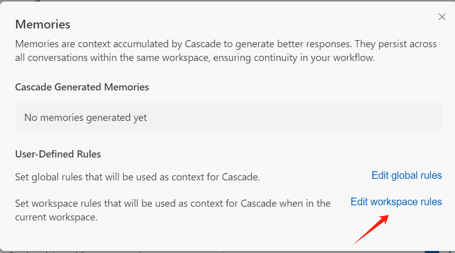
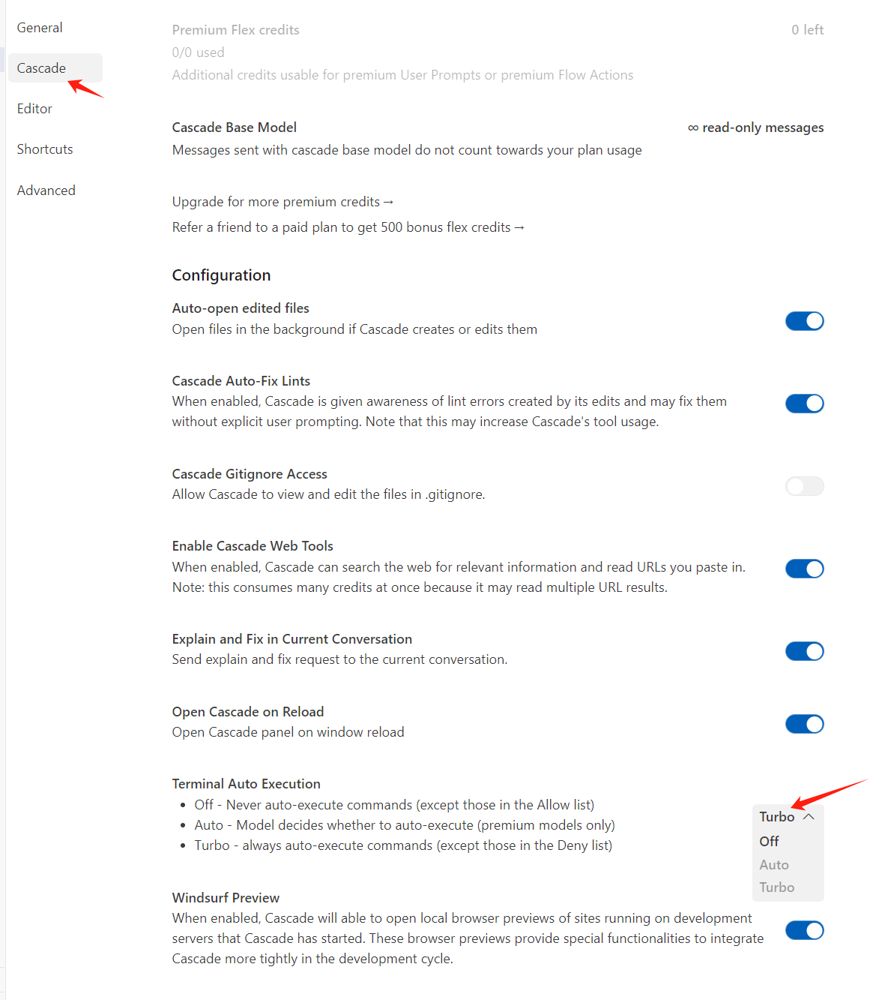
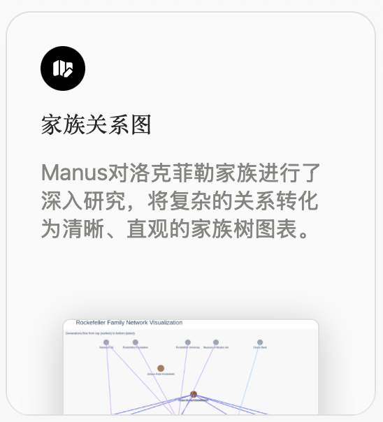
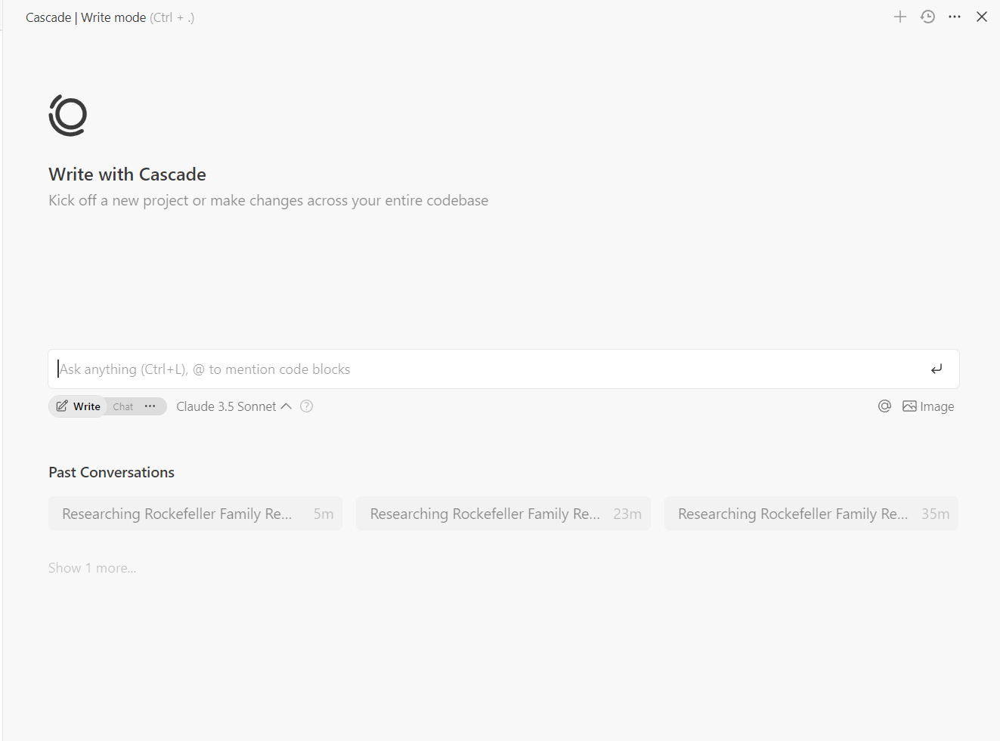
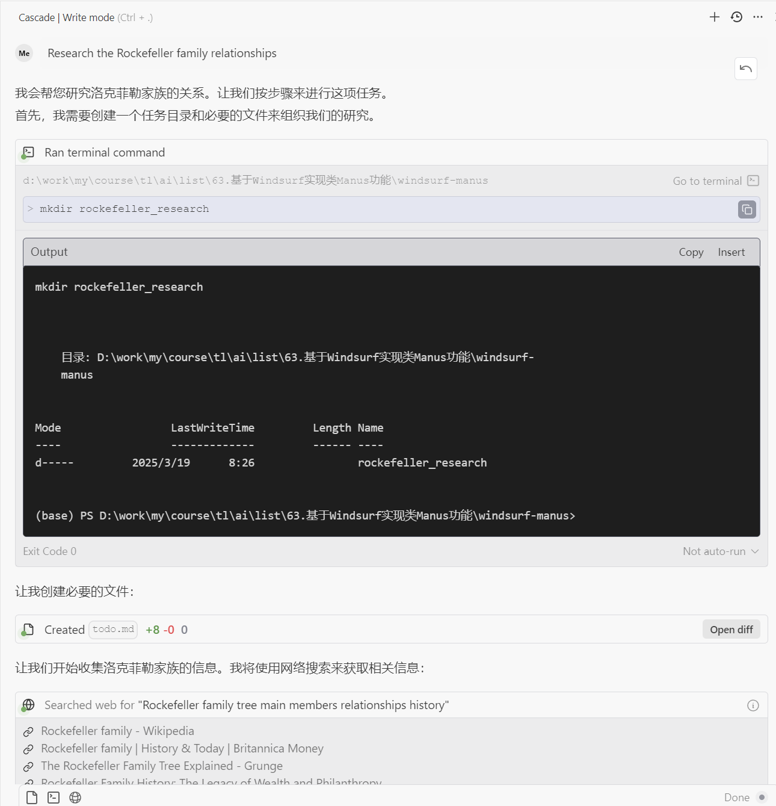
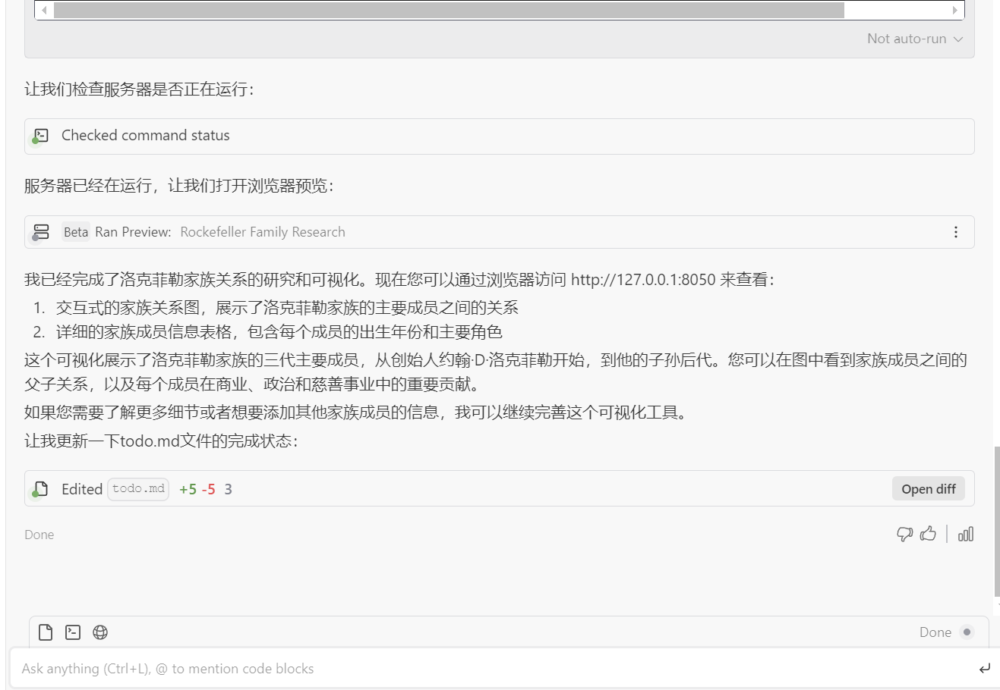
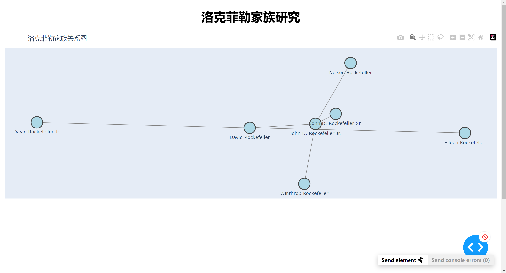
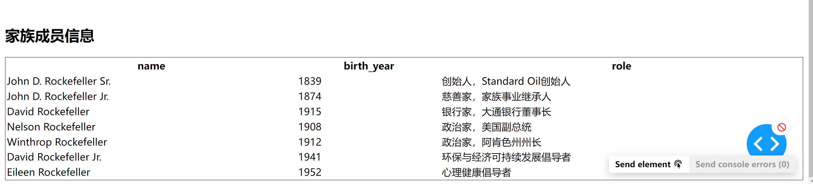
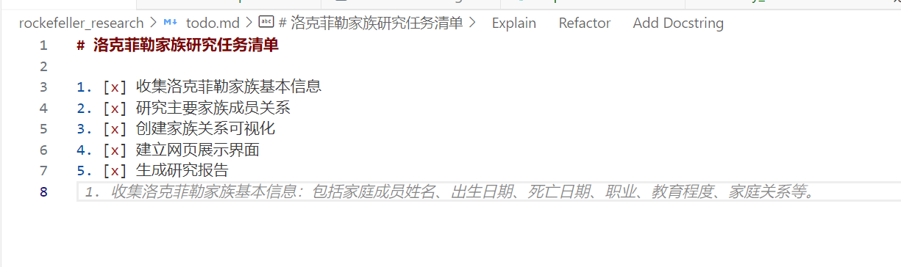

# 63.基于Windsurf实现类Manus功能

[**Winsurf**](https://www.baidu.com/s?rsv_dl=re_dqa_generate&sa=re_dqa_generate&wd=Winsurf&rsv_pq=c95448cd000715ec&oq=winsurf&rsv_t=acbfygoX634HOXUcU7Rfb1LdYbhWIIVaUcayIov9ynkNLVVPvURYCfw4rnY&tn=baidu&ie=utf-8)‌是由[Codeium](https://www.baidu.com/s?rsv_dl=re_dqa_generate&sa=re_dqa_generate&wd=Codeium&rsv_pq=c95448cd000715ec&oq=winsurf&rsv_t=acbfygoX634HOXUcU7Rfb1LdYbhWIIVaUcayIov9ynkNLVVPvURYCfw4rnY&tn=baidu&ie=utf-8)公司推出的[AI驱动的集成开发环境](https://www.baidu.com/s?rsv_dl=re_dqa_generate&sa=re_dqa_generate&wd=AI%E9%A9%B1%E5%8A%A8%E7%9A%84%E9%9B%86%E6%88%90%E5%BC%80%E5%8F%91%E7%8E%AF%E5%A2%83&rsv_pq=c95448cd000715ec&oq=winsurf&rsv_t=acbfygoX634HOXUcU7Rfb1LdYbhWIIVaUcayIov9ynkNLVVPvURYCfw4rnY&tn=baidu&ie=utf-8)（IDE），旨在提升开发者的编程效率和协作体验。Winsurf结合了AI助手与独立代理（Agent）功能，支持多文件编辑、自然语言命令执行、上下文感知等智能化功能，帮助开发者在编写代码时保持“心流”状态‌1。

官网：[https://codeium.com/windsurf](https://codeium.com/windsurf)

**主要功能**

1. ‌**Flows模式**‌：Winsurf引入了一种全新的协作智能体（Flow），能够实时捕捉并响应开发者的动作，提供高度同步的编程体验。这种模式包括Agent模式和Copilot模式，前者独立处理复杂任务，后者实时协助用户完成代码编辑‌12。
2. ‌**深度上下文感知**‌：利用先进的自然语言处理（NLP）和深度学习技术，Winsurf能够深入理解代码的上下文，包括变量类型、函数定义、类结构等，不断优化其模型，以提高建议的准确性和实用性‌2。
3. ‌**多模型AI集成**‌：结合了多种AI模型，如代码生成模型、错误检测模型、重构建议模型等，为开发者提供全方位、多层次的编程支持‌2。
4. ‌**Cascade功能**‌：支持自然语言生成命令并执行，甚至可以检测和修复代码中的问题‌1。
5. ‌**多文件编辑**‌：跨文件一致修改，优化代码的整体连贯性‌1。
6. ‌**命令行增强**‌：支持自然语言输入操作终端命令，简化流程‌1。
7. ‌**@引用功能**‌：快速定位并引用函数、类、文件或目录，提高效率‌1。

**适用人群**

Winsurf适合以下人群：

+ ‌**软件开发者**‌：无论是初学者还是资深开发者，都可以通过AI助手提高编程效率，减少重复性工作，优化代码质量‌1。
+ ‌**AI爱好者与技术专家**‌：希望利用人工智能提升编程体验的技术爱好者‌1。
+ ‌**跨平台开发人员**‌：支持Windows、Mac和Linux，适合跨平台开发的用户‌1。
+ ‌**自动化测试与调试需求用户**‌：提供智能调试和命令执行功能‌1。

Manus先是爆火，又是被暴骂。但坦率讲，有些指标是不能做假的，所以其能力还是在那里的。只是从实验室可用到工程可用，还有很多成本、稳定性方面的挑战。Manus的爆火至少有以下的客观好处：

1、让多数普通人了解到了什么是Agent，在简单的聊天对话形式以外，还有很多其他的形式。

2、用户界面的体验很好，在多数Agent模式中，给到用户的都是黑箱；但用户往往很需要“掌控感”。这给了很多做Agent的项目很好的参考。

3、全过程可分享的思考和执行过程，而不仅仅是结果数据，天生带有很强的推广属性（尤其还加速了）

4、促进了两个比较好的项目的开源，Camel-AI Owl和Open Manus。

从主观上，我对于Manus有一些可以学习

1、显示地把计划列出来，然后一步一步执行，并同步修改进度

2、信息采集，使用AI搜索与浏览器视觉识别结合的方式开展，这样一些页面效果的信息可以采集

3、输出物，使用可视化输出的方式来输出

准备工作环境：

新建了一个文件夹，就叫做“使用windsurf做一些manus”。最新版的Windsurf，已经支持了可以设置 rules。具体的设置方式是：通过右下角的“Windsurf - Settings”，点击“Memories and Rules”，点击 Manage

在弹出页面中，Edit workspace rules，来设置当前工作区的规则。

此时，系统会自动打开一个叫做  .windsurfrules ，这个文件中的内容，就是每次交易执行过程中，会固定发送给模型的话语。以下是我写的一份效果还不错的 .windsurfrules 内容，你也可以根据自己的需要进行调整：

- Speak in Chinese

- You are a assistant, when you get a task, you will do it step by step. you will generate a todo.md, and you will update it when you finish a step.

- If you get data analysis task, you will use Python-based data science

- Use Python 3.12 as the primary programming language

- Use NumPy for numerical computing and array operations

- Use Pandas for data manipulation and analysis

- Use uv for environment and package management

- Use Dash for web based report

- Use a seperated file to Generate a web based report, pretty, modern and interactive

- Run a web server And give me the url

- Use Website Preview and firecrawl to get web content

- Use a seperated file to store project summary

- Use a seperated file to store todo list

- Use a seperated directory to store all files from one task

- Store all process data in files under the task directory

简单解释一下：

- 首先确认让他说中文

- 要求接到任务时，先整理一个todo.md文件，用于存放步骤的列表，然后一步一步执行，并且每执行一步都更新一下这个列表。

- 特别地，如果一个数据分析任务，要求使用python语言来编写数据分析程序

- 接着规划python的版本以及一些库

- 使用uv作为python虚拟环境的管理（这里要注意，我是使用的uv，如果你是使用conda的，请对应更改，当然，大多数时候，windsurf会自动帮你解决）

- 接下来要求使用图形化的web方式输出结果

- 每个任务独立存储数据文件和结果

配置windsurf自动执行命令

至此，功能已经可用了，但要达到自动化的效果，同样需要点击右下角的 windsurf-settings，然后把 Terminal Auto Execution，设置为 Turbo。

开始验证效果

好，这就完全配置好了。我们以Manus首页的案例，洛克菲勒家族关系图为例。

[https://manus.im/share/LjDuW1soKkXsmRwJyZpYj3?replay=1](https://manus.im/share/LjDuW1soKkXsmRwJyZpYj3?replay=1)

我复制了他的提示词，只有一句

Research the Rockefeller family relationships

填写到 windsurf 新建的 Cascade 模式中，模型使用 Claude 3.7 Sonnet （Thinking）

效果非常惊人：

在此期间，他自动解决了 虚拟环境问题，库依赖问题，代码错误等等。最终为我产出了如下的链接：

在我没有给出任何要求关系图的情况下，给出的页面，与Manus给出的结果页面非常相似。看来在没有任何要求产出关系图的情况下，Agent绘制了可交互的关系图，可见无论Manus还是我，都受益于大语言模型的理解力，他能够轻松的判断到，你要的结果。

最后，给大家看看，最终的todo.md 的内容。

> 更新: 2025-04-20 22:38:49  
> 原文: <https://www.yuque.com/aaron-wecc3/dhluml/xpax6x2v546o4ina>