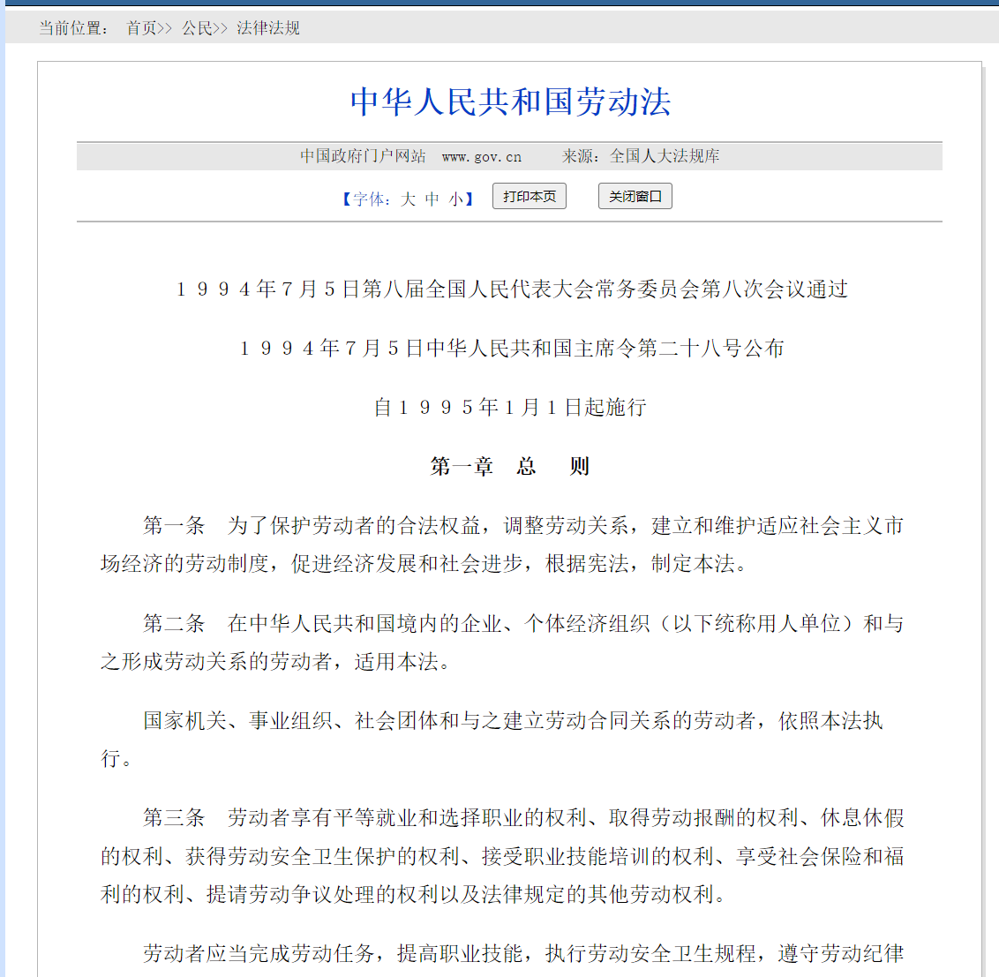
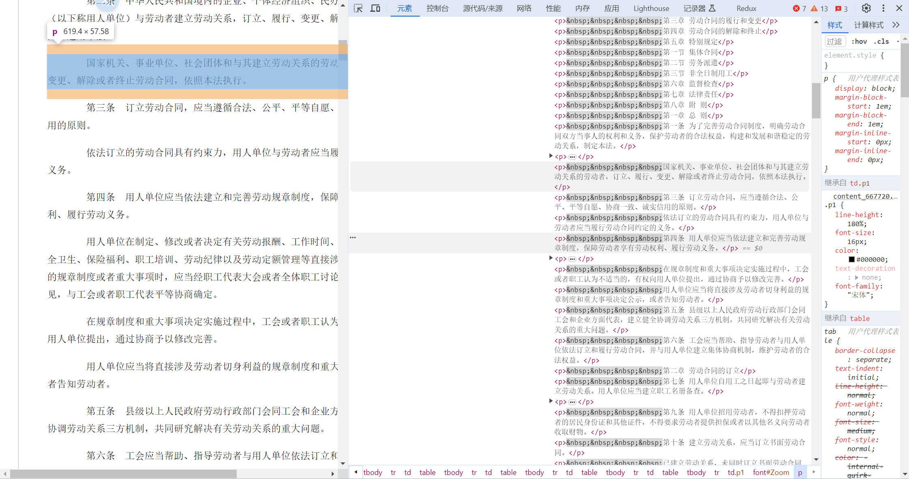
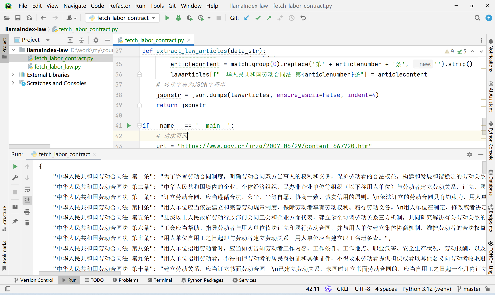

# 64.基于LlamaIndex开发AI法律助手

**示例代码**

[llamaIndex-law.ppt](https://www.yuque.com/attachments/yuque/0/2025/ppt/1387387/1745159929839-38e98336-1ca6-47dd-9adf-c313a13672ea.ppt)

_<font style="color:#DF2A3F;">注：将ppt后缀名改为zip后解压</font>_

python版本：3.12.4


## <font style="color:rgb(51, 51, 51);">前言</font>
## <font style="color:rgb(51, 51, 51);">一、 项目背景与需求设计</font>
<font style="color:rgb(51, 51, 51);">需求场景: 开发一个AI法律助手只能问答系统要求: </font>

1. <font style="color:rgb(51, 51, 51);">需要更新最新的法律条文 (更新频率>= 每月) </font>
2. <font style="color:rgb(51, 51, 51);">支持对法律条款的精确引用. </font>
3. <font style="color:rgb(51, 51, 51);">处理复杂的法律条款的关联查询.</font>

<font style="color:rgb(51, 51, 51);">选择 RAG 而非微调的原因： </font>

1. <font style="color:rgb(51, 51, 51);">法律条文存在一定的更新频率，微调模型难以快速同步最新信息。 </font>
2. <font style="color:rgb(51, 51, 51);">需要精确引用条款原文，避免模型生成内容失真。 </font>
3. <font style="color:rgb(51, 51, 51);">法律知识体系庞大，微调需要海量标注数据。</font>
4. <font style="color:rgb(51, 51, 51);">RAG 机制天然支持条款溯源，符合法律场景需求。</font>

## <font style="color:rgb(51, 51, 51);">二、 数据收集与整理</font>
<font style="color:rgb(51, 51, 51);">数据来源，去官网下载</font>

[<font style="color:rgb(65, 131, 196);">https://www.gov.cn/banshi/2005-05/25/content_905.htm</font>](https://www.gov.cn/banshi/2005-05/25/content_905.htm)

[<font style="color:rgb(65, 131, 196);">https://www.gov.cn/jrzg/2007-06/29/content_667720.htm</font>](https://www.gov.cn/jrzg/2007-06/29/content_667720.htm)

<font style="color:rgb(51, 51, 51);">右键点击查看，可以看到我们所要信息都在标签 p 里面。</font><font style="color:rgb(51, 51, 51);">自动化解决办法通过爬虫和正则匹配下载和更新数据，不需要人为的再去定期查看网页是否有更新，再去同步信息。下载脚本</font>

```python
import json
import re
import requests
from bs4 import BeautifulSoup

def fetch_and_parse(url):
    # 请求网页
    response = requests.get(url)
    # 设置网页编码格式
    response.encoding = 'utf-8'
    # 解析网页内容
    soup = BeautifulSoup(response.text, 'html.parser')
    # 提取正文内容
    content = soup.find_all('p')
    # 初始化存储数据
    data = []
    # 提取文本并格式化
    for para in content:
        text = para.get_text(strip=True)
        if text:  # 只处理非空文本
            # 根据需求格式化内容
            data.append(text)
    # 将data列表转换为字符串
    data_str = '\n'.join(data)
    return data_str

def extract_law_articles(data_str):
    # 正则表达式，匹配每个条款号及其内容
    pattern = re.compile(r'第([一二三四五六七八九十零百]+)条.*?(?=\n第|$)', re.DOTALL)
    # 初始化字典来存储条款号和内容
    lawarticles = {}
    # 搜索所有匹配项
    for match in pattern.finditer(data_str):
        articlenumber = match.group(1)
        articlecontent = match.group(0).replace('第' + articlenumber + '条', '').strip()
        lawarticles[f"中华人民共和国劳动合同法 第{articlenumber}条"] = articlecontent
    # 转换字典为JSON字符串
    jsonstr = json.dumps(lawarticles, ensure_ascii=False, indent=4)
    return jsonstr

if __name__ == '__main__':
    # 请求页面
    url = "https://www.gov.cn/jrzg/2007-06/29/content_667720.htm"
    data_str = fetch_and_parse(url)
    jsonstr = extract_law_articles(data_str)
    print(jsonstr)
```



## <font style="color:rgb(51, 51, 51);">三、 核心实现流程</font>
<font style="color:rgb(51, 51, 51);">基于大语言模型（LLM）和向量检索（RAG）的法律智能助手，用于根据法律条文回答问题。以下是详细讲解：</font>

### <font style="color:rgb(51, 51, 51);">1. 配置与模型初始化</font>
#### <font style="color:rgb(51, 51, 51);">1. 配置区</font>
<font style="color:rgb(51, 51, 51);">功能：定义了一个 Config 类，用于集中管理模型路径、数据目录、向量数据库目录、持久化目录、集合名称和检索结果数量（TOP_K）。</font><font style="color:rgb(51, 51, 51);">关键点：</font><font style="color:rgb(51, 51, 51);">EMBED_MODEL_PATH 和 LLM_MODEL_PATH 分别指定了用于嵌入（embedding）和生成回答的模型路径。</font><font style="color:rgb(51, 51, 51);">DATA_DIR 存放法律条文的 JSON 文件。</font><font style="color:rgb(51, 51, 51);">VECTOR_DB_DIR 和 PERSIST_DIR 分别用于存储向量数据库和持久化索引。</font><font style="color:rgb(51, 51, 51);">COLLECTION_NAME 是向量数据库中的集合名称，用于存储法律条文的嵌入向量。</font>

#### <font style="color:rgb(51, 51, 51);">2. 模型初始化（init_models 函数）</font>
<font style="color:rgb(51, 51, 51);">功能：初始化嵌入模型（HuggingFaceEmbedding）和语言模型（HuggingFaceLLM），并验证模型是否正常加载。</font><font style="color:rgb(51, 51, 51);">关键点：</font><font style="color:rgb(51, 51, 51);">使用 HuggingFaceEmbedding 加载嵌入模型，用于将文本转换为向量。</font><font style="color:rgb(51, 51, 51);">使用 HuggingFaceLLM 加载语言模型，用于生成回答。</font><font style="color:rgb(51, 51, 51);">通过 test_embedding 验证嵌入模型的输出维度是否正确。</font><font style="color:rgb(51, 51, 51);">将嵌入模型和语言模型设置到全局 Settings 中，供后续使用。</font>

#### <font style="color:rgb(51, 51, 51);">3. 数据加载与验证（load_and_validate_json_files 函数）</font>
<font style="color:rgb(51, 51, 51);">功能：加载法律条文的 JSON 文件，并验证数据结构是否符合要求。</font><font style="color:rgb(51, 51, 51);">关键点：</font><font style="color:rgb(51, 51, 51);">遍历指定目录下的所有 JSON 文件。</font><font style="color:rgb(51, 51, 51);">验证每个文件的根元素是否为列表，列表中的每个元素是否为字典，以及字典的值是否为字符串。</font><font style="color:rgb(51, 51, 51);">将验证通过的数据整合为一个列表，每个条目包含法律条文内容和来源文件名。</font><font style="color:rgb(51, 51, 51);">如果数据结构不符合要求，会抛出异常并提示错误信息。</font>

#### <font style="color:rgb(51, 51, 51);">4. 节点生成（create_nodes 函数）</font>
<font style="color:rgb(51, 51, 51);">功能：将法律条文数据转换为 TextNode 对象，用于后续的向量嵌入和索引构建。</font><font style="color:rgb(51, 51, 51);">关键点：</font><font style="color:rgb(51, 51, 51);">为每个法律条文生成一个唯一的 ID（node_id），格式为 文件名:: 法律名称。</font><font style="color:rgb(51, 51, 51);">提取法律名称、条款名称等元数据，并将其存储在节点的 metadata 中。</font><font style="color:rgb(51, 51, 51);">每个节点包含法律条文的文本内容和元数据，方便后续查询时提供上下文信息。</font>

### <font style="color:rgb(51, 51, 51);">2. 向量存储与索引构建</font>
#### <font style="color:rgb(51, 51, 51);">1. 向量存储初始化（init_vector_store 函数）</font>
<font style="color:rgb(51, 51, 51);">功能：初始化向量存储，并根据需要构建或加载索引。</font><font style="color:rgb(51, 51, 51);">关键点：</font><font style="color:rgb(51, 51, 51);">使用 chromadb 创建一个持久化的向量存储客户端，指定存储路径为 VECTOR_DB_DIR。</font><font style="color:rgb(51, 51, 51);">如果向量数据库中没有数据（chroma_collection.count() == 0），则创建一个新的索引：</font><font style="color:rgb(51, 51, 51);">将节点添加到存储上下文（StorageContext）。</font><font style="color:rgb(51, 51, 51);">使用 VectorStoreIndex 构建索引，并将索引持久化到 PERSIST_DIR。</font><font style="color:rgb(51, 51, 51);">如果已有索引，则直接加载索引。</font><font style="color:rgb(51, 51, 51);">验证存储上下文中的文档数量，并打印示例节点的 ID，确保索引构建正确。</font>

#### <font style="color:rgb(51, 51, 51);">2. 索引构建流程</font>
<font style="color:rgb(51, 51, 51);">功能：根据输入的法律条文节点，构建向量索引。</font><font style="color:rgb(51, 51, 51);">关键点：</font><font style="color:rgb(51, 51, 51);">使用 ChromaVectorStore 将法律条文的嵌入向量存储到向量数据库中。</font><font style="color:rgb(51, 51, 51);">如果是首次构建索引，会将节点的文本内容嵌入为向量，并存储到向量数据库中。</font><font style="color:rgb(51, 51, 51);">如果索引已存在，则直接加载现有索引，避免重复嵌入和存储。</font><font style="color:rgb(51, 51, 51);">提供了双重持久化保障，确保索引数据不会丢失。</font>

### <font style="color:rgb(51, 51, 51);">3. 主程序逻辑</font>
#### <font style="color:rgb(51, 51, 51);">1. 主程序入口（main 函数）</font>
<font style="color:rgb(51, 51, 51);">功能：启动法律智能助手，加载模型、数据和索引，并提供交互式查询。</font><font style="color:rgb(51, 51, 51);">关键点：</font><font style="color:rgb(51, 51, 51);">调用 init_models 初始化嵌入模型和语言模型。</font><font style="color:rgb(51, 51, 51);">如果向量数据库目录不存在，则加载法律条文数据并生成节点。</font><font style="color:rgb(51, 51, 51);">调用 init_vector_store 初始化向量存储，并构建或加载索引。</font><font style="color:rgb(51, 51, 51);">创建查询引擎，指定相似度检索的返回结果数量（TOP_K）和回答模板。</font>

#### <font style="color:rgb(51, 51, 51);">2. 交互式查询</font>
<font style="color:rgb(51, 51, 51);">功能：通过命令行接收用户问题，并根据法律条文生成回答。</font><font style="color:rgb(51, 51, 51);">关键点：</font><font style="color:rgb(51, 51, 51);">使用 query_engine.query 执行查询，根据用户问题检索最相关的法律条文。</font><font style="color:rgb(51, 51, 51);">生成的回答基于检索到的法律条文，确保回答的准确性和相关性。</font><font style="color:rgb(51, 51, 51);">打印回答内容和支持回答的法律条文依据，包括法律名称、条款内容、来源文件和相关度得分。</font><font style="color:rgb(51, 51, 51);">提供退出选项（输入 q），结束交互。</font>

#### <font style="color:rgb(51, 51, 51);">3. 运行逻辑</font>
<font style="color:rgb(51, 51, 51);">功能：通过 if </font>**<font style="color:rgb(51, 51, 51);">name</font>**<font style="color:rgb(51, 51, 51);"> == “</font>**<font style="color:rgb(51, 51, 51);">main</font>**<font style="color:rgb(51, 51, 51);">”: 确保直接运行脚本时执行主程序。</font><font style="color:rgb(51, 51, 51);">关键点：</font><font style="color:rgb(51, 51, 51);">脚本被直接运行时，会调用 main 函数启动法律智能助手。</font><font style="color:rgb(51, 51, 51);">如果脚本被其他模块导入，则不会自动执行主程序。</font>

### <font style="color:rgb(51, 51, 51);">4. 代码</font>
```python
# -*- coding: utf-8 -*-
# 这行指定了文件的编码格式为UTF-8，确保中文字符能够正确显示

# 导入必要的库
# json库用于处理JSON格式数据，例如从文件中读取法律条文
import json
# time库用于计时，比如记录索引加载时间
import time
# pathlib库提供了面向对象的文件系统路径操作，比如查找所有JSON文件
from pathlib import Path
# typing库提供类型提示功能，帮助IDE提供更好的代码补全和错误检查
from typing import List, Dict

# chromadb是一个向量数据库，用于存储和检索文本的向量表示
import chromadb
# 以下是llama_index库的各种组件，用于构建检索增强生成(RAG)系统
# VectorStoreIndex是核心索引类，用于管理文档的向量表示
from llama_index.core import VectorStoreIndex, StorageContext, Settings
# TextNode是文档的基本单位，每个法律条文会被转换为一个TextNode
from llama_index.core.schema import TextNode
# HuggingFaceLLM是对接HuggingFace模型的接口，用于生成回答
from llama_index.llms.huggingface import HuggingFaceLLM
# HuggingFaceEmbedding用于将文本转换为向量表示
from llama_index.embeddings.huggingface import HuggingFaceEmbedding
# ChromaVectorStore是llama_index与chromadb的连接器
from llama_index.vector_stores.chroma import ChromaVectorStore
# PromptTemplate用于定义提示模板，指导LLM如何回答问题
from llama_index.core import PromptTemplate

# 定义问答模板，这是给大模型的指令和上下文格式
# 模板包含系统指令、相关法律条文和用户问题
# {context_str}和{query_str}是占位符，会在运行时被替换为实际内容
QA_TEMPLATE = (
    "<|im_start|>system\n"
    "你是一个专业的法律助手，请严格根据以下法律条文回答问题：\n"
    "相关法律条文：\n{context_str}\n<|im_end|>\n"
    "<|im_start|>user\n{query_str}<|im_end|>\n"
    "<|im_start|>assistant\n"
)

# 创建提示模板对象，后续会用于查询引擎
response_template = PromptTemplate(QA_TEMPLATE)

# ================== 配置区 ==================
# 定义Config类，集中管理所有配置参数，方便修改和维护
class Config:
    # 嵌入模型路径，用于将文本转换为向量
    EMBED_MODEL_PATH = r"D:\software\huggingface\hub\models--BAAI--bge-small-zh-v1.5\snapshots\7999e1d3359715c523056ef9478215996d62a620"
    # 大语言模型路径，用于生成回答
    LLM_MODEL_PATH = r"D:\software\huggingface\hub\models--deepseek-ai--DeepSeek-R1-Distill-Qwen-1.5B\snapshots\6393b7559e403fd1d80bfead361586fd6f630a4d"

    # 数据目录，存放法律条文的JSON文件
    DATA_DIR = "./data"
    # 向量数据库目录，存放持久化的向量数据
    VECTOR_DB_DIR = "./chroma_db"
    # 存储目录，用于保存索引和其他持久化数据
    PERSIST_DIR = "./storage"

    # 集合名称，在向量数据库中标识这组法律数据
    COLLECTION_NAME = "chinese_labor_laws"
    # 检索时返回的最相关条目数量
    TOP_K = 3

# ================== 初始化模型 ==================
# 初始化并验证嵌入模型和大语言模型
def init_models():
    """初始化模型并验证"""
    # 初始化嵌入模型，用于将文本转换为向量
    # 例如将"劳动合同"转换为一个512维的向量
    embed_model = HuggingFaceEmbedding(
        model_name=Config.EMBED_MODEL_PATH,
        device = 'cuda' if hasattr(Settings, 'device') else 'cpu'  # 如果可用则使用GPU加速
    )

    # 初始化大语言模型，用于生成回答
    # 例如根据检索到的法律条文，生成对"试用期最长多久"的专业回答
    llm = HuggingFaceLLM(
        model_name=Config.LLM_MODEL_PATH,
        tokenizer_name=Config.LLM_MODEL_PATH,
        device_map= "auto",  # 自动选择设备
        tokenizer_kwargs={"trust_remote_code": True},  # 信任模型的远程代码
        generate_kwargs={"temperature": 0.3}  # 温度参数控制生成的随机性，越低越确定性
    )

    # 将模型设置为全局默认模型
    Settings.embed_model = embed_model
    Settings.llm = llm

    # 验证嵌入模型是否正常工作，测试其输出维度
    test_embedding = embed_model.get_text_embedding("测试文本")
    print(f"Embedding维度验证：{len(test_embedding)}")

    return embed_model, llm

# ================== 数据处理 ==================
# 加载并验证JSON格式的法律文件
def load_and_validate_json_files(data_dir: str) -> List[Dict]:
    """加载并验证JSON法律文件"""
    # 查找目录中所有JSON文件
    # 例如找到 labor_law.json, labor_contract.json 等
    json_files = list(Path(data_dir).glob("*.json"))
    # 确保至少找到一个JSON文件，否则抛出异常
    assert json_files, f"未找到JSON文件于 {data_dir}"
    
    # 存储所有加载的数据
    all_data = []
    # 遍历每个JSON文件
    for json_file in json_files:
        with open(json_file, 'r', encoding='utf-8') as f:
            try:
                # 加载JSON数据
                data = json.load(f)
                # 验证数据结构：根元素必须是列表
                if not isinstance(data, list):
                    raise ValueError(f"文件 {json_file.name} 根元素应为列表")
                # 验证列表中的每个元素必须是字典
                for item in data:
                    if not isinstance(item, dict):
                        raise ValueError(f"文件 {json_file.name} 包含非字典元素")
                    # 验证字典中的每个值必须是字符串
                    for k, v in item.items():
                        if not isinstance(v, str):
                            raise ValueError(f"文件 {json_file.name} 中键 '{k}' 的值不是字符串")
                # 将数据添加到总列表中，同时记录来源文件
                all_data.extend({
                    "content": item,
                    "metadata": {"source": json_file.name}
                } for item in data)
            except Exception as e:
                # 如果处理过程中出现任何错误，抛出异常
                raise RuntimeError(f"加载文件 {json_file} 失败: {str(e)}")
    
    # 打印加载成功的条目数量
    print(f"成功加载 {len(all_data)} 个法律文件条目")
    return all_data

# 将原始数据转换为TextNode对象，每个法律条文一个节点
def create_nodes(raw_data: List[Dict]) -> List[TextNode]:
    """添加ID稳定性保障"""
    nodes = []
    # 遍历每个数据条目
    for entry in raw_data:
        # 获取法律条文字典和来源文件
        law_dict = entry["content"]
        source_file = entry["metadata"]["source"]
        
        # 遍历字典中的每个条目（法律条文）
        for full_title, content in law_dict.items():
            # 生成稳定ID，确保每次运行生成相同的ID
            # 例如："labor_law.json::中华人民共和国劳动法 第一条"
            node_id = f"{source_file}::{full_title}"
            
            # 分割标题，提取法律名称和条款号
            # 例如："中华人民共和国劳动法 第一条" -> "中华人民共和国劳动法", "第一条"
            parts = full_title.split(" ", 1)
            law_name = parts[0] if len(parts) > 0 else "未知法律"
            article = parts[1] if len(parts) > 1 else "未知条款"
            
            # 创建TextNode对象，包含条文内容和元数据
            node = TextNode(
                text=content,  # 条文内容
                id_=node_id,   # 稳定ID
                metadata={     # 元数据，用于后续检索和展示
                    "law_name": law_name,         # 法律名称
                    "article": article,           # 条款号
                    "full_title": full_title,     # 完整标题
                    "source_file": source_file,   # 来源文件
                    "content_type": "legal_article"  # 内容类型
                }
            )
            nodes.append(node)
    
    # 打印生成的节点数量和第一个节点的ID示例
    print(f"生成 {len(nodes)} 个文本节点（ID示例：{nodes[0].id_}）")
    return nodes

# ================== 向量存储 ==================
# 初始化向量存储，创建或加载索引
def init_vector_store(nodes: List[TextNode]) -> VectorStoreIndex:
    # 创建持久化的ChromaDB客户端，数据将保存在指定目录
    chroma_client = chromadb.PersistentClient(path=Config.VECTOR_DB_DIR)
    # 获取或创建集合，用于存储法律条文的向量表示
    chroma_collection = chroma_client.get_or_create_collection(
        name=Config.COLLECTION_NAME,
        metadata={"hnsw:space": "cosine"}  # 使用余弦相似度计算向量距离
    )

    # 创建存储上下文，连接到ChromaDB
    storage_context = StorageContext.from_defaults(
        vector_store=ChromaVectorStore(chroma_collection=chroma_collection)
    )

    # 判断是否需要新建索引：如果集合为空且提供了节点，则创建新索引
    if chroma_collection.count() == 0 and nodes is not None:
        print(f"创建新索引（{len(nodes)}个节点）...")
        
        # 将节点添加到文档存储中
        storage_context.docstore.add_documents(nodes)  
        
        # 创建向量索引
        index = VectorStoreIndex(
            nodes,
            storage_context=storage_context,
            show_progress=True  # 显示进度条
        )
        # 双重持久化保障，确保数据不会丢失
        storage_context.persist(persist_dir=Config.PERSIST_DIR)
        index.storage_context.persist(persist_dir=Config.PERSIST_DIR)  # <-- 新增
    else:
        # 如果集合不为空，则加载已有索引
        print("加载已有索引...")
        storage_context = StorageContext.from_defaults(
            persist_dir=Config.PERSIST_DIR,
            vector_store=ChromaVectorStore(chroma_collection=chroma_collection)
        )
        # 从向量存储创建索引
        index = VectorStoreIndex.from_vector_store(
            storage_context.vector_store,
            storage_context=storage_context,
            embed_model=Settings.embed_model
        )

    # 安全验证，确保数据正确加载
    print("\n存储验证结果：")
    # 检查文档存储中的记录数
    doc_count = len(storage_context.docstore.docs)
    print(f"DocStore记录数：{doc_count}")
    
    # 如果有记录，打印一个示例节点ID
    if doc_count > 0:
        sample_key = next(iter(storage_context.docstore.docs.keys()))
        print(f"示例节点ID：{sample_key}")
    else:
        # 如果没有记录，打印警告
        print("警告：文档存储为空，请检查节点添加逻辑！")
    
    
    return index

# ================== 主程序 ==================
# 主函数，程序入口
def main():
    # 初始化模型
    embed_model, llm = init_models()
    
    # 仅当需要更新数据时执行
    # 如果向量数据库目录不存在，则需要从头创建
    if not Path(Config.VECTOR_DB_DIR).exists():
        print("\n初始化数据...")
        # 加载原始数据
        raw_data = load_and_validate_json_files(Config.DATA_DIR)
        # 创建文本节点
        nodes = create_nodes(raw_data)
    else:
        # 如果已有数据，则不需要重新加载
        nodes = None
    
    # 初始化向量存储
    print("\n初始化向量存储...")
    # 记录开始时间，用于计算加载耗时
    start_time = time.time()
    # 创建或加载索引
    index = init_vector_store(nodes)
    # 打印加载耗时
    print(f"索引加载耗时：{time.time()-start_time:.2f}s")
    
    # 创建查询引擎，用于检索和回答问题
    query_engine = index.as_query_engine(
        similarity_top_k=Config.TOP_K,  # 检索最相关的TOP_K个条目
        text_qa_template=response_template,  # 使用前面定义的提示模板
        verbose=True  # 显示详细日志
    )
    
    # 交互式问答循环
    while True:
        # 获取用户输入的问题
        question = input("\n请输入劳动法相关问题（输入q退出）: ")
        # 如果用户输入q，则退出循环
        if question.lower() == 'q':
            break
        
        # 执行查询，获取回答
        response = query_engine.query(question)
        
        # 显示回答结果
        print(f"\n智能助手回答：\n{response.response}")
        # 显示支持依据（检索到的相关法律条文）
        print("\n支持依据：")
        # 遍历每个来源节点
        for idx, node in enumerate(response.source_nodes, 1):
            # 获取节点元数据
            meta = node.metadata
            # 打印条目编号和标题
            print(f"\n[{idx}] {meta['full_title']}")
            # 打印来源文件
            print(f"  来源文件：{meta['source_file']}")
            # 打印法律名称
            print(f"  法律名称：{meta['law_name']}")
            # 打印条款内容（前100个字符）
            print(f"  条款内容：{node.text[:100]}...")
            # 打印相关度得分
            print(f"  相关度得分：{node.score:.4f}")

# 程序入口点，当直接运行此脚本时执行main函数
if __name__ == "__main__":
    main()
```

## <font style="color:rgb(51, 51, 51);">五、测试</font>
```powershell
Embedding维度验证：512

初始化数据...
成功加载 2 个法律文件条目
生成 205 个文本节点（ID示例：data.json::中华人民共和国劳动合同法 第一条）

初始化向量存储...
创建新索引（205个节点）...
Generating embeddings: 100%|██████████| 205/205 [00:03<00:00, 66.31it/s]

存储验证结果：
DocStore记录数：205
示例节点ID：data.json::中华人民共和国劳动合同法 第一条
索引加载耗时：4.07s

请输入劳动法相关问题（输入q退出）: 裁员
Setting `pad_token_id` to `eos_token_id`:151643 for open-end generation.

智能助手回答：
assistant: 
Okay, so the user is asking about裁员. I need to provide a detailed response based on the legal articles provided. Let me start by understanding the context.

First, the user is in a situation where their employer is facing difficulties, possibly due to a破产 or significant restructuring. They're considering裁员 as a possible solution. I should refer to the relevant labor laws to determine the legal basis for such a decision.

Looking at the first law, the劳动法第二十七条, it states that if a用人单位 needs to reduce staff, they can do so in the first 30 days by informing the工会 or employees, get their opinions, and then report to the劳动行政部门. If they do this within six months and then hire fewer people, they have to consider whether to prefer the laid-off individuals.

The second law, the劳动合同法第四十一条, adds another layer. It says that if a用人单位 needs to reduce staff, they can do so in the first 30 days by informing the employees, get their opinions, and then report to the劳动行政部门. If they do this within six months and then hire fewer people, they must consider whether to prefer the laid-off individuals.

The third law,劳动法第七十九条, outlines the process for

支持依据：

[1] 中华人民共和国劳动法 第二十七条
  来源文件：data.json
  法律名称：中华人民共和国劳动法
  条款内容：用人单位濒临破产进行法定整顿期间或者生产经营状况发生严重困难，确需裁减人员的，应当提前三十日向工会或者全体职工说明情况，听取工会或者职工的意见，经向劳动行政部门报告后，可以裁减人员。
用人单位依据本条...
  相关度得分：0.6383

[2] 中华人民共和国劳动合同法 第四十一条
  来源文件：data.json
  法律名称：中华人民共和国劳动合同法
  条款内容：有下列情形之一，需要裁减人员二十人以上或者裁减不足二十人但占企业职工总数百分之十以上的，用人单位提前三十日向工会或者全体职工说明情况，听取工会或者职工的意见后，裁减人员方案经向劳动行政部门报告，可以裁...
  相关度得分：0.6221

[3] 中华人民共和国劳动法 第七十九条
  来源文件：data.json
  法律名称：中华人民共和国劳动法
  条款内容：劳动争议发生后，当事人可以向本单位劳动争议调解委员会申请调解；调解不成，当事人一方要求仲裁的，可以向劳动争议仲裁委员会申请仲裁。当事人一方也可以直接向劳动争议仲裁委员会申请仲裁。对仲裁裁决不服的，可以...
  相关度得分：0.5885

请输入劳动法相关问题（输入q退出）: 
```


> 更新: 2025-04-20 22:38:49  
> 原文: <https://www.yuque.com/aaron-wecc3/dhluml/hzfkw5z9h5v26023>