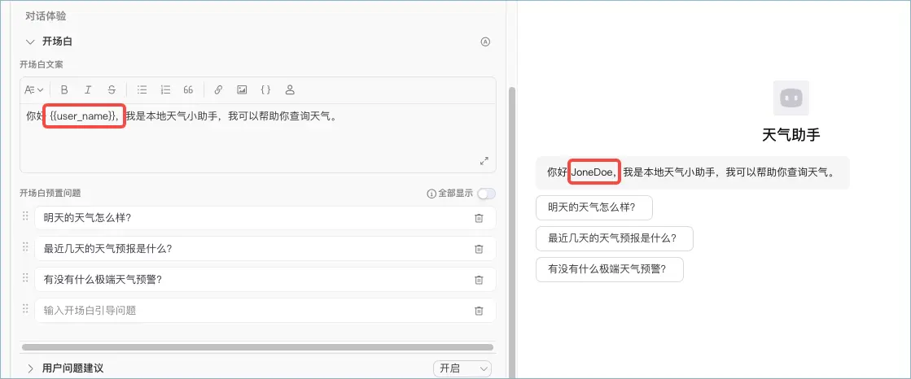
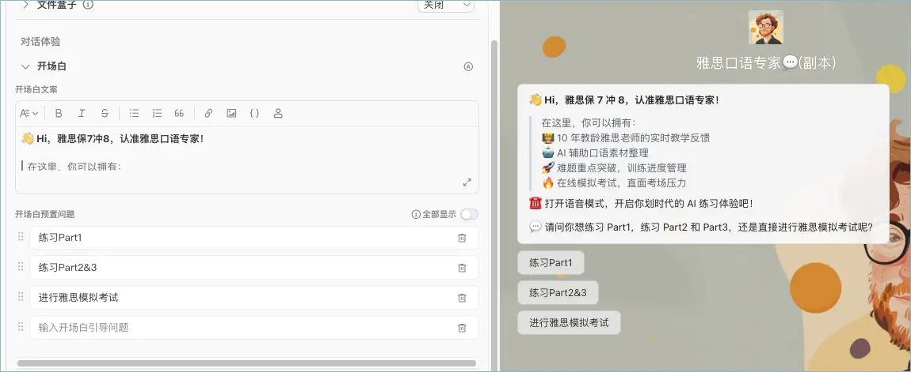
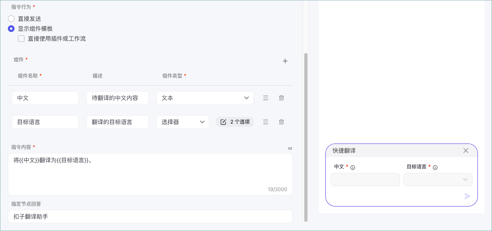
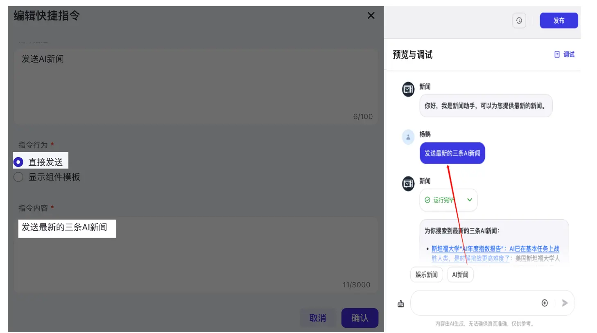
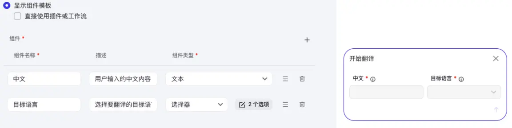
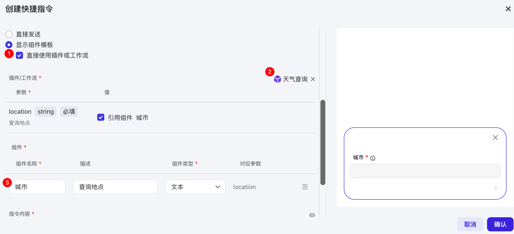
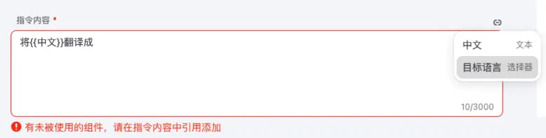
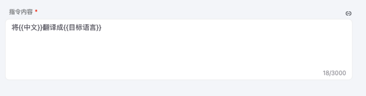
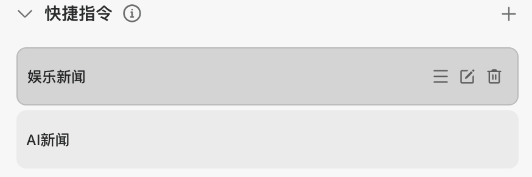

# 69.Coze优化智能体交互体验

# 开场白
开场白是用户进入智能体后自动展示的引导信息。它的主要目的是帮助用户理解智能体的用途，以及如何与其进行交互。

**说明**

开场白功能支持如下平台：

+ 豆包、微信公众号（服务号）、微信订阅号、微信小程序、抖音小程序、飞书、Chat SDK 和 API。
+ 微信小程序和抖音小程序：仅支持展示全部预置问题，不支持展示部分预置问题。
+ 微信公众号（服务号）和微信订阅号：不支持预置问题。

常见的开场白效果如下：

## 设置开场白
在智能体编排页面的**开场白**区域，可以设置**开场白文案**和**开场白预置问题**。

### 开场白文案
**开场白文案**用于帮助用户快速理解智能体的能力。用户进入智能体后，智能体会默认发送这段预先设置的开场白文案。**开场白文案**为 Markdown 格式，你可以在 Markdown 编辑器中设计智能体的开场白，调试区域会同步展示开场白的预览效果。你也可以通过 AI 自动生成开场白。

通过 Markdown 编辑器，你可以调整开场白文案样式，例如设置层级、加粗、斜体、删除线等样式效果。也可以添加链接、图片、代码块和 {{user_name}} 变量。其中，{{user_name}} 会自动引用扣子用户的昵称。

### 开场白预置问题
首次使用智能体的用户往往需要一些对话示例体验智能体的能力和效果，你可以为智能体设置**开场白预置问题**，提供一些推荐问题。这些推荐问题会展示在开场白文案之下，用户单击问题即可发起一次对话，帮助用户快速体验 Bot。如果设置了多个开场白问题，则默认随机显示 3 条预置问题。你也可以开启全部展示，开启后，开场白会默认按顺序显示所有预置问题。

## 示例
以[雅思口语专家](https://www.coze.cn/store/bot/7389299390185209892)智能体为例，同时设置开场白文案和预置问题。

开场白配置示例：

展示效果：

# 快捷指令
扣子支持开发者在搭建智能体时创建一些快捷指令，方便用户在与智能体会话时通过快捷指令快速、准确地输入信息。

## 功能说明
配置快捷指令后，智能体用户在智能体的对话框中可以直接通过指令发起预设的对话。快捷指令的行为可以是发送一段简单的文字、上传文件、使用插件或工作流等。多 Agent 模式下，全局配置中也支持添加快捷指令，默认不指定节点回答，智能体根据用户输入匹配对应的节点处理。

例如在翻译智能体中增加一个快捷指令，即原文输入框和目标语言列表，对话时你只需输入待翻译的内容和语言即可快速下发一条翻译指令。

快捷指令效果：

配置示例：

## 创建简单指令
参考以下步骤，创建一个简单快捷指令。

1.在编排页面，定位到**快捷指令**功能，然后单击 **+**。

2.在弹出的页面，完成以下配置。

| **配置** | **说明** |
| --- | --- |
| 按钮名称 | 输入快捷指令的按钮名称。例如：AI 。 |
| 指令名称 | 输入唤起该指令的名称，只支持使用字母和下划线。例如get_ai_news。可以在飞书、微信等渠道通过输入指令例如**/get_ai_news**唤起快捷指令。 |
| 指令描述 | 添加指令说明信息。 |
| 指令行为 | 选择**直接发送**，即用户点击该指令时，直接发送一条消息给智能体。 |
| 指令内容 | 输入用户点击该指令时发送的内容。例如：发送最新的三条 AI 新闻。 |

3.配置完成后，可以在调试区，直接点击快捷指令查看效果。

+ 如下图所示（左侧是快捷指令配置截图，右侧是调试截图），当点击**AI新闻**指令时，会自动发送配置好的指令内容。

****

## 创建组件指令
扣子提供了选择器、上传等组件，通过添加这些组件，可以设计更符合使用场景的快捷指令。

参考以下步骤，创建一个带组件的快捷指令。

1.在智能体编排页面，定位到**快捷指令**功能，然后单击 **+**。

2.在弹出的页面，完成以下配置。

| **配置** | **说明** |
| --- | --- |
| 按钮名称 | 输入快捷指令的按钮名称。例如：翻译 。 |
| 指令名称 | 输入唤起该指令的名称，只支持使用字母和下划线。例如translate。可以在飞书、微信等渠道通过输入指令例如**/translate**唤起快捷指令。 |
| 指令描述 | 添加指令说明信息。 |
| 指令行为 | 选择显示**组件模板**。 1.添加组件名称，并选择组件的类型。 2.单击+按钮，增加组件。 你可以在右侧面板实时预览组件效果。  如果你想直接使用工作流或插件的输出结果作为组件组成，勾选**直接使用插件或工作流**，并选择一个插件/工作流。 系统会根据选择的插件/工作流的输出数据格式自动填充组件信息。  |
| 指令内容 | 输入用户点击该指令时发送的内容。 单击文本框上方的绑定按钮，插入组件。  所有添加的组件都必须要在指令内容中进行关联。  |

3.配置完成后，可以在调试区，直接点击快捷指令查看效果。

## 其他操作
+ 拖拽快捷指令卡片调整快捷指令的顺序。
+ 单击编辑图标修改快捷指令。
+ 单击删除图标删除快捷指令。
+ 

  

> 更新: 2025-04-20 22:38:48  
> 原文: <https://www.yuque.com/aaron-wecc3/dhluml/fmu0q2nqrmsw0ugo>