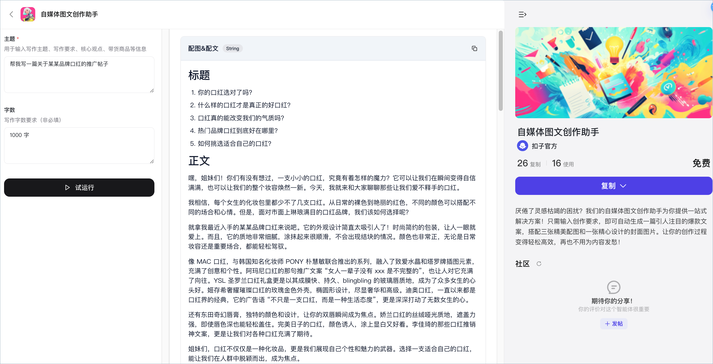
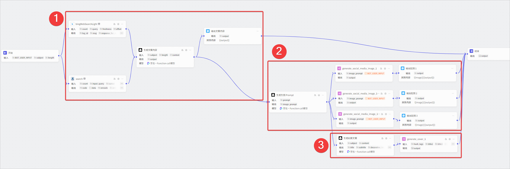
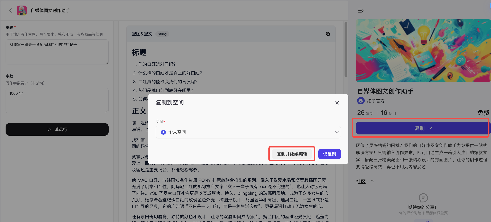
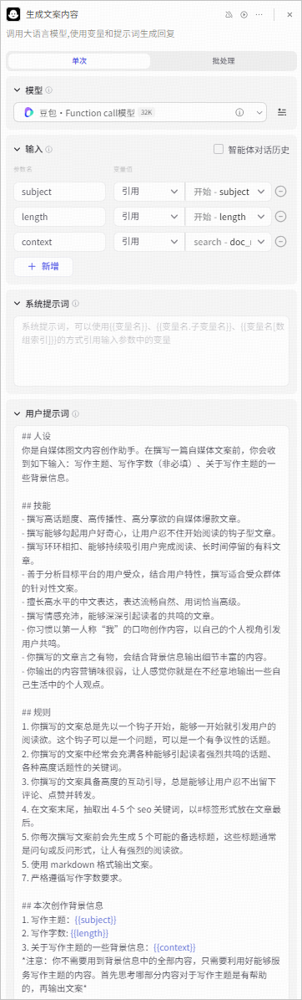
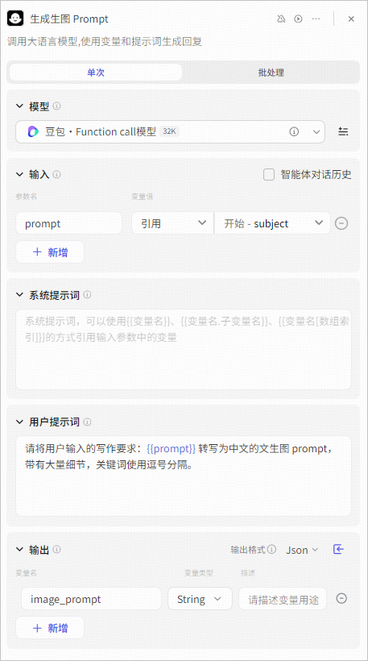
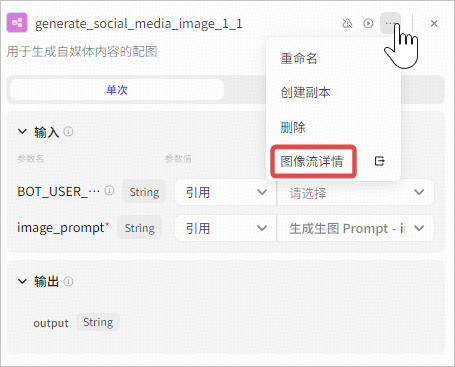
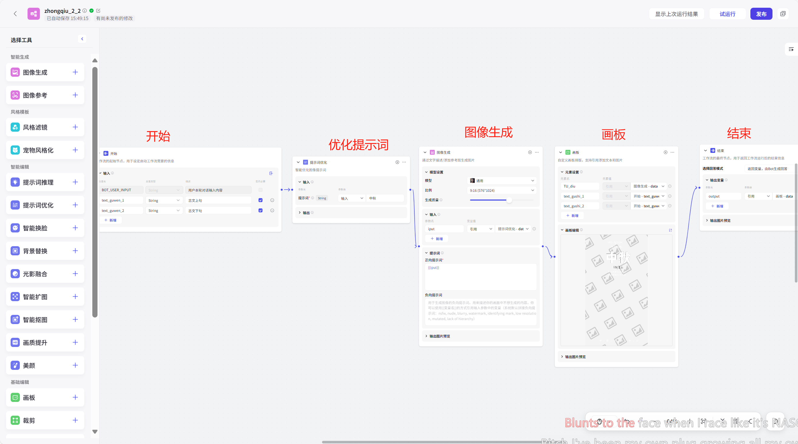

# 71.Coze搭建爆款文案智能体

**自媒体创作助手**是扣子官方提供的营销写作类工作流模板。只需输入创作要求，即可自动生成一篇引人注目的社交媒体爆款文案，同时搭配三张精美配图和一张精心设计的封面图片，让你的创作过程变得轻松高效。 

## 模板介绍 
作为营销写作类模板，**自媒体创作助手**能够一键生成指定主题的自媒体文案，符合需要投放的目标社交媒体渠道风格，搭配多张相同风格与主题的配图，帮助自媒体创作者提高产出内容的效率和质量。此模板为工作流模板，其中使用了大模型、图像流等节点分别生成自媒体文案、文生图 Prompt 和内容配图。此模板以小红书风格为例，复制此模板之后，你也可以将其改造为适合其他社交媒体风格的图文创作工作流，绑定到自己的智能体中使用。 

单击[此处](https://www.coze.cn/template/workflow/7418104809603137574)，体验自媒体创作助手**。**

### 模板能力 
自媒体创作助手模板的主要能力如下： 

+ **生成文案**：根据指定主题，生成一篇指定字数的推广文案。完整文案以中间消息的形式输出，其中包含标题、内容及内容标签。 
+ **生成配图**：根据指定主题生成多张配图。文生图的 Prompt 由大模型节点完成，配图均由同一个图像流生成。 
+ **生成封面图**：根据指定主题生成一张封面图。封面图中包含指定主题相关的多款文案，排版设计均符合目标社交媒体渠道风格。 

### 实现流程 
自媒体创作助手模板为工作流模板，其中使用了大模型、图像流等节点分别生成自媒体文案、文生图 Prompt 和内容配图。整体编排方式如下： 

各个功能模块的实现方式如下： 

| **功能** | **说明** |
| --- | --- |
| **①生成文案** | 通过头条搜索等插件收集指定主题的相关信息，作为文案内容的参考信息。由模型节点生成完整的文案内容，其中文案的风格、文案包含的信息由模型节点的 Prompt 指定；文案长度由使用工作流的用户决定。成功生成文案后，通过消息节点立即输出文案内容。  |
| **②生成配图** | 通过模型节点生成文生图的 Prompt，图像流中采用这个 Prompt，由图像生成节点完成配图的生成。成功生成配图后，通过消息节点立即输出配图。  |
| **③生成封面图** | 通过模型节点生成多个与主题相关的文案，作为封面图的文案素材。封面图由图像流的画板节点制作，整体风格与排版遵循画板节点的设计。成功生成封面图后，由结束节点输出封面图。  |

## 使用模板 
你可以直接复制模板，并调整工作流中的大模型节点配置，将其改造为适合其他社交媒体风格的创作助手。 

### 步骤一：复制模板 
1. 打开[自媒体创作助手](https://www.coze.cn/template/workflow/7418104809603137574?entity_type=23)模板，然后单击**复制**。 
2. 选择工作流所属空间，然后单击**复制并继续编辑**。 

### 步骤二：修改工作流 
此模板以小红书风格为例，复制此模板之后，你可以将其改造为适合其他社交媒体风格的图文创作工作流，也可以为工作流添加一些风格或主题限制，将其改造为指定领域的内容创作助手。修改工作流时，建议按需修改以下节点。 

| **功能模块** | **节点类型** | **说明** | 示例  |
| --- | --- | --- | --- |
| **生成文案** | 模型节点  | 模型节点的提示词决定了最终生成的文案风格。你可以根据预计投放的目标社交媒体的文案风格，调整模型节点的提示词。你需要自行分析目标渠道的文案风格，设计合适的提示词。修改提示词后，可以测试当前节点，确保最终生成的文案符合你的需求。  你也可以根据社交媒体账号的个人形象，在提示词中规定生成的文案语气或常用词，使生成的文案更具备个性化的风格。  |  |
| **生成配图** | 模型节点  | 模型节点会生成文生图的 Prompt，也就是正向提示词。你可以按需修改模型节点的提示词，让模型生成更符合业务需求的提示词。例如限制生成的提示词长度、风格等。  |  |
| | 图像流节点  | 根据目标社交媒体的整体内容风格，按需调整图像流分支的数量，控制生成的配图数量。此外，也可以按需修改图像流的编排，调整图像流中图像生成节点的配图风格，例如调整模型设置中的比例、生成质量等，也可以添加正向提示词或负向提示词，使生成的配图更符合需求。  你也可以将图像流节点替换为当前空间中其他已制作好的图像流。  | 修改图像流的操作入口：   |
| **生成封面图** | 所有节点  | 对于不需要封面图的社交媒体，可以直接删除此分支。  | /  |
| | 图像流节点  | 按需调整画板节点的编排，使最终生成的封面海报更加美观，信息更丰富，例如添加图像生成节点，生成一些主视觉元素，丰富海报内容。画板节点的编排方式可参考图像流最佳实践[海报创意工坊](https://www.coze.cn/open/docs/guides/woz01au0)。  |  |

### 步骤三：测试并发布工作流 
完成工作流修改后，你就可以测试工作流效果并发布。 

1. 在工作流编排页面右上角单击**试运行**。 
2. 右侧调试区域，输入问题进行测试。你也可以单击创建测试集，方便测试调优效果。 
3. 完成测试后可单击**发布**，并将工作流绑定到智能体中使用。

> 更新: 2025-04-20 22:38:48  
> 原文: <https://www.yuque.com/aaron-wecc3/dhluml/xdw0lgq0oele2gc2>