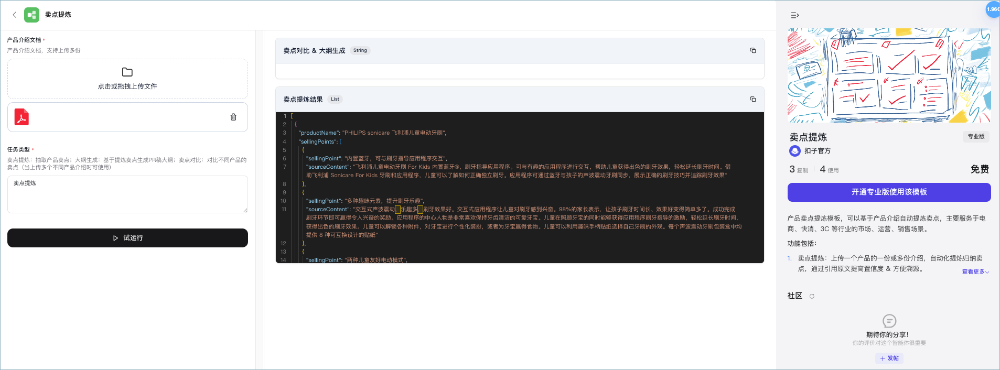
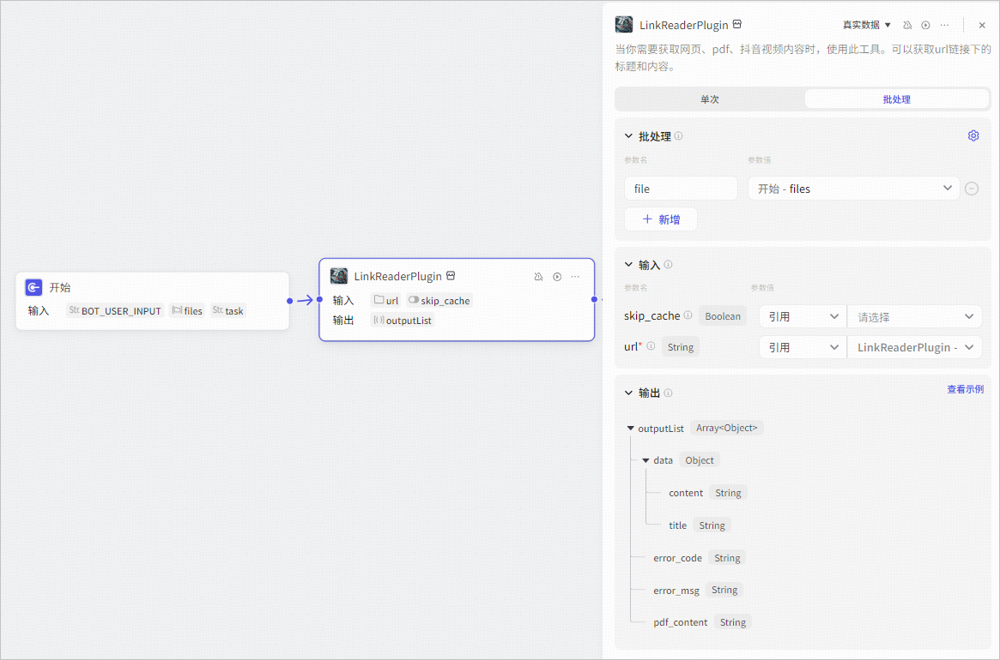
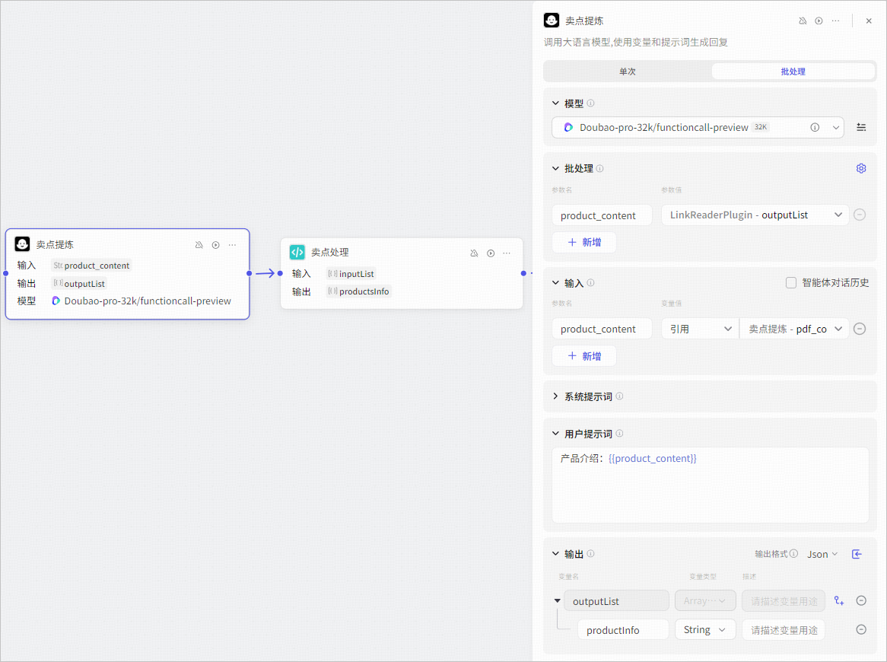
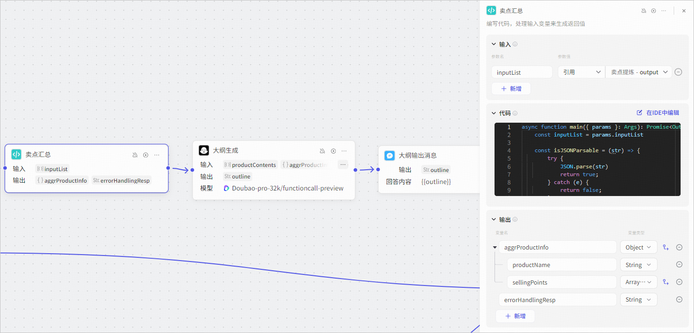
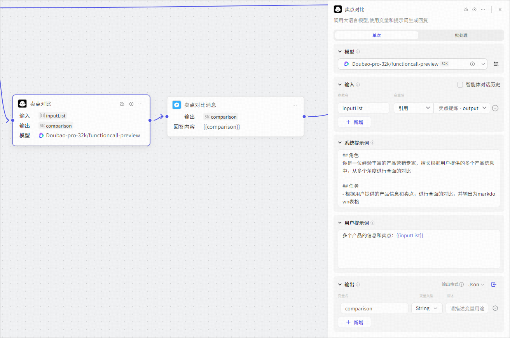
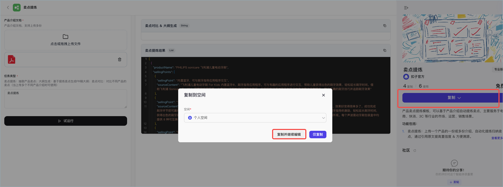
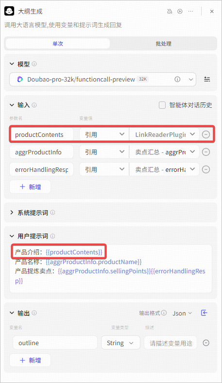
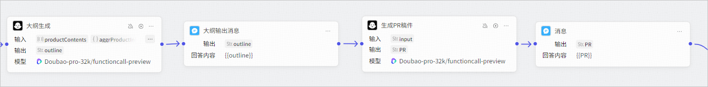
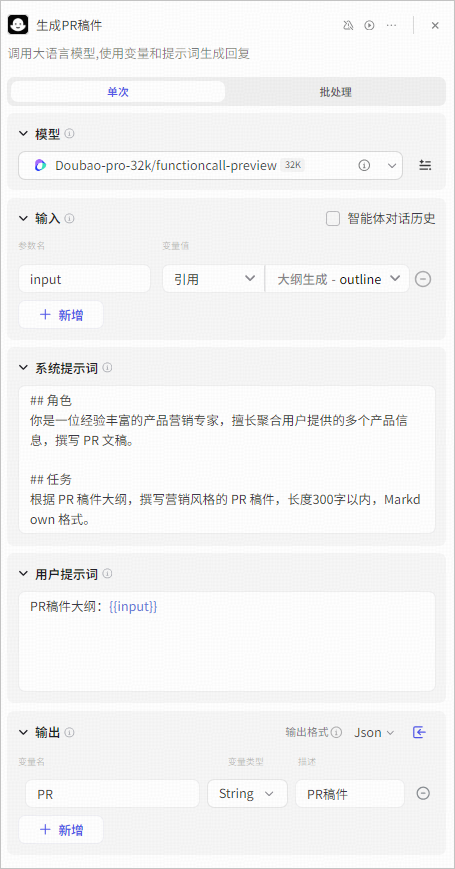
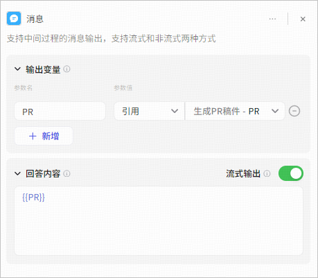

# 72.Coze搭建产品卖点提炼智能体

**卖点提炼**是扣子官方提供的电商生服类工作流模板。只需上传产品介绍文档，指定任务类型（例如卖点提炼、抽取产品卖点等），即可基于产品介绍自动提炼出产品的核心卖点。 

## 模板介绍 
在电商、快消、3C 等行业的市场、运营、销售场景下，往往需要基于产品的核心卖点定制专属的营销策略及运营推广方向，**卖点提炼**模板可以自动归纳总结产品介绍、生成 PR 稿大纲，还可以输出不同产品的卖点对比，节省了人工分析的时间和成本，有助于制定更加精准有效的营销策略。尤其是在电商销售、直播带货场景下，可以帮助 MCN 机构、带货达人、电商主播快速提炼产品卖点，准备营销话术，提高直播准备工作的效率。

此模板为工作流模板，复制此模板之后，你也可以将其改造为适合自己业务场景的信息提炼工作流，绑定到自己的智能体中使用。 

+ **卖点提炼**模板是扣子专业版的专属模板，仅专业版扣子用户可复制并使用此模板。 
+ 体验模板时，请上传 PDF 格式的产品介绍，否则工作流可能运行失败。 

单击[此处](https://www.coze.cn/template/workflow/7423727933803511844)，体验卖点提炼模板**。**

## 实现流程 
**卖点提炼**模板为工作流模板，其中使用了大模型、图像流等节点分别生成自媒体文案、文生图 Prompt 和内容配图。整体设计思路如下： 

各个功能模块的实现方式如下： 

| **模块** | **实现方式** | 工作流配置示例  |
| --- | --- | --- |
| 文件解析  | 通过插件 LinkReaderPlugin 解析产品介绍文档中的内容。插件节点使用批处理方式解析文件，所以支持批量解析多个产品介绍文档。  |  |
| 卖点提炼  | 通过大模型节点实现卖点提炼，并使用代码节点进行格式化整理。工作流节点处理流程如下：  1. 模型节点读取插件解析出的产品介绍文档内容，并通过批处理的方式为每个文档总结并提炼卖点。  2. 通过代码节点对提炼结果做进一步格式化整理。  该方式的优势在于来源可追溯。每个卖点都同时抽取原文，在提示词中定义抽取模板，并指定以 JSON 格式化输出。同时为避免 LLM 抽取卖点时随机杂乱，模版在提示词中强调了卖点之间的联系性。  |  |
| 大纲生成  | 基于提炼的卖点生成 PR 稿大纲。工作流节点处理流程如下：  1. 将从多个文件中提炼的卖点通过代码节点合并到一起。  2. 产品上新的 PR 稿一般结构相对固定，由引言、三个核心卖点段落和总结段落组成，所以我们在提示词中定义大纲结构和段落之间关系。  3. 模型节点的输入参数指定为提炼卖点 + 产品介绍原文。卖点帮助 LLM 更好理解大纲生成时的重点，原文帮助 LLM 撰写大纲时补充细节和卖点间的联系。通过这种规则可以有效帮助 LLM 在大纲中展示大小卖点之间的联系  |  |
| 卖点对比  | 对比不同产品的卖点。此功能通过模型节点实现，我们在提示词中定义卖点对比方式，并指定模型以 Markdown 表格形式输出对比结果即可。  |  |

## 使用模板 
你可以直接复制模板，并调整工作流中的大模型节点配置，将其改造为适合其他社交媒体风格的创作助手。 

### 步骤一：复制模板 
1. 登录扣子专业版账号，并访问[卖点提炼](https://www.coze.cn/template/workflow/7423727933803511844?)[模板页面](https://www.coze.cn/template/workflow/7423727933803511844?)。 
2. 选择工作流所属空间，然后单击**复制并继续编辑**。 

### 步骤二：（可选）修改工作流 
如果当前的卖点提炼模板已满足你的业务场景需求，你可以直接将其绑定到智能体中使用。其中，文件解析、卖点提炼、和卖点对比的功能模块建议维持模板中的编排模式。对于大纲生成的功能模块，你可以按需添加 PR 稿件的生成逻辑、也可以简化生成大纲的流程，让工作流的编排更轻量，提高大量文档分析的场景下的运行效率和成本。 

#### 降低运行成本 
当前工作流的生成大纲节点提示词中输入了原始的产品介绍文档内容、卖点汇总的内容，在产品介绍文档内容量非常大时，可能会消耗大量的模型 Token。如果在你的业务场景中经常需要一次性分析多个产品介绍文档，为了降低成本，你也可以在提示词中删除产品介绍，也就是删除下图中的红框部分，让模型直接参考产品名称及提炼好的卖点来生成 PR 稿件大纲。 

#### 生成 PR 稿件 
为工作流添加 PR 稿件生成的能力。此功能模块可以作为**大纲生成**的扩展功能，即根据生成的 PR 稿件大纲，扩写一篇 PR 文章，此功能主要依赖大模型节点的能力，由模型基于大纲撰写一篇符合场景要求的 PR 稿件。 

+ 本文档以模型节点为例，但是为了达到更好的生成效果，推荐你另外搭建一个生成长文的工作流，通过多个节点分别扩写不同的 PR 段落。 
+ 你也可以按需优化大纲生成节点的模型提示词，例如将示例替换为当前业务场景下的典型 PR 稿件大纲示例，使生成的大纲更符合业务场景的需求。 

相关节点说明如下： 

| **节点类型** | **说明** | **示例** |
| --- | --- | --- |
| 模型节点  | 新增一个模型节点，此模型节点用于参考上游节点生成的 PR 大纲，生成符合要求的 PR 稿件。  你需要为这个新的模型节点设置提示词和人设，建议根据当前的宣发场景针对性撰写提示词，使模型效果更符合业务诉求。  |  |
| 消息接节点  | 消息节点用于输出生成的 PR 稿件。  |  |

### 步骤三：测试并发布工作流 
完成工作流修改后，你就可以测试工作流效果并发布。 

1. 在工作流编排页面右上角单击**试运行**。 
2. 右侧调试区域，输入问题进行测试。你也可以单击创建测试集，方便测试调优效果。 
3. 完成测试后可单击**发布**，并将工作流绑定到智能体中使用。

> 更新: 2025-04-20 22:38:48  
> 原文: <https://www.yuque.com/aaron-wecc3/dhluml/pssyug8xen38wg1k>