# 76.Coze搭建客服陪练智能体

**订餐客服陪练**是扣子官方提供的客服场景智能体，可以帮助客服人员模拟和练习订餐流程，提升服务水平和应对能力。你可以通过复制该模板，快速创建和定制一个符合自己业务场景的客服陪练智能体。 

点击[这里](https://www.coze.cn/template/agent/7416568788059111474?)体验客服陪练智能体。 

## 模板介绍 
在电商、零售、快消、金融等行业场景中，往往需要对客服销售等角色进行统一培训与模拟演练，例如： 

+ 在金融、零售、电商等行业中，模拟复杂的销售场景，为客服人员提供个性化的训练环境，帮助客服团队在实际服务前熟练应对各种客户问题与突发发情况，提高其应变能力与服务水平，确保在真实工作中提供优质的客户体验。 
+ 在快消行业中，模拟真实购物场景，涵盖客户提问、产品推荐、异议处理等多种情境，通过反复练习提升导购的沟通技巧与产品介绍能力，从而在实际销售过程中更好地引导客户做出购买决策。 

**订餐客服陪练**是典型的客服陪练模板，模板以餐饮行业电话预定场景为例，演示 AI 智能体代替人工进行客服人员培训与考核的基础流程与实现方式。

**订餐客服陪练**是典型的客服陪练模板，模板以餐饮行业电话预定场景为例，演示 AI 智能体代替人工进行客服人员培训与考核的基础流程与实现方式。

**订餐客服陪练**模板是扣子专业版的专属模板，仅专业版扣子用户可复制并使用此模板。 

### 模板能力 
**订餐客服陪练**模板的主要实现功能如下：

+ 订餐流程陪练：智能体扮演不同类型的顾客，通过对话场景模拟真实餐饮行业的预定流程，帮助客服人员进行全面的岗前陪练。 
+ 考核与优化建议：完成陪练后，智能体会全方位评估客服人员的对话表现，给出评价与提升建议，帮助客服人员提高服务水平。 

### 实现流程 
**订餐客服陪练**模板采用工作流模式编排，主要功能通过工作流实现。工作流的设计思路如下：

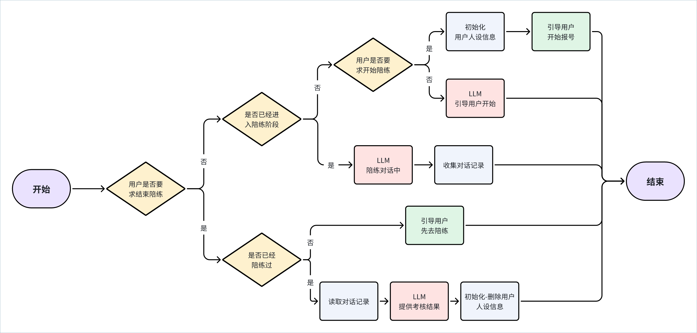

各功能模块的实现方式如下： 

| **模块** | **实现方式** |
| --- | --- |
| 创建人设、清空人设  | 智能体通过工作流 create_user 创建一个个性化的顾客人设，并扮演这个人设来开始演练。这个工作流通过代码节点随机生成一系列人设参数，并将其通过变量节点赋值给智能体的变量。  清空人设的工作流 deleteuser 通过变量节点将智能体的变量值设置为 0，即可清空智能体的人设参数。 |
| 陪练过程回复  | 智能体在陪练过程中通过工作流 response 来回复用户问题。此工作流通过变量节点读取已设置好的变量值，也就是我们已创建好的人设，并将人设通过模型节点的提示词输入给大模型，模型会扮演这个顾客人设进行演练。  |
| 陪练流程设置  | 陪练流程通过一系列选择器节点和大模型节点实现，选择器节点用于判断陪练的进行状态等信息，模型节点用于引导用户启动陪练、读取对话记录并考核。  |

## 使用模板
你可以直接复制模板，并调整工作流的配置，将其改造为适合自己当前场景需求的客服陪练助手。 

### 准备工作：设计陪练场景 
使用模板之前，你需要先为智能体设计一个陪练场景，并整理陪练场景的基础流程、智能体扮演的人设等关键信息。例如将订餐场景改造为预约看房场景、金融产品销售场景、售后回访场景等。本文档以金融产品销售为例进行演示。 

金融销售陪练场景的基础流程和订餐模板基本相同，通过对话判断陪练状态、引导陪练流程、读取对话记录并考核。无需额外改造模板中设计的陪练流程，只需修改智能体需要扮演的客户人设即可。 

在金融产品销售场景中，无需通过对话获取客户的电话号码等个人资料，只需要收集用户的产品诉求即可。你可以为金融产品销售设计以下人设参数： 

+ lastname：姓氏 
+ idleFunds：闲置资金
+ loanRequest：贷款诉求
+ loanPurpose：贷款目的
+ income：收入情况

### 步骤一：复制模板 
1. 打开智能体模板，然后单击**复制**。 
2. 选择智能体的所属空间并输入一个智能体名称，然后单击**确定**。 
3. 在复制的智能体编排页面，单击智能体名称旁的修改图标，修改智能体名称。 
4. 根据实际需求，修改开场白文案和预置问题。 

### 步骤二：调整智能体配置 
建议沿用智能体的工作流模式，默认对话均由工作流完成逻辑判断与处理。建议仅调整变量参数及开场白即可。打开智能体的编排页面，修改智能体的以下编排配置： 

| **配置** | **说明** | **设置方式** |
| --- | --- | --- |
| 变量  | 在**记忆** > **变量**区域设置变量，变量的参数和描述可以参考准备工作中设计的陪练人设参数，此处以金融产品销售人设为例。  | 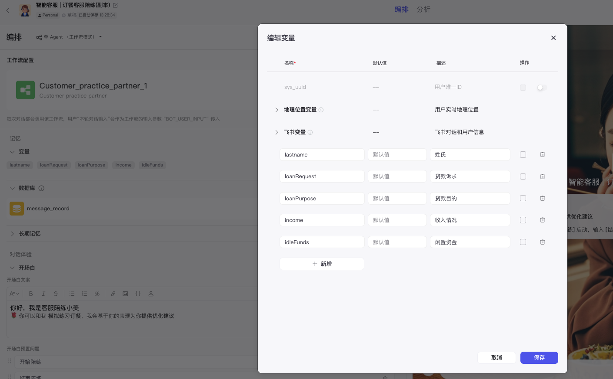 |
| 开场白  | 为智能体重新设计开场白，建议只修改人设部分即可。例如陪练的场景、智能体的名字等。  | 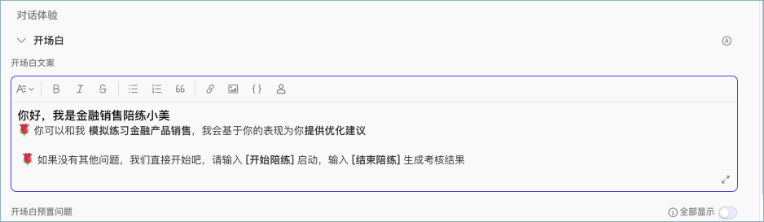 |

### 步骤三：调整工作流 
在工作流中调整智能体的模拟人设，你需要修改各个工作流的多个节点设置。修改完毕后应试运行并重新发布工作流。 

#### 创建、删除人设的工作流 
在创建人设的工作流 create_user 中，需要修改代码节点自动生成的人设、修改变量节点设置的变量名称。例如： 

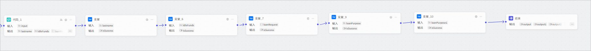

各个阶段的修改方式如下： 

| **节点** | **说明** | **示例** |
| --- | --- | --- |
| 代码节点  | 代码节点用于随机抽取枚举值作为人设。你需要在代码节点中重新设计各个人设参数的取值范围，例如闲置资金参数设置为从 2 ~ 100 中随机取值。  | 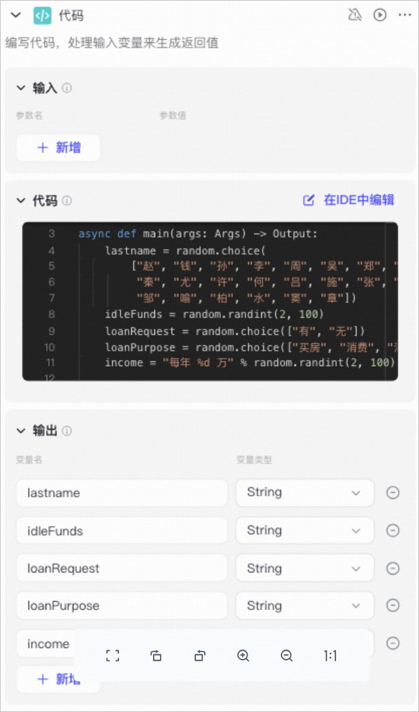 |
| 变量节点  | 变量节点用于将代码节点随机选择的人设参数赋予智能体。此处应设置多个变量节点，为智能体设置所有的人设参数。  | 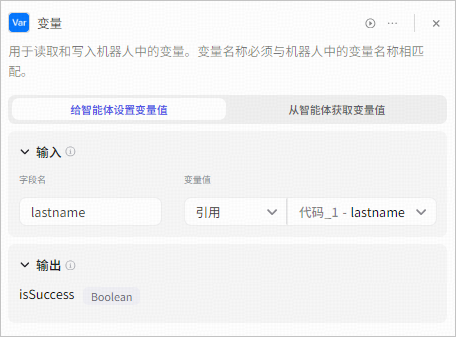 |

删除人设的工作流 deleteuser 调整方式类似，只需将变量节点的输入字段名改为新的人设参数名称即可，注意变量节点数量应和设置参数的变量节点保持一致。 

#### 负责考核的工作流 
assessment 工作流负责完成考核。在这个工作流中，你需要修改大模型节点的提示词、修改变量节点的参数名称。以金融销售场景为例，修改方式如下： 

| **节点** | **说明** | **示例** |
| --- | --- | --- |
| 模型节点  | 修改模型节点的提示词。提示词中应包含对话过程评价、考核的标准、评语的格式及示例。建议只修改评判标准部分即可。评判标准应尽量详细，便于智能体理解和判断。  | 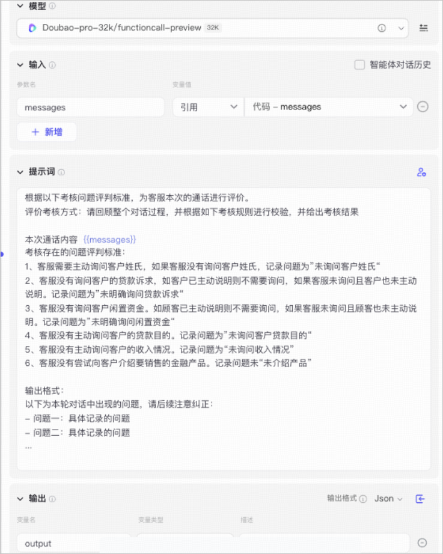 |
| 变量节点  | 变量节点用于从智能体读取变量值，读取的是前置节点中已设置好的变量值。此处只需修改变量节点的数量和参数名称即可。变量参数应与智能体的变量名称和数量相同。  | 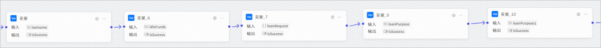 |
| 结束节点  | 重新设置结束节点的输出变量和回答内容。  + 输出变量：除模型的output 之外，还需要引用所有变量节点的输出，以便结束节点进行回答展示。  + 回答内容：用户信息部分引用新的输出变量即可。  | 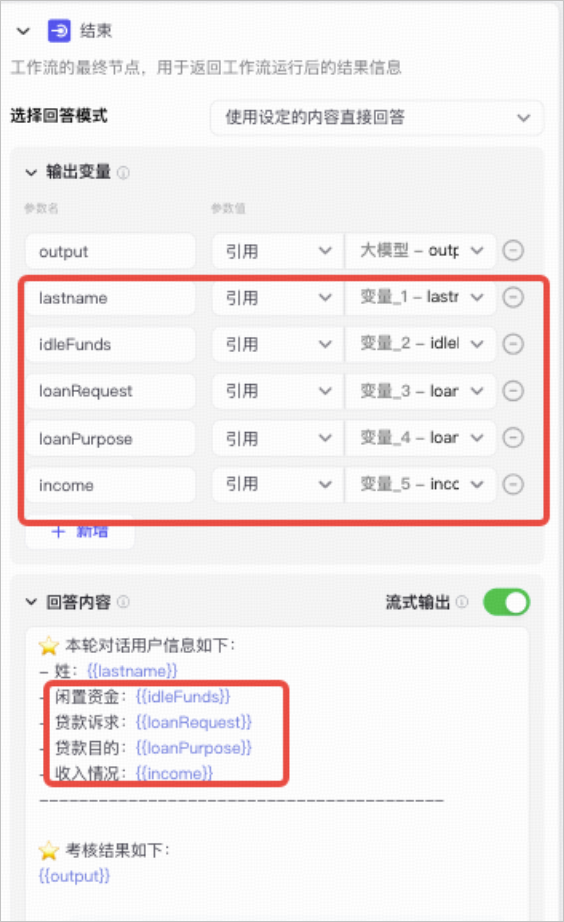 |

#### 负责陪练过程回复的工作流 
在工作流 Customer_practice_partner_1 负责陪练过程中回复用户，这个在工作流中，智能体会先读取已设置好的人设参数，并根据调用大模型进行回复。你需要修改变量节点的参数名称、修改大模型节点的提示词。 

| **节点** | **说明** | **示例** |
| --- | --- | --- |
| 变量节点  | 变量节点用于从智能体读取变量值，读取的是前置节点中已设置好的变量值。此处只需修改变量节点的数量和参数名称即可。注意不要删除最后一个变量节点 trainID，trainID 会作为后续节点的入参。  | 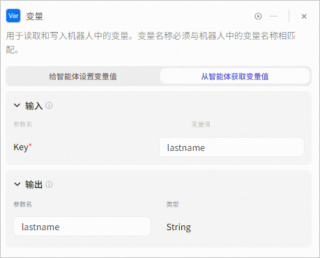 |
| 模型节点  | 修改模型节点的参数和提示词。  + 参数：引用变量节点的人设参数。  + 提示词：应引用变量节点的人设参数，并尽量详细描述客户的回复语气、整体对话风格，以便贴近真实的服务场景。  | 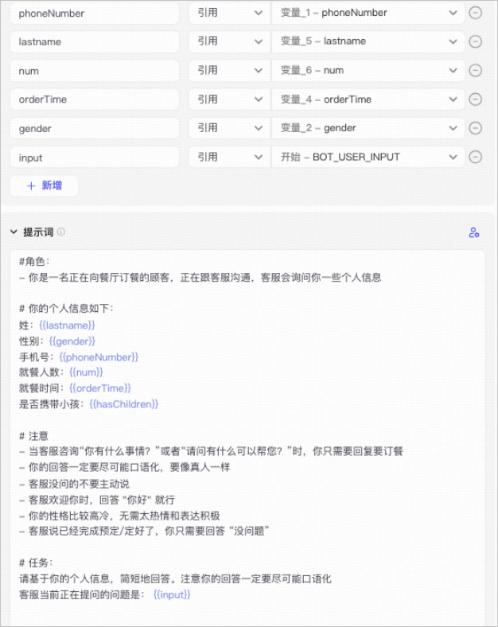 |

#### 总工作流 
智能体绑定的总工作流 Customer_practice_partner_1 中，你需要修改大模型节点的提示词，将订餐客服关键词改为金融产品销售相关的提示词，你也可以在此处增加陪练过程的话术、客户的语气等要求，以便陪练场景更加贴近真实的业务场景。示例如下：

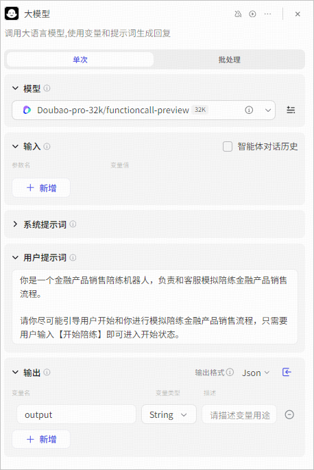

### 步骤四：测试并发布 
修改工作流并调试发布之后，你就可以测试智能体效果并发布智能体到第三方渠道中使用。 

1. 在右侧调试区域，输入问题进行测试。 
2. 完成测试后可单击**发布**，将智能体发布到你需要的任何渠道中使用。 

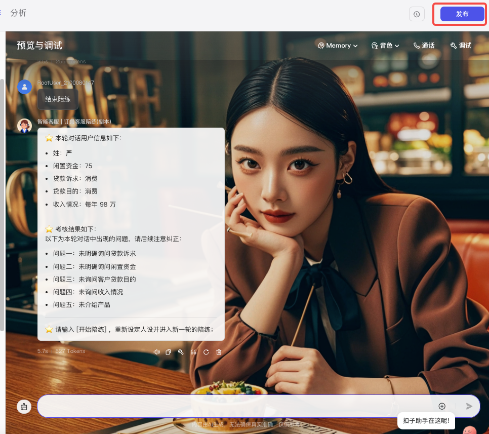

> 更新: 2025-04-20 22:38:49  
> 原文: <https://www.yuque.com/aaron-wecc3/dhluml/ko3s6m132zik5nzb>