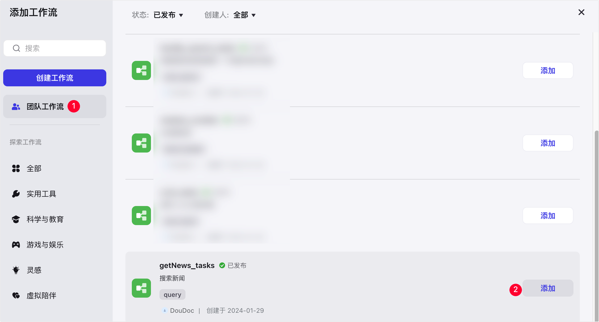

# 77.Coze搭建搜索新闻工作流

工作流内可选择丰富的插件节点处理任务。例如，本文将介绍如何使用插件节点构建一个用于搜索新闻的工作流。 

## 效果示例 
本文构建的示例工作流节点概览如下图所示，该工作流中添加 **getToutiaoNews** 工具节点来实现搜索新闻的能力。 

下图展示了示例工作流添加到智能体之后，智能体带来的用户任务处理能力。当用户输入内容后，智能体会调用示例工作流处理任务，并向用户返回处理结果。 

## 步骤一：构建工作流 
1. 在页面右上角，单击 **+资源** > **工作流**。 

本文示例配置如下： 

    - **工作流名称**：输入 getNews_tasks
    - **工作流描述**：输入 搜索新闻
1. 在工作流的编辑页面的左侧列表内，单击**插件**右侧的 **+** 图标，查找并选用内置的 **getToutiaoNews** 节点。 

该节点将用于搜索新闻。 

1. 连接各节点，并依次配置输入输出参数。 

节点连接顺序：**开始 → getToutiaoNews → 结束**。各节点参数配置说明如下表： 

| **节点** | **参数配置** |
| --- | --- |
| 开始  | 开始节点预置了输入参数 input，**String** 类型。  |
| getToutiaoNews  | 该节点的输入参数固定取值 **q**，仅需要在**参数值**区域引用**开始**节点的 input 参数。  |
| 结束  | 新增 output 输入参数，并在**参数值**区域选择引用 **getToutiaoNews **节点的 **news** 参数。  |

1. 配置完成后，单击页面右上角的**试运行**，测试工作流。 

例如，输入 科技 进行测试，待所有节点都运行成功（节点会展示绿色边框）后，查看指定节点的运行结果。 

1. 测试工作流无问题后，单击页面右上角的**发布**。 

成功发布后，在工作流列表中可以查看到该工作流。 

## 步骤二：在智能体添加工作流并测试 
1. 前往当前团队的 Develop 页面，创建或进入指定智能体。 
2. 在智能体编排页面，找到**技能**区域的**工作流**，在右侧单击加号图标。 
3. 在对话框左侧单击**团队工作流**，找到自建的 **getNews_tasks** 工作流，并在右侧单击**添加**。 

1. 在智能体的**人设与回复逻辑**内，声明智能体使用 **getNews_tasks** 工作流处理任务。 

编写后，你可以单击**优化**，让 AI 帮助你生成结构化的回复逻辑。智能体会分析用户意图，根据系统提示词和工作流的描述信息自行选择执行工作流。 

1. 在智能体的右侧**预览与调试**区域，输入内容预览智能体实现的效果。 

例如输入 科技新闻。 

> 更新: 2025-04-20 22:38:47  
> 原文: <https://www.yuque.com/aaron-wecc3/dhluml/ic6ain9yu266eh2a>