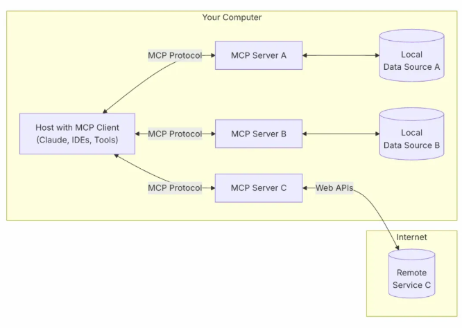
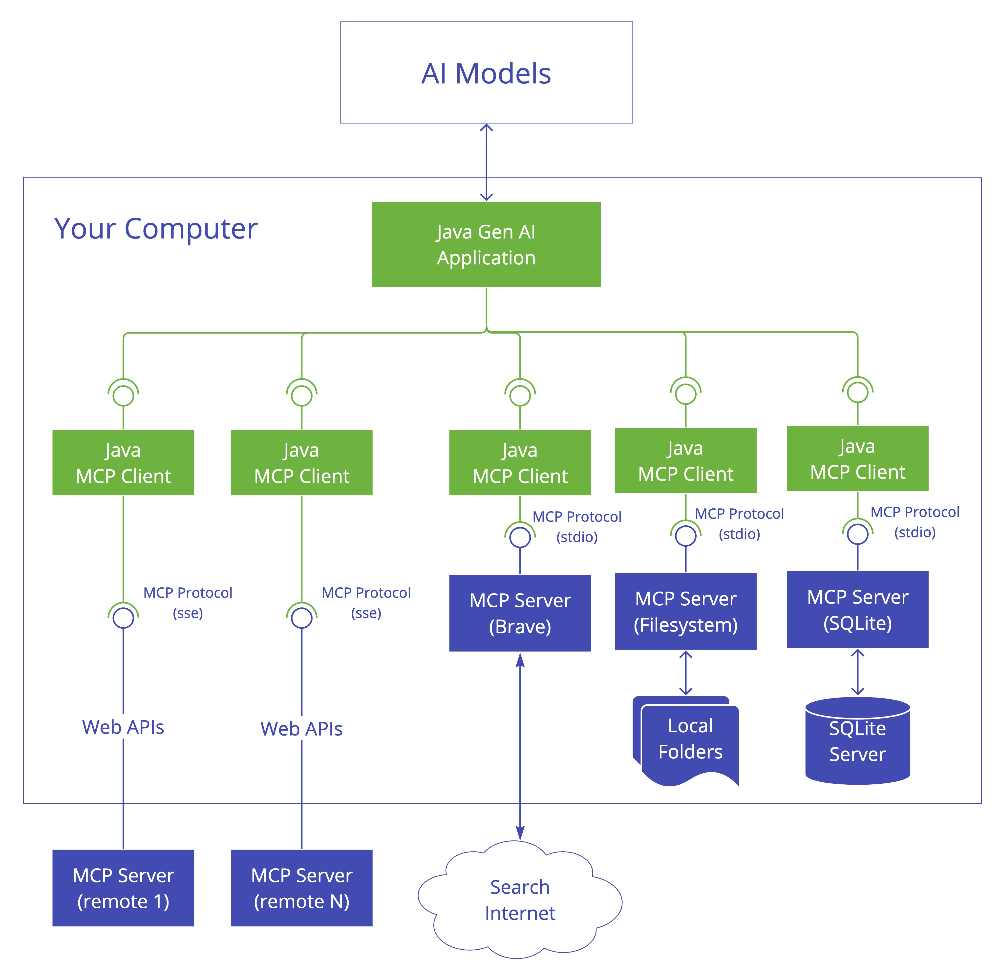
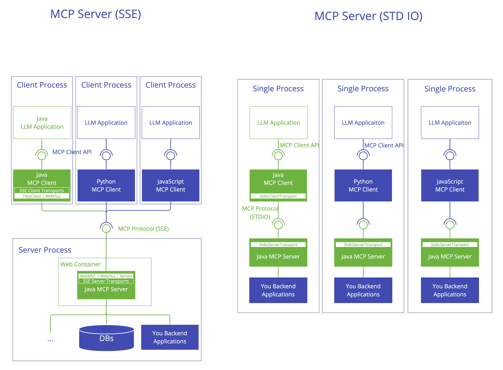
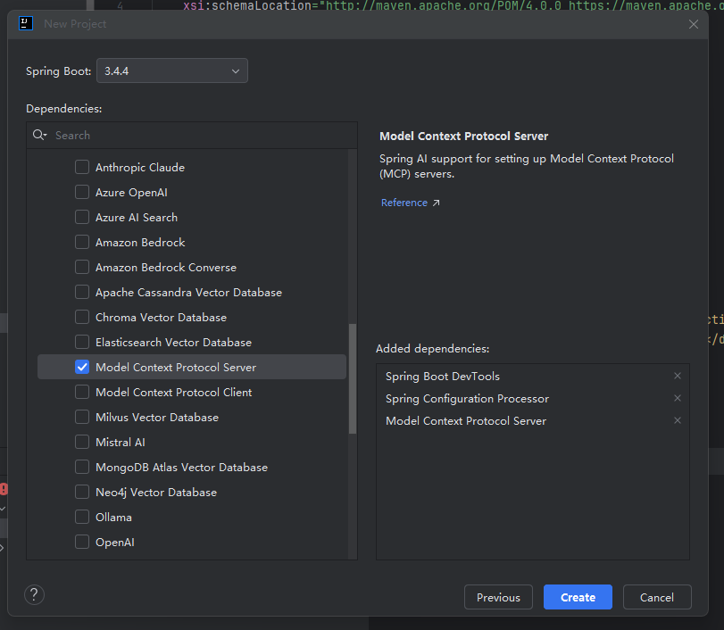
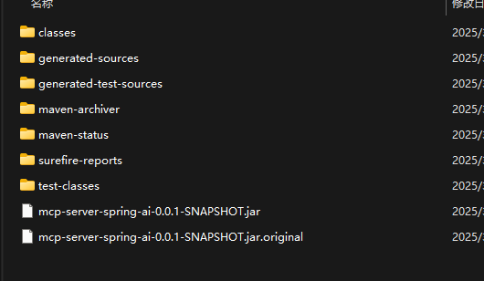
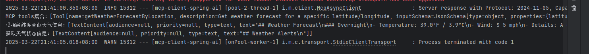
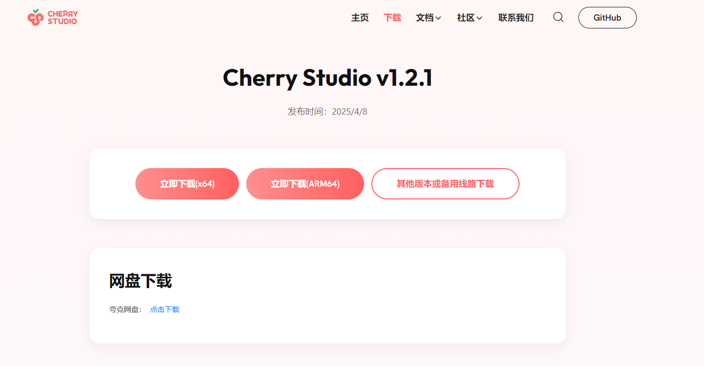
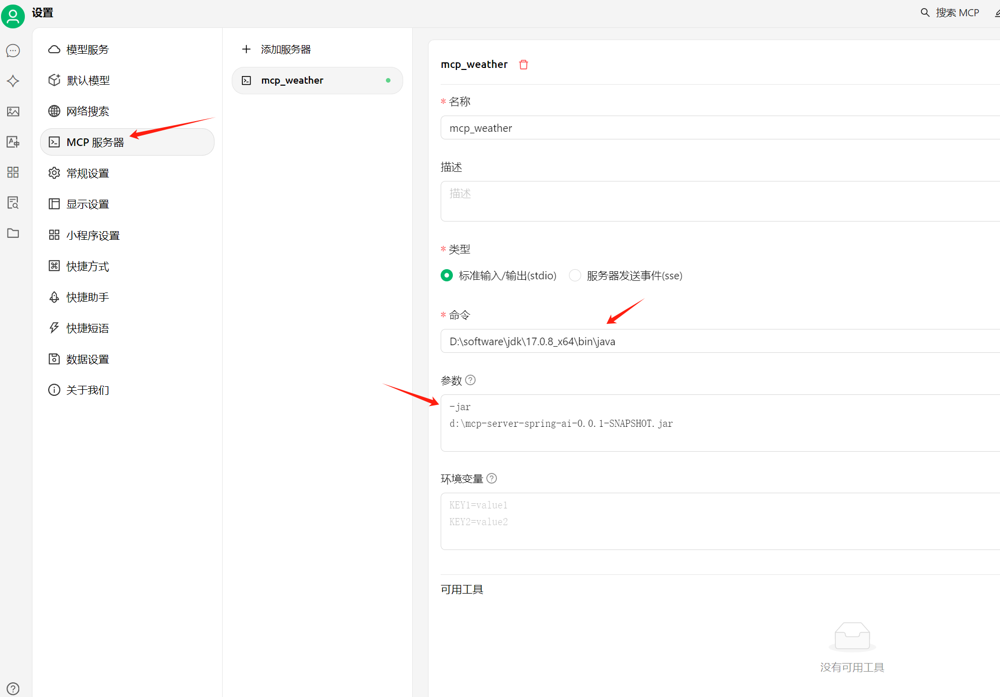
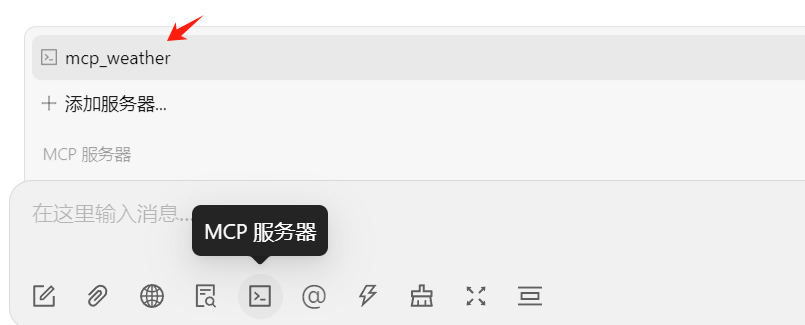
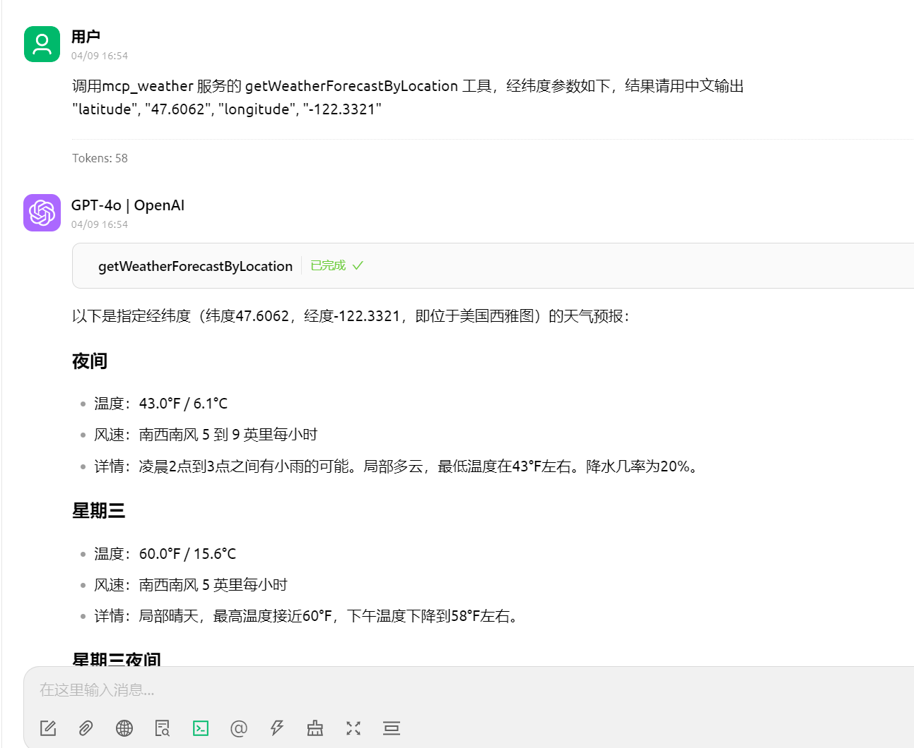

# 78.SpringAI轻松构建MCP Client-Server架构

**示例代码**

[mcp-demo.ppt](https://www.yuque.com/attachments/yuque/0/2025/ppt/1387387/1745159927138-9538ecb5-74c8-4043-8062-2efab107bbd2.ppt)

_<font style="color:#DF2A3F;">注：将ppt后缀名改为zip后解压</font>_

jdk版本：17.0.8


## <font style="color:rgb(51, 51, 51);">1、前言</font>
<font style="color:rgb(51, 51, 51);">最近 Anthropic 主导发布了 MCP（Model Context Protocol，模型上下文协议）后，着实真真火了一把。熟悉 AI 大模型的人对 Anthropic 应该不会陌生，Claude 3.5 Sonnet 模型就是他们发布的，包括现在的最强编程 AI 模型 3.7 Sonnet。今天我们来刨析下什么是 MCP，AI 大模型下，需要 MCP 吗？</font>

## <font style="color:rgb(51, 51, 51);">2、什么是 MCP？</font>
<font style="color:rgb(51, 51, 51);">MCP（Model Context Protocol）模型上下文协议，是一种适用于 AI 大模型与数据源交互的标准协议。旨在实现跨模型、跨会话的上下文信息持久化与动态共享。它通过标准化接口实现模型间的上下文传递、版本控制和协同推理，解决复杂 AI 任务中的上下文碎片化问题。</font>

<font style="color:rgb(119, 119, 119);">那为什么需要重新定义 AI 的上下文管理？ 在我们最开始使用 AI 大模型的时候，经常会遇到以下一些问题，如：上下文可能莫名的丢失，导致会话的语义出现断层。再如：不同模型之间，比如 ChatGPT 和 DeepSeek 之间记忆不互通，或者不同版本之间无法追踪上下文的变更历史等等，这些其实都是信息孤岛。</font>

<font style="color:rgb(51, 51, 51);">因此，我们需要有一个专门的协议或者说技术能跨模型、跨版本串联我们的上下文，解决记忆互通的问题。</font>

<font style="color:rgb(51, 51, 51);">如果我们观察整个 AI 自动化的发展过程，我们会发现 AI 自动化分三个阶段：AI Chat、AI Composer、AI Agent。</font>

+ <font style="color:rgb(51, 51, 51);">AI Chat 通常只是提供建议和代码片段，人机协作的模式通常需要用户手动进行复制，调试，集成。</font>
+ <font style="color:rgb(51, 51, 51);">AI Composer 相比 AI Chat 支持了局部的代码自动修改，我们只需要确认接受或拒绝接受即可。但是也局限于代码的上下文操作。</font>
+ <font style="color:rgb(51, 51, 51);">AI Agent 可以完成端到端的任务闭环。他是一个完全的智能体，自主决策，修改，调整我们所需的代码块，或者自主提取需要的信息。我们只需要负责监控动作就行。但是跨系统的协作能力有所欠缺。</font>

<font style="color:rgb(51, 51, 51);">因此，进一步的演化路线自然是为了完善 AI Agent 的跨模型或跨系统而实现。他是一个中间层，可以作为 AI Agent 的智能路由中枢。</font>

<font style="color:rgb(119, 119, 119);">熟悉 Java 分布式的朋友应该会发现，这个其实很想分布式的发展进程。而 MCP 更多像是一个 RPC 的标准协议一样。不确定我这么比喻是否恰当。</font>

## <font style="color:rgb(51, 51, 51);">3、MCP 架构</font>
<font style="color:rgb(51, 51, 51);">模型上下文协议 （MCP） 遵循客户端 - 主机 - </font>[<font style="color:rgb(65, 131, 196);">服务器</font>](https://cloud.tencent.com/product/cvm/?from_column=20065&from=20065)<font style="color:rgb(51, 51, 51);">架构，其中每个主机可以运行多个客户端实例。这种架构使用户能够跨应用程序集成 AI 功能，同时保持明确的安全边界并隔离问题。MCP 基于 JSON-RPC 构建，提供有状态会话协议，专注于客户端和服务器之间的上下文交换和采样协调。</font>

<font style="color:rgb(51, 51, 51);">官方的 MCP 系统架构图：</font>



<font style="color:rgb(51, 51, 51);">可以发现 MCP 基于三层分层模式：</font>

+ **<font style="color:rgb(51, 51, 51);">MCP Host（主机应用）：</font>**<font style="color:rgb(51, 51, 51);">运行 AI 模型或代理的宿主程序，如 Claude 桌面版、某 IDE 中的 AI 助手等。主机应用通过内置的 MCP 客户端与外部建立连接，是连接的发起方。</font>
+ **<font style="color:rgb(51, 51, 51);">MCP Client（客户端）：</font>**<font style="color:rgb(51, 51, 51);">嵌入在主机应用中的协议客户端组件。每个 MCP 客户端与一个特定的 MCP 服务器保持一对一的连接，用于向服务器发送请求或接收响应。一个主机应用中可以运行多个 MCP 客户端，从而同时连接多个不同的服务器。</font>
+ **<font style="color:rgb(51, 51, 51);">MCP Server（服务器）：</font>**<font style="color:rgb(51, 51, 51);">独立运行的轻量程序，封装了某一数据源或服务的具体能力，通过标准化的 MCP 接口对外提供。每个 MCP 服务器相当于一个 “适配器”，将底层的数据源 / 工具（本地文件、</font>[<font style="color:rgb(65, 131, 196);">数据库</font>](https://cloud.tencent.com/product/tencentdb-catalog?from_column=20065&from=20065)<font style="color:rgb(51, 51, 51);">、第三方 API 等）的功能以统一格式暴露出来，供客户端调用。</font>
+ **<font style="color:rgb(51, 51, 51);">本地数据源：</font>**<font style="color:rgb(51, 51, 51);">部署在用户本地环境中的数据资源，例如本机文件系统、数据库、应用服务等。MCP 服务器可以受控地访问这些资源，并将内容提供给 AI 模型使用。例如，一个本地 MCP 服务器可以读取电脑文件或查询本地 SQLite 数据库，然后将结果发给模型作为参考。</font>
+ **<font style="color:rgb(51, 51, 51);">远程服务：</font>**<font style="color:rgb(51, 51, 51);">通过网络提供的外部系统或在线服务（通常通过 HTTP API 访问）。MCP 服务器也可以连接到这些远程服务获取数据。比如，可以有一个 MCP 服务器连接 Slack 的 Web API，代表 AI 助手执行发送消息、读取频道记录等操作。</font>

## <font style="color:rgb(51, 51, 51);">4、MCP & JAVA 支持</font>
<font style="color:rgb(51, 51, 51);">MCP 提供了多种编程语言的支持，如 Python，Java，Kotlin，TypeScript 等。这里以 Java SDK 为例，官方也提供了相关文档：</font>[<font style="color:rgb(65, 131, 196);">https://modelcontextprotocol.io/sdk/java/mcp-overview</font>](https://cloud.tencent.com/developer/tools/blog-entry?target=https%3A%2F%2Fmodelcontextprotocol.io%2Fsdk%2Fjava%2Fmcp-overview&objectId=2507182&objectType=1&isNewArticle=undefined)

<font style="color:rgb(119, 119, 119);">Spring AI 也已经支持了 MCP 了。</font>

### <font style="color:rgb(51, 51, 51);">4.1、多种传输方式</font>
<font style="color:rgb(51, 51, 51);">MCP 提供了两种不同的传输实现。</font>

+ <font style="color:rgb(51, 51, 51);">默认传输方式：基于 Stdio，HTTP SSE</font>
+ <font style="color:rgb(51, 51, 51);">基于 Spring 的传输：WebFlux SSE，WebMVC SSE4.2、JAVA 应用的基础架构 JAVA SDK 也是遵循分层结构：</font>


+ <font style="color:rgb(51, 51, 51);">客户端 / 服务器层 （McpClient/McpServer）： 两者都使用 McpSession 进行同步 / 异步操作，其中 McpClient 处理客户端协议操作，McpServer 管理服务器端协议操作。</font>
+ <font style="color:rgb(51, 51, 51);">会话层 （McpSession）： 使用 DefaultMcpSession 实现管理通信模式和状态。</font>
+ <font style="color:rgb(51, 51, 51);">传输层 （McpTransport）： 通过以下方式处理 JSON-RPC 消息序列化 / 反序列化：</font>
+ <font style="color:rgb(51, 51, 51);">核心模块中的 StdioTransport （stdin/stdout）</font>
+ <font style="color:rgb(51, 51, 51);">专用传输模块（Java HttpClient、Spring WebFlux、Spring WebMVC）中的 HTTP SSE 传输</font>

**<font style="color:rgb(51, 51, 51);">MCP 客户端是模型上下文协议 （MCP） 架构中的关键组件，负责建立和管理与 MCP 服务器的连接。它实现协议的客户端。</font>**



**<font style="color:rgb(51, 51, 51);">MCP 服务器是模型上下文协议 （MCP） 架构中的基础组件，用于为客户提供工具、资源和功能。它实现协议的服务器端。</font>**



### <font style="color:rgb(51, 51, 51);">4.3、简单构建自己的 MCP Server</font>
<font style="color:rgb(51, 51, 51);">MCP 服务器可以提供三种主要类型的功能：</font>

1. **<font style="color:rgb(51, 51, 51);">Resources: 资源。</font>**<font style="color:rgb(51, 51, 51);">客户端可以读取的类似文件的数据（如 API 响应或文件内容）。</font>
2. **<font style="color:rgb(51, 51, 51);">Tools: 工具。</font>**<font style="color:rgb(51, 51, 51);">可由 LLM（经用户批准）调用的函数。</font>
3. **<font style="color:rgb(51, 51, 51);">Prompts: 提示。</font>**<font style="color:rgb(51, 51, 51);">帮助用户完成特定任务的预先编写的模板。</font>

<font style="color:rgb(51, 51, 51);">由于 Spring AI 已经同步支持了 MCP，因此我们这里使用 Spring AI MCP 自动换配来快速入门。环境要求：Java 17+，Spring Boot 3.3.x+。</font>

#### <font style="color:rgb(51, 51, 51);">4.3.1、构建 Spring Boot 初始化工程</font>
<font style="color:rgb(51, 51, 51);">和常规的构建 Spring Boot 工程一样，只是这里选择 MCP Server 依赖。如果没有勾选，后续自己添加相应依赖即可。</font>



<font style="color:rgb(51, 51, 51);">MCP 的 maven 依赖：</font>

```plain
<dependency>
        <groupId>org.springframework.ai</groupId>
        <artifactId>spring-ai-mcp-server-spring-boot-starter</artifactId>
    </dependency>
```

#### <font style="color:rgb(51, 51, 51);">4.3.2、实现 MCP Server</font>
<font style="color:rgb(51, 51, 51);">让我们实现一个使用 REST 客户端查询 National Weather Service API 数据的气象服务。创建 WeatherService.java：</font>

```java
package org.example.mcpserverspringai;

import com.fasterxml.jackson.databind.JsonNode;
import com.fasterxml.jackson.databind.ObjectMapper;
import org.springframework.ai.tool.annotation.Tool;
import org.springframework.ai.tool.annotation.ToolParam;
import org.springframework.stereotype.Service;
import org.springframework.web.client.RestClient;
import org.springframework.web.client.RestClientResponseException;

@Service
public class WeatherService {

    private final RestClient restClient;
    private final ObjectMapper objectMapper = new ObjectMapper();

    public WeatherService() {
        this.restClient = RestClient.builder()
        .baseUrl("https://api.weather.gov")
        .defaultHeader("Accept", "application/geo+json")
        .defaultHeader("User-Agent", "WeatherApiClient/1.0 (your@email.com)")
        .build();
    }

    @Tool()
    public String getWeatherForecastByLocation(
        double latitude,
        double longitude
    ) {
        try {

            String pointsResponse = restClient.get()
            .uri("/points/{lat},{lon}", latitude, longitude)
            .retrieve()
            .onStatus(s -> s.is4xxClientError() || s.is5xxServerError(), (req, res) -> {
                throw new WeatherApiException("Failed to get location data: " + res.getStatusText());
            })
            .body(String.class);

            JsonNode pointsRoot = objectMapper.readTree(pointsResponse);
            String forecastUrl = pointsRoot.path("properties")
            .path("forecast")
            .asText();


            String forecastResponse = restClient.get()
            .uri(forecastUrl)
            .retrieve()
            .body(String.class);

            return parseForecastData(forecastResponse);

        } catch (RestClientResponseException e) {
            throw new WeatherApiException("Weather API error: " + e.getResponseBodyAsString());
        } catch (Exception e) {
            throw new WeatherApiException("Failed to retrieve forecast", e);
        }
    }

    private String parseForecastData(String json) throws Exception {
        StringBuilder result = new StringBuilder();
        JsonNode root = objectMapper.readTree(json);
        JsonNode periods = root.path("properties").path("periods");

        result.append("## Weather Forecast\n");
        for (JsonNode period : periods) {
            result.append(String.format(
                "### %s\n- Temperature: %.1f°F / %.1f°C\n- Wind: %s %s\n- Details: %s\n\n",
                period.path("name").asText(),
                period.path("temperature").asDouble(),
                fahrenheitToCelsius(period.path("temperature").asDouble()),
                period.path("windDirection").asText(),
                period.path("windSpeed").asText(),
                period.path("detailedForecast").asText()
            ));
        }
        return result.toString();
    }

    @Tool()
    public String getAlerts(@ToolParam(description = "Two-letter US state code (e.g. CA, NY)") String state) {
        if (state == null || state.length() != 2) {
            throw new IllegalArgumentException("Invalid state code format");
        }

        try {
            String alertResponse = restClient.get()
                    .uri("/alerts/active?area={state}", state.toUpperCase())
                    .retrieve()
                    .body(String.class);

            return parseAlertData(alertResponse);

        } catch (RestClientResponseException e) {
            throw new WeatherApiException("Weather API error: " + e.getResponseBodyAsString());
        } catch (Exception e) {
            throw new WeatherApiException("Failed to retrieve alerts", e);
        }
    }

    private String parseAlertData(String json) throws Exception {
        StringBuilder result = new StringBuilder();
        JsonNode root = objectMapper.readTree(json);
        JsonNode features = root.path("features");

        result.append("## Weather Alerts\n");
        for (JsonNode feature : features) {
            JsonNode properties = feature.path("properties");
            result.append(String.format(
                    "### %s\n- Severity: %s\n- Areas: %s\n- Effective: %s\n- Instructions: %s\n\n",
                    properties.path("event").asText(),
                    properties.path("severity").asText(),
                    properties.path("areaDesc").asText(),
                    properties.path("effective").asText(),
                    properties.path("instruction").asText()
            ));
        }

        if (result.isEmpty()) {
            return "No active alerts for this area";
        }
        return result.toString();
    }

    private double fahrenheitToCelsius(double f) {
        return (f - 32) * 5 / 9;
    }

    public static class WeatherApiException extends RuntimeException {
        public WeatherApiException(String message) {
            super(message);
        }

        public WeatherApiException(String message, Throwable cause) {
            super(message, cause);
        }
    }
}
```

<font style="color:rgb(51, 51, 51);">@Service 注解会在您的应用程序上下文中自动注册服务。Spring AI @Tool 注释，使创建和维护 MCP 工具变得容易。使用 Spring Boot 自动配置将自动向 MCP 服务器注册这些工具。</font>

#### <font style="color:rgb(51, 51, 51);">4.3.3、创建 Server 启动器</font>
```java
@SpringBootApplication
public class McpServerSpringAiApplication {

    public static void main(String[] args) {
        SpringApplication.run(McpServerSpringAiApplication.class, args);
    }

    @Bean
    public ToolCallbackProvider weatherTools(WeatherService weatherService) {
        return  MethodToolCallbackProvider.builder().toolObjects(weatherService).build();
    }

}
```

<font style="color:rgb(51, 51, 51);">这里使用 MethodToolCallbackProvider 实用程序将 @Tools 转换为 MCP 服务器使用的可作回调。</font>

#### <font style="color:rgb(51, 51, 51);">4.3.4、打包 MCP Server</font>
<font style="color:rgb(51, 51, 51);">接着我们运行 mvn clean package，将上面的服务打成 jar 包。</font>



#### <font style="color:rgb(51, 51, 51);">4.3.5、MCP Client 调用</font>
<font style="color:rgb(51, 51, 51);">我们可以使用一些桌面工具如 Claude Desktop、Cursor 等来引入我们的 MCP Server。我自己试了下 Claude，但是 Claude 需要国外的手机号进行注册才行，咋没这个条件啊。又试了下 Cursor，发现这货只支持 Http SSE 方式。我这里只是为了做演示，所以就算了，不想封装了。 因此这里我直接编写一个 MCP Client 来做测试。</font>

<font style="color:rgb(51, 51, 51);">我们创建一个 MCP Client 工程：mcp-client-spring-ai，引入 maven 依赖：</font>

```plain
<dependency>
        <groupId>org.springframework.ai</groupId>
        <artifactId>spring-ai-mcp-client-spring-boot-starter</artifactId>
    </dependency>
```

<font style="color:rgb(51, 51, 51);">创建 MCP Client 测试类：</font>

```plain
package org.example.mcpclientspringai;

import io.modelcontextprotocol.client.McpClient;
import io.modelcontextprotocol.client.transport.ServerParameters;
import io.modelcontextprotocol.client.transport.StdioClientTransport;
import io.modelcontextprotocol.spec.McpSchema;
import org.junit.jupiter.api.Test;
import org.springframework.boot.test.context.SpringBootTest;

import java.util.Map;

@SpringBootTest
class McpClientSpringAiApplicationTests {

    @Test
    void contextLoads() {
        
        var stdioParams = ServerParameters.builder("java")
                .args("-jar", "E:\\idea_projects\\mcp-server-spring-ai\\target\\mcp-server-spring-ai-0.0.1-SNAPSHOT.jar")
                .build();
        var stdioTransport = new StdioClientTransport(stdioParams);
        var mcpClient = McpClient.sync(stdioTransport).build();
        mcpClient.initialize();
        
        McpSchema.ListToolsResult toolsList = mcpClient.listTools();
        System.out.println("MCP tools集合：" + toolsList.tools());
        
        
        McpSchema.CallToolResult weather = mcpClient.callTool(
                new McpSchema.CallToolRequest("getWeatherForecastByLocation",
                        Map.of("latitude", "47.6062", "longitude", "-122.3321")));
        System.out.println("根据经纬度查询天气信息：" + weather.content());
        
        McpSchema.CallToolResult alert = mcpClient.callTool(
                new McpSchema.CallToolRequest("getAlerts", Map.of("state", "NY")));
        System.out.println("获取天气状态信息：" + alert.content());
        mcpClient.closeGracefully();
    }

}
```

#### <font style="color:rgb(51, 51, 51);">4.3.6、运行结果</font>


<font style="color:rgb(51, 51, 51);">从打印的信息可以看出，成功获取到了我们通过 @Tool 注解的两个 MCP Server 的工具，同时也成功查询到了当地的气象信息。就是这么简单。</font>

<font style="color:rgb(51, 51, 51);"></font>

**<font style="color:rgb(51, 51, 51);">4.3.7、Cherry Studio 测试MCP服务调用</font>**

[https://cherry-ai.com/download](https://cherry-ai.com/download)








<font style="color:rgb(51, 51, 51);">调用mcp_weather 服务的 getWeatherForecastByLocation 工具，经纬度参数如下，结果请用中文输出</font>

<font style="color:rgb(51, 51, 51);">"latitude", "47.6062", "longitude", "-122.3321"</font>



### <font style="color:rgb(51, 51, 51);">4.4、既然如此？</font>
<font style="color:rgb(51, 51, 51);">可见 Java 通过 Spring AI 进行 MCP 的集成，也是相当简单。想象一下，如果我们写好了能够满足需求的 MCP Server，然后通过 Client 自己完成监管以及代码 check，甚至可以集成视觉模型进行样式调整？那么岂不是一个活脱脱的智能程序员就出现了？当然可能想的比较简单。</font>

<font style="color:rgb(51, 51, 51);">其实由此可见，MCP 也并不是什么新鲜玩意，他就只是个大家共识的标准协议而已。</font>

## <font style="color:rgb(51, 51, 51);">5、MCP & function calling</font>
<font style="color:rgb(51, 51, 51);">有人肯定会说，MCP 这样的方式和 function calling 有什么区别吗？ function calling 同样也具备调用外部接口的能力。为什么要需要 MCP。</font>

+ **<font style="color:rgb(51, 51, 51);">MAP：</font>**
    1. <font style="color:rgb(51, 51, 51);">MCP 是一个更底层，通用的标准协议。</font>
    2. <font style="color:rgb(51, 51, 51);">MCP 更倾向于抽象和通用。</font>
    3. <font style="color:rgb(51, 51, 51);">MCP 通常支持多数据源。</font>
+ **<font style="color:rgb(51, 51, 51);">function calling：</font>**
    1. <font style="color:rgb(51, 51, 51);">function calling 是大模型专用的特性，或者说实现方式。</font>
    2. <font style="color:rgb(51, 51, 51);">function calling 更倾向于具体的实现调用。</font>
    3. <font style="color:rgb(51, 51, 51);">function calling 适用于特定场景，单一数据源。</font>

## <font style="color:rgb(51, 51, 51);">6、小结</font>
<font style="color:rgb(51, 51, 51);">MCP 正在重塑 AI 系统的构建范式，其核心价值体现在他的认知连续性，让 AI 真正具备 "记忆传承" 能力。以及系统协作性，构建模型间的认知协作网络。还有工程标准化，上下文管理从定制开发走向协议规范。</font>

<font style="color:rgb(51, 51, 51);">随着 V1.2 协议标准即将发布，MCP 将成为智能系统的基础设施标配。我相信未来已来，唯智者先见；上下文革命，从 MCP 开始。</font>


> 更新: 2025-04-20 22:38:47  
> 原文: <https://www.yuque.com/aaron-wecc3/dhluml/gtpukm2kqlq18rot>