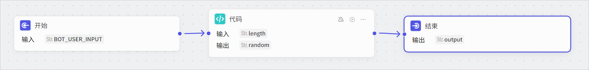
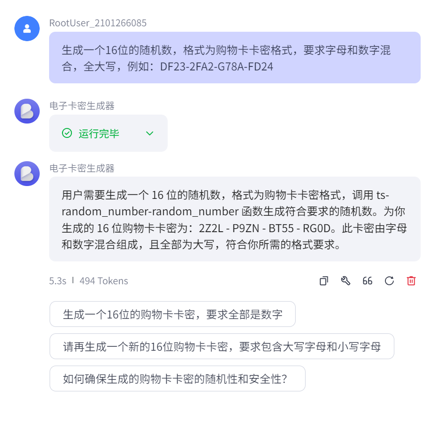
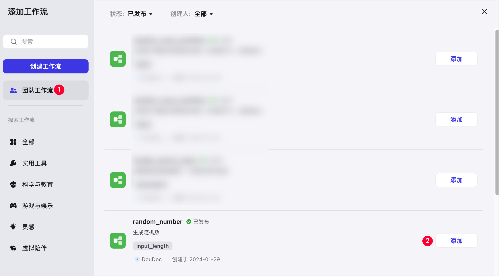

# 79.Coze工作流编写代码执行特定任务

你可以在工作流内添加 Code 节点编写代码处理任务。例如，本教程中将使用 Code 节点生成随机数。

## 效果示例

本文构建的示例工作流节点概览如下图所示，该工作流中添加  Code 节点用于生成电子卡密



下图展示了示例工作流添加到智能体之后，智能体带来的用户任务处理能力。当用户输入内容后，智能体会调用示例工作流处理任务，并向用户返回处理结果。



## 步骤一：构建工作流

1. 登录[扣子](https://www.coze.cn/home)平台。
2. 在左侧导航栏中选择**工作空间**，并在页面顶部空间列表中选择目标工作空间。
3. 从左侧导航栏进入**资源库**页面。
4. 在页面右上角，单击 **+资源** > **工作流**。

本文示例配置如下：

```
- **工作流名称**：输入 random_number
- **工作流描述**：输入 生成随机数
```

5\. 在工作流的编辑页面，从左侧**选择节点**列表，选用**代码**节点。
6\. 连接各节点，并依次配置输入输出参数。

节点连接顺序：**开始 → 代码 → 结束**，各节点参数配置说明如下表。

| **节点** | **参数配置** |
| --- | --- |
| 开始  | 新增 input_length 输入参数，并选择 **String** 数据类型。  |
| 代码  | + 新增 length 输入参数，并在**参数值**区域选择**引用 Start > input_length**。 <br/>+ 在 Code 节点打开 IDE，清空默认内容并添加以下代码，该代码用于生成随机数。 <br/><code>java async function main({ params }: Args): Promise<Output> {  var IDX = 36, HEX = '';   while (IDX--) HEX += IDX.toString(36);     // @see https://github.com/lukeed/uid/blob/master/src/single.js   function uid(len) {       var str = '', num = len || 11;       while (num--) str += HEX[Math.random() * 36 | 0];       return str;   }     const ret = {       "random": uid(params.length),   }   return ret   } </code>  + 新增 random 输出值，数据类型选择 **String**。  |
| 结束  | 新增 output 输入参数，并在**参数值**区域选择**引用 Code > random**。  |

7. 配置完成后，单击页面右上角的试运行，测试工作流。

例如，输入 8 进行测试，待所有节点都运行成功（节点会展示绿色边框）后，查看指定节点的运行结果。

8. 测试工作流无问题后，单击页面右上角的**发布**。

成功发布后，在工作流列表中可以查看到该工作流。

## 步骤二：在智能体添加工作流并测试

1. 前往当前团队的 Develop 页面，创建或进入指定智能体。
2. 在智能体内，找到**技能**区域的**工作流**，在右侧单击加号图标。
3. 在对话框左侧单击**团队工作流**，找到自建的 **random_number** 工作流，并在右侧单击**添加**。



4. 在智能体的**人设与回复逻辑**内，声明智能体使用 **random_number** 工作流处理任务。

编写后，你可以单击**优化**，让 AI 帮助你生成结构化的回复逻辑。

5. 在智能体的右侧**预览与调试**区域，输入内容预览智能体实现的效果。

例如输入：生成一个16位的随机数，格式为购物卡卡密格式，要求字母和数字混合，全大写，例如：DF23-2FA2-G78A-FD24


> 更新: 2025-04-20 22:38:46  
> 原文: <https://www.yuque.com/aaron-wecc3/dhluml/nt7kqggycqkm01z4>