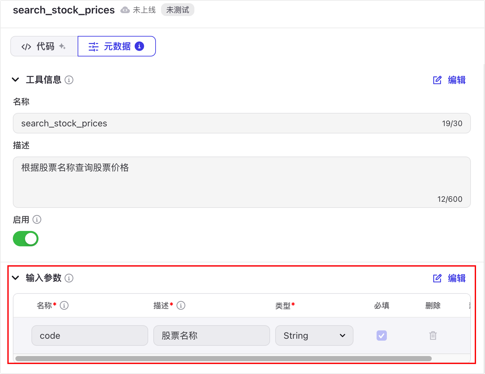
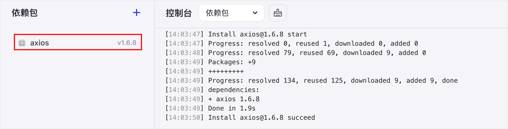
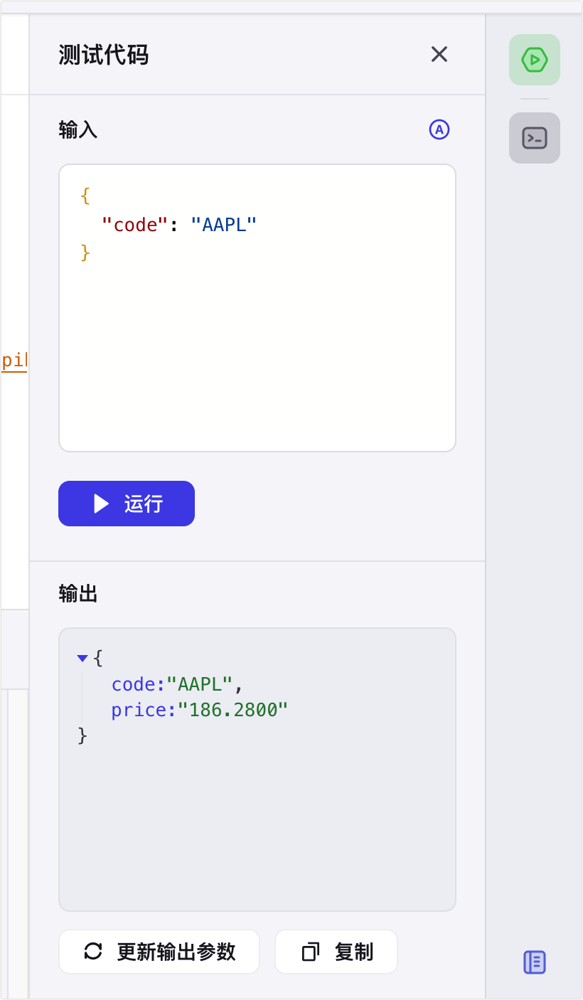
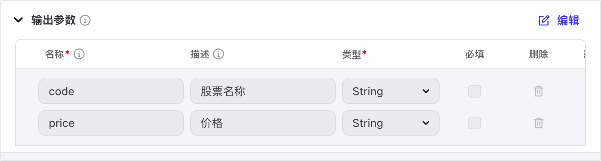
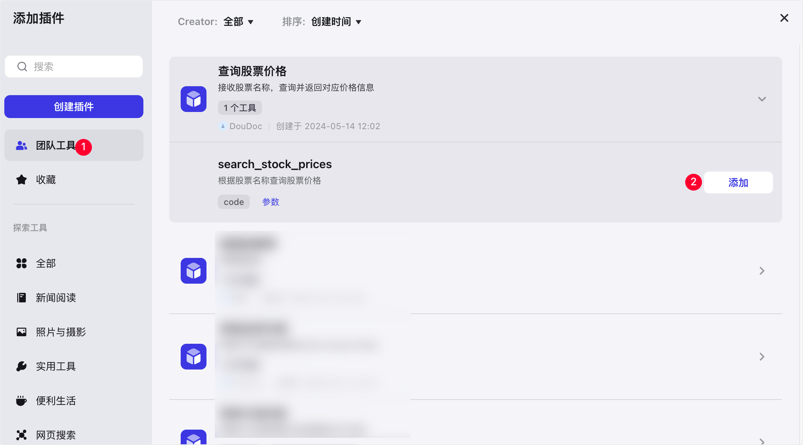

# 80.Coze定制化开发股票分析插件

开发一个查询股票价格的插件为例，介绍如何通过插件集成的 IDE 工具创建自定义插件。 


## 步骤一：构建工作流 
1. 在页面右上角，单击 **+资源** > **插件**。 
2. 在新建插件对话框内完成配置，并单击**确认**。 
    - **插件名称**：示例值 查询股票价格。 
    - **插件描述**：示例值 接收股票名称，查询并返回对应价格信息。 
    - **插件工具创建方式**：选择**在 Coze IDE 中创建**。 
    - **IDE 运行时**：选择 **Node.js**。 
3. 待页面自动跳转后，单击**在IDE中创建工具**。 
4. 在弹出的**创建工具**对话框，设置工具名称与介绍，并单击**确定**。 
    - **工具名称**：示例值 search_stock_prices。 
    - **工具介绍**：示例值 根据股票名称查询股票价格。 

## 步骤二：配置并发布插件 
1. 在 IDE 工具中，单击**元数据**页签。 
2. 在元数据的**输入参数**区域，单击**编辑**，并新增 **code** 参数，描述为**股票名称**。 



3. 单击**代码**页签，在代码编辑器中通过快捷键唤起 AI 助手（macOS 为 Command + I、Windows 为 Ctrl + I）。 
4. 向 AI 助手输入代码编辑需求，由 AI 生成代码。 

例如输入：根据 input.code，到 alpha vantage 查询股票价格。 

5. AI 生成代码后，可自行调整代码内容。 

完整示例代码如下，您可以选择直接复制使用该示例代码。 

```java
import { Args } from '@/runtime';

import { Input, Output } from "@/typings/search_stock_prices/search_stock_prices";

import axios from 'axios';

export async function handler({ input, logger }: Args<Input>): Promise<Output> {

    const code  = input.code;

    const apiKey = 'YOUR_ALPHA_VANTAGE_API_KEY';

    const url = `https://www.alphavantage.co/query?function=GLOBAL_QUOTE&symbol=${code}&apikey=${apiKey}`;


    try {

        const response = await axios.get(url);

        const data = response.data['Global Quote'];

        return {

            code: code,

            price: data['05. price'],

        };

    } catch (error) {

        logger.error(`Error fetching stock price for ${code}: ${error}`);

    return {

        code: code,

        price: null,

        };

    }

}
```

6. 在页面左下角，添加 **axios@1.6.8** 依赖包。 



7. 在页面右上角单击**测试代码**图标，并在输入区域单击**自动生成**图标。 
8. 将自动生成的测试数据改为 AAPL，并单击**运行**。 
9. 在**输出**区域查看测试结果，并单击**更新输出参数**。 



10. 在页面中间单击**元数据**页签，在**输出参数**区域单击**编辑**，完善输出参数的描述。 
    - code 描述为股票名称。 
    - price 描述为价格。 



11. 在页面右侧单击**运行**，重新进行测试。测试无问题后，在页面右上角单击**发布**。 
12. 在**发布**对话框，单击**下一步**。 
13. 在**个人信息收集声明**对话框，选择**否**，并单击**发布**。 

## 步骤三：在智能体内使用插件 
1. 在页面右上角，单击 **+创建智能体**。 
2. 选择创建智能体或者进入指定智能体。 
3. 在智能体编排页面，找到**插件**区域，并单击右侧的 **+** 图标。 
4. 在添加插件页面，单击**团队工具**，并选择添加 **search_stock_prices** 工具。 



5. 在智能体的**人设与回复逻辑**中，设置调用插件的规则。 
6. 在智能体的**预览与调试**中，测试智能体功能。 

如下图所示，智能体调用**查询股票价格**插件的 **search_stock_prices** 工具处理用户咨询的 AAPL 股票价格。 


> 更新: 2025-04-20 22:38:47  
> 原文: <https://www.yuque.com/aaron-wecc3/dhluml/cthn83r4xpopbemk>