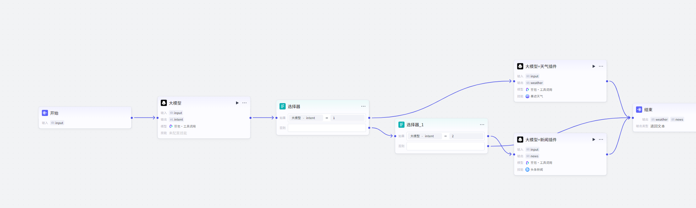
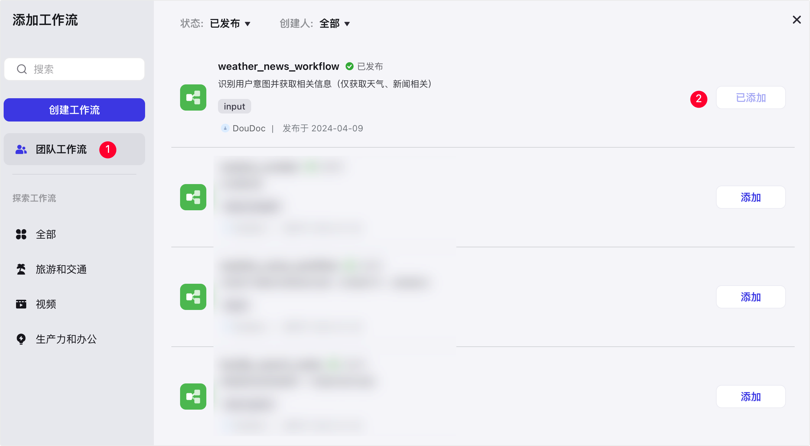
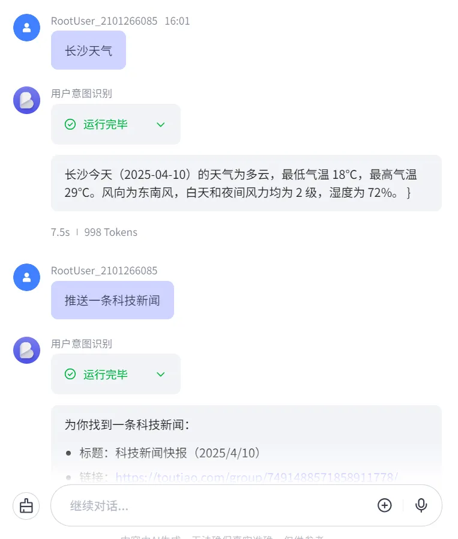

# 81.Coze构建识别用户意图工作流

通过大模型节点、选择器节点和插件节点构建一个用于识别用户意图的工作流。

## 效果示例

构建的示例工作流概览如下。



在该工作流中：

1. 使用大模型节点将用户输入数据分为 **1（天气）**、**2（新闻）**、**3（其他）** 三种类型。
2. 使用选择器节点判断用户输入数据的类型，并分支处理。
   1. 如果数据类型为 **1**，会将数据流转至大模型节点和天气插件节点，获取地区天气。
   2. 如果数据类型为 **2**，会将数据流转至新闻插件节点，获取新闻。
   3. 如果数据类型为 **3**，则不做处理直接返回。

下图展示了示例工作流添加到智能体之后，智能体带来的用户任务处理能力。当用户输入内容后，智能体会调用示例工作流处理任务，并向用户返回处理结果。


## 步骤一：构建工作流

1. 登录[扣子](https://www.coze.cn/home)平台。
2. 在左侧导航栏中选择**工作空间**，并在页面顶部空间列表中选择目标工作空间。
3. 从左侧导航栏进入**资源库**页面。
4. 在页面右上角，单击 **+资源** > **工作流**。

本文示例配置如下：

```
- **工作流名称**：输入 weather_news_workflow
- **工作流描述**：输入 识别用户意图并获取相关信息（仅获取天气、新闻相关）
```

5\. 在工作流的编辑页面，按如下图所示的顺序，依次添加大模型节点、选择器节点、插件节点，并进行连接。
\- 你可以在编辑页面左侧的**选择节点**列表内，添加**大模型**节点、**选择器**节点。
\- 你可以在编辑页面左侧单击插件节点的 **+** 图标，搜索**天气**关键词\*\*，**并添加**临近天气 > weather\*\* 插件工具查询天气；搜索**新闻**关键词，并添加**头条新闻 > getToutiaoNews** 工具节点获取新闻。
6\. 连接各节点后，依次为节点配置输入输出参数。

本示例中各节点配置的参数信息如下表所示。

| **节点** | **参数配置** |
| --- | --- |
| 开始  | 新增 **input** 输入参数，选择 **String** 类型。  |
| 大模型  | 选择大模型节点的**单次**模式。示例配置如下： <br/>+ 输入参数：名称 **query**，并在**变量值**区域选择**引用 开始 > input**。 <br/>+ 系统提示词：使用以下示例 Markdown 信息，表示将用户输入的数据传入 LLM 进行处理。 <br/>`plain ## 分析  分析以下使用 ` 括起来的文本：  `  {{query}}  `    ## 返回  - 如果文本与天气有关，则返回1   - 如果文本与新闻有关，则返回2   - 否则返回3 \`\`\`  + 输出值：名称 **intent**，类型选择 **Integer**。  |
| 选择器  | 第一个选择器节点。从该节点开始，工作流将分为两个分支。示例配置如下： <br/>+ 分支一：**如果**区域的判断条件设置为 **大模型 > intent 等于输入 1** ，并连接至第二个 LLM 节点（LLM_1）。该分支用于获取天气数据。 <br/>+ 分支二：**否则**区域无需设置参数，连接至第二个选择器节点即可。该分支用于做下一步的判断。  |

```
- 分支一用于获取天气数据，节点配置如下表。 
```

| **节点** | **参数配置** |
| --- | --- |
| 大模型_1  | 选择大模型节点的**单次**模式。示例配置如下： <br/>+ 输入参数：名称 **query**，并在**变量值**区域选择**引用 开始 > input**。 <br/>+ 提示词：使用以下示例 Markdown 信息，表示将用户输入的数据传入 LLM 进行处理。 <br/>`plain ## 返回  根据{{input}} 提示词，调用DayWeather工具天气信息 `  + 输出值： <br/>    - weather  |
| 结束  | 在结束节点的输入参数中，新增一个名为 weather 参数，并在**参数值**区域选择**引用 weather > data**。该参数用于返回天气信息。  |

```
- 分支二用于进行下一步判断，判断是获取新闻，还是直接流转至 End 节点。 
```

| **节点** | **参数配置** |
| --- | --- |
| 选择器_1  | 第二个选择器节点，用于判断是继续获取新闻，还是直接流转至 End 节点。 <br/>+ **如果**区域的判断条件设置为 **大模型 > intent 等于输入 2** ，并连接至 getToutiaoNews 节点。该分支用于获取新闻。 <br/>+ **否则**区域无需设置参数，连接至 End 节点即可。  |
| getToutiaoNews  | 搜索新闻。选择节点内的**单次**模式，并需要配置输入参数 **q** 的**参数值**为**引用 开始 > input**。  |
| 结束  | 在结束节点的输入参数中，新增以下参数， <br/>+ 参数名称 intent，**参数值**选择**引用 大模型 > intent**。该参数用于返回用户意图。 <br/>+ 参数名称 newsItems，**参数值**选择**引用 getToutiaoNews > news**。该参数用于返回新闻内容。  |

7. 配置完成后，单击页面右上角的**试运行**，测试工作流。

例如，输入 杭州天气 进行测试，待所有节点都运行成功（节点会展示绿色边框）后，查看指定节点的运行结果。测试完天气之后，按同样的方法测试新闻和其他内容即可。

8. 测试工作流无问题后，单击页面右上角的**发布**。

## 步骤二：在智能体添加工作流并测试

1. 前往当前团队的 **Develop** 页面，创建或进入指定智能体。
2. 在智能体编排页面，找到**技能**区域的**工作流**，在右侧单击加号图标。
3. 在对话框左侧单击**团队工作流**，找到自建的 **weather_news_workflow** 工作流，并在右侧单击**添加**。



4. 在智能体的**人设与回复逻辑**内，声明智能体使用 **weather_news_workflow** 工作流处理任务。

例如 在用户要求查看天气时，调用 weather_news_workflow 工作流查看天气。

编写后，你可以单击**优化**，让 AI 帮助你生成结构化的回复逻辑。

5. 在智能体的右侧**预览与调试**区域，输入内容预览智能体实现的效果。

例如输入 长沙天气。




> 更新: 2025-04-20 22:38:47  
> 原文: <https://www.yuque.com/aaron-wecc3/dhluml/mogns7cpb0sp3650>