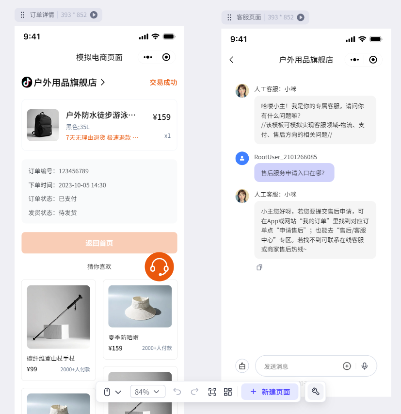
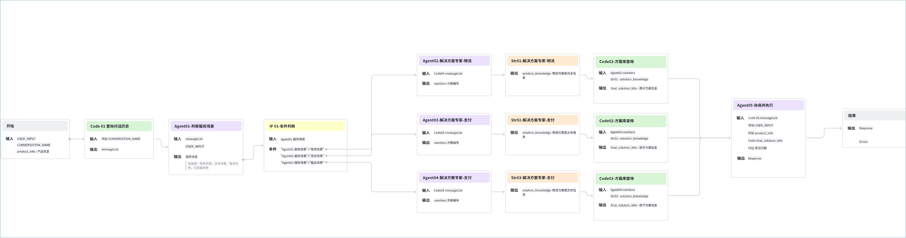
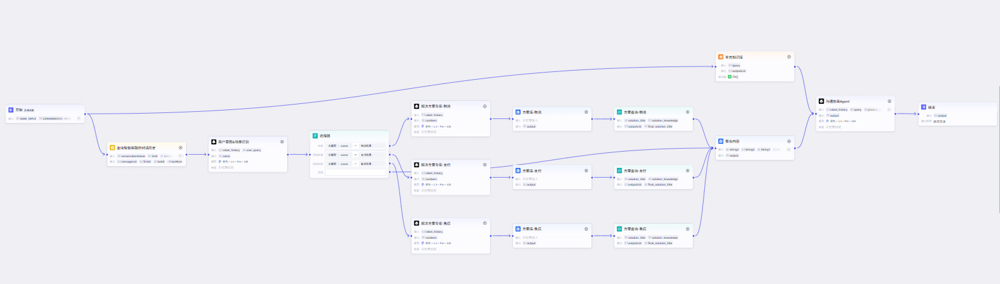

# 82.基于Coze开发电商售后客服

## 背景介绍 
常见用户视角的智能客服流程为：自助解决->智能客服->人工客服。 

在电商场景中，人工客服往往会耗费极高的人力成本。而且，当问题集中涌现时，客户进线后等待时间过长，这会进一步降低用户对商品的印象分。在此场景下，“大模型回复+人工监管”的模式，能够在很大程度上优化客户进线后的等待体验，同时也能优化人工客服的人力支出。 

本模板为抖音电商团队的智能客服同款模板，目前，抖音电商客服正在推进大模型能力的全面应用，预期能够解决90%的客户问题，剩余10%为人工监管带来的支持。 

## 功能点介绍 
1. 进线用户特征解析 
2. 用户意图识别&场景判断 
3. 对应场景的解决方案输出 
4. 总结归纳回复内容 

## 模板模块介绍 
### 前端页面 
模拟消费者进线咨询路径，复刻核心场景 

模版地址：[https://www.coze.cn/template/project/7483445293669957632](https://www.coze.cn/template/project/7483445293669957632?)

### 核心业务流程 
基于客服服务流程，结合扣子提供的大模型、知识库、代码等能力，抽象“客服小咪智能体”工作流。 

核心业务流程如下： 

关键能力节点如下： 

+ 主流程：串联完整服务链路，判断会话基本面并路由至相应Agent 
+ Agent节点：承接独立职能，如寒暄&收尾、问题澄清、场景路由、判断解决方案、协商&执行方案等 
+ 配置节点：知识库配置、判断条件配置、LLM模型参数配置等 
+ 代码节点：IM通信、特征解析、实验参数获取 等 

| 节点名称  | 设计逻辑  |
| --- | --- |
| 对话历史查询  | 使用会话：存储记录用户进线前的对话历史  |
| 用户意图&场景识别  | 使用大模型：结合用户的历史对话，判断用户的进线动机以及属于客服的哪个场景咨询，并给出结果判断  |
| 场景分流  | 使用选择器：根据上述的结果判断，分流到对应的场景里。因客服场景较多，本模板仅展现最典型的三个场景（物流、支付、售后），开发者复制该模板后，可根据实际情况进行修改。  |
| 细分场景解决方案定位  | 使用大模型及知识库：每个细分场景一个大模型节点，由不同场景解决专家人设，根据上述的内容，结合知识库储备的解决方案文档，给出正确的处理方案。该节点需要根据业务的实际需求进行材料的替换，历史积累的解决方案越详细，问题穷举得越多，输出的效果会越好。  |
| 内容聚合  | 将历史沉淀的FAQ文档，加上大模型通过方案库整理输出的内容，一并输入给最后一个大模型，作为大模型输出前的最终素材。  |
| 话术输出  | 使用大模型：最后一个大模型节点主要是对此前的素材进行话术上的优化，使其输出的内容更通俗易懂，并通过服务指南的指定，让输出的内容更有温度，降低AI感。  |

## 最终效果 
通过Agent能力建设和工作流的串联，将“客服”这一角色抽象化、数据化为一个智能体，由其代替真实人类为用户提供服务。最终，电商团队在扣子平台搭建的智能客服，提高人工回复的质量和效率。

> 更新: 2025-04-20 22:38:47  
> 原文: <https://www.yuque.com/aaron-wecc3/dhluml/xosuint2nkt253ls>