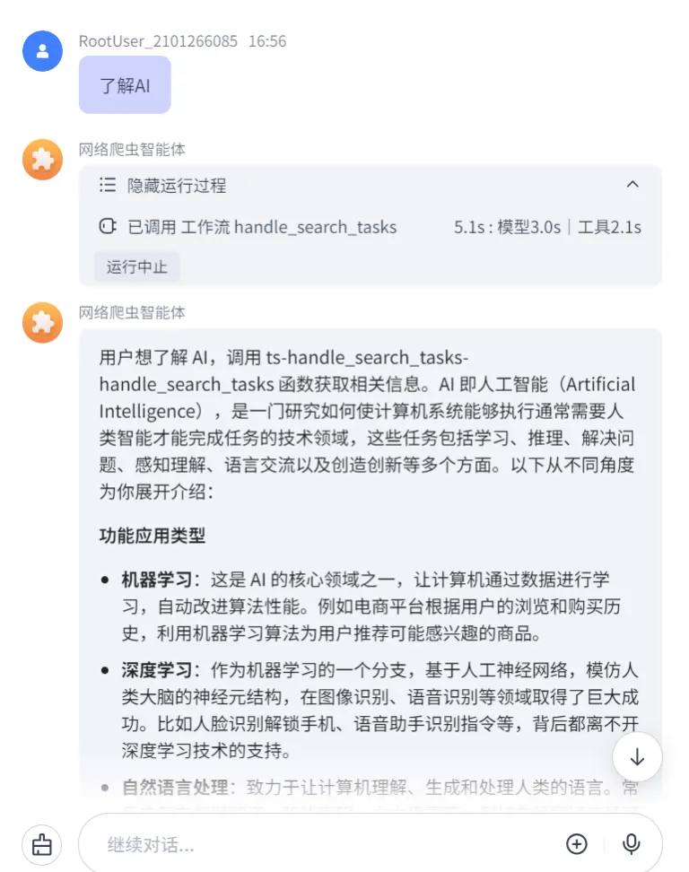
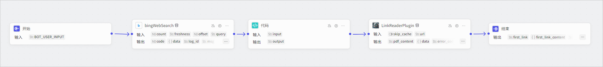
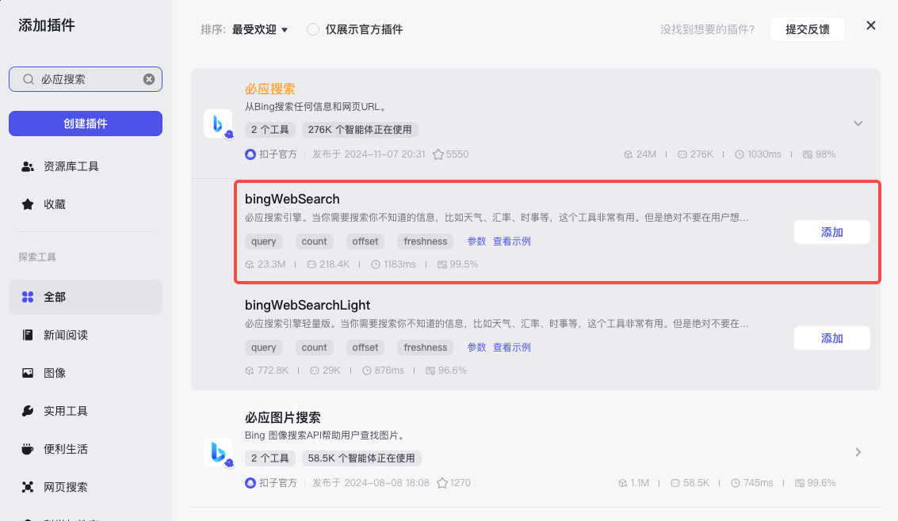
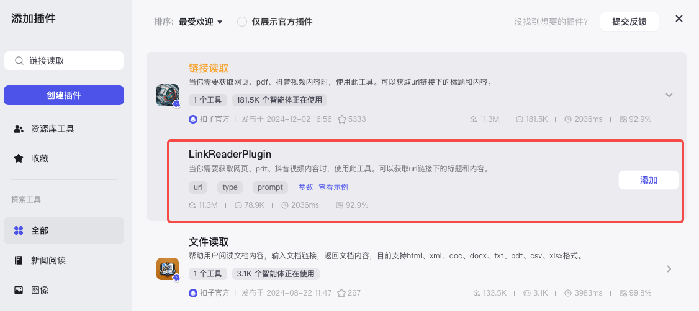
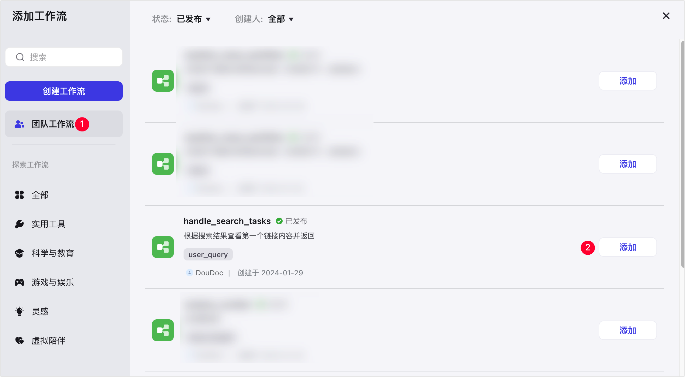
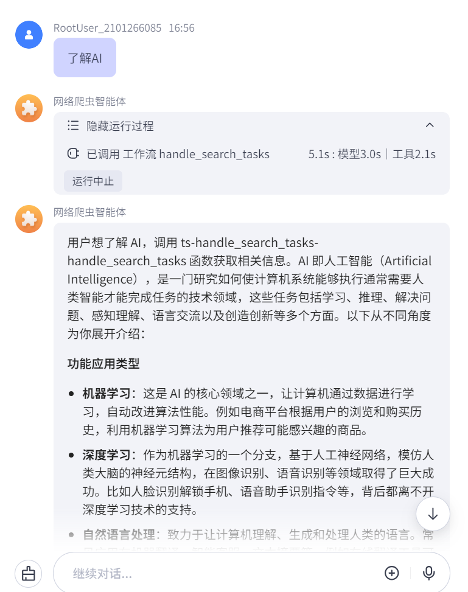

# 83.基于Coze开发网页数据采集助手

通过代码节点和插件节点构建一个用于处理搜索结果的工作流。



## 效果展示

本文构建的示例工作流节点概览如下图所示。在该工作流中：

1. 使用搜索插件，搜索数据。
2. 使用代码节点，提取第一条数据的链接。
3. 使用获取网页内容插件，获取链接内容。



示例工作流添加到智能体之后，智能体带来的用户任务处理能力。当用户输入内容后，智能体会调用示例工作流处理任务，并向用户返回处理结果。

## 步骤一：构建工作流

1. 登录[扣子](https://www.coze.cn/home)平台。
2. 在左侧导航栏中选择**工作空间**，并在页面顶部空间列表中选择目标工作空间。
3. 从左侧导航栏进入**资源库**页面。
4. 在页面右上角，单击 **+资源** > **工作流**。

本文示例配置如下：

```
- **工作流名称**：输入 handle_search_tasks
- **工作流描述**：输入 根据搜索结果查看第一个链接内容并返回
```

5\. 在工作流页面左侧，单击**插件**右侧 **+** 图标，查找**必应搜索**插件并选用 **bingWebSearch** 工具。

该节点将用于搜索用户输入的信息。



6. 在工作流页面左侧的**选择节点**列表内，选用**代码**节点。

该节点将用于提取搜索结果中第一条数据对应的访问链接。

7. 在工作流页面左侧，单击**插件**右侧 **+** 图标，查找**链接读取**并选用 **LinkReaderPlugin** 工具。

该节点用于获取指定 URL 的内容。



8. 连接各节点，并依次配置输入输出参数。

节点连接顺序：**Start → bingWebSearch → 代码 → LinkReaderPlugin → End**，各节点参数配置详情如下。

| **节点** | **参数配置** |
| --- | --- |
| 开始  | 新增 user_query 输入参数，并选择 **String** 类型。  |
| bingWebSearch  | 设置 query 输入参数，在**参数值**区域选择**引用 Start > user_query**。其他参数项保持默认配置。  |
| 代码  | 1. 新增 input 输入参数，在参数值区域选择**引用 bingWebSearch > response_for_model**。 <br/>2. 在**代码**区域进入 IDE，将默认代码替换为如下代码，该代码用于提取搜索结果的第一个链接。 <br/><code>plain async function main({ params }: Args): Promise<Output> {      const parsedData = JSON.parse(params.input);       for (let i = 0; i < parsedData.length; i++) {           const regex = /link:(http[s]?:\/\/[^\s]+)/;           const match = regex.exec(parsedData[i]);           if (match) {             return match[1];           }       }   } </code>  1. 新增 output 输出参数，并选择 **String** 类型。  |
| LinkReaderPlugin  | 设置 url 输入参数，在**参数值**区域选择**引用 Code > output**。其他参数项保持默认配置。  |
| 结束  | 新增以下<font style="color:rgb(38, 38, 38);">输出</font>参数： <br/>1. 新增 first_link 输出参数，在**参数值**区域选择**引用 Code > output**。该参数用于输出网页链接。 <br/>2. 新增 first_link_content 输入参数，在**参数值**区域选择**引用 LinkReaderPlugin > data**。该参数用于获取网页链接的内容。 <br/>3. 新增 search_result 输入参数，在**参数值**区域**引用 LinkReaderPlugin > response_for_model**。该参数用于获取搜索结果。  |

9. 配置完成后，单击页面右上角的**试运行**，测试工作流。

例如，输入 了解 AI 进行测试，待所有节点都运行成功（节点会展示绿色边框）后，查看指定节点的运行结果。

10. 测试工作流无问题后，单击页面右上角的**发布**。

成功发布后，在工作流列表中可以查看到该工作流。

## 步骤二：在智能体添加工作流并测试

1. 前往当前团队的智能体页面，创建或进入指定智能体。
2. 在智能体编排页面，找到**技能**区域的工作流，在右侧单击加号图标。
3. 在对话框左侧单击**团队工作流**，找到自建的 **handle_search_tasks** 工作流，并在右侧单击**添加**。



4. 在智能体的**人设与回复逻辑**内，声明智能体使用 **handle_search_tasks** 工作流处理任务。

编写后，你可以单击**优化**，让 AI 帮助你生成结构化的回复逻辑。

5. 在智能体的右侧**预览与调试**区域，输入内容预览智能体实现的效果。

例如输入 了解 AI。




> 更新: 2025-04-20 22:38:47  
> 原文: <https://www.yuque.com/aaron-wecc3/dhluml/xkxtw8q3s1tepn0g>