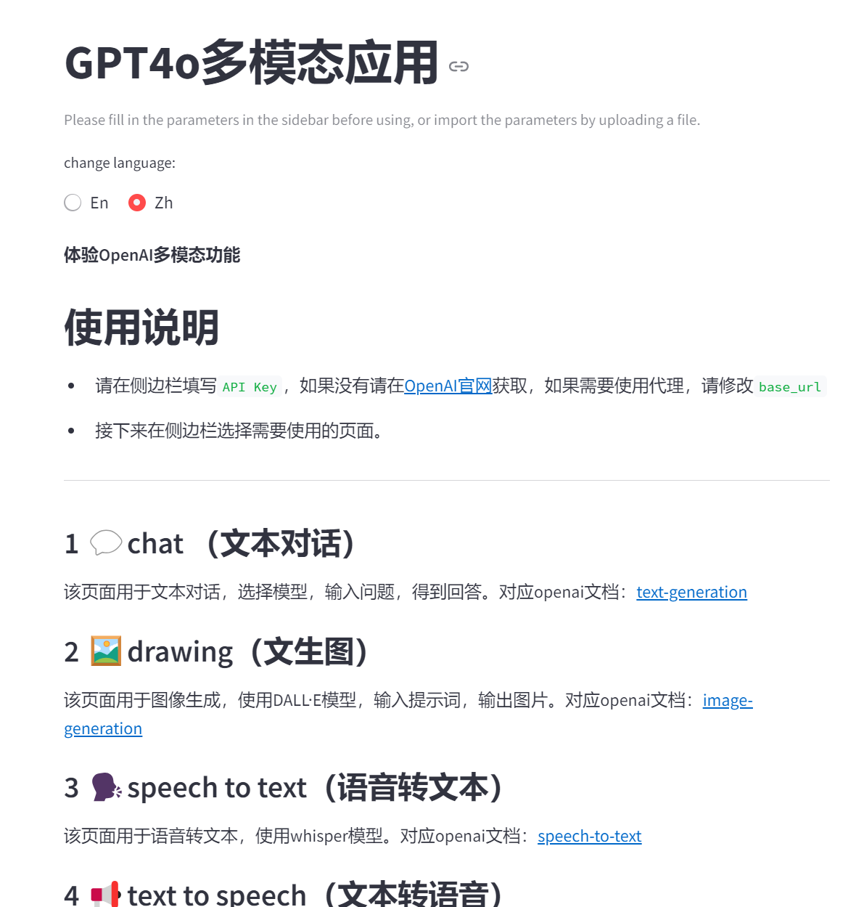
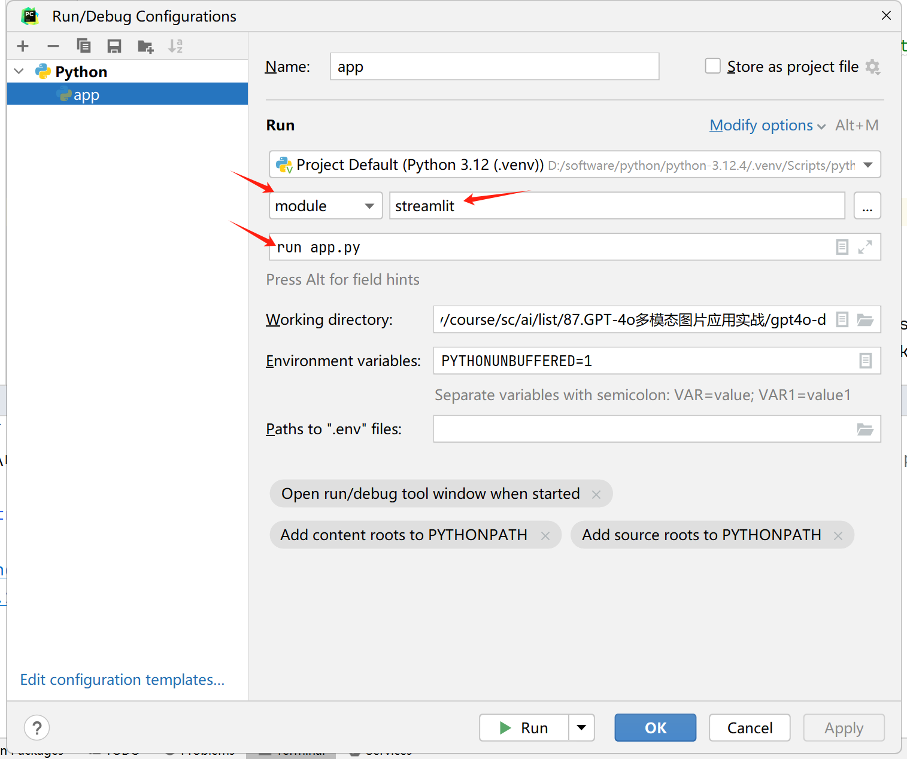
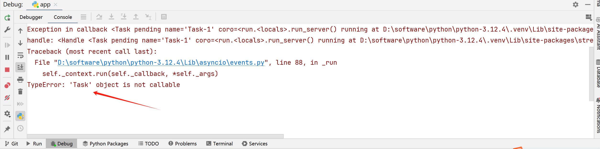
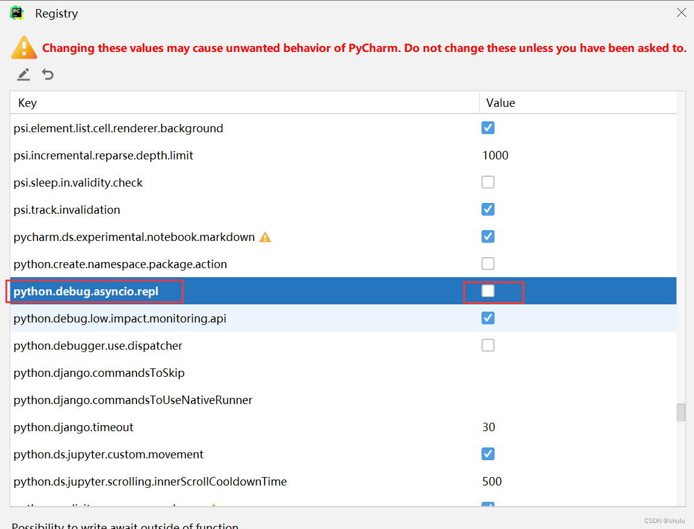

# 87.GPT-4o多模态应用实战

**示例代码**

[gpt4o-demo.ppt](https://www.yuque.com/attachments/yuque/0/2025/ppt/1387387/1745159926249-731639a3-9ba8-41b7-9a75-bf2a9e92af35.ppt)

_<font style="color:#DF2A3F;">注：将ppt后缀名改为zip后解压</font>_

python版本：3.12.4


## 演示效果


## Streamlit开发文档
官方文档：[https://docs.streamlit.io/](https://docs.streamlit.io/)

中文文档：[https://blog.csdn.net/weixin_44458771/article/details/135495928](https://blog.csdn.net/weixin_44458771/article/details/135495928)


## Streamlit命令行启动
```powershell
pip install streamlit
streamlit run app.py --server.port 8501
```


## <font style="color:rgb(51, 51, 51);">配置Pycharm调试Streamlit应用</font>
<font style="color:rgb(51, 51, 51);">开发环境</font>

<font style="color:rgb(51, 51, 51);">PyCharm Community Edition 2024</font>

<font style="color:rgb(51, 51, 51);">Win10/11</font>

<font style="color:rgb(51, 51, 51);">Streamlit </font><font style="color:#080808;background-color:#ffffff;">1.39.0</font>


### <font style="color:rgb(51, 51, 51);">创建应用</font>
<font style="color:rgb(51, 51, 51);">app.py</font>

```python
import streamlit as st

st.header("hello")
st.write("this is a streamlit demo")
```

### 调试应用
<font style="color:rgb(51, 51, 51);">启动参数</font>

**module**：<font style="color:#080808;background-color:#ffffff;">streamlit</font>

**<font style="color:rgb(51, 51, 51);">Script parameters</font>**<font style="color:rgb(51, 51, 51);">：</font><font style="color:#080808;background-color:#ffffff;">run app.py</font>



<font style="color:rgb(51, 51, 51);">再次启动 debug 按钮，报错如下</font>



<font style="color:rgb(51, 51, 51);">解决如下:</font>

<font style="color:rgb(51, 51, 51);">Help | Find Action | Registry | python.debug.asyncio.repl 去掉勾。</font>



###  


> 更新: 2025-04-20 22:38:46  
> 原文: <https://www.yuque.com/aaron-wecc3/dhluml/zg8galldagwfw0wv>