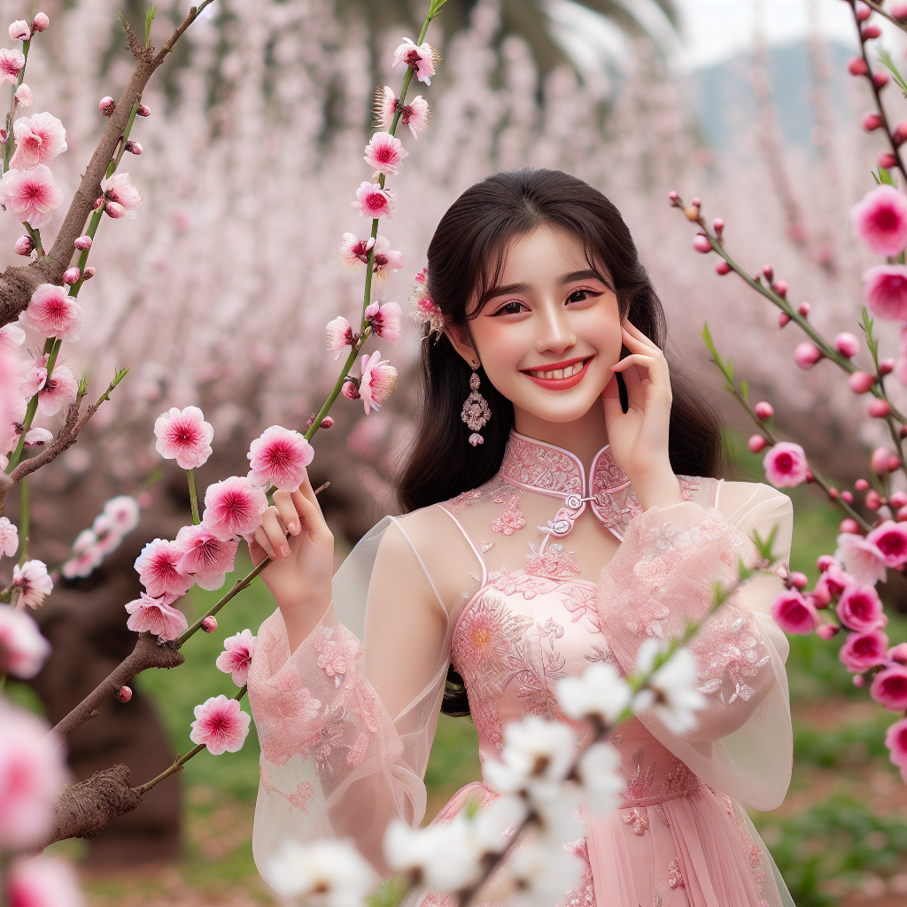
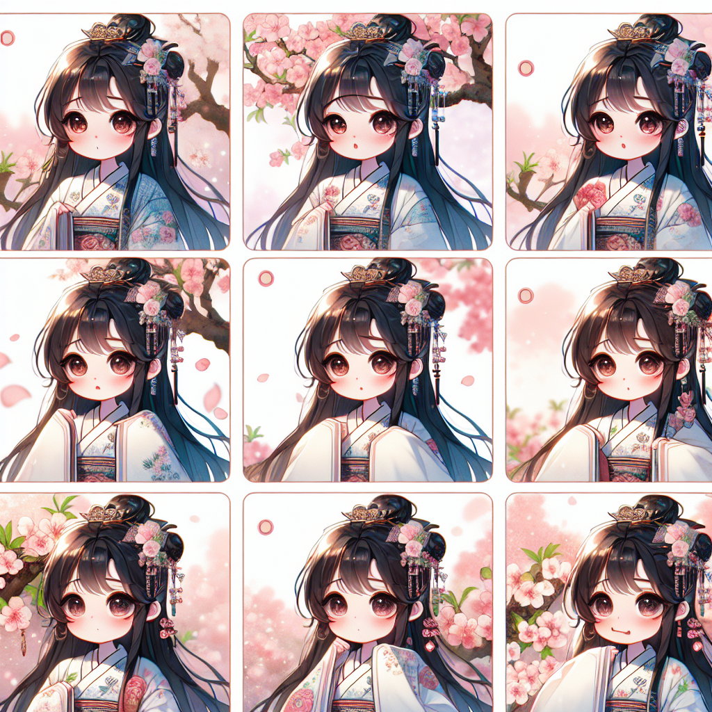
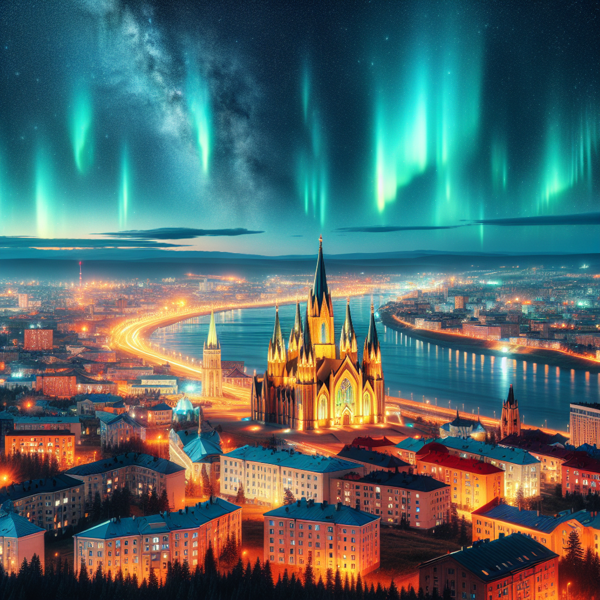
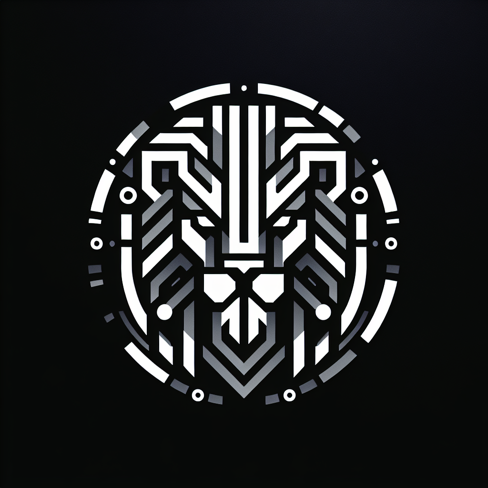
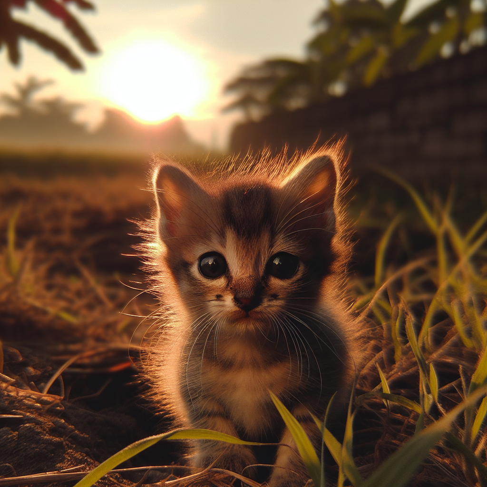
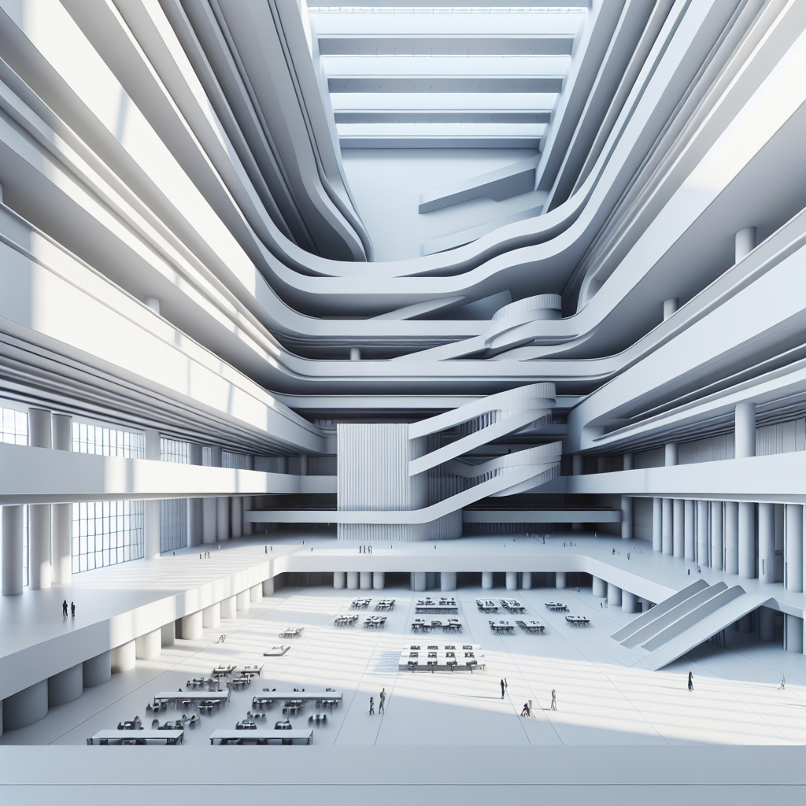
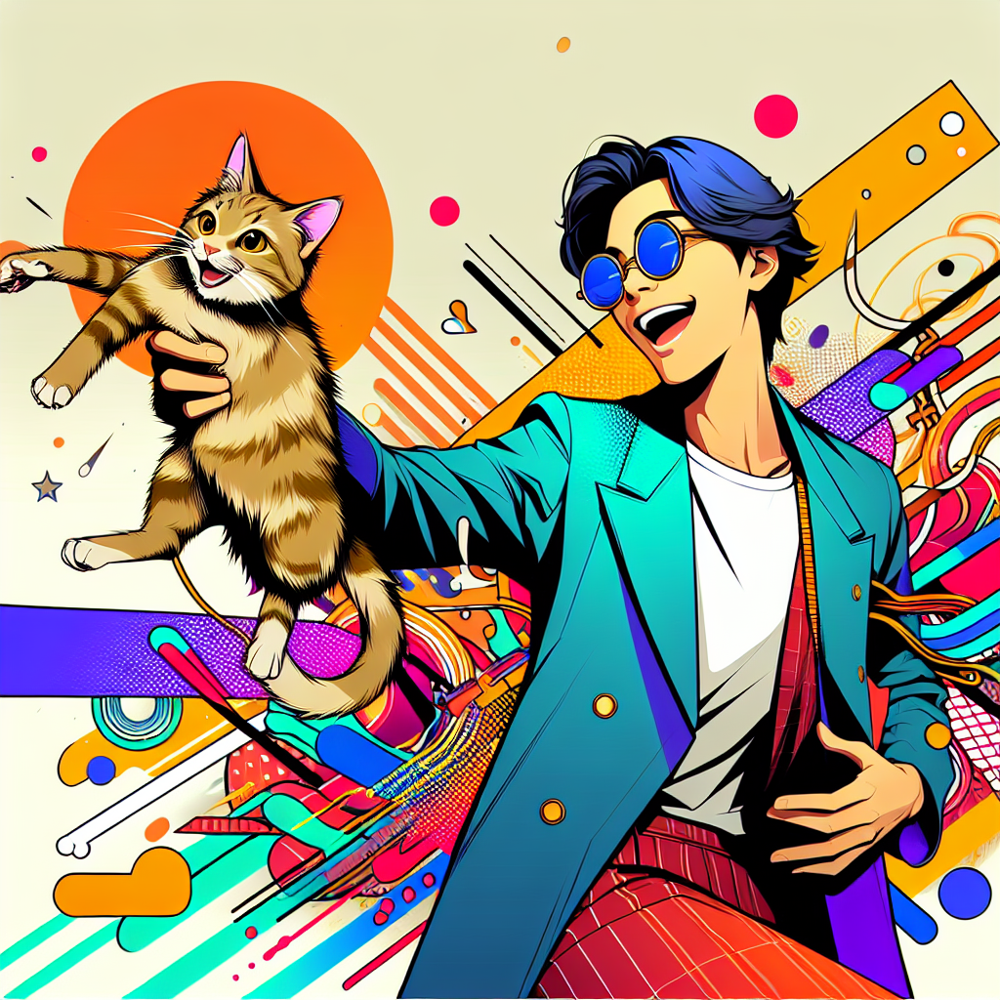
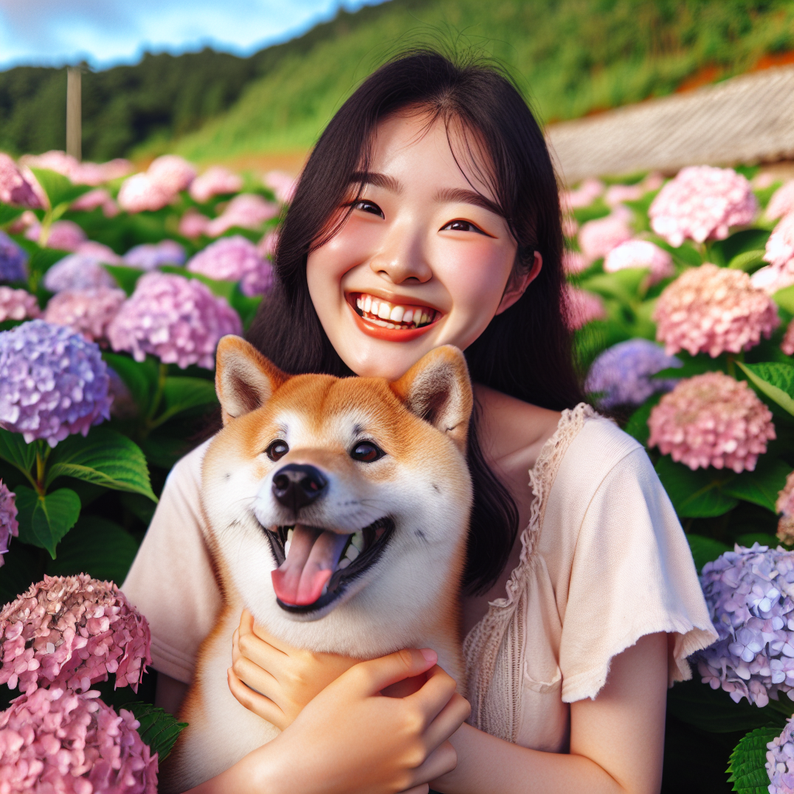
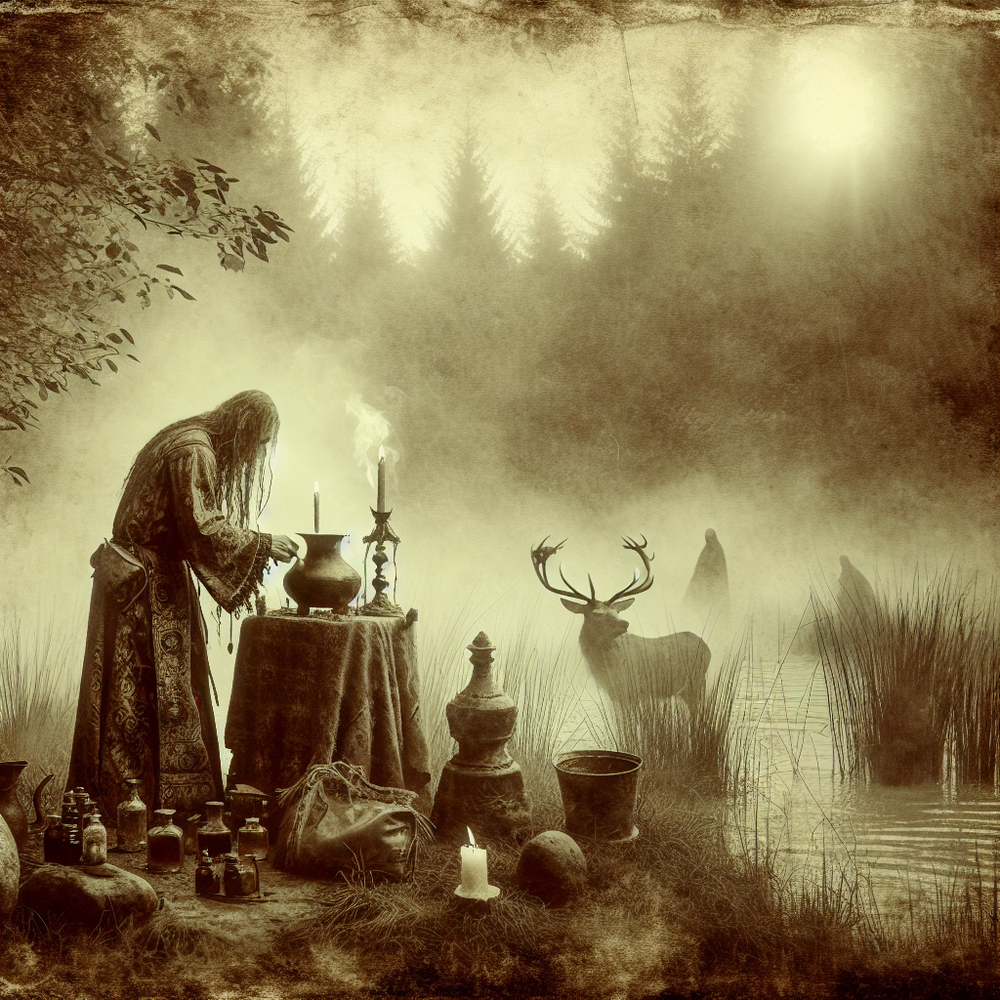
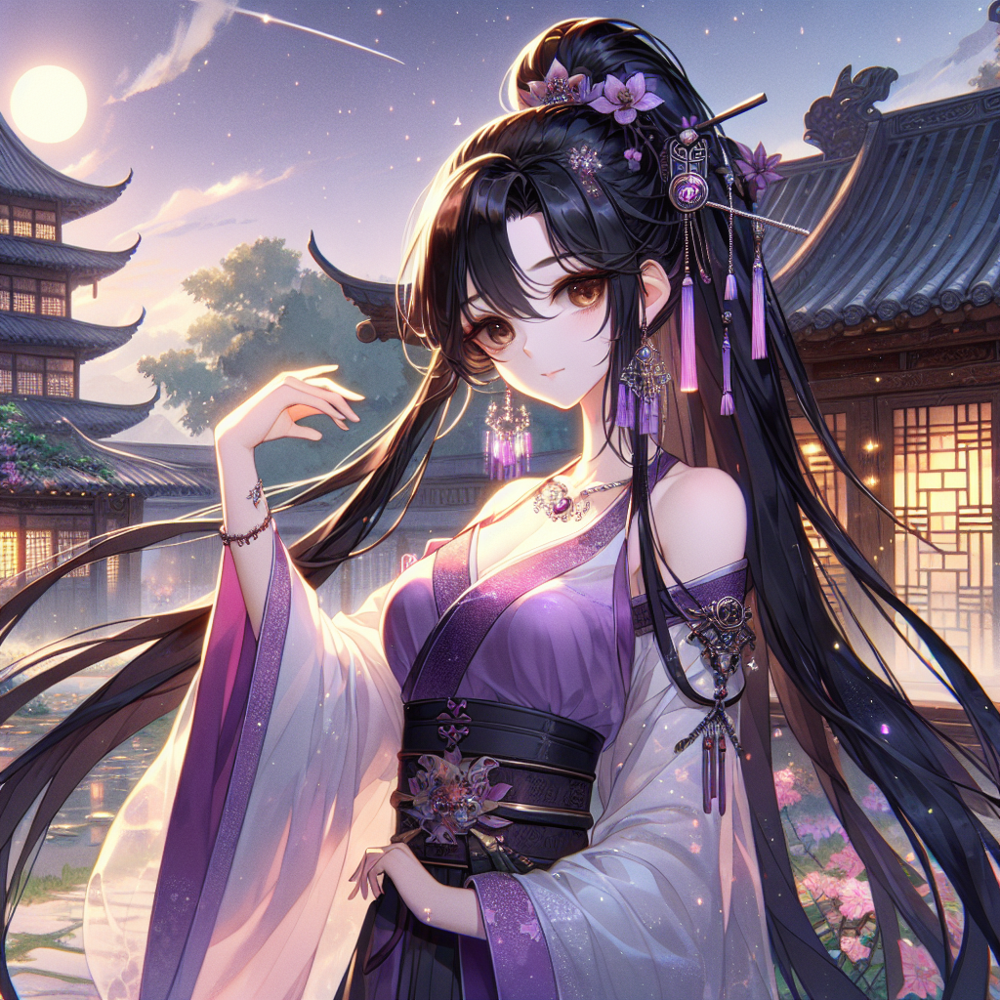

# 89.DALL-E3图像提示工程最佳实践

# 图像提示工程

图像提示工程（Image Prompt Engineering）是一项新兴的技术，旨在通过设计和优化图像提示来引导模型生成高质量的图像输出。这种技术不仅适用于文本生成，还可以在图像生成、图像理解和多模态任务中发挥重要作用。

以下是一些在图像提示工程中常用的技术和最佳实践：

### 1. 明确图像生成目标

**最佳实践**：明确你希望模型生成的图像类型、风格或内容。

**示例**：

* **目标不明确**：`"生成一张图片。" `
* **目标明确**：`"生成一张卡通风格的森林场景，包含动物和树木。" `

### 2. 提供详细描述

**最佳实践**：为模型提供详细的描述，包括场景、颜色、风格等信息。

**示例**：

* **简单描述**：`"生成一张城市图片。" `
* **详细描述**：`"生成一张现代城市的图片，包含高楼大厦、街道和行人，使用明亮的色调。" `

### 3. 使用参考图像

**最佳实践**：提供参考图像，帮助模型理解期望的风格或内容。

**示例**：

* **无参考图像**：`"生成一张风景图片。" `
* **有参考图像**：<code>"生成一张类似于下面这张图片内容的图像。\n[参考图像链接：<font style="color:rgb(9, 171, 59);background-color:rgb(248, 249, 251);">https://image.pollinations.ai/prompt/dog</font>]" </code>

### 4. 分步生成

**最佳实践**：对于复杂的图像生成任务，可以分步进行，逐步细化图像内容。

**示例**：

* **一步生成**：`"生成一张包含海滩、椰子树和日落的图片。" `
* **分步生成**：
  1. `“首先生成一张海滩的基础图像。”`
  2. `“在海滩上添加椰子树。”`
  3. `“在背景中添加日落。”`

### 5. 使用多模态提示

**最佳实践**：结合文本和图像提示，提供更加丰富的信息。

**示例**：

* **单一提示**：`"生成一张森林的图片。" `
* **多模态提示**：<code>"生成一张森林的图片，参考下面的描述和图像。\n描述：一个宁静的森林，阳光透过树叶。\n[参考图像链接：<font style="color:rgb(9, 171, 59);background-color:rgb(248, 249, 251);">https://image.pollinations.ai/prompt/forest</font>]" </code>

### 6. 控制图像风格和细节

**最佳实践**：通过提示控制图像的风格和细节，确保生成的图像符合预期。

**示例**：

* **无风格控制**：`"生成一张花园的图片。" `
* **有风格控制**：`"生成一张印象派风格的花园图片，使用柔和的色调和模糊的边缘。" `

### 7. 反复试验和调整

**最佳实践**：不断试验和调整提示，观察模型生成的图像，并根据需要进行优化。

**示例**：

* **初始提示**：`"生成一张城市夜景的图片。" `
* **调整提示**：`"生成一张城市夜景的图片，包含霓虹灯、车流和高楼大厦的灯光。" `

### 8. 使用图像模板和占位符

**最佳实践**：使用图像模板和占位符来指示需要填充的内容或格式。

**示例**：

* **无模板**：`"生成一张包含建筑物和树木的图像。" `
* **有模板**：`"生成一张包含建筑物和树木的图像，建筑物在左侧，树木在右侧。" `

### 9. 多轮对话生成

**最佳实践**：在需要时，通过多轮对话逐步引导模型生成所需的图像内容。

**示例**：

* **单轮对话**：`"生成一张包含湖泊和山脉的图片。" `
* **多轮对话**：
  * 用户：`"生成一张包含湖泊的图片。" `
  * 模型：`"生成的湖泊图片。"`
  * 用户：`"在湖泊背景中添加山脉。" `
  * 模型：`"生成的湖泊和山脉图片。"`

### 10. 结合图像和文本生成

**最佳实践**：结合图像和文本生成，创建更加丰富和多样的内容。

**示例**：

* **图像生成**：`"生成一张宇宙场景的图片。" `
* **图像和文本生成**：`"生成一张宇宙场景的图片，并生成一段描述这张图片的文字。" `
  * **输出**：
    * **图像**：宇宙场景图片
    * **文本描述**：`"这是一张充满星星和星云的宇宙场景图片，背景是深邃的黑色，星星闪烁着微弱的光芒。" `

### 11. 风险与安全管理

**最佳实践**：在生成图像时，注意内容的风险和安全问题，避免生成不当或敏感的图像。

**示例**：

* **提示**：`"生成一张适合所有年龄段观看的风景图片。" `
* **输出**：确保生成的图像没有敏感或不当内容。

通过遵循这些最佳实践，可以更有效地利用图像提示工程技术来生成高质量的图像内容，满足各种应用需求。

<font style="color:rgb(51, 51, 51);">本文主要列举网络中 Dall E3 提示词，每一个提示词都可能得到一个不错的绘画作品，大家可以尝试尝试。这些提示词不仅可以用于 DALL E，还可以尝试在 Midjourney、Stable Diffusion 等 </font>[<font style="color:rgb(51, 51, 51);">AI 绘画</font>](https://so.csdn.net/so/search?q=AI%E7%BB%98%E7%94%BB\&spm=1001.2101.3001.7020)<font style="color:rgb(51, 51, 51);">工具中进行使用。大家也可以对比一下各种工具下的不同效果。</font>

<font style="color:rgb(51, 51, 51);">当前主要分为以下 11 个类别</font>

<font style="color:rgb(51, 51, 51);">1、人物形象</font>

<font style="color:rgb(51, 51, 51);">2、卡通头像</font>

<font style="color:rgb(51, 51, 51);">3、自然风景</font>

<font style="color:rgb(51, 51, 51);">4、LOGO 设计</font>

<font style="color:rgb(51, 51, 51);">5、动物形象</font>

<font style="color:rgb(51, 51, 51);">6、室内设计</font>

<font style="color:rgb(51, 51, 51);">7、动漫风格</font>

<font style="color:rgb(51, 51, 51);">8、二次元图</font>

<font style="color:rgb(51, 51, 51);">9、日常场景</font>

<font style="color:rgb(51, 51, 51);">10、古风神话</font>

<font style="color:rgb(51, 51, 51);">11、游戏场景</font>

<font style="color:rgb(51, 51, 51);"></font>

# <font style="color:rgb(51, 51, 51);">DALL-E3绘图提示词大全</font>

## <font style="color:rgb(51, 51, 51);">01、人物形象</font>



```plain
【001】在春天的桃花林中，一位笑容灿烂的中国女孩穿着粉色的裙子，与花朵相映成趣。
【002】一个漂亮的中国女孩，自拍照，真实， --ar 9:16 --v 5.2，中等胸部，白色一字肩裙子，写实照片，虚幻引擎，杰作，官方艺术效果，CG渲染，光影效果
【003】青春可爱的阳光少女，广告拍摄 --ar 1:1 --v 5.2，写实照片，虚幻引擎，杰作，官方艺术效果，CG渲染，光影效果，背景虚化建筑，
【004】写实照片，虚幻引擎，杰作，官方艺术效果，中国人，可爱的女生，长发，裙子，年龄18岁，阳光帅气的男生，短发，格子寸衫，微笑，年龄20岁，成熟，森林公园，花草，光影效果，CG渲染
【005】给我画一张小野和蛋仔土豆在一起的照片，小野是清纯可爱的女生，蛋仔土豆是阳光帅气的男生
【006】苏星月，汉服，在一个梦幻的地方
【007】一个小女孩，卡通，穿着短裤，开心的大笑，棕色的大眼睛，白色连衣裙，长发，中式发型，独奏，白色的运动鞋，坐在凳子上，盲盒，泡泡玛特，米白色和米黄色，干净的背景，工作室照明，超高清呈现，超高质量，工作室质量
【008】Masterpiece, official art effects, CG rendering, realistic details, Chinese girl, Chinese style Hanfu, black long hair, exquisite facial features, full body photo, Kawaii, cute, ultra high resolution, 8K, [: (detailed face: 1.2): 0.2], (1.2), medium chest, (morning) (villa garden), elegant classical posture, (ulzzang-650:0.2)，写实照片
虚幻引擎，花园，双手抓着秋千坐着，景深背景
【009】中国少女，杨超越风格，长发，一字肩裙子，精准的五官，逼真的面部细节，CG渲染，杰作，官方艺术效果，真实照片，虚幻引擎，花园，双手抓着秋千坐着，景深背景
【010】写实照片，虚幻引擎，CG渲染，杰作，官方艺术效果，中国女孩，精致的五官，逼真的面部细节，黑色长发，耳环，头饰，项链，手镯，锁骨，中等胸部，时尚简约风，裙子，户外，别墅花园，景深
【011】Realistic photos, unreal engine, masterpieces, official artistic effects, Asian girls, exquisite facial features, realistic facial details, smiling movements, long hair, earrings, necklaces, shoulder-length skirts, collarbones, medium breasts, fashionable and simple style, white shoes, outdoor, pastoral flowers, sunlight refraction, light and shadow effects, CG rendering
【012】杰作，官方艺术效果，CG渲染，逼真的细节，中国少女，黑色长发，精致的五官，全身照，卡哇伊，可爱，中等胸部，精致的锁骨，白色的连衣裙，蓝色拖鞋，超高分辨率，8K，[：（细节脸：1.2）：0.2]，（1.2），（上午）（别墅花园），优雅的坐姿，姿势，花海，草木，（ulzzang 650:0.2）
【013】Asian girl, full body photo, realistic, black long hair, exquisite facial features, realistic facial details, smiling expression, cute, Kawaii, hair accessories, exquisite collarbone, medium chest, white gauze skirt, pattern, slippers, butterfly dancing, elegant sitting posture, park, green grass garden, lawn, background blurry, blue sky and white clouds, ultra-high resolution, ultimate details, 8K
【014】Asian girl, black long hair, exquisite facial features, realistic facial details, smiling expression, cute, Kawaii, hair accessories, pink gauze skirt, pattern, butterfly dancing, park, green grass garden, lawn, background blurring, blue sky and white clouds, ultra high resolution, ultimate details, 8K
【015】(Real person photography), real beauty, masterpiece, official art effects, CG rendering, realistic details, Chinese girls, national style Hanfu, Tang Dynasty Hanfu, light and thin styles, prints, patterns, details, black long hair, delicate facial features, full body photos, Kawaii, cute, ultra high resolution, 8K, [: (detailed face: 1.2): 0.2], (1.2), medium chest, forest park, sunlight refraction, flowers, ginkgo trees, evening, Sunset and sunset
【016】(Real person photography), real beauty, masterpiece, official art effects, CG rendering, realistic details, Chinese girls, Chinese style Hanfu, Song style Hanfu, prints, patterns, details, black long hair, exquisite facial features, full body photos, Kawaii, cute, ultra high resolution, 8K, [: (detailed face: 1.2): 0.2], (1.2), medium chest, pavilion, elegant classical posture, ginkgo tree, evening, sunset, sunset
【017】Masterpiece, official art effects, CG rendering, realistic details, beautiful Chinese girl, white suspender dress, exquisite collarbone, shoulders exposed, wearing diamond necklace, 8k, best quality, masterpiece display, wallpaper, 9:16, (detailed facial features), gorgeous, (dynamic posture: 1.2), strong light on face and lips. (Separated lips: 1.3). smile.
【018】(Real person photography), a Chinese girl with realistic and delicate facial features, dressed in a white chiffon dress, diamond necklace, masterpiece, of the best quality, official art, extremely detailed CG unified 8k wallpaper, highly detailed,，1girl，
【019】(Chinese girls), beautiful women, mature temperament, exquisite facial features, realistic facial details, long black hair, big chest, deep V, smile, hand details, hair accessories, necklaces, bracelets, anime clothes, COS cartoon characters, game characters, bare shoulders, collarbones, masterpieces, official art, outdoor, game stage, Stage lighting, laser spotlights, 8K, CG rendering, movie grade lighting, complex details, (photography: 1.1), (Gorgeous woman: 1.3), Instagram, (photo realism: 0.8)
【020】（杨超越风格），独奏，中国女孩，漂亮，棕色头发，长发，中等胸部，精致的五官，逼真的面部细节，看向观众，微笑，连衣裙，洛丽塔，户外，大街，夜间，夜市街，路灯，背景，模糊，楼房建筑，杰作，官方艺术，8K，CG渲染，复杂的细节，（摄影：1.1），（华丽的中国女人：1.3），instagram，（照片真实感：0.8）
```

## <font style="color:rgb(51, 51, 51);">02、卡通头像</font>



```plain
【001】可爱的少女，动漫，唐朝汉服，桃花树，头像，表情包，艺术设计，九张不同表情，细节
【002】头像，表情包，每一张设计一个头像表情包，按九宫排列，9张表情包，一个美丽的小女孩，二次元动漫，杰作，官方艺术效果，精细
【003】艺术设计，头像，表情包，每一张设计一个头像表情包，按九宫排列，9张表情包，一个美丽的小女孩，动漫，杰作，官方艺术效果，精细，逼真，CG渲染
【004】卡通手绘画萌宝包子表情各异，扁平风格，超清分辨率，8K，细节，每一组3张，总共9张，九宫格
```

## <font style="color:rgb(51, 51, 51);">03、自然风景</font>



```plain
【001】美丽的城市极光
【002】((masterpiece, best quality,)),moon, night, no humans, table, star (sky), sky, window, water, night sky, full moon, grass, chair, food, lamp, lily pad, plant, cloud, cup, scenery, starry sky, fruit, book
【003】((masterpiece, best quality,)),food, no humans, lantern, plant, window, water, bamboo, lily pa
【004】建筑，花草，喷水池，蓝天白云
```

## <font style="color:rgb(51, 51, 51);">04、LOGO 设计</font>



```plain
【001】具有科技风格的狮头形状Logo，背景要求纯黑色。
【002】这是一款以老鼠为标志的简约白色LOGO设计，整体呈现出半几何的风格，LOGO由三种颜色构成，不仅简洁明快，也富有创意与艺术感，简洁、白色三色调的半几何化老鼠标志
【003】机械鳄鱼(Alligator)机器人体育吉祥物：兽形矢量插图标志，粗线轮廓，扁平化设计，简约色彩，平面插图，吉祥物角色。超清分辨率，8K，细节
```

## <font style="color:rgb(51, 51, 51);">05、动物形象</font>



```plain
【001】夕阳下的小猫好自由。
【002】春天里，躺在樱花树下的猫咪怀里一起打个盹，治愈风
【003】温暖柔软的巨大化动物，给人无比安心的感觉。埋进毛茸茸萌物里，苦恼就会慢慢消散。
【004】大大的毛茸茸的宠物猫，小小的建筑，小小的人，压抑，温暖，善良，不要写实，要治愈风或者国风
【005】a smile dinosaur, illustrate by Duncan Beedie children book illustration, simple, cute, full colour, minimalist, detailed, illustration, no background --ar 1:1 --v 5.2
【006】超萌可爱中国龙，Pixar风格渲染，红枫叶背景，虚幻引擎5打造，超大广角视角，超清分辨率，8K，细节
【007】写实照片，虚幻引擎，CG渲染，冬季枝头的胖红雀，写实主义画家风格，浅红与深灰，酸浆果色，浅红与黑色，生动逼真，色彩丰富，草原主题
【008】蓝云小鸟萌翻天，音符伴舞在碧空
```

## <font style="color:rgb(51, 51, 51);">06、室内设计</font>



```plain
【001】现代大楼，室内设计，现代，极简，超大空间感，白色，3D，3D渲染，由3DMAX做的室内效果图
```

## <font style="color:rgb(51, 51, 51);">07、动漫风格</font>


```plain
【001】冬天也不要怕冷，大大的企鹅会把它的肚子借给人类倚靠的，日本漫画的治愈风格，压抑，类似夏目友人帐那种
【002】秋日的公交站旁，一旦人类在那里停留一段时间，会有越来越多的大大的兔子靠上来，日本漫画的治愈风格，压抑，类似夏目友人帐那种
```

## <font style="color:rgb(51, 51, 51);">08、二次元图</font>



```plain
【001】一个帅气的文艺青年和一只猫开开心心，二次元
【002】写实照片，二次元，CG渲染，杰作，官方艺术效果，亚洲女孩，黑色头发，长发，动漫COS衣服，手持话筒，舞动身姿，动漫舞台
【003】（写真摄影），中国女孩，独奏，可爱的，甜美的笑容，漂亮，精致的五官，逼真的面部细节，二次元风格，复杂的细节，胸大，锁骨，长发，发饰，发带飘带，动漫COS衣服，饮料，姿势动作，户外，公园，树林，花草，草坪，CG渲染，电影级光影，杰作，官方艺术，复杂的细节，（摄影：1.1），（华丽的中国女人：1.3），instagram，（照片真实感：0.8）
```

## <font style="color:rgb(51, 51, 51);">09、日常场景</font>



```plain
【001】夏天来了，少女和心爱的柴犬在紫阳花田中的笑容像刚刚放晴的天空一样明媚，治愈，压抑
```

## <font style="color:rgb(51, 51, 51);">10、古风神话</font>



```plain
【001】古风，萨满巫师，水池边，巫蛊，古风，祭司，灵异，古风
【002】写实照片，梦幻感，神秘的小松鼠大人，嘴巴喷紫色烟雾，天朗气清，繁星闪烁，银色残月，黄金风暴，尾巴闪电，长发闪耀，御风飞舞，江山如画，浑身燃烧火焰，眼含苍穹，乘风破浪
【003】古风，日出，山风
```

## <font style="color:rgb(51, 51, 51);">11、游戏场景</font>



```plain
【001】outdoor，(purple hairs:1.2)，(large breasts:1.1)，flowers，floating hair，sky，rainbow,moon,sky,stars,(hand on own breasts:1.4),standing，,1girl, jewelry, solo, hair ornament, holding, earrings, brown eyes, ponytail, fire, long hair, weapon, east asian architecture, high ponytail, architecture, outdoors, looking at viewer, sky, black hair, blurry, day, holding weapon, upper body，,looking at viewer，closed mouth，,<lora:dingdang-liuqiyue:0.55>
d, potted plant <lora:游戏场景设计_v1.0:0.8>
```


> 更新: 2025-04-20 22:38:46  
> 原文: <https://www.yuque.com/aaron-wecc3/dhluml/pfqc5hufcxm6zs9g>