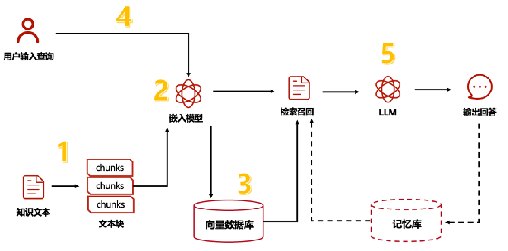
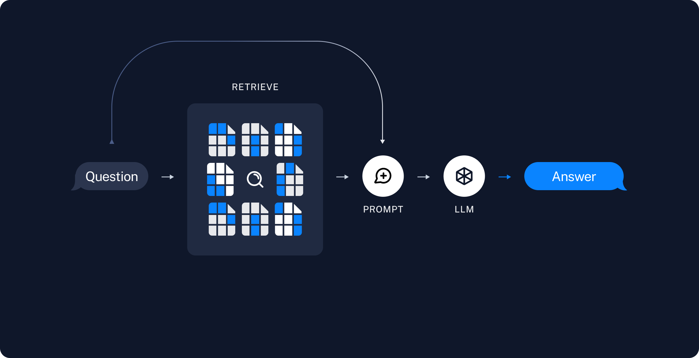
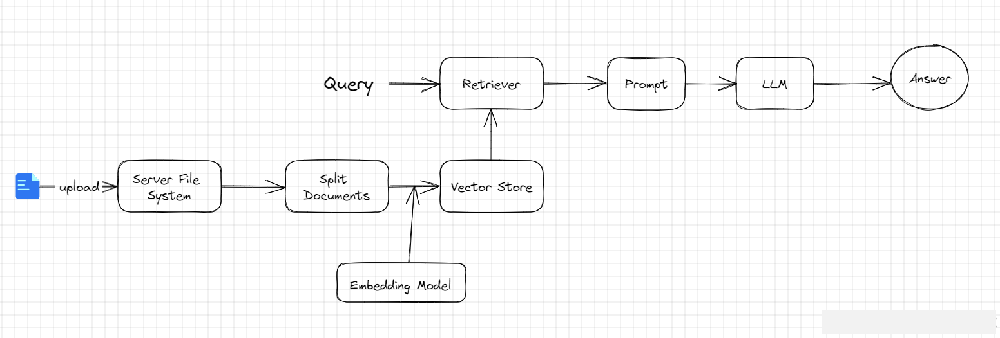
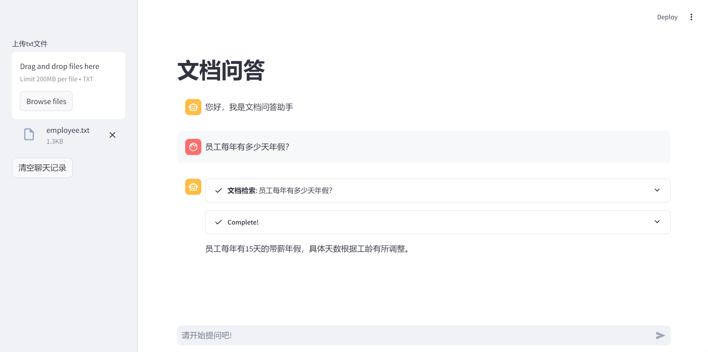

# 9.LangChain基于RAG实现文档问答

**示例代码**

[langchain-rag.ppt](https://www.yuque.com/attachments/yuque/0/2025/ppt/1387387/1745159934951-fdcab4c9-3d8d-4ed0-b38c-0d9a795859fb.ppt)

*<font style="color:#DF2A3F;">注：将ppt后缀名改为zip后解压</font>*

python版本：3.12.4

## <font style="color:rgb(0, 0, 0);">RAG是什么？ </font>

<font style="color:rgb(0, 0, 0);">大语言模型所实现的最强大应用之一是复杂的问答(Q\&A)聊天机器人。这些应用能够回答关于特定源信息的问题。这些应用使用一种称为检索增强生成(RAG)的技术。</font>

<font style="color:rgb(0, 0, 0);">RAG是一种用额外数据增强大语言模型知识的技术。</font>

<font style="color:rgb(0, 0, 0);">大语言模型可以对广泛的主题进行推理，但它们的知识仅限于训练时截止日期前的公开数据。如果你想构建能够对私有数据或模型截止日期后引入的数据进行推理的人工智能应用，你需要用特定信息来增强模型的知识。检索适当信息并将其插入模型提示的过程被称为检索增强生成（RAG）。</font>

<font style="color:rgb(0, 0, 0);">LangChain有许多组件旨在帮助构建问答应用，以及更广泛的RAG应用。</font>



## <font style="color:rgb(0, 0, 0);">RAG工作流</font>

<font style="color:rgb(0, 0, 0);">一个典型的RAG应用有两个主要组成部分：</font>

**<font style="color:rgb(0, 0, 0);">索引(Indexing)</font>**<font style="color:rgb(0, 0, 0);">：从数据源获取数据并建立索引的管道(pipeline)。</font>*<font style="color:rgb(0, 0, 0);">这通常在离线状态下进行。</font>*

**<font style="color:rgb(0, 0, 0);">检索和生成(Retrieval and generation)</font>**<font style="color:rgb(0, 0, 0);">：实际的RAG链，在运行时接收用户查询，从索引中检索相关数据，然后将其传递给模型。</font>

<font style="color:rgb(0, 0, 0);">从原始数据到答案的最常见完整顺序如下：</font>

### <font style="color:rgb(0, 0, 0);">索引(Indexing) </font>

1. **<font style="color:rgb(0, 0, 0);">加载(Load)</font>**<font style="color:rgb(0, 0, 0);">：首先我们需要加载数据。这是通过文档加载器</font>[<font style="color:rgb(0, 0, 0);">Document Loaders</font>](https://blog.frognew.com/library/agi/langchain/components/document-loaders.html)<font style="color:rgb(0, 0, 0);">完成的。</font>
2. **<font style="color:rgb(0, 0, 0);">分割(Split)</font>**<font style="color:rgb(0, 0, 0);">：文本分割器</font>[<font style="color:rgb(0, 0, 0);">Text splitters</font>](https://python.langchain.com/docs/concepts/#text-splitters)<font style="color:rgb(0, 0, 0);">将大型文档(</font><code><font style="color:rgb(0, 0, 0);">Documents</font></code><font style="color:rgb(0, 0, 0);">)分成更小的块(chunks)。这对于索引数据和将其传递给模型都很有用，因为大块数据更难搜索，而且不适合模型有限的上下文窗口。</font>
3. **<font style="color:rgb(0, 0, 0);">存储(Store)</font>**<font style="color:rgb(0, 0, 0);">：我们需要一个地方来存储和索引我们的分割(splits)，以便后续可以对其进行搜索。这通常使用向量存储</font>[<font style="color:rgb(0, 0, 0);">VectorStore</font>](https://blog.frognew.com/library/agi/langchain/components/vector-stores.html)<font style="color:rgb(0, 0, 0);">和嵌入模型</font>[<font style="color:rgb(0, 0, 0);">Embeddings model</font>](https://blog.frognew.com/library/agi/langchain/components/embedding-models.html)<font style="color:rgb(0, 0, 0);">来完成。</font>


### <font style="color:rgb(0, 0, 0);">检索和生成(Retrieval and generation) </font>

4. **<font style="color:rgb(0, 0, 0);">检索(Retrieve)</font>**<font style="color:rgb(0, 0, 0);">：给定用户输入，使用检索器</font>[<font style="color:rgb(0, 0, 0);">Retriever</font>](https://blog.frognew.com/library/agi/langchain/components/retrievers.html)<font style="color:rgb(0, 0, 0);">从存储中检索相关的文本片段。</font>
5. **<font style="color:rgb(0, 0, 0);">生成(Generate)</font>**<font style="color:rgb(0, 0, 0);">：</font><font style="color:rgb(0, 0, 0);"> </font>[<font style="color:rgb(0, 0, 0);">ChatModel</font>](https://blog.frognew.com/library/agi/langchain/components/chat-models.html)<font style="color:rgb(0, 0, 0);">使用包含问题和检索到的数据的提示来生成答案。</font>



## 文档问答

### <font style="color:rgb(51, 51, 51);">实现流程</font>

<font style="color:rgb(51, 51, 51);">一个 RAG 程序的 APP 主要有以下流程：</font>

1. <font style="color:rgb(51, 51, 51);">用户在 RAG 客户端上传一个txt文件</font>
2. <font style="color:rgb(51, 51, 51);">服务器端接收客户端文件，存储在服务端</font>
3. <font style="color:rgb(51, 51, 51);">服务器端程序对文件进行读取</font>
4. <font style="color:rgb(51, 51, 51);">对文件内容进行拆分，防止一次性塞给 Embedding 模型超 token 限制</font>
5. <font style="color:rgb(51, 51, 51);">把 Embedding 后的内容存储在向量数据库，生成检索器</font>
6. <font style="color:rgb(51, 51, 51);">程序准备就绪，允许用户进行提问</font>
7. <font style="color:rgb(51, 51, 51);">用户提出问题，大模型调用检索器检索文档，把相关片段找出来后，组织后，回复用户。</font>



### <font style="color:rgb(51, 51, 51);">代码实现</font>

<font style="color:rgb(51, 51, 51);">使用 Streamlit 实现文件上传，我这里只实现了 txt 文件上传，其实这里可以在 </font>[<font style="color:rgb(51, 51, 51);">type</font>](https://so.csdn.net/so/search?q=type\&spm=1001.2101.3001.7020)<font style="color:rgb(51, 51, 51);"> 参数里面设置多个文件类型，在后面的检索器方法里面针对每个类型进行处理即可。</font>

#### <font style="color:rgb(51, 51, 51);">实现文件上传</font>

```python
import streamlit as st

# 上传txt文件，允许上传多个文件
uploaded_files = st.sidebar.file_uploader(
    label="上传txt文件", type=["txt"], accept_multiple_files=True
)
if not uploaded_files:
    st.info("请先上传按TXT文档。")
    st.stop()
```

#### <font style="color:rgb(51, 51, 51);">实现检索器</font>

<font style="color:rgb(51, 51, 51);">注意 chunk_size 最大设置数值取决于 Embedding 模型允许单词的最大字符数限制。</font>

```python
import tempfile
import os
from langchain.document_loaders import TextLoader
from langchain_community.embeddings import QianfanEmbeddingsEndpoint
from langchain_chroma import Chroma
from langchain_text_splitters import RecursiveCharacterTextSplitter

# 实现检索器
@st.cache_resource(ttl="1h")
def configure_retriever(uploaded_files):
    # 读取上传的文档，并写入一个临时目录
    docs = []
    temp_dir = tempfile.TemporaryDirectory(dir=r"D:\\")
    for file in uploaded_files:
        temp_filepath = os.path.join(temp_dir.name, file.name)
        with open(temp_filepath, "wb") as f:
            f.write(file.getvalue())
        loader = TextLoader(temp_filepath, encoding="utf-8")
        docs.extend(loader.load())

    # 进行文档分割
    text_splitter = RecursiveCharacterTextSplitter(chunk_size=300, chunk_overlap=30)
    splits = text_splitter.split_documents(docs)

    # 这里使用了OpenAI向量模型
    embeddings = OpenAIEmbeddings()
    vectordb = Chroma.from_documents(splits, embeddings)

    retriever = vectordb.as_retriever()

    return retriever


retriever = configure_retriever(uploaded_files)
```

#### <font style="color:rgb(51, 51, 51);">创建检索工具</font>

<font style="color:rgb(51, 51, 51);">langchain 提供了 create_retriever_tool 工具，可以直接用。</font>

```python
# 创建检索工具
from langchain.tools.retriever import create_retriever_tool

tool = create_retriever_tool(
    retriever,
    "文档检索",
    "用于检索用户提出的问题，并基于检索到的文档内容进行回复.",
)
tools = [tool]
```

#### <font style="color:rgb(51, 51, 51);">创建 React Agent</font>

````python
instructions = """您是一个设计用于查询文档来回答问题的代理。
您可以使用文档检索工具，并基于检索内容来回答问题
您可能不查询文档就知道答案，但是您仍然应该查询文档来获得答案。
如果您从文档中找不到任何信息用于回答问题，则只需返回“抱歉，这个问题我还不知道。”作为答案。
"""

base_prompt_template = """
{instructions}

TOOLS:
------

You have access to the following tools:

{tools}

To use a tool, please use the following format:

•```
Thought: Do I need to use a tool? Yes
Action: the action to take, should be one of [{tool_names}]
Action Input: the input to the action
Observation: the result of the action
•```

When you have a response to say to the Human, or if you do not need to use a tool, you MUST use the format:

•```
Thought: Do I need to use a tool? No
Final Answer: [your response here]
•```

Begin!

Previous conversation history:
{chat_history}

New input: {input}
{agent_scratchpad}"""

base_prompt = PromptTemplate.from_template(base_prompt_template)

prompt = base_prompt.partial(instructions=instructions)

# 创建llm
llm = ChatOpenAI()

# 创建react Agent
agent = create_react_agent(llm, tools, prompt)

agent_executor = AgentExecutor(agent=agent, tools=tools, memory=memory, verbose=False)
````

#### <font style="color:rgb(51, 51, 51);">实现 Agent 回复</font>

<font style="color:rgb(51, 51, 51);">获取用户输入，并回复用户，这里使用 StreamlitCallbackHandler 实现了 React 推理回调，可以让模型的推理过程可见。</font>

```python
# 创建聊天输入框
user_query = st.chat_input(placeholder="请开始提问吧!")

if user_query:
    st.session_state.messages.append({"role": "user", "content": user_query})
    st.chat_message("user").write(user_query)

    with st.chat_message("assistant"):
        st_cb = StreamlitCallbackHandler(st.container())
        config = {"callbacks": [st_cb]}
        response = agent_executor.invoke({"input": user_query}, config=config)
        st.session_state.messages.append({"role": "assistant", "content": response["output"]})
        st.write(response["output"])
```

<font style="color:rgb(51, 51, 51);">‍</font>

#### <font style="color:rgb(51, 51, 51);">实现效果</font>




> 更新: 2025-04-20 22:38:55  
> 原文: <https://www.yuque.com/aaron-wecc3/dhluml/vaay48ng372x9svg>