# 90.大模型开发环境Conda和Jupyter使用

**示例代码**

[conda-demo.ppt](https://www.yuque.com/attachments/yuque/0/2025/ppt/1387387/1745159926423-8256b793-8cb8-4980-8c03-851dfd1b303a.ppt)

*<font style="color:#DF2A3F;">注：将ppt后缀名改为zip后解压</font>*

python版本：3.12.4

## <font style="color:rgb(51, 51, 51);">Conda 入门</font>

### <font style="color:rgb(51, 51, 51);">Conda版本差异</font>

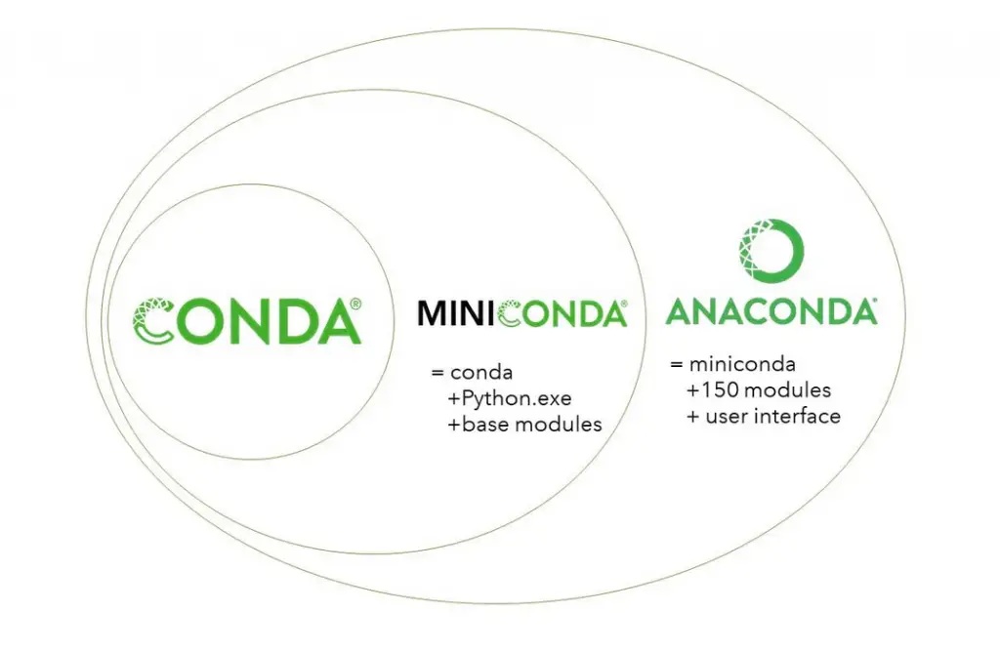

**Conda**：是一个包和环境管理的工具。支持 Windows、macOS 和 Linux。Conda 可以快速的安装、运行和更新包和相关的依赖。Conda 也可以轻易地创建、保存、加载和转换环境。

**Anaconda**：是一个用于科学计算的 Python 发行版，支持 Linux, Mac, Windows, 包含了 conda、conda-build、Python 和众多科学计算的包及其依赖。

**Miniconda**：是一个 Anaconda 的轻量级替代，默认只包含了 conda，Python 和一些它们所以依赖的包。

### <font style="color:rgb(51, 51, 51);">Anaconda 和 Miniconda 区别？</font>

<font style="color:rgb(51, 51, 51);">Miniconda 是 Anaconda 的精简版本，同样也是一个开源环境，两者都是 conda 系统的一部分。不同之处在于 Anaconda 会预先安装许多常用的 Python 套件，因此占用较多的硬盘空间。相比之下，Miniconda 因为名为 ”Mini”，因此仅安装运行所需的基本套件，对于有多个不同 Python 版本共存的情況，可以节省大量空间。</font>

<font style="color:rgb(119, 119, 119);">Miniconda 可以依据自己需求建立自己的 Python 环境，想要的套件自行安装。</font>

### <font style="color:rgb(51, 51, 51);">为什么要使用 Conda？</font>

<font style="color:rgb(51, 51, 51);">一个典型的 Python 项目会使用多个包来完成其功能。其中一些包也可能被其他项目所使用（共享）。 </font>**<font style="color:rgb(51, 51, 51);">项目之间共享的包可能会引起冲突。</font>**<font style="color:rgb(51, 51, 51);"> 比如，我们有两个项目 P1 和 P2，P1 使用 NumPy 1.2 版本，而 P2 需要 NumPy 1.3 版本，一个环境中存在两个版本就可能导致冲突。 解决这个问题的办法就是使用虚拟环境。我们可以为每个项目分别创建一个独立的虚拟环境，来隔离包冲突。</font>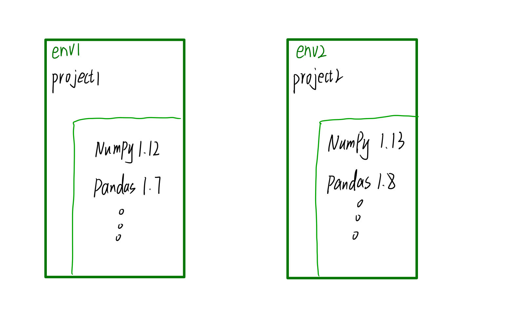

<font style="color:rgb(51, 51, 51);">常用的 Python 虚拟环境管理工具有：</font>

1. <font style="color:rgb(51, 51, 51);">Virtualenv</font>
2. <font style="color:rgb(51, 51, 51);">Conda</font>
3. <font style="color:rgb(51, 51, 51);">pipenv</font>
4. <font style="color:rgb(51, 51, 51);">venv</font>

<font style="color:rgb(51, 51, 51);">通过使用这些工具，我们可以很容易的创建虚拟环境。</font>

## <font style="color:rgb(51, 51, 51);">Conda 安装</font>

### <font style="color:rgb(51, 51, 51);">Miniconda 下载安装</font>

<font style="color:rgb(51, 51, 51);">官网下载地址： </font>[<font style="color:rgb(65, 131, 196);">https://www.anaconda.com/download/success</font>](https://www.anaconda.com/download/success)

**<font style="color:rgb(51, 51, 51);">Anaconda Installers vs Miniconda Installers</font>**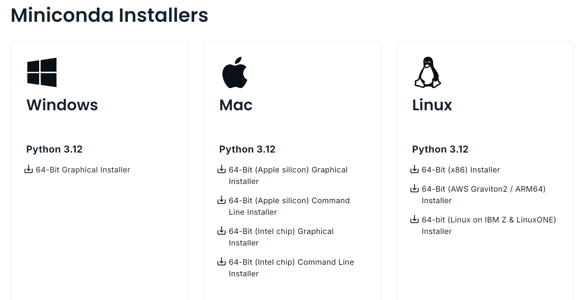

<font style="color:rgb(51, 51, 51);">下载后依据指引进行 Miniconda 安装。</font>

<font style="color:rgb(51, 51, 51);"></font>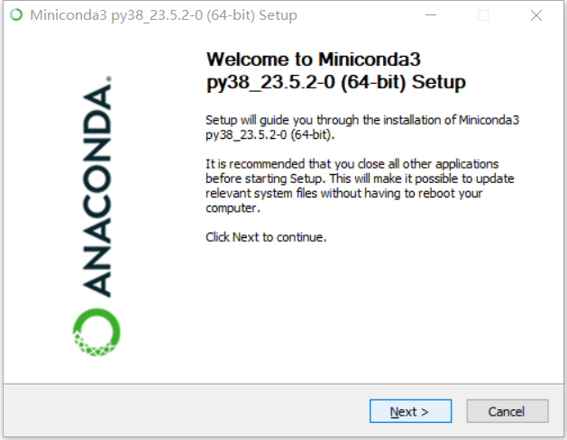


<font style="color:rgb(51, 51, 51);">根子自己需要选择为当前用户还是为所有用户安装。</font>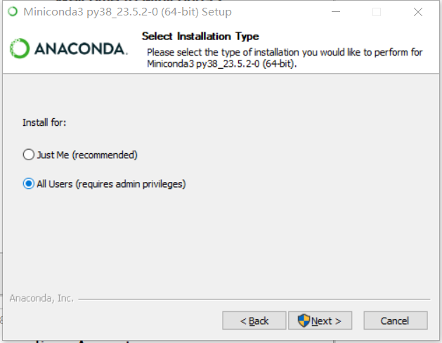

<font style="color:rgb(51, 51, 51);">选择安装目录。</font>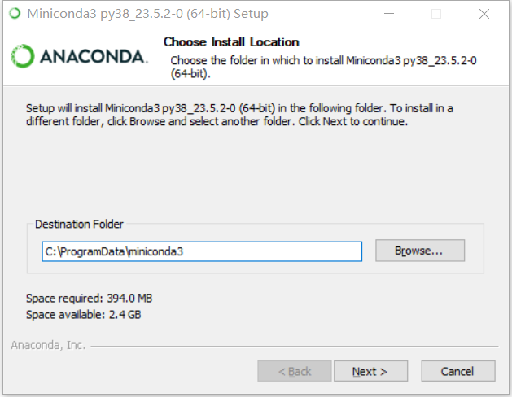

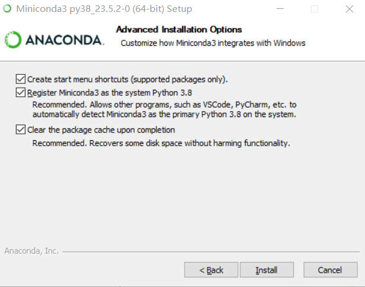

* <font style="color:rgb(51, 51, 51);">在开始菜单中，创建快捷方式。</font>
* <font style="color:rgb(51, 51, 51);">注册 Miniconda3，使它能被 VsCode、PyCharm 等检测到。</font>
* <font style="color:rgb(51, 51, 51);">清除缓存。</font>

<font style="color:rgb(51, 51, 51);">到此我们的 conda 已经安装完毕。此时，我们的开始菜单中多了如下几个目录。</font>

### <font style="color:rgb(51, 51, 51);">使用 Anaconda Powershell Prompt 终端</font>


<font style="color:rgb(51, 51, 51);">安装完成后，打开终端 </font><code><font style="color:rgb(51, 51, 51);background-color:rgb(243, 244, 244);">Anaconda Powershell Prompt</font></code><font style="color:rgb(51, 51, 51);"> ，如果有看到命令列提示中的（base），那表示安装成功。</font>

<font style="color:rgb(51, 51, 51);">我们可以输入 </font><code><font style="color:rgb(51, 51, 51);background-color:rgb(243, 244, 244);">Python --version</font></code><font style="color:rgb(51, 51, 51);"> 确认 Python 版本。</font>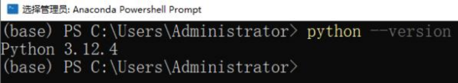

## <font style="color:rgb(51, 51, 51);">Conda 命令</font>

### <font style="color:rgb(51, 51, 51);">基本命令</font>

```powershell
conda –help # 查看帮助
conda info  # 查看 conda 信息
conda --version # 查看 conda 版本
conda update conda  # 更新Conda（慎用）
conda clean –all    # 清理不再需要的包
conda <指令> --help   # 查看某一个指令的详细帮助
conda config --show #查看 conda 的环境配置
conda clean -p  # 清理没有用，没有安装的包
conda clean -t  # 清理 tarball
conda clean --all   # 清理所有包和 conda 的缓存文件
```

### <font style="color:rgb(51, 51, 51);">环境管理</font>

#### <font style="color:rgb(51, 51, 51);">创建 Conda 环境</font>

<font style="color:rgb(51, 51, 51);">使用 conda 可以在电脑上创建很多套相互隔离的 Python 环境，命令如下：</font>

```powershell
# 语法
conda create --name <env_name> python=<version> [package_name1] [package_name2] [...]

# 样例创建一个名为 learn 的环境，python版本为3.10
conda create --name learn python=3.10   # name 可以简写为 -n
```

#### <font style="color:rgb(51, 51, 51);">切换 Conda 环境</font>

<font style="color:rgb(51, 51, 51);">前面说到 Conda 可以创建多套相互隔离的 Python 环境，使用 </font><code><font style="color:rgb(51, 51, 51);background-color:rgb(243, 244, 244);">conda activate env_name</font></code><font style="color:rgb(51, 51, 51);"> 可以切换不同的环境。</font>

```plain
# 语法
conda activate env_name

# 样例切换到 learn 环境
conda activate learn
```

<font style="color:rgb(51, 51, 51);">如果要</font>**<font style="color:rgb(51, 51, 51);">退出此环境</font>**<font style="color:rgb(51, 51, 51);">，回到基础环境，可以使用如下命令</font>

```plain
# 退出当前环境
conda deactivate
```

#### <font style="color:rgb(51, 51, 51);">查看 Conda 环境</font>

<font style="color:rgb(51, 51, 51);">当电脑上安装了很多台 Conda 环境的时候，可以使用 </font><code><font style="color:rgb(51, 51, 51);background-color:rgb(243, 244, 244);">conda env list</font></code><font style="color:rgb(51, 51, 51);"> 命令查看所有已创建的 Conda 环境。</font>

```plain
# 查看当前电脑上所有的conda环境
conda env list
```

#### <font style="color:rgb(51, 51, 51);">删除某个 Conda 环境</font>

```plain
# 语法
conda remove --name <env_name> --all

# 样例
conda remove --name learn --all
```

#### <font style="color:rgb(51, 51, 51);">克隆环境</font>

```plain
# 语法
conda create --name <new_evn_name> --clone <old_env_name>

# 样例
conda create --name myclone --clone myenv
```

### <font style="color:rgb(51, 51, 51);">包管理</font>

<font style="color:rgb(51, 51, 51);">一旦激活了环境，你就可以使用 </font><code><font style="color:rgb(51, 51, 51);background-color:rgb(243, 244, 244);">conda</font></code><font style="color:rgb(51, 51, 51);"> 和 </font><code><font style="color:rgb(51, 51, 51);background-color:rgb(243, 244, 244);">pip</font></code><font style="color:rgb(51, 51, 51);"> 在当前环境下安装你所需要的包。在 </font>**<font style="color:rgb(51, 51, 51);">conda 环境</font>**<font style="color:rgb(51, 51, 51);">中，不建议使用 </font><code><font style="color:rgb(51, 51, 51);background-color:rgb(243, 244, 244);">pip</font></code><font style="color:rgb(51, 51, 51);">。</font>

#### <font style="color:rgb(51, 51, 51);">安装包</font>

<font style="color:rgb(51, 51, 51);">在激活的环境中安装包，例如安装 NumPy：</font>

```plain
conda install numpy
```

<font style="color:rgb(51, 51, 51);">可以使用以下命令安装特定版本的包：</font>

```plain
conda install numpy=1.18
```

#### <font style="color:rgb(51, 51, 51);">更新包</font>

<font style="color:rgb(51, 51, 51);">更新某个包到最新版本：</font>

```plain
conda update numpy

# 更新所有包到最新版本（慎用）
conda update all
```

<font style="color:rgb(51, 51, 51);">执行命令后，conda 将会对版本进行比较并列出可以升级的版本。同时，也会告知用户其他相关包也会升级到相应版本。当较新的版本可以用于升级时，终端会显示</font><font style="color:rgb(51, 51, 51);">Proceed (\[y]/n)? ，此时输入 y 即可进行升级。</font>

#### <font style="color:rgb(51, 51, 51);">卸载包</font>

<font style="color:rgb(51, 51, 51);">如果不再需要某个包，可以将其卸载：</font>

```plain
conda remove numpy
```

#### <font style="color:rgb(51, 51, 51);">列出环境中的所有包</font>

<font style="color:rgb(51, 51, 51);">查看当前环境中已安装的所有包：</font>

```plain
conda list
```

<font style="color:rgb(51, 51, 51);">查看当前虚拟环境中已安装的某个包的信息</font>

```plain
conda list pip
```

#### <font style="color:rgb(51, 51, 51);">搜索包</font>

<font style="color:rgb(51, 51, 51);">搜索可用的包及其版本信息：</font>

```plain
conda search package-name
```

### <font style="color:rgb(51, 51, 51);">使用通道</font>

<font style="color:rgb(51, 51, 51);">Conda 通道（Channel）是 Conda 用来查找和下载软件包的源。通道就像是软件仓库，用户可以从这些通道中获取需要的软件包。理解和有效管理 Conda 通道，可以帮助用户更好地控制软件包的来源、版本以及稳定性。</font>

**<font style="color:rgb(51, 51, 51);">主要通道</font>**

* <font style="color:rgb(51, 51, 51);">默认通道：这是 Conda 自带的官方通道，由 Anaconda 维护，包含了常用的数据科学和机器学习包。默认通道提供的包经过测试和优化，通常是稳定且值得信赖的。</font>
* <font style="color:rgb(51, 51, 51);">Conda-Forge：Conda-Forge 是一个社区驱动的通道，拥有数量庞大的软件包和活跃的维护者社区。通常情况下，Conda-Forge 提供更多的最新软件包版本，对于一些在默认通道中没有的包来说尤为重要。由于是社区维护，更新速度快，适合需要最新特性和支持的用户。</font>
* <font style="color:rgb(51, 51, 51);">Bioconda：专为生物信息学和生物数据分析设计的通道。包含很多用于生物数据处理和分析的工具。</font>

**<font style="color:rgb(51, 51, 51);">查看已配置的通道</font>**<font style="color:rgb(51, 51, 51);">你可以使用以下命令查看当前配置的通道列表：</font>

```plain
conda config --show channels
```

**<font style="color:rgb(51, 51, 51);">添加新的通道</font>**<font style="color:rgb(51, 51, 51);">如果需要从其他通道安装包，可以将其添加到 Conda 配置中。例如，添加 Conda-Forge：</font>

```plain
conda config --add channels conda-forge
```

**<font style="color:rgb(51, 51, 51);">设置通道顺序</font>**<font style="color:rgb(51, 51, 51);">通道是按顺序搜索的，优先使用在前面的通道。可以通过以下命令调整顺序：</font>

```plain
conda config --set channel_priority strict
```

<font style="color:rgb(51, 51, 51);">使用 strict 优先级时，Conda 会严格按照通道顺序来选择包。</font>

**<font style="color:rgb(51, 51, 51);">删除通道</font>**<font style="color:rgb(51, 51, 51);">如果不需要某个通道，可以将其移除：</font>

```plain
conda config --remove channels channel-name
```

**<font style="color:rgb(51, 51, 51);">临时使用特定通道</font>**<font style="color:rgb(51, 51, 51);">你可以在安装包时临时指定通道，而不改变全局配置。例如：</font>

```plain
conda install package-name -c conda-forge
```

<font style="color:rgb(51, 51, 51);">这样做会从 Conda-Forge 通道安装指定的包。</font>

**<font style="color:rgb(51, 51, 51);">通道优先级</font>**<font style="color:rgb(51, 51, 51);">Conda 允许设置通道优先级，以决定从哪个通道下载软件包。默认情况下，Conda 会根据通道列表的顺序依次查找包。你可以通过以下命令启用或禁用通道优先级：</font>

```plain
# 启用优先级
conda config --set channel_priority true
# 禁用优先级
conda config --set channel_priority false
```

<font style="color:rgb(51, 51, 51);">启用优先级后，Conda 会严格根据通道顺序来选择包，确保从首选通道安装。</font>

**<font style="color:rgb(51, 51, 51);">创建自定义通道</font>**<font style="color:rgb(51, 51, 51);">如果你需要在团队中共享包，或者需要托管私有包，可以创建自己的 Conda 通道。自定义通道可以通过简单的 HTTP 服务器（如 NGINX 或 Apache）托管，或者使用</font><font style="color:rgb(51, 51, 51);">Anaconda 的企业解决方案。</font>

### <font style="color:rgb(51, 51, 51);">设置镜像</font>

<font style="color:rgb(51, 51, 51);">为了提高 Conda 包的下载速度，特别是在网络连接到默认的 Conda 服务器速度较慢的情况下，设置国内镜像（或其他更接近你的地理位置的镜像）是一个常见且有效的方法。</font>

<font style="color:rgb(51, 51, 51);">以下是如何设置 Conda 镜像的步骤：</font>**<font style="color:rgb(51, 51, 51);">方法一：通过命令行配置</font>**<font style="color:rgb(51, 51, 51);">你可以使用 </font><code><font style="color:rgb(51, 51, 51);background-color:rgb(243, 244, 244);">conda config</font></code><font style="color:rgb(51, 51, 51);"> 命令来添加镜像。例如，使用清华大学的 Anaconda 镜像。</font>

* <font style="color:rgb(51, 51, 51);">打开命令提示符或终端。</font>
* <font style="color:rgb(51, 51, 51);">添加镜像 URL：</font>

```plain
conda config --add channels https://mirrors.tuna.tsinghua.edu.cn/anaconda/pkgs/main
conda config --add channels https://mirrors.tuna.tsinghua.edu.cn/anaconda/pkgs/free
conda config --add channels https://mirrors.tuna.tsinghua.edu.cn/anaconda/pkgs/r
conda config --add channels https://mirrors.tuna.tsinghua.edu.cn/anaconda/pkgs/pro
conda config --add channels https://mirrors.tuna.tsinghua.edu.cn/anaconda/cloud/conda-forge
conda config --add channels https://mirrors.tuna.tsinghua.edu.cn/anaconda/cloud/msys2
conda config --add channels https://mirrors.tuna.tsinghua.edu.cn/anaconda/cloud/bioconda
conda config --add channels https://mirrors.tuna.tsinghua.edu.cn/anaconda/cloud/menpo

conda config --set show_channel_urls yes
```

<font style="color:rgb(51, 51, 51);">默认情况下，conda config 添加的通道会排在列表的头部，但你可以通过以下命令来确认顺序：</font>

```plain
conda config --show channels
```

**<font style="color:rgb(51, 51, 51);">方法二：通过修改配置文件</font>**<font style="color:rgb(51, 51, 51);">你也可以直接修改 Conda 的配置文件来设置镜像：</font>

* <font style="color:rgb(51, 51, 51);">找到并编辑 Conda 的配置文件：</font><code><font style="color:rgb(51, 51, 51);background-color:rgb(243, 244, 244);">~/.condarc</font></code><font style="color:rgb(51, 51, 51);">（Linux 和 macOS）或 </font><code><font style="color:rgb(51, 51, 51);background-color:rgb(243, 244, 244);">C:\Users<用户名>\.condarc</font></code><font style="color:rgb(51, 51, 51);">（Windows）。TUNA 提供了 Anaconda 仓库与第三方源（conda-forge、msys2、pytorch 等，各系统都可以通过修改用户目录下的 </font><code><font style="color:rgb(51, 51, 51);background-color:rgb(243, 244, 244);">.condarc</font></code><font style="color:rgb(51, 51, 51);"> 文件来使用 TUNA 镜像源。Windows 用户无法直接创建名为 </font><code><font style="color:rgb(51, 51, 51);background-color:rgb(243, 244, 244);">.condarc</font></code><font style="color:rgb(51, 51, 51);"> 的文件，可先执行 </font><code><font style="color:rgb(51, 51, 51);background-color:rgb(243, 244, 244);">conda config –-set show_channel_urls yes</font></code><font style="color:rgb(51, 51, 51);"> 生成该文件之后再修改。</font>
* <font style="color:rgb(51, 51, 51);">添加或修改如下内容：</font>

```plain
channels:
	- defaults
show_channel_urls: true
default_channels:
	- https://mirrors.tuna.tsinghua.edu.cn/anaconda/pkgs/main
	- https://mirrors.tuna.tsinghua.edu.cn/anaconda/pkgs/r
	- https:// mirrors.tuna.tsinghua.edu.cn/anaconda/pkgs/msys2
custom_channels:
	conda-forge: https://mirrors.tuna.tsinghua.edu.cn/anaconda/cloud
	msys2: https://mirrors.tuna.tsinghua.edu.cn/anaconda/cloud
	bioconda: https://mirrors.tuna.tsinghua.edu.cn/anaconda/cloud
	menpo: https://mirrors.tuna.tsinghua.edu.cn/anaconda/cloud
	pytorch: https://mirrors.tuna.tsinghua.edu.cn/anaconda/cloud
	pytorch-lts: https://mirrors.tuna.tsinghua.edu.cn/anaconda/cloud
	simpleitk: https://mirrors.tuna.tsinghua.edu.cn/anaconda/cloud
	deepmodeling: https://mirrors.tuna.tsinghua.edu.cn/anaconda/cloud/
```

<font style="color:rgb(51, 51, 51);">运行 </font><code><font style="color:rgb(51, 51, 51);background-color:rgb(243, 244, 244);">conda clean -i</font></code><font style="color:rgb(51, 51, 51);"> 清除索引缓存，保证用的是镜像站提供的索引。</font>

**<font style="color:rgb(51, 51, 51);">验证和测试</font>**<font style="color:rgb(51, 51, 51);">在设置完镜像后，你可以通过安装软件包来测试镜像是否工作正常。例如：</font>

```plain
conda install numpy
```

<font style="color:rgb(51, 51, 51);">查看输出的信息，确保包是从你设置的镜像 URL 下载的。</font>

### <font style="color:rgb(51, 51, 51);">环境导入与导出</font>

**<font style="color:rgb(51, 51, 51);">导出环境</font>**<font style="color:rgb(51, 51, 51);">将当前环境导出为一个 YAML 文件，方便共享：</font>

```plain
conda env export > environment.yml
```

**<font style="color:rgb(51, 51, 51);">从文件创建环境</font>**<font style="color:rgb(51, 51, 51);">使用 YAML 文件创建一个新环境：</font>

```plain
conda env create -f environment.yml
```

## <font style="color:rgb(51, 51, 51);">Mamba 使用</font>

<font style="color:rgb(51, 51, 51);">Mamba 是一个用于管理 Conda 环境和包的开源工具，旨在解决 Conda 在处理大型环</font><font style="color:rgb(51, 51, 51);">境时的速度和性能问题。它与 Conda 兼容，但提供更快的依赖解析和包安装，这使得</font><font style="color:rgb(51, 51, 51);">它在处理复杂环境时更加高效。</font>

**<font style="color:rgb(51, 51, 51);">Mamba 的关键特点</font>**

* **<font style="color:rgb(51, 51, 51);">快速的依赖解析</font>**<font style="color:rgb(51, 51, 51);">：Mamba 使用一个高效的 C++ 库进行依赖解析，这使得在面对复杂的包依赖时能更快地找到解决方案。</font>
* **<font style="color:rgb(51, 51, 51);">并行下载</font>**<font style="color:rgb(51, 51, 51);">：Mamba 可以并行下载和安装包，这大大减少了安装时间，特别是在需要下载大量包的情况下。</font>
* **<font style="color:rgb(51, 51, 51);">与 Conda 兼容</font>**<font style="color:rgb(51, 51, 51);">：Mamba 可以无缝替代 Conda 的命令，你可以在几乎所有 Conda 命令中直接使用 mamba 来替换 conda。</font>
* **<font style="color:rgb(51, 51, 51);">更好的用户体验</font>**<font style="color:rgb(51, 51, 51);">：提供更直观的输出信息和进度条，让用户可以更清晰地了解安装进度和过程。</font>

**<font style="color:rgb(51, 51, 51);">安装 Mamba</font>**<font style="color:rgb(51, 51, 51);">要安装 Mamba，你首先需要一个 Conda 环境。以下是在已有 Conda 环境中安装 Mamba 的步骤：</font><font style="color:rgb(51, 51, 51);">如果你希望在特定环境中安装 Mamba，可以先激活该环境：</font>

```plain
conda activate myenv
```

<font style="color:rgb(51, 51, 51);">你可以通过 Conda-Forge 通道安装 Mamba，因为 Mamba 在该通道上维护得很好：</font>

```plain
conda install mamba -n base -c conda-forge
```

<font style="color:rgb(51, 51, 51);">这里 </font><code><font style="color:rgb(51, 51, 51);background-color:rgb(243, 244, 244);">-n base</font></code><font style="color:rgb(51, 51, 51);"> 表示将 Mamba 安装在 base 环境中，这样你可以在任何环境中使用</font><font style="color:rgb(51, 51, 51);">Mamba。</font>

**<font style="color:rgb(51, 51, 51);">使用 Mamba</font>**<font style="color:rgb(51, 51, 51);"> 可以直接替代 Conda 的命令。以下是一些常见的 Conda 命令及其 Mamba 等效用法：</font>

* <font style="color:rgb(51, 51, 51);">创建环境：</font><code><font style="color:rgb(51, 51, 51);background-color:rgb(243, 244, 244);">mamba create –name myenv python=3.8</font></code>
* <font style="color:rgb(51, 51, 51);">激活环境：</font><code><font style="color:rgb(51, 51, 51);background-color:rgb(243, 244, 244);">conda activate myenv</font></code><font style="color:rgb(51, 51, 51);"> （Mamba 不改变环境激活命令，你仍然使用 Conda 的激活命令）</font>
* <font style="color:rgb(51, 51, 51);">安装包：</font><code><font style="color:rgb(51, 51, 51);background-color:rgb(243, 244, 244);">mamba install numpy</font></code>
* <font style="color:rgb(51, 51, 51);">更新包：</font><code><font style="color:rgb(51, 51, 51);background-color:rgb(243, 244, 244);">mamba update numpy</font></code>
* <font style="color:rgb(51, 51, 51);">删除包：</font><code><font style="color:rgb(51, 51, 51);background-color:rgb(243, 244, 244);">mamba remove numpy</font></code>
* <font style="color:rgb(51, 51, 51);">更新环境中的所有包：</font><code><font style="color:rgb(51, 51, 51);background-color:rgb(243, 244, 244);">mamba update –all</font></code>

**<font style="color:rgb(51, 51, 51);">优势</font>**<font style="color:rgb(51, 51, 51);">：</font>

* **<font style="color:rgb(51, 51, 51);">速度</font>**<font style="color:rgb(51, 51, 51);">：Mamba 在处理包管理和环境解决时速度快得多，这对大环境尤其有用。</font>
* **<font style="color:rgb(51, 51, 51);">效率</font>**<font style="color:rgb(51, 51, 51);">：并行下载和安装机制使得整体过程更加高效。</font>
* **<font style="color:rgb(51, 51, 51);">兼容性</font>**<font style="color:rgb(51, 51, 51);">：能够无缝替代 Conda，并与其生态系统兼容。</font>

**<font style="color:rgb(51, 51, 51);">局限性：</font>**

* **<font style="color:rgb(51, 51, 51);">新兴工具</font>**<font style="color:rgb(51, 51, 51);">：作为一个较新的工具，Mamba 可能在某些边缘情况下不如 Conda 稳</font><font style="color:rgb(51, 51, 51);">定。</font>
* **<font style="color:rgb(51, 51, 51);">社区支持</font>**<font style="color:rgb(51, 51, 51);">：虽然 Mamba 的社区在快速增长，但它仍然没有 Conda 那么成熟。</font>

## <font style="color:rgb(51, 51, 51);">Jupyter使用</font>

### <font style="color:rgb(51, 51, 51);">Jupyter 介绍</font>

<font style="color:rgb(51, 51, 51);">JupyterLab 是最新的基于 Web 的交互式开发环境，适用于 notebooks、代码和数据。其灵活的界面允许用户配置和安排数据科学、科学计算、计算新闻和机器学习中的工作流程。模块化设计允许扩展来扩展和丰富功能。</font>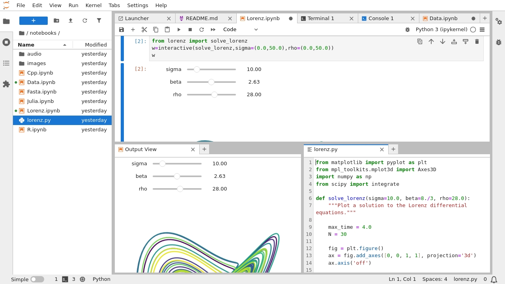

### <font style="color:rgb(51, 51, 51);">Jupyter 安装使用</font>

<font style="color:rgb(51, 51, 51);">使用 安装 JupyterLab ： pip</font>

```plain
pip install jupyterlab
```

<font style="color:rgb(51, 51, 51);">注意：如果您使用 conda 或 mamba 安装 JupyterLab，我们建议使用 </font>[<font style="color:rgb(65, 131, 196);">conda-forge 通道</font>](https://conda-forge.org/)<font style="color:rgb(51, 51, 51);">。</font><font style="color:rgb(51, 51, 51);">安装后，使用以下命令启动 JupyterLab：</font>

```plain
jupyter lab
```

## <font style="color:rgb(51, 51, 51);">PyCharm 中使用 Conda 环境</font>

<font style="color:rgb(51, 51, 51);">1）创建项目所需要的虚拟环境</font>

```plain
conda create -n learn python=3.10
```

<font style="color:rgb(51, 51, 51);">2）创建项目，选择 Custom environment ，类型选择 </font><code><font style="color:rgb(51, 51, 51);background-color:rgb(243, 244, 244);">Conda</font></code><font style="color:rgb(51, 51, 51);"> ，环境选择 </font><code><font style="color:rgb(51, 51, 51);background-color:rgb(243, 244, 244);">learn</font></code><font style="color:rgb(51, 51, 51);">，点击 </font>**<font style="color:rgb(51, 51, 51);">创建</font>**<font style="color:rgb(51, 51, 51);"> 即可</font>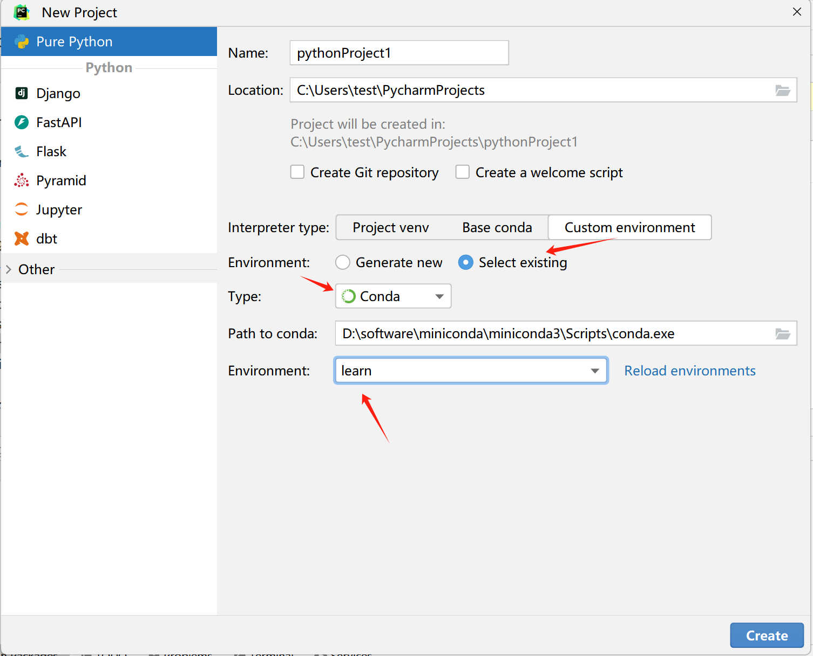

<font style="color:rgb(51, 51, 51);">3）查看项目环境配置</font>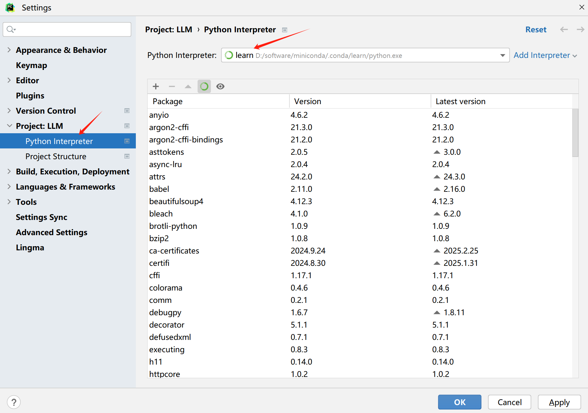

**<font style="color:rgb(51, 51, 51);">注意：</font>**<font style="color:rgb(51, 51, 51);">项目中需要另外的依赖库，直接到 Conda Powershell Prompt 终端下，激活 learn 环境，使用 pip 安装依赖库即可</font>**<font style="color:rgb(51, 51, 51);">！</font>**


> 更新: 2025-04-20 22:38:46  
> 原文: <https://www.yuque.com/aaron-wecc3/dhluml/nhwglo5m6wyh14q7>