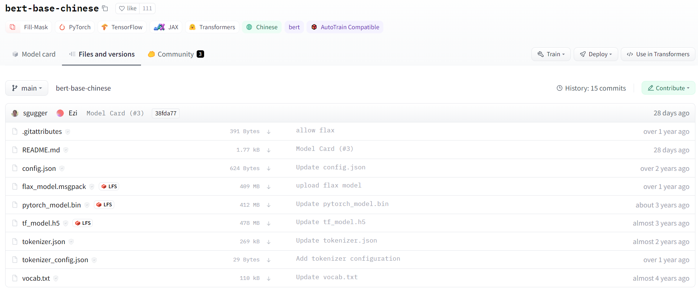

# 92.HF Transformers快速入门教程

**示例代码**

[transformers-demo.ppt](https://www.yuque.com/attachments/yuque/0/2025/ppt/1387387/1745159926153-a210d9f6-622c-4bf1-a5d1-00862fc45b23.ppt)

*<font style="color:#DF2A3F;">注：将ppt后缀名改为zip后解压</font>*

python版本：3.12.4

<font style="color:rgb(51, 51, 51);"></font>

<font style="color:rgb(51, 51, 51);">现在做 NLP 方面的研究实在离不开预训练语言模型，尤其是 BERT。</font>

<font style="color:rgb(51, 51, 51);">huggingface 的 transformers 包是目前使用 BERT 最主流最方便的工具之一</font>

<font style="color:rgb(51, 51, 51);">注：由于官方文档和网页时常更新，链接失效是很有可能的！</font>

<font style="color:rgb(51, 51, 51);">本次使用的 transformers 版本为 4.15.0</font>

1. <font style="color:rgb(51, 51, 51);">预训练模型下载</font>

<code><font style="color:rgb(51, 51, 51);background-color:rgb(243, 244, 244);">huggingface/transformers</font></code><font style="color:rgb(51, 51, 51);"> 支持的所有模型：</font>[<font style="color:rgb(65, 131, 196);">https://huggingface.co/models</font>](https://huggingface.co/models)

<font style="color:rgb(51, 51, 51);">如果环境支持科学上网，可以通过</font><code><font style="color:rgb(51, 51, 51);background-color:rgb(243, 244, 244);">git lfs</font></code><font style="color:rgb(51, 51, 51);">命令直接下载模型。</font>

```plain
git lfs install
git clone https://huggingface.co/bert-base-chinese
```

<font style="color:rgb(51, 51, 51);">如果需要手动下载模型并上传至服务器，则可以在 huggingface 的网页中手动下载模型。</font>

<font style="color:rgb(51, 51, 51);">通常我们需要保存的是三个文件及一些额外的文件</font>

* <font style="color:rgb(51, 51, 51);">配置文件 config.json</font>
* <font style="color:rgb(51, 51, 51);">词典文件 vocab.json</font>
* <font style="color:rgb(51, 51, 51);">预训练模型文件，如果你使用 pytorch 则保存 pytorch_model.bin，如果你使用 tensorflow 2 则保存 tf_model.h5</font>

<font style="color:rgb(51, 51, 51);">额外的文件，指的是 merges.txt、special_tokens_map.json、added_tokens.json、tokenizer_config.json、sentencepiece.bpe.</font>[<font style="color:rgb(65, 131, 196);">model</font>](https://so.csdn.net/so/search?q=model\&spm=1001.2101.3001.7020)<font style="color:rgb(51, 51, 51);"> 等，这几类是 tokenizer 需要使用的文件，如果出现的话，也需要保存下来。没有的话，就不必在意。如果不确定哪些需要下，哪些不需要的话，可以把类似的文件全部下载下来。</font>

<font style="color:rgb(51, 51, 51);">以 </font>[<font style="color:rgb(65, 131, 196);">bert-base-chinese</font>](https://huggingface.co/bert-base-chinese)<font style="color:rgb(51, 51, 51);"> 模型为例，点击 Files and versions，下载所需的文件，放入与模型同名的文件夹中。</font>



**<font style="color:rgb(51, 51, 51);">下载后，需保持文件夹和文件名称与仓库中的一致。</font>**

**<font style="color:rgb(51, 51, 51);">模型的快速使用</font>**

```plain
from transformers import AutoTokenizer, AutoModelForMaskedLM
tokenizer = AutoTokenizer.from_pretrained("bert-base-chinese")
model = AutoModelForMaskedLM.from_pretrained("bert-base-chinese")
```

<code><font style="color:rgb(51, 51, 51);background-color:rgb(243, 244, 244);">from_pretrained()</font></code><font style="color:rgb(51, 51, 51);">的参数</font><code><font style="color:rgb(51, 51, 51);background-color:rgb(243, 244, 244);">pretrained_model_name_or_path</font></code><font style="color:rgb(51, 51, 51);">，可以接受的参数有如下几种：</font>

* <font style="color:rgb(51, 51, 51);">short-cut name（缩写名称，类似于 gpt2 这种）</font>
* <font style="color:rgb(51, 51, 51);">identifier name（类似于 microsoft/DialoGPT-small 这种）</font>
* <font style="color:rgb(51, 51, 51);">文件夹</font>
* <font style="color:rgb(51, 51, 51);">文件</font>

<font style="color:rgb(51, 51, 51);">对于 short-cut name 或 identifier name，这种情况下，本地有文件，可以使用本地的，本地没有文件，则会自动下载。</font>

<font style="color:rgb(51, 51, 51);">一些常用的 short-cut name，可以在 </font>[<font style="color:rgb(65, 131, 196);">https://huggingface.co/models</font>](https://huggingface.co/models)<font style="color:rgb(51, 51, 51);"> 中查看</font>

<font style="color:rgb(51, 51, 51);">对于文件夹，则会从文件夹中找 vocab.json、pytorch_model.bin、tf_model.h5、merges.txt、special_tokens_map.json、added_tokens.json、tokenizer_config.json、sentencepiece.bpe.model 等进行加载。所以这也是为什么下载的时候，一定要保证这些名称是这几个，不能变。</font>

<font style="color:rgb(51, 51, 51);">对于文件，则会直接加载文件。</font>

<font style="color:rgb(51, 51, 51);">官方给的样例，通常都是 short-cut name，我们可以将之替换为下载好的模型文件夹路径。</font>

```plain
from transformers import AutoTokenizer, AutoModelForMaskedLM
tokenizer = AutoTokenizer.from_pretrained(local_model_path)
model = AutoModelForMaskedLM.from_pretrained(local_model_path)
```

<font style="color:rgb(51, 51, 51);">官方 Quick tour</font>

[<font style="color:rgb(65, 131, 196);">Quick tour 代码实时运行（google Colab）</font>](https://colab.research.google.com/github/huggingface/notebooks/blob/main/transformers_doc/en/pytorch/quicktour.ipynb)

### <font style="color:rgb(51, 51, 51);">1. pipeline API</font>

<font style="color:rgb(51, 51, 51);">在给定任务上使用预训练模型的最简单方法是使用</font><code><font style="color:rgb(51, 51, 51);background-color:rgb(243, 244, 244);">pipeline()</font></code><font style="color:rgb(51, 51, 51);">。Transformers 为以下任务提供了开箱即用的接口：</font>

* <font style="color:rgb(51, 51, 51);">情感分析（Sentiment analysis）</font>
* <font style="color:rgb(51, 51, 51);">英语文本生成（Text generation in English）</font>
* <font style="color:rgb(51, 51, 51);">命令实体识别（Name entity recognition, NER）</font>
* <font style="color:rgb(51, 51, 51);">QA</font>
* <font style="color:rgb(51, 51, 51);">文本填空: 给定带有被屏蔽词的文本（例如，用 \[mask] 替换），然后填入空白处</font>
* <font style="color:rgb(51, 51, 51);">摘要（Summarization）</font>
* <font style="color:rgb(51, 51, 51);">翻译</font>
* <font style="color:rgb(51, 51, 51);">特征提取: 返回文本的向量表示</font>

[<font style="color:rgb(65, 131, 196);">所有任务的示例代码</font>](https://huggingface.co/docs/transformers/v4.15.0/en/task_summary)

<font style="color:rgb(51, 51, 51);">下面以情感分析任务为例</font>

```plain
from transformers import pipeline
classifier = pipeline('sentiment-analysis')
```

<font style="color:rgb(51, 51, 51);">第一次键入此命令时，将下载对应的预训练模型和它的分词器（</font>[<font style="color:rgb(65, 131, 196);">tokenizer</font>](https://so.csdn.net/so/search?q=tokenizer\&spm=1001.2101.3001.7020)<font style="color:rgb(51, 51, 51);">）。分词器的作用是将文本先进行预处理，然后将分词结果输入模型进行预测。管道将所有这些信息组合在一起，并对预测进行后期处理，使其可读。</font>

<font style="color:rgb(51, 51, 51);">简单使用：</font>

```plain
classifier('We are very happy to show you the 🤗 Transformers library.')
```

<font style="color:rgb(51, 51, 51);">也可以输入句子的 list，返回的结果将是一个字典列表。</font>

```plain
results = classifier(["We are very happy to show you the 🤗 Transformers library.",
           "We hope you don't hate it."])
for result in results:
    print(f"label: {result['label']}, with score: {round(result['score'], 4)}")
# label: POSITIVE, with score: 0.9998
# label: NEGATIVE, with score: 0.5309
```

<font style="color:rgb(51, 51, 51);">默认这个 pipeline 下载的模型是 “distilbert-base-uncased-finetuned-sst-2-english”，我们可以在 huggingface 的网站中找到更多用于文本分类的 BERT 模型，地址为 </font>[<font style="color:rgb(65, 131, 196);">https://huggingface.co/models?pipeline_tag=text-classification</font>](https://huggingface.co/models?pipeline_tag=text-classification)

<font style="color:rgb(51, 51, 51);">选择使用模型的代码如下：</font>

```plain
classifier = pipeline('sentiment-analysis', model="techthiyanes/chinese_sentiment")
```

<font style="color:rgb(51, 51, 51);">我们也可以使用保存在本地的预训练模型。我们需要向 pipeline 中传递一个模型对象和其相应的分词器。</font>

<font style="color:rgb(51, 51, 51);">我们将需要两个类来完成这个工作。</font>

<font style="color:rgb(51, 51, 51);">第一个是 AutoTokenizer，我们将使用它下载与我们选择的模型关联的分词器，并对它进行实例化。</font>

<font style="color:rgb(51, 51, 51);">第二个是 AutoModelForSequenceClassification，我们将使用它来下载模型本身。</font>

```plain
from transformers import AutoTokenizer, AutoModelForSequenceClassification
model_name = "nlptown/bert-base-multilingual-uncased-sentiment"
model = AutoModelForSequenceClassification.from_pretrained(model_name)
tokenizer = AutoTokenizer.from_pretrained(model_name)
classifier = pipeline('sentiment-analysis', model=model, tokenizer=tokenizer)
```

<font style="color:rgb(119, 119, 119);">请注意，如果我们在其他任务中使用该库，则模型的类将发生更改。详情见 </font>[<font style="color:rgb(65, 131, 196);">Summary of the tasks</font>](https://huggingface.co/transformers/v4.6.0/task_summary.html)

### <font style="color:rgb(51, 51, 51);">2. pipeline 的工作原理</font>

<font style="color:rgb(51, 51, 51);">如下面的代码所示，模型和分词器是通过</font><code><font style="color:rgb(51, 51, 51);background-color:rgb(243, 244, 244);">from_pretrained</font></code><font style="color:rgb(51, 51, 51);">方法创建的。</font>

```plain
from transformers import AutoTokenizer, AutoModelForSequenceClassification
model_name = "distilbert-base-uncased-finetuned-sst-2-english"
pt_model = AutoModelForSequenceClassification.from_pretrained(model_name)
tokenizer = AutoTokenizer.from_pretrained(model_name)
```

#### <font style="color:rgb(51, 51, 51);">2.1 使用分词器（tokenizer）</font>

<font style="color:rgb(51, 51, 51);">第一步，tokenizer 会将输入文本分成单词（或单词的一部分，标点符号等），通常称为标记（token）。因为存在不同的预处理方式，所以我们在实例化 tokenizer 的时候，需要传入预训练模型的模型名称。</font>

<font style="color:rgb(51, 51, 51);">第二步，将 tokens 转换为数字，从而把输入文本转化成 tensor 的形式，输入对应的模型中。tokenizer 中有一个词表（vocab），在调用 from_pretrained 方法时下载的，因为我们需要使用和模型在预训练阶段用的一样的词表。</font>

<font style="color:rgb(51, 51, 51);">为了实现上述的功能, 我们可以直接把文本传给 tokenizer。</font><font style="color:rgb(51, 51, 51);">返回一个字典，包含的是 </font>[<font style="color:rgb(65, 131, 196);">input_ids</font>](https://huggingface.co/transformers/v4.6.0/glossary.html#input-ids)<font style="color:rgb(51, 51, 51);">，还有 </font>[<font style="color:rgb(65, 131, 196);">attention mask</font>](https://huggingface.co/transformers/glossary.html#attention-mask)<font style="color:rgb(51, 51, 51);">"input_ids" 是输入的 tokens 在词表中的 id，"attention_mask" 告诉模型哪些词需要关注，哪些词不需要关注。</font>

```plain
inputs = tokenizer("We are very happy to show you the 🤗 Transformers library.")
print(inputs)
```

```plain
{
    'input_ids':[101, 2057, 2024, 2200, 3407, 2000, 2265, 2017, 1996, 100, 19081, 3075, 1012, 102], 	         'attention_mask': [1, 1, 1, 1, 1, 1, 1, 1, 1, 1, 1, 1, 1, 1]
}
```

<font style="color:rgb(51, 51, 51);">设置 tokenizer 的参数，比如将输入文本全部填充到相同的长度，将它们们截断到模型可接受的最大长度，然后返回张量。</font>

```plain
pt_batch = tokenizer(
    ["We are very happy to show you the 🤗 Transformers library.", "We hope you don't hate it."],
    padding=True,
    truncation=True,
    max_length=512,
    return_tensors="pt"
)
for key, value in pt_batch.items():
    print(f"{key}: {value.numpy().tolist()}")

# input_ids: [[101, 2057, 2024, 2200, 3407, 2000, 2265, 2017, 1996, 100, 19081, 3075, 1012, 102], [101, 2057, 3246, 2017, 2123, 1005, 1056, 5223, 2009, 1012, 102, 0, 0, 0]]
# attention_mask: [[1, 1, 1, 1, 1, 1, 1, 1, 1, 1, 1, 1, 1, 1], [1, 1, 1, 1, 1, 1, 1, 1, 1, 1, 1, 0, 0, 0]]
```

<font style="color:rgb(51, 51, 51);">注意 padding 出来的地方，attention_mask 为 0。</font>

<font style="color:rgb(51, 51, 51);">对于填充的部分，也会生成对应的 attention mask，但值为 0，因为填充部分不需要模型进行关注。更多关于 tokenizer 见</font>[<font style="color:rgb(65, 131, 196);">文档</font>](https://huggingface.co/transformers/v4.6.0/preprocessing.html)

#### <font style="color:rgb(51, 51, 51);">2.2 使用模型（model）</font>

<font style="color:rgb(51, 51, 51);">一旦 tokenizer 处理好了对应的文本，我们就可以直接把处理好的结果传给对应的模型。</font>

```plain
pt_outputs = pt_model(**pt_batch)
print(pt_outputs)
SequenceClassifierOutput(loss=None, logits=tensor([[-4.0833,  4.3364],
    [ 0.0818, -0.0418]], grad_fn=<AddmmBackward>), hidden_states=None, attentions=None)
```

**<font style="color:rgb(51, 51, 51);">输出的 logits 是什么？</font>**

<font style="color:rgb(51, 51, 51);">形式：torch.FloatTensor of shape (batch_size, config.num_labels))</font>

<font style="color:rgb(51, 51, 51);">意义：Classification (or regression if config.num_labels==1) scores (before SoftMax)</font>

<font style="color:rgb(119, 119, 119);">全部的 Transformers models（PyTorch 或 TensorFlow）返回模型在最终激活函数（如 SoftMax）之前的激活，因为该最终激活功能通常与损失函数混淆。</font>

<font style="color:rgb(51, 51, 51);">在最后的结果中使用 softmax 函数来获得最终的预测</font>

```plain
from torch import nn
pt_predictions = nn.functional.softmax(pt_outputs.logits, dim=-1)
print(pt_predictions)

tensor([[2.2043e-04, 9.9978e-01],
        [5.3086e-01, 4.6914e-01]], grad_fn=<SoftmaxBackward>)
```

<font style="color:rgb(51, 51, 51);">如果除了输入之外，还为模型提供标签，则模型输出对象还将包含损失属性：</font>

```plain
import torch
pt_outputs = pt_model(**pt_batch, labels = torch.tensor([1, 0]))
print(pt_outputs)
```

```plain
SequenceClassifierOutput(loss=tensor(0.3167, grad_fn=<NllLossBackward>), logits=tensor([[-4.0833,  4.3364],
        [ 0.0818, -0.0418]], grad_fn=<AddmmBackward>), hidden_states=None, attentions=None)
```

<font style="color:rgb(51, 51, 51);">训练完成后，保存模型</font>

```plain
pt_save_directory = './pt_save_pretrained'
tokenizer.save_pretrained(pt_save_directory)
pt_model.save_pretrained(pt_save_directory)
```

<font style="color:rgb(51, 51, 51);">也可以这样载入模型，即不使用 AutoModel 和 AutoTokenizer。</font><font style="color:rgb(51, 51, 51);">transformers 库中每个架构加类的组合有一个模型类，因此如果需要，代码很容易访问和调整。</font>

```plain
from transformers import DistilBertTokenizer, DistilBertForSequenceClassification
model_name = "distilbert-base-uncased-finetuned-sst-2-english"
model = DistilBertForSequenceClassification.from_pretrained(model_name)
tokenizer = DistilBertTokenizer.from_pretrained(model_name)
```

#### <font style="color:rgb(51, 51, 51);">2.3 定制模型参数</font>

<font style="color:rgb(51, 51, 51);">如果要更改模型本身的构建方式，可以定义自定义配置类。每个体系结构都有自己的相关配置。例如，DistilBertConfig 允许您为 DistilBERT 指定隐藏层维度、dropout rate 等参数。如果您进行核心修改，例如更改隐藏层大小（hidden size），您将无法再使用预训练模型，需要从头开始训练。然后，您将直接从此配置实例化模型。</font>

<font style="color:rgb(51, 51, 51);">下面，我们使用</font><code><font style="color:rgb(51, 51, 51);background-color:rgb(243, 244, 244);">from_pretrained()</font></code><font style="color:rgb(51, 51, 51);">方法加载 tokenizer 的预定义词汇表。然而，我们希望从头开始初始化模型。因此，我们从配置实例化模型，而不是使用</font><code><font style="color:rgb(51, 51, 51);background-color:rgb(243, 244, 244);">from_pretrained()</font></code><font style="color:rgb(51, 51, 51);">方法。</font>

```plain
from transformers import DistilBertConfig, DistilBertTokenizer, DistilBertForSequenceClassification
config = DistilBertConfig(n_heads=8, dim=512, hidden_dim=4*512)
tokenizer = DistilBertTokenizer.from_pretrained('distilbert-base-uncased')
model = DistilBertForSequenceClassification(config)
```

<font style="color:rgb(51, 51, 51);">对于仅更改模型头部（例如，标签数量）的对象，仍然可以对主体使用预训练模型。</font>

<font style="color:rgb(51, 51, 51);">例如，让我们使用预训练体为 10 个不同的标签定义一个分类器。我们可以将配置需要的任何参数传递给 from_pretrained() 方法，它将适当地更新默认配置，而不是创建一个具有所有默认值的新配置来更改标签的数量：</font>

```plain
from transformers import DistilBertConfig, DistilBertTokenizer, DistilBertForSequenceClassification
model_name = "distilbert-base-uncased"
model = DistilBertForSequenceClassification.from_pretrained(model_name, num_labels=10)
tokenizer = DistilBertTokenizer.from_pretrained(model_name)
```


> 更新: 2025-04-20 22:38:46  
> 原文: <https://www.yuque.com/aaron-wecc3/dhluml/cmrop015vm4bpi3e>