# AI大模型直播课

#  AI元年逆袭之路，           		RAGflow构建本地知识库
### 引言 Manus智能体刷屏
#### AI元年，万物即可A
随着人工智能技术的飞速发展，我们正处在一个被称为“AI元年”的时代。在这个时期，AI技术不仅在理论上取得了突破，更在实际应用中展现出了巨大的潜力和价值。本文将探讨AI赛道的多个方面，包括AI智能体、模型私有定制化、搜广推等，并深入解析RAG技术、Embedding模型以及如何快速搭建本地知识库等关键技术。

简单来说 AI的大模型正在迅速改变我们的生活方式，万物皆可加入AI，市场缺口巨大。

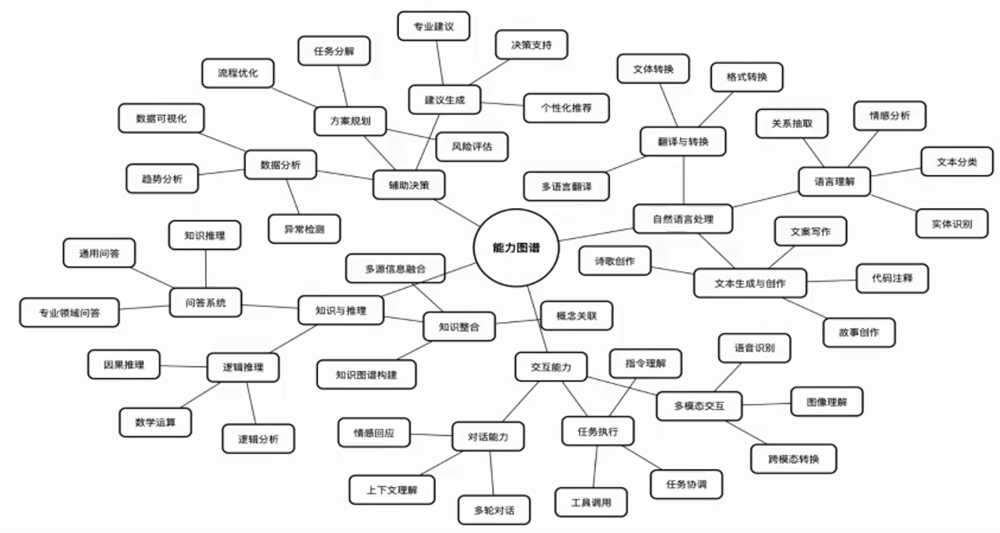

四大核心能力：

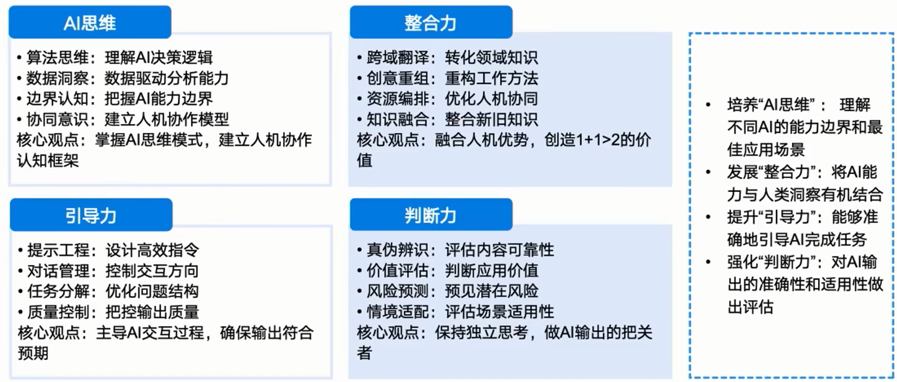

#### 为什么不直接使用网页版ds？
网页版的大模型不说**响应**速度，和**精准**度。主要基于现有的外部数据集进行训练，但缺乏完整的知识库。这种结构化不足会导致模型在实际场景中的表现下降。而且特定领域由于**数据安全性**，不能选择外部模型。

[Deepseek Chat](https://chat.deepseek.com/)

#### 如何实现网页版ds不能实现的需求？
**本地化**部署，通过**RAG**（Retrieval-Augmented Generation）结合文本检索和生成任务，弥补了这一短板。它能够根据上下文信息查找相关的知识，并将其整合到模型的回答中，显著提升了模型的泛化能力。

[Ollama Down](https://ollama.com/) 然后小黑窗口run ，可配合chatbox客户端使用，也可配置[硅基流动](https://siliconflow.cn/zh-cn/models)满血版

#### AI赛道，如何把握机会？
##### AI 智能体
AI智能体是指能够自主执行任务、做出决策并从环境中学习的系统。它们可以应用于客户服务、游戏、自动化控制等多个领域。

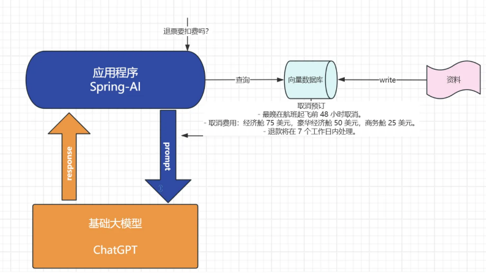

##### 模型私有定制化
模型私有定制化是指根据特定需求和数据集对预训练模型进行调整，以适应特定的业务场景。

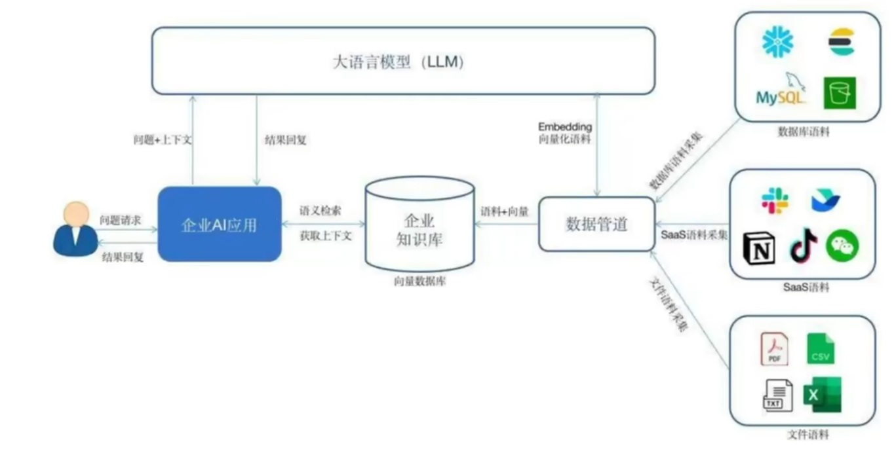

##### 搜广推
即搜索、广告和推荐系统，利用AI技术提高内容的个性化和相关性，提升用户体验和商业价值。

### 什么是RAG？为什么需要？原理是？
#### RAG原理
RAG（Retrieval-Augmented Generation）是一种结合了检索（Retrieval）和生成（Generation）的模型架构。它首先从大规模数据集中检索相关信息，然后将这些信息作为上下文输入到生成模型中，以生成更加准确和相关的输出。

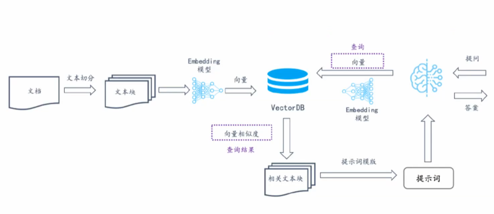

RAG技术的原理是通过检索增强生成模型的能力，使其能够利用外部知识库来生成更加丰富和准确的内容。

#### 技术细节：检索，增强，生成
##### 检索策略：
    - **词袋模型**：将单词和短语作为实体，存储为向量形式。
    - **嵌入表（Embedding）**：将单词映射到低维空间，便于检索。例如，在Word2Vec模型中，每个单词被映射到一个向量。

##### 生成过程：
    - 在生成文本时，结合检索结果获取相关信息，并将其融入生成的文本中。
    - 通过监督学习（Supervised Learning），在生成过程和外部知识库之间建立关联。例如，在问答系统中，生成器的目标是尽可能接近用户提供的查询。

##### 增强机制：
    - 在生成过程中，使用检索结果来调整生成参数或直接提取相关信息。这可以通过损失函数（Loss Function）来实现，使生成文本与目标数据集更相似。

### RAG和模型微调的区别？微调流程是？
### RAG和模型微调的区别
| **特性** | **RAG（Retrieval-Augmented Generation）** | **微调（Fine-tuning）** |
| :--- | :--- | :--- |
| **原理** | 通过检索外部知识库中的信息，并将其作为上下文输入到生成模型中，增强生成文本的准确性和相关性。 | 对预训练模型的参数进行针对性调整，使其适应特定任务或领域。 |
| **数据需求** | 数据需求较少，主要依赖外部知识库。 | 需要大量标注数据进行训练。 |
| **更新成本** | 知识更新成本低，只需更新知识库。 | 更新困难，需要重新微调模型。 |
| **推理速度** | 推理速度较慢，需要检索和生成两个步骤。 | 推理速度快，只需一次模型调用。 |
| **灵活与适应性** | 适应性强，适合动态环境和多样化任务。 | 适应性较差，主要适用于特定任务和稳定环境。 |
| **优点** | 动态知识更新、较少的数据需求、灵活性强、可定制化。 | 定制化能力强、一体化、高效推理。 |
| **缺点** | 推理速度慢、复杂性增加、依赖外部知识库。 | 数据需求高、更新困难、存储和计算成本高。 |
| **适用场景** | 外部知识频繁更新、标注数据不足、任务复杂多样。 | 任务和数据相对稳定、有充足标注数据、对推理速度要求高。 |

RAG与模型微调的主要区别在于，RAG侧重于利用外部知识库来增强模型的生成能力，而模型微调则是通过在特定数据集上进一步训练模型来调整其参数。LoRA 微调是提升大模型性能的关键方法之一。

简单直白的说就是：RAG就是给大模型投喂知识，微调就是训练优化。

####  微调流程：
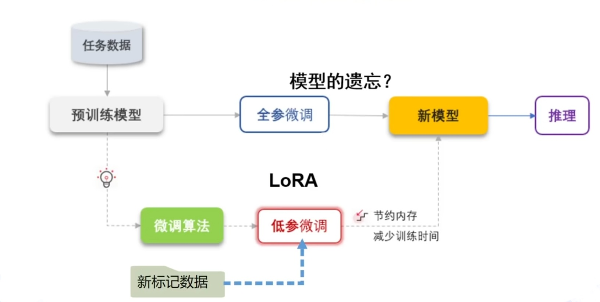

微调流程通常包括以下步骤：

1. 准备特定领域的数据集。
2. 选择一个预训练模型。
3. 在特定数据集上进一步训练模型，调整模型参数。
4. 评估模型性能并进行必要的调整。

### 什么是Embedding？为什么需要？
Embedding（向量）是一种将高维数据转换为低维向量的技术，这些向量能够在一定程度上保留原始数据的语义信息。在自然语言处理等领域，Embedding模型能够将文本转换为向量，从而使得机器学习模型能够更好地理解和处理文本数据。

简而言之就是让知识库的文件能被机器看懂。可查看[Ollama](https://ollama.com/search?c=embedding)可下的model除了chat模型还有embedding

#### 为什么需要Embedding模型？
##### 高维表示：
    - 传统的方法如TF-IDF（ TF-Inverse Document Frequency）直接使用词的频率作为特征值，这些特征值通常非常稀疏和低维。这种表示方式在处理文本数据时可能会出现维度过载的问题。

##### 捕捉上下文关系：
    - 在自然语言处理任务中，模型需要理解一个句子中的每个词与其他词之间的关系。使用嵌入向量可以更好地捕捉这些关系，因为嵌入向量不仅包含词本身的特征，还包含了其与其他词的相似性或相关性。

##### 处理稀疏数据：
    - 嵌入向量通常可以处理更密集的数据结构，这使得模型在处理稀疏输入时表现更好。例如，在某些任务中，每个单词的嵌入向量可能都是非零的，并且可以在较高的维度上分布均匀。

##### 提高模型性能：
    - 传统的词袋模型和TF-IDF等方法在某些情况下效果不佳，因为它们忽略了一些重要的上下文信息。使用嵌入向量可以让模型更好地利用这些信息，从而提升整体模型的性能。

##### 与深度学习结合的效果：
    - 嵌入向量可以有效地整合到深度学习模型中。例如，在LSTM（长短期记忆网络）或CNN（卷积神经网络）中使用嵌入向量可以让模型更好地理解文本序列中的上下文关系，从而提高模型的预测能力。

##### 处理变长输入：
    - 传统的词袋模型和TF-IDF等方法对输入的词数量非常敏感。如果一个句子很长或者很短，可能会导致特征空间变得过大或过小，影响模型的学习效果。

### 如何快速搭建本地知识库？实操！
快速搭建本地知识库的步骤包括：

1. 本地部署AI大模型。
2. 收集和整理知识库相关数据。
3. 选择合适的存储和检索技术。
4. 实施数据的索引和检索机制。

#### 实操：
##### 1，本地部署大模型 ollama下载安装DeepSeek
打开 [https://ollama.com/download](https://ollama.com/download)  下exe 安装

命令行：ollama run deepseek-r1:1.5b  部署ds模型

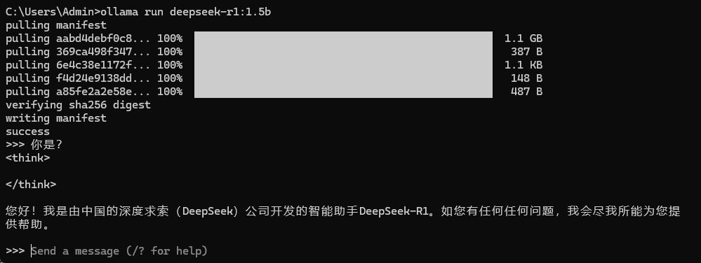

告别小黑窗 下载chatbox：https://chatboxai.app

设置：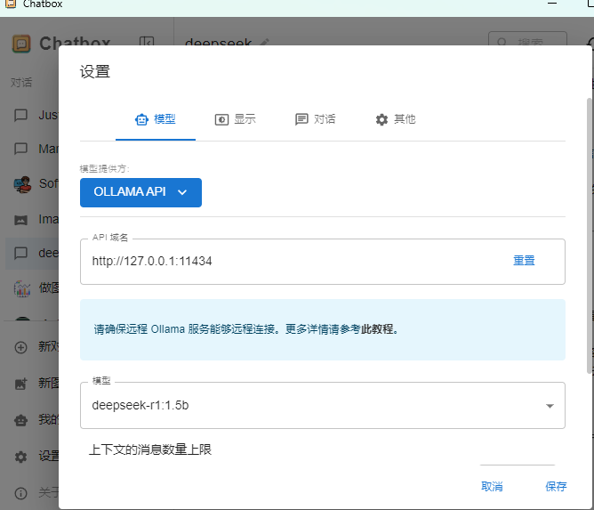

##### 2，RAG开源架构 RAGFlow镜像启动
下载RAGFlow  git ：

$ git clone [https://github.com/infiniflow/ragflow.git](https://github.com/infiniflow/ragflow.git)

修改配置（默认不带Embedding模块）本地部署Embedding

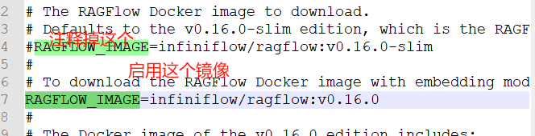

然后下载docker镜像 执行下面这个命令：

docker compose -f docker-compose.yml up -d

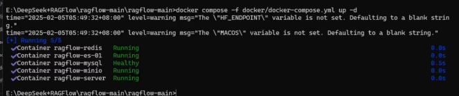

##### 3，配置 LLM：chat模型 和 embedding模型
（注意名称,ipconfig  IP地址不能127.0.0.1）

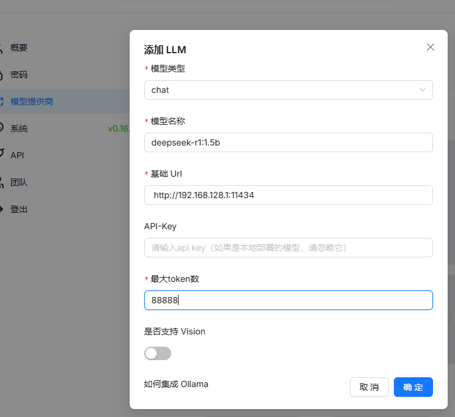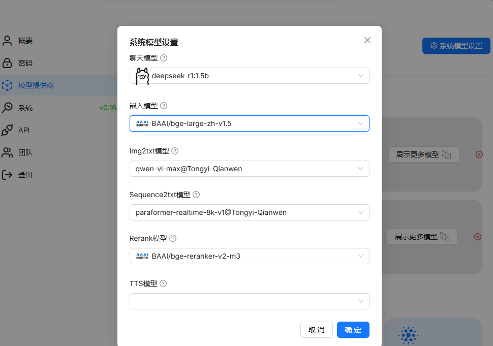

##### 4，构建个人知识库：
让大模型先写一份员工规范 / 蟹堡王员工规范 上传并解析

##### 5，[RAGFlow ](http://localhost/)导入与否 问答测试的效果 对比 
（员工基本原则？怎么接待一车的沙丁鱼）

调整：设置助理，提示引擎： 不知道的答复。 模型设置token大些避免回答较短

##### 不本地部署，可以只搭建个人知识库吗？
如**DS网页版**也可上传文档，但不能形成知识库。**Langchain**适合技术用户快速搭建知识库，也可选择谷歌**浏览器插件**：Page Assist - 本地 AI 模型

### AI大模型学习规划，落地项目，简历优化
AI大模型学习规划

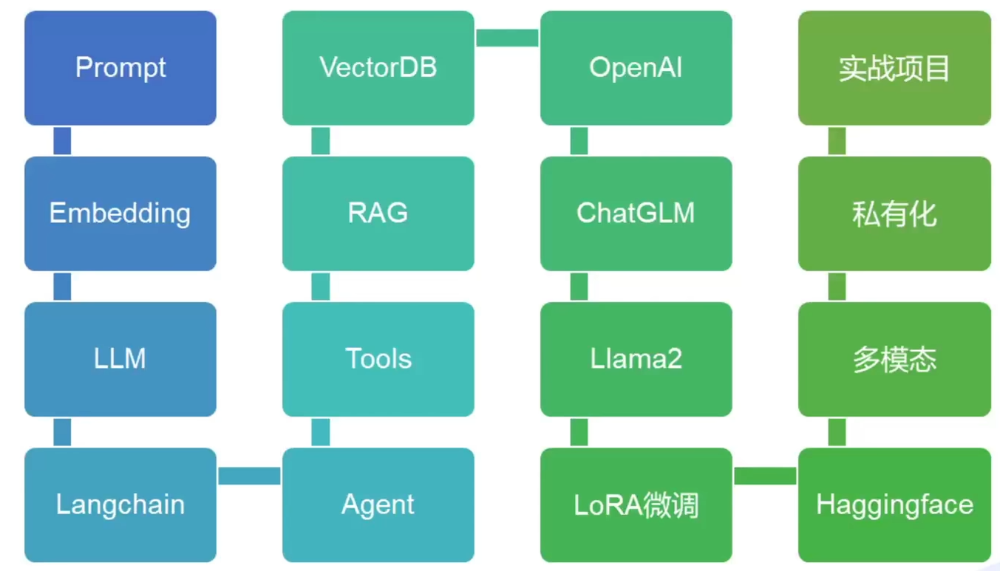

聊天机器人，根据信息执行相关业务操作：比如收发邮件，购票，退换票

### AI大模型就业形式，和大厂案例

+ Google：利用AI技术改进搜索引擎，提高广告投放的精准度。
+ Amazon：通过AI技术优化物流和供应链管理，提高效率。
+ 飞书，钉钉，腾讯等大厂皆已适配自己的ds，官网给出近百款[集成案例](https://github.com/deepseek-ai/awesome-deepseek-integration/tree/main)

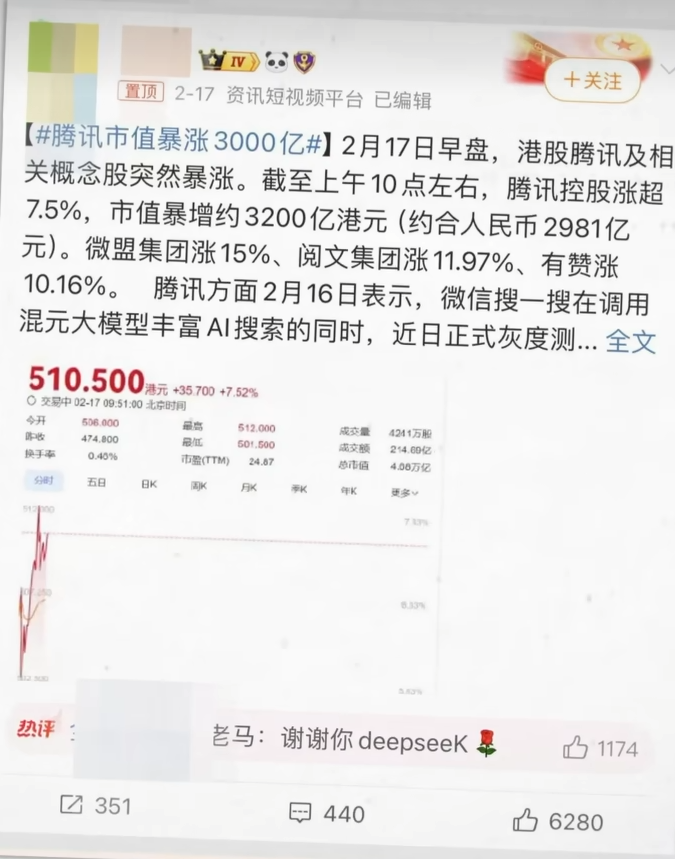

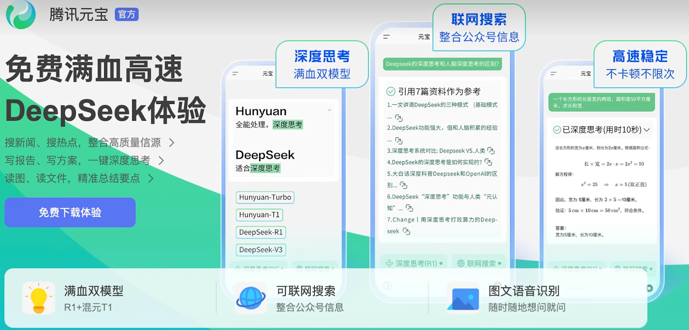

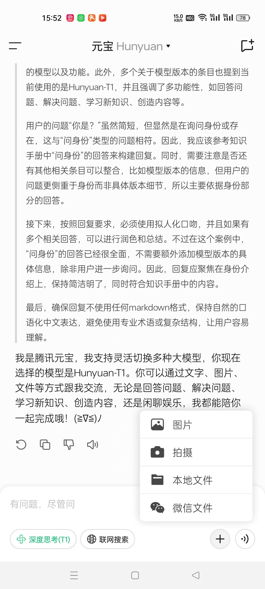

> 更新: 2025-04-20 22:38:49  
> 原文: <https://www.yuque.com/aaron-wecc3/dhluml/asgpo5yesx0uioag>