# 163.Cursor快速入门与配置

# 示例代码

[cursor-demo.zip](https://www.yuque.com/attachments/yuque/0/2025/zip/2424104/1755056833133-89eda2b7-f0f5-4064-a051-e2d8a5883230.zip)

# <font style="color:rgb(51, 51, 51);">AI 编程入门</font>

<font style="color:rgb(51, 51, 51);">在传统的编程模式中，开发程序是一项高度专业化的任务。程序员需要具备深厚的技术背景，掌握至少一门编程语言比如</font><code><font style="color:rgb(51, 51, 51);background-color:rgb(243, 244, 244);">Python</font></code><font style="color:rgb(51, 51, 51);">、</font><code><font style="color:rgb(51, 51, 51);background-color:rgb(243, 244, 244);">Java</font></code><font style="color:rgb(51, 51, 51);">、</font><code><font style="color:rgb(51, 51, 51);background-color:rgb(243, 244, 244);">C++</font></code><font style="color:rgb(51, 51, 51);">等等。并且要对复杂的逻辑和算法有清晰的理解。他们通过编写一行行代码，精确地告诉计算机每一步该怎么做。但这个过程需要深厚的专业知识、严谨的逻辑思维和极大的耐心。且门槛较高、开发周期较长。</font>

<font style="color:rgb(51, 51, 51);">然而，随着 AI 人工智能技术的飞速发展，编程的方式正在迎来革命性的变化。现在，我们迎来了一个全新的阶段：你不再需要精通晦涩难懂的编程语法，甚至不需要直接面对复杂的代码编辑器。取而代之的是，你可以像和朋友聊天一样，用自然、日常的语言，向一个强大的 AI 大模型（比如我们常说的</font><code><font style="color:rgb(51, 51, 51);background-color:rgb(243, 244, 244);">DeepSeek</font></code><font style="color:rgb(51, 51, 51);">、</font><code><font style="color:rgb(51, 51, 51);background-color:rgb(243, 244, 244);">ChatGPT</font></code><font style="color:rgb(51, 51, 51);">、</font><code><font style="color:rgb(51, 51, 51);background-color:rgb(243, 244, 244);">豆包</font></code><font style="color:rgb(51, 51, 51);">等）描述你的需求。</font>

<font style="color:rgb(51, 51, 51);">想象一下，你只需要告诉 AI：“我想要一个能计算两个数之和的小程序。” 或者 “帮我设计一个简单的网页，上面有个按钮，点击后能显示‘你好，世界！’”。然后，这个 AI 大模型就像一个超级能干的编程助手，它会理解你的意图，迅速生成相应的代码，甚至可能是一个可以直接运行的程序。</font>

<font style="color:rgb(51, 51, 51);">所以，我们可以这样理解：</font>**<font style="color:rgb(51, 51, 51);">用自然语言进行 “对话” + 背后强大的“AI 大模型” 智能处理 = 这就是 AI 编程的核心。</font>**


**<font style="color:rgb(51, 51, 51);">AI 编程的核心</font>**<font style="color:rgb(51, 51, 51);">在于利用强大的 AI 大模型来辅助甚至主导编程过程。这些 AI 大模型经过海量数据的训练，具备了理解和生成代码的能力。通过简单的对话聊天，即使是非专业的用户，也能够与 AI 大模型交互，快速生成所需的程序代码。</font>

<font style="color:rgb(51, 51, 51);">这种模式的出现，极大地降低了编程的门槛，使得更多的人能够参与到软件开发中来。无论是初学者还是有一定基础的开发者，都可以借助 AI 大模型的智能辅助，快速实现自己的想法，提高开发效率。</font>

# <font style="color:rgb(51, 51, 51);">主流AI编程IDE对比</font>

<font style="color:rgb(51, 51, 51);">市面上流行的 AI 编程 IDE（集成开发环境）有很多，下面对比几款主流 AI 编程工具，看看它们各自的特点和区别。</font>

| **<font style="color:rgb(51, 51, 51);">工具名称</font>** | **<font style="color:rgb(51, 51, 51);">类型</font>** | **<font style="color:rgb(51, 51, 51);">核心功能</font>** | **<font style="color:rgb(51, 51, 51);">支持模型</font>** | **<font style="color:rgb(51, 51, 51);">价格</font>** | **<font style="color:rgb(51, 51, 51);">优势</font>** | **<font style="color:rgb(51, 51, 51);">劣势</font>** |
| :--- | :--- | :--- | :--- | :--- | :--- | :--- |
| **<font style="color:rgb(51, 51, 51);">GitHub Copilot</font>** | <font style="color:rgb(51, 51, 51);">IDE 插件</font> | <font style="color:rgb(51, 51, 51);">代码补全、Copilot Chat、支持多种语言</font> | <font style="color:rgb(51, 51, 51);">GPT-4o、Claude 3.7 等</font> | <font style="color:rgb(51, 51, 51);">个人用户每月 10 美元或每年 100 美元</font> | <font style="color:rgb(51, 51, 51);">代码补全能力强、支持广泛语言、成熟社区</font> | <font style="color:rgb(51, 51, 51);">对整个代码库的理解有限，基本重构能力较弱</font> |
| **<font style="color:rgb(51, 51, 51);">Cursor AI</font>** | <font style="color:rgb(51, 51, 51);">独立 IDE</font> | <font style="color:rgb(51, 51, 51);">代码生成、重构、自然语言编辑、多文件协作</font> | <font style="color:rgb(51, 51, 51);">OpenAI 系列、Claude 系列、DeepSeek 系列</font> | <font style="color:rgb(51, 51, 51);">免费版，Pro 版每月 20 美元</font> | **<font style="color:rgb(51, 51, 51);">AI 编程第一选择</font>**<font style="color:rgb(51, 51, 51);">，最强 AI 编程 IDE，接入新模型的速度非常，适合专业开发</font> | <font style="color:rgb(51, 51, 51);">价格较高</font> |
| **<font style="color:rgb(51, 51, 51);">Windsurf IDE</font>** | <font style="color:rgb(51, 51, 51);">独立 IDE</font> | <font style="color:rgb(51, 51, 51);">AI Flow 动态思维画布、实时差分评估、本地优先 AI</font> | <font style="color:rgb(51, 51, 51);">OpenAPI 系列、DeepSeek 系列</font> | <font style="color:rgb(51, 51, 51);">免费版，Pro 版每月 15 美元</font> | <font style="color:rgb(51, 51, 51);">本地运行 AI 模型、快速性能、以 Web 为中心</font> | <font style="color:rgb(51, 51, 51);">还不够成熟，需要高端硬件</font> |
| **<font style="color:rgb(51, 51, 51);">Trae</font>** | <font style="color:rgb(51, 51, 51);">独立 IDE</font> | <font style="color:rgb(51, 51, 51);">自然语言到代码的转化、低代码开发</font> | <font style="color:rgb(51, 51, 51);">Claude 3.5、DeepSeek R1</font> | <font style="color:rgb(51, 51, 51);">免费</font> | <font style="color:rgb(51, 51, 51);">国产工具，免费且有潜力</font> | <font style="color:rgb(51, 51, 51);">功能相对基础，社区支持有限</font> |
| **<font style="color:rgb(51, 51, 51);">Codeium</font>** | <font style="color:rgb(51, 51, 51);">IDE 插件</font> | <font style="color:rgb(51, 51, 51);">代码生成、聊天、搜索功能</font> | <font style="color:rgb(51, 51, 51);">未明确</font> | <font style="color:rgb(51, 51, 51);">免费</font> | <font style="color:rgb(51, 51, 51);">免费使用，支持多种语言和 IDE</font> | <font style="color:rgb(51, 51, 51);">功能相对基础</font> |

**<font style="color:rgb(51, 51, 51);">简单小结一下：</font>**

* <font style="color:rgb(51, 51, 51);">如果你要深度体验一波 AI 编程的魅力，首选 </font>**<font style="color:rgb(51, 51, 51);">Cursor</font>**<font style="color:rgb(51, 51, 51);">。Cursor 是一款以 AI 为核心的代码编辑器，它基于 Visual Studio Code（VS Code）开发，继承了 VS Code 的强大功能，并在此基础上加入了深度集成的 AI 功能。</font>
* <font style="color:rgb(51, 51, 51);">如果你是国产爱好者且想免费白嫖，首选字节跳动出品的 Trae。</font>

<font style="color:rgb(51, 51, 51);"></font>

# <font style="color:rgb(0, 0, 0);">Cursor 简介</font>

<font style="color:rgb(51, 51, 51);">Cursor 是一款基于人工智能的现代代码编辑器，由 Anysphere 公司开发。</font>

<font style="color:rgb(51, 51, 51);">Cursor 是基于</font><font style="color:rgb(51, 51, 51);"> </font>[<font style="color:rgb(0, 102, 0);">VS Code</font>](https://www.runoob.com/vscode/vscode-tutorial.html)<font style="color:rgb(51, 51, 51);"> </font><font style="color:rgb(51, 51, 51);">开发的一款编辑器，它在保留 VS Code 强大功能和熟悉操作体验的同时，专注于集成 AI 技术，帮助开发者更高效地编写代码。</font>

<font style="color:rgb(51, 51, 51);">另外国内阿里与字节也有基于 VS Code 开发的 IDE：</font>

* **<font style="color:rgb(51, 51, 51);">阿里 Lingma IDE：</font>**[<font style="color:rgb(0, 102, 0);">https://lingma.aliyun.com/</font>](https://click.aliyun.com/m/1000402708/)
* **<font style="color:rgb(51, 51, 51);">字节 Trae：</font>**[<font style="color:rgb(0, 102, 0);">https://www.trae.com.cn/</font>](https://www.trae.com.cn/?utm_source=advertising\&utm_medium=runoob_ug_cpa\&utm_term=hw_trae_runoob)

**<font style="color:rgb(51, 51, 51);">核心特征：</font>**

* **<font style="color:rgb(51, 51, 51);">AI 原生设计</font>**<font style="color:rgb(51, 51, 51);">：从底层架构就融入了 AI 能力，而非后期添加的插件</font>
* **<font style="color:rgb(51, 51, 51);">智能代码生成</font>**<font style="color:rgb(51, 51, 51);">：通过自然语言描述快速生成代码片段</font>
* **<font style="color:rgb(51, 51, 51);">上下文感知</font>**<font style="color:rgb(51, 51, 51);">：深度理解项目结构和代码关系</font>
* **<font style="color:rgb(51, 51, 51);">实时协助</font>**<font style="color:rgb(51, 51, 51);">：在编程过程中提供即时的建议和优化</font>
* **<font style="color:rgb(51, 51, 51);">多模型支持</font>**<font style="color:rgb(51, 51, 51);">：集成了多种先进的大语言模型</font>

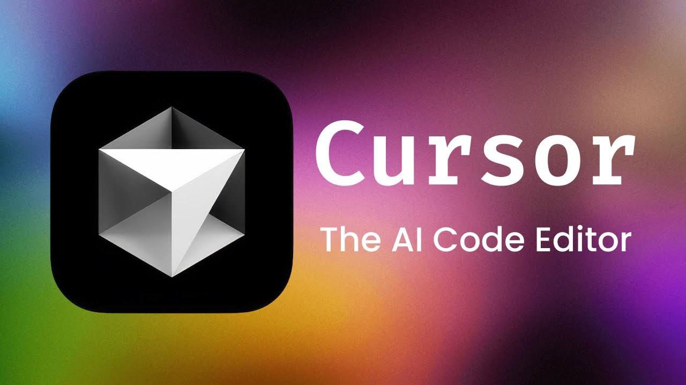

### <font style="color:rgb(51, 51, 51);">Cursor 与传统 IDE 的区别</font>

| <font style="color:rgb(255, 255, 255);">功能特性</font> | <font style="color:rgb(255, 255, 255);">传统 IDE</font> | <font style="color:rgb(255, 255, 255);">Cursor</font> |
| --- | --- | --- |
| **<font style="color:rgb(51, 51, 51);">代码补全</font>** | <font style="color:rgb(51, 51, 51);">基于语法分析和已有代码的静态补全</font> | <font style="color:rgb(51, 51, 51);">AI 驱动的智能补全，理解上下文和意图</font> |
| **<font style="color:rgb(51, 51, 51);">代码生成</font>** | <font style="color:rgb(51, 51, 51);">依靠预设模板和代码片段</font> | <font style="color:rgb(51, 51, 51);">通过自然语言描述生成完整代码逻辑</font> |
| **<font style="color:rgb(51, 51, 51);">问题解决</font>** | <font style="color:rgb(51, 51, 51);">需要手动查找文档、Stack Overflow 等</font> | <font style="color:rgb(51, 51, 51);">内置 AI 助手，即时解答编程问题</font> |
| **<font style="color:rgb(51, 51, 51);">代码理解</font>** | <font style="color:rgb(51, 51, 51);">提供语法高亮和基础结构分析</font> | <font style="color:rgb(51, 51, 51);">深度理解代码逻辑，提供详细解释</font> |
| **<font style="color:rgb(51, 51, 51);">重构优化</font>** | <font style="color:rgb(51, 51, 51);">手动操作，依赖开发者经验</font> | <font style="color:rgb(51, 51, 51);">AI 智能分析并建议最佳重构方案</font> |
| **<font style="color:rgb(51, 51, 51);">学习支持</font>** | <font style="color:rgb(51, 51, 51);">需要外部资料和文档</font> | <font style="color:rgb(51, 51, 51);">内置技术知识，实时学习辅导</font> |
| **<font style="color:rgb(51, 51, 51);">错误处理</font>** | <font style="color:rgb(51, 51, 51);">显示编译错误和基础语法检查</font> | <font style="color:rgb(51, 51, 51);">预测潜在问题，提供修复建议和解释</font> |
| **<font style="color:rgb(51, 51, 51);">项目理解</font>** | <font style="color:rgb(51, 51, 51);">文件级别的分析和导航</font> | <font style="color:rgb(51, 51, 51);">整个项目架构的深度理解和关联分析</font> |
| **<font style="color:rgb(51, 51, 51);">协作方式</font>** | <font style="color:rgb(51, 51, 51);">主要依赖团队成员间的沟通</font> | <font style="color:rgb(51, 51, 51);">AI 作为智能编程伙伴参与开发过程</font> |
| **<font style="color:rgb(51, 51, 51);">适应性</font>** | <font style="color:rgb(51, 51, 51);">需要手动配置和插件扩展</font> | <font style="color:rgb(51, 51, 51);">自动适应项目类型和编程语言特点</font> |

**<font style="color:rgb(51, 51, 51);">核心差异总结：</font>**

| <font style="color:rgb(255, 255, 255);">对比维度</font> | <font style="color:rgb(255, 255, 255);">传统 IDE</font> | <font style="color:rgb(255, 255, 255);">Cursor</font> |
| --- | --- | --- |
| **<font style="color:rgb(51, 51, 51);">交互方式</font>** | <font style="color:rgb(51, 51, 51);">基于菜单、快捷键的工具操作</font> | <font style="color:rgb(51, 51, 51);">自然语言对话 + 传统操作</font> |
| **<font style="color:rgb(51, 51, 51);">学习曲线</font>** | <font style="color:rgb(51, 51, 51);">需要记忆大量快捷键和功能位置</font> | <font style="color:rgb(51, 51, 51);">通过对话快速上手，降低学习门槛</font> |
| **<font style="color:rgb(51, 51, 51);">开发效率</font>** | <font style="color:rgb(51, 51, 51);">依赖开发者经验和熟练度</font> | <font style="color:rgb(51, 51, 51);">AI 辅助显著提升编码速度</font> |
| **<font style="color:rgb(51, 51, 51);">代码质量</font>** | <font style="color:rgb(51, 51, 51);">主要依靠开发者技能水平</font> | <font style="color:rgb(51, 51, 51);">AI 持续提供最佳实践建议</font> |
| **<font style="color:rgb(51, 51, 51);">知识获取</font>** | <font style="color:rgb(51, 51, 51);">需要主动搜索和学习</font> | <font style="color:rgb(51, 51, 51);">被动接收 AI 推荐和解释</font> |
| **<font style="color:rgb(51, 51, 51);">问题诊断</font>** | <font style="color:rgb(51, 51, 51);">基于错误信息手动排查</font> | <font style="color:rgb(51, 51, 51);">AI 分析问题根源并提供解决方案</font> |
| **<font style="color:rgb(51, 51, 51);">创新能力</font>** | <font style="color:rgb(51, 51, 51);">受限于开发者知识范围</font> | <font style="color:rgb(51, 51, 51);">AI 提供多样化解决思路</font> |
| **<font style="color:rgb(51, 51, 51);">适用人群</font>** | <font style="color:rgb(51, 51, 51);">需要一定编程基础</font> | <font style="color:rgb(51, 51, 51);">适合各个水平的开发者</font> |

***

## <font style="color:rgb(51, 51, 51);">设置</font>

<font style="color:rgb(51, 51, 51);">如果您之前使用 VS Code，可以轻松将您的扩展、主题、设置和快捷键一键导入到 Cursor 中。</font>

<font style="color:rgb(51, 51, 51);">只需进入 Cursor Settings > General > Account，选择 import 导入配置文件，即可完成迁移。</font>

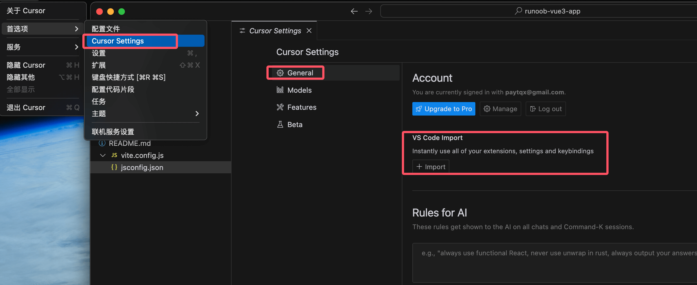

<font style="color:rgb(51, 51, 51);">Cursor 会定期同步 VS Code 的最新版本，确保您始终使用最新的功能和优化。</font>

### <font style="color:rgb(51, 51, 51);">为什么 Cursor 是一个独立应用，而不是 VS Code 的插件？</font>

<font style="color:rgb(51, 51, 51);">作为独立应用，Cursor 可以更深度地优化编辑器界面，并实现更强大的 AI 集成，例如，Cursor Tab 和 CMD-K 等功能，无法通过插件形式在现有编程环境中实现。</font>

### <font style="color:rgb(51, 51, 51);">如何设置 Cursor？</font>

* <font style="color:rgb(51, 51, 51);">点击右上角的齿轮按钮，或按下快捷键</font><font style="color:rgb(51, 51, 51);"> </font>**<font style="color:rgb(51, 51, 51);">Ctrl/⌘ + Shift + J</font>**<font style="color:rgb(51, 51, 51);">，即可打开 Cursor 的专属设置面板。</font>
* <font style="color:rgb(51, 51, 51);">您也可以通过</font><font style="color:rgb(51, 51, 51);"> </font>**<font style="color:rgb(51, 51, 51);">Ctrl/⌘ + Shift + P</font>**<font style="color:rgb(51, 51, 51);">，输入</font><font style="color:rgb(51, 51, 51);"> </font>**<font style="color:rgb(51, 51, 51);">Cursor Settings</font>**<font style="color:rgb(51, 51, 51);"> </font><font style="color:rgb(51, 51, 51);">来打开。</font>

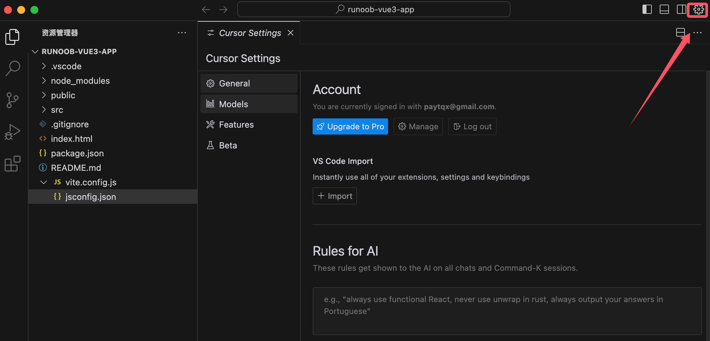

### <font style="color:rgb(51, 51, 51);">为什么 Cursor 的活动栏是水平的？</font>

<font style="color:rgb(51, 51, 51);">默认情况下，Cursor 的活动栏是水平放置的，这是为了节省空间，方便集成聊天功能。</font>


<font style="color:rgb(51, 51, 51);">如果您更喜欢传统的垂直活动栏，可以按照以下步骤调整：</font>

* <font style="color:rgb(51, 51, 51);">打开</font><font style="color:rgb(51, 51, 51);"> </font>**<font style="color:rgb(51, 51, 51);">Cursor 设置</font>**<font style="color:rgb(51, 51, 51);">。</font>
* <font style="color:rgb(51, 51, 51);">搜索并找到</font><font style="color:rgb(51, 51, 51);"> </font>**<font style="color:rgb(51, 51, 51);">workbench.activityBar.orientation</font>**<font style="color:rgb(51, 51, 51);">，将其值改为</font><font style="color:rgb(51, 51, 51);"> </font>**<font style="color:rgb(51, 51, 51);">vertical</font>**<font style="color:rgb(51, 51, 51);">。</font>
* <font style="color:rgb(51, 51, 51);">重启 Cursor 即可生效。</font>


<font style="color:rgb(51, 51, 51);">改为</font><font style="color:rgb(51, 51, 51);"> </font>**<font style="color:rgb(51, 51, 51);">vertical</font>**<font style="color:rgb(51, 51, 51);"> </font><font style="color:rgb(51, 51, 51);">后重启效果：</font>

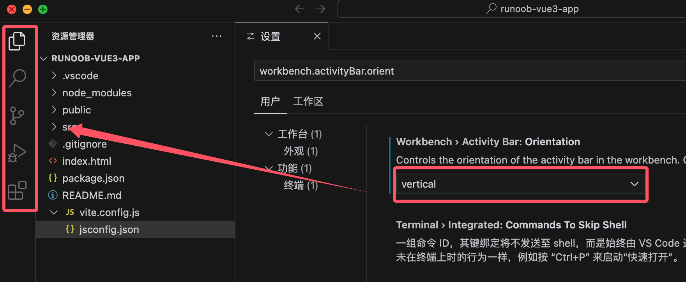

***

## <font style="color:rgb(51, 51, 51);">Cursor 使用</font>

### <font style="color:rgb(51, 51, 51);">Cursor 免费版和和收费区别？</font>

<code><font style="color:rgb(51, 51, 51);background-color:rgb(243, 244, 244);">Cursor</font></code><font style="color:rgb(51, 51, 51);">功能虽强大，但也分为免费版和收费版，不同版本之间功能区别较大。</font>

<font style="color:rgb(51, 51, 51);">以下是 Cursor 免费版和收费版（Pro 版）的区别，以及如何进行充值的说明：</font>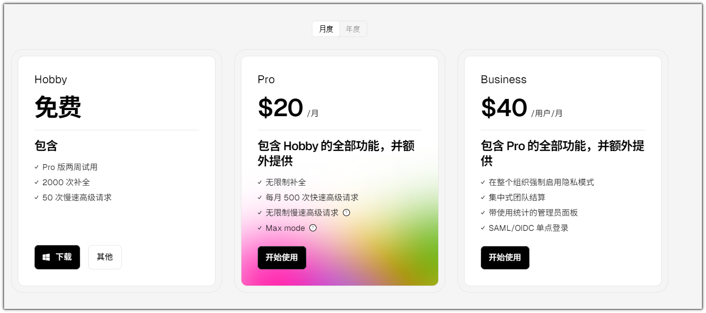

**<font style="color:rgb(51, 51, 51);">1、免费版</font>**

<font style="color:rgb(51, 51, 51);">免费只能使用差的模型，没法使用最强的编程模型，每个月只能使用 50 次请求</font><font style="color:rgb(51, 51, 51);">可能还会有更多限制，cursor 免费用户的限制随着时间一直在增加。</font>

**<font style="color:rgb(51, 51, 51);">2、收费版（Pro）</font>**

<font style="color:rgb(51, 51, 51);">无限次 tab 使用、每月 500 次高速请求，可使用各种最好的编程模型，也可以使用 MAX 模式，每月 $20（约合人民币 140 元），年付更优惠。</font>

### <font style="color:rgb(51, 51, 51);">如何充值？</font>

<font style="color:rgb(51, 51, 51);">在 Cursor 官网登录账户后，进入订阅页面，选择 Pro 版或 Business 版，点击 “Get Started” 或“开始使用”按钮。</font>


<font style="color:rgb(51, 51, 51);">选择支付方式，如国内用户选择支付宝即可。</font>

<font style="color:rgb(51, 51, 51);">Cursor 提供多种订阅等级，以满足不同用户的需求。</font>

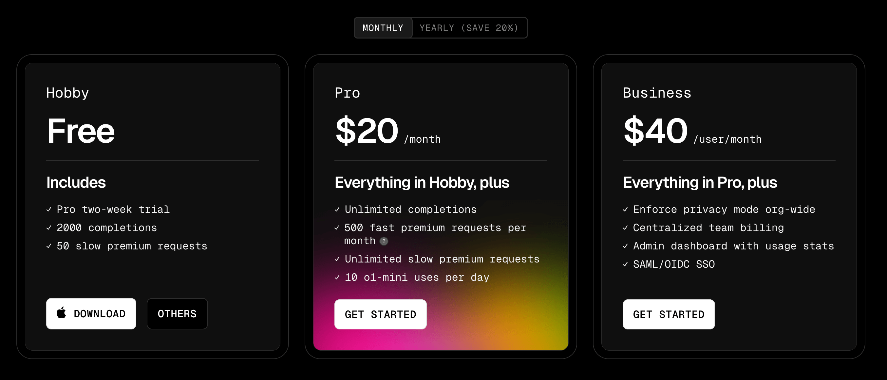

**<font style="color:rgb(51, 51, 51);">Hobby 计划</font>**

* **<font style="color:rgb(51, 51, 51);">14 天 Pro 试用</font>**<font style="color:rgb(51, 51, 51);">（包含 250 次快速高级模型使用）</font>
* <font style="color:rgb(51, 51, 51);">50 次慢速高级模型使用</font>
* <font style="color:rgb(51, 51, 51);">2000 次代码补全使用</font>

**<font style="color:rgb(51, 51, 51);">Pro 计划</font>**

* <font style="color:rgb(51, 51, 51);">每月 500 次快速高级模型使用</font>
* <font style="color:rgb(51, 51, 51);">无限次慢速高级模型使用</font>
* <font style="color:rgb(51, 51, 51);">无限次代码补全使用</font>
* <font style="color:rgb(51, 51, 51);">每月 10 次 o1+mini 使用</font>

**<font style="color:rgb(51, 51, 51);">Business 计划</font>**

* <font style="color:rgb(51, 51, 51);">使用量与 Pro 计划相同</font>
* <font style="color:rgb(51, 51, 51);">全组织范围强制启用隐私模式</font>
* <font style="color:rgb(51, 51, 51);">集中团队账单管理</font>
* <font style="color:rgb(51, 51, 51);">管理员仪表盘，查看使用统计</font>
* <font style="color:rgb(51, 51, 51);">支持 SAML/OIDC 单点登录 (SSO)</font>

**<font style="color:rgb(51, 51, 51);">高级模型</font>**<font style="color:rgb(51, 51, 51);">\
</font><font style="color:rgb(51, 51, 51);">GPT-4、GPT-4o 和 Claude 3.5 Sonnet 均被视为高级模型。每次 Claude 3.5 Haiku 的请求计为 1/3 次高级模型请求。</font>

**<font style="color:rgb(51, 51, 51);">Pro 试用</font>**<font style="color:rgb(51, 51, 51);">\
</font><font style="color:rgb(51, 51, 51);">所有新用户均可享受 14 天 Pro 试用，试用期间可使用所有 Pro 功能以及 250 次快速高级模型请求。14 天试用期结束后，未升级的用户将自动降级为 Hobby 计划。</font>

**<font style="color:rgb(51, 51, 51);">快速与慢速请求</font>**<font style="color:rgb(51, 51, 51);">\
</font><font style="color:rgb(51, 51, 51);">默认情况下，Cursor 服务器会尽量为所有用户提供快速高级模型请求。但在高峰时段，快速请求额度用尽的用户将被移至慢速请求池，即等待快速请求可用的队列中。\
</font><font style="color:rgb(51, 51, 51);">该队列是公平的，Cursor 会尽力缩短队列等待时间。如果您需要更多快速请求且不想等待，可以在设置页面购买额外额度。</font>

**<font style="color:rgb(51, 51, 51);">查看使用情况</font>**<font style="color:rgb(51, 51, 51);">\
</font><font style="color:rgb(51, 51, 51);">您可以在 Cursor 设置页面查看使用情况。</font>

* <font style="color:rgb(51, 51, 51);">在 Cursor 应用中，进入</font><font style="color:rgb(51, 51, 51);"> </font>**<font style="color:rgb(51, 51, 51);">Cursor Settings > General > Account</font>**<font style="color:rgb(51, 51, 51);">。</font>
* <font style="color:rgb(51, 51, 51);">Cursor 的使用量每月重置，重置时间基于您的订阅开始日期。</font>

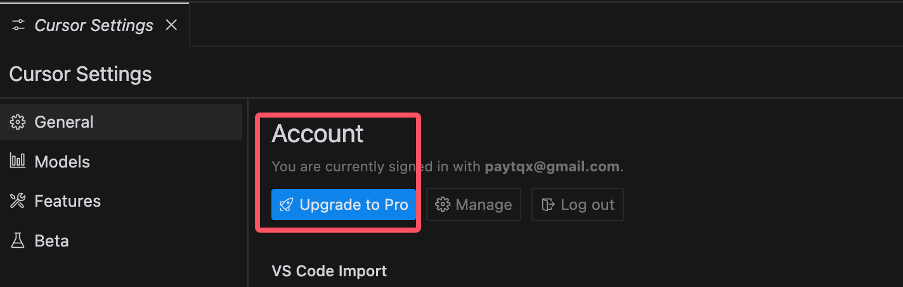

# <font style="color:rgb(0, 0, 0);">Cursor 安装</font>

<font style="color:rgb(51, 51, 51);">Cursor 是一款跨平台的代码编辑器，支持 Windows、macOS 和 Linux 系统。</font>

<font style="color:rgb(51, 51, 51);">Cursor 官方网站下载页面：</font>[<font style="color:rgb(0, 102, 0);">https://www.cursor.com/downloads</font>](https://www.cursor.com/downloads)<font style="color:rgb(51, 51, 51);">。</font>

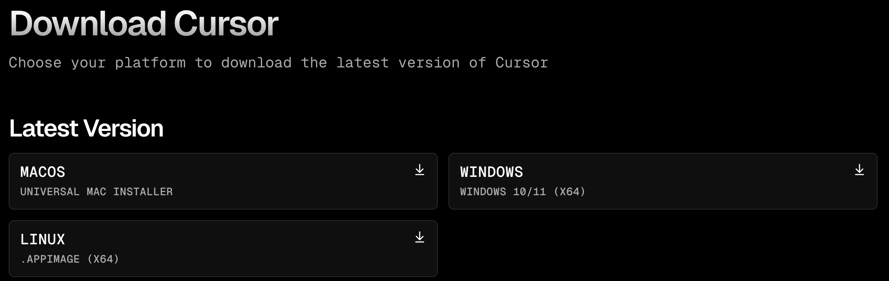

**<font style="color:rgb(51, 51, 51);">最低系统要求：</font>**

| <font style="color:rgb(255, 255, 255);">操作系统</font> | <font style="color:rgb(255, 255, 255);">版本要求</font> | <font style="color:rgb(255, 255, 255);">架构支持</font> |
| --- | --- | --- |
| **<font style="color:rgb(51, 51, 51);">Windows</font>** | <font style="color:rgb(51, 51, 51);">Windows 10 版本 1903 或更高</font> | <font style="color:rgb(51, 51, 51);">x64, ARM64</font> |
| **<font style="color:rgb(51, 51, 51);">macOS</font>** | <font style="color:rgb(51, 51, 51);">macOS 10.15 Catalina 或更高</font> | <font style="color:rgb(51, 51, 51);">Intel x64, Apple Silicon (M1/M2)</font> |
| **<font style="color:rgb(51, 51, 51);">Linux</font>** | <font style="color:rgb(51, 51, 51);">Ubuntu 18.04+, Debian 10+, RHEL 8+, SUSE 15+</font> | <font style="color:rgb(51, 51, 51);">x64, ARM64</font> |

**<font style="color:rgb(51, 51, 51);">硬件要求：</font>**

* **<font style="color:rgb(51, 51, 51);">内存 (RAM)</font>**<font style="color:rgb(51, 51, 51);">：最低 4GB，推荐 8GB 或更多</font>
* **<font style="color:rgb(51, 51, 51);">存储空间</font>**<font style="color:rgb(51, 51, 51);">：至少 2GB 可用磁盘空间</font>
* **<font style="color:rgb(51, 51, 51);">处理器</font>**<font style="color:rgb(51, 51, 51);">：支持 SSE2 的 x64 或 ARM64 处理器</font>
* **<font style="color:rgb(51, 51, 51);">网络连接</font>**<font style="color:rgb(51, 51, 51);">：稳定的互联网连接（AI 功能必需）</font>
* **<font style="color:rgb(51, 51, 51);">显示器</font>**<font style="color:rgb(51, 51, 51);">：分辨率至少 1024x768</font>

<font style="color:rgb(51, 51, 51);">默认情况下访问 Cursor 官网</font><font style="color:rgb(51, 51, 51);"> </font>[<font style="color:rgb(0, 102, 0);">https://www.cursor.com/</font>](https://www.cursor.com/)<font style="color:rgb(51, 51, 51);">，页面会根据你的系统自动匹配安装包，比如我是 macOS，就会出现 Download for macOS 按钮：</font>


* **<font style="color:rgb(51, 51, 51);">Windows</font>**<font style="color:rgb(51, 51, 51);">：下载</font><font style="color:rgb(51, 51, 51);"> </font><code><font style="color:rgb(51, 51, 51);">.exe</font></code><font style="color:rgb(51, 51, 51);"> </font><font style="color:rgb(51, 51, 51);">安装包</font>
* **<font style="color:rgb(51, 51, 51);">macOS</font>**<font style="color:rgb(51, 51, 51);">：下载</font><font style="color:rgb(51, 51, 51);"> </font><code><font style="color:rgb(51, 51, 51);">.dmg</font></code><font style="color:rgb(51, 51, 51);"> </font><font style="color:rgb(51, 51, 51);">镜像文件</font>
* **<font style="color:rgb(51, 51, 51);">Linux</font>**<font style="color:rgb(51, 51, 51);">：下载</font><font style="color:rgb(51, 51, 51);"> </font><code><font style="color:rgb(51, 51, 51);">.deb</font></code><font style="color:rgb(51, 51, 51);">（Ubuntu/Debian）或</font><font style="color:rgb(51, 51, 51);"> </font><code><font style="color:rgb(51, 51, 51);">.rpm</font></code><font style="color:rgb(51, 51, 51);">（RHEL/SUSE）包</font>

***

## <font style="color:rgb(51, 51, 51);">一、Windows 系统</font>

<font style="color:rgb(51, 51, 51);">打开浏览器，访问 Cursor 官网:</font><font style="color:rgb(51, 51, 51);"> </font>[<font style="color:rgb(0, 102, 0);">https://www.cursor.com/</font>](https://www.cursor.com/)<font style="color:rgb(51, 51, 51);">。</font>

<font style="color:rgb(51, 51, 51);">点击页面上的 "Download for Windows" 按钮，下载 Cursor 安装包 (exe 文件)。</font>


<font style="color:rgb(51, 51, 51);">双击下载的安装包，启动安装程序。</font>

<font style="color:rgb(51, 51, 51);">按照提示选择安装路径，建议使用默认路径。</font>

<font style="color:rgb(51, 51, 51);">点击 "Install" 按钮，等待安装完成。</font>

<font style="color:rgb(51, 51, 51);">安装完成后，点击 "Finish" 按钮，启动 Cursor 编辑器。</font>

***

## <font style="color:rgb(51, 51, 51);">二、macOS 系统</font>

<font style="color:rgb(51, 51, 51);">打开浏览器，访问 Cursor 官网:</font><font style="color:rgb(51, 51, 51);"> </font>[<font style="color:rgb(0, 102, 0);">https://www.cursor.com/</font>](https://www.cursor.com/)<font style="color:rgb(51, 51, 51);">，点击页面上的 "Download for Mac" 按钮，下载 Cursor 安装包 (dmg 文件)。</font>


<font style="color:rgb(51, 51, 51);">双击下载的 dmg 文件，将 Cursor 应用程序图标拖动到 "Applications" 文件夹中，完成安装。</font>

<font style="color:rgb(51, 51, 51);">打开 "Applications" 文件夹，双击 Cursor 图标，启动编辑器。</font>

***

## <font style="color:rgb(51, 51, 51);">三、Linux 系统</font>

<font style="color:rgb(51, 51, 51);">打开浏览器，访问 Cursor 官网:</font><font style="color:rgb(51, 51, 51);"> </font>[<font style="color:rgb(0, 102, 0);">https://www.cursor.com/</font>](https://www.cursor.com/)<font style="color:rgb(51, 51, 51);">，点击页面上的 "Download for Linux" 按钮，选择适合您 Linux 发行版的安装包 (deb 或 rpm 文件)。</font>


**<font style="color:rgb(51, 51, 51);">Debian/Ubuntu 系统:</font>**

```plain
sudo dpkg -i cursor_<version>_amd64.deb
sudo apt-get install -f
```

**<font style="color:rgb(51, 51, 51);">Fedora/Red Hat 系统:</font>**

<font style="color:rgb(51, 51, 51);">使用以下命令安装 rpm 包：</font>

<font style="color:rgb(51, 51, 51);">sudo rpm -ivh cursor\_<version>\_x86_64.rpm</font>

***

## <font style="color:rgb(51, 51, 51);">注册与登录</font>

<font style="color:rgb(51, 51, 51);">在安装包安装后要设置一些配置信息，语言我们选择中文：</font>

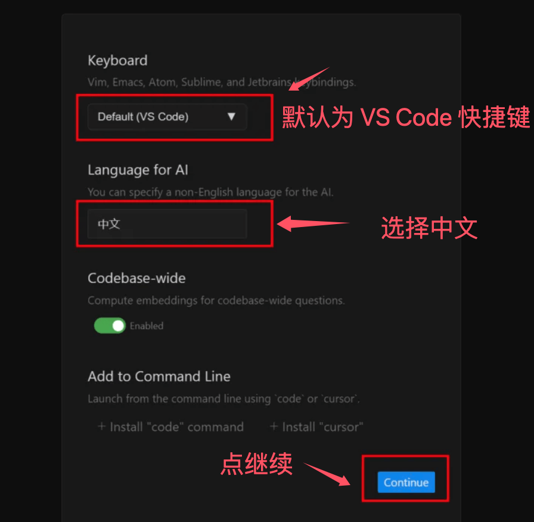

<font style="color:rgb(51, 51, 51);">如果本机之前安装过 VS Code，可以导入 VS Code 的扩展：</font>

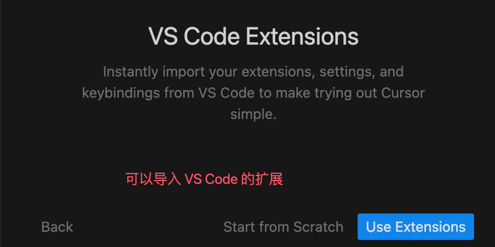

<font style="color:rgb(51, 51, 51);">首次使用 Cursor 时，需要注册一个新账号或使用已有账号进行登录，也可以用 Github 等授权登录。</font>


<font style="color:rgb(51, 51, 51);">这里勾选默认即可，点</font><font style="color:rgb(51, 51, 51);"> </font>**<font style="color:rgb(51, 51, 51);background-color:rgb(236, 234, 230);">Continue</font>**<font style="color:rgb(51, 51, 51);"> </font><font style="color:rgb(51, 51, 51);">按钮完成设置：</font>

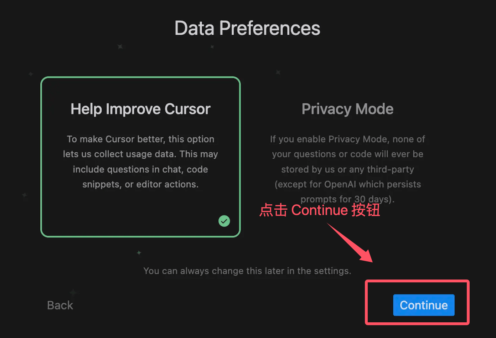

# <font style="color:rgb(0, 0, 0);background-color:rgb(250, 252, 253);">Cursor 设置</font>

上一章节我们学会了 Cursor 安装，接下来就是配置。

**<font style="color:rgb(51, 51, 51);background-color:rgb(250, 252, 253);">第一次启动流程：</font>**

**<font style="color:rgb(51, 51, 51);background-color:rgb(250, 252, 253);">1、欢迎界面</font>**

* <font style="color:rgb(51, 51, 51);background-color:rgb(250, 252, 253);">选择界面语言（支持中文、英文等）</font>
* <font style="color:rgb(51, 51, 51);background-color:rgb(250, 252, 253);">阅读并接受服务条款</font>
* <font style="color:rgb(51, 51, 51);background-color:rgb(250, 252, 253);">选择是否发送使用数据以改进产品</font>

**<font style="color:rgb(51, 51, 51);background-color:rgb(250, 252, 253);">2、主题与外观设置</font>**

* <font style="color:rgb(51, 51, 51);background-color:rgb(250, 252, 253);">选择深色/浅色主题</font>
* <font style="color:rgb(51, 51, 51);background-color:rgb(250, 252, 253);">调整字体大小（默认、大、超大）</font>
* <font style="color:rgb(51, 51, 51);background-color:rgb(250, 252, 253);">设置颜色主题（默认、高对比度等）</font>

**<font style="color:rgb(51, 51, 51);background-color:rgb(250, 252, 253);">3、键盘快捷键方案</font>**

* <font style="color:rgb(51, 51, 51);background-color:rgb(250, 252, 253);">默认方案（Cursor 原生）</font>
* <font style="color:rgb(51, 51, 51);background-color:rgb(250, 252, 253);">VS Code 兼容方案</font>
* <font style="color:rgb(51, 51, 51);background-color:rgb(250, 252, 253);">Vim 模式（适合 Vim 用户）</font>
* <font style="color:rgb(51, 51, 51);background-color:rgb(250, 252, 253);">自定义方案</font>

**<font style="color:rgb(51, 51, 51);background-color:rgb(250, 252, 253);">4、编程语言检测</font>**

* <font style="color:rgb(51, 51, 51);background-color:rgb(250, 252, 253);">Cursor 会扫描系统中已安装的开发工具</font>
* <font style="color:rgb(51, 51, 51);background-color:rgb(250, 252, 253);">自动配置常用编程语言的支持</font>
* <font style="color:rgb(51, 51, 51);background-color:rgb(250, 252, 253);">提示安装缺失的语言服务器</font>

**<font style="color:rgb(51, 51, 51);background-color:rgb(250, 252, 253);">5、工作区设置</font>**

* <font style="color:rgb(51, 51, 51);background-color:rgb(250, 252, 253);">选择默认工作区位置</font>
* <font style="color:rgb(51, 51, 51);background-color:rgb(250, 252, 253);">配置项目模板路径</font>
* <font style="color:rgb(51, 51, 51);background-color:rgb(250, 252, 253);">设置自动保存选项</font>


***

## <font style="color:rgb(51, 51, 51);background-color:rgb(250, 252, 253);">账户注册与登录</font>

**<font style="color:rgb(51, 51, 51);background-color:rgb(250, 252, 253);">创建 Cursor 账户：</font>**

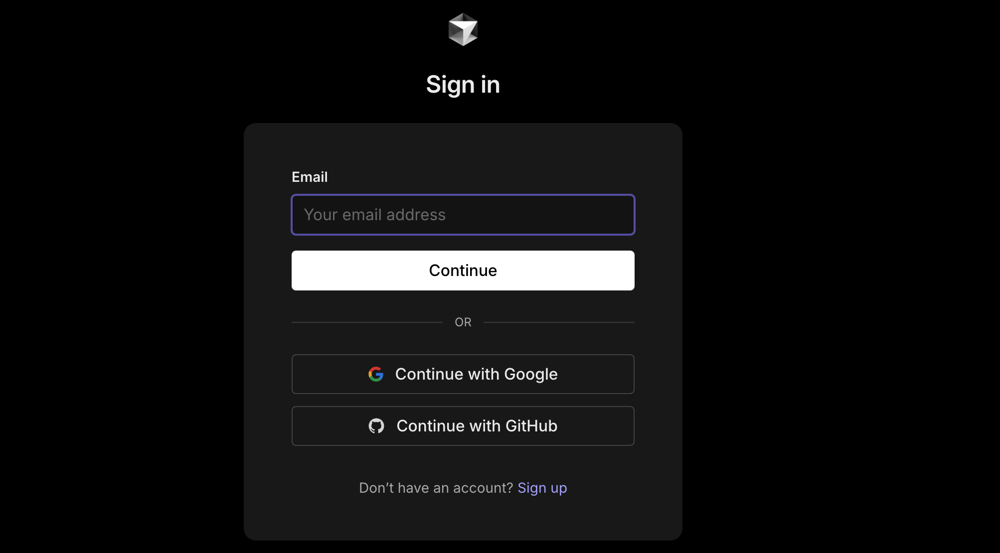

**<font style="color:rgb(51, 51, 51);background-color:rgb(250, 252, 253);">注册方式选择</font>**

* <font style="color:rgb(51, 51, 51);background-color:rgb(250, 252, 253);">邮箱注册（推荐）</font>
* <font style="color:rgb(51, 51, 51);background-color:rgb(250, 252, 253);">Google 账户登录</font>
* <font style="color:rgb(51, 51, 51);background-color:rgb(250, 252, 253);">GitHub 账户登录</font>

**<font style="color:rgb(51, 51, 51);background-color:rgb(250, 252, 253);">邮箱注册流程</font>**

* <font style="color:rgb(51, 51, 51);background-color:rgb(250, 252, 253);">点击"Sign up"按钮</font>
* <font style="color:rgb(51, 51, 51);background-color:rgb(250, 252, 253);">输入邮箱地址和密码</font>
* <font style="color:rgb(51, 51, 51);background-color:rgb(250, 252, 253);">确认密码并同意服务条款</font>
* <font style="color:rgb(51, 51, 51);background-color:rgb(250, 252, 253);">点击发送到邮箱的验证链接</font>
* <font style="color:rgb(51, 51, 51);background-color:rgb(250, 252, 253);">完成邮箱验证后自动登录</font>

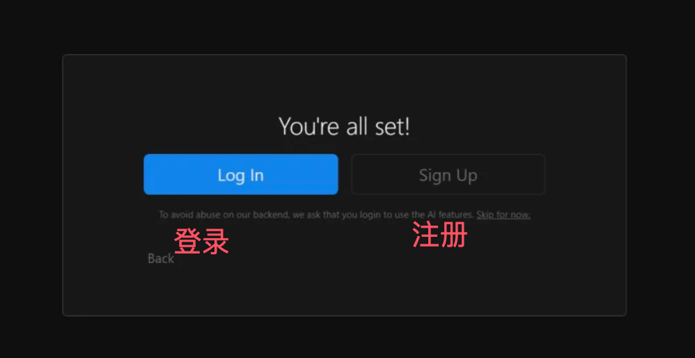

**<font style="color:rgb(51, 51, 51);background-color:rgb(250, 252, 253);">第三方账户登录</font>**

* <font style="color:rgb(51, 51, 51);background-color:rgb(250, 252, 253);">选择对应的第三方登录选项</font>
* <font style="color:rgb(51, 51, 51);background-color:rgb(250, 252, 253);">授权 Cursor 访问基本信息</font>
* <font style="color:rgb(51, 51, 51);background-color:rgb(250, 252, 253);">自动完成账户创建和登录</font>

**<font style="color:rgb(51, 51, 51);background-color:rgb(250, 252, 253);">账户配置选项：</font>**

* **<font style="color:rgb(51, 51, 51);background-color:rgb(250, 252, 253);">个人信息设置</font>**<font style="color:rgb(51, 51, 51);background-color:rgb(250, 252, 253);">：姓名、头像、时区</font>
* **<font style="color:rgb(51, 51, 51);background-color:rgb(250, 252, 253);">通知偏好</font>**<font style="color:rgb(51, 51, 51);background-color:rgb(250, 252, 253);">：邮件通知、产品更新、功能提醒</font>
* **<font style="color:rgb(51, 51, 51);background-color:rgb(250, 252, 253);">隐私设置</font>**<font style="color:rgb(51, 51, 51);background-color:rgb(250, 252, 253);">：数据使用授权、遥测数据收集</font>
* **<font style="color:rgb(51, 51, 51);background-color:rgb(250, 252, 253);">团队邀请</font>**<font style="color:rgb(51, 51, 51);background-color:rgb(250, 252, 253);">：加入现有团队或创建新团队</font>

***

## <font style="color:rgb(51, 51, 51);background-color:rgb(250, 252, 253);">许可证和付费计划说明</font>

**<font style="color:rgb(51, 51, 51);background-color:rgb(250, 252, 253);">免费计划 (Cursor Free)：</font>**

| <font style="color:rgb(255, 255, 255);">功能特性</font> | <font style="color:rgb(255, 255, 255);">免费计划限制</font> |
| --- | --- |
| **<font style="color:rgb(51, 51, 51);">AI 对话次数</font>** | <font style="color:rgb(51, 51, 51);">每月 200 次对话</font> |
| **<font style="color:rgb(51, 51, 51);">代码生成</font>** | <font style="color:rgb(51, 51, 51);">每月 2000 次补全</font> |
| **<font style="color:rgb(51, 51, 51);">项目数量</font>** | <font style="color:rgb(51, 51, 51);">无限制</font> |
| **<font style="color:rgb(51, 51, 51);">文件大小</font>** | <font style="color:rgb(51, 51, 51);">单文件最大 100MB</font> |
| **<font style="color:rgb(51, 51, 51);">模型选择</font>** | <font style="color:rgb(51, 51, 51);">基础模型（GPT-3.5 等效）</font> |
| **<font style="color:rgb(51, 51, 51);">团队协作</font>** | <font style="color:rgb(51, 51, 51);">最多 3 人</font> |
| **<font style="color:rgb(51, 51, 51);">技术支持</font>** | <font style="color:rgb(51, 51, 51);">社区支持</font> |

**<font style="color:rgb(51, 51, 51);background-color:rgb(250, 252, 253);">专业计划 (Cursor Pro - $20/月)：</font>**

| <font style="color:rgb(255, 255, 255);">功能特性</font> | <font style="color:rgb(255, 255, 255);">专业计划</font> |
| --- | --- |
| **<font style="color:rgb(51, 51, 51);">AI 对话次数</font>** | <font style="color:rgb(51, 51, 51);">无限制</font> |
| **<font style="color:rgb(51, 51, 51);">代码生成</font>** | <font style="color:rgb(51, 51, 51);">无限制</font> |
| **<font style="color:rgb(51, 51, 51);">高级模型</font>** | <font style="color:rgb(51, 51, 51);">GPT-4, Claude 等高级模型</font> |
| **<font style="color:rgb(51, 51, 51);">优先级处理</font>** | <font style="color:rgb(51, 51, 51);">更快的响应速度</font> |
| **<font style="color:rgb(51, 51, 51);">高级功能</font>** | <font style="color:rgb(51, 51, 51);">代码审查、智能重构</font> |
| **<font style="color:rgb(51, 51, 51);">团队协作</font>** | <font style="color:rgb(51, 51, 51);">最多 10 人</font> |
| **<font style="color:rgb(51, 51, 51);">技术支持</font>** | <font style="color:rgb(51, 51, 51);">邮件支持</font> |
| **<font style="color:rgb(51, 51, 51);">存储空间</font>** | <font style="color:rgb(51, 51, 51);">100GB 云存储</font> |

**<font style="color:rgb(51, 51, 51);background-color:rgb(250, 252, 253);">团队计划 (Cursor Business - $40/用户/月)：</font>**

| <font style="color:rgb(255, 255, 255);">功能特性</font> | <font style="color:rgb(255, 255, 255);">团队计划</font> |
| --- | --- |
| **<font style="color:rgb(51, 51, 51);">所有 Pro 功能</font>** | <font style="color:rgb(51, 51, 51);">✓</font> |
| **<font style="color:rgb(51, 51, 51);">团队成员</font>** | <font style="color:rgb(51, 51, 51);">无限制</font> |
| **<font style="color:rgb(51, 51, 51);">管理控制台</font>** | <font style="color:rgb(51, 51, 51);">用户管理、权限控制</font> |
| **<font style="color:rgb(51, 51, 51);">单点登录 (SSO)</font>** | <font style="color:rgb(51, 51, 51);">SAML/OIDC 支持</font> |
| **<font style="color:rgb(51, 51, 51);">审计日志</font>** | <font style="color:rgb(51, 51, 51);">详细的使用记录</font> |
| **<font style="color:rgb(51, 51, 51);">自定义模型</font>** | <font style="color:rgb(51, 51, 51);">企业级 AI 模型</font> |
| **<font style="color:rgb(51, 51, 51);">优先支持</font>** | <font style="color:rgb(51, 51, 51);">专属客户成功经理</font> |
| **<font style="color:rgb(51, 51, 51);">数据隐私</font>** | <font style="color:rgb(51, 51, 51);">企业级数据保护</font> |

**<font style="color:rgb(51, 51, 51);background-color:rgb(250, 252, 253);">计划选择建议：</font>**

* **<font style="color:rgb(51, 51, 51);background-color:rgb(250, 252, 253);">个人学习用户</font>**<font style="color:rgb(51, 51, 51);background-color:rgb(250, 252, 253);">：免费计划足够日常学习使用</font>
* **<font style="color:rgb(51, 51, 51);background-color:rgb(250, 252, 253);">专业开发者</font>**<font style="color:rgb(51, 51, 51);background-color:rgb(250, 252, 253);">：推荐 Pro 计划获得完整 AI 体验</font>
* **<font style="color:rgb(51, 51, 51);background-color:rgb(250, 252, 253);">小团队</font>**<font style="color:rgb(51, 51, 51);background-color:rgb(250, 252, 253);">：Pro 计划可满足小规模协作需求</font>
* **<font style="color:rgb(51, 51, 51);background-color:rgb(250, 252, 253);">企业用户</font>**<font style="color:rgb(51, 51, 51);background-color:rgb(250, 252, 253);">：选择 Business 计划确保安全和管控</font>

**<font style="color:rgb(51, 51, 51);background-color:rgb(250, 252, 253);">升级和付费流程：</font>**

1. **<font style="color:rgb(51, 51, 51);background-color:rgb(250, 252, 253);">选择计划</font>**
   * <font style="color:rgb(51, 51, 51);background-color:rgb(250, 252, 253);">在设置中点击"Upgrade"</font>
   * <font style="color:rgb(51, 51, 51);background-color:rgb(250, 252, 253);">比较不同计划的功能差异</font>
   * <font style="color:rgb(51, 51, 51);background-color:rgb(250, 252, 253);">选择适合的付费计划</font>
2. **<font style="color:rgb(51, 51, 51);background-color:rgb(250, 252, 253);">付费方式</font>**
   * <font style="color:rgb(51, 51, 51);background-color:rgb(250, 252, 253);">信用卡支付（Visa、MasterCard、AmEx）</font>
   * <font style="color:rgb(51, 51, 51);background-color:rgb(250, 252, 253);">PayPal 支付</font>
   * <font style="color:rgb(51, 51, 51);background-color:rgb(250, 252, 253);">企业发票付款（Business 计划）</font>
3. **<font style="color:rgb(51, 51, 51);background-color:rgb(250, 252, 253);">订阅管理</font>**
   * <font style="color:rgb(51, 51, 51);background-color:rgb(250, 252, 253);">随时升级或降级计划</font>
   * <font style="color:rgb(51, 51, 51);background-color:rgb(250, 252, 253);">按月或按年付费（年付有折扣）</font>
   * <font style="color:rgb(51, 51, 51);background-color:rgb(250, 252, 253);">取消订阅后可使用至当前计费周期结束</font>

<font style="color:rgb(51, 51, 51);background-color:rgb(250, 252, 253);"></font>

# <font style="color:rgb(0, 0, 0);">Cursor 中文设置</font>

<font style="color:rgb(51, 51, 51);">Cursor 是基于</font><font style="color:rgb(51, 51, 51);"> </font>[<font style="color:rgb(0, 102, 0);">VS Code</font>](https://www.runoob.com/vscode/vscode-tutorial.html)<font style="color:rgb(51, 51, 51);"> </font><font style="color:rgb(51, 51, 51);">开发的一款编辑器，所以它的扩展使用的也是 VS Code 的扩展市场。</font>

<font style="color:rgb(51, 51, 51);">默认 Curosr 的界面上英文的，我们可以通过 VS Code 的扩展市场安装中文包。</font>

<font style="color:rgb(51, 51, 51);">VS Code 有一个内置的扩展市场，提供了数千个由社区和微软官方提供的扩展。</font>

<font style="color:rgb(51, 51, 51);">接下来我们就在扩展市场中查找中文包，并安装。</font>

<font style="color:rgb(51, 51, 51);">VScode 安装汉化包很简单，打开 Curosr，点击左侧安装扩展图标，在搜索框输入</font><font style="color:rgb(51, 51, 51);"> </font>**<font style="color:rgb(51, 51, 51);background-color:rgb(236, 234, 230);">Chinese</font>**<font style="color:rgb(51, 51, 51);">：</font>

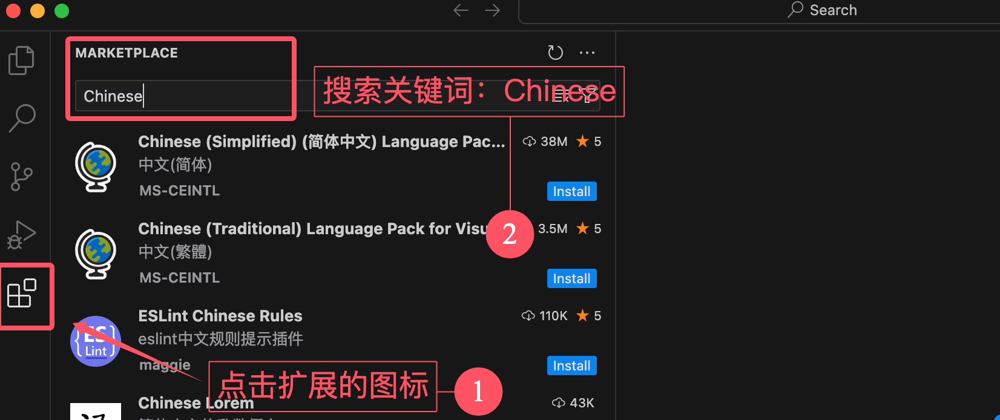

<font style="color:rgb(51, 51, 51);">然后点击第一个搜索出来选项【Chinese (Simplified) (简体中文)】的 Install 按钮就可以：</font>

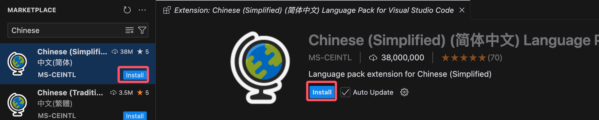

<font style="color:rgb(51, 51, 51);">安装完成后，重启 Curosr，界面显示的就是中文了。</font>

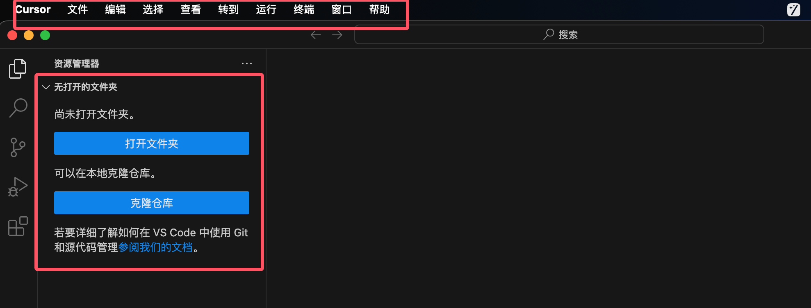

<font style="color:rgb(51, 51, 51);background-color:rgb(250, 252, 253);">  
</font><font style="color:rgb(51, 51, 51);background-color:rgb(250, 252, 253);"> </font>

# <font style="color:rgb(0, 0, 0);">Cursor 界面介绍</font>

<font style="color:rgb(51, 51, 51);">Cursor 编辑器是一款功能强大且用户友好的代码编辑器，特别适合初学者和中级开发者使用。</font>

<font style="color:rgb(51, 51, 51);">本文将详细介绍 Cursor 编辑器的界面，帮助你快速上手并充分利用其功能。</font>

## <font style="color:rgb(51, 51, 51);">1、主界面概览</font>

<font style="color:rgb(51, 51, 51);">Cursor 编辑器的主界面设计简洁直观，主要由以下几个部分组成：</font>

* **<font style="color:rgb(51, 51, 51);">菜单栏</font>**<font style="color:rgb(51, 51, 51);">：位于窗口的顶部，包含文件、编辑、视图、运行、工具和帮助等菜单项。</font>
* **<font style="color:rgb(51, 51, 51);">侧边栏</font>**<font style="color:rgb(51, 51, 51);">：位于窗口的左侧，通常显示项目文件结构、搜索、版本控制等功能。</font>
* **<font style="color:rgb(51, 51, 51);">编辑区</font>**<font style="color:rgb(51, 51, 51);">：位于窗口的中央，是编写和编辑代码的主要区域。</font>

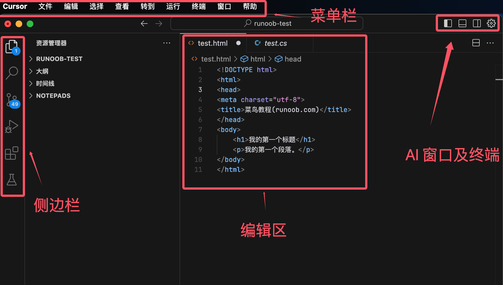

## <font style="color:rgb(51, 51, 51);">2、菜单栏详解</font>

### <font style="color:rgb(51, 51, 51);">2.1 文件菜单</font>

* **<font style="color:rgb(51, 51, 51);">新建文件</font>**<font style="color:rgb(51, 51, 51);">：创建一个新的代码文件。</font>
* **<font style="color:rgb(51, 51, 51);">打开文件</font>**<font style="color:rgb(51, 51, 51);">：打开一个已存在的代码文件。</font>
* **<font style="color:rgb(51, 51, 51);">保存文件</font>**<font style="color:rgb(51, 51, 51);">：保存当前编辑的文件。</font>
* **<font style="color:rgb(51, 51, 51);">另存为</font>**<font style="color:rgb(51, 51, 51);">：将当前文件另存为一个新文件。</font>
* **<font style="color:rgb(51, 51, 51);">关闭文件</font>**<font style="color:rgb(51, 51, 51);">：关闭当前打开的文件。</font>

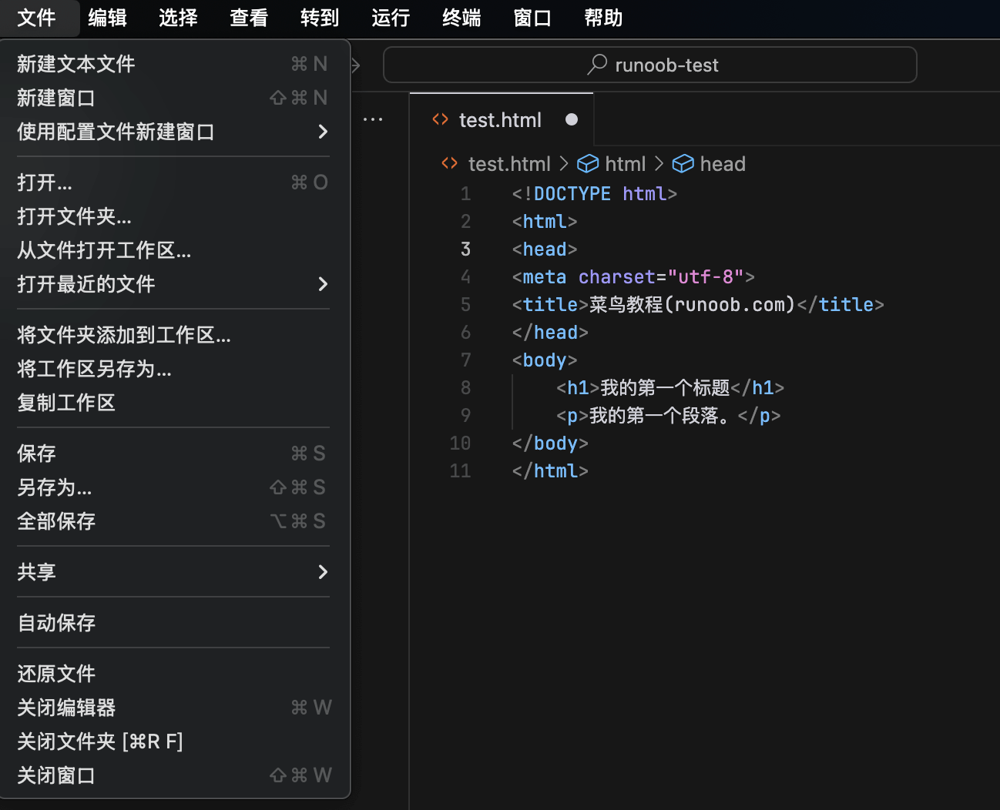

### <font style="color:rgb(51, 51, 51);">2.2 编辑菜单</font>

<font style="color:rgb(51, 51, 51);">主要功能：</font>

* **<font style="color:rgb(51, 51, 51);">撤销</font>**<font style="color:rgb(51, 51, 51);">：撤销上一次的编辑操作。</font>
* **<font style="color:rgb(51, 51, 51);">重做</font>**<font style="color:rgb(51, 51, 51);">：重做上一次撤销的操作。</font>
* **<font style="color:rgb(51, 51, 51);">剪切</font>**<font style="color:rgb(51, 51, 51);">：剪切选中的文本。</font>
* **<font style="color:rgb(51, 51, 51);">复制</font>**<font style="color:rgb(51, 51, 51);">：复制选中的文本。</font>
* **<font style="color:rgb(51, 51, 51);">粘贴</font>**<font style="color:rgb(51, 51, 51);">：粘贴剪贴板中的内容。</font>
* **<font style="color:rgb(51, 51, 51);">查找</font>**<font style="color:rgb(51, 51, 51);">：在当前文件中查找指定的文本。</font>
* **<font style="color:rgb(51, 51, 51);">替换</font>**<font style="color:rgb(51, 51, 51);">：在当前文件中查找并替换指定的文本。</font>

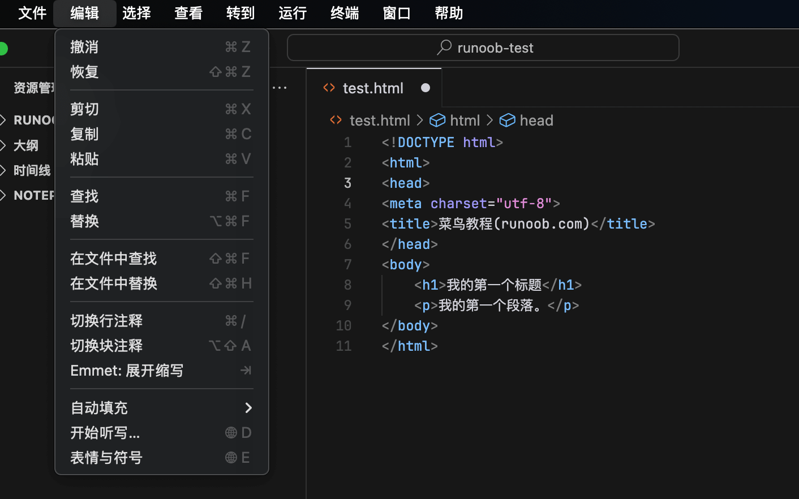

### <font style="color:rgb(51, 51, 51);">2.3 窗口/视图菜单</font>

* **<font style="color:rgb(51, 51, 51);">放大</font>**<font style="color:rgb(51, 51, 51);">：放大编辑区的字体。</font>
* **<font style="color:rgb(51, 51, 51);">缩小</font>**<font style="color:rgb(51, 51, 51);">：缩小编辑区的字体。</font>
* **<font style="color:rgb(51, 51, 51);">重置缩放</font>**<font style="color:rgb(51, 51, 51);">：将编辑区的字体大小恢复到默认值。</font>
* **<font style="color:rgb(51, 51, 51);">全屏</font>**<font style="color:rgb(51, 51, 51);">：将编辑器切换到全屏模式。</font>

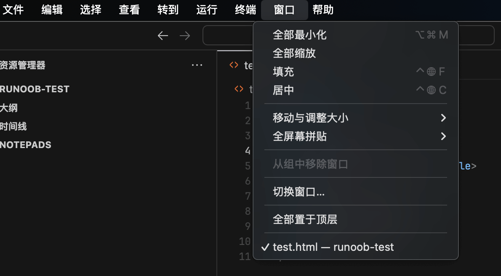

### <font style="color:rgb(51, 51, 51);">2.4 运行菜单</font>

<font style="color:rgb(51, 51, 51);">主要功能：</font>

* **<font style="color:rgb(51, 51, 51);">运行</font>**<font style="color:rgb(51, 51, 51);">：运行当前编辑的代码。</font>
* **<font style="color:rgb(51, 51, 51);">调试</font>**<font style="color:rgb(51, 51, 51);">：启动调试模式，逐步执行代码并查看变量值。</font>

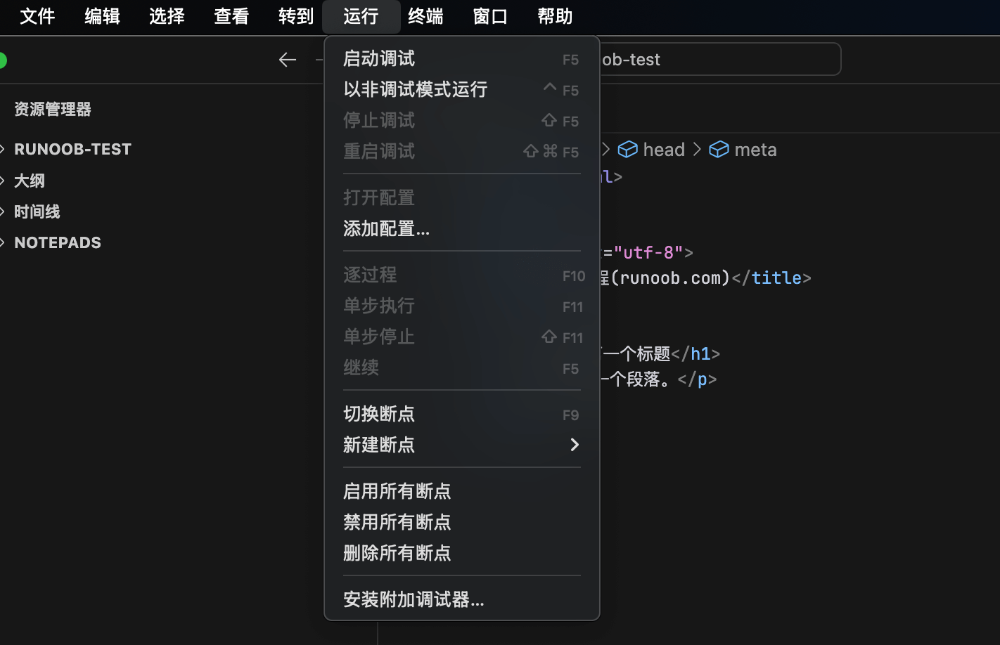

### <font style="color:rgb(51, 51, 51);">2.4 查看菜单</font>

<font style="color:rgb(51, 51, 51);">主要功能：</font>

* **<font style="color:rgb(51, 51, 51);">命令面板</font>**<font style="color:rgb(51, 51, 51);">：打开命令面板。</font>
* **<font style="color:rgb(51, 51, 51);">外观</font>**<font style="color:rgb(51, 51, 51);">：设置各种外观视图的显示与隐藏。</font>

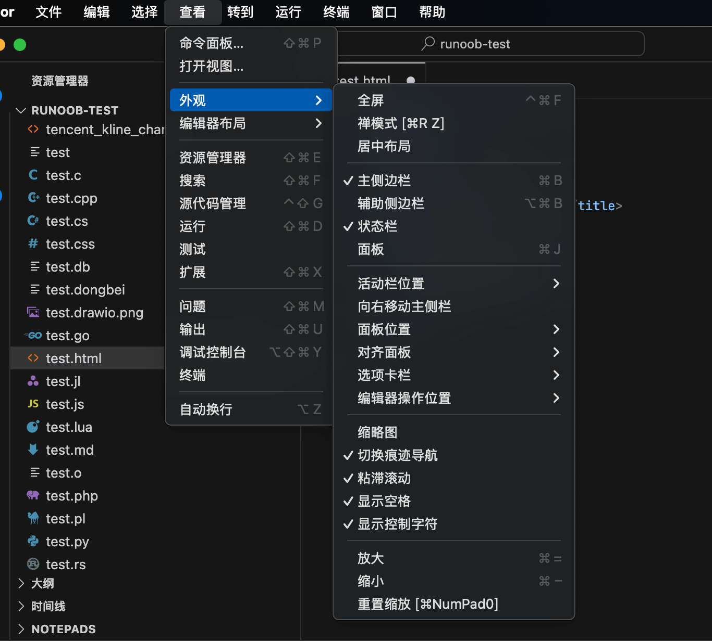

## <font style="color:rgb(51, 51, 51);">3、侧边栏详解</font>

<font style="color:rgb(51, 51, 51);">侧边栏是 Cursor 编辑器的一个重要组成部分，提供了多种功能：</font>

* **<font style="color:rgb(51, 51, 51);">命令面板</font>**<font style="color:rgb(51, 51, 51);">：打开命令面板。</font>
* **<font style="color:rgb(51, 51, 51);">外观</font>**<font style="color:rgb(51, 51, 51);">：显示各种功能面板，比如状态栏。</font>
* **<font style="color:rgb(51, 51, 51);">编辑布局</font>**<font style="color:rgb(51, 51, 51);">：设置编辑器的布局方式。</font>


<font style="color:rgb(51, 51, 51);">默认情况下，Cursor 的活动栏是水平放置的，这是为了节省空间，方便集成聊天功能。</font>

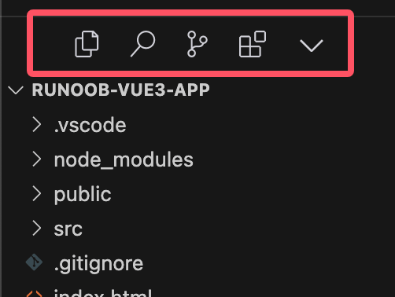

<font style="color:rgb(51, 51, 51);">如果您更喜欢传统的垂直活动栏，可以按照以下步骤调整：</font>

* <font style="color:rgb(51, 51, 51);">打开</font><font style="color:rgb(51, 51, 51);"> </font>**<font style="color:rgb(51, 51, 51);">Cursor 设置</font>**<font style="color:rgb(51, 51, 51);">。</font>
* <font style="color:rgb(51, 51, 51);">搜索并找到</font><font style="color:rgb(51, 51, 51);"> </font>**<font style="color:rgb(51, 51, 51);">workbench.activityBar.orientation</font>**<font style="color:rgb(51, 51, 51);">，将其值改为</font><font style="color:rgb(51, 51, 51);"> </font>**<font style="color:rgb(51, 51, 51);">vertical</font>**<font style="color:rgb(51, 51, 51);">。</font>
* <font style="color:rgb(51, 51, 51);">重启 Cursor 即可生效。</font>

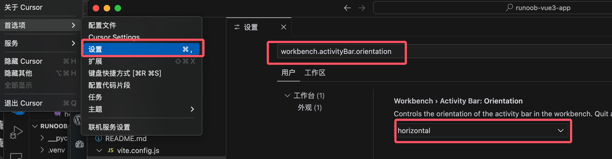

<font style="color:rgb(51, 51, 51);">改为</font><font style="color:rgb(51, 51, 51);"> </font>**<font style="color:rgb(51, 51, 51);">vertical</font>**<font style="color:rgb(51, 51, 51);"> </font><font style="color:rgb(51, 51, 51);">后重启效果：</font>


## <font style="color:rgb(51, 51, 51);">4、编辑区详解</font>

<font style="color:rgb(51, 51, 51);">编辑区是编写和编辑代码的主要区域，具有以下特点：</font>

* **<font style="color:rgb(51, 51, 51);">语法高亮</font>**<font style="color:rgb(51, 51, 51);">：根据代码的语法结构，使用不同的颜色高亮显示代码，提高代码的可读性。</font>
* **<font style="color:rgb(51, 51, 51);">自动补全</font>**<font style="color:rgb(51, 51, 51);">：在输入代码时，编辑器会自动提示可能的代码补全选项，提高编码效率。</font>
* **<font style="color:rgb(51, 51, 51);">代码折叠</font>**<font style="color:rgb(51, 51, 51);">：可以折叠代码块，方便用户查看和编辑大型代码文件。</font>
* **<font style="color:rgb(51, 51, 51);">多光标编辑</font>**<font style="color:rgb(51, 51, 51);">：支持同时编辑多个光标位置，方便批量修改代码。</font>

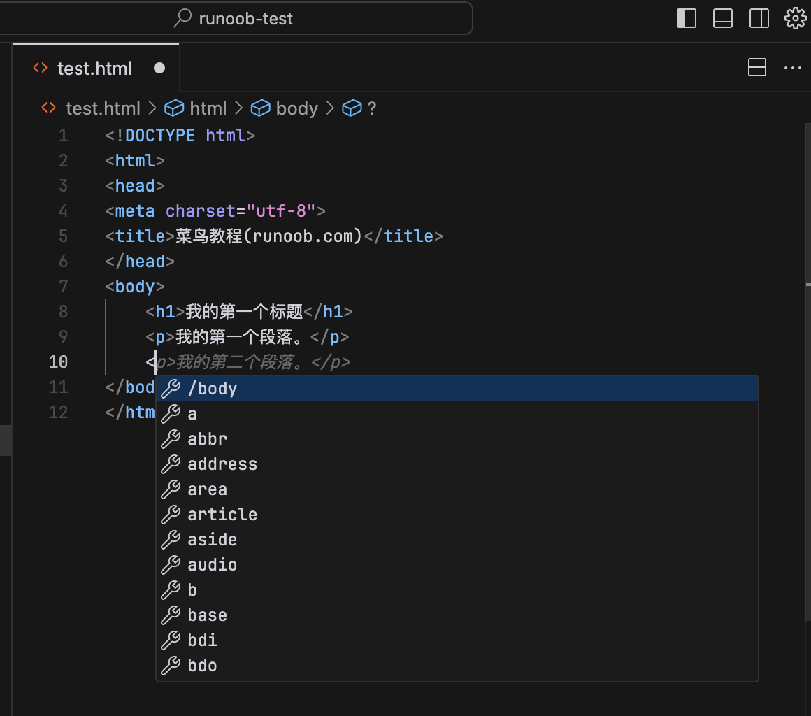

## <font style="color:rgb(51, 51, 51);">5、状态栏详解</font>

<font style="color:rgb(51, 51, 51);">状态栏位于窗口的底部，显示当前文件的状态信息，包括：</font>

* **<font style="color:rgb(51, 51, 51);">行号和列号</font>**<font style="color:rgb(51, 51, 51);">：显示当前光标所在的行号和列号。</font>
* **<font style="color:rgb(51, 51, 51);">编码格式</font>**<font style="color:rgb(51, 51, 51);">：显示当前文件的编码格式，如 UTF-8。</font>
* **<font style="color:rgb(51, 51, 51);">文件类型</font>**<font style="color:rgb(51, 51, 51);">：显示当前文件的类型，如 Python、JavaScript 等。</font>
* **<font style="color:rgb(51, 51, 51);">Git 状态</font>**<font style="color:rgb(51, 51, 51);">：显示当前文件的 Git 状态，如已修改、已提交等。</font>

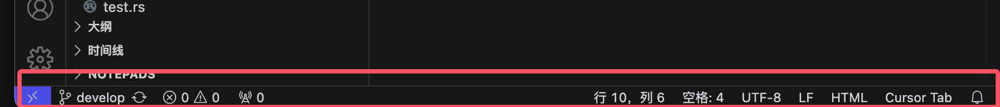

<font style="color:rgb(51, 51, 51);background-color:rgb(250, 252, 253);">  
</font><font style="color:rgb(51, 51, 51);background-color:rgb(250, 252, 253);"> </font>

# <font style="color:rgb(0, 0, 0);">Cursor 打开目录</font>

<font style="color:rgb(51, 51, 51);">我们可以在 Cursor 中打开一个代码文件，也可以在在 Cursor 中打开一个目录（文件夹）是一个简单的过程，操作都很简单。</font>

<font style="color:rgb(51, 51, 51);">首先，我们打开已经安装好的 Cursor，在 Cursor 首次打开时，你会看到一个项目的</font><font style="color:rgb(51, 51, 51);"> </font>**<font style="color:rgb(51, 51, 51);background-color:rgb(236, 234, 230);">Open a folder（打开目录）</font>**<font style="color:rgb(51, 51, 51);"> </font><font style="color:rgb(51, 51, 51);">按钮。</font>

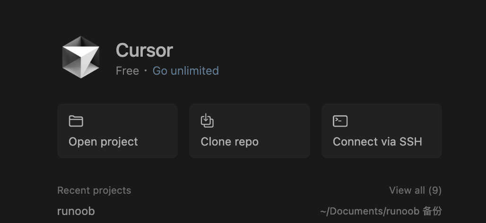

<font style="color:rgb(51, 51, 51);">欢迎界面的中间区域，有三个非常核心的按钮：</font>

* **<font style="color:rgb(51, 51, 51);">Open project：</font>**<font style="color:rgb(51, 51, 51);"> </font><font style="color:rgb(51, 51, 51);">打开本地已有的项目文件夹，适合本地开发者直接导入已有项目。</font>
* **<font style="color:rgb(51, 51, 51);">Clone repo：</font>**<font style="color:rgb(51, 51, 51);">直接从 Git 仓库克隆项目，支持输入 Git 仓库地址，一键拉取代码，非常方便做远程协作或开源项目学习。</font>
* **<font style="color:rgb(51, 51, 51);">Connect via SSH：</font>**<font style="color:rgb(51, 51, 51);">通过 SSH 连接远程服务器上的项目，非常适合远程开发场景，尤其适合云服务器上的项目调试。</font>
* **<font style="color:rgb(51, 51, 51);">Recent projects：</font>**<font style="color:rgb(51, 51, 51);">列出最近打开的项目。</font>

<font style="color:rgb(51, 51, 51);">我们也可以打开一个已存在的文件或目录（文件夹），比如我们打开一个 runoob-test，打开该目录后，它就会显示在资源管理器中：</font>

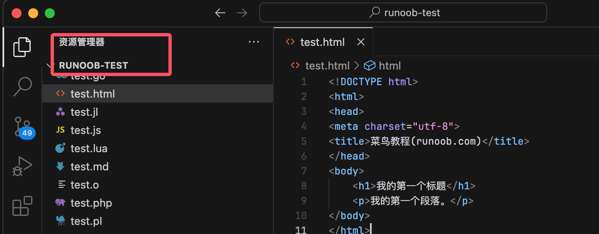

<font style="color:rgb(51, 51, 51);">当然也可以直接在菜单栏中操作，创建火打开文件目录：</font>


<font style="color:rgb(51, 51, 51);">在打开的目录右侧，可以在该目录下新建文文件、新建目录、刷新、折叠目录：</font>

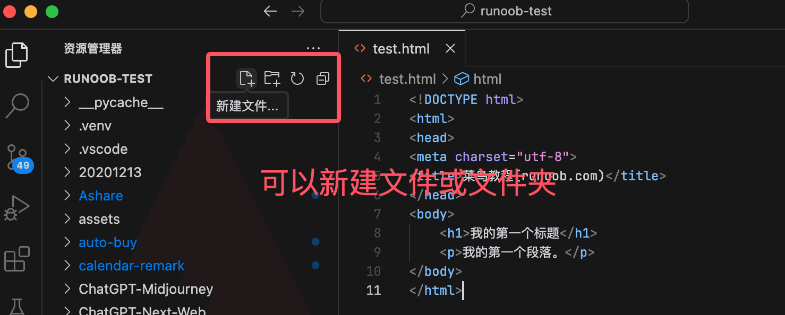

<font style="color:rgb(51, 51, 51);background-color:rgb(250, 252, 253);">  
</font><font style="color:rgb(51, 51, 51);background-color:rgb(250, 252, 253);"> </font>

# <font style="color:rgb(0, 0, 0);">Cursor 模型设置</font>

<font style="color:rgb(51, 51, 51);">Cursor 强大之处就是充分利用了大模型的能力。</font>

<font style="color:rgb(51, 51, 51);">Cursor 内置了很多大模型，当然我们可以自定义设置模型，设置也非常简单。</font>

### <font style="color:rgb(51, 51, 51);">1、打开设置</font>

<font style="color:rgb(51, 51, 51);">点击右上角的齿轮图标，打开设置界面。</font>

<font style="color:rgb(51, 51, 51);">选择</font><font style="color:rgb(51, 51, 51);"> </font>**<font style="color:rgb(51, 51, 51);background-color:rgb(236, 234, 230);">Models (模型)</font>**<font style="color:rgb(51, 51, 51);">，可以看到系统默认已经设置了一些大模型，选择你想要的模型，如 GPT-3.5 或 GPT-4。</font>

<font style="color:rgb(51, 51, 51);">我们可以在列表底部 Add Model(添加模型) 按钮。</font>

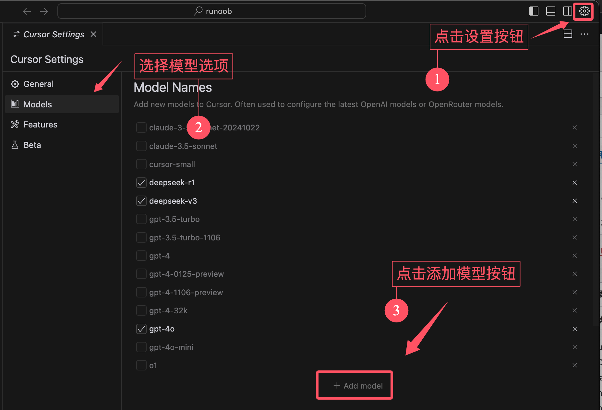

<font style="color:rgb(51, 51, 51);">点击按钮后，会出现一个输入框，我们输入模型名，比如</font><font style="color:rgb(51, 51, 51);"> </font>**<font style="color:rgb(51, 51, 51);background-color:rgb(236, 234, 230);">deepseek-v3</font>**<font style="color:rgb(51, 51, 51);"> </font><font style="color:rgb(51, 51, 51);">及</font><font style="color:rgb(51, 51, 51);"> </font>**<font style="color:rgb(51, 51, 51);background-color:rgb(236, 234, 230);">deepseek-r1</font>**<font style="color:rgb(51, 51, 51);">。</font>

**<font style="color:rgb(51, 51, 51);">注意：</font>**<font style="color:rgb(51, 51, 51);">模型名一定不能输错。</font>

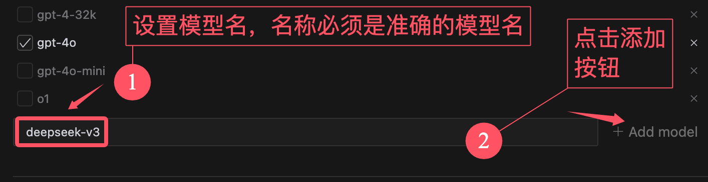

<font style="color:rgb(51, 51, 51);">模型添加好后，我们需要设置 API key 和请求地址，在下面输入框输入即可：</font>

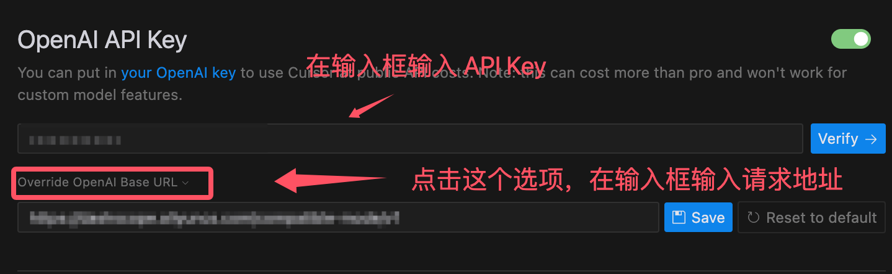

<font style="color:rgb(51, 51, 51);">API key 和请求地需要去大模型的官方获取，当然如果第三方平台有提供的也可以，比如 DeepSeek 的可以去官方</font><font style="color:rgb(51, 51, 51);"> </font>[<font style="color:rgb(0, 102, 0);">https://platform.deepseek.com/usage</font>](https://platform.deepseek.com/usage)<font style="color:rgb(51, 51, 51);"> </font><font style="color:rgb(51, 51, 51);">申请：</font>


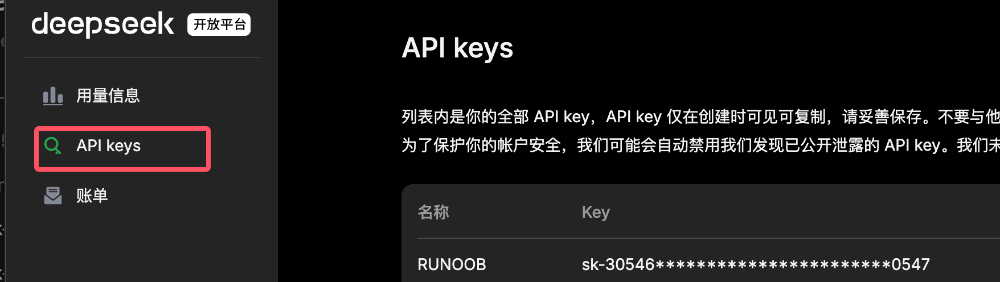

<font style="color:rgb(51, 51, 51);">请求地址官方的接口文档都会说明，DeepSeek 的为：</font><font style="color:rgb(51, 51, 51);"> </font>**<font style="color:rgb(51, 51, 51);background-color:rgb(236, 234, 230);">https://api.deepseek.com/chat/completions</font>**<font style="color:rgb(51, 51, 51);">。</font>

<font style="color:rgb(51, 51, 51);">设置完成后，我们可以点击</font><font style="color:rgb(51, 51, 51);"> </font>**<font style="color:rgb(51, 51, 51);background-color:rgb(236, 234, 230);">Verify</font>**<font style="color:rgb(51, 51, 51);"> </font><font style="color:rgb(51, 51, 51);">按钮，看看是否设置成功，如果没有报错信息说明成功了，模型列表中也会出现我们添加的模型，我们把其他的 </font><font style="color:rgb(51, 51, 51);">☑️</font><font style="color:rgb(51, 51, 51);"> 去掉，勾选 </font><font style="color:rgb(51, 51, 51);">☑️</font><font style="color:rgb(51, 51, 51);"> 这以下两个就可以开始使用了。</font>

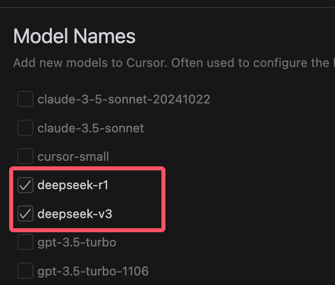

<font style="color:rgb(51, 51, 51);">接下来我们试试对话聊天，点击右上角的小图标打开聊天窗口，然后选择 deepseek-r1 模型，就可以开始了：</font>

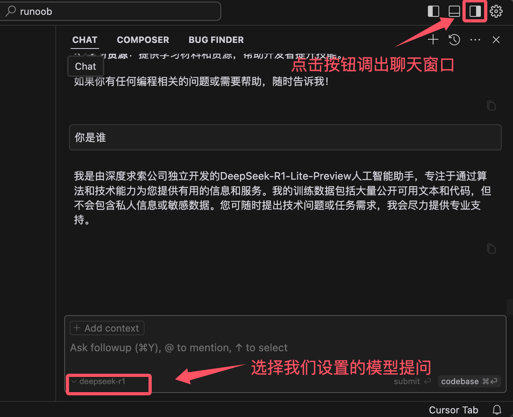

<font style="color:rgb(51, 51, 51);background-color:rgb(250, 252, 253);">  
</font><font style="color:rgb(51, 51, 51);background-color:rgb(250, 252, 253);"> </font>

# <font style="color:rgb(0, 0, 0);">Cursor code/cursor 命令</font>

<font style="color:rgb(51, 51, 51);">Cursor 是一款基于 Visual Studio Code (VS Code) 的现代化代码编辑器，所以它继承了 VS Code 的强大功能，如本文要介绍的</font><font style="color:rgb(51, 51, 51);"> </font>**<font style="color:rgb(51, 51, 51);background-color:rgb(236, 234, 230);">code</font>**<font style="color:rgb(51, 51, 51);"> </font><font style="color:rgb(51, 51, 51);">命令。</font>

<font style="color:rgb(51, 51, 51);">在 Visual Studio Code 中，</font>**<font style="color:rgb(51, 51, 51);background-color:rgb(236, 234, 230);">code</font>**<font style="color:rgb(51, 51, 51);"> </font><font style="color:rgb(51, 51, 51);">或</font><font style="color:rgb(51, 51, 51);"> </font>**<font style="color:rgb(51, 51, 51);background-color:rgb(236, 234, 230);">cursor</font>**<font style="color:rgb(51, 51, 51);"> </font><font style="color:rgb(51, 51, 51);">命令是一个命令行工具，用于快速打开 VS Code 并执行一些与代码相关的操作。</font>

<font style="color:rgb(51, 51, 51);">code 命令直接可以帮助开发者从终端或命令提示符中直接启动 VS Code 或处理特定的任务。</font>

<font style="color:rgb(51, 51, 51);">最常用的方式就是使用</font><font style="color:rgb(51, 51, 51);"> </font>**<font style="color:rgb(51, 51, 51);background-color:rgb(236, 234, 230);">code</font>**<font style="color:rgb(51, 51, 51);"> </font><font style="color:rgb(51, 51, 51);">或</font><font style="color:rgb(51, 51, 51);"> </font>**<font style="color:rgb(51, 51, 51);background-color:rgb(236, 234, 230);">cursor</font>**<font style="color:rgb(51, 51, 51);">命令直接从命令行中打开文件目录，此时需要先安装 code 命令。</font>

<font style="color:rgb(51, 51, 51);background-color:rgb(243, 247, 240);">Cursor 支持将终端启动命令设置为</font><font style="color:rgb(51, 51, 51);background-color:rgb(243, 247, 240);"> </font>**<font style="color:rgb(51, 51, 51);background-color:rgb(236, 234, 230);">code</font>**<font style="color:rgb(51, 51, 51);background-color:rgb(243, 247, 240);"> </font><font style="color:rgb(51, 51, 51);background-color:rgb(243, 247, 240);">或 cursor，以便快速启动编辑器，如果本地已经安装了 VS Code，</font>**<font style="color:rgb(51, 51, 51);background-color:rgb(236, 234, 230);">code</font>**<font style="color:rgb(51, 51, 51);background-color:rgb(243, 247, 240);"> </font><font style="color:rgb(51, 51, 51);background-color:rgb(243, 247, 240);">命令一般用在 VS Code 中，Cursor 使用</font><font style="color:rgb(51, 51, 51);background-color:rgb(243, 247, 240);"> </font>**<font style="color:rgb(51, 51, 51);background-color:rgb(236, 234, 230);">cursor</font>**<font style="color:rgb(51, 51, 51);background-color:rgb(243, 247, 240);"> </font><font style="color:rgb(51, 51, 51);background-color:rgb(243, 247, 240);">命令。</font>

<font style="color:rgb(51, 51, 51);">启用 Cursor 的 code 命令 非常简单，先打开命令面板：</font>

* <font style="color:rgb(51, 51, 51);">macOS 系统快捷键：</font>**<font style="color:rgb(51, 51, 51);background-color:rgb(236, 234, 230);">⇧⌘P（command + shift + p）</font>**
* <font style="color:rgb(51, 51, 51);">Windows/Linux 快捷键:</font><font style="color:rgb(51, 51, 51);"> </font>**<font style="color:rgb(51, 51, 51);background-color:rgb(236, 234, 230);">Ctrl + Shift + P</font>**

<font style="color:rgb(51, 51, 51);">搜索安装</font>**<font style="color:rgb(51, 51, 51);background-color:rgb(236, 234, 230);"> </font>\*\*\*\*<font style="color:rgb(51, 51, 51);background-color:rgb(236, 234, 230);">>shell command</font>**<font style="color:rgb(51, 51, 51);">:</font>

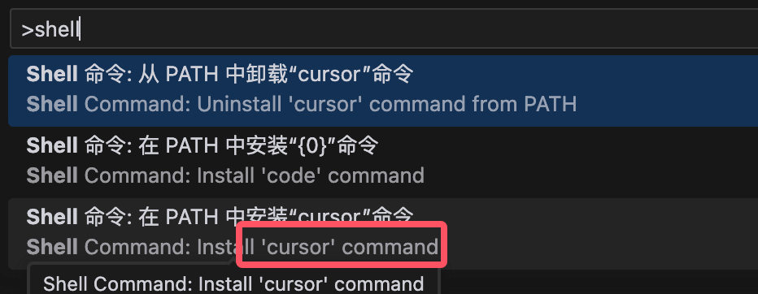

<font style="color:rgb(51, 51, 51);">然后选择</font><font style="color:rgb(51, 51, 51);"> </font>**<font style="color:rgb(51, 51, 51);background-color:rgb(236, 234, 230);">在 PATH 中 安装 "cursor" 命令 - Shell Command: Install 'cursor' command in PATH</font>**<font style="color:rgb(51, 51, 51);"> </font><font style="color:rgb(51, 51, 51);">即可为系统 PATH 路径添加了</font><font style="color:rgb(51, 51, 51);"> </font>**<font style="color:rgb(51, 51, 51);background-color:rgb(236, 234, 230);">cursor</font>**<font style="color:rgb(51, 51, 51);"> </font><font style="color:rgb(51, 51, 51);">命令的引用。</font>

<font style="color:rgb(51, 51, 51);">我们可以通过命令行打开文件、安装扩展、修改显示语言，甚至查看诊断信息。</font>

<font style="color:rgb(51, 51, 51);">通过</font><font style="color:rgb(51, 51, 51);"> </font>**<font style="color:rgb(51, 51, 51);background-color:rgb(236, 234, 230);">cursor --version</font>**<font style="color:rgb(51, 51, 51);"> </font><font style="color:rgb(51, 51, 51);">查看版本信息：</font>

```plain
# cursor --version
0.45.14
906121b8c0bdf041c14a15dac228e66ab5505260
arm64
```

<font style="color:rgb(51, 51, 51);">以下是一些常用的命令行选项，可以通过</font><font style="color:rgb(51, 51, 51);"> </font>**<font style="color:rgb(51, 51, 51);background-color:rgb(236, 234, 230);">cursor --help</font>**<font style="color:rgb(51, 51, 51);"> </font><font style="color:rgb(51, 51, 51);">命令查看：</font>

```plain
Cursor 0.45.14

Usage: cursor [options][paths...]

To read from stdin, append '-' (e.g. 'ps aux | grep code | cursor -')

Options
  -d --diff <file> <file>                    Compare two files with each
                                             other.
  -m --merge <path1> <path2> <base> <result> Perform a three-way merge by
                                             providing paths for two modified
                                             versions of a file, the common
                                             origin of both modified versions
                                             and the output file to save merge
                                             results.
  -a --add <folder>                          Add folder(s) to the last active
                                             window.
  -g --goto <file:line[:character]>          Open a file at the path on the
                                             specified line and character
                                             position.
  -n --new-window                            Force to open a new window.
  -r --reuse-window                          Force to open a file or folder in
                                             an already opened window.
  -w --wait                                  Wait for the files to be closed
                                             before returning.
  --locale <locale>                          The locale to use (e.g. en-US or
                                             zh-TW).
  --user-data-dir <dir>                      Specifies the directory that user
                                             data is kept in. Can be used to
                                             open multiple distinct instances
                                             of Code.
  --profile <profileName>                    Opens the provided folder or
                                             workspace with the given profile
                                             and associates the profile with
                                             the workspace. If the profile
                                             does not exist, a new empty one
                                             is created.
  -h --help                                  Print usage.
```

<font style="color:rgb(51, 51, 51);">我们可以在命令行中使用</font><font style="color:rgb(51, 51, 51);"> </font>**<font style="color:rgb(51, 51, 51);background-color:rgb(236, 234, 230);">cursor .</font>**<font style="color:rgb(51, 51, 51);"> </font><font style="color:rgb(51, 51, 51);">命令让文件夹在 Cursor 中打开：</font>

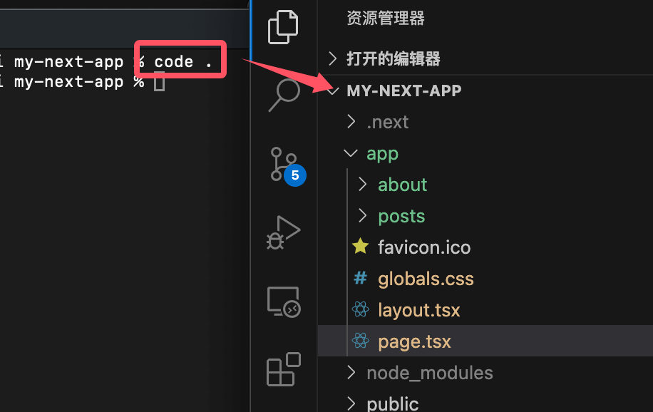

| <font style="color:rgb(255, 255, 255);">命令</font> | <font style="color:rgb(255, 255, 255);">功能说明</font> |
| --- | --- |
| <code><font style="color:rgb(51, 51, 51);">code <路径></font></code> | <font style="color:rgb(51, 51, 51);">打开文件或文件夹</font> |
| <code><font style="color:rgb(51, 51, 51);">cursor .</font></code> | <font style="color:rgb(51, 51, 51);">打开当前目录作为工作区</font> |
| <code><font style="color:rgb(51, 51, 51);">cursor --new-window</font></code> | <font style="color:rgb(51, 51, 51);">在新窗口中打开</font> |
| <code><font style="color:rgb(51, 51, 51);">cursor --diff</font></code> | <font style="color:rgb(51, 51, 51);">对比两个文件的内容</font> |
| <code><font style="color:rgb(51, 51, 51);">cursor --wait</font></code> | <font style="color:rgb(51, 51, 51);">等待窗口关闭后再返回终端</font> |
| <code><font style="color:rgb(51, 51, 51);">cursor --disable-extensions</font></code> | <font style="color:rgb(51, 51, 51);">禁用所有扩展运行 VS Code</font> |
| <code><font style="color:rgb(51, 51, 51);">cursor --install-extension <扩展名></font></code> | <font style="color:rgb(51, 51, 51);">安装指定扩展</font> |
| <code><font style="color:rgb(51, 51, 51);">cursor --list-extensions</font></code> | <font style="color:rgb(51, 51, 51);">列出所有已安装的扩展</font> |
| <code><font style="color:rgb(51, 51, 51);">cursor --uninstall-extension <扩展名></font></code> | <font style="color:rgb(51, 51, 51);">卸载指定扩展</font> |

<font style="color:rgb(51, 51, 51);background-color:rgb(250, 252, 253);"></font>

<font style="color:rgb(51, 51, 51);background-color:rgb(250, 252, 253);"></font>

# <font style="color:rgb(0, 0, 0);">Cursor Chat 与 Composer</font>

<font style="color:rgb(51, 51, 51);">Cursor AI 聊天窗口中有 Chat 和 Composer 两个功能，它们是两种不同功能的 AI 辅助编程模式：</font>

* <font style="color:rgb(51, 51, 51);">Chat 是一个交互式的 AI 助手，你可以用自然语言与它对话，提出问题、请求代码解释、进行代码审查、查找错误等。它更侧重于交互式的问答和代码辅助，适合快速获取解决方案、调试代码或学习新概念。</font>
* <font style="color:rgb(51, 51, 51);">Composer 是一个强大的代码生成工具，主要用于生成全新的代码。你可以提供需求描述或示例代码，让 Composer 生成完整的代码片段或文件。它更侧重于代码的生成，适合构建新功能、优化代码结构或处理复杂的编程任务。</font>

**<font style="color:rgb(51, 51, 51);">简单来说 Chat 适合快速问答和简单任务，Composer 适合复杂代码生成和跨文件操作，平时开发我们可以先用 Composer 生成代码，再用 Chat 对代码进行解释或优化。</font>**

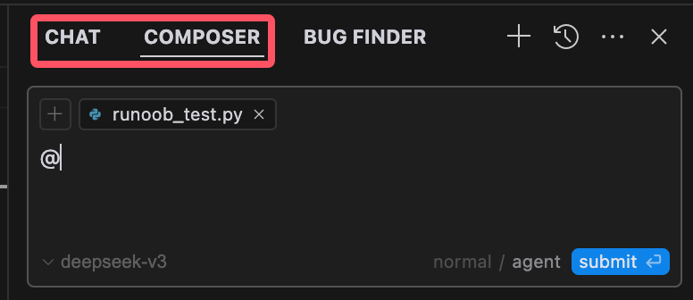

**<font style="color:rgb(51, 51, 51);">选择 Chat 还是 Composer 取决于任务需求：</font>**

* <font style="color:rgb(51, 51, 51);">如果需要快速问答、即时解决问题，Chat 是更好的选择。</font>
* <font style="color:rgb(51, 51, 51);">如果需要生成复杂代码、处理多个文件或进行精细调整，Composer 更适合。</font>

***

## <font style="color:rgb(51, 51, 51);">Cursor Chat 介绍</font>

<font style="color:rgb(51, 51, 51);">Cursor Chat 是一个集成在代码编辑器中的聊天工具，它允许开发者在编写代码的同时与团队成员进行实时沟通。通过 Cursor Chat，开发者可以在不离开编辑器的情况下讨论代码问题、分享代码片段或寻求帮助。</font>

### <font style="color:rgb(51, 51, 51);">主要功能</font>

* <font style="color:rgb(51, 51, 51);">对话式交互：用户可以像与真人对话一样，用自然语言提问或请求代码片段。</font>
* <font style="color:rgb(51, 51, 51);">快速响应：适合即时问答，如代码调试、技术概念解释等。</font>
* <font style="color:rgb(51, 51, 51);">上下文感知：Chat 会记住之前的对话，支持逐步深入提问。</font>
* <font style="color:rgb(51, 51, 51);">代码引用：可以直接引用代码片段，让 AI 解释或修改。</font>

## <font style="color:rgb(97, 127, 16);background-color:rgb(229, 238, 204);">实例</font>

<font style="color:rgb(0, 0, 0);background-color:rgb(249, 249, 249);">export default function AboutPage</font><font style="color:olive;background-color:rgb(249, 249, 249);">(</font><font style="color:olive;background-color:rgb(249, 249, 249);">)</font><font style="color:rgb(0, 0, 0);background-color:rgb(249, 249, 249);"> </font><font style="color:olive;background-color:rgb(249, 249, 249);">{</font><font style="color:rgb(0, 0, 0);background-color:rgb(249, 249, 249);">\
</font><font style="color:rgb(0, 0, 0);background-color:rgb(249, 249, 249);"> </font>**<font style="color:green;background-color:rgb(249, 249, 249);">return</font>**<font style="color:rgb(0, 0, 0);background-color:rgb(249, 249, 249);"> </font><font style="color:gray;background-color:rgb(249, 249, 249);"><</font><font style="color:rgb(0, 0, 0);background-color:rgb(249, 249, 249);">h1</font><font style="color:gray;background-color:rgb(249, 249, 249);">></font><font style="color:rgb(0, 0, 0);background-color:rgb(249, 249, 249);">关于我们，RUNOOB.</font><font style="color:rgb(0, 85, 170);background-color:rgb(249, 249, 249);">COM</font><font style="color:gray;background-color:rgb(249, 249, 249);"><</font><font style="color:rgb(0, 0, 0);background-color:rgb(249, 249, 249);">/h1</font><font style="color:gray;background-color:rgb(249, 249, 249);">>;</font><font style="color:rgb(0, 0, 0);background-color:rgb(249, 249, 249);">\
</font><font style="color:olive;background-color:rgb(249, 249, 249);">}</font>

<font style="color:rgb(51, 51, 51);">接下来我们在 Chat 对话窗口，让 AI 添加注释。</font>

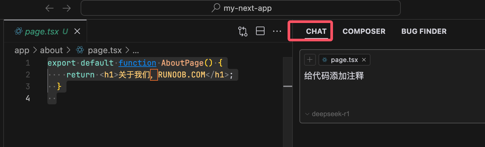

<font style="color:rgb(51, 51, 51);">然后 点击 Apply 按钮，就可以应用到代码文件中了：</font>

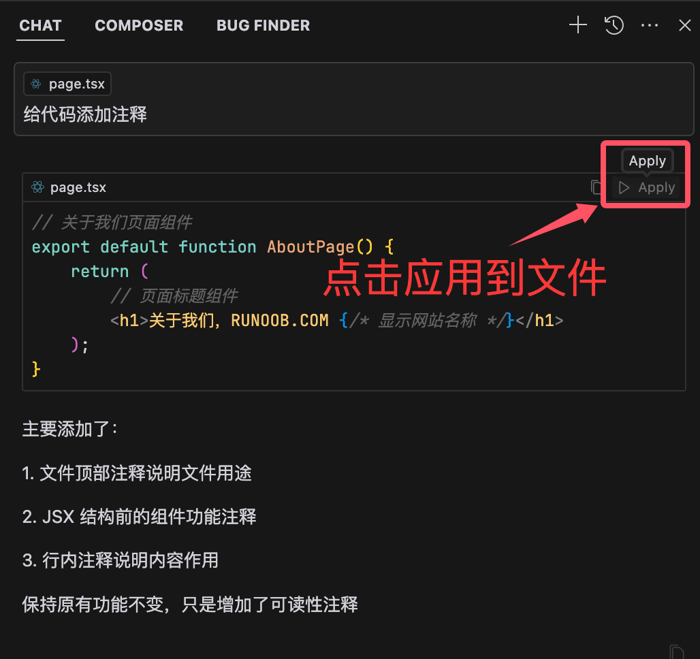

***

## <font style="color:rgb(51, 51, 51);">Composer 介绍</font>

<font style="color:rgb(51, 51, 51);">Composer 可以根据自然语言描述，Composer 可以生成完整的代码片段或文件，甚至构建整个应用程序，同时支持同时编辑多个文件，能够理解文件之间的调用关系，适合复杂项目的开发。</font>

<font style="color:rgb(51, 51, 51);">Composer 能够理解整个项目结构和现有代码，生成更符合逻辑、更高质量的代码。</font>

<font style="color:rgb(51, 51, 51);">Composer 生成代码后，用户可以通过额外指令进一步优化代码。</font>

<font style="color:rgb(51, 51, 51);">比如我们可以创建一个目录，编写需求文档：</font>

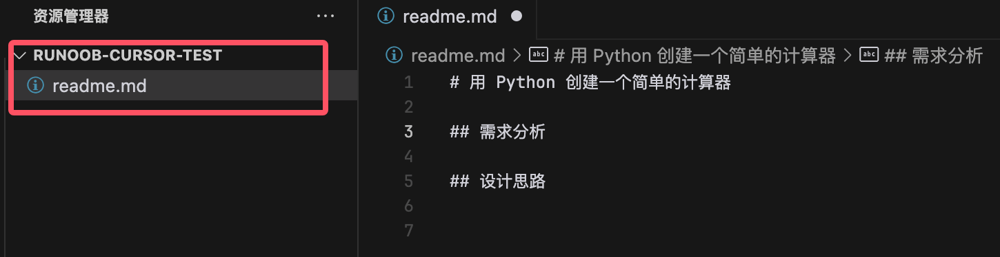

<font style="color:rgb(51, 51, 51);">在 Composer 对话窗口就可以让他根据需求文档生成代码：</font>

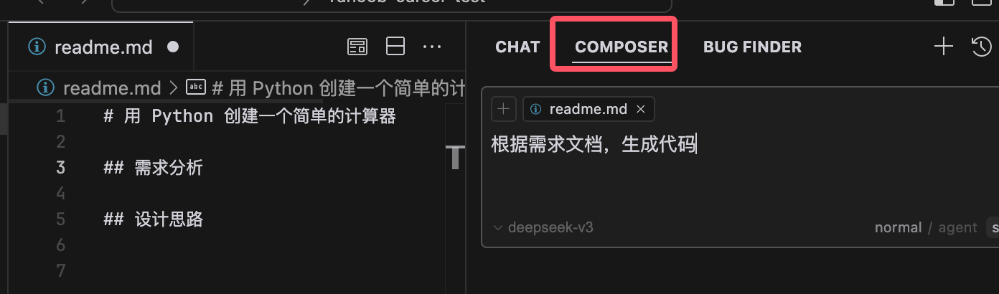

<font style="color:rgb(51, 51, 51);background-color:rgb(250, 252, 253);"></font>

<font style="color:rgb(54, 54, 54);">Cursor</font><font style="color:rgb(54, 54, 54);"> </font><font style="color:rgb(54, 54, 54);">在最新版本</font><font style="color:rgb(54, 54, 54);"> </font>**<font style="color:rgb(54, 54, 54);">0.46.8</font>**<font style="color:rgb(54, 54, 54);"> </font><font style="color:rgb(54, 54, 54);">中移除了</font><font style="color:rgb(54, 54, 54);"> </font>**<font style="color:rgb(54, 54, 54);">Composer</font>**<font style="color:rgb(54, 54, 54);"> </font><font style="color:rgb(54, 54, 54);">和</font><font style="color:rgb(54, 54, 54);"> </font>**<font style="color:rgb(54, 54, 54);">Bug Finder</font>**<font style="color:rgb(54, 54, 54);"> </font><font style="color:rgb(54, 54, 54);">功能，主要是为了简化</font>[<font style="color:rgb(65, 131, 196);">用户体验</font>](https://so.csdn.net/so/search?q=%E7%94%A8%E6%88%B7%E4%BD%93%E9%AA%8C\&spm=1001.2101.3001.7020)<font style="color:rgb(54, 54, 54);">，并整合多个模式。</font>

<font style="color:rgb(54, 54, 54);">他们将 </font>**<font style="color:rgb(54, 54, 54);">Chat 模式</font>**<font style="color:rgb(54, 54, 54);"> 作为主要交互方式，结合了之前的 </font>**<font style="color:rgb(54, 54, 54);">Compose</font>**<font style="color:rgb(54, 54, 54);"> 和 </font>**<font style="color:rgb(54, 54, 54);">Command</font>**<font style="color:rgb(54, 54, 54);"> 模式的功能，使用户可以在一个统一的界面中进行</font>[<font style="color:rgb(65, 131, 196);">代码生成</font>](https://so.csdn.net/so/search?q=%E4%BB%A3%E7%A0%81%E7%94%9F%E6%88%90\&spm=1001.2101.3001.7020)<font style="color:rgb(54, 54, 54);">、编辑和命令执行。此外，新的界面提供了 </font>**<font style="color:rgb(54, 54, 54);">Agent</font>**<font style="color:rgb(54, 54, 54);">、</font>**<font style="color:rgb(54, 54, 54);">Ask</font>**<font style="color:rgb(54, 54, 54);"> 和 </font>**<font style="color:rgb(54, 54, 54);">Edit</font>**<font style="color:rgb(54, 54, 54);"> 三种模式，以替代原来的 Composer 功能。</font><font style="color:rgb(51, 51, 51);background-color:rgb(250, 252, 253);">\
</font><font style="color:rgb(51, 51, 51);background-color:rgb(250, 252, 253);"> </font>

<font style="color:rgb(51, 51, 51);background-color:rgb(250, 252, 253);"></font>

<font style="color:rgb(51, 51, 51);background-color:rgb(250, 252, 253);"></font>


> 更新: 2025-08-13 11:47:13  
> 原文: <https://www.yuque.com/aaron-wecc3/dhluml/cispfgz8drlla98q>