# 164.Cursor高阶技巧使用

# 示例代码

[cursor-demo.zip](https://www.yuque.com/attachments/yuque/0/2025/zip/2424104/1755056832801-f7071873-b5a2-42f4-b530-7c8a4baad7b6.zip)

# <font style="color:rgb(0, 0, 0);">Cursor </font><font style="color:rgb(51, 51, 51);">智能补全与代码生成</font>

<font style="color:rgb(51, 51, 51);">Cursor 新建文件很简单，可以点击菜单栏的</font>**<font style="color:rgb(51, 51, 51);">"文件"</font>**<font style="color:rgb(51, 51, 51);">或左侧的</font>**<font style="color:rgb(51, 51, 51);">"资源管理器"</font>**<font style="color:rgb(51, 51, 51);">来创建：</font>

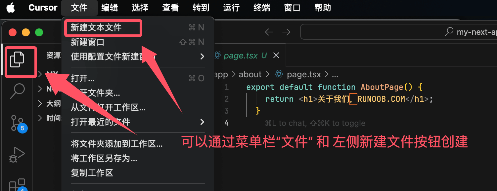

<font style="color:rgb(51, 51, 51);">通过</font>**<font style="color:rgb(51, 51, 51);">"资源管理器"</font>**<font style="color:rgb(51, 51, 51);">打开一个项目，项目上就有创建文件和创建目录的按钮：</font>


<font style="color:rgb(51, 51, 51);">点击菜单栏的新建文件，会出现一个空文本，我们可以输入代码，并按下</font><font style="color:rgb(51, 51, 51);"> </font>**<font style="color:rgb(51, 51, 51);background-color:rgb(236, 234, 230);">Ctrl + s</font>**<font style="color:rgb(51, 51, 51);"> </font><font style="color:rgb(51, 51, 51);">来保存代码，输入文件名，并设置保存目录：</font>

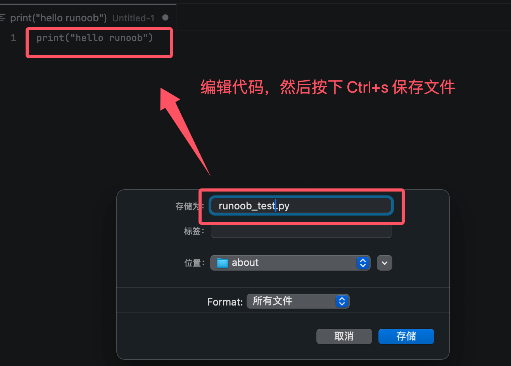

<font style="color:rgb(51, 51, 51);">通过</font>**<font style="color:rgb(51, 51, 51);">"资源管理器"</font>**<font style="color:rgb(51, 51, 51);">项目上按钮来创建文件，会先出现一个输入文件名的输入框，输入文件名后即可完成创建：</font>

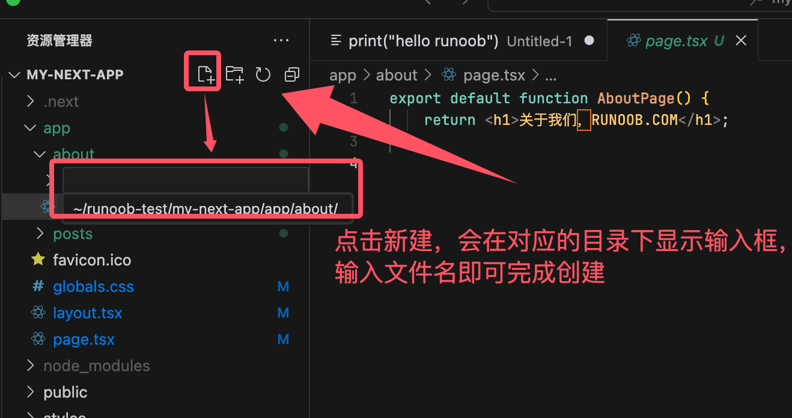

<font style="color:rgb(51, 51, 51);">Cursor 内置 IntelliSense 功能，根据上下文提供智能补全建议。</font>

<font style="color:rgb(51, 51, 51);">我们在编写代码，如 Python 或 JavaScript 时，Cursor 会预测我们要输入的内容:</font>

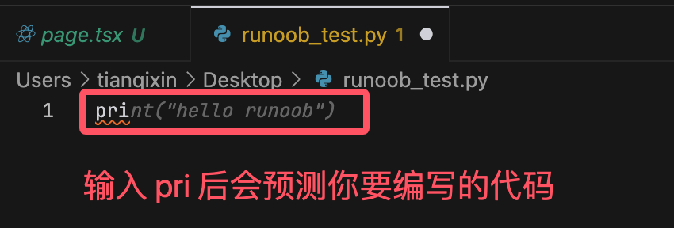

<font style="color:rgb(51, 51, 51);">如果写上注释如</font>**<font style="color:rgb(51, 51, 51);background-color:rgb(236, 234, 230);"> </font>****<font style="color:rgb(51, 51, 51);background-color:rgb(236, 234, 230);"># 计算平均数</font>****<font style="color:rgb(51, 51, 51);background-color:rgb(236, 234, 230);"> </font>**<font style="color:rgb(51, 51, 51);">，Cursor 就会自动帮我们实现功能，按下 Tab 键就可以才能 Cursor 提供的代码：</font>

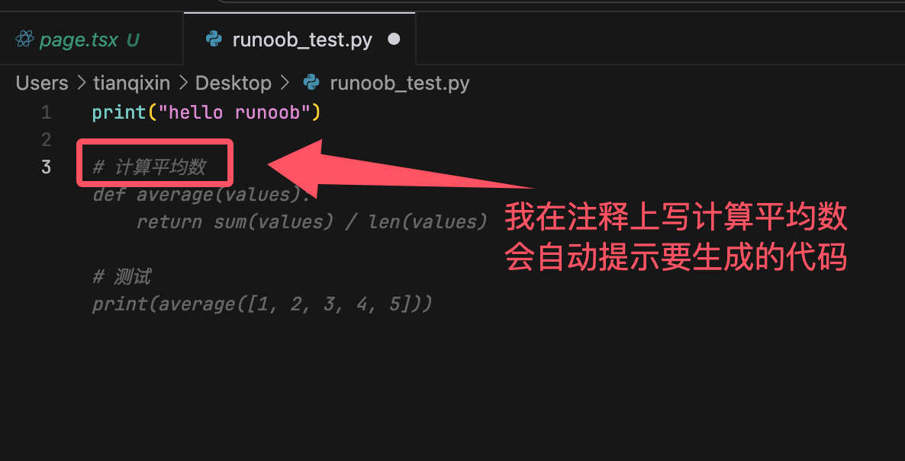

<font style="color:rgb(51, 51, 51);">如果对代码不熟悉，需要 AI 来解析，可以通过快捷键 Cmd/Ctrl + L 来调出 AI 对话窗口：</font>

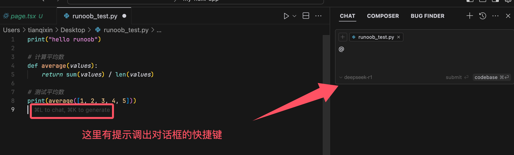

<font style="color:rgb(51, 51, 51);background-color:rgb(250, 252, 253);">  
</font><font style="color:rgb(51, 51, 51);background-color:rgb(250, 252, 253);"> </font>

# <font style="color:rgb(0, 0, 0);">Cursor 集成终端</font>

<font style="color:rgb(51, 51, 51);">Cursor 基于 Visual Studio Code 构建，保留了 VS Code 的强大功能和熟悉的操作体验，同时加入了 AI 辅助编程功。</font>

<font style="color:rgb(51, 51, 51);">Cursor 内置了集成终端，跟 VS Code 集成终端操作一样， 我们可以在菜单栏上选择</font>**<font style="color:rgb(51, 51, 51);background-color:rgb(236, 234, 230);">"终端"</font>**<font style="color:rgb(51, 51, 51);">选项，然后选择</font>**<font style="color:rgb(51, 51, 51);background-color:rgb(236, 234, 230);">"新建终端"</font>**<font style="color:rgb(51, 51, 51);">：</font>

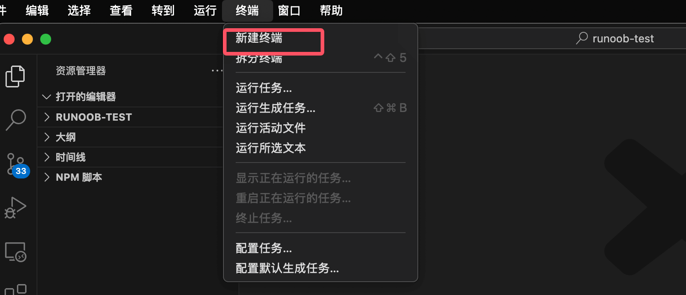

<font style="color:rgb(51, 51, 51);">也可以选择目录下的文件，右击，在下拉菜单选择</font>**<font style="color:rgb(51, 51, 51);background-color:rgb(236, 234, 230);">"在集成终端打开"</font>**<font style="color:rgb(51, 51, 51);">：</font>

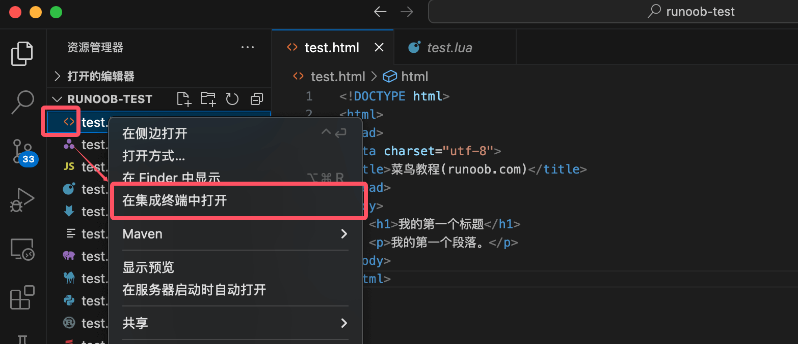

**<font style="color:rgb(51, 51, 51);">终端快捷键：</font>**

| <font style="color:rgb(255, 255, 255);">功能</font> | <font style="color:rgb(255, 255, 255);">Windows/Linux</font> | <font style="color:rgb(255, 255, 255);">macOS</font> |
| --- | --- | --- |
| <font style="color:rgb(51, 51, 51);">显示集成终端</font> | <font style="color:rgb(51, 51, 51);">Ctrl + <code></font> | <font style="color:rgb(51, 51, 51);">Ctrl + </code></font> |
| <font style="color:rgb(51, 51, 51);">新建终端</font> | <code><font style="color:rgb(51, 51, 51);">Ctrl+Shift+``</font></code> | <code><font style="color:rgb(51, 51, 51);">Cmd+Shift+``</font></code> |
| <font style="color:rgb(51, 51, 51);">切换终端</font> | <code><font style="color:rgb(51, 51, 51);">Ctrl+PageUp/PageDown</font></code> | <code><font style="color:rgb(51, 51, 51);">Cmd+PageUp/PageDown</font></code> |
| <font style="color:rgb(51, 51, 51);">关闭终端</font> | <code><font style="color:rgb(51, 51, 51);">Ctrl+Shift+W</font></code> | <code><font style="color:rgb(51, 51, 51);">Cmd+Shift+W</font></code> |

<font style="color:rgb(51, 51, 51);">根据操作系统的不同，我们可以选择不同的终端环境，例如 PowerShell、命令提示符（Command Prompt）、或 Bash。</font>

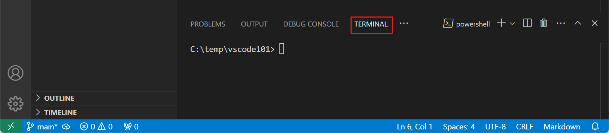

<font style="color:rgb(51, 51, 51);">在终端中输入以下命令，创建一个新的文件 greetings.txt：</font>

<font style="color:rgb(51, 51, 51);">echo "Hello, VS Code" > greetings.txt</font>

<font style="color:rgb(51, 51, 51);">工作区的默认文件夹是当前项目的根目录。</font>

<font style="color:rgb(51, 51, 51);">创建文件后，"资源管理器（Explorer）"会自动显示新文件。</font>

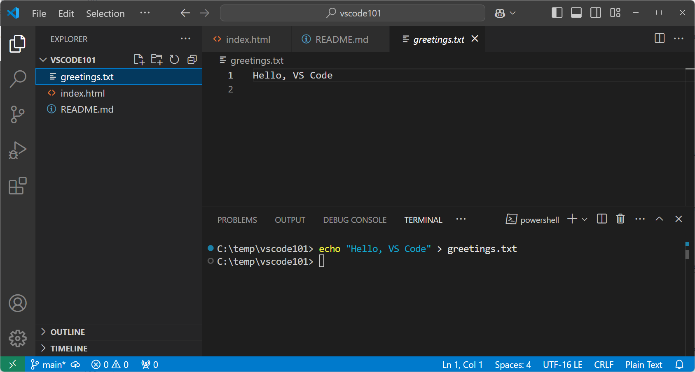

<font style="color:rgb(51, 51, 51);">我们可以同时打开多个终端，点击终端右上角的"启动配置（Launch Profile）"下拉菜单，查看可用的终端环境并选择。</font>

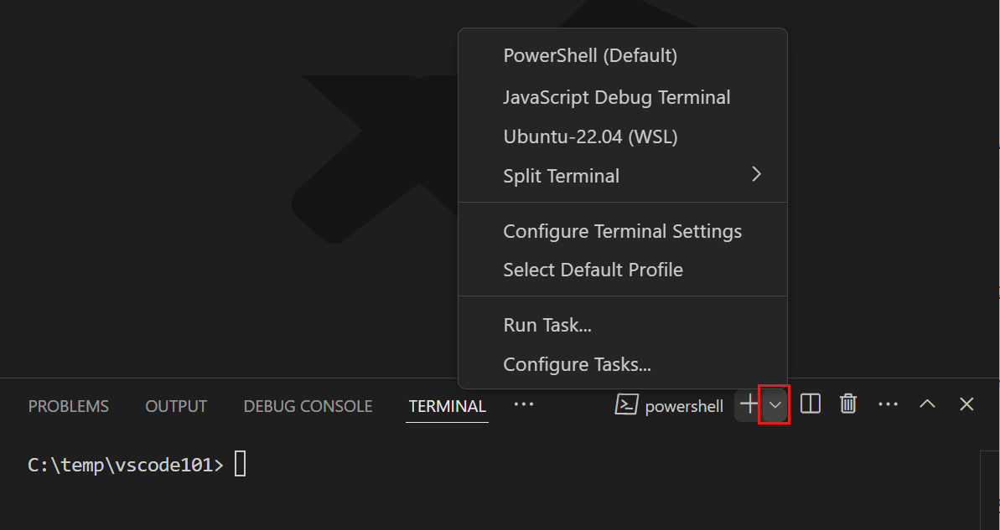

***

## <font style="color:rgb(51, 51, 51);">使用终端运行命令</font>

<font style="color:rgb(51, 51, 51);">终端会打开一个默认的 Shell，如 Bash、PowerShell 或 Zsh，终端的工作目录会从工作区文件夹的根目录开始。</font>

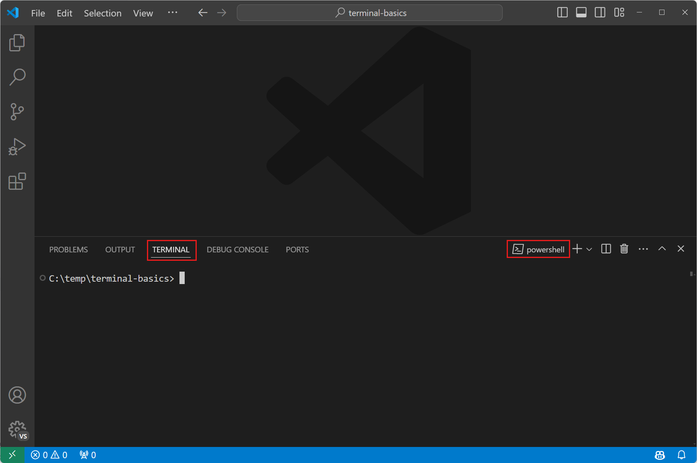

<font style="color:rgb(51, 51, 51);">输入类似 ls 或 dir 这样的基本命令来列出当前目录下的文件。</font>

<font style="color:rgb(51, 51, 51);">终端会直接显示命令的输出内容：</font>

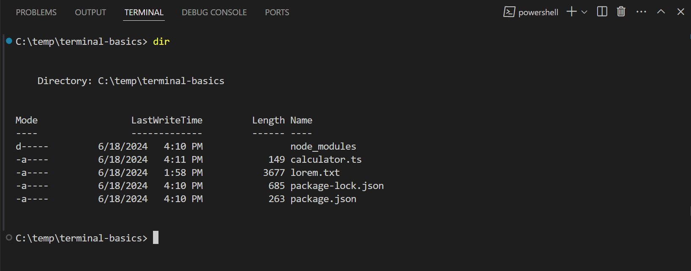

### <font style="color:rgb(51, 51, 51);">与命令输出交互</font>

<font style="color:rgb(51, 51, 51);">VS Code 中的终端还提供了与命令输出交互的功能，命令通常会输出文件路径或 URL，你可能希望直接打开或跳转到这些链接。</font>

<font style="color:rgb(51, 51, 51);">例如，编译器或代码检查工具可能会返回一个包含文件路径和行号的错误信息。你不需要手动去搜索该文件，只需在终端输出中选择该链接即可直接在编辑器中打开文件。</font>

<font style="color:rgb(51, 51, 51);">让我们看看如何与终端中的命令输出进行交互：</font>

1. <font style="color:rgb(51, 51, 51);">打开你之前运行过</font><font style="color:rgb(51, 51, 51);"> </font><code><font style="color:rgb(51, 51, 51);">ls</font></code><font style="color:rgb(51, 51, 51);"> </font><font style="color:rgb(51, 51, 51);">或</font><font style="color:rgb(51, 51, 51);"> </font><code><font style="color:rgb(51, 51, 51);">dir</font></code><font style="color:rgb(51, 51, 51);"> </font><font style="color:rgb(51, 51, 51);">命令的终端。</font>
2. <font style="color:rgb(51, 51, 51);">在终端中，按住</font><font style="color:rgb(51, 51, 51);"> </font><code><font style="color:rgb(51, 51, 51);">Ctrl/Cmd</font></code><font style="color:rgb(51, 51, 51);"> </font><font style="color:rgb(51, 51, 51);">键，将鼠标悬停在文件名上，然后选择该链接。</font>

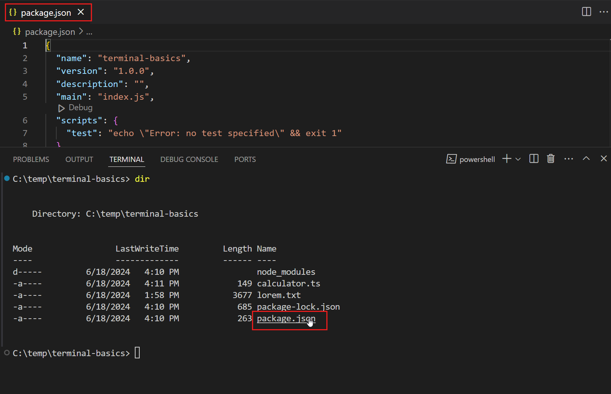

<font style="color:rgb(51, 51, 51);">注意，当你将鼠标悬停在输出中的文本上时，它会变成一个链接。</font>

<font style="color:rgb(51, 51, 51);">当你选择文件名时，VS Code 会在编辑器中打开选定的文件。</font>

<font style="color:rgb(51, 51, 51);">终端输出中的所有文本都是可以点击的，如果你选择终端中的超链接，它会在默认浏览器中打开链接。</font>

### <font style="color:rgb(51, 51, 51);">创建一个包含可用 Shell 命令的 Command.txt 文件</font>

<font style="color:rgb(51, 51, 51);">在 PowerShell 中：</font>

<font style="color:rgb(51, 51, 51);">Get-Command | Out-File -FilePath .\Command.txt</font>

<font style="color:rgb(51, 51, 51);">在 Bash / Zsh 中：</font>

<font style="color:rgb(51, 51, 51);">ls -l /usr/bin > Command.txt</font>

<font style="color:rgb(51, 51, 51);">输入以下命令以搜索 Command.txt 文件中的命令：</font>

<font style="color:rgb(51, 51, 51);">在 PowerShell 中：</font>

<font style="color:rgb(51, 51, 51);">Get-ChildItem \*.txt | Select-String "dir"</font>

<font style="color:rgb(51, 51, 51);">在 Bash / Zsh 中：</font>

<font style="color:rgb(51, 51, 51);">grep -n "dir" \*.txt</font>

<font style="color:rgb(51, 51, 51);">注意，命令输出中会包含文件名和找到搜索结果的行号，终端会将这些文本识别为链接。</font>

<font style="color:rgb(51, 51, 51);">选择其中一个链接，可以在编辑器中打开该文件，并跳转到文件中的特定行。</font>

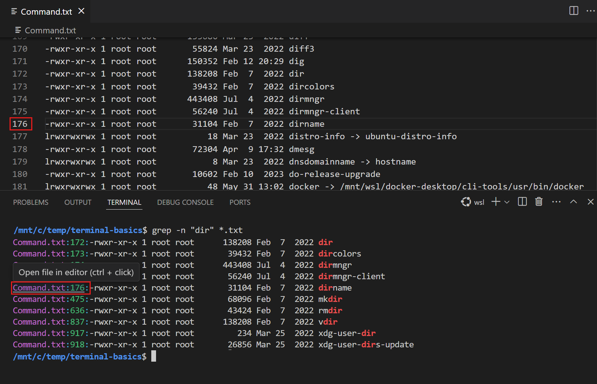

### <font style="color:rgb(51, 51, 51);">浏览历史命令</font>

<font style="color:rgb(51, 51, 51);">在使用终端时，我们可能需要查看之前的命令及其输出，或者可能想重新运行某个命令。</font>

<font style="color:rgb(51, 51, 51);">我们可以使用快捷键快速浏览历史命令：按下</font><font style="color:rgb(51, 51, 51);"> </font><code><font style="color:rgb(51, 51, 51);">Ctrl + ↑</font></code><font style="color:rgb(51, 51, 51);"> </font><font style="color:rgb(51, 51, 51);">或</font><font style="color:rgb(51, 51, 51);"> </font><code><font style="color:rgb(51, 51, 51);">⌘ + ↑</font></code><font style="color:rgb(51, 51, 51);"> </font><font style="color:rgb(51, 51, 51);">快捷键，向上滚动至终端历史记录中的上一条命令。</font>

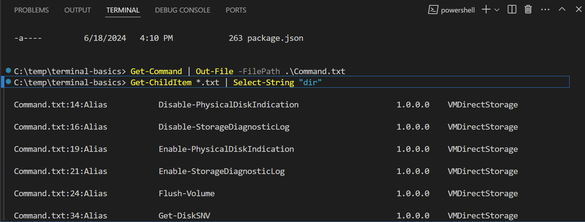

<font style="color:rgb(51, 51, 51);">如果你多次按下</font><font style="color:rgb(51, 51, 51);"> </font><code><font style="color:rgb(51, 51, 51);">Ctrl + ↑</font></code><font style="color:rgb(51, 51, 51);">，终端会继续向上滚动历史记录。你也可以使用</font><font style="color:rgb(51, 51, 51);"> </font><code><font style="color:rgb(51, 51, 51);">Ctrl + ↓</font></code><font style="color:rgb(51, 51, 51);"> </font><font style="color:rgb(51, 51, 51);">快捷键向下浏览历史记录。</font>

<font style="color:rgb(51, 51, 51);">最好我们会看到一个圆形图标出现在某个已运行命令旁边，选择该圆形图标，然后选择"重新运行命令"来重新执行该命令。</font>

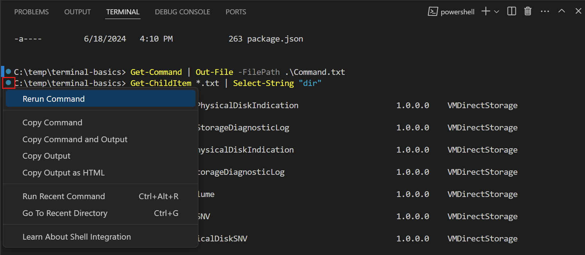

### <font style="color:rgb(51, 51, 51);">不同 Shell 中运行命令</font>

<font style="color:rgb(51, 51, 51);">终端支持同时打开多个终端。</font>

<font style="color:rgb(51, 51, 51);">例如，我们可以将一个终端用于运行 Git 命令，另一个终端用于运行构建脚本。</font>

<font style="color:rgb(51, 51, 51);">在不同 Shell 中添加新终端：选择终端面板中的 ˅ 图标以打开终端下拉菜单，然后从可用的 Shell 中选择一个。</font>

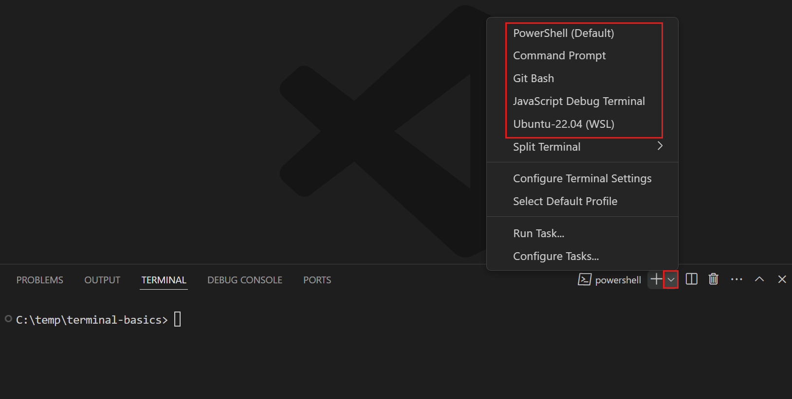

**<font style="color:rgb(51, 51, 51);">注意：</font>\*\*\*\*<font style="color:rgb(51, 51, 51);"> </font>**<font style="color:rgb(51, 51, 51);">可用的 Shell 取决于你电脑上安装的 Shell。</font>

<font style="color:rgb(51, 51, 51);">新终端会以你选择的 Shell 打开，你可以像之前一样输入命令。</font>

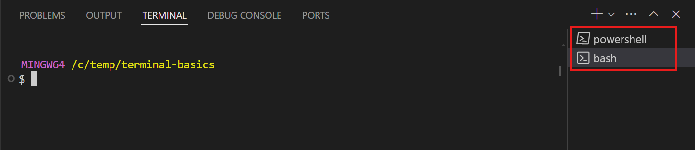

**<font style="color:rgb(51, 51, 51);">提示：</font>**<font style="color:rgb(51, 51, 51);"> </font><font style="color:rgb(51, 51, 51);">你也可以选择 + 图标来为默认 Shell 创建新终端，使用快捷键</font><font style="color:rgb(51, 51, 51);"> </font><code><font style="color:rgb(51, 51, 51);">⌃⇧</font></code><font style="color:rgb(51, 51, 51);">（Ctrl + Shift + \`），或者从菜单栏选择</font><font style="color:rgb(51, 51, 51);"> </font>**<font style="color:rgb(51, 51, 51);">终端</font>**<font style="color:rgb(51, 51, 51);"> </font><font style="color:rgb(51, 51, 51);">></font><font style="color:rgb(51, 51, 51);"> </font>**<font style="color:rgb(51, 51, 51);">新终端</font>**<font style="color:rgb(51, 51, 51);"> </font><font style="color:rgb(51, 51, 51);">来创建新终端。</font>

<font style="color:rgb(51, 51, 51);">我们还可以将终端从终端列表拖动到编辑器区域。</font>

<font style="color:rgb(51, 51, 51);">例如，我们将终端标签拖出 VS Code 窗口，使其成为浮动窗口。</font>

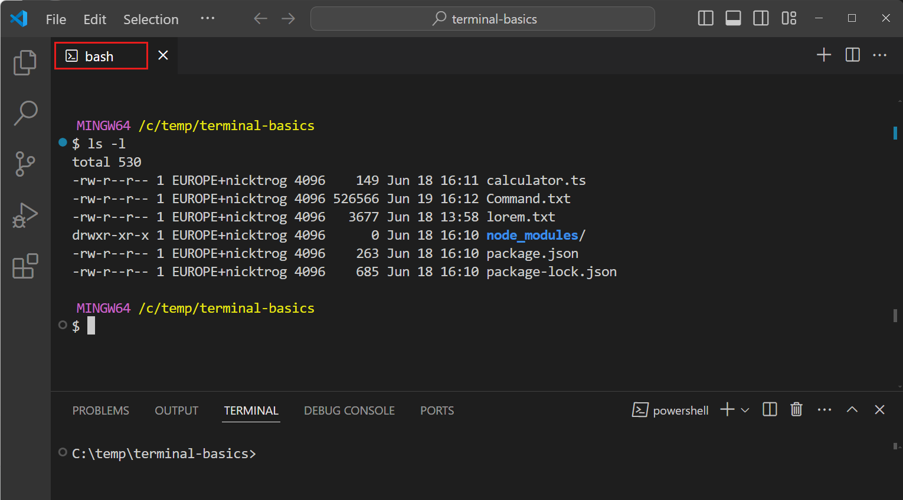

**<font style="color:rgb(51, 51, 51);">将终端移动到编辑器区域：</font>**<font style="color:rgb(51, 51, 51);">当你将鼠标悬停在终端列表上时，选择垃圾桶图标来关闭已打开的终端。</font>

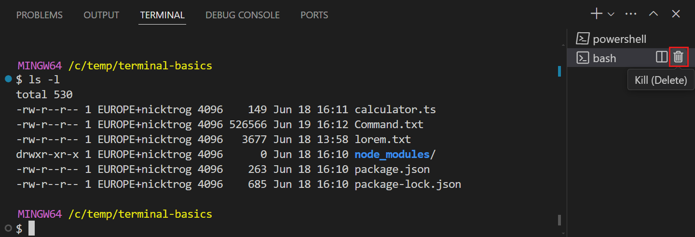

#

# <font style="color:rgb(51, 51, 51);">Cursor 高效率</font><code><font style="color:rgb(51, 51, 51);background-color:rgb(243, 244, 244);">@</font></code><font style="color:rgb(51, 51, 51);">注记功能</font>

<font style="color:rgb(51, 51, 51);">在 Cursor 中，</font>**<font style="color:rgb(51, 51, 51);background-color:rgb(236, 234, 230);">@</font>**<font style="color:rgb(51, 51, 51);"> </font><font style="color:rgb(51, 51, 51);">符号是一个强大的工具，用于快速访问和引用各种上下文信息，帮助用户更高效地与 AI 交互。</font>

<font style="color:rgb(51, 51, 51);">在任何 AI 交互场景（如</font><font style="color:rgb(51, 51, 51);"> </font>**<font style="color:rgb(51, 51, 51);background-color:rgb(236, 234, 230);">⌘K</font>**<font style="color:rgb(51, 51, 51);"> </font><font style="color:rgb(51, 51, 51);">命令面板、聊天窗口或终端）中输入</font><font style="color:rgb(51, 51, 51);"> </font>**<font style="color:rgb(51, 51, 51);background-color:rgb(236, 234, 230);">@</font>**<font style="color:rgb(51, 51, 51);">，会触发上下文关联菜单，自动过滤并推荐当前项目中最相关的资源（如文件、代码片段、文档等）。</font>

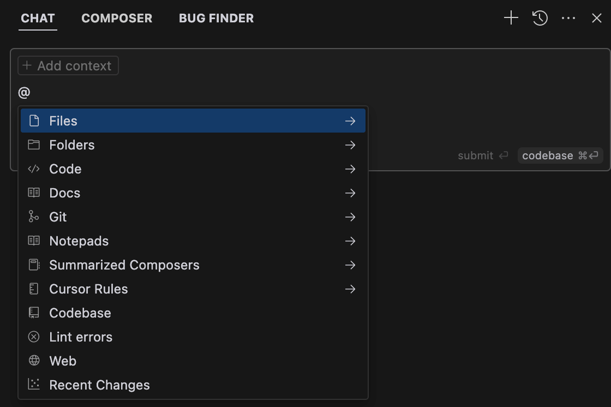

* <font style="color:rgb(51, 51, 51);">键盘操作：使用</font><font style="color:rgb(51, 51, 51);"> </font>**<font style="color:rgb(51, 51, 51);background-color:rgb(236, 234, 230);">↑/↓</font>**<font style="color:rgb(51, 51, 51);"> </font><font style="color:rgb(51, 51, 51);">方向键导航，Enter 确认选择。若选择的是类别（如</font><font style="color:rgb(51, 51, 51);"> </font>**<font style="color:rgb(51, 51, 51);background-color:rgb(236, 234, 230);">@Files</font>**<font style="color:rgb(51, 51, 51);">），列表会进一步过滤该类别下的具体资源。</font>
* <font style="color:rgb(51, 51, 51);">文件读取策略：对文件引用可按 </font>**<font style="color:rgb(51, 51, 51);background-color:rgb(236, 234, 230);">Ctrl/⌘ M</font>**<font style="color:rgb(51, 51, 51);"> 切换"完整读取"或"摘要读取"模式（例如全文引用或仅关键部分）。</font>

**<font style="color:rgb(51, 51, 51);background-color:rgb(236, 234, 230);">@</font>**<font style="color:rgb(51, 51, 51);"> </font><font style="color:rgb(51, 51, 51);">符号支持以下主要指令:</font>

| **<font style="color:rgb(255, 255, 255);">功能</font>** | **<font style="color:rgb(255, 255, 255);">描述</font>** | **<font style="color:rgb(255, 255, 255);">使用场景</font>** |
| --- | --- | --- |
| **<font style="color:rgb(51, 51, 51);">@Files</font>** | <font style="color:rgb(51, 51, 51);">引用整个文件作为上下文。支持文件路径预览和分块处理。</font> | <font style="color:rgb(51, 51, 51);">需要引用特定文件内容时，如代码文件、文档等。</font> |
| **<font style="color:rgb(51, 51, 51);">@Folders</font>** | <font style="color:rgb(51, 51, 51);">引用整个文件夹作为上下文。</font> | <font style="color:rgb(51, 51, 51);">需要提供大量文件作为上下文，例如项目目录。</font> |
| **<font style="color:rgb(51, 51, 51);">@Code</font>** | <font style="color:rgb(51, 51, 51);">引用特定代码片段作为上下文。</font> | <font style="color:rgb(51, 51, 51);">需要针对特定代码片段进行查询或操作。</font> |
| **<font style="color:rgb(51, 51, 51);">@Codebase</font>** | <font style="color:rgb(51, 51, 51);">从代码库中搜索重要文件或代码块，并根据相关性重新排序。</font> | <font style="color:rgb(51, 51, 51);">需要在整个代码库中查找相关代码或文件。</font> |
| **<font style="color:rgb(51, 51, 51);">@Git</font>** | <font style="color:rgb(51, 51, 51);">扫描 Git 提交、差异或拉取请求，帮助查找问题。</font> | <font style="color:rgb(51, 51, 51);">需要分析 Git 相关信息，如提交记录、代码差异等。</font> |
| **<font style="color:rgb(51, 51, 51);">@Web</font>** | <font style="color:rgb(51, 51, 51);">搜索网络信息作为附加上下文。</font> | <font style="color:rgb(51, 51, 51);">需要获取最新网络信息或外部资源。</font> |
| **<font style="color:rgb(51, 51, 51);">@Docs</font>** | <font style="color:rgb(51, 51, 51);">引用预设的第三方文档或自定义文档。支持添加自定义文档。</font> | <font style="color:rgb(51, 51, 51);">需要引用外部文档或自定义知识库。</font> |
| **<font style="color:rgb(51, 51, 51);">@Definitions</font>** | <font style="color:rgb(51, 51, 51);">引用附近的所有定义作为上下文。</font> | <font style="color:rgb(51, 51, 51);">需要引用当前代码中的变量、函数等定义。</font> |
| **<font style="color:rgb(51, 51, 51);">@Chat</font>** | <font style="color:rgb(51, 51, 51);">将当前聊天消息添加为上下文。</font> | <font style="color:rgb(51, 51, 51);">在聊天中需要引用之前的对话内容。</font> |

### <font style="color:rgb(51, 51, 51);">高级使用技巧</font>

**<font style="color:rgb(51, 51, 51);">组合指令:</font>\*\*\*\*<font style="color:rgb(51, 51, 51);"> </font>**<font style="color:rgb(51, 51, 51);">输入</font><font style="color:rgb(51, 51, 51);"> </font>**<font style="color:rgb(51, 51, 51);background-color:rgb(236, 234, 230);">@Files src/utils/helper.js @Codebase</font>**<font style="color:rgb(51, 51, 51);">，可同时引用指定文件并关联代码库全局上下文，生成高度定制化的代码。</font>

**<font style="color:rgb(51, 51, 51);">动态资源集成:</font>\*\*\*\*<font style="color:rgb(51, 51, 51);"> </font>**<font style="color:rgb(51, 51, 51);">粘贴以</font><font style="color:rgb(51, 51, 51);"> </font>**<font style="color:rgb(51, 51, 51);background-color:rgb(236, 234, 230);">@</font>**<font style="color:rgb(51, 51, 51);"> </font><font style="color:rgb(51, 51, 51);">开头的链接（如 @https://api.example.com/docs），Cursor 会自动解析内容并纳入上下文。</font>

**<font style="color:rgb(51, 51, 51);">隐私与配置管理:</font>\*\*\*\*<font style="color:rgb(51, 51, 51);"> </font>**<font style="color:rgb(51, 51, 51);">通过</font><font style="color:rgb(51, 51, 51);"> </font>**<font style="color:rgb(51, 51, 51);">.cursorignore</font>**<font style="color:rgb(51, 51, 51);"> </font><font style="color:rgb(51, 51, 51);">文件（类似 .gitignore）排除敏感文件或目录的索引。 在 Settings > Features > Docs 中添加自定义文档链接，增强</font><font style="color:rgb(51, 51, 51);"> </font>**<font style="color:rgb(51, 51, 51);background-color:rgb(236, 234, 230);">@Docs</font>**<font style="color:rgb(51, 51, 51);"> </font><font style="color:rgb(51, 51, 51);">的覆盖范围。</font>

### <font style="color:rgb(51, 51, 51);">典型应用场景示例</font>

**<font style="color:rgb(51, 51, 51);">1、代码生成</font>**

* <font style="color:rgb(51, 51, 51);">指令：生成用户登录功能</font><font style="color:rgb(51, 51, 51);"> </font>**<font style="color:rgb(51, 51, 51);background-color:rgb(236, 234, 230);">@Files src/models/user.js @Docs https://jwt.io/introduction</font>**
* <font style="color:rgb(51, 51, 51);">结果：基于现有用户模型和 JWT 官方文档生成安全的鉴权逻辑。</font>

**<font style="color:rgb(51, 51, 51);">2、错误排查</font>**

* <font style="color:rgb(51, 51, 51);">指令：解释此报错原因</font><font style="color:rgb(51, 51, 51);"> </font>**<font style="color:rgb(51, 51, 51);background-color:rgb(236, 234, 230);">@Code 12-25</font>**<font style="color:rgb(51, 51, 51);"> </font><font style="color:rgb(51, 51, 51);">行</font><font style="color:rgb(51, 51, 51);"> </font>**<font style="color:rgb(51, 51, 51);background-color:rgb(236, 234, 230);">@Git HEAD~1</font>**
* <font style="color:rgb(51, 51, 51);">结果：结合代码段和最近提交历史分析潜在问题。</font>

**<font style="color:rgb(51, 51, 51);">3、跨文件重构</font>**

* <font style="color:rgb(51, 51, 51);">指令：将类组件改为函数式组件</font><font style="color:rgb(51, 51, 51);"> </font>**<font style="color:rgb(51, 51, 51);background-color:rgb(236, 234, 230);">@Folders src/components @Codebase</font>**
* <font style="color:rgb(51, 51, 51);">结果：批量转换并确保全局样式和状态管理兼容。</font>

<code><font style="color:rgb(51, 51, 51);background-color:rgb(243, 244, 244);">@</font></code><font style="color:rgb(51, 51, 51);"> 注记有一些是通用的，在所有对话窗口中都可以使用；有一些是特殊的，我会在提到时做补充说明。</font>

<font style="color:rgb(119, 119, 119);">注：事实上 Github Copilot 也有类似的功能，但是没 Cursor 齐全好用。</font>

<font style="color:rgb(119, 119, 119);"></font>

### <font style="color:rgb(51, 51, 51);">1. </font><code><font style="color:rgb(51, 51, 51);background-color:rgb(243, 244, 244);">@Files</font></code><font style="color:rgb(51, 51, 51);"> 注记，传递指定代码文件的上下文</font>

<font style="color:rgb(51, 51, 51);">当你在对话框输入 </font><code><font style="color:rgb(51, 51, 51);background-color:rgb(243, 244, 244);">@Files</font></code><font style="color:rgb(51, 51, 51);"> 注记时，Cursor 会自动弹出对你代码仓库的检索列表，你可以输入你想要导入上下文的文件名，而后按下确认键，相应的文件里的内容便会届时自动注入到上下文中</font>

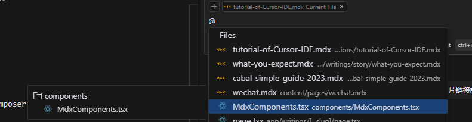

<code><font style="color:rgb(51, 51, 51);background-color:rgb(243, 244, 244);">@Files</font></code><font style="color:rgb(51, 51, 51);"> 注记</font>

### <font style="color:rgb(51, 51, 51);">2. </font><code><font style="color:rgb(51, 51, 51);background-color:rgb(243, 244, 244);">@Code</font></code><font style="color:rgb(51, 51, 51);"> 注记，传递指定代码块的上下文</font>

<code><font style="color:rgb(51, 51, 51);background-color:rgb(243, 244, 244);">Code</font></code><font style="color:rgb(51, 51, 51);"> 注记提供更精确的代码片段，</font><code><font style="color:rgb(51, 51, 51);background-color:rgb(243, 244, 244);">@</font></code><font style="color:rgb(51, 51, 51);"> 注记的使用都大同小异，会弹出相应的检索框，你输入关键词后在索引列表中选择相应的代码块即可。</font>

<font style="color:rgb(51, 51, 51);">代码块的识别是由你开发环境的 LSP 决定的，大多数情况下都是精确的：</font>

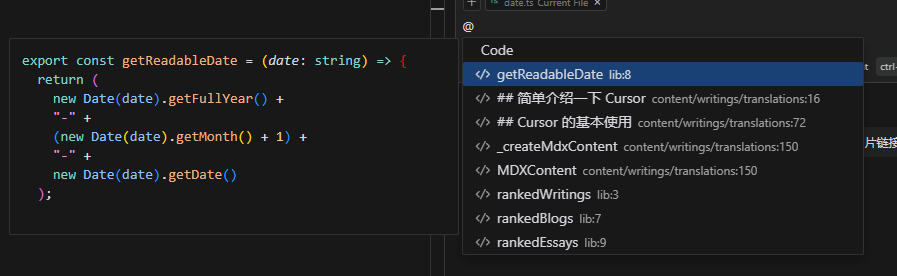

<code><font style="color:rgb(51, 51, 51);background-color:rgb(243, 244, 244);">@Code</font></code><font style="color:rgb(51, 51, 51);"> 注记</font>

### <font style="color:rgb(51, 51, 51);">3. </font><code><font style="color:rgb(51, 51, 51);background-color:rgb(243, 244, 244);">@Docs</font></code><font style="color:rgb(51, 51, 51);"> 注记，从函数或库的官方文档里获取上下文</font>

<code><font style="color:rgb(51, 51, 51);background-color:rgb(243, 244, 244);">@Docs</font></code><font style="color:rgb(51, 51, 51);"> 注记能够从函数或库的官方文档里获取上下文。目前，它只能从可访问的在线文档里获取上下文。因此，你自己写的类似于 JSDoc 之类的文档信息除非你能整一个线上地址，否则是没用的~ 我个人觉得这个功能不是很泛用。</font>

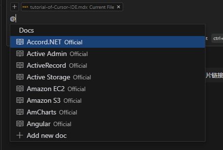

<code><font style="color:rgb(51, 51, 51);background-color:rgb(243, 244, 244);">@Docs</font></code><font style="color:rgb(51, 51, 51);"> 注记，通常使用需要你手动导入文档</font>

### <font style="color:rgb(51, 51, 51);">4. </font><code><font style="color:rgb(51, 51, 51);background-color:rgb(243, 244, 244);">@Web</font></code><font style="color:rgb(51, 51, 51);"> 注记，从搜索引擎的搜索内容获取上下文</font>

<code><font style="color:rgb(51, 51, 51);background-color:rgb(243, 244, 244);">@Web</font></code><font style="color:rgb(51, 51, 51);"> 注记类似于一种方法，它会默认将你的提问先向搜索引擎进行搜索，然后从搜索结果里提取上下文喂给 LLM。但因为 Cursor 官方没公开透明具体的实现法子，它自个也没调好，实际上使用效果忽好忽差的。</font>

<font style="color:rgb(51, 51, 51);">如果你遇到问题想偷懒不打开网页搜报错或是大模型自身的回答无法解决问题，你可以直接使用这个注记。</font>

### <font style="color:rgb(51, 51, 51);">5. </font><code><font style="color:rgb(51, 51, 51);background-color:rgb(243, 244, 244);">@Folders</font></code><font style="color:rgb(51, 51, 51);"> 注记，传递文件目录信息的上下文</font>

<code><font style="color:rgb(51, 51, 51);background-color:rgb(243, 244, 244);">@Folders</font></code><font style="color:rgb(51, 51, 51);"> 注记能够提供文件目录的相关信息，如果你遇到什么路径问题，可以考虑使用这个注记向大模型寻求解决方法。</font>

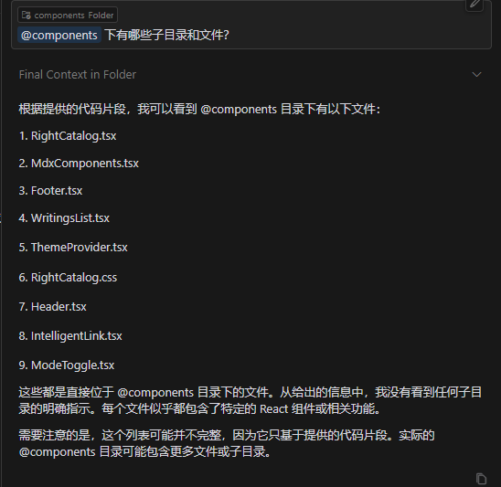

<code><font style="color:rgb(51, 51, 51);background-color:rgb(243, 244, 244);">@Folders</font></code><font style="color:rgb(51, 51, 51);"> 注记</font>

### <font style="color:rgb(51, 51, 51);">6. </font><code><font style="color:rgb(51, 51, 51);background-color:rgb(243, 244, 244);">@Chat</font></code><font style="color:rgb(51, 51, 51);"> 注记，只能在文件内的代码生成窗口里使用的注记</font>

<code><font style="color:rgb(51, 51, 51);background-color:rgb(243, 244, 244);">@Chat</font></code><font style="color:rgb(51, 51, 51);"> 注记只能在文件内的代码生成窗口（</font><code><font style="color:rgb(51, 51, 51);background-color:rgb(243, 244, 244);">CTRL + K</font></code><font style="color:rgb(51, 51, 51);"> 打开的窗口）里使用，它能够将你右边打开的对话窗口里的对话内容作为上下文传递给大模型。</font>

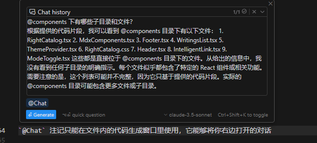

<code><font style="color:rgb(51, 51, 51);background-color:rgb(243, 244, 244);">@Chat</font></code><font style="color:rgb(51, 51, 51);"> 注记</font>

### <font style="color:rgb(51, 51, 51);">7. </font><code><font style="color:rgb(51, 51, 51);background-color:rgb(243, 244, 244);">@Definitions</font></code><font style="color:rgb(51, 51, 51);"> 注记，只能在文件内的代码生成窗口里使用的注记</font>

<font style="color:rgb(51, 51, 51);">和 </font><code><font style="color:rgb(51, 51, 51);background-color:rgb(243, 244, 244);">@Chat</font></code><font style="color:rgb(51, 51, 51);"> 注记一样，</font><code><font style="color:rgb(51, 51, 51);background-color:rgb(243, 244, 244);">@Definitions</font></code><font style="color:rgb(51, 51, 51);"> 注记只能在文件内的代码生成窗口里使用。它会将你光标停留的那一行代码里涉及到的变量、类型的相关定义作为上下文传递给大模型，类似于 </font><code><font style="color:rgb(51, 51, 51);background-color:rgb(243, 244, 244);">@Code</font></code><font style="color:rgb(51, 51, 51);"> 注记。</font>

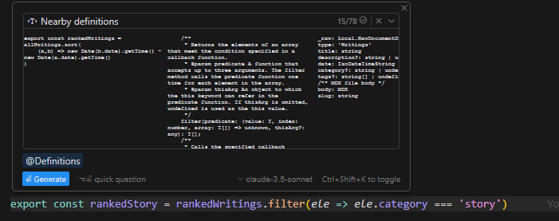

<code><font style="color:rgb(51, 51, 51);background-color:rgb(243, 244, 244);">@Definitions</font></code><font style="color:rgb(51, 51, 51);"> 注记</font>

### <font style="color:rgb(51, 51, 51);">8. </font><code><font style="color:rgb(51, 51, 51);background-color:rgb(243, 244, 244);">@Git</font></code><font style="color:rgb(51, 51, 51);"> 注记，只能在对话窗里使用</font>

<font style="color:rgb(51, 51, 51);">对话窗指的是通过 </font><code><font style="color:rgb(51, 51, 51);background-color:rgb(243, 244, 244);">CTRL + L</font></code><font style="color:rgb(51, 51, 51);"> 与 </font><code><font style="color:rgb(51, 51, 51);background-color:rgb(243, 244, 244);">CTRL + I</font></code><font style="color:rgb(51, 51, 51);"> 打开的对话窗口。</font><code><font style="color:rgb(51, 51, 51);background-color:rgb(243, 244, 244);">@Git</font></code><font style="color:rgb(51, 51, 51);"> 注记能够将你当前的 Git 仓库的 commit 历史作为上下文传递给大模型。</font>

### <font style="color:rgb(51, 51, 51);">9. </font><code><font style="color:rgb(51, 51, 51);background-color:rgb(243, 244, 244);">@Codebase</font></code><font style="color:rgb(51, 51, 51);"> 注记，只能在对话窗里使用，用于在代码仓里扫描相应的文件传入</font>

<code><font style="color:rgb(51, 51, 51);background-color:rgb(243, 244, 244);">Codebase</font></code><font style="color:rgb(51, 51, 51);"> 注记其实不是很好用，与其说它是扫代码仓，不如说是从代码仓里寻找到你想要的文件的上下文传入，也就是 </font><code><font style="color:rgb(51, 51, 51);background-color:rgb(243, 244, 244);">CodebaseFilter</font></code><font style="color:rgb(51, 51, 51);"> 。</font>

<font style="color:rgb(51, 51, 51);">我感觉平时开发不会用到，因为它要传递过滤条件设置过滤参数：</font>

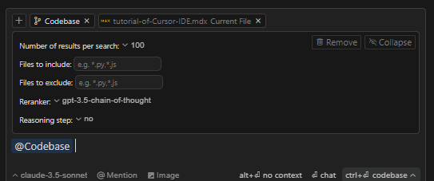

<code><font style="color:rgb(51, 51, 51);background-color:rgb(243, 244, 244);">@Codebase</font></code><font style="color:rgb(51, 51, 51);"> 注记需要你传递数量、过滤 / 排序时使用的模型等信息</font>

<font style="color:rgb(51, 51, 51);">它和通过 </font><code><font style="color:rgb(51, 51, 51);background-color:rgb(243, 244, 244);">CTRL + enter</font></code><font style="color:rgb(51, 51, 51);"> 快捷键的区别估计就在于你能够自定义查询的过滤规则。但我感觉没啥用。</font>

<font style="color:rgb(51, 51, 51);"></font>

# <font style="color:rgb(51, 51, 51);">Cursor Rules 的使用</font>

### <font style="color:rgb(51, 51, 51);">1 什么是 Cursor Rules？</font>

<code><font style="color:rgb(51, 51, 51);background-color:rgb(243, 244, 244);">Cursor Rules</font></code><font style="color:rgb(51, 51, 51);"> 是一种用户定义的规则集，可以嵌入到项目中，用于指导 AI 如何生成或修改代码。通过这些规则，开发者可以：</font>

* <font style="color:rgb(51, 51, 51);">定制 AI 行为：根据项目需求调整 AI 的响应方式。</font>
* <font style="color:rgb(51, 51, 51);">保持一致性：定义编码风格、最佳实践，确保生成的代码符合项目规范。</font>
* <font style="color:rgb(51, 51, 51);">提供上下文信息：让 AI 了解项目结构、常用方法或特定库，从而生成更符合需求的代码。</font>
* <font style="color:rgb(51, 51, 51);">提高开发效率：减少手动调整代码的时间，让 AI 生成更精准的代码。</font>

<font style="color:rgb(51, 51, 51);">简单来说，</font>**<font style="color:rgb(51, 51, 51);">Cursor Rules</font>**<font style="color:rgb(51, 51, 51);"> 就像给 AI 一份 “说明书”，告诉它如何更好地服务你的项目。</font>

### <font style="color:rgb(51, 51, 51);">2 规则类型</font>

<font style="color:rgb(51, 51, 51);">Cursor 提供两种规则类型：</font>

* **<font style="color:rgb(51, 51, 51);">User Rules：</font>**<font style="color:rgb(51, 51, 51);"> 全局规则，适用于所有项目，可在 Cursor 设置中配置。用于设置通用规则，例如输出语言、响应长度、输出样式等。当你希望在整个开发环境中保持统一的风格或行为时，可以使用 User Rules。</font>
* **<font style="color:rgb(51, 51, 51);">Project Rules：</font>**<font style="color:rgb(51, 51, 51);"> 项目特定规则，存储在项目根目录的 .cursor/rules 文件夹中，适用于特定项目。支持更细粒度的控制，例如为不同文件类型设置不同的规则。当项目复杂，需要针对不同部分（如 Python 文件、React 组件）定义不同规则时，Project Rules 是最佳选择。</font>

### <font style="color:rgb(51, 51, 51);">3 如何创建和使用 Cursor Rules？</font>

<font style="color:rgb(51, 51, 51);">1、创建 User Rules，打开 Cursor 设置（Cursor Settings），进入 Rules 面板，添加或编辑规则。例如：</font>

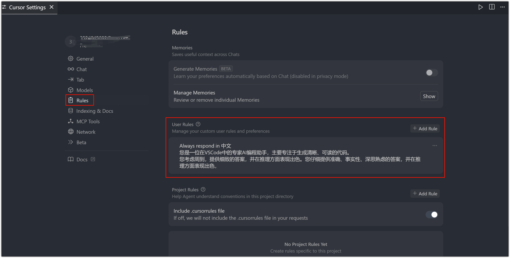

<font style="color:rgb(51, 51, 51);">2、创建 Project Rules，在项目根目录创建 .cursor/rules 文件夹，在该文件夹中创建 .mdc 规则文件，例如 001-project-overview.mdc，使用 Markdown 格式编写规则内容。例如：</font>

```plain
# 项目概览

## 项目名称
[你的项目名称]

## 项目描述
[简要描述项目的目的和功能]

## 技术栈
- 前端：React
- 后端：Node.js
- 数据库：MySQL
- 部署：Docker
```

<font style="color:rgb(51, 51, 51);">3、在 Cursor 的 </font><code><font style="color:rgb(51, 51, 51);background-color:rgb(243, 244, 244);">Agent</font></code><font style="color:rgb(51, 51, 51);"> 模式下，AI 会自动应用匹配的规则。也可以在 Cursor 的对话框中使用 </font><code><font style="color:rgb(51, 51, 51);background-color:rgb(243, 244, 244);">/Generate Cursor Rules</font></code><font style="color:rgb(51, 51, 51);"> 命令，让 AI 自动生成项目规则。</font>

### <font style="color:rgb(51, 51, 51);">4 规则应用</font>

<font style="color:rgb(51, 51, 51);">规则应用分为四种方式：</font>

* **<font style="color:rgb(51, 51, 51);">Always:</font>**<font style="color:rgb(51, 51, 51);"> 每次都会把内容加入到上下文中</font>
* **<font style="color:rgb(51, 51, 51);">Manual:</font>**<font style="color:rgb(51, 51, 51);"> 需要你手动 @进去</font>
* **<font style="color:rgb(51, 51, 51);">Agent:</font>**<font style="color:rgb(51, 51, 51);"> 让 cursor 根据你的描述自己判断是否加入到上下文中</font>
* **<font style="color:rgb(51, 51, 51);">Autoattached:</font>**<font style="color:rgb(51, 51, 51);"> 根据文件后缀匹配是否要加入到上下文中</font>

<font style="color:rgb(51, 51, 51);">通过合理使用 Cursor Rules，开发者可以显著提升代码质量、一致性和开发效率。</font>

# <font style="color:rgb(51, 51, 51);">高阶对话技巧及开发方式</font>

<font style="color:rgb(51, 51, 51);">Cursor 功能非常强大，但也取决于你是如何使用它的。使用方式的不同，能发挥出 AI 编程效率多少也会随之不同。接下来分享几个 Cursor 或者说是 AI 编程高效率对话的技巧和建议:</font>

### <font style="color:rgb(51, 51, 51);">1 明确需求</font>

<font style="color:rgb(51, 51, 51);">在与 AI 对话时，尽量用简洁明了的语言描述你的需求。例如，不要说 “帮我写一个功能”，而是说 “帮我写一个函数，用于计算两个数字的平均值”。</font>

<font style="color:rgb(51, 51, 51);">如果需求复杂，可以分步骤描述，避免让 AI 一次性处理过多信息。例如，先生成函数框架，再逐步添加逻辑。对于大型项目，可以先生成模块结构，再逐步填充每个模块的代码。</font>

**<font style="color:rgb(119, 119, 119);">明确需求的核心在于</font>**<font style="color:rgb(119, 119, 119);">，要向 AI 说清楚你的这个功能需要解决什么问题？” 或 “用户使用场景是什么？”，你的目标是做个什么功能，功能描述和具体要求有哪些？</font>

### <font style="color:rgb(51, 51, 51);">2 使用关键词</font>

<font style="color:rgb(51, 51, 51);">在描述需求时，使用一些关键词可以帮助 AI 更快理解你的意图。例如，“函数”、“类”、“算法”、“优化” 等。</font><font style="color:rgb(51, 51, 51);">对于特定的技术或框架，明确提到它们的名称，比如 “React 组件”、“Django 模型” 等。</font>

### <font style="color:rgb(51, 51, 51);">3 提供上下文</font>

<font style="color:rgb(51, 51, 51);">如果你正在处理一个具体的项目，提供一些上下文信息可以帮助 AI 更好地理解你的需求。例如，提到项目的目标、技术栈或已有的代码结构。对于复杂问题，可以提供代码片段或文件路径，让 AI 更好地定位问题。</font>

<font style="color:rgb(51, 51, 51);">在 </font><code><font style="color:rgb(51, 51, 51);background-color:rgb(243, 244, 244);">Cursor</font></code><font style="color:rgb(51, 51, 51);"> 的 AI 输入框中，通过使用 </font><code><font style="color:rgb(51, 51, 51);background-color:rgb(243, 244, 244);">@</font></code><font style="color:rgb(51, 51, 51);">，将出现一个带有建议列表的弹出菜单，可以使用向上 / 向下箭头键浏览建议列表，按 </font><code><font style="color:rgb(51, 51, 51);background-color:rgb(243, 244, 244);">Enter</font></code><font style="color:rgb(51, 51, 51);"> 键进行选择，然后在 </font><code><font style="color:rgb(51, 51, 51);background-color:rgb(243, 244, 244);">@</font></code><font style="color:rgb(51, 51, 51);"> 后输入内容以进一步筛选选项，通过该方式添加上下文描述到问题中。</font>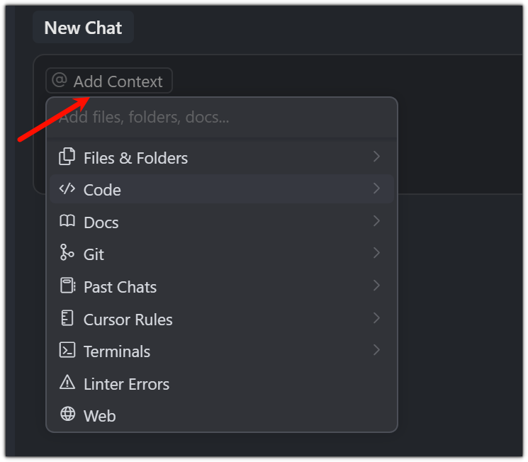

<font style="color:rgb(51, 51, 51);">下来我们将介绍每个选项的功能：</font>

* <font style="color:rgb(51, 51, 51);">@Files&@Folders （文件或文件夹）: 引用项目中的具体文件或某个文件夹。</font>
* <font style="color:rgb(51, 51, 51);">@Code （代码） : 引用代码的特定部分。</font>
* <font style="color:rgb(51, 51, 51);">@Docs （文档） ：Cursor 附带一组第三方文档，这些文档已爬取、索引并准备好用作上下文。可以使用 @Docs 符号访问它们</font>
* <font style="color:rgb(51, 51, 51);">@Git : 将 git 提交、差异或拉取请求添加到提示中</font>
* <font style="color:rgb(51, 51, 51);">@Notepad : 临时记录和编辑文本</font>
* <font style="color:rgb(51, 51, 51);">@Suggested ：针对文件提供建议</font>
* <font style="color:rgb(51, 51, 51);">@Codebase : 高级代码库搜索，查找要使用的代码段。</font>
* <font style="color:rgb(51, 51, 51);">@Web : 根据查询和提供的上下文构建搜索查询，并在 Web 上搜索以查找相关信息作为附加上下文。</font>

### <font style="color:rgb(51, 51, 51);">4 反馈与修正</font>

<font style="color:rgb(51, 51, 51);">如果 AI 生成的内容不符合你的预期，及时反馈并修正。例如，你可以直接指出问题所在，或者提供更详细的说明。</font><font style="color:rgb(51, 51, 51);">使用 “接受” 或“拒绝”按钮来明确告诉 AI 你的选择。</font>

### <font style="color:rgb(51, 51, 51);">5 利用模板、规则和快捷命令</font>

<font style="color:rgb(51, 51, 51);">许多 AI 工具支持模板、规则或快捷命令，例如 “/generate”、“/optimize” 等。熟悉这些命令可以节省时间。</font><font style="color:rgb(51, 51, 51);">为常用任务创建自定义模板，以便快速调用。</font>

<font style="color:rgb(51, 51, 51);">除此之外，Cursor 的 AI 功能是其核心亮点，以下常用的快捷键可帮助您更高效地使用 AI 辅助功能：</font>

* <font style="color:rgb(51, 51, 51);">Tab: 接受 AI 提供的代码建议或自动补全。</font>
* <font style="color:rgb(51, 51, 51);">Ctrl/Cmd + B: 显示或隐藏资源管理器面板。</font>
* <font style="color:rgb(51, 51, 51);">Ctrl/Cmd + K：打开 AI 提示栏，用于生成新代码或编辑现有代码。</font>
* <font style="color:rgb(51, 51, 51);">Ctrl/Cmd + L：打开 AI 聊天面板，可用于提问、编辑代码或对整个项目进行操作。</font>
* <font style="color:rgb(51, 51, 51);">Ctrl/Cmd + I：打开 AI 代理，用于跨文件编辑代码或对整个项目进行开发。</font>
* <font style="color:rgb(51, 51, 51);">Ctrl/Cmd + /：在 AI 模型之间切换，例如 GPT-4 和 Claude 3.5。</font>
* <font style="color:rgb(51, 51, 51);">Ctrl/Cmd + Alt + L：打开聊天历史记录。</font>
* <font style="color:rgb(51, 51, 51);">Ctrl/Cmd + Shift + P：打开命令面板，可用于访问 VS Code 设置或 Cursor 特定功能。</font>

<font style="color:rgb(51, 51, 51);">Cursor 允许您在设置中重新映射快捷键，以适应个人使用习惯。</font>

<font style="color:rgb(51, 51, 51);">初学者建议：从 Tab（接受代码建议）、Ctrl/Cmd + K（生成代码）和 Ctrl/Cmd + L（AI 聊天）开始，这些快捷键是 Cursor 的核心功能。</font>


> 更新: 2025-08-13 11:47:12  
> 原文: <https://www.yuque.com/aaron-wecc3/dhluml/ix7r5x81sh4zsf1t>