# 165.Cursor提效应用场景实战

## 示例代码

[cursor-demo.zip](https://www.yuque.com/attachments/yuque/0/2025/zip/2424104/1755056832645-a93b71e5-f580-4b86-b206-9c96aa72243a.zip)

## <font style="color:rgb(51, 51, 51);">常用提效功能与配置</font>

### <font style="color:rgb(51, 51, 51);">界面布局介绍</font>

<font style="color:rgb(51, 51, 51);">如果你使用过 </font>[<font style="color:rgb(65, 131, 196);">VScode</font>](https://zhida.zhihu.com/search?content_id=254619980\&content_type=Article\&match_order=1\&q=VScode\&zhida_source=entity)<font style="color:rgb(51, 51, 51);"> 编程，那么你应该很熟悉这个界面，因为它就是 VScode 界面； </font>

<font style="color:rgb(51, 51, 51);">但如果你和我一样是小白，只为提高工作效率，那么接下来的比喻可能辅助你理解：想象一下你正在一个设备齐全的厨房做菜。Cursor 的界面布局也是这样科学合理： </font>

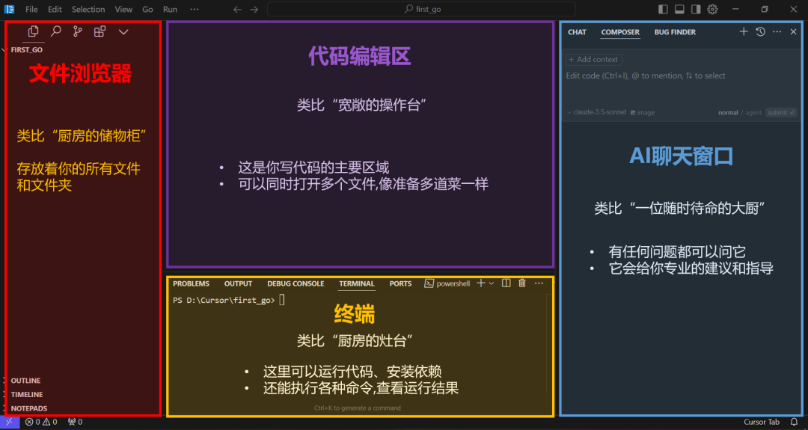

### <font style="color:rgb(51, 51, 51);">中文模式设置</font>

<font style="color:rgb(51, 51, 51);">作为小白使用者，看到一堆英文确实有点懵（什么乱七八糟的 hhh）。别担心！那我们先把界面改成中文: </font>

```
1. <font style="color:rgb(51, 51, 51);">下载中文包</font>
2. <font style="color:rgb(51, 51, 51);">按下 Ctrl + Shift + P(Mac 是 Command + Shift + P)</font>
3. <font style="color:rgb(51, 51, 51);">输入 "language"→ 选择 "Configure Display Language"→ 选择 "中文 (简体)"</font>
4. <font style="color:rgb(51, 51, 51);">重启 Cursor，界面就变成中文啦！（怒赞！）</font>
```

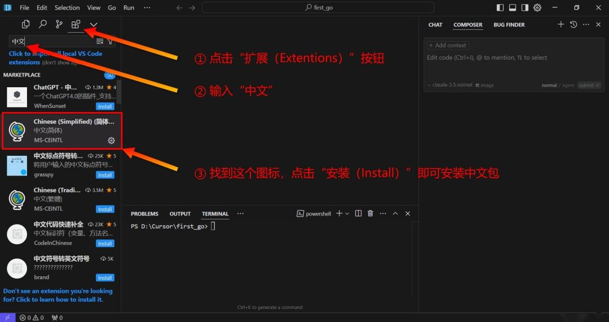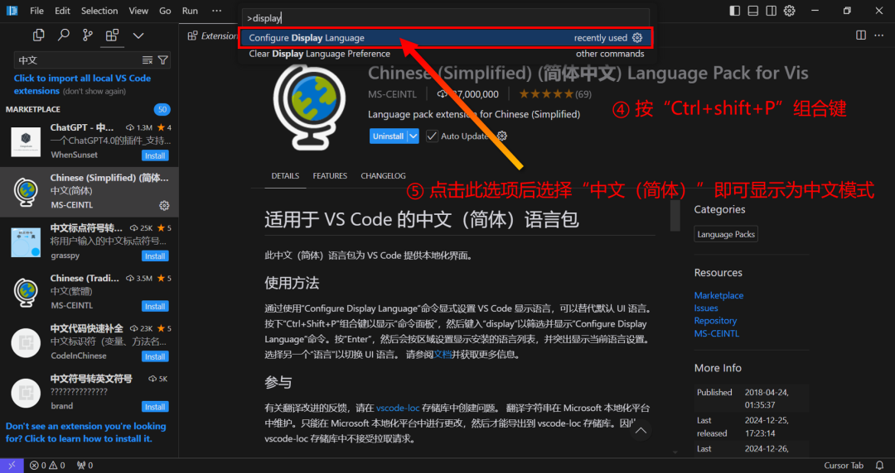

### <font style="color:rgb(51, 51, 51);">YOLO 模式</font>

<font style="color:rgb(51, 51, 51);">YOLO 模式是 Cursor 的一个特色功能，它能让 AI 更大胆地帮你写代码。开启后: </font>

* <font style="color:rgb(51, 51, 51);">AI 会更主动地提供完整的代码建议；</font>
* <font style="color:rgb(51, 51, 51);">生成的代码更符合实际应用场景；</font>
* <font style="color:rgb(51, 51, 51);">特别适合初学者快速上手和学习（我一般是开启的，因为俺是小白~）</font>

<font style="color:rgb(51, 51, 51);">建议新手都开启这个模式，让 AI 成为你更得力的助手！开启方法很简单: </font>

```
1. <font style="color:rgb(51, 51, 51);">点击右上角的设置图标</font>
2. <font style="color:rgb(51, 51, 51);">找到 "实验性功能（Features）"</font>
3. <font style="color:rgb(51, 51, 51);">打开 "YOLO 模式" 开关即可</font>
```

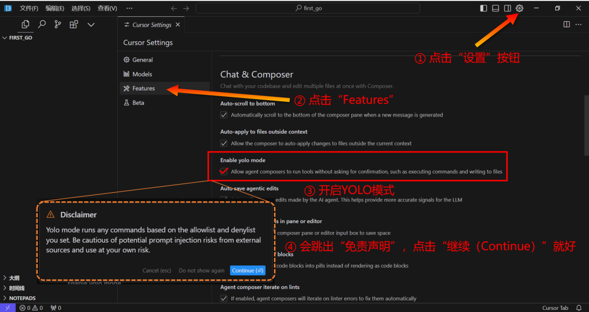

### <font style="color:rgb(51, 51, 51);">功能窗口区别</font>

<font style="color:rgb(51, 51, 51);">Cursor 提供了多种与 AI 交互的方式, 让我们来了解一下它们的区别: </font>

<font style="color:rgb(51, 51, 51);">Chat 窗口 vs Composer 窗口 </font>

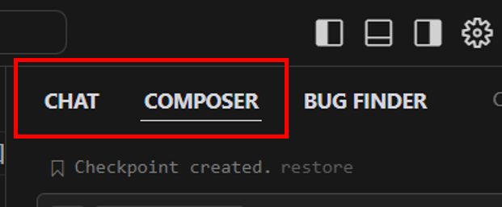

<font style="color:rgb(51, 51, 51);">像</font>**<font style="color:rgb(51, 51, 51);">聊天</font>**<font style="color:rgb(51, 51, 51);">一样自由对话</font>

**<font style="color:rgb(51, 51, 51);">直接</font>**<font style="color:rgb(51, 51, 51);">在代码中进行 </font>**<font style="color:rgb(51, 51, 51);">AI</font>\*\*\*\*<font style="color:rgb(51, 51, 51);">编辑</font>**

<font style="color:rgb(51, 51, 51);">Normal 模式 vs Agent 模式 </font>

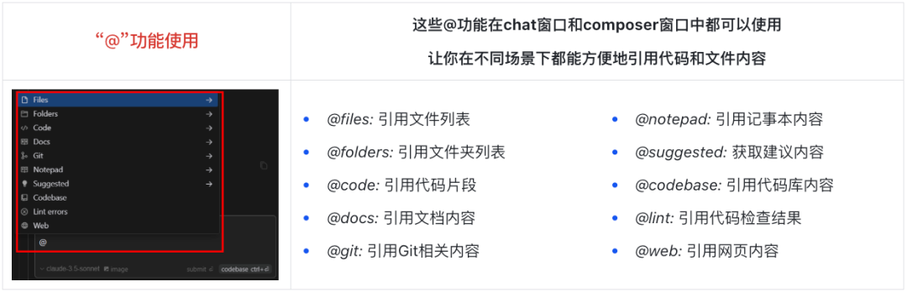

<font style="color:rgb(51, 51, 51);">我常常使用 @功能就是把一堆看不懂的文献、或者看不懂的代码文件，都存放到一个文件夹下，然后 @codebase，这个工具就会自动的识别该文件夹目录下的所有文件了，不用我一个一个导入让 AI“看” 了，而是相当于一键指定了它需要看的内容！ </font>

### <font style="color:rgb(51, 51, 51);">选择 AI 大模型</font>

<font style="color:rgb(51, 51, 51);">由于 Cursor 工具嵌入了很多模型，包括 deepseek、gpt、claude、gemini 等等，选择自己喜欢的模型就行。（一般来说，claude 在写代码方面要优一些，然后 deepseek 会在讨论方面会更好一点） </font>

<font style="color:rgb(51, 51, 51);">而软件也在更新，有时候会接入一些新的模型，比如近期接入了 “deepseek r1”，就可以把它勾选上，这样新的模型就可以为我们服务啦！！ </font>

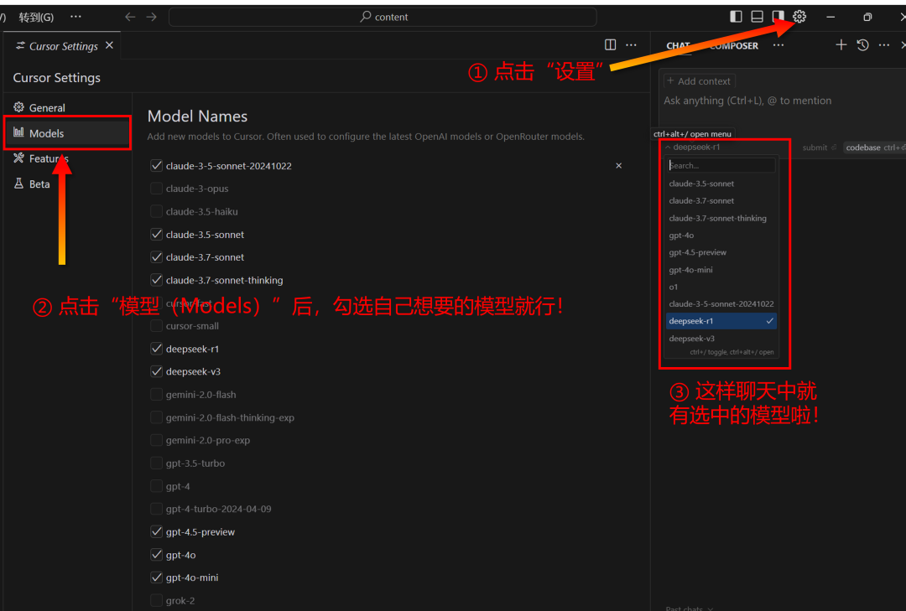

### <font style="color:rgb(51, 51, 51);">基本操作入门</font>

* <font style="color:rgb(51, 51, 51);">创建新项目：点击左上角的 "文件" → "新建文件"</font>
* <font style="color:rgb(51, 51, 51);">基本代码编辑：像写文字一样直接输入</font>
* <font style="color:rgb(51, 51, 51);">AI 代码补全：输入时会自动弹出建议</font>
* <font style="color:rgb(51, 51, 51);">实时错误提示：有错误会自动标红提醒</font>
* <font style="color:rgb(51, 51, 51);">……（You can do what you want）</font>

### <font style="color:rgb(51, 51, 51);">代码补全尝试</font>

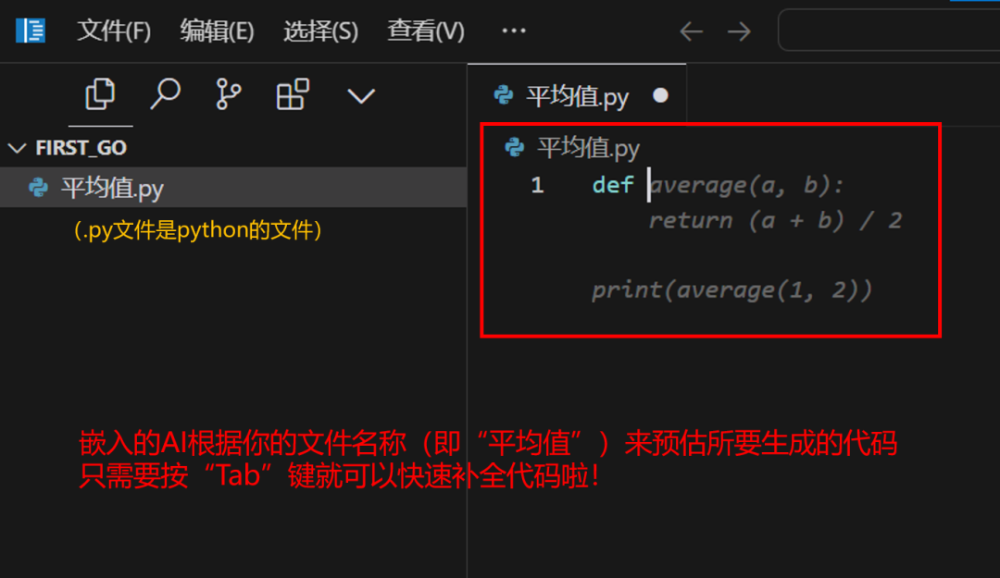

### <font style="color:rgb(51, 51, 51);">文章生成尝试（类似 </font>[<font style="color:rgb(65, 131, 196);">ChatGPT</font>](https://zhida.zhihu.com/search?content_id=254619980\&content_type=Article\&match_order=1\&q=ChatGPT\&zhida_source=entity)<font style="color:rgb(51, 51, 51);">）</font>

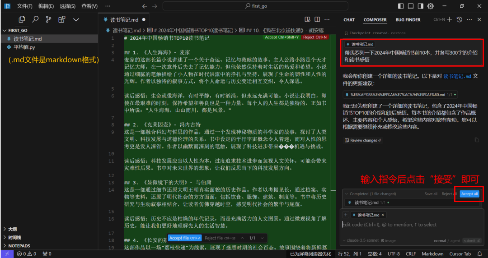

### <font style="color:rgb(51, 51, 51);">一句话生成网页</font>

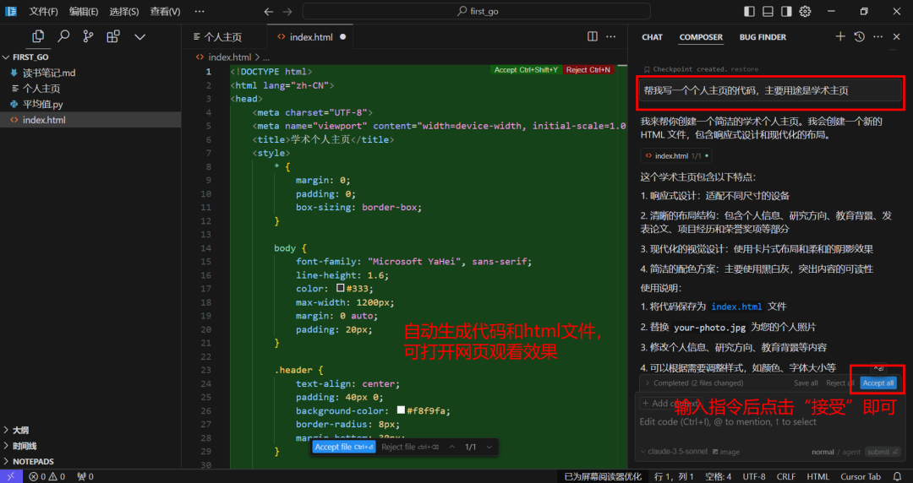

<font style="color:rgb(51, 51, 51);">小贴士：不要被这些功能吓到！就像学做菜一样，从最简单的开始，慢慢就会熟练起来啦！ </font>

### <font style="color:rgb(51, 51, 51);">快捷键</font>

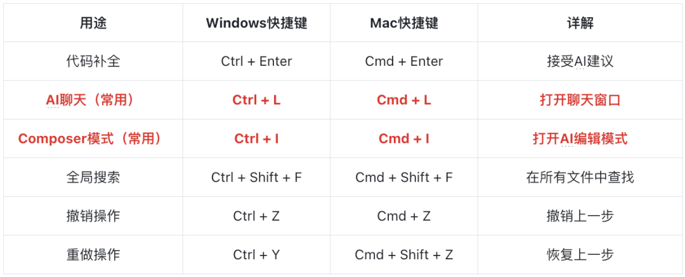

<font style="color:rgb(51, 51, 51);">提示：可以点击左上角 "文件" → "首选项" → "键盘快捷方式" 来查看完整的快捷键列表 </font>

## <font style="color:rgb(51, 51, 51);">AI 提效应用场景实战</font>

### <font style="color:rgb(51, 51, 51);">文献阅读</font>

* <font style="color:rgb(51, 51, 51);">PDF 文档导入功能</font>
* <font style="color:rgb(51, 51, 51);">智能文本解析</font>
* <font style="color:rgb(51, 51, 51);">关键信息提取</font>

<code><font style="color:rgb(51, 51, 51);background-color:rgb(243, 244, 244);">我想写一个文献阅读梳理，请帮我阅读这篇文献，然后告诉我主要讲了什么</font></code>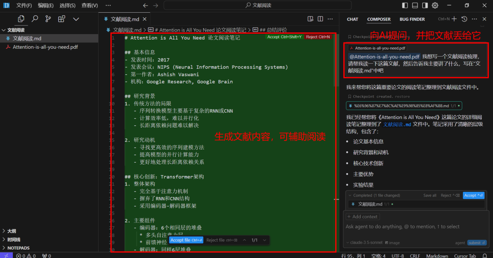

### <font style="color:rgb(51, 51, 51);">视频选题推荐</font>

* <font style="color:rgb(51, 51, 51);">基于兴趣的主题推荐</font>
* <font style="color:rgb(51, 51, 51);">热点话题分析</font>
* <font style="color:rgb(51, 51, 51);">研究方向建议</font>

<code><font style="color:rgb(51, 51, 51);background-color:rgb(243, 244, 244);">我是一个AI视频博主，想做一期文生视频和图生视频的选题，请帮我想5个方向。</font></code>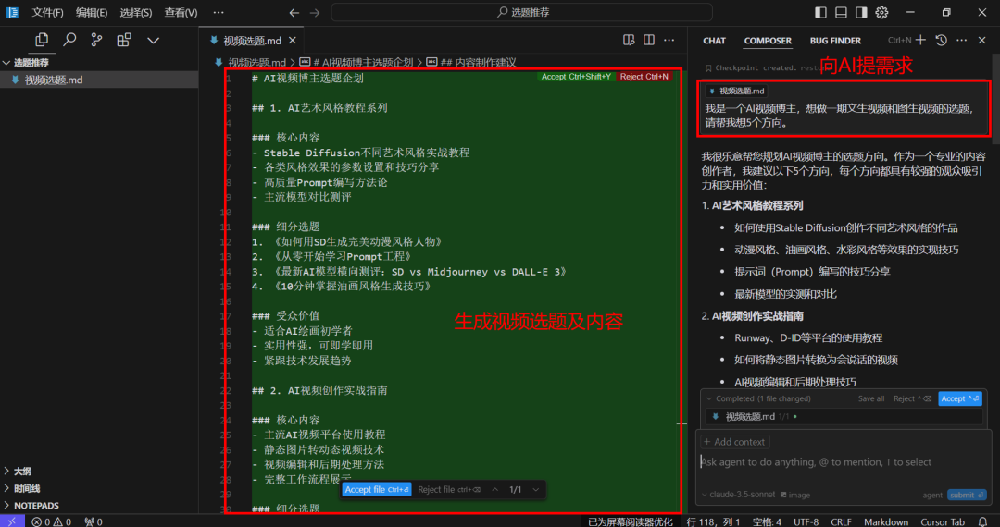

### <font style="color:rgb(51, 51, 51);">生成大纲</font>

* <font style="color:rgb(51, 51, 51);">智能大纲生成</font>
* <font style="color:rgb(51, 51, 51);">结构优化建议</font>
* <font style="color:rgb(51, 51, 51);">逻辑关系分析</font>

<code><font style="color:rgb(51, 51, 51);background-color:rgb(243, 244, 244);">我想让小学生也能快速制作海报（文生图）的一些工具和方法，请帮我生成大纲</font></code>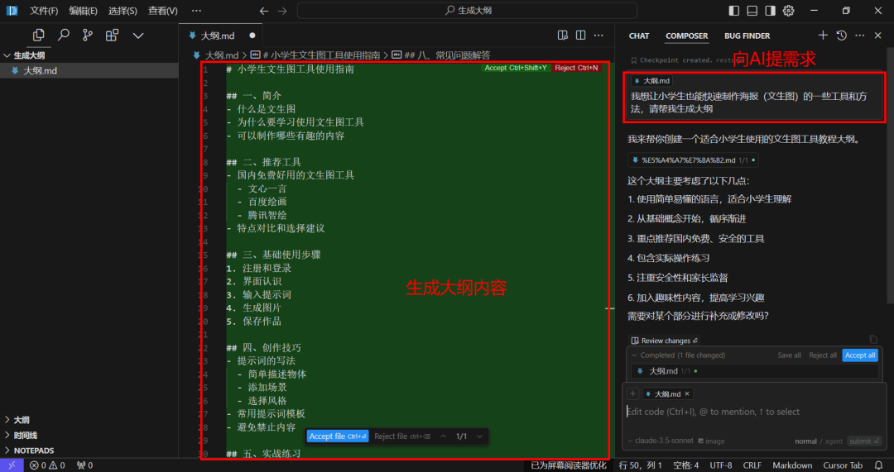

### <font style="color:rgb(51, 51, 51);">写作相关</font>

#### <font style="color:rgb(51, 51, 51);">辅助写作（带有 AI 功能的 word 文档）</font>

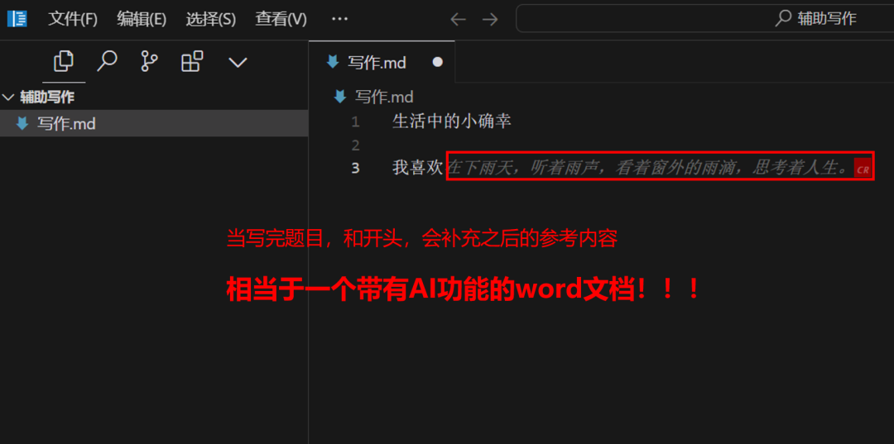

#### <font style="color:rgb(51, 51, 51);">续写和扩写内容</font>

<code><font style="color:rgb(51, 51, 51);background-color:rgb(243, 244, 244);">请帮我写一篇《生活中的小确幸》文章，包含亲情、友情、爱情的小事情，800字。</font></code>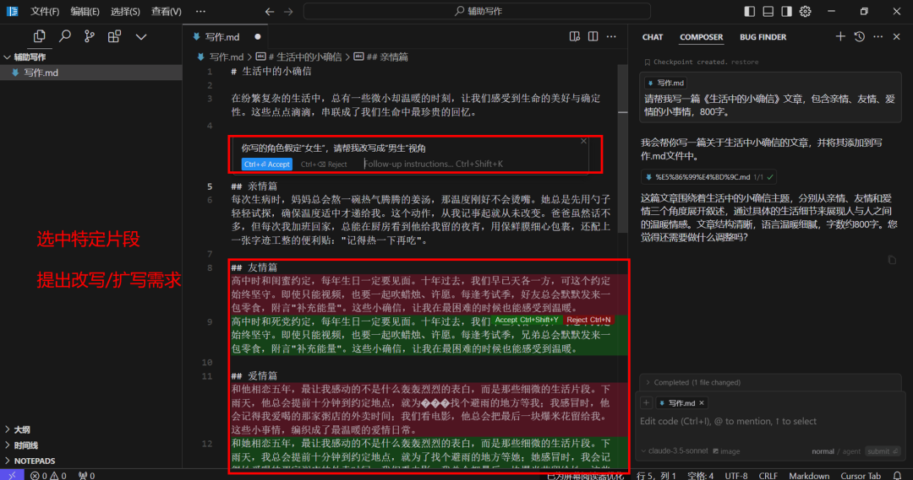

#### <font style="color:rgb(51, 51, 51);">改写语言风格（文言文）</font>

<code><font style="color:rgb(51, 51, 51);background-color:rgb(243, 244, 244);">帮我改写成文言文的风格</font></code>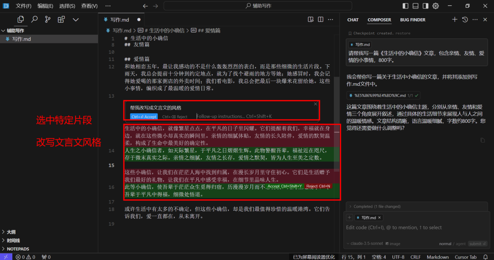

#### <font style="color:rgb(51, 51, 51);">翻译</font>

<font style="color:rgb(51, 51, 51);">对比其他的翻译工具，可实现逐句翻译对照（这一点很爽！！！逐句对照！写论文友好！）。 </font>

<code><font style="color:rgb(51, 51, 51);background-color:rgb(243, 244, 244);">帮我翻译成英文</font></code>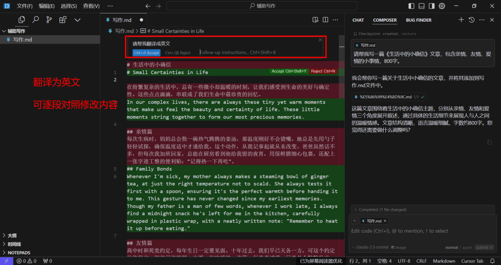

### <font style="color:rgb(51, 51, 51);">储存文档历史</font>

***

* <font style="color:rgb(51, 51, 51);">版本控制</font>
* <font style="color:rgb(51, 51, 51);">修改记录</font>
* <font style="color:rgb(51, 51, 51);">协作管理</font>

<font style="color:rgb(51, 51, 51);">点击 “时间线”，会查看到历史修改的记录，可帮助我们更好的优化内容！ </font>

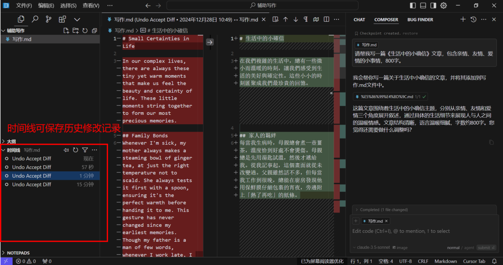

### <font style="color:rgb(51, 51, 51);">数据分析与可视化</font>

#### <font style="color:rgb(51, 51, 51);">提数据分析需求</font>

<code><font style="color:rgb(51, 51, 51);background-color:rgb(243, 244, 244);">我现在有关于银行客户的数据样例，主要想做“银行信用：对银行客户的评分判别”分析，请帮我生成python代码并且分析</font></code>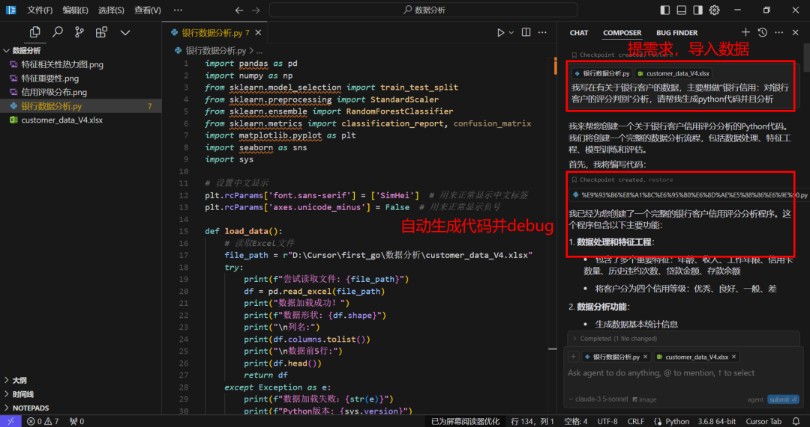

#### <font style="color:rgb(51, 51, 51);">AI 编写代码与运行</font>

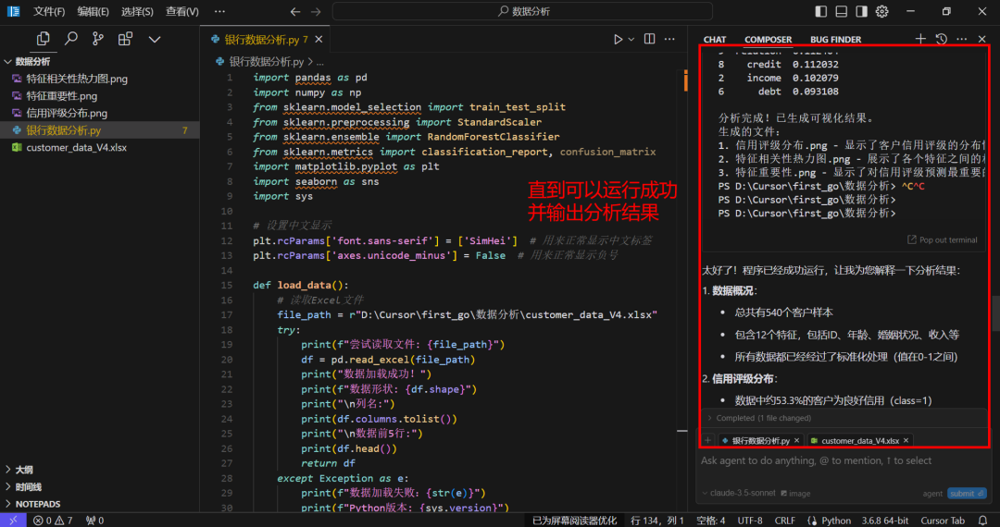

#### <font style="color:rgb(51, 51, 51);">结果分析与可视化</font>

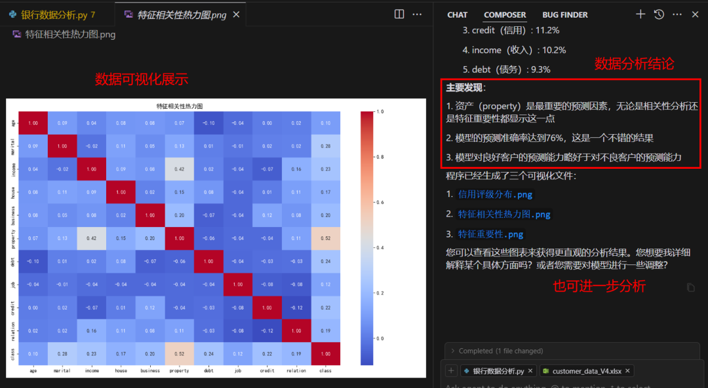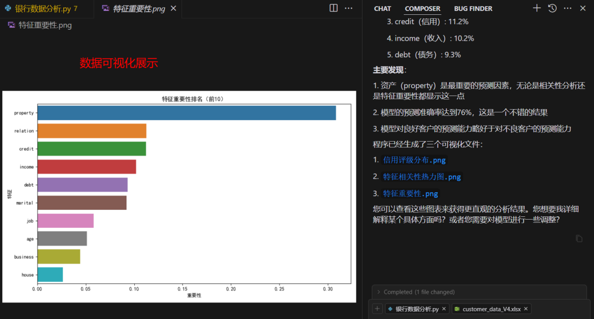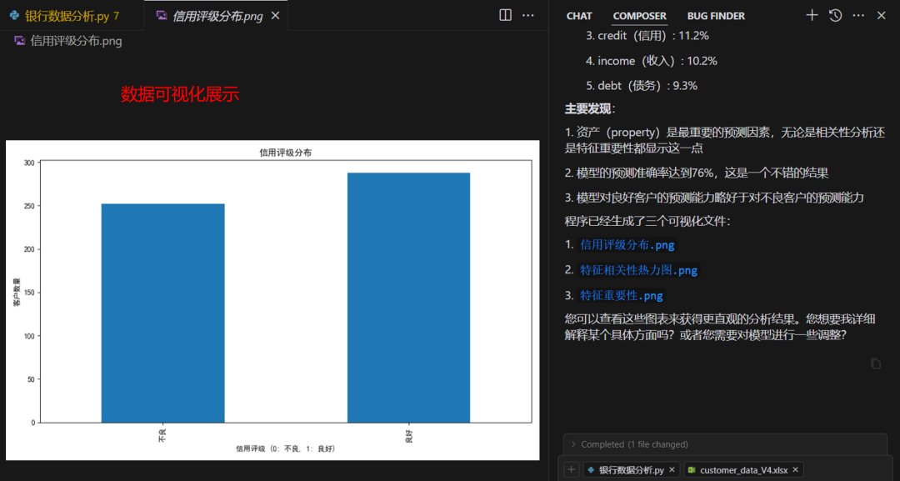

### <font style="color:rgb(51, 51, 51);">Deepseek + Cursor 科研神器</font>


<font style="color:rgb(51, 51, 51);">分享一个用 Cursor 使用 Deepseek 的科研小技巧，可能不需要在多个 AI 平台来回切换了，直接在这个平台就可以进行。我平常会使用 chat 功能（deepseek r1 模型）来讨论，讨论需求、讨论选题、头脑风暴... 然后使用 composer 模式让它基于讨论的内容去生成、执行、写 python 代码、写 md 文档，科研 yyds！解放生产力！ </font>

<font style="color:rgb(51, 51, 51);">还记得我们最开始怎么做科研的吗？（在没有 AI 之前） </font>

<font style="color:rgb(51, 51, 51);">可能是需要人工看大量的文献，来总结时间线、归纳文献综述、总结 research gap 等等；还需要从 </font>[<font style="color:rgb(65, 131, 196);">GitHub</font>](https://zhida.zhihu.com/search?content_id=254619980\&content_type=Article\&match_order=1\&q=GitHub\&zhida_source=entity)<font style="color:rgb(51, 51, 51);">、</font>[<font style="color:rgb(65, 131, 196);">csdn</font>](https://zhida.zhihu.com/search?content_id=254619980\&content_type=Article\&match_order=1\&q=csdn\&zhida_source=entity)<font style="color:rgb(51, 51, 51);"> 等等平台参考代码、反复调试、然后报错、然后不气馁、然后跑通（开心）。现在有了 AI 工具善用它，确实可以提高我们的效率，然后更专注于 “创造性” 层面的事情！ </font>

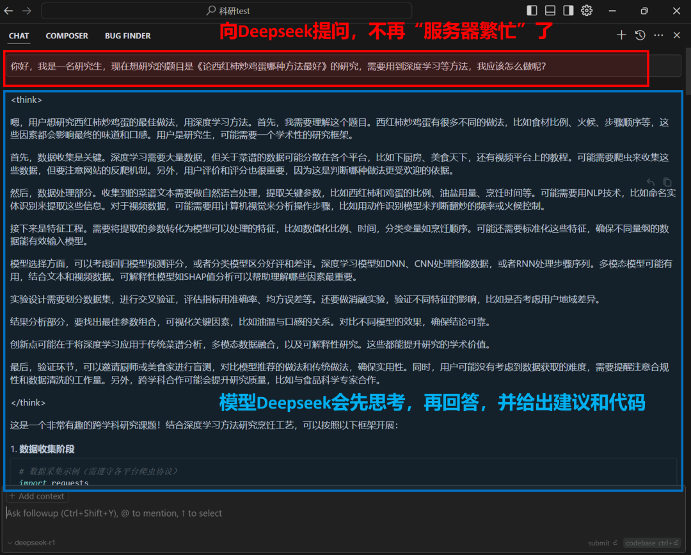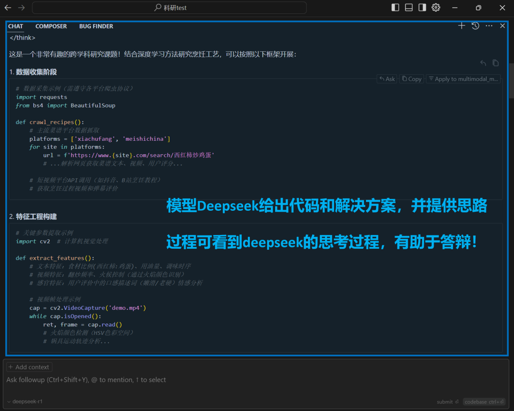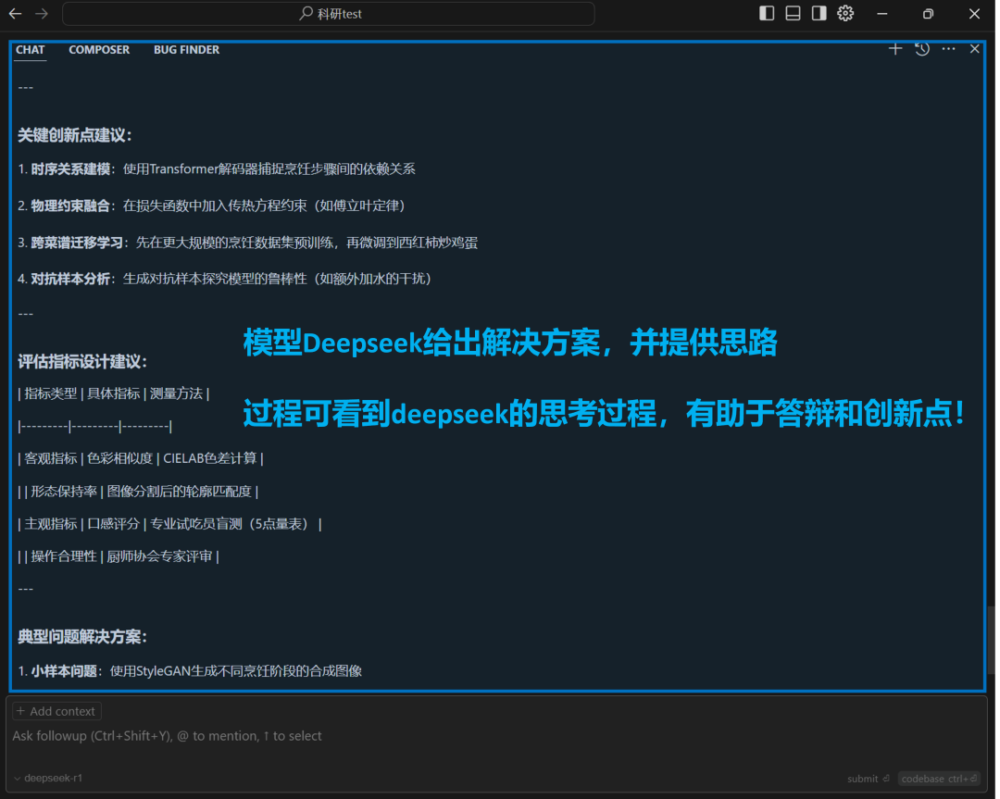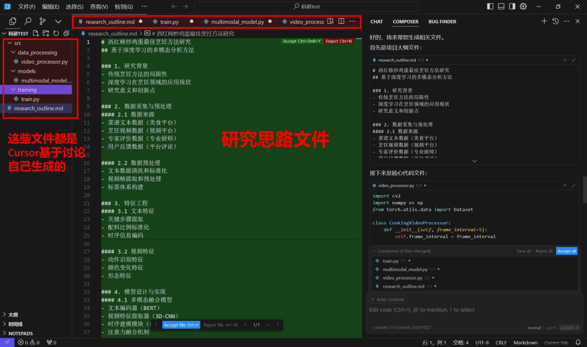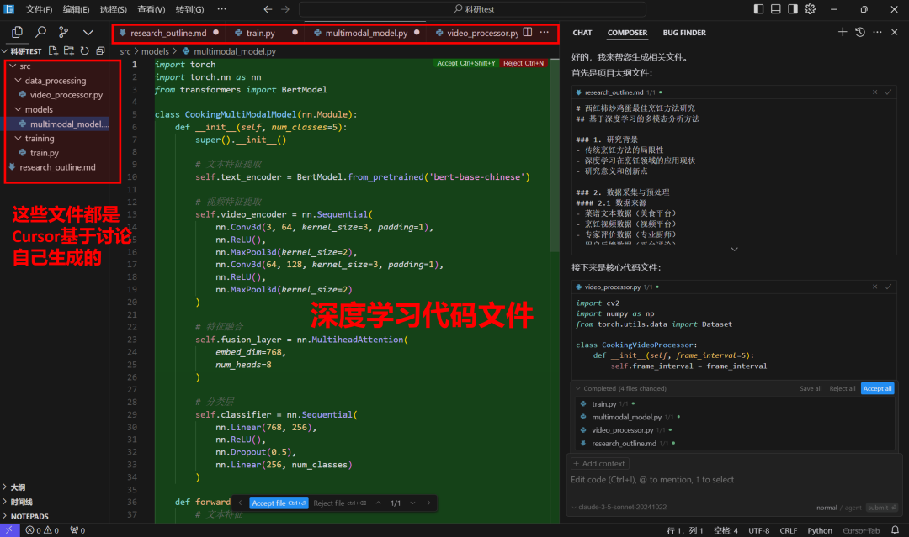

### <font style="color:rgb(51, 51, 51);">个人网站快速开发</font>

#### <font style="color:rgb(51, 51, 51);">明确的需求</font>

<font style="color:rgb(51, 51, 51);">把我们的需求复制给 Cursor，它就能自动帮我们生成完整的网页代码（包含 HTML/CSS/JS 文件） </font>

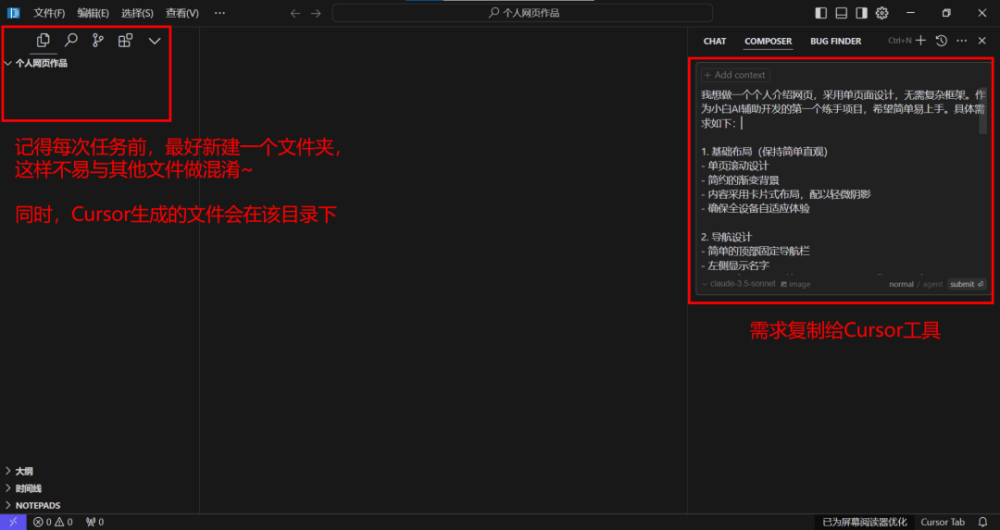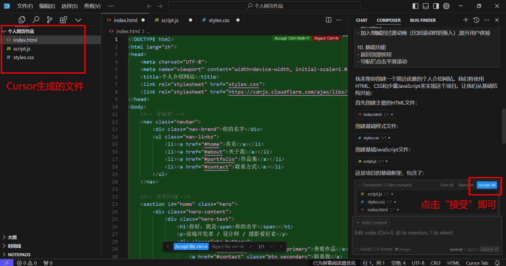

#### <font style="color:rgb(51, 51, 51);">个性化调整</font>

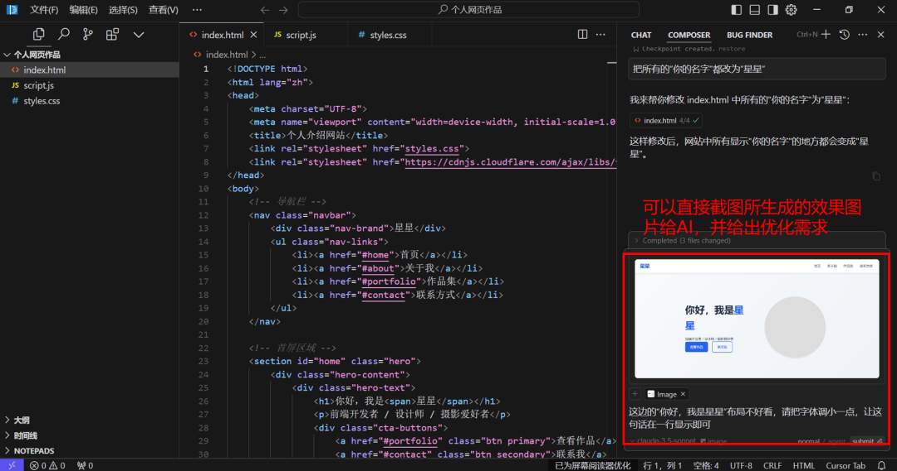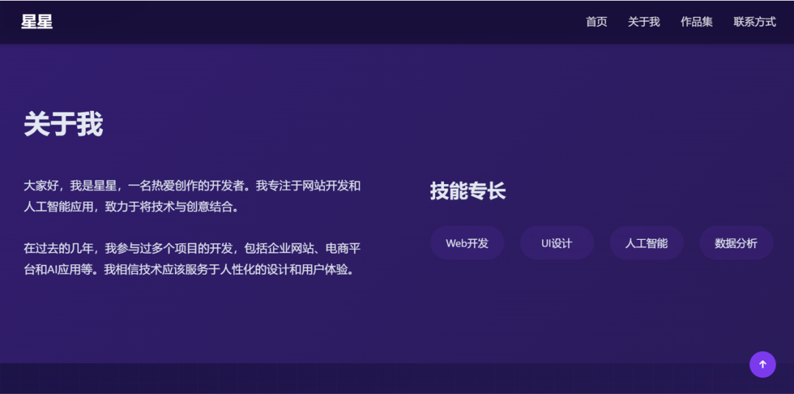

### <font style="color:rgb(51, 51, 51);">其他提效场景（多多探索 and 尝试）</font>

* <font style="color:rgb(51, 51, 51);">撰写 PRD（产品需求文档），理清楚思路</font>
* <font style="color:rgb(51, 51, 51);">绘画 PRD 示意图、动态效果直接展示给后端开发者，减少沟通成本</font>
* <font style="color:rgb(51, 51, 51);">开发浏览器插件，可以自己 diy 一些小东西（比如视频字幕提取、视频总结等插件）</font>
* <font style="color:rgb(51, 51, 51);">Web 网页应用（可以与商家合作）</font>
* <font style="color:rgb(51, 51, 51);">......</font>

<font style="color:rgb(51, 51, 51);">小贴士：遇到困难时不要灰心，学会善用 AI 助手，AI 工具真的很高效！！作为小白，也可以多用用不同的工具，看看哪个适合自己，自己会在哪些场景下使用，来回切换几个不同的工具，每个工具可能也有侧重点，用它！ </font>


> 更新: 2025-08-13 11:47:12  
> 原文: <https://www.yuque.com/aaron-wecc3/dhluml/ye7yv4wgk49bya33>