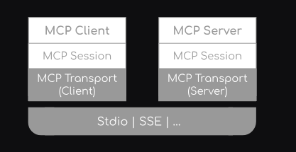
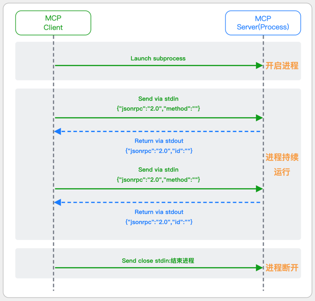
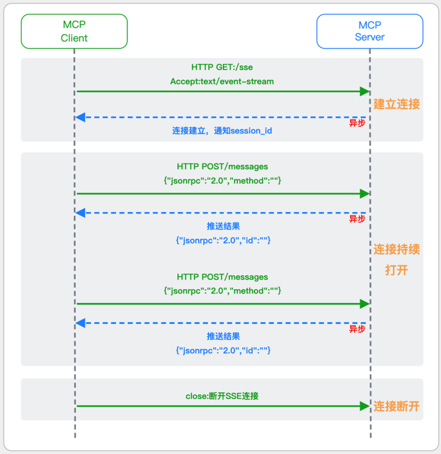
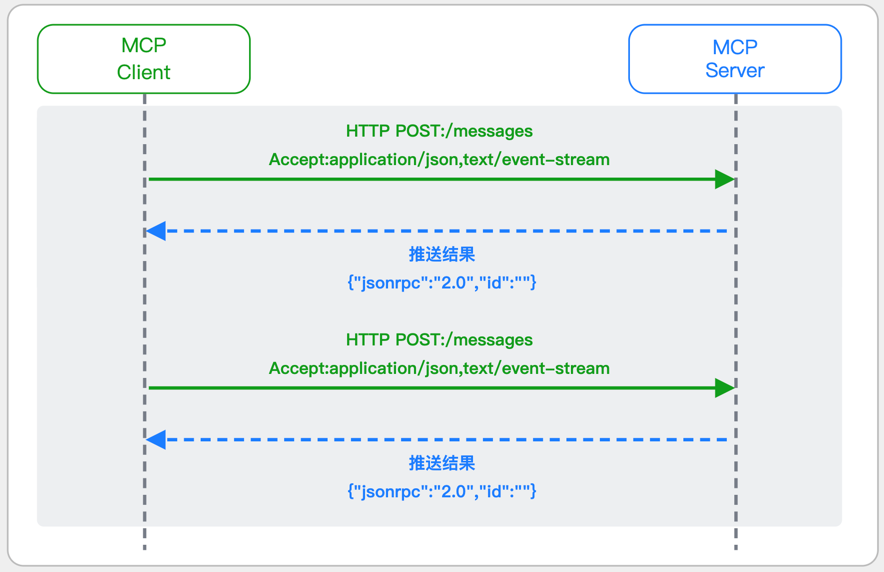
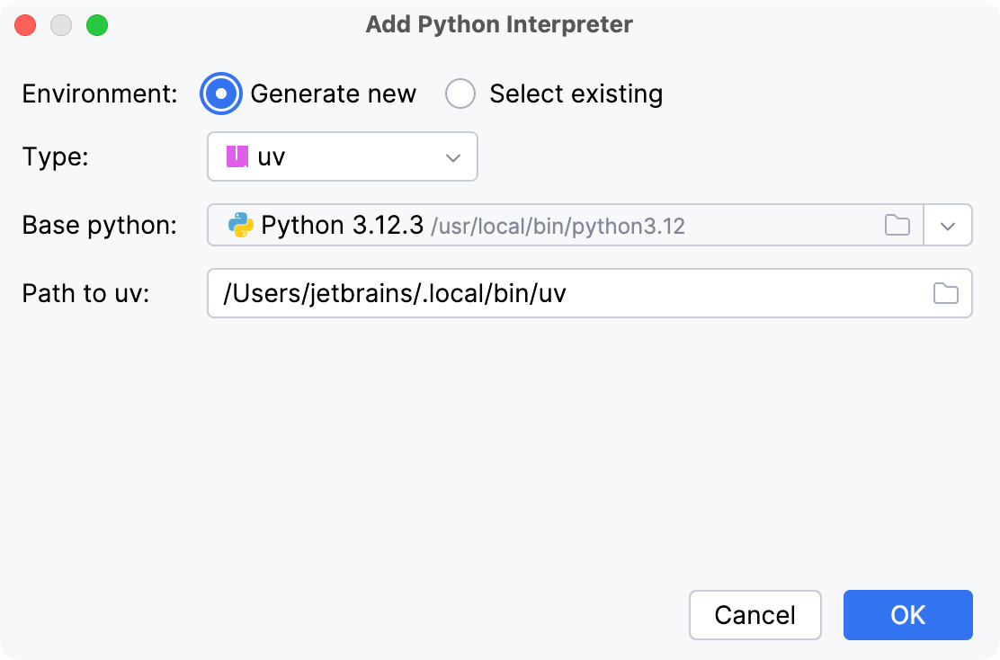
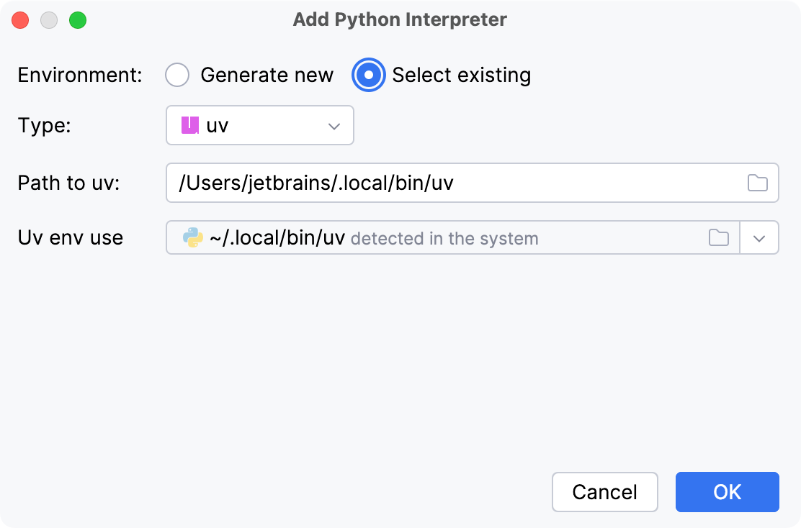

# Day1: MCP核心架构与快速实战

## 示例代码

[mcp-quick.zip](https://www.yuque.com/attachments/yuque/0/2025/zip/2424104/1756654389728-f3d12ed6-1a91-4ffd-9137-b5f702ea6fc6.zip)

## 课程大纲

1. MCP模型上下文协议基础概念
2. MCP传输模式与核心架构深度剖析
3. 基于MCP SDK快速上手MCP服务开发
4. 基于STDIO传输协议开发MCP应用
5. 基于SSE传输协议开发MCP应用
6. FastMCP开发框架介绍与快速入门
7. 基于FastMCP开发智能问答应用
8. AI时代如何快速抓住时代红利实现逆袭

## MCP模型上下文协议基础概念

**<font style="color:rgb(51, 51, 51);">MCP（Model Context Protocol 模型上下文协议）</font>**<font style="color:rgb(51, 51, 51);"> </font><font style="color:rgb(51, 51, 51);">2024 年 11 月底，由 Anthropic 推出的一种开放标准，旨在统一大型语言模型（LLM）与外部数据源和工具之间的通信协议。MCP 的主要目的在于解决当前 AI 模型因数据孤岛限制而无法充分发挥潜力的难题，MCP 使得 AI 应用能够安全地访问和操作本地及远程数据，为 AI 应用提供了连接万物的接口。</font>

<font style="color:rgb(51, 51, 51);">Function Calling 是 AI 模型调用函数的机制，MCP 是一个标准协议，使 AI 模型与 API 无缝交互，而 AI Agent 是一个自主运行的智能系统，利用 Function Calling 和 MCP 来分析和执行任务，实现特定目标。</font>

<font style="color:rgb(51, 51, 51);">MCP 官方简介：</font>[<font style="color:rgb(65, 131, 196);">https://www.anthropic.com/news/model-context-</font>](https://www.anthropic.com/news/model-context-)[<font style="color:rgb(65, 131, 196);">protocol</font>](https://so.csdn.net/so/search?q=protocol\&spm=1001.2101.3001.7020)

<font style="color:rgb(51, 51, 51);">MCP 文档手册：</font>[<font style="color:rgb(65, 131, 196);">https://modelcontextprotocol.io/introduction</font>](https://modelcontextprotocol.io/introduction)

<font style="color:rgb(51, 51, 51);">MCP 中文文档：</font>[<font style="color:rgb(65, 131, 196);">https://mcp-docs.cn/introduction</font>](https://mcp-docs.cn/introduction)

<font style="color:rgb(51, 51, 51);">MCP 客户端：</font>[<font style="color:rgb(65, 131, 196);">https://modelcontextprotocol.io/clients</font>](https://modelcontextprotocol.io/clients)

<font style="color:rgb(51, 51, 51);">MCP 官方服务器列表：</font>[<font style="color:rgb(65, 131, 196);">https://github.com/modelcontextprotocol/servers</font>](https://github.com/modelcontextprotocol/servers)

<font style="color:rgb(51, 51, 51);">PythonSDK 的 github 地址：</font>[<font style="color:rgb(65, 131, 196);">https://github.com/modelcontextprotocol/python-sdk</font>](https://github.com/modelcontextprotocol/python-sdk)

<font style="color:rgb(65, 131, 196);"></font>

### <font style="color:rgb(51, 51, 51);">为什么出现 MCP</font>

<font style="color:rgb(51, 51, 51);">若开发一个不论是 ChatBot 还是复杂的 Agent 的 AI 应用，都不会再局限于简单的聊天对话，而是需要与外部世界连接，以访问数据源或使用工具。如访问本地文件、访问数据库结构、调用第三方 API 服务等，那么就需要连接不同的对象，使用不同的接口协议，需要熟悉 SQL、第三方开放 API 接口调用等，这都需要做大量的适配工作。</font>


<font style="color:rgb(51, 51, 51);">MCP(Model Context Protocol 模型上下文协议)，Anthropic 开源，就是用来帮助简化 LLM 应用与这些外部资源间的集成。它允许 LLM 应用使用统一的协议来连接到这些外部资源，而不必逐个适配。</font>

<font style="color:rgb(51, 51, 51);">MCP 的做法是增加了一个中间层：LLM 应用通过统一的 MCP 协议连接中间层（称为 MCP Server），而这个中间层会处理与外部资源的对接。</font>

### <font style="color:rgb(51, 51, 51);">MCP 有哪些好处</font>

* <font style="color:rgb(51, 51, 51);">LLM 应用的简化：不用适配各种私有协议，只需要知道怎么连接 MCP server</font>
* <font style="color:rgb(51, 51, 51);">LLM 应用的快速扩展：随时 “插拔” 新的 MCP Server 即可，一个不够就再来一个</font>
* <font style="color:rgb(51, 51, 51);">快速适应变化：若一个外部资源的接口发生变化，只需要对它的 MCP Server 做修改，所有的 LLM 应用就可以无缝适应</font>
* <font style="color:rgb(51, 51, 51);">新的 AI 能力共享生态：通过 MCP Server 的共享，新的 LLM 应用可以快速获得各种工具，形成了一种新的合作体系，提高整体效用</font>

### <font style="color:rgb(51, 51, 51);">基于 MCP 的集成架构</font>

1. **<font style="color:rgb(51, 51, 51);">MCP 主机（MCP Hosts）</font>**<font style="color:rgb(51, 51, 51);">：发起请求的 LLM 应用程序（例如 Claude Desktop、IDE 或 AI 工具）。</font>
2. **<font style="color:rgb(51, 51, 51);">MCP 客户端（MCP Clients）</font>**<font style="color:rgb(51, 51, 51);">：在主机程序内部，与 MCP server 保持 1:1 的连接，MCP Client 是由 LLM 应用程序使用 MCP SDK 创建并维护的一个 Server 会话，就像在程序中维护一个数据库的 Connection 一样，借助 MCP SDK 可以与 MCP Server 通信，如查看 Server 的 Tools。在本地模式下，Client 与 Server 是一对一的关系。如果需要连接多个 MCP Server，需要自行维护多个 Session。</font>
3. **<font style="color:rgb(51, 51, 51);">MCP 服务器（MCP Servers）</font>**<font style="color:rgb(51, 51, 51);">：为 MCP client 提供上下文、工具和 prompt 信息。</font>
4. **<font style="color:rgb(51, 51, 51);">本地资源（Local Resources）</font>**<font style="color:rgb(51, 51, 51);">：本地计算机中可供 MCP server 安全访问的资源（例如文件、数据库）。</font>
5. **<font style="color:rgb(51, 51, 51);">远程资源（Remote Resources）</font>**<font style="color:rgb(51, 51, 51);">：MCP server 可以连接到的远程资源（例如通过 API）。</font>


<font style="color:rgb(51, 51, 51);">基于 MCP 将 LLM 应用与外部资源集成的架构可用下图表示：</font>


<font style="color:rgb(51, 51, 51);"></font>

<font style="color:rgb(65, 131, 196);"></font>

## MCP传输模式与核心架构深度剖析

### <font style="color:rgb(51, 51, 51);">消息协议：JSON-RPC 2.0</font>

<font style="color:rgb(51, 51, 51);">在 MCP 中规定了唯一的标准消息格式，就是 JSON-RPC 2.0</font>

<font style="color:rgb(51, 51, 51);">JSON-RPC 2.0 是一种轻量级的、用于远程过程调用（RPC）的消息交换协议，使用 JSON 作为数据格式</font>

**<font style="color:rgb(51, 51, 51);">注意：</font>**<font style="color:rgb(51, 51, 51);"> 它不是一个底层通信协议，只是一个应用层的消息格式标准。这种消息协议的好处，与语言无关 (还有语言不支持 JSON 吗)、简单易用 (结构简单，天然可读，易于调试)、轻量灵活 (可以适配各种传输方式)</font>

### <font style="color:rgb(51, 51, 51);">三种传输模式</font>

<font style="color:rgb(51, 51, 51);">MCP 提供了三种不同的传输实现。</font>

* <font style="color:rgb(51, 51, 51);">默认传输方式：基于 Stdio、SSE、Streamable HTTP</font>



* **<font style="color:rgb(51, 51, 51);">客户端 / 服务器层 （McpClient/McpServer）</font>**<font style="color:rgb(51, 51, 51);">： 两者都使用 McpSession 进行同步 / 异步操作，其中 McpClient 处理客户端协议操作，McpServer 管理服务器端协议操作。</font>
* **<font style="color:rgb(51, 51, 51);">会话层 （McpSession）</font>**<font style="color:rgb(51, 51, 51);">： 使用 DefaultMcpSession 实现管理通信模式和状态。</font>
* **<font style="color:rgb(51, 51, 51);">传输层 （McpTransport）</font>**<font style="color:rgb(51, 51, 51);">： 通过以下方式处理 JSON-RPC 消息序列化 / 反序列化：</font>
* **<font style="color:rgb(51, 51, 51);">核心模块中的 StdioTransport （stdin/stdout）</font>**
* **<font style="color:rgb(51, 51, 51);">专用传输模块</font>**<font style="color:rgb(51, 51, 51);">（Java HttpClient、Spring WebFlux、Spring WebMVC）中的 HTTP SSE 传输</font>

<font style="color:rgb(51, 51, 51);">MCP 客户端是模型上下文协议 （MCP） 架构中的关键组件，负责建立和管理与 MCP 服务器的连接。它实现协议的客户端。</font>


#### <font style="color:rgb(51, 51, 51);">STDIO 模式</font>

<font style="color:rgb(51, 51, 51);">STDIO（Standard Input/Output）是一种基于标准输入（stdin）和标准输出（stdout）的本地通信方式</font>

<font style="color:rgb(51, 51, 51);">MCP Client 启动一个子进程（MCP Server）并通过 stdin 和 stdout 交换 JSON-RPC 消息来实现通信</font>

<font style="color:rgb(51, 51, 51);">其基本通信过程如下：</font>



**<font style="color:rgb(51, 51, 51);">详细描述如下:</font>**

1. **<font style="color:rgb(51, 51, 51);">启动子进程（MCP Server）</font>**

* <font style="color:rgb(51, 51, 51);">MCP Client 以子进程形式启动 MCP Server，通过命令行指定 Server 的可执行文件及其参数</font>

1. **<font style="color:rgb(51, 51, 51);">消息交换</font>**

* <font style="color:rgb(51, 51, 51);">MCP Client 通过 stdin 向 MCP Server 写入 JSON-RPC 消息</font>
* <font style="color:rgb(51, 51, 51);">MCP Server 处理请求后，通过 stdout 返回 JSON-RPC 消息，也可通过 stderr 输出日志</font>

1. **<font style="color:rgb(51, 51, 51);">生命周期管理</font>**

* <font style="color:rgb(51, 51, 51);">MCP Client 控制子进程 (MCP Server) 的启动和关闭。通信结束后，MCP Client 关闭 stdin，终止 MCP Server</font>

#### <font style="color:rgb(51, 51, 51);">SSE 模式</font>

<font style="color:rgb(51, 51, 51);">基于 SSE 的 Remote 模式 (MCP 标准 (2025-03-26 版之前))</font>

<font style="color:rgb(51, 51, 51);">SSE(服务器发送事件) 是一种基于 HTTP 协议的单向通信技术，允许 Server 主动实时向 Client 推送消息，Client 只需建立一次连接即可持续接收消息。它的特点是:</font>

* <font style="color:rgb(51, 51, 51);">单向（仅 Server → Client）</font>
* <font style="color:rgb(51, 51, 51);">基于 HTTP 协议，一般借助一次 HTTP Get 请求建立连接</font>
* <font style="color:rgb(51, 51, 51);">适合实时消息推送场景（如进度更新、实时数据流等）</font>

<font style="color:rgb(51, 51, 51);">由于 SSE 是一种单向通信的模式，所以它需要配合 HTTP Post 来实现 Client 与 Server 的双向通信</font>

<font style="color:rgb(51, 51, 51);">严格的说，这是一种 HTTP Post（Client->Server）+ HTTP SSE（Server -> Client）的伪双工通信模式</font>

**<font style="color:rgb(51, 51, 51);">这种传输模式下:</font>**

* <font style="color:rgb(51, 51, 51);">一个 HTTP Post 通道，用于 Client 发送请求。比如调用 MCP Server 中的 Tools 并传递参数。注意，此时 Server 会立即返回</font>
* <font style="color:rgb(51, 51, 51);">一个 HTTP SSE 通道，用于 Server 推送数据，比如返回调用结果或更新进度</font>
* <font style="color:rgb(51, 51, 51);">两个通道通过 session_id 来关联，而请求与响应则通过消息中的 id 来对应</font>

**<font style="color:rgb(51, 51, 51);">其基本通信过程如下:</font>**



**<font style="color:rgb(51, 51, 51);">详细描述如下:</font>**

1. **<font style="color:rgb(51, 51, 51);">连接建立：</font>**<font style="color:rgb(51, 51, 51);"> Client 首先请求建立 SSE 连接，Server“同意”，然后生成并推送唯一的 Session ID</font>
2. **<font style="color:rgb(51, 51, 51);">请求发送：</font>**<font style="color:rgb(51, 51, 51);"> Client 通过 HTTP POST 发送 JSON-RPC2.0 请求（请求中会带有 Session ID 和 Request ID 信息）</font>
3. **<font style="color:rgb(51, 51, 51);">请求接收确认：</font>**<font style="color:rgb(51, 51, 51);"> Server 接收请求后立即返回 202(Accepted) 状态码，表示已接受请求</font>
4. **<font style="color:rgb(51, 51, 51);">异步处理：</font>**<font style="color:rgb(51, 51, 51);"> Server 应用框架会自动处理请求，根据请求中的参数，决定调用某个工具或资源</font>
5. **<font style="color:rgb(51, 51, 51);">结果推送：</font>**<font style="color:rgb(51, 51, 51);"> 处理完成后，Server 通过 SSE 通道推送 JSON-RPC2.0 响应，其中带有对应的 Request ID</font>
6. **<font style="color:rgb(51, 51, 51);">结果匹配：</font>**<font style="color:rgb(51, 51, 51);"> Client 的 SSE 连接侦听接收到数据流后，会根据 Request ID 将接收到的响应与之前的请求匹配</font>
7. **<font style="color:rgb(51, 51, 51);">重复处理：</font>**<font style="color:rgb(51, 51, 51);"> 循环 2-6 这个过程。这里面包含一个 MCP 的初始化过程</font>
8. **<font style="color:rgb(51, 51, 51);">连接断开：</font>**<font style="color:rgb(51, 51, 51);"> 在 Client 完成所有请求后，可以选择断开 SSE 连接，会话结束</font>

<font style="color:rgb(51, 51, 51);">简单总结：通过 HTTP Post 发送请求，但通过 SSE 的长连接异步获得 Server 的响应结果</font>

#### <font style="color:rgb(51, 51, 51);">2.2.3 Streamable 模式</font>

<font style="color:rgb(51, 51, 51);">Streamable HTTP 模式（MCP 标准（2025-03-26 版））</font>

<font style="color:rgb(51, 51, 51);">在 MCP 新标准 (2025-03-26 版) 中，MCP 引入了新的 Streamable HTTP 远程传输机制来代替之前的 HTTP+SSE 的远程传输模式，STDIO 的本地模式不变</font>

<font style="color:rgb(51, 51, 51);">该新标准还在 OAuth2.1 的授权框架、JSON-RPC 批处理、增强工具注解等方面进行增加和调整，且在 2025.05.08 号发布的 MCP SDK 1.8.0 版本中正式支持了 Streamable HTTP</font>

**<font style="color:rgb(51, 51, 51);">HTTP+SSE 这种方式存在问题有:</font>**

* <font style="color:rgb(51, 51, 51);">需要维护两个独立的连接端点</font>
* <font style="color:rgb(51, 51, 51);">有较高的连接可靠性要求。一旦 SSE 连接断开，Client 无法自动恢复，需要重新建立新连接，导致上下文丢失</font>
* <font style="color:rgb(51, 51, 51);">Server 必须为每个 Client 维持一个高可用长连接，对可用性和伸缩性提出挑战</font>
* <font style="color:rgb(51, 51, 51);">强制所有 Server 向 Client 的消息都经由 SSE 单向推送，缺乏灵活性</font>

**<font style="color:rgb(51, 51, 51);">其主要变化部分的基本通信过程如下:</font>**



**<font style="color:rgb(51, 51, 51);">这里的主要变化包括:</font>**

* <font style="color:rgb(51, 51, 51);">Server 只需一个统一的 HTTP 端点（/messages）用于通信</font>
* <font style="color:rgb(51, 51, 51);">Client 可以完全无状态的方式与 Server 进行交互，即 Restful HTTP Post 方式</font>
* <font style="color:rgb(51, 51, 51);">必要时 Client 也可以在单次请求中获得 SSE 方式响应，如：一个需要进度通知的长时间运行的任务，可以借助 SSE 不断推送进度</font>
* <font style="color:rgb(51, 51, 51);">Client 也可以通过 HTTP Get 请求来打开一个长连接的 SSE 流，这种方式与当前的 HTTP+SSE 模式类似</font>
* <font style="color:rgb(51, 51, 51);">增强的 Session 管理。Server 会在初始化时返回 Mcp-Session-Id，后续 Client 在每次请求中需要携带该 MCP-Session-Id。这个 Mcp-Session-Id 作用是用来关联一次会话的多次交互; Server 可以用 Session-Id 来终止会话，要求 Client 开启新会话; Client 也可以用 HTTP Delete 请求来终止会话</font>

**<font style="color:rgb(51, 51, 51);">Streamable HTTP 在旧方案的基础上，提升了传输层的灵活性与健壮性:</font>**

* <font style="color:rgb(51, 51, 51);">允许无状态的 Server 存在，不依赖长连接。有更好的部署灵活性与扩展能力</font>
* <font style="color:rgb(51, 51, 51);">对 Server 中间件的兼容性更好，只需要支持 HTTP 即可，无需做 SSE 处理</font>
* <font style="color:rgb(51, 51, 51);">允许根据自身需要开启 SSE 响应或长连接，保留了现有规范 SSE 模式的优势</font>

## 基于MCP SDK快速上手MCP服务开发

接下来我们介绍 Model Context Protocol（MCP）Python SDK 的使用方法和核心概念。MCP 是一种用于将外部数据源和工具与大型语言模型（LLM）应用集成的开放协议。通过 MCP，开发者可以构建 MCP 客户端连接到任何 MCP 服务器，创建暴露资源、提示和工具的 MCP 服务器，并处理所有 MCP 协议消息和生命周期事件。本文将涵盖 MCP 的安装、快速入门、核心概念、服务器运行方式、示例以及高级用法等内容。

### 概述

MCP Python SDK 实现了完整的 MCP 规范，使开发者能够轻松地构建 MCP 客户端和服务器。它支持标准传输如 stdio、SSE 和 Streamable HTTP，并且能够处理所有 MCP 协议消息和生命周期事件。

### 基于uv安装

#### 添加 MCP 到 Python 项目

<font style="color:rgb(51, 51, 51);">安装 uv 命令</font>

```plain
powershell -ExecutionPolicy ByPass -c "irm https://astral.sh/uv/install.ps1 | iex"
```

<font style="color:rgb(51, 51, 51);">打开系统高级环境变量，在 </font><code><font style="color:rgb(51, 51, 51);background-color:rgb(243, 244, 244);">Path</font></code><font style="color:rgb(51, 51, 51);"> 将 uv 路径添加进去：</font>

```plain
setx UV_HOME "C:\Users\用户名\.local\bin"
```


<font style="color:rgb(51, 51, 51);">重启 Powershell 。 在命令行输入 </font><code><font style="color:rgb(51, 51, 51);background-color:rgb(243, 244, 244);">uv</font></code><font style="color:rgb(51, 51, 51);">  ， 能返回版本信息就算安装成功了:</font>

推荐使用 uv 来管理 Python 项目。如果尚未创建 uv 管理的项目，可以按照以下步骤创建：

```plain
uv init mcp-server
cd mcp-server
```

然后将 MCP 添加到项目依赖项中：

```plain
uv add "mcp[cli]"
```

对于使用 pip 管理依赖项的项目，可以运行以下命令：

```plain
pip install "mcp[cli]"
```

### PyCharm配置uv开发环境

[uv](https://docs.astral.sh/uv/)<font style="color:rgb(25, 25, 28);"> 工具使 Python 开发更简单，减少新项目的设置任务并帮助管理现有项目。</font>

<font style="color:rgb(25, 25, 28);">要在 PyCharm 中使用</font><font style="color:rgb(25, 25, 28);"> </font>`uv`<font style="color:rgb(25, 25, 28);"> </font><font style="color:rgb(25, 25, 28);">，您需要</font><font style="color:rgb(25, 25, 28);"> </font>在您的机器上安装它<font style="color:rgb(25, 25, 28);">并创建一个特定的 Python 环境。</font>

<font style="color:rgb(25, 25, 28);">当您在</font><font style="color:rgb(25, 25, 28);"> </font>[创建新 Python 项目](https://www.jetbrains.com/zh-cn/help/pycharm/creating-empty-project.html)<font style="color:rgb(25, 25, 28);">时选择</font><font style="color:rgb(25, 25, 28);"> </font>`uv`<font style="color:rgb(25, 25, 28);"> </font><font style="color:rgb(25, 25, 28);">，PyCharm 会自动生成一个</font><font style="color:rgb(25, 25, 28);"> </font>**pyproject.toml**\*\* \*\*<font style="color:rgb(25, 25, 28);">文件。 此文件指定了所需的包、脚本、插件和 URL。 请参阅</font><font style="color:rgb(25, 25, 28);"> </font>[pyproject](https://packaging.python.org/en/latest/guides/writing-pyproject-toml/)<font style="color:rgb(25, 25, 28);"> </font><font style="color:rgb(25, 25, 28);">指南以了解其结构和格式的更多信息。</font>

请确保您使用的是 PyCharm 2024.3.2 或更高版本。

**创建 uv 环境**

1. 请执行以下操作之一：
   * 点击 [Python Interpreter 选择器](https://www.jetbrains.com/zh-cn/help/pycharm/configuring-python-interpreter.html#widget) 并选择 **添加新的解释器**。
   * 按 CtrlAlt<font style="color:transparent;">0</font>S 以打开 **设置** 并转到 **项目：<项目名称> | Python 解释器**。 点击可用解释器列表旁的 **添加解释器** 链接。
   * 点击 [Python Interpreter 选择器](https://www.jetbrains.com/zh-cn/help/pycharm/configuring-python-interpreter.html#widget) 并选择 **解释器设置**。 点击可用解释器列表旁的 **添加解释器** 链接。
2. 请选择 **添加本地解释器**。
3. 以下操作取决于您是想生成一个新的虚拟环境还是使用现有的环境。

新建 uv 环境



```
1. 从环境类型列表中选择 **uv**。
2. 从列表中选择基础解释器，或者点击  并在您的文件系统中找到 Python 可执行文件。
3. 通常，PyCharm 会检测到 uv 的安装。
```

否则，请指定 uv 可执行文件的位置，或点击  浏览以找到它。

现有 uv 环境



```
1. 
```

4\. 点击 **OK** 完成任务。

### MCP服务端快速入门

下面创建一个简单的 MCP 服务器，它暴露了一个计算器工具和一些数据：

```plain
# server.py
from mcp.server.fastmcp import FastMCP

# 创建一个 MCP 服务器
mcp = FastMCP("Demo")


# 添加一个加法工具
@mcp.tool()
def add(a: int, b: int) -> int:
    """添加两个数字"""
    return a + b


# 添加一个动态问候资源
@mcp.resource("greeting://{name}")
def get_greeting(name: str) -> str:
    """获取个性化问候"""
    return f"Hello, {name}!"
```

可以通过以下命令启动mcp服务

```plain
uv run mcp dev server.py
```

或者，可以使用 MCP Inspector 进行测试：

```plain
mcp dev server.py
```

## 基于STDIO传输协议开发MCP应用

### STDIO客户端代码实现

````python
from fastmcp import Client
from fastmcp.client.transports import PythonStdioTransport
from openai import OpenAI
import asyncio
import logging
import json
import os

class LLMClient:
    """LLM客户端，负责与大语言模型API通信"""

    def __init__(self, model_name: str, url: str, api_key: str) -> None:
        self.model_name: str = model_name
        self.url: str = url
        self.client = OpenAI(api_key=api_key, base_url=url)

    def get_response(self, messages: list[dict[str, str]]) -> str:
        """发送消息给LLM并获取响应"""
        response = self.client.chat.completions.create(
            model=self.model_name,
            messages=messages,
            stream=False
        )
        return response.choices[0].message.content


class ChatSession:
    """聊天会话，处理用户输入和LLM响应，并与MCP工具交互"""

    def __init__(self, llm_client: LLMClient, mcp_client: Client, ) -> None:
        self.mcp_client: Client = mcp_client
        self.llm_client: LLMClient = llm_client

    async def process_llm_response(self, llm_response: str) -> str:
        """处理LLM响应，解析工具调用并执行"""
        try:
            # 尝试移除可能的markdown格式
            if llm_response.startswith('```json'):
                llm_response = llm_response.strip('```json').strip('```').strip()
            tool_call = json.loads(llm_response)
            if "tool" in tool_call and "arguments" in tool_call:
                # 检查工具是否可用
                tools = await self.mcp_client.list_tools()
                if any(tool.name == tool_call["tool"] for tool in tools):
                    try:
                        # 执行工具调用
                        result = await self.mcp_client.call_tool(
                            tool_call["tool"], tool_call["arguments"]
                        )

                        return f"Tool execution result: {result.content[0].text}"
                    except Exception as e:
                        error_msg = f"Error executing tool: {str(e)}"
                        logging.error(error_msg)
                        return error_msg
                return f"No server found with tool: {tool_call['tool']}"
            return llm_response
        except json.JSONDecodeError:
            # 如果不是JSON格式，直接返回原始响应
            return llm_response

    async def start(self, system_message) -> None:
        """启动聊天会话的主循环"""
        messages = [{"role": "system", "content": system_message}]
        while True:
            try:
                # 获取用户输入
                user_input = input("用户: ").strip().lower()
                if user_input in ["quit", "exit", "退出"]:
                    print('AI助手退出')
                    break
                messages.append({"role": "user", "content": user_input})

                # 获取LLM的初始响应
                llm_response = self.llm_client.get_response(messages)
                print("助手: ", llm_response)

                # 处理可能的工具调用
                result = await self.process_llm_response(llm_response)

                # 如果处理结果与原始响应不同，说明执行了工具调用，需要进一步处理
                while result != llm_response:
                    messages.append({"role": "assistant", "content": llm_response})
                    messages.append({"role": "system", "content": result})

                    # 将工具执行结果发送回LLM获取新响应
                    llm_response = self.llm_client.get_response(messages)
                    result = await self.process_llm_response(llm_response)
                    print("助手: ", llm_response)

                messages.append({"role": "assistant", "content": llm_response})

            except KeyboardInterrupt:
                print('AI助手退出')
                break


async def main():
    # 使用fastmcp的stdio传输连接
    transport = PythonStdioTransport(script_path="fastmcp_stdio_server.py")
    async with Client(transport) as mcp_client:
        # 初始化LLM客户端
        llm_client = LLMClient(model_name='gpt-4o', api_key=os.getenv('OPENAI_API_KEY'),
                               url='https://api.openai.com/v1')

        # 获取可用工具列表并格式化为系统提示的一部分
        tools = await mcp_client.list_tools()
        dict_list = [tool.__dict__ for tool in tools]
        tools_description = json.dumps(dict_list, ensure_ascii=False)

        # 系统提示，指导LLM如何使用工具和返回响应
        system_message = f'''
                你是一个智能助手，严格遵循以下协议返回响应：

                可用工具：{tools_description}

                响应规则：
                1、当需要计算时，返回严格符合以下格式的纯净JSON：
                {{
                    "tool": "tool-name",
                    "arguments": {{
                        "argument-name": "value"
                    }}
                }}
                2、禁止包含以下内容：
                 - Markdown标记（如```json）
                 - 自然语言解释（如"结果："）
                 - 格式化数值（必须保持原始精度）
                 - 单位符号（如元、kg）

                校验流程：
                ✓ 参数数量与工具定义一致
                ✓ 数值类型为number
                ✓ JSON格式有效性检查

                正确示例：
                用户：单价88.5买235个多少钱？
                响应：{{"tool":"multiply","arguments":{{"a":88.5,"b":235}}}}

                错误示例：
                用户：总金额是多少？
                错误响应：总价500元 → 含自然语言
                错误响应：```json{{...}}``` → 含Markdown

                3、在收到工具的响应后：
                 - 将原始数据转化为自然、对话式的回应
                 - 保持回复简洁但信息丰富
                 - 聚焦于最相关的信息
                 - 使用用户问题中的适当上下文
                 - 避免简单重复使用原始数据
                '''
        
        print("🤖 MCP 客户端已启动！支持以下工具:", [tool.name for tool in tools])
        
        # 启动聊天会话
        chat_session = ChatSession(llm_client=llm_client, mcp_client=mcp_client)
        await chat_session.start(system_message=system_message)

if __name__ == "__main__":
    asyncio.run(main())

````

### STDIO服务端代码实现

```python
#如果想使用MCP Inspector ，就引入这个包
#from mcp.server.fastmcp import FastMCP

#如果想独立启动fastmcp server，就引入这个包
from fastmcp import FastMCP

mcp = FastMCP("fastmcp-server")


@mcp.tool()
def say_hello(name: str) -> str:
    return 'hello，' + name


if __name__ == "__main__":
    mcp.run(transport='stdio')

```

## 基于SSE传输协议开发MCP应用

### SSE客户端代码实现

````python
from fastmcp import Client
from openai import OpenAI
import asyncio
import logging
import json
import os

class LLMClient:
    """LLM客户端，负责与大语言模型API通信"""

    def __init__(self, model_name: str, url: str, api_key: str) -> None:
        self.model_name: str = model_name
        self.url: str = url
        self.client = OpenAI(api_key=api_key, base_url=url)

    def get_response(self, messages: list[dict[str, str]]) -> str:
        """发送消息给LLM并获取响应"""
        response = self.client.chat.completions.create(
            model=self.model_name,
            messages=messages,
            stream=False
        )
        return response.choices[0].message.content


class ChatSession:
    """聊天会话，处理用户输入和LLM响应，并与MCP工具交互"""

    def __init__(self, llm_client: LLMClient, mcp_client: Client, ) -> None:
        self.mcp_client: Client = mcp_client
        self.llm_client: LLMClient = llm_client

    async def process_llm_response(self, llm_response: str) -> str:
        """处理LLM响应，解析工具调用并执行"""
        try:
            # 尝试移除可能的markdown格式
            if llm_response.startswith('```json'):
                llm_response = llm_response.strip('```json').strip('```').strip()
            tool_call = json.loads(llm_response)
            if "tool" in tool_call and "arguments" in tool_call:
                # 检查工具是否可用
                tools = await self.mcp_client.list_tools()
                if any(tool.name == tool_call["tool"] for tool in tools):
                    try:
                        # 执行工具调用
                        result = await self.mcp_client.call_tool(
                            tool_call["tool"], tool_call["arguments"]
                        )

                        return f"Tool execution result: {result}"
                    except Exception as e:
                        error_msg = f"Error executing tool: {str(e)}"
                        logging.error(error_msg)
                        return error_msg
                return f"No server found with tool: {tool_call['tool']}"
            return llm_response
        except json.JSONDecodeError:
            # 如果不是JSON格式，直接返回原始响应
            return llm_response

    async def start(self, system_message) -> None:
        """启动聊天会话的主循环"""
        messages = [{"role": "system", "content": system_message}]
        while True:
            try:
                # 获取用户输入
                user_input = input("用户: ").strip().lower()
                if user_input in ["quit", "exit", "退出"]:
                    print('AI助手退出')
                    break
                messages.append({"role": "user", "content": user_input})

                # 获取LLM的初始响应
                llm_response = self.llm_client.get_response(messages)
                print("助手: ", llm_response)

                # 处理可能的工具调用
                result = await self.process_llm_response(llm_response)

                # 如果处理结果与原始响应不同，说明执行了工具调用，需要进一步处理
                while result != llm_response:
                    messages.append({"role": "assistant", "content": llm_response})
                    messages.append({"role": "system", "content": result})

                    # 将工具执行结果发送回LLM获取新响应
                    llm_response = self.llm_client.get_response(messages)
                    result = await self.process_llm_response(llm_response)
                    print("助手: ", llm_response)

                messages.append({"role": "assistant", "content": llm_response})

            except KeyboardInterrupt:
                print('AI助手退出')
                break


async def main():
    async with Client("http://127.0.0.1:3001/sse") as mcp_client:
        # 初始化LLM客户端，使用通义千问模型
        llm_client = LLMClient(model_name='gpt-4o', api_key=os.getenv('OPENAI_API_KEY'),
                               url='https://api.openai.com/v1')

        # 获取可用工具列表并格式化为系统提示的一部分
        tools = await mcp_client.list_tools()
        dict_list = [tool.__dict__ for tool in tools]
        tools_description = json.dumps(dict_list, ensure_ascii=False)

        # 系统提示，指导LLM如何使用工具和返回响应
        system_message = f'''
                你是一个智能助手，严格遵循以下协议返回响应：

                可用工具：{tools_description}

                响应规则：
                1、当需要计算时，返回严格符合以下格式的纯净JSON：
                {{
                    "tool": "tool-name",
                    "arguments": {{
                        "argument-name": "value"
                    }}
                }}
                2、禁止包含以下内容：
                 - Markdown标记（如```json）
                 - 自然语言解释（如"结果："）
                 - 格式化数值（必须保持原始精度）
                 - 单位符号（如元、kg）

                校验流程：
                ✓ 参数数量与工具定义一致
                ✓ 数值类型为number
                ✓ JSON格式有效性检查

                正确示例：
                用户：单价88.5买235个多少钱？
                响应：{{"tool":"multiply","arguments":{{"a":88.5,"b":235}}}}

                错误示例：
                用户：总金额是多少？
                错误响应：总价500元 → 含自然语言
                错误响应：```json{{...}}``` → 含Markdown

                3、在收到工具的响应后：
                 - 将原始数据转化为自然、对话式的回应
                 - 保持回复简洁但信息丰富
                 - 聚焦于最相关的信息
                 - 使用用户问题中的适当上下文
                 - 避免简单重复使用原始数据
                '''
        # 启动聊天会话
        chat_session = ChatSession(llm_client=llm_client, mcp_client=mcp_client)
        await chat_session.start(system_message=system_message)

if __name__ == "__main__":
    asyncio.run(main())

````

### SSE服务端代码实现

```python
#如果想使用MCP Inspector ，就引入这个包
#from mcp.server.fastmcp import FastMCP

#如果想独立启动fastmcp server，就引入这个包
from fastmcp import FastMCP

mcp = FastMCP("base-calculator-server")


@mcp.tool()
def say_hello(name: str) -> str:
    return 'hello，' + name


if __name__ == "__main__":
    mcp.run(transport='sse', host="127.0.0.1", port=3001)
    #mcp.run()

```

## FastMCP开发框架介绍与快速入门

### <font style="color:rgb(0, 0, 0);">项目概述</font>

<font style="color:rgb(0, 0, 0);"></font>项目地址：<https://github.com/jlowin/fastmcp>

<font style="color:rgb(0, 0, 0);">FastMCP是一个用于构建Model Context Protocol (MCP)服务器和客户端的高级Python框架，旨在让开发者能够快速、简洁地创建工具、暴露资源、定义提示并连接组件。该项目由GitHub用户jlowin开发维护，已经成为MCP生态系统中的重要组成部分。</font>

### <font style="color:rgb(0, 0, 0);">为什么选择FastMCP？</font>

<font style="color:rgb(0, 0, 0);">虽然MCP协议功能强大，但实现它需要大量样板代码 - 服务器设置、协议处理程序、内容类型、错误管理等。FastMCP处理所有复杂的协议细节和服务器管理，让您专注于构建优秀的工具。</font>

<font style="color:rgb(0, 0, 0);">FastMCP的设计目标：</font>

* <font style="color:rgb(0, 0, 0);">🚀</font><font style="color:rgb(0, 0, 0);"> </font>**<font style="color:rgb(0, 0, 0);">快速</font>**<font style="color:rgb(0, 0, 0);">：高级接口意味着更少的代码和更快的开发</font>
* <font style="color:rgb(0, 0, 0);">🍀</font><font style="color:rgb(0, 0, 0);"> </font>**<font style="color:rgb(0, 0, 0);">简单</font>**<font style="color:rgb(0, 0, 0);">：用最少的样板代码构建MCP服务器</font>
* <font style="color:rgb(0, 0, 0);">🐍</font><font style="color:rgb(0, 0, 0);"> </font>**<font style="color:rgb(0, 0, 0);">Pythonic</font>**<font style="color:rgb(0, 0, 0);">：对Python开发者感觉自然</font>
* <font style="color:rgb(0, 0, 0);">🔍</font><font style="color:rgb(0, 0, 0);"> </font>**<font style="color:rgb(0, 0, 0);">完整</font>**<font style="color:rgb(0, 0, 0);">：提供MCP核心规范的完整实现，支持服务器和客户端</font>

### <font style="color:rgb(0, 0, 0);">核心功能特性</font>

#### <font style="color:rgb(0, 0, 0);">基础功能</font>

* <font style="color:rgb(0, 0, 0);">使用直观装饰器创建服务器，样板代码最少</font>
* <font style="color:rgb(0, 0, 0);">代理现有服务器来修改配置或传输方式</font>
* <font style="color:rgb(0, 0, 0);">将服务器组合成复杂应用</font>
* <font style="color:rgb(0, 0, 0);">从OpenAPI规范或FastAPI对象生成服务器</font>
* <font style="color:rgb(0, 0, 0);">以编程方式与MCP服务器交互</font>
* <font style="color:rgb(0, 0, 0);">使用任何传输协议连接到任何MCP服务器</font>
* <font style="color:rgb(0, 0, 0);">无需手动干预即可测试服务器</font>
* <font style="color:rgb(0, 0, 0);">利用核心MCP功能，如LLM采样</font>

#### <font style="color:rgb(0, 0, 0);">版本演进</font>

<font style="color:rgb(0, 0, 0);">FastMCP 1.0使构建MCP服务器变得如此简单，以至于它现在已经成为官方Model Context Protocol Python SDK的一部分！</font>

<font style="color:rgb(0, 0, 0);">FastMCP 2.0在此基础上引入了多种新功能：</font>

* <font style="color:rgb(0, 0, 0);">代理和组合MCP服务器等高级功能</font>
* <font style="color:rgb(0, 0, 0);">从OpenAPI规范或FastAPI对象自动生成服务器</font>
* <font style="color:rgb(0, 0, 0);">引入客户端功能，如LLM采样</font>

## 基于FastMCP开发智能问答应用

### <font style="color:rgb(51, 51, 51);">需求概述</font>

<font style="color:rgb(51, 51, 51);">实现一个四则运算的 MCP Server，具体提供的接口详情介绍:</font>

**<font style="color:rgb(51, 51, 51);">(1) 加法运算</font>**

<font style="color:rgb(51, 51, 51);">name=‘add’</font>

<font style="color:rgb(51, 51, 51);">description=‘执行加法运算’</font>

<font style="color:rgb(51, 51, 51);">inputSchema={‘properties’: {‘a’: {‘title’: ‘A’, ‘type’: ‘number’}, ‘b’: {‘title’: ‘B’, ‘type’: ‘number’}}, ‘required’: \[‘a’, ‘b’], ‘title’: ‘addArguments’, ‘type’: ‘object’})</font>

**<font style="color:rgb(51, 51, 51);">(2) 减法运算</font>**

<font style="color:rgb(51, 51, 51);">name=‘subtract’</font>

<font style="color:rgb(51, 51, 51);">description=‘执行减法运算’</font>

<font style="color:rgb(51, 51, 51);">inputSchema={‘properties’: {‘a’: {‘title’: ‘A’, ‘type’: ‘number’}, ‘b’: {‘title’: ‘B’, ‘type’: ‘number’}}, ‘required’: \[‘a’, ‘b’], ‘title’: ‘subtractArguments’, ‘type’: ‘object’})</font>

**<font style="color:rgb(51, 51, 51);">(3) 乘法运算</font>**

<font style="color:rgb(51, 51, 51);">name=‘multiply’</font>

<font style="color:rgb(51, 51, 51);">description=‘执行乘法运算’</font>

<font style="color:rgb(51, 51, 51);">inputSchema={‘properties’: {‘a’: {‘title’: ‘A’, ‘type’: ‘number’}, ‘b’: {‘title’: ‘B’, ‘type’: ‘number’}}, ‘required’: \[‘a’, ‘b’], ‘title’: ‘multiplyArguments’, ‘type’: ‘object’})</font>

**<font style="color:rgb(51, 51, 51);">(3) 除法运算</font>**

<font style="color:rgb(51, 51, 51);">name=‘divide’</font>

<font style="color:rgb(51, 51, 51);">description=‘执行除法运算’</font>

<font style="color:rgb(51, 51, 51);">inputSchema={‘properties’: {‘a’: {‘title’: ‘A’, ‘type’: ‘number’}, ‘b’: {‘title’: ‘B’, ‘type’: ‘number’}}, ‘required’: \[‘a’, ‘b’], ‘title’: ‘divideArguments’, ‘type’: ‘object’})]</font>

### FastMCP客户端实现

````python
from fastmcp import Client
from openai import OpenAI
import asyncio
import logging
import json
import os

class LLMClient:
    """LLM客户端，负责与大语言模型API通信"""

    def __init__(self, model_name: str, url: str, api_key: str) -> None:
        self.model_name: str = model_name
        self.url: str = url
        self.client = OpenAI(api_key=api_key, base_url=url)

    def get_response(self, messages: list[dict[str, str]]) -> str:
        """发送消息给LLM并获取响应"""
        response = self.client.chat.completions.create(
            model=self.model_name,
            messages=messages,
            stream=False
        )
        return response.choices[0].message.content


class ChatSession:
    """聊天会话，处理用户输入和LLM响应，并与MCP工具交互"""

    def __init__(self, llm_client: LLMClient, mcp_client: Client, ) -> None:
        self.mcp_client: Client = mcp_client
        self.llm_client: LLMClient = llm_client

    async def process_llm_response(self, llm_response: str) -> str:
        """处理LLM响应，解析工具调用并执行"""
        try:
            # 尝试移除可能的markdown格式
            if llm_response.startswith('```json'):
                llm_response = llm_response.strip('```json').strip('```').strip()
            tool_call = json.loads(llm_response)
            if "tool" in tool_call and "arguments" in tool_call:
                # 检查工具是否可用
                tools = await self.mcp_client.list_tools()
                if any(tool.name == tool_call["tool"] for tool in tools):
                    try:
                        # 执行工具调用
                        result = await self.mcp_client.call_tool(
                            tool_call["tool"], tool_call["arguments"]
                        )

                        return f"Tool execution result: {result}"
                    except Exception as e:
                        error_msg = f"Error executing tool: {str(e)}"
                        logging.error(error_msg)
                        return error_msg
                return f"No server found with tool: {tool_call['tool']}"
            return llm_response
        except json.JSONDecodeError:
            # 如果不是JSON格式，直接返回原始响应
            return llm_response

    async def start(self, system_message) -> None:
        """启动聊天会话的主循环"""
        messages = [{"role": "system", "content": system_message}]
        while True:
            try:
                # 获取用户输入
                user_input = input("用户: ").strip().lower()
                if user_input in ["quit", "exit", "退出"]:
                    print('AI助手退出')
                    break
                messages.append({"role": "user", "content": user_input})

                # 获取LLM的初始响应
                llm_response = self.llm_client.get_response(messages)
                print("助手: ", llm_response)

                # 处理可能的工具调用
                result = await self.process_llm_response(llm_response)

                # 如果处理结果与原始响应不同，说明执行了工具调用，需要进一步处理
                while result != llm_response:
                    messages.append({"role": "assistant", "content": llm_response})
                    messages.append({"role": "system", "content": result})

                    # 将工具执行结果发送回LLM获取新响应
                    llm_response = self.llm_client.get_response(messages)
                    result = await self.process_llm_response(llm_response)
                    print("助手: ", llm_response)

                messages.append({"role": "assistant", "content": llm_response})

            except KeyboardInterrupt:
                print('AI助手退出')
                break


async def main():
    async with Client("http://127.0.0.1:3001/sse") as mcp_client:
        # 初始化LLM客户端，使用通义千问模型
        llm_client = LLMClient(model_name='gpt-4o', api_key=os.getenv('OPENAI_API_KEY'),
                               url='https://api.openai.com/v1')

        # 获取可用工具列表并格式化为系统提示的一部分
        tools = await mcp_client.list_tools()
        dict_list = [tool.__dict__ for tool in tools]
        tools_description = json.dumps(dict_list, ensure_ascii=False)

        # 系统提示，指导LLM如何使用工具和返回响应
        system_message = f'''
                你是一个智能助手，严格遵循以下协议返回响应：

                可用工具：{tools_description}

                响应规则：
                1、当需要计算时，返回严格符合以下格式的纯净JSON：
                {{
                    "tool": "tool-name",
                    "arguments": {{
                        "argument-name": "value"
                    }}
                }}
                2、禁止包含以下内容：
                 - Markdown标记（如```json）
                 - 自然语言解释（如"结果："）
                 - 格式化数值（必须保持原始精度）
                 - 单位符号（如元、kg）

                校验流程：
                ✓ 参数数量与工具定义一致
                ✓ 数值类型为number
                ✓ JSON格式有效性检查

                正确示例：
                用户：单价88.5买235个多少钱？
                响应：{{"tool":"multiply","arguments":{{"a":88.5,"b":235}}}}

                错误示例：
                用户：总金额是多少？
                错误响应：总价500元 → 含自然语言
                错误响应：```json{{...}}``` → 含Markdown

                3、在收到工具的响应后：
                 - 将原始数据转化为自然、对话式的回应
                 - 保持回复简洁但信息丰富
                 - 聚焦于最相关的信息
                 - 使用用户问题中的适当上下文
                 - 避免简单重复使用原始数据
                '''
        # 启动聊天会话
        chat_session = ChatSession(llm_client=llm_client, mcp_client=mcp_client)
        await chat_session.start(system_message=system_message)

if __name__ == "__main__":
    asyncio.run(main())

````

### FastMCP服务端实现

```python
#如果想使用MCP Inspector ，就引入这个包
#from mcp.server.fastmcp import FastMCP

#如果想独立启动fastmcp server，就引入这个包
from fastmcp import FastMCP

mcp = FastMCP("base-calculator-server")


@mcp.tool()
def say_hello(name: str) -> str:
    return 'hello，' + name

@mcp.tool()
def add(a: float, b: float) -> float:
    """加法运算

    参数:
    a: 第一个数字
    b: 第二个数字

    返回:
    两数之和
    """
    return a + b


@mcp.tool()
def subtract(a: float, b: float) -> float:
    """减法运算

    参数:
    a: 第一个数字
    b: 第二个数字

    返回:
    两数之差 (a - b)
    """
    return a - b


@mcp.tool()
def multiply(a: float, b: float) -> float:
    """乘法运算

    参数:
    a: 第一个数字
    b: 第二个数字

    返回:
    两数之积
    """
    return a * b


@mcp.tool()
def divide(a: float, b: float) -> float:
    """除法运算

    参数:
    a: 被除数
    b: 除数

    返回:
    两数之商 (a / b)

    异常:
    ValueError: 当除数为零时
    """
    if b == 0:
        raise ValueError("除数不能为零")
    return a / b


if __name__ == "__main__":
    mcp.run(transport='sse', host="127.0.0.1", port=3001)
    #mcp.run()

```

### <font style="color:rgb(51, 51, 51);">MCP Server 测试</font>

* <font style="color:rgb(51, 51, 51);">3 加 4 等于几</font>
* <font style="color:rgb(51, 51, 51);">调用工具计算 3+2</font>
* <font style="color:rgb(51, 51, 51);">调用工具计算 3-2</font>
* <font style="color:rgb(51, 51, 51);">调用工具计算 3\*2</font>
* <font style="color:rgb(51, 51, 51);">调用工具计算 3/2</font>

## AI时代如何快速抓住时代红利实现逆袭

<https://www.processon.com/view/link/67dd6739a191f700f07130b5>


> 更新: 2025-08-31 23:33:09  
> 原文: <https://www.yuque.com/aaron-wecc3/dhluml/gemfwc6oikgigbox>