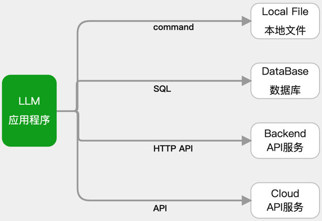
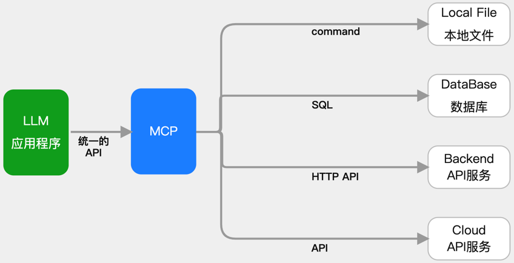
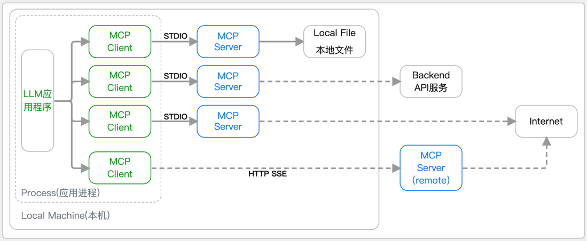
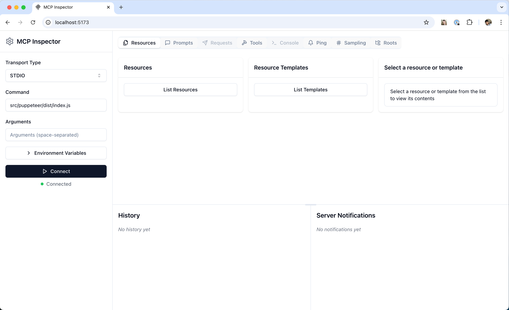

# Day2: MCP企业级项目开发实践

## 示例代码

[mcp-ent.zip](https://www.yuque.com/attachments/yuque/0/2025/zip/2424104/1756654381611-8950f6b5-8da6-4914-85f2-24c8ed4e6527.zip)

## 课程大纲

1. MCP核心组件之Tools开发实战
2. MCP核心组件之Resources开发实战
3. MCP核心组件之Prompts开发实战
4. MCP核心组件之Sampling开发实战
5. 基于MCP Inspector调试MCP服务
6. MCP企业级应用之开发数据分析MCP服务
7. MCP企业级应用之开发高德地图MCP服务
8. 2025年AI技术学习方向与热门岗位深度剖析

## 前言

**<font style="color:rgb(51, 51, 51);">MCP（Model Context Protocol 模型上下文协议）</font>**<font style="color:rgb(51, 51, 51);"> </font><font style="color:rgb(51, 51, 51);">2024 年 11 月底，由 Anthropic 推出的一种开放标准，旨在统一大型语言模型（LLM）与外部数据源和工具之间的通信协议。MCP 的主要目的在于解决当前 AI 模型因数据孤岛限制而无法充分发挥潜力的难题，MCP 使得 AI 应用能够安全地访问和操作本地及远程数据，为 AI 应用提供了连接万物的接口。</font>

<font style="color:rgb(51, 51, 51);">Function Calling 是 AI 模型调用函数的机制，MCP 是一个标准协议，使 AI 模型与 API 无缝交互，而 AI Agent 是一个自主运行的智能系统，利用 Function Calling 和 MCP 来分析和执行任务，实现特定目标。</font>

<font style="color:rgb(51, 51, 51);">MCP 官方简介：</font>[<font style="color:rgb(65, 131, 196);">https://www.anthropic.com/news/model-context-</font>](https://www.anthropic.com/news/model-context-)[<font style="color:rgb(65, 131, 196);">protocol</font>](https://so.csdn.net/so/search?q=protocol\&spm=1001.2101.3001.7020)

<font style="color:rgb(51, 51, 51);">MCP 文档手册：</font>[<font style="color:rgb(65, 131, 196);">https://modelcontextprotocol.io/introduction</font>](https://modelcontextprotocol.io/introduction)

<font style="color:rgb(51, 51, 51);">MCP 中文文档：</font>[<font style="color:rgb(65, 131, 196);">https://mcp-docs.cn/introduction</font>](https://mcp-docs.cn/introduction)

<font style="color:rgb(51, 51, 51);">MCP 客户端：</font>[<font style="color:rgb(65, 131, 196);">https://modelcontextprotocol.io/clients</font>](https://modelcontextprotocol.io/clients)

<font style="color:rgb(51, 51, 51);">MCP 官方服务器列表：</font>[<font style="color:rgb(65, 131, 196);">https://github.com/modelcontextprotocol/servers</font>](https://github.com/modelcontextprotocol/servers)

<font style="color:rgb(51, 51, 51);">PythonSDK 的 github 地址：</font>[<font style="color:rgb(65, 131, 196);">https://github.com/modelcontextprotocol/python-sdk</font>](https://github.com/modelcontextprotocol/python-sdk)

<font style="color:rgb(65, 131, 196);"></font>

### <font style="color:rgb(51, 51, 51);">为什么出现 MCP</font>

<font style="color:rgb(51, 51, 51);">若开发一个不论是 ChatBot 还是复杂的 Agent 的 AI 应用，都不会再局限于简单的聊天对话，而是需要与外部世界连接，以访问数据源或使用工具。如访问本地文件、访问数据库结构、调用第三方 API 服务等，那么就需要连接不同的对象，使用不同的接口协议，需要熟悉 SQL、第三方开放 API 接口调用等，这都需要做大量的适配工作。</font>



<font style="color:rgb(51, 51, 51);">MCP(Model Context Protocol 模型上下文协议)，Anthropic 开源，就是用来帮助简化 LLM 应用与这些外部资源间的集成。它允许 LLM 应用使用统一的协议来连接到这些外部资源，而不必逐个适配。</font>

<font style="color:rgb(51, 51, 51);">MCP 的做法是增加了一个中间层：LLM 应用通过统一的 MCP 协议连接中间层（称为 MCP Server），而这个中间层会处理与外部资源的对接。</font>

### <font style="color:rgb(51, 51, 51);">MCP 有哪些好处</font>

* <font style="color:rgb(51, 51, 51);">LLM 应用的简化：不用适配各种私有协议，只需要知道怎么连接 MCP server</font>
* <font style="color:rgb(51, 51, 51);">LLM 应用的快速扩展：随时 “插拔” 新的 MCP Server 即可，一个不够就再来一个</font>
* <font style="color:rgb(51, 51, 51);">快速适应变化：若一个外部资源的接口发生变化，只需要对它的 MCP Server 做修改，所有的 LLM 应用就可以无缝适应</font>
* <font style="color:rgb(51, 51, 51);">新的 AI 能力共享生态：通过 MCP Server 的共享，新的 LLM 应用可以快速获得各种工具，形成了一种新的合作体系，提高整体效用</font>

### <font style="color:rgb(51, 51, 51);">基于 MCP 的集成架构</font>

1. **<font style="color:rgb(51, 51, 51);">MCP 主机（MCP Hosts）</font>**<font style="color:rgb(51, 51, 51);">：发起请求的 LLM 应用程序（例如 Claude Desktop、IDE 或 AI 工具）。</font>
2. **<font style="color:rgb(51, 51, 51);">MCP 客户端（MCP Clients）</font>**<font style="color:rgb(51, 51, 51);">：在主机程序内部，与 MCP server 保持 1:1 的连接，MCP Client 是由 LLM 应用程序使用 MCP SDK 创建并维护的一个 Server 会话，就像在程序中维护一个数据库的 Connection 一样，借助 MCP SDK 可以与 MCP Server 通信，如查看 Server 的 Tools。在本地模式下，Client 与 Server 是一对一的关系。如果需要连接多个 MCP Server，需要自行维护多个 Session。</font>
3. **<font style="color:rgb(51, 51, 51);">MCP 服务器（MCP Servers）</font>**<font style="color:rgb(51, 51, 51);">：为 MCP client 提供上下文、工具和 prompt 信息。</font>
4. **<font style="color:rgb(51, 51, 51);">本地资源（Local Resources）</font>**<font style="color:rgb(51, 51, 51);">：本地计算机中可供 MCP server 安全访问的资源（例如文件、数据库）。</font>
5. **<font style="color:rgb(51, 51, 51);">远程资源（Remote Resources）</font>**<font style="color:rgb(51, 51, 51);">：MCP server 可以连接到的远程资源（例如通过 API）。</font>


<font style="color:rgb(51, 51, 51);">基于 MCP 将 LLM 应用与外部资源集成的架构可用下图表示：</font>



### <font style="color:rgb(51, 51, 51);"> FastMCP框架</font>

#### <font style="color:rgb(0, 0, 0);">项目概述</font>

<font style="color:rgb(0, 0, 0);"></font>项目地址：<https://github.com/jlowin/fastmcp>

<font style="color:rgb(0, 0, 0);">FastMCP是一个用于构建Model Context Protocol (MCP)服务器和客户端的高级Python框架，旨在让开发者能够快速、简洁地创建工具、暴露资源、定义提示并连接组件。该项目由GitHub用户jlowin开发维护，已经成为MCP生态系统中的重要组成部分。</font>

#### <font style="color:rgb(0, 0, 0);">为什么选择FastMCP？</font>

<font style="color:rgb(0, 0, 0);">虽然MCP协议功能强大，但实现它需要大量样板代码 - 服务器设置、协议处理程序、内容类型、错误管理等。FastMCP处理所有复杂的协议细节和服务器管理，让您专注于构建优秀的工具。</font>

<font style="color:rgb(0, 0, 0);">FastMCP的设计目标：</font>

* <font style="color:rgb(0, 0, 0);">🚀</font><font style="color:rgb(0, 0, 0);"> </font>**<font style="color:rgb(0, 0, 0);">快速</font>**<font style="color:rgb(0, 0, 0);">：高级接口意味着更少的代码和更快的开发</font>
* <font style="color:rgb(0, 0, 0);">🍀</font><font style="color:rgb(0, 0, 0);"> </font>**<font style="color:rgb(0, 0, 0);">简单</font>**<font style="color:rgb(0, 0, 0);">：用最少的样板代码构建MCP服务器</font>
* <font style="color:rgb(0, 0, 0);">🐍</font><font style="color:rgb(0, 0, 0);"> </font>**<font style="color:rgb(0, 0, 0);">Pythonic</font>**<font style="color:rgb(0, 0, 0);">：对Python开发者感觉自然</font>
* <font style="color:rgb(0, 0, 0);">🔍</font><font style="color:rgb(0, 0, 0);"> </font>**<font style="color:rgb(0, 0, 0);">完整</font>**<font style="color:rgb(0, 0, 0);">：提供MCP核心规范的完整实现，支持服务器和客户端</font>

#### <font style="color:rgb(0, 0, 0);">核心功能特性</font>

##### <font style="color:rgb(0, 0, 0);">基础功能</font>

* <font style="color:rgb(0, 0, 0);">使用直观装饰器创建服务器，样板代码最少</font>
* <font style="color:rgb(0, 0, 0);">代理现有服务器来修改配置或传输方式</font>
* <font style="color:rgb(0, 0, 0);">将服务器组合成复杂应用</font>
* <font style="color:rgb(0, 0, 0);">从OpenAPI规范或FastAPI对象生成服务器</font>
* <font style="color:rgb(0, 0, 0);">以编程方式与MCP服务器交互</font>
* <font style="color:rgb(0, 0, 0);">使用任何传输协议连接到任何MCP服务器</font>
* <font style="color:rgb(0, 0, 0);">无需手动干预即可测试服务器</font>
* <font style="color:rgb(0, 0, 0);">利用核心MCP功能，如LLM采样</font>

##### <font style="color:rgb(0, 0, 0);">版本演进</font>

<font style="color:rgb(0, 0, 0);">FastMCP 1.0使构建MCP服务器变得如此简单，以至于它现在已经成为官方Model Context Protocol Python SDK的一部分！</font>

<font style="color:rgb(0, 0, 0);">FastMCP 2.0在此基础上引入了多种新功能：</font>

* <font style="color:rgb(0, 0, 0);">代理和组合MCP服务器等高级功能</font>
* <font style="color:rgb(0, 0, 0);">从OpenAPI规范或FastAPI对象自动生成服务器</font>
* <font style="color:rgb(0, 0, 0);">引入客户端功能，如LLM采样</font>

#### v2 版本更新内容

FastMCP 1.0 使得构建 MCP 服务器变得非常简单，现在它已成为 [官方模型上下文协议 Python SDK](https://github.com/modelcontextprotocol/python-sdk) 的一部分！对于基本用例，您可以通过导入 `mcp.server.fastmcp.FastMCP`（或安装 `fastmcp=1.0`）来使用上游版本。

基于 MCP 生态系统的演变，FastMCP 2.0 在这个基础上引入了各种新功能（以及更多实验性想法）。它添加了高级功能，如代理和组合 MCP 服务器，以及从 OpenAPI 规范或 FastAPI 对象自动生成它们。FastMCP 2.0 还引入了新的客户端功能，如 LLM 抽样。

#### <font style="color:rgb(51, 51, 51);">安装</font>

<font style="color:rgb(51, 51, 51);">我们强烈建议使用 </font>[<font style="color:rgb(65, 131, 196);">uv</font>](https://docs.astral.sh/uv/)<font style="color:rgb(51, 51, 51);"> 来安装 FastMCP，因为它对于通过 CLI 部署服务器是必需的：</font>

#### <font style="color:rgb(51, 51, 51);">添加</font>

```plain
uv add fastmcp
```

<font style="color:rgb(51, 51, 51);">直接安装</font>

```plain
uv pip install fastmcp
```

#### <font style="color:rgb(51, 51, 51);">验证安装</font>

<font style="color:rgb(51, 51, 51);">查看版本</font>

```plain
fastmcp version
```

#### <font style="color:rgb(51, 51, 51);">安装用于开发</font>

```plain
git clone https://github.com/jlowin/fastmcp.git
cd fastmcp
# Install with dev dependencies
uv sync
```

<font style="color:rgb(51, 51, 51);">这将安装所有依赖</font>

<font style="color:rgb(51, 51, 51);">运行测试：</font>

```plain
pytest
```

## MCP核心组件之Tools开发实战

Tools工具允许 LLMs 通过执行您的 Python 函数来执行操作。它们非常适合涉及计算、外部 API 调用或副作用的任务。

使用`@mcp.tool()`装饰同步或异步函数。FastMCP 会根据类型提示 和 文档字符串 自动生成必要的 MCP 模式。

可以使用 Pydantic 模型来处理复杂的输入。

```python
# 如果想使用MCP Inspector ，就引入这个包
# from mcp.server.fastmcp import FastMCP

# 如果想独立启动fastmcp server，就引入这个包
from fastmcp import FastMCP
from pydantic import BaseModel

mcp = FastMCP("mcp-server")


class UserInfo(BaseModel):
    user_id: int
    notify: bool = False


@mcp.tool()
async def send_notification(user: UserInfo, message: str) -> dict:
    """如果用户请求，向用户发送通知。"""
    if user.notify:
        # 模拟发送通知
        print(f"通知用户 {user.user_id}: {message}")
        return {"status": "sent", "user_id": user.user_id}
    return {"status": "skipped", "user_id": user.user_id}


@mcp.tool()
def get_stock_price(ticker: str) -> float:
    """获取股票代码的当前价格。"""
    # 替换为实际的API调用
    prices = {"AAPL": 180.50, "GOOG": 140.20}
    return prices.get(ticker.upper(), 0.0)


if __name__ == "__main__":
    mcp.run(transport='sse', host="127.0.0.1", port=3001)
```

## MCP核心组件之Resources开发实战

<font style="color:rgb(51, 51, 51);">资源将数据暴露给 LLMs。它们应主要提供信息，而不进行显著的计算或副作用（如 GET 请求）。</font>

<font style="color:rgb(51, 51, 51);">使用</font><code><font style="color:rgb(51, 51, 51);background-color:rgb(243, 244, 244);">@mcp.resource("your://uri")</font></code><font style="color:rgb(51, 51, 51);">装饰函数。</font>

<font style="color:rgb(51, 51, 51);">在 URI 中使用花括号</font><code><font style="color:rgb(51, 51, 51);background-color:rgb(243, 244, 244);">{}</font></code><font style="color:rgb(51, 51, 51);">定义动态资源（模板），其中 URI 的部分将成为函数参数。</font>

```python
# 如果想使用MCP Inspector ，就引入这个包
# from mcp.server.fastmcp import FastMCP

# 如果想独立启动fastmcp server，就引入这个包
from fastmcp import FastMCP
from pydantic import BaseModel

mcp = FastMCP("mcp-server")


# 静态资源，返回简单的文本
@mcp.resource("config://app-version")
def get_app_version() -> str:
    """返回应用程序版本。"""
    return "v2.1.0"


# 动态资源模板，期望从URI中获取'user_id'参数
@mcp.resource("db://users/{user_id}/email")
async def get_user_email(user_id: str) -> str:
    """根据给定的用户ID检索邮箱地址。"""
    # 替换为实际的数据库查询
    emails = {"123": "alice@example.com", "456": "bob@example.com"}
    return emails.get(user_id, "not_found@example.com")


# 返回JSON数据的资源
@mcp.resource("data://product-categories")
def get_categories() -> list[str]:
    """返回可用产品类别列表。"""
    return ["Electronics", "Books", "Home Goods"]


if __name__ == "__main__":
    mcp.run(transport='sse', host="127.0.0.1", port=3001)

```

## MCP核心组件之Prompts开发实战

<font style="color:rgb(51, 51, 51);">提示定义了可重用的模板或交互模式，用于 LLM。</font>

<font style="color:rgb(51, 51, 51);">它们有助于指导 LLM 如何有效地使用服务器的能力。</font>

<font style="color:rgb(51, 51, 51);">使用</font><code><font style="color:rgb(51, 51, 51);background-color:rgb(243, 244, 244);">@mcp.prompt()</font></code><font style="color:rgb(51, 51, 51);">装饰函数。该函数应返回所需的提示内容，可以是简单的字符串、</font><code><font style="color:rgb(51, 51, 51);background-color:rgb(243, 244, 244);">Message</font></code><font style="color:rgb(51, 51, 51);">对象（如</font><code><font style="color:rgb(51, 51, 51);background-color:rgb(243, 244, 244);">UserMessage</font></code><font style="color:rgb(51, 51, 51);">或</font><code><font style="color:rgb(51, 51, 51);background-color:rgb(243, 244, 244);">AssistantMessage</font></code><font style="color:rgb(51, 51, 51);">），或这些对象的列表。</font>

````python
# 如果想使用MCP Inspector ，就引入这个包
# from mcp.server.fastmcp import FastMCP

# 如果想独立启动fastmcp server，就引入这个包
from fastmcp import FastMCP
from fastmcp.prompts import Message
from mcp.server.fastmcp.prompts.base import AssistantMessage, UserMessage

mcp = FastMCP("mcp-server")


@mcp.prompt()
def ask_review(code_snippet: str) -> str:
    """生成标准的代码审查请求。"""
    return f"请审查以下代码片段是否存在潜在的错误和风格问题：\n```python\n{code_snippet}\n```"


@mcp.prompt()
def debug_session_start(error_message: str) -> list[Message]:
    """启动调试帮助会话。"""
    return [
        UserMessage(f"我遇到了一个错误：\n{error_message}"), AssistantMessage(
            "好的，我可以帮助你解决这个问题。你能提供完整的错误追踪信息并告诉我你想要做什么吗？")
    ]


if __name__ == "__main__":
    mcp.run(transport='sse', host="127.0.0.1", port=3001)

````

## MCP核心组件之Sampling开发实战

<font style="color:rgb(51, 51, 51);">采样是 MCP（多客户端协议）的一个功能，允许服务器从客户端的 LLM（大型语言模型）请求完成，从而在保持服务器安全性和隐私性的同时，实现复杂的使用场景。</font>

```python
# 如果想使用MCP Inspector ，就引入这个包
# from mcp.server.fastmcp import FastMCP

# 如果想独立启动fastmcp server，就引入这个包
from fastmcp import FastMCP

mcp = FastMCP("mcp-server")

from fastmcp import Context

# -- 服务器端 --
# 创建一个从客户端请求LLM补全的服务器


@mcp.tool()
async def generate_poem(topic: str, context: Context) -> str:
    """生成关于给定主题的短诗。"""
    # 服务器从客户端LLM请求补全
    response = await context.sample(
        f"请为{topic}写一首短诗",
        system_prompt="你是一位才华横溢的诗人，能够创作简洁而富有感染力的诗歌。"
    )
    return response.text

# 获取文档资源
@mcp.resource("data://get_docs")
def get_docs() -> list[str]:
    """返回可用产品类别列表。"""
    return (
        "MCP 的诞生绝非偶然，而是 AI 发展进程中需求推动的必然结果。随着 GPT-4、Claude 等大模型在推理能力和回答质量上取得显著突破，如何让 AI 与企业自身的数据和系统对接，成为横亘在发展道路上的新挑战。"
        "在 MCP 出现之前，不同 AI 助手接入数据库、文件系统、第三方应用等，通常都需要编写定制的集成代码。例如，开发者可能使用 LangChain 框架编写 Python 脚本，让某个 LLM 能查询自家数据库；"
        "可要是换成另一个 LLM 模型或另一个数据源，就不得不重新适配新的代码。"
        "这种“M×N 集成难题”日益突出：M 种不同的大模型与 N 种不同的数据 / 工具要两两集成，需要开发和维护大量碎片化的连接器。这不仅开发成本高、容易出错，而且难以规模化地扩展 AI 系统的能力")

@mcp.tool()
async def summarize_document(document_uri: str, context: Context) -> str:
    """使用客户端LLM能力总结文档。"""
    # 首先读取文档作为资源
    doc_resource = await context.read_resource(document_uri)
    doc_content = doc_resource[0].content  # 假设为单个文本内容

    # 然后要求客户端LLM对其进行总结
    response = await context.sample(
        f"请总结以下文档内容：\n\n{doc_content}",
        system_prompt="你是一位专业的总结专家，请创建简洁的摘要。"
    )
    return response.text


if __name__ == "__main__":
    mcp.run(transport='sse', host="127.0.0.1", port=3001)

```

## 基于MCP Inspector调试MCP服务

MCP Inspector<font style="color:rgb(0, 0, 0);">是一个用于测试和调试 MCP 服务器的交互式开发者工具。虽然</font>[调试指南](https://modelcontextprotocol.info/docs/tools/debugging)<font style="color:rgb(0, 0, 0);">将检查器作为整体调试工具包的一部分进行介绍，但本文档详细探讨了检查器的特性和功能。</font>

<font style="color:rgb(0, 0, 0);">工具地址：</font><https://github.com/modelcontextprotocol/inspector>

### 入门

#### 安装和基本使用

<font style="color:rgb(0, 0, 0);">检查器可以直接通过</font><font style="color:rgb(0, 0, 0);"> </font><code><font style="color:rgb(0, 0, 0);">npx</font></code><font style="color:rgb(0, 0, 0);"> </font><font style="color:rgb(0, 0, 0);">运行，无需安装：</font>

```bash
npx @modelcontextprotocol/inspector <command>
```

```bash
npx @modelcontextprotocol/inspector <command> <arg1> <arg2>
```

##### 检查来自 NPM 或 PyPi 的服务器

<font style="color:rgb(0, 0, 0);">从 </font>[NPM](https://npmjs.com/)<font style="color:rgb(0, 0, 0);"> 或 </font>[PyPi](https://pypi.com/)<font style="color:rgb(0, 0, 0);"> 启动服务器包的常用方法。</font>

```bash
npx -y @modelcontextprotocol/inspector npx 
# 例如 npx -y @modelcontextprotocol/inspector 
npx server-postgres postgres://127.0.0.1/testdb `` 
```

```bash
npx @modelcontextprotocol/inspector uvx 
# 例如 
npx @modelcontextprotocol/inspector 
uvx mcp-server-git --repository ~/code/mcp/servers.git
```

##### 检查本地开发的服务器

<font style="color:rgb(0, 0, 0);">要检查本地开发或作为仓库下载的服务器，最常用的方法是：</font>

```bash
 npx @modelcontextprotocol/inspector node path/to/server/index.js args... 
```

<font style="color:rgb(0, 0, 0);"></font>

```bash
npx @modelcontextprotocol/inspector
uv --directory path/to/server run \ package-name args... 
```

<font style="color:rgb(0, 0, 0);">请仔细阅读附带的 README 以获取最准确的说明。</font>

### 功能概述



<font style="color:rgb(0, 0, 0);">检查器提供了几个用于与 MCP 服务器交互的功能：</font>

#### 服务器连接面板

* <font style="color:rgb(0, 0, 0);">允许选择用于连接服务器的</font>[传输方式](https://modelcontextprotocol.info/docs/concepts/transports)
* <font style="color:rgb(0, 0, 0);">对于本地服务器，支持自定义命令行参数和环境</font>

#### 资源标签页

* <font style="color:rgb(0, 0, 0);">列出所有可用资源</font>
* <font style="color:rgb(0, 0, 0);">显示资源元数据（MIME 类型、描述）</font>
* <font style="color:rgb(0, 0, 0);">允许资源内容检查</font>
* <font style="color:rgb(0, 0, 0);">支持订阅测试</font>

#### 提示词标签页

* <font style="color:rgb(0, 0, 0);">显示可用的提示词模板</font>
* <font style="color:rgb(0, 0, 0);">显示提示词参数和描述</font>
* <font style="color:rgb(0, 0, 0);">支持使用自定义参数测试提示词</font>
* <font style="color:rgb(0, 0, 0);">预览生成的消息</font>

#### 工具标签页

* <font style="color:rgb(0, 0, 0);">列出可用工具</font>
* <font style="color:rgb(0, 0, 0);">显示工具模式和描述</font>
* <font style="color:rgb(0, 0, 0);">支持使用自定义输入测试工具</font>
* <font style="color:rgb(0, 0, 0);">显示工具执行结果</font>

#### 通知面板

* <font style="color:rgb(0, 0, 0);">显示从服务器记录的所有日志</font>
* <font style="color:rgb(0, 0, 0);">显示从服务器接收的通知</font>

### 最佳实践

#### 开发工作流

1. <font style="color:rgb(0, 0, 0);">开始开发</font>
   * <font style="color:rgb(0, 0, 0);">启动检查器和您的服务器</font>
   * <font style="color:rgb(0, 0, 0);">验证基本连接</font>
   * <font style="color:rgb(0, 0, 0);">检查功能协商</font>
2. <font style="color:rgb(0, 0, 0);">迭代测试</font>
   * <font style="color:rgb(0, 0, 0);">修改服务器</font>
   * <font style="color:rgb(0, 0, 0);">重新构建服务器</font>
   * <font style="color:rgb(0, 0, 0);">重新连接检查器</font>
   * <font style="color:rgb(0, 0, 0);">测试受影响的功能</font>
   * <font style="color:rgb(0, 0, 0);">监控消息</font>
3. <font style="color:rgb(0, 0, 0);">测试边缘情况</font>
   * <font style="color:rgb(0, 0, 0);">无效输入</font>
   * <font style="color:rgb(0, 0, 0);">缺少提示词参数</font>
   * <font style="color:rgb(0, 0, 0);">并发操作</font>
   * <font style="color:rgb(0, 0, 0);">验证错误处理和错误响应</font>

## MCP企业级应用之开发数据分析MCP服务

### 数据分析MCP服务端

```bash
from mcp.types import TextContent
from fastmcp import Context, FastMCP
import psycopg2
from psycopg2.extras import RealDictCursor
import json

mcp = FastMCP("数据查询mcp服务端",
              debug=True,
              host="0.0.0.0",
              port=3001)

# 数据库连接配置
DB_CONFIG = {
    "dbname": "postgres",
    "user": "sa",
    "password": "123789",
    "host": "127.0.0.1",
    "port": "15432"
}


def get_db_connection():
    """创建数据库连接"""
    return psycopg2.connect(**DB_CONFIG)


@mcp.resource("db://province_info/data/{province_name}")
async def get_province_data(province_name: str) -> str:
    """中国省份（含直辖市）信息

    参数:
    province_name: 中国省份名称或直辖市，如广东省，北京市

    返回:
    以 json 格式返回某省份信息
    """
    sql = '''
            select region_code,
                   province_name,
                   capital_city,
                   area,
                   population,
                   abbreviation 
            from public.chinese_provinces 
            where province_name = '{province_name}'
    '''.format(province_name=province_name)
    with get_db_connection() as conn:
        with conn.cursor(cursor_factory=RealDictCursor) as cur:
            cur.execute(sql)
            rows = cur.fetchall()
            return json.dumps(list(rows), default=str)


@mcp.resource("db://movie_info/data/{movie_name}")
async def get_movie_data(movie_name: str) -> str:
    """电影信息

    参数:
    movie_name: 电影名称

    返回:
    以 json 格式返回某电影信息
    """
    sql = '''
    select movie_type, 
           main_actors, 
           region, 
           director, 
           features, 
           rating, 
           movie_name
    from public.chinese_movie_ratings
    where movie_name = '{movie_name}'
    '''.format(movie_name=movie_name)
    with get_db_connection() as conn:
        with conn.cursor(cursor_factory=RealDictCursor) as cur:
            cur.execute(sql)
            rows = cur.fetchall()
            return json.dumps(list(rows), default=str)


@mcp.resource("db://weibo_data/data/?date={date}&limit={limit}")
async def get_weibo_data(ctx: Context, date: str, limit: int = 10,) -> str:
    """微博数据

    参数:
    date: 日期，数据格式为 yyyymmdd
    limit: 要求返回的数据量

    返回:
    以 json 格式返回微博数据
    """
    sql = f'''
            select weibo_id,
                   user_name,
                   publish_date,
                   publish_time,
                   weibo_content 
            from public.t_weibo_ncov
            where publish_date = '{date}'
            limit {limit}
    '''.format(date=date, limit=limit)
    with get_db_connection() as conn:
        with conn.cursor(cursor_factory=RealDictCursor) as cur:
            cur.execute(sql)
            rows = cur.fetchall()

            # 通过 Sampling，给每个微博内容增加情感倾向标签
            for weibo_data in rows:
                system_prompt = '请给出这条微博内容的情感倾向，标注分为三类的其中一个：积极，中性和消极'
                response = await ctx.sample(
                    messages=weibo_data['weibo_content'],
                    system_prompt=system_prompt
                )
                assert isinstance(response, TextContent)
                weibo_data['sentiment_tag'] = response.text
                print(weibo_data)
            return json.dumps(list(rows), default=str)


@mcp.resource("db://weibo_data/data/?weibo_user={weibo_user}&limit={limit}")
async def get_weibo_user_data(ctx: Context, weibo_user: str, limit: int = 10,) -> str:
    """某具体微博用户名的微博内容

    参数:
    weibo_user: 微博用户名
    limit: 要求返回的数据量

    返回:
    以 json 格式返回微博数据
    """
    sql = '''
            select weibo_id,
                   user_name,
                   publish_date,
                   publish_time,
                   weibo_content 
            from public.t_weibo_ncov
            where user_name = '{weibo_user}'
            limit {limit}
    '''.format(weibo_user=weibo_user, limit=limit)
    with get_db_connection() as conn:
        with conn.cursor(cursor_factory=RealDictCursor) as cur:
            cur.execute(sql)
            rows = cur.fetchall()

            # 通过 Sampling，给每个微博内容增加情感倾向标签
            for weibo_data in rows:
                system_prompt = '请给出这条微博内容的情感倾向，标注分为三类的其中一个：积极，中性和消极'
                response = await ctx.sample(
                    messages=weibo_data['weibo_content'],
                    system_prompt=system_prompt
                )
                assert isinstance(response, TextContent)
                weibo_data['sentiment_tag'] = response.text
                print(weibo_data)
            return json.dumps(list(rows), default=str)

if __name__ == "__main__":
    mcp.run("sse")

```

### 数据分析MCP客户端

````python
import asyncio
import json
import logging
import os
import marvin
from fastmcp import Client
from fastmcp.client.sampling import RequestContext, SamplingMessage, SamplingParams
from marvin import settings
from openai import OpenAI, AsyncOpenAI
from pydantic_ai.models.openai import OpenAIModel
from pydantic_ai.providers.deepseek import DeepSeekProvider

settings.enable_default_print_handler = False


class LLMClient:
    """大语言模型客户端，负责与LLM API进行通信"""

    def __init__(self, model_name: str, url: str, api_key: str) -> None:
        """
        初始化LLM客户端

        Args:
            model_name: 模型名称
            url: API基础URL
            api_key: API密钥
        """
        self.model_name: str = model_name
        self.url: str = url
        self.client = OpenAI(api_key=api_key, base_url=url)

    def get_response(self, messages: list[dict[str, str]]) -> str:
        """
        向LLM发送消息并获取响应

        Args:
            messages: 消息列表，每条消息包含role和content

        Returns:
            LLM的响应文本
        """
        response = self.client.chat.completions.create(
            model=self.model_name,
            messages=messages,
            stream=False
        )
        return response.choices[0].message.content


class ChatSession:
    """聊天会话管理器，处理用户输入、LLM响应和资源访问"""

    def __init__(self, llm_client: LLMClient, mcp_client: Client) -> None:
        """
        初始化聊天会话

        Args:
            llm_client: LLM客户端实例
            mcp_client: MCP客户端实例，用于访问资源
        """
        self.mcp_client: Client = mcp_client
        self.llm_client: LLMClient = llm_client

    async def process_llm_response(self, llm_response: str) -> str:
        """
        处理LLM的响应，解析资源URI调用或工具调用并执行

        Args:
            llm_response: LLM返回的响应文本

        Returns:
            处理后的响应文本，包含资源数据或工具执行结果
        """
        try:
            # 检查是否为资源URI调用（以db://开头）
            if llm_response.strip().startswith('db://'):
                uri = llm_response.strip()
                try:
                    # 执行资源读取
                    resource_data = await self.mcp_client.read_resource(uri=uri)
                    return f"Resource data: {resource_data}"
                except Exception as e:
                    error_msg = f"Error reading resource: {str(e)}"
                    logging.error(error_msg)
                    return error_msg
            else:
                # 尝试解析为JSON工具调用（保留兼容性）
                if llm_response.startswith('```json'):
                    llm_response = llm_response.strip('```json').strip('```').strip()
                try:
                    tool_call = json.loads(llm_response)
                    if "tool" in tool_call and "arguments" in tool_call:
                        # 检查工具是否可用
                        available_tools = await self.mcp_client.list_tools()
                        if any(tool.name == tool_call["tool"] for tool in available_tools):
                            try:
                                # 执行工具调用
                                tool_result = await self.mcp_client.call_tool(
                                    tool_call["tool"], tool_call["arguments"]
                                )
                                return f"Tool execution result: {tool_result}"
                            except Exception as e:
                                error_msg = f"Error executing tool: {str(e)}"
                                logging.error(error_msg)
                                return error_msg
                        return f"Tool not found: {tool_call['tool']}"
                except json.JSONDecodeError:
                    pass
                # 如果不是JSON格式或工具调用，直接返回原始响应
                return llm_response
        except Exception as e:
            error_msg = f"Error processing LLM response: {str(e)}"
            logging.error(error_msg)
            return error_msg

    async def start(self, system_message: str) -> None:
        """
        启动聊天会话的主循环

        Args:
            system_message: 系统提示消息，指导LLM的行为
        """
        messages = [{"role": "system", "content": system_message}]
        while True:
            try:
                # 获取用户输入
                user_input = input("用户: ").strip().lower()
                if user_input in ["quit", "exit", "退出"]:
                    print('AI助手已退出')
                    break
                messages.append({"role": "user", "content": user_input})

                # 获取LLM的初始响应
                llm_response = self.llm_client.get_response(messages)
                print("助手: ", llm_response)

                # 处理可能的资源调用或工具调用
                result = await self.process_llm_response(llm_response)

                # 如果处理结果与原始响应不同，说明执行了资源调用或工具调用，需要进一步处理
                while result != llm_response:
                    messages.append({"role": "assistant", "content": llm_response})
                    messages.append({"role": "system", "content": result})

                    # 将资源数据或工具执行结果发送回LLM获取新响应
                    llm_response = self.llm_client.get_response(messages)
                    result = await self.process_llm_response(llm_response)
                    print("助手: ", llm_response)

                messages.append({"role": "assistant", "content": llm_response})

            except KeyboardInterrupt:
                print('AI助手已退出')
                break


# 获取DeepSeek API密钥
api_key = os.getenv('DEEPSEEK_API_KEY')
base_url = os.getenv('DEEPSEEK_BASE_URL')

client = AsyncOpenAI(max_retries=3, base_url=base_url, api_key=api_key)
# 初始化DeepSeek模型
model = OpenAIModel(
    model_name='deepseek-v3-250324',
    provider=DeepSeekProvider(openai_client=client),
)

# 创建Marvin智能助手
agent = marvin.Agent(
    model=model,
    name="智能助手"
)


async def sampling_func(
        messages: list[SamplingMessage],
        params: SamplingParams,
        ctx: RequestContext,
) -> str:
    """
    采样函数，用于处理消息并获取LLM响应

    Args:
        messages: 消息列表
        params: 采样参数
        ctx: 请求上下文

    Returns:
        LLM的响应文本
    """
    return await marvin.say_async(
        message=[m.content.text for m in messages],
        instructions=params.systemPrompt,
        agent=agent
    )


async def main():
    """主函数，初始化客户端并启动聊天会话"""
    async with Client("http://127.0.0.1:3001/sse", sampling_handler=sampling_func, timeout=600) as mcp_client:
        # 初始化LLM客户端，使用通义千问模型
        llm_client = LLMClient(
            model_name='gpt-4o',
            api_key=os.getenv('OPENAI_API_KEY'),
            url='https://api.openai.com/v1'
        )

        # 获取可用资源模板
        resource_templates = await mcp_client.list_resource_templates()
        template_dicts = [template.__dict__ for template in resource_templates]
        resources_description = json.dumps(template_dicts, ensure_ascii=False)

        # 系统提示，指导LLM如何使用资源模板和返回响应
        system_message = f'''
                你是一个智能助手，能够访问多种数据资源。严格遵循以下协议返回响应：

                可用资源模板：{resources_description}

                响应规则：
                1、当用户询问需要查询数据时，判断是否需要调用资源模板：
                 - 如果需要查询数据，返回对应的资源URI
                 - 如果是普通对话，直接回答用户问题

                2、资源调用格式：
                 - 返回纯净的URI字符串，不包含任何其他内容
                 - URI格式必须严格按照资源模板定义
                 - 根据用户需求填入合适的参数值
                 
                3、URI参数说明：
                 - date: 日期参数，格式如0101表示1月1日
                 - limit: 限制返回数据条数
                 - 其他参数根据资源模板定义填入

                4、非数据查询的响应：
                 - 对于普通对话，直接给出自然语言回答
                 - 不需要调用资源时，不要返回URI

                5、收到资源数据后：
                 - 将数据转化为用户友好的格式
                 - 突出显示关键信息
                 - 保持回复简洁清晰
                 - 根据用户问题提供相关分析
                '''
        # 启动聊天会话
        chat_session = ChatSession(llm_client=llm_client, mcp_client=mcp_client)
        await chat_session.start(system_message=system_message)


if __name__ == "__main__":
    asyncio.run(main())
````

## MCP企业级应用之开发高德地图MCP服务

### <font style="color:rgb(51, 51, 51);">高德地图 MCP Server 介绍</font>

<font style="color:rgb(51, 51, 51);">为实现 LBS 服务与 LLM 更好的交互，高德地图 MCP Server 现已覆盖 12 大核心服务接口，提供全场景覆盖的地图服务。包括地理编码、逆地理编码、IP 定位、天气查询、骑行路径规划、步行路径规划、驾车路径规划、公交路径规划、距离测量、关键词搜索、周边搜索、详情搜索等。</font>

<font style="color:rgb(51, 51, 51);">链接地址：</font>[<font style="color:rgb(65, 131, 196);">https://lbs.amap.com/api/mcp-server/summary</font>](https://lbs.amap.com/api/mcp-server/summary)

<font style="color:rgb(51, 51, 51);">具体提供的接口详情介绍：</font>

**<font style="color:rgb(51, 51, 51);">(1) 地理编码</font>**

<font style="color:rgb(51, 51, 51);">name=‘maps_regeocode’</font>

<font style="color:rgb(51, 51, 51);">description=‘将一个高德经纬度坐标转换为行政区划地址信息’</font>

<font style="color:rgb(51, 51, 51);">inputSchema={‘type’: ‘object’, ‘properties’: {‘location’: {‘type’: ‘string’, ‘description’: ‘经纬度’}}, ‘required’: \[‘location’]}</font>

**<font style="color:rgb(51, 51, 51);">(2) 逆地理编码</font>**

<font style="color:rgb(51, 51, 51);">name=‘maps_geo’</font><font style="color:rgb(51, 51, 51);">description=‘将详细的结构化地址转换为经纬度坐标。支持对地标性名胜景区、建筑物名称解析为经纬度坐标’</font><font style="color:rgb(51, 51, 51);">inputSchema={‘type’: ‘object’, ‘properties’: {‘address’: {‘type’: ‘string’, ‘description’: ‘待解析的结构化地址信息’}, ‘city’: {‘type’: ‘string’, ‘description’: ‘指定查询的城市’}}, ‘required’: \[‘address’]}</font>

**<font style="color:rgb(51, 51, 51);">(3)IP 定位</font>**

<font style="color:rgb(51, 51, 51);">name=‘maps_ip_location’</font><font style="color:rgb(51, 51, 51);">description=‘IP 定位根据用户输入的 IP 地址，定位 IP 的所在位置’</font><font style="color:rgb(51, 51, 51);">inputSchema={‘type’: ‘object’, ‘properties’: {‘ip’: {‘type’: ‘string’, ‘description’: ‘IP 地址’}}, ‘required’: \[‘ip’]}</font>

**<font style="color:rgb(51, 51, 51);">(4) 天气查询</font>**

<font style="color:rgb(51, 51, 51);">name=‘maps_weather’</font><font style="color:rgb(51, 51, 51);">description=‘根据城市名称或者标准 adcode 查询指定城市的天气’</font><font style="color:rgb(51, 51, 51);">inputSchema={‘type’: ‘object’, ‘properties’: {‘city’: {‘type’: ‘string’, ‘description’: ‘城市名称或者 adcode’}}, ‘required’: \[‘city’]}</font>

**<font style="color:rgb(51, 51, 51);">(5) 骑行路径规划</font>**

<font style="color:rgb(51, 51, 51);">name=‘maps_bicycling’</font><font style="color:rgb(51, 51, 51);">description=‘骑行路径规划用于规划骑行通勤方案，规划时会考虑天桥、单行线、封路等情况。最大支持 500km 的骑行路线规划’</font><font style="color:rgb(51, 51, 51);">inputSchema={‘type’: ‘object’, ‘properties’: {‘origin’: {‘type’: ‘string’, ‘description’: ‘出发点经纬度，坐标格式为：经度，纬度’}, ‘destination’: {‘type’: ‘string’, ‘description’: ‘目的地经纬度，坐标格式为：经度，纬度’}}, ‘required’: \[‘origin’, ‘destination’]}</font>

**<font style="color:rgb(51, 51, 51);">(6) 步行路径规划</font>**

<font style="color:rgb(51, 51, 51);">name=‘maps_direction_walking’</font><font style="color:rgb(51, 51, 51);">description=‘步行路径规划 API 可以根据输入起点终点经纬度坐标规划 100km 以内的步行通勤方案，并且返回通勤方案的数据’</font><font style="color:rgb(51, 51, 51);">inputSchema={‘type’: ‘object’, ‘properties’: {‘origin’: {‘type’: ‘string’, ‘description’: ‘出发点经度，纬度，坐标格式为：经度，纬度’}, ‘destination’: {‘type’: ‘string’, ‘description’: ‘目的地经度，纬度，坐标格式为：经度，纬度’}}, ‘required’: \[‘origin’, ‘destination’]}</font>

**<font style="color:rgb(51, 51, 51);">(7) 驾车路径规划</font>**

<font style="color:rgb(51, 51, 51);">name=‘maps_direction_driving’</font><font style="color:rgb(51, 51, 51);">description=‘驾车路径规划 API 可以根据用户起终点经纬度坐标规划以小客车、轿车通勤出行的方案，并且返回通勤方案的数据。’</font><font style="color:rgb(51, 51, 51);">inputSchema={‘type’: ‘object’, ‘properties’: {‘origin’: {‘type’: ‘string’, ‘description’: ‘出发点经度，纬度，坐标格式为：经度，纬度’}, ‘destination’: {‘type’: ‘string’, ‘description’: ‘目的地经度，纬度，坐标格式为：经度，纬度’}}, ‘required’: \[‘origin’, ‘destination’]}</font>

**<font style="color:rgb(51, 51, 51);">(8) 公交路径规划</font>**

<font style="color:rgb(51, 51, 51);">name=‘maps_direction_transit_integrated’</font><font style="color:rgb(51, 51, 51);">description=‘公交路径规划 API 可以根据用户起终点经纬度坐标规划综合各类公共（火车、公交、地铁）交通方式的通勤方案，并且返回通勤方案的数据，跨城场景下必须传起点城市与终点城市’</font><font style="color:rgb(51, 51, 51);">inputSchema={‘type’: ‘object’, ‘properties’: {‘origin’: {‘type’: ‘string’, ‘description’: ‘出发点经度，纬度，坐标格式为：经度，纬度’}, ‘destination’: {‘type’: ‘string’, ‘description’: ‘目的地经度，纬度，坐标格式为：经度，纬度’}, ‘city’: {‘type’: ‘string’, ‘description’: ‘公共交通规划起点城市’}, ‘cityd’: {‘type’: ‘string’, ‘description’: ‘公共交通规划终点城市’}}, ‘required’: \[‘origin’, ‘destination’, ‘city’, ‘cityd’]}</font>

**<font style="color:rgb(51, 51, 51);">(9) 距离测量</font>**

<font style="color:rgb(51, 51, 51);">name=‘maps_distance’</font><font style="color:rgb(51, 51, 51);">description=‘距离测量 API 可以测量两个经纬度坐标之间的距离, 支持驾车、步行以及球面距离测量’</font><font style="color:rgb(51, 51, 51);">inputSchema={‘type’: ‘object’, ‘properties’: {‘origins’: {‘type’: ‘string’, ‘description’: ‘起点经度，纬度，可以传多个坐标，使用分号隔离，比如 120,30;120,31，坐标格式为：经度，纬度’}, ‘destination’: {‘type’: ‘string’, ‘description’: ‘终点经度，纬度，坐标格式为：经度，纬度’}, ‘type’: {‘type’: ‘string’, ‘description’: ‘距离测量类型, 1 代表驾车距离测量，0 代表直线距离测量，3 步行距离测量’}}, ‘required’: \[‘origins’, ‘destination’]}</font>

**<font style="color:rgb(51, 51, 51);">(10) 关键词搜索</font>**

<font style="color:rgb(51, 51, 51);">name=‘maps_text_search’</font><font style="color:rgb(51, 51, 51);">description=‘关键词搜，根据用户传入关键词，搜索出相关的 POI’</font><font style="color:rgb(51, 51, 51);">inputSchema={‘type’: ‘object’, ‘properties’: {‘keywords’: {‘type’: ‘string’, ‘description’: ‘搜索关键词’}, ‘city’: {‘type’: ‘string’, ‘description’: ‘查询城市’}, ‘types’: {‘type’: ‘string’, ‘description’: ‘POI 类型，比如加油站’}}, ‘required’: \[‘keywords’]}</font>

**<font style="color:rgb(51, 51, 51);">(11) 周边搜索</font>**

<font style="color:rgb(51, 51, 51);">name=‘maps_search_detail’</font><font style="color:rgb(51, 51, 51);">description=‘查询关键词搜或者周边搜获取到的 POI ID 的详细信息’</font><font style="color:rgb(51, 51, 51);">inputSchema={‘type’: ‘object’, ‘properties’: {‘id’: {‘type’: ‘string’, ‘description’: ‘关键词搜或者周边搜获取到的 POI ID’}}, ‘required’: \[‘id’]}</font>

**<font style="color:rgb(51, 51, 51);">(12) 详情搜索</font>**

<font style="color:rgb(51, 51, 51);">name=‘maps_around_search’</font><font style="color:rgb(51, 51, 51);">description=‘周边搜，根据用户传入关键词以及坐标 location，搜索出 radius 半径范围的 POI’</font><font style="color:rgb(51, 51, 51);">inputSchema={‘type’: ‘object’, ‘properties’: {‘keywords’: {‘type’: ‘string’, ‘description’: ‘搜索关键词’}, ‘location’: {‘type’: ‘string’, ‘description’: ‘中心点经度纬度’}, ‘radius’: {‘type’: ‘string’, ‘description’: ‘搜索半径’}}, ‘required’: \[‘location’]})]</font>

### <font style="color:rgb(51, 51, 51);">申请高德地图 API_KEY</font>

* <font style="color:rgb(51, 51, 51);">注册并认证开发者：</font>[<font style="color:rgb(65, 131, 196);">https://lbs.amap.com/</font>](https://lbs.amap.com/)
* <font style="color:rgb(51, 51, 51);">进入控制台，创建应用，并添加 Key，参考链接：</font>[<font style="color:rgb(65, 131, 196);">https://lbs.amap.com/api/mcp-server/create-project-and-key</font>](https://lbs.amap.com/api/mcp-server/create-project-and-key)

### <font style="color:rgb(51, 51, 51);">安装依赖</font>

**<font style="color:rgb(51, 51, 51);">注意:</font>**<font style="color:rgb(51, 51, 51);"> 截止 2025.04.25 MCP 最新版本为 1.6.0，建议先使用要求的对应版本进行本项目测试，避免因版本升级造成的代码不兼容。测试通过后，可进行升级测试。</font>

```plain
# !pip install mcp==1.6.0
# !pip install requests==2.32.3
```

### <font style="color:rgb(51, 51, 51);">MCP 服务功能接口测试</font>

1. <font style="color:rgb(51, 51, 51);">首先需要下载并安装 node 的环境，直接下载 </font>[<font style="color:rgb(65, 131, 196);">https://nodejs.org/zh-cn</font>](https://nodejs.org/zh-cn)<font style="color:rgb(51, 51, 51);"> 安装包进行安装即可</font>
2. <font style="color:rgb(51, 51, 51);">测试服务器是否能正常启动：</font><code><font style="color:rgb(51, 51, 51);background-color:rgb(243, 244, 244);">npx -y @amap/amap-maps-mcp-server</font></code>
3. <font style="color:rgb(51, 51, 51);">进入到 </font><code><font style="color:rgb(51, 51, 51);background-color:rgb(243, 244, 244);">01_AmapMCPServerTest/amapMCPServerTest.py</font></code><font style="color:rgb(51, 51, 51);"> 运行脚本进行服务接口的单独验证测试</font>

### <font style="color:rgb(51, 51, 51);">MCP Client 测试</font>

1. <font style="color:rgb(51, 51, 51);">进入到 </font><code><font style="color:rgb(51, 51, 51);background-color:rgb(243, 244, 244);">01_AmapMCPServerTest/clientChatTest.py</font></code><font style="color:rgb(51, 51, 51);"> 运行脚本进行服务接口的单独验证测试</font>
2. <font style="color:rgb(51, 51, 51);">在运行脚本之前，需要在 </font><code><font style="color:rgb(51, 51, 51);background-color:rgb(243, 244, 244);">.env</font></code><font style="color:rgb(51, 51, 51);"> 文件中配置大模型相关的参数及在 </font><code><font style="color:rgb(51, 51, 51);background-color:rgb(243, 244, 244);">servers_config.json</font></code><font style="color:rgb(51, 51, 51);"> 文件中配置需要使用的 MCP Server</font>
3. <font style="color:rgb(51, 51, 51);">获取经纬度工具: </font>[<font style="color:rgb(65, 131, 196);">http://www.jsons.cn/lngcode/</font>](http://www.jsons.cn/lngcode/)
4. <font style="color:rgb(51, 51, 51);">测试问题参考所示:</font>

* <font style="color:rgb(51, 51, 51);">这个 113.93029,22.53291 经纬度对应的地方是哪里</font>
* <font style="color:rgb(51, 51, 51);">深圳红树林的经纬度坐标是多少</font>
* <font style="color:rgb(51, 51, 51);">112.10.22.229 这个 IP 所在位置</font>
* <font style="color:rgb(51, 51, 51);">深圳的天气如何</font>
* <font style="color:rgb(51, 51, 51);">我要从深圳市南山区中兴大厦骑行到宝安区宝安体育馆，帮我规划下路径</font>
* <font style="color:rgb(51, 51, 51);">我要从深圳市南山区中兴大厦步行到宝安区宝安体育馆，帮我规划下路径</font>
* <font style="color:rgb(51, 51, 51);">我要从深圳市南山区中兴大厦驾车到宝安区宝安体育馆，帮我规划下路径</font>
* <font style="color:rgb(51, 51, 51);">我要从深圳市南山区中兴大厦坐公共交通到宝安区宝安体育馆，帮我规划下路径</font>
* <font style="color:rgb(51, 51, 51);">测量下从深圳市南山区中兴大厦到宝安区宝安体育馆驾车距离是多少</font>
* <font style="color:rgb(51, 51, 51);">深圳市南山区中石化的加油站有哪些，需要有 POI 的 ID</font>
* <font style="color:rgb(51, 51, 51);">POI 为 B020016GPH 的详细信息</font>
* <font style="color:rgb(51, 51, 51);">深圳市南山区周围 10 公里的中石化的加油站</font>

## 2025年AI技术学习方向与热门岗位深度剖析

<https://www.processon.com/view/link/67dd6739a191f700f07130b5>


> 更新: 2025-08-31 23:33:01  
> 原文: <https://www.yuque.com/aaron-wecc3/dhluml/qqe3hqvwm5hxlgnd>