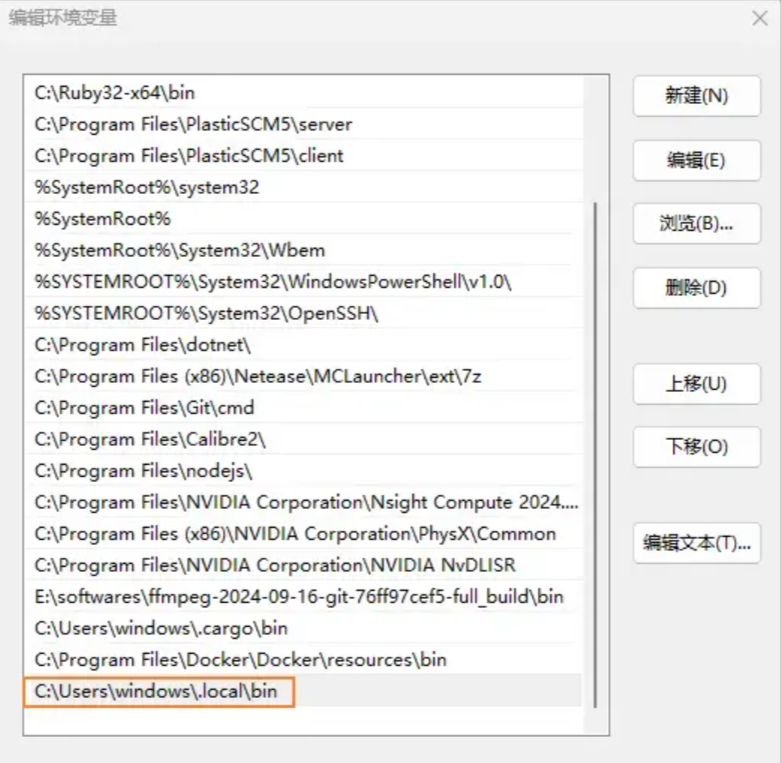
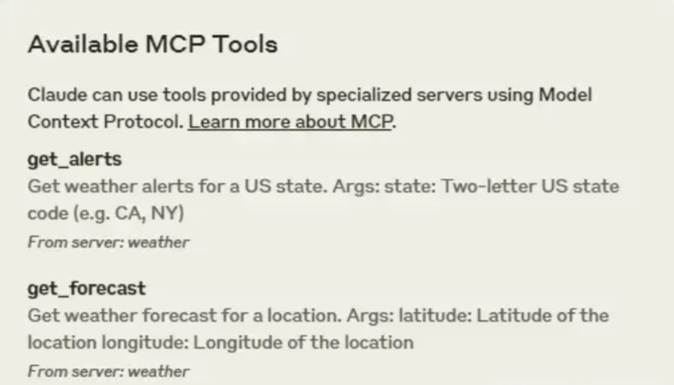
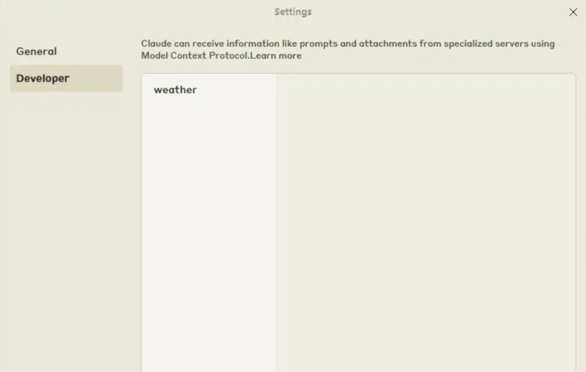
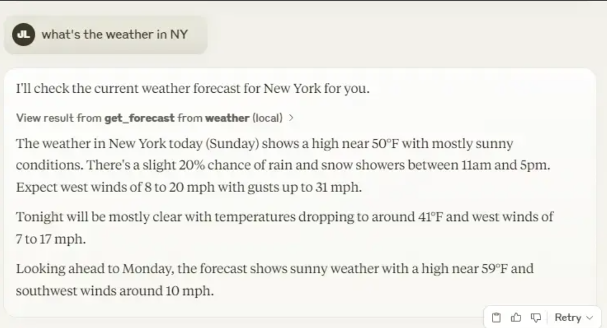
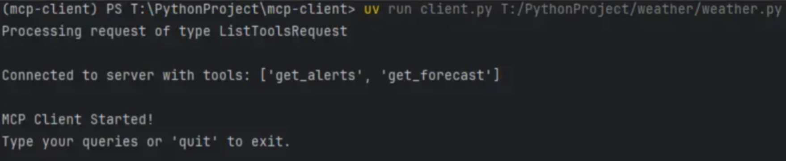

# 01.MCP基础概念与快速入门

## 示例代码

[mcp-demo.zip](https://www.yuque.com/attachments/yuque/0/2025/zip/2424104/1753931389683-a2fe4d0e-e16b-45d1-bebf-c01a2405c9e5.zip)

## <font style="color:rgb(51, 51, 51);">MCP基础概念</font>

<font style="color:rgb(51, 51, 51);">MCP（Model Context Protocol，模型上下文协议） ，2024 年 11 月底，由 Anthropic 推出的一种开放标准，旨在统一大型语言模型（LLM）与外部数据源和工具之间的通信协议。MCP 的主要目的在于解决当前 AI 模型因数据孤岛限制而无法充分发挥潜力的难题，MCP 使得 AI 应用能够安全地访问和操作本地及远程数据，为 AI 应用提供了连接万物的接口。</font>

<font style="color:rgb(51, 51, 51);">Function Calling 是 AI 模型调用函数的机制，MCP 是一个标准协议，使 AI 模型与 API 无缝交互，而 AI Agent 是一个自主运行的智能系统，利用 Function Calling 和 MCP 来分析和执行任务，实现特定目标。</font>

<font style="color:rgb(51, 51, 51);">MCP 官方文档：</font>[<font style="color:rgb(65, 131, 196);">https://modelcontextprotocol.io/introduction</font>](https://modelcontextprotocol.io/introduction)

<font style="color:rgb(51, 51, 51);">MCP 客户端：</font>[<font style="color:rgb(65, 131, 196);">https://modelcontextprotocol.io/clients</font>](https://modelcontextprotocol.io/clients)

<font style="color:rgb(51, 51, 51);">MCP SDK：</font>[<font style="color:rgb(65, 131, 196);">https://github.com/modelcontextprotocol/python-sdk</font>](https://github.com/modelcontextprotocol/python-sdk)

### <font style="color:rgb(51, 51, 51);">MCP 核心架构</font>

* <font style="color:rgb(51, 51, 51);">MCP 主机（MCP Hosts）：发起请求的 LLM 应用程序（例如 Claude Desktop、IDE 或 AI 工具）。</font>
* <font style="color:rgb(51, 51, 51);">MCP 客户端（MCP Clients）：在主机程序内部，与 MCP server 保持 1:1 的连接。</font>
* <font style="color:rgb(51, 51, 51);">MCP 服务器（MCP Servers）：为 MCP client 提供上下文、工具和 prompt 信息。</font>
* <font style="color:rgb(51, 51, 51);">本地资源（Local Resources）：本地计算机中可供 MCP server 安全访问的资源（例如文件、数据库）。</font>
* <font style="color:rgb(51, 51, 51);">远程资源（Remote Resources）：MCP server 可以连接到的远程资源（例如通过 API）。</font>


<font style="color:rgb(51, 51, 51);">MCP client 充当 LLM 和 MCP server 之间的桥梁，MCP client 的工作流程如下：</font>

* <font style="color:rgb(51, 51, 51);">MCP client 首先从 MCP server 获取可用的工具列表。</font>
* <font style="color:rgb(51, 51, 51);">将用户的查询连同工具描述通过 function calling 一起发送给 LLM。</font>
* <font style="color:rgb(51, 51, 51);">LLM 决定是否需要使用工具以及使用哪些工具。</font>
* <font style="color:rgb(51, 51, 51);">如果需要使用工具，MCP client 会通过 MCP server 执行相应的工具调用。</font>
* <font style="color:rgb(51, 51, 51);">工具调用的结果会被发送回 LLM。</font>
* <font style="color:rgb(51, 51, 51);">LLM 基于所有信息生成自然语言响应。</font>
* <font style="color:rgb(51, 51, 51);">最后将响应展示给用户。</font>

### <font style="color:rgb(51, 51, 51);">MCP 通信机制</font>

<font style="color:rgb(51, 51, 51);">MCP 协议支持两种主要的通信机制：基于标准输入输出 stdio 的本地通信和基于 SSE（Server-Sent Events）的远程通信。这两种机制都使用 JSON-RPC 2.0 格式进行消息传输，确保了通信的标准化和可扩展性。</font>

* <font style="color:rgb(51, 51, 51);">本地通信：通过 stdio 传输数据，适用于在同一台机器上运行的客户端和服务器之间的通信。</font>
* <font style="color:rgb(51, 51, 51);">远程通信：利用 SSE 与 HTTP 结合，实现跨网络的实时数据传输，适用于需要访问远程资源或分布式部署的场景。</font>

### <font style="color:rgb(51, 51, 51);">MCP Server</font>

<font style="color:rgb(51, 51, 51);">MCP Server 是 MCP 架构中的关键组件，它可以提供 3 种主要类型的功能：</font>

* <font style="color:rgb(51, 51, 51);">资源（Resources）：类似文件的数据，可以被客户端读取，如 API 响应或文件内容。</font>
* <font style="color:rgb(51, 51, 51);">工具（Tools）：可以被 LLM 调用的函数（需要用户批准）。</font>
* <font style="color:rgb(51, 51, 51);">提示（Prompts）：预先编写的模板，帮助用户完成特定任务。</font>

<font style="color:rgb(51, 51, 51);">这些功能使 MCP server 能够为 AI 应用提供丰富的上下文信息和操作能力，从而增强 LLM 的实用性和灵活性。</font>

## <font style="color:rgb(51, 51, 51);">MCP快速入门</font>

<font style="color:rgb(51, 51, 51);">MCP 通过三种主要原语（Primitives）增强 LLM 的功能，理解这些原语是编写 MCP 的关键：</font>

1. **<font style="color:rgb(51, 51, 51);">提示（Prompts）</font>**<font style="color:rgb(51, 51, 51);">：预定义的指令或模板，指导 LLM 如何处理输入或生成输出。</font>
2. **<font style="color:rgb(51, 51, 51);">资源（Resources）</font>**<font style="color:rgb(51, 51, 51);">：提供额外上下文的结构化数据，例如文件或数据库内容。</font>
3. **<font style="color:rgb(51, 51, 51);">工具（Tools）</font>**<font style="color:rgb(51, 51, 51);">：可执行的函数，允许 LLM 执行操作（如查询 API）或检索信息。</font>

* **<font style="color:rgb(51, 51, 51);">关键点</font>**<font style="color:rgb(51, 51, 51);">：这些原语是 MCP 的核心，决定了服务器能为 LLM 提供什么能力。</font>

<font style="color:rgb(51, 51, 51);">在我们的示例中，使用 </font>**<font style="color:rgb(51, 51, 51);">Claude for Desktop</font>**<font style="color:rgb(51, 51, 51);"> 作为客户端，自己编写 python 文件作为服务端，在 Claude Desktop 里调用 server.py。</font>

**<font style="color:rgb(51, 51, 51);">先决条件</font>**

* <font style="color:rgb(51, 51, 51);">已安装 python 3.10 或更高</font>
* <font style="color:rgb(51, 51, 51);">已安装 Claude for Desktop</font>

### <font style="color:rgb(51, 51, 51);">1. 安装 uv，设置环境变量</font>

<font style="color:rgb(51, 51, 51);">打开 Powershell，输入如下命令：</font>

```plain
powershell -ExecutionPolicy ByPass -c "irm https://astral.sh/uv/install.ps1 | iex"
```

<font style="color:rgb(51, 51, 51);">打开系统高级环境变量，在 </font><code><font style="color:rgb(51, 51, 51);background-color:rgb(243, 244, 244);">Path</font></code><font style="color:rgb(51, 51, 51);"> 将 uv 路径添加进去：</font>

```plain
setx UV_HOME "C:\Users\windows\.local\bin"
```



<font style="color:rgb(51, 51, 51);">重启 Powershell 。 在命令行输入 </font><code><font style="color:rgb(51, 51, 51);background-color:rgb(243, 244, 244);">uv</font></code><font style="color:rgb(51, 51, 51);">  ， 能返回版本信息就算安装成功了:</font>

<font style="color:rgb(51, 51, 51);"></font>

### <font style="color:rgb(51, 51, 51);">2. 创建和设置项目</font>

<font style="color:rgb(51, 51, 51);">打开 </font>**<font style="color:rgb(51, 51, 51);">Powershell</font>**<font style="color:rgb(51, 51, 51);"> ， </font><code><font style="color:rgb(51, 51, 51);background-color:rgb(243, 244, 244);">cd</font></code><font style="color:rgb(51, 51, 51);"> 到你想要创建项目的目录位置</font>

<font style="color:rgb(51, 51, 51);">接着依次输入以下命令：</font>

```plain
uv init weather
cd weather
uv venv
.venv\Scripts\activate
uv add mcp[cli] httpx
new-item weather.py
```

### <font style="color:rgb(51, 51, 51);">3. 添加代码</font>

<font style="color:rgb(51, 51, 51);">将以下代码整个复制到 </font><code><font style="color:rgb(51, 51, 51);background-color:rgb(243, 244, 244);">weather.py</font></code><font style="color:rgb(51, 51, 51);">：</font>

```plain
from typing import Any  
import httpx  
from mcp.server.fastmcp import FastMCP  
  

mcp = FastMCP("weather")  
  

NWS_API_BASE = "https://api.weather.gov"  
USER_AGENT = "weather-app/1.0"  
  
async def make_nws_request(url: str) -> dict[str, Any] | None:  
    """Make a request to the NWS API with proper error handling."""  
    headers = {  
        "User-Agent": USER_AGENT,  
        "Accept": "application/geo+json"  
    }  
    async with httpx.AsyncClient() as client:  
        try:  
            response = await client.get(url, headers=headers, timeout=30.0)  
            response.raise_for_status()  
            return response.json()  
        except Exception:  
            return None  
  
def format_alert(feature: dict) -> str:  
    """Format an alert feature into a readable string."""  
    props = feature["properties"]  
    return f"""  
Event: {props.get('event', 'Unknown')}  
Area: {props.get('areaDesc', 'Unknown')}  
Severity: {props.get('severity', 'Unknown')}  
Description: {props.get('description', 'No description available')}  
Instructions: {props.get('instruction', 'No specific instructions provided')}  
"""  
  
@mcp.tool()  
async def get_alerts(state: str) -> str:  
    """Get weather alerts for a US state.  
  
    Args:        state: Two-letter US state code (e.g. CA, NY)    """    url = f"{NWS_API_BASE}/alerts/active/area/{state}"  
    data = await make_nws_request(url)  
  
    if not data or "features" not in data:  
        return "Unable to fetch alerts or no alerts found."  
  
    if not data["features"]:  
        return "No active alerts for this state."  
  
    alerts = [format_alert(feature) for feature in data["features"]]  
    return "\n---\n".join(alerts)  
  
@mcp.tool()  
async def get_forecast(latitude: float, longitude: float) -> str:  
    """Get weather forecast for a location.  
  
    Args:        latitude: Latitude of the location        longitude: Longitude of the location    """    
    points_url = f"{NWS_API_BASE}/points/{latitude},{longitude}"  
    points_data = await make_nws_request(points_url)  
  
    if not points_data:  
        return "Unable to fetch forecast data for this location."  
  
    
    forecast_url = points_data["properties"]["forecast"]  
    forecast_data = await make_nws_request(forecast_url)  
  
    if not forecast_data:  
        return "Unable to fetch detailed forecast."  
  
    
    periods = forecast_data["properties"]["periods"]  
    forecasts = []  
    for period in periods[:5]:  
        forecast = f"""  
{period['name']}:  
Temperature: {period['temperature']}°{period['temperatureUnit']}  
Wind: {period['windSpeed']} {period['windDirection']}  
Forecast: {period['detailedForecast']}  
"""  
        forecasts.append(forecast)  
  
    return "\n---\n".join(forecasts)  
  
if __name__ == "__main__":  
    
    mcp.run(transport='stdio')
```

<font style="color:rgb(51, 51, 51);">如果代码里提示依赖错误，安装对应的包就好。</font>

### <font style="color:rgb(51, 51, 51);">4. 运行服务</font>

<font style="color:rgb(51, 51, 51);">打开 </font>**<font style="color:rgb(51, 51, 51);">Claude for Desktop</font>**<font style="color:rgb(51, 51, 51);"> , 点击左上角菜单 —— File —— Settings —— Developer</font>

<font style="color:rgb(51, 51, 51);">点击 </font><code><font style="color:rgb(51, 51, 51);background-color:rgb(243, 244, 244);">Edit Config</font></code><font style="color:rgb(51, 51, 51);"> ，就会在 </font><code><font style="color:rgb(51, 51, 51);background-color:rgb(243, 244, 244);">C:\Users\windows\AppData\Roaming\Claude</font></code><font style="color:rgb(51, 51, 51);"> 目录下自动创建 </font><code><font style="color:rgb(51, 51, 51);background-color:rgb(243, 244, 244);">claude_desktop_config.json</font></code><font style="color:rgb(51, 51, 51);"> 文件。</font>

<font style="color:rgb(51, 51, 51);">打开 </font><code><font style="color:rgb(51, 51, 51);background-color:rgb(243, 244, 244);">claude_desktop_config.json</font></code><font style="color:rgb(51, 51, 51);"> , 添加如下代码：</font>

```plain
{
    "mcpServers": {
        "weather": {
            "command": "uv",
            "args": [
                "--directory",
                "T:\\PythonProject\\weather",
                "run",
                "weather.py"
            ]
        }
    }
}
```

<font style="color:rgb(51, 51, 51);">其中路径为在上一步创建的</font><code><font style="color:rgb(51, 51, 51);background-color:rgb(243, 244, 244);">weather</font></code><font style="color:rgb(51, 51, 51);">目录, 使用</font>**<font style="color:rgb(51, 51, 51);">绝对路径</font>**<font style="color:rgb(51, 51, 51);">。</font>

<font style="color:rgb(51, 51, 51);">这会告诉 Claude for Desktop ，</font>

* <font style="color:rgb(51, 51, 51);">我们的服务名叫 </font><code><font style="color:rgb(51, 51, 51);background-color:rgb(243, 244, 244);">weather</font></code><font style="color:rgb(51, 51, 51);"> ,</font>
* <font style="color:rgb(51, 51, 51);">通过 </font><code><font style="color:rgb(51, 51, 51);background-color:rgb(243, 244, 244);">uv --directory T:\\PythonProject\\weather run weather</font></code><font style="color:rgb(51, 51, 51);"> 来启动服务。</font>

<font style="color:rgb(51, 51, 51);">保存文件。</font>

### <font style="color:rgb(51, 51, 51);">5. 在 Claude 中使用服务</font>

<font style="color:rgb(51, 51, 51);">打开</font>**<font style="color:rgb(51, 51, 51);">任务管理器</font>**<font style="color:rgb(51, 51, 51);">，将 Claude </font>**<font style="color:rgb(51, 51, 51);">结束任务</font>**<font style="color:rgb(51, 51, 51);">，彻底关掉。 重新打开 </font>**<font style="color:rgb(51, 51, 51);">Claude for Desktop</font>**<font style="color:rgb(51, 51, 51);"> 。</font>

<font style="color:rgb(51, 51, 51);">如果在 Claude 的对话框下看到了一把</font>**<font style="color:rgb(51, 51, 51);">锤子</font>**<font style="color:rgb(51, 51, 51);">，说明我们的 MCP 服务配置成功了。</font>


<font style="color:rgb(51, 51, 51);">点击锤子能看到：  </font>



<font style="color:rgb(51, 51, 51);">在设置页显示如下： </font>



**<font style="color:rgb(51, 51, 51);">下面测试服务：</font>**

<font style="color:rgb(51, 51, 51);">在对话框输入：</font>*<font style="color:rgb(51, 51, 51);">what's the weather in NY</font>*



<font style="color:rgb(51, 51, 51);">服务配置成功啦！</font>

<font style="color:rgb(119, 119, 119);">要使用 Claude API, 需要充值购买 credits 否则请求会报 Error: Error code: 403 - {'error': {'type': 'forbidden', 'message': 'Request not allowed'}}</font>

## <font style="color:rgb(79, 79, 79);">MCP Client</font>

### <font style="color:rgb(51, 51, 51);">1. 创建和设置项目</font>

<font style="color:rgb(51, 51, 51);">前期的步骤与上文介绍的一致，先决条件和 uv 的安装看 </font>**<font style="color:rgb(51, 51, 51);">MCP Server</font>**<font style="color:rgb(51, 51, 51);"> 部分。 打开 Powershell , cd 到 python 项目的目录下，依次输入如下命令：</font>

```plain
uv init mcp-client
cd mcp-client
uv venv
.venv\Scripts\activate
source .venv/bin/activate
uv add mcp anthropic python-dotenv
new-item client.py
```

### <font style="color:rgb(51, 51, 51);">2. 配置 API_KEY</font>

```plain
new-item .env
```

<font style="color:rgb(51, 51, 51);">打开</font><code><font style="color:rgb(51, 51, 51);background-color:rgb(243, 244, 244);">.env</font></code><font style="color:rgb(51, 51, 51);">文件，复制以下代码：</font>

```plain
ANTHROPIC_API_KEY=<your key here>
```

<font style="color:rgb(51, 51, 51);">在 </font>[<font style="color:rgb(65, 131, 196);">Claude 控制台</font>](https://console.anthropic.com/settings/keys)<font style="color:rgb(51, 51, 51);">创建 KEY（需充值才能用），将 API Key 复制到</font><code><font style="color:rgb(51, 51, 51);background-color:rgb(243, 244, 244);">.env</font></code><font style="color:rgb(51, 51, 51);"> （确保 key 的安全，不要分享出去！）</font>

<font style="color:rgb(51, 51, 51);">将</font><code><font style="color:rgb(51, 51, 51);background-color:rgb(243, 244, 244);">.env</font></code><font style="color:rgb(51, 51, 51);">文件添加到. gitignore , 在 powershell 输入以下命令：</font>

```plain
echo ".env" >> .gitignore
```

### <font style="color:rgb(51, 51, 51);">3. 添加代码</font>

```plain
import asyncio  
from typing import Optional  
from contextlib import AsyncExitStack  
  
from mcp import ClientSession, StdioServerParameters  
from mcp.client.stdio import stdio_client  
  
from anthropic import Anthropic  
from dotenv import load_dotenv  
  
load_dotenv()  
  
class MCPClient:  
    def __init__(self):  
        
        self.session: Optional[ClientSession] = None  
        self.exit_stack = AsyncExitStack()  
        self.anthropic = Anthropic()  
    
  
    async def connect_to_server(self, server_script_path: str):  
        """Connect to an MCP server  
  
        Args:            server_script_path: Path to the server script (.py or .js)        """        is_python = server_script_path.endswith('.py')  
        is_js = server_script_path.endswith('.js')  
        if not (is_python or is_js):  
            raise ValueError("Server script must be a .py or .js file")  
  
        command = "python" if is_python else "node"  
        server_params = StdioServerParameters(  
            command=command,  
            args=[server_script_path],  
            env=None  
        )  
  
        stdio_transport = await self.exit_stack.enter_async_context(stdio_client(server_params))  
        self.stdio, self.write = stdio_transport  
        self.session = await self.exit_stack.enter_async_context(ClientSession(self.stdio, self.write))  
  
        await self.session.initialize()  
  
        
        response = await self.session.list_tools()  
        tools = response.tools  
        print("\nConnected to server with tools:", [tool.name for tool in tools])  
  
    async def process_query(self, query: str) -> str:  
        """Process a query using Claude and available tools"""  
        messages = [  
            {  
                "role": "user",  
                "content": query  
            }  
        ]  
  
        response = await self.session.list_tools()  
        available_tools = [{  
            "name": tool.name,  
            "description": tool.description,  
            "input_schema": tool.inputSchema  
        } for tool in response.tools]  
  
        
        response = self.anthropic.messages.create(  
            model="claude-3-5-sonnet-20241022",  
            max_tokens=1000,  
            messages=messages,  
            tools=available_tools  
        )  
  
        
        tool_results = []  
        final_text = []  
  
        assistant_message_content = []  
        for content in response.content:  
            if content.type == 'text':  
                final_text.append(content.text)  
                assistant_message_content.append(content)  
            elif content.type == 'tool_use':  
                tool_name = content.name  
                tool_args = content.input  
  
                
                result = await self.session.call_tool(tool_name, tool_args)  
                tool_results.append({"call": tool_name, "result": result})  
                final_text.append(f"[Calling tool {tool_name} with args {tool_args}]")  
  
                assistant_message_content.append(content)  
                messages.append({  
                    "role": "assistant",  
                    "content": assistant_message_content  
                })  
                messages.append({  
                    "role": "user",  
                    "content": [  
                        {  
                            "type": "tool_result",  
                            "tool_use_id": content.id,  
                            "content": result.content  
                        }  
                    ]  
                })  
  
                
                response = self.anthropic.messages.create(  
                    model="claude-3-5-sonnet-20241022",  
                    max_tokens=1000,  
                    messages=messages,  
                    tools=available_tools  
                )  
  
                final_text.append(response.content[0].text)  
  
        return "\n".join(final_text)  
  
    async def chat_loop(self):  
        """Run an interactive chat loop"""  
        print("\nMCP Client Started!")  
        print("Type your queries or 'quit' to exit.")  
  
        while True:  
            try:  
                query = input("\nQuery: ").strip()  
  
                if query.lower() == 'quit':  
                    break  
  
                response = await self.process_query(query)  
                print("\n" + response)  
  
            except Exception as e:  
                print(f"\nError: {str(e)}")  
  
    async def cleanup(self):  
        """Clean up resources"""  
        await self.exit_stack.aclose()  
  
async def main():  
    if len(sys.argv) < 2:  
        print("Usage: python client.py <path_to_server_script>")  
        sys.exit(1)  
  
    client = MCPClient()  
    try:  
        await client.connect_to_server(sys.argv[1])  
        await client.chat_loop()  
    finally:  
        await client.cleanup()  
  
if __name__ == "__main__":  
    import sys  
    asyncio.run(main())
```

<font style="color:rgb(51, 51, 51);">如果开头 anthropic 报错，安装 anthropic 就好。</font>

### <font style="color:rgb(51, 51, 51);">4. 运行 Client</font>

<font style="color:rgb(51, 51, 51);">这里我们使用上文创建的 mcp 服务 </font>**<font style="color:rgb(51, 51, 51);">weather</font>**<font style="color:rgb(51, 51, 51);"> 在 powershell 输入</font>

```plain
uv run client.py T:/PythonProject/weather/weather.py
```



<font style="color:rgb(51, 51, 51);">接着，我们就可以在 Query 输入问题了。</font>

<font style="color:rgb(51, 51, 51);">至此，我们的第一个 MCP 服务端和客户端编写完成。</font>

##


> 更新: 2025-07-31 11:09:49  
> 原文: <https://www.yuque.com/aaron-wecc3/dhluml/rlxq4pcdttz369rl>