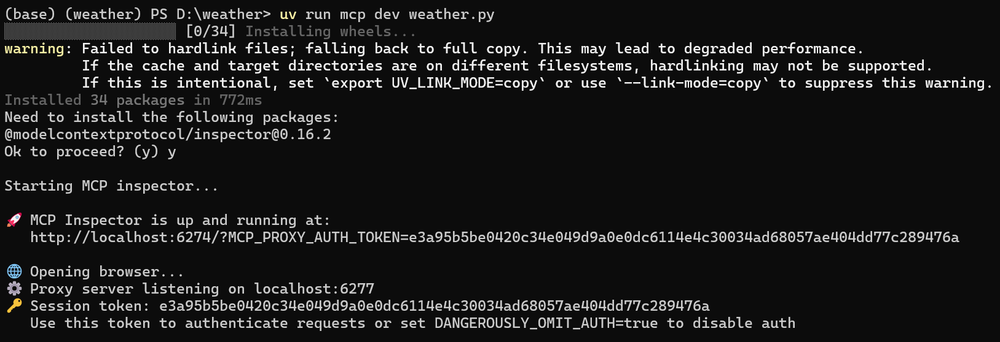
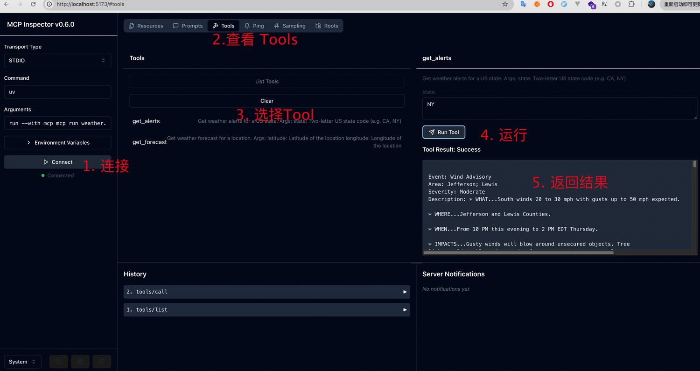
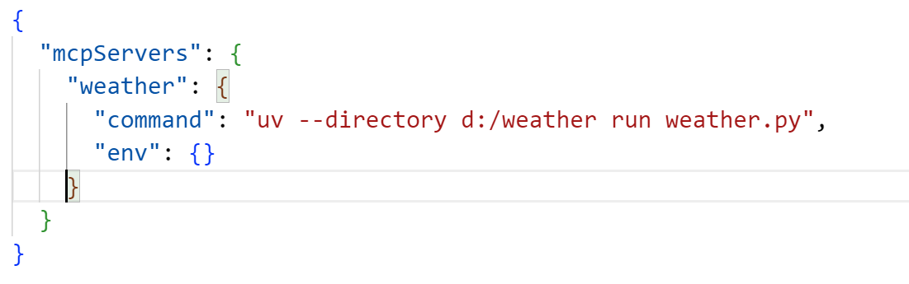
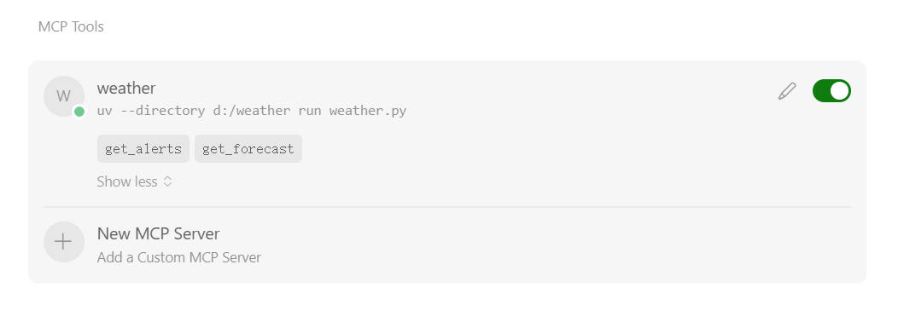
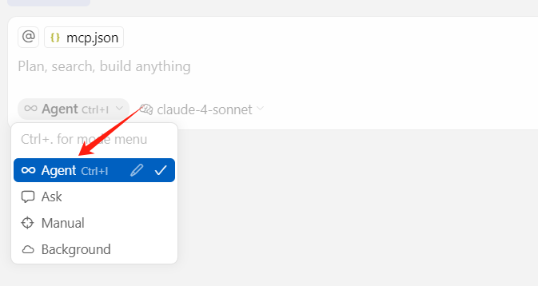
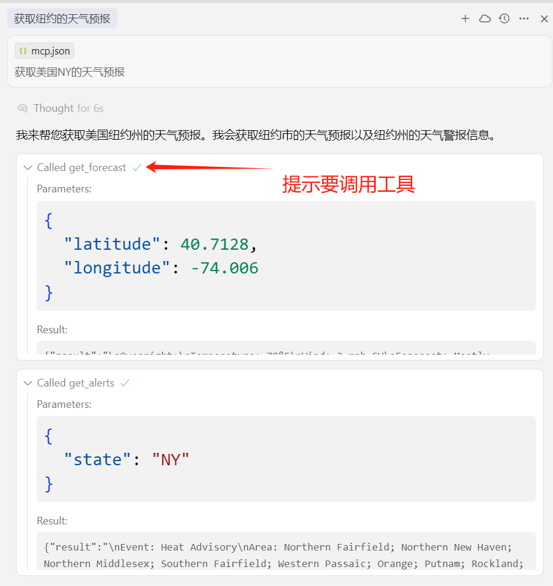
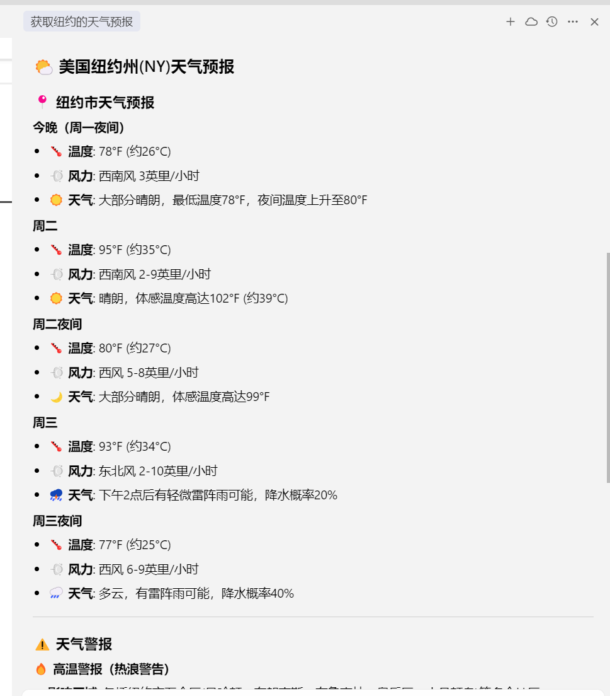
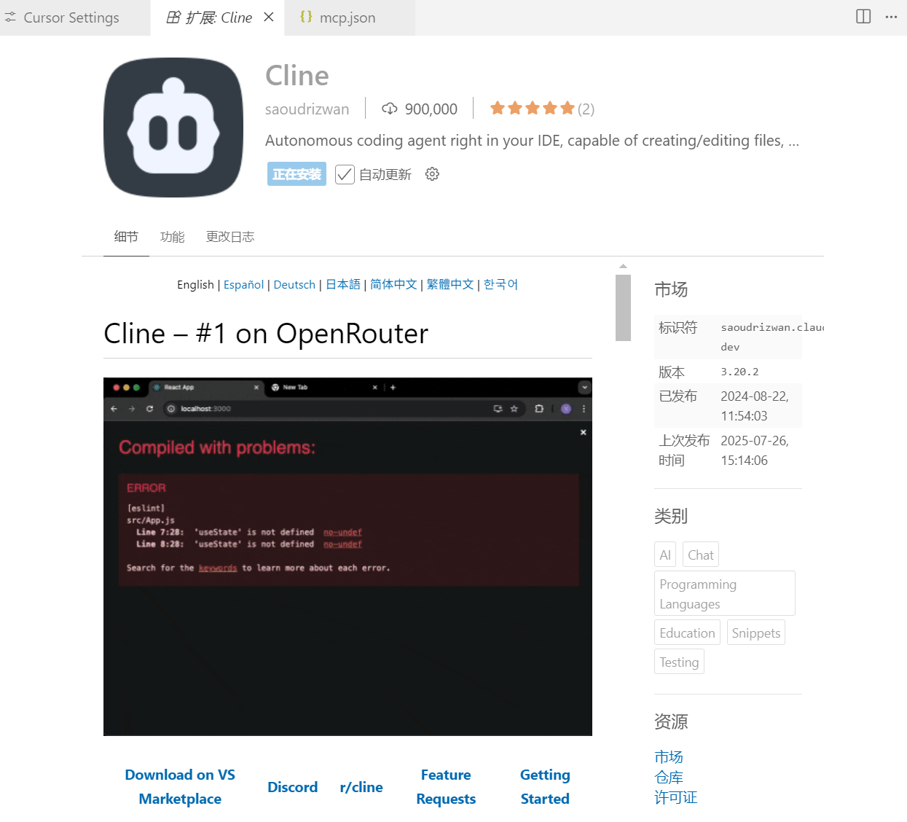
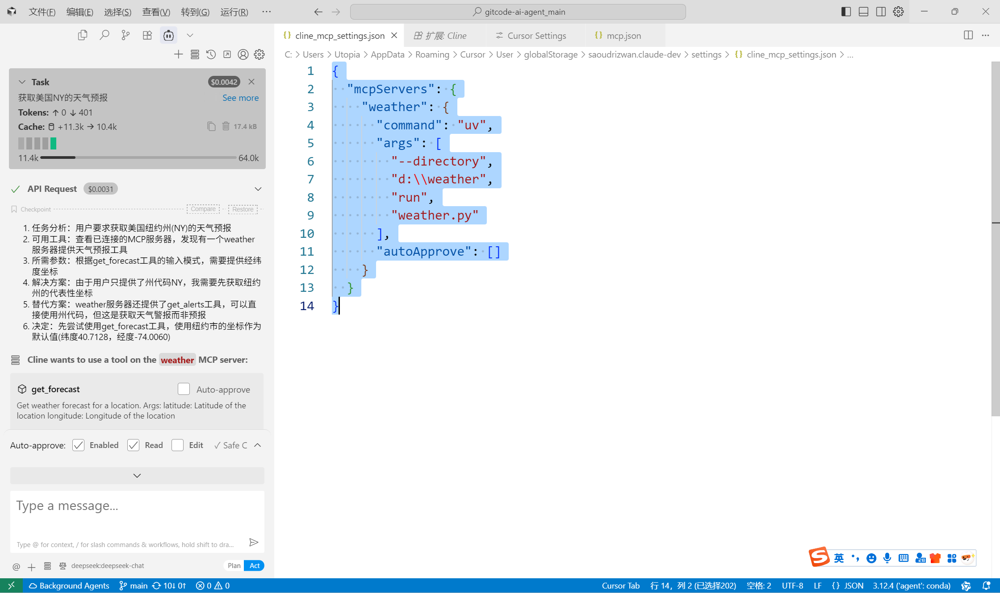

# 02.MCP服务端开发与多客户端调用

## 示例代码

[mcp-demo.zip](https://www.yuque.com/attachments/yuque/0/2025/zip/2424104/1753931389964-1a3dece0-253c-4af4-90d1-743822b722fb.zip)

## <font style="color:rgb(51, 51, 51);">MCP服务端开发</font>

接下来我们介绍 Model Context [Protocol](https://so.csdn.net/so/search?q=Protocol\&spm=1001.2101.3001.7020)（MCP）Python SDK 的使用方法和核心概念。MCP 是一种用于将外部数据源和工具与大型语言模型（LLM）应用集成的开放协议。通过 MCP，开发者可以构建 MCP 客户端连接到任何 MCP 服务器，创建暴露资源、提示和工具的 MCP 服务器，并处理所有 MCP 协议消息和生命周期事件。本文将涵盖 MCP 的安装、快速入门、核心概念、服务器运行方式、示例以及高级用法等内容。

### 一、概述

MCP Python SDK 实现了完整的 MCP 规范，使开发者能够轻松地构建 MCP 客户端和服务器。它支持标准传输如 stdio、SSE 和 Streamable HTTP，并且能够处理所有 MCP 协议消息和生命周期事件。

### 二、安装

#### （一）添加 MCP 到 Python 项目

<font style="color:rgb(51, 51, 51);">安装 uv 命令</font>

```plain
powershell -ExecutionPolicy ByPass -c "irm https://astral.sh/uv/install.ps1 | iex"
```

推荐使用 uv 来管理 Python 项目。如果尚未创建 uv 管理的项目，可以按照以下步骤创建：

```plain
uv init mcp-server-demo
cd mcp-server-demo
```

然后将 MCP 添加到项目依赖项中：

```plain
uv add "mcp[cli]"
```

对于使用 pip 管理依赖项的项目，可以运行以下命令：

```plain
pip install "mcp[cli]"
```

#### （二）运行独立的 MCP 开发工具

使用 uv 运行 mcp 命令：

```plain
uv run mcp
```

### 三、快速入门

下面创建一个简单的 MCP 服务器，它暴露了一个计算器工具和一些数据：

```plain
# server.py
from mcp.server.fastmcp import FastMCP

# 创建一个 MCP 服务器
mcp = FastMCP("Demo")


# 添加一个加法工具
@mcp.tool()
def add(a: int, b: int) -> int:
    """添加两个数字"""
    return a + b


# 添加一个动态问候资源
@mcp.resource("greeting://{name}")
def get_greeting(name: str) -> str:
    """获取个性化问候"""
    return f"Hello, {name}!"

```

可以通过以下命令将此服务器安装到 Claude Desktop 并立即与其交互：

```plain
mcp install server.py

```

或者，可以使用 MCP Inspector 进行测试：

```plain
mcp dev server.py

```

### 四、核心概念

#### （一）服务器

FastMCP 服务器是与 MCP 协议交互的核心接口。它处理连接管理、协议合规性和消息路由。以下是一个示例：

```plain
# 添加生命周期支持以启用启动/关闭和强类型
from contextlib import asynccontextmanager
from collections.abc import AsyncIterator
from dataclasses import dataclass

from fake_database import Database  # 替换为实际的数据库类型

from mcp.server.fastmcp import Context, FastMCP

# 创建一个命名服务器
mcp = FastMCP("My App")

# 指定部署和开发的依赖项
mcp = FastMCP("My App", dependencies=["pandas", "numpy"])


@dataclass
class AppContext:
    db: Database


@asynccontextmanager
async def app_lifespan(server: FastMCP) -> AsyncIterator[AppContext]:
    """使用类型安全的上下文管理应用程序生命周期"""
    # 启动时初始化
    db = await Database.connect()
    try:
        yield AppContext(db=db)
    finally:
        # 关闭时清理
        await db.disconnect()


# 将生命周期传递给服务器
mcp = FastMCP("My App", lifespan=app_lifespan)


# 在工具中访问类型安全的生命周期上下文
@mcp.tool()
def query_db(ctx: Context) -> str:
    """使用初始化资源的工具"""
    db = ctx.request_context.lifespan_context.db
    return db.query()

```

#### （二）资源

资源是向 LLM 暴露数据的方式，类似于 REST API 中的 GET 端点。它们提供数据，但不应执行大量计算或产生副作用。示例如下：

```plain
from mcp.server.fastmcp import FastMCP

mcp = FastMCP("My App")


@mcp.resource("config://app")
def get_config() -> str:
    """静态配置数据"""
    return "App 配置信息"


@mcp.resource("users://{user_id}/profile")
def get_user_profile(user_id: str) -> str:
    """动态用户数据"""
    return f"用户 {user_id} 的个人资料数据"

```

#### （三）工具

工具允许 LLM 通过服务器执行操作。与资源不同，工具预期会执行计算并产生副作用。示例代码如下：

```plain
import httpx
from mcp.server.fastmcp import FastMCP

mcp = FastMCP("My App")


@mcp.tool()
def calculate_bmi(weight_kg: float, height_m: float) -> float:
    """根据体重（千克）和身高（米）计算 BMI"""
    return weight_kg / (height_m**2)


@mcp.tool()
async def fetch_weather(city: str) -> str:
    """获取城市的当前天气"""
    async with httpx.AsyncClient() as client:
        response = await client.get(f"https://api.weather.com/{city}")
        return response.text

```

#### （四）提示

提示是可重用的模板，可帮助 LLM 有效地与服务器交互。示例如下：

```plain
from mcp.server.fastmcp import FastMCP
from mcp.server.fastmcp.prompts import base

mcp = FastMCP("My App")


@mcp.prompt()
def review_code(code: str) -> str:
    return f"请审查以下代码：\n\n{code}"


@mcp.prompt()
def debug_error(error: str) -> list[base.Message]:
    return [
        base.UserMessage("我遇到以下错误："),
        base.UserMessage(error),
        base.AssistantMessage("我将帮助你调试。你之前尝试过什么？"),
    ]

```

#### （五）图像

FastMCP 提供了一个 `Image` 类，可以自动处理图像数据。示例如下：

```plain
from mcp.server.fastmcp import FastMCP, Image
from PIL import Image as PILImage

mcp = FastMCP("My App")


@mcp.tool()
def create_thumbnail(image_path: str) -> Image:
    """从图像创建缩略图"""
    img = PILImage.open(image_path)
    img.thumbnail((100, 100))
    return Image(data=img.tobytes(), format="png")

```

#### （六）上下文

上下文对象为工具和资源提供了访问 MCP 功能的能力。示例如下：

```plain
from mcp.server.fastmcp import FastMCP, Context

mcp = FastMCP("My App")


@mcp.tool()
async def long_task(files: list[str], ctx: Context) -> str:
    """处理多个文件并跟踪进度"""
    for i, file in enumerate(files):
        ctx.info(f"正在处理 {file}")
        await ctx.report_progress(i, len(files))
        data, mime_type = await ctx.read_resource(f"file://{file}")
    return "处理完成"

```

#### （七）认证

服务器可以使用认证来暴露访问受保护资源的工具。`mcp.server.auth` 实现了一个 OAuth 2.0 服务器接口，服务器可以通过提供 `OAuthServerProvider` 协议的实现来使用它。示例如下：

```plain
mcp = FastMCP("My App",
        auth_server_provider=MyOAuthServerProvider(),
        auth=AuthSettings(
            issuer_url="https://myapp.com",
            revocation_options=RevocationOptions(
                enabled=True,
            ),
            client_registration_options=ClientRegistrationOptions(
                enabled=True,
                valid_scopes=["myscope", "myotherscope"],
                default_scopes=["myscope"],
            ),
            required_scopes=["myscope"],
        ),
)

```

### 五、运行服务器

#### （一）开发模式

使用 MCP Inspector 测试和调试服务器是最快捷的方式：

```plain
mcp dev server.py

# 添加依赖项
mcp dev server.py --with pandas --with numpy

# 挂载本地代码
mcp dev server.py --with-editable .

```

#### （二）多客户端调用

#### （三）直接执行

对于高级场景如自定义部署：

```plain
from mcp.server.fastmcp import FastMCP

mcp = FastMCP("My App")

if __name__ == "__main__":
    mcp.run()

```

运行命令如下：

```plain
python server.py
# 或
mcp run server.py

```

#### （四）Streamable HTTP 传输

Streamable HTTP 传输正在取代 SSE 传输用于生产部署：

```plain
from mcp.server.fastmcp import FastMCP

# 有状态服务器（维护会话状态）
mcp = FastMCP("StatefulServer")

# 无状态服务器（无会话持久化）
mcp = FastMCP("StatelessServer", stateless_http=True)

# 无状态服务器（无会话持久化，无支持的客户端的 sse 流）
mcp = FastMCP("StatelessServer", stateless_http=True, json_response=True)

# 使用 streamable_http 传输运行服务器
mcp.run(transport="streamable-http")

```

可以将多个 FastMCP 服务器挂载到 FastAPI 应用中：

```plain
# echo.py
from mcp.server.fastmcp import FastMCP

mcp = FastMCP(, stateless_http=True)


@mcp.tool(description="一个简单的回显工具")
def echo(message: str) -> str:
    return f"回显：{message}"

```

```plain
# math.py
from mcp.server.fastmcp import FastMCP

mcp = FastMCP(, stateless_http=True)


@mcp.tool(description="一个简单的加法工具")
def add_two(n: int) -> int:
    return n + 2

```

```plain
# main.py
import contextlib
from fastapi import FastAPI
from mcp.echo import echo
from mcp.math import math


# 创建一个组合生命周期以管理两个会话管理器
@contextlib.asynccontextmanager
async def lifespan(app: FastAPI):
    async with contextlib.AsyncExitStack() as stack:
        await stack.enter_async_context(echo.mcp.session_manager.run())
        await stack.enter_async_context(math.mcp.session_manager.run())
        yield


app = FastAPI(lifespan=lifespan)
app.mount("/echo", echo.mcp.streamable_http_app())
app.mount("/math", math.mcp.streamable_http_app())

```

Streamable HTTP 传输支持以下功能：

* 有状态和无状态操作模式
* 使用事件存储的可恢复性
* JSON 或 SSE 响应格式
* 更好的多节点部署可扩展性

#### （五）挂载到现有 ASGI 服务器

SSE 传输正在被 Streamable HTTP 传输取代。默认情况下，SSE 服务器挂载在 `/sse`，Streamable HTTP 服务器挂载在 `/mcp`。可以通过以下方法自定义这些路径：

```plain
from starlette.applications import Starlette
from starlette.routing import Mount, Host
from mcp.server.fastmcp import FastMCP


mcp = FastMCP("My App")

# 将 SSE 服务器挂载到现有的 ASGI 服务器
app = Starlette(
    routes=[
        Mount('/', app=mcp.sse_app()),
    ]
)

# 或动态挂载为主机
app.router.routes.append(Host('mcp.acme.corp', app=mcp.sse_app()))

```

当在不同路径下挂载多个 MCP 服务器时，可以按以下几种方式配置挂载路径：

```plain
from starlette.applications import Starlette
from starlette.routing import Mount
from mcp.server.fastmcp import FastMCP

# 创建多个 MCP 服务器
github_mcp = FastMCP("GitHub API")
browser_mcp = FastMCP("Browser")
curl_mcp = FastMCP("Curl")
search_mcp = FastMCP("Search")

# 方法 1：通过设置（推荐用于持久配置）配置挂载路径
github_mcp.settings.mount_path = "/github"
browser_mcp.settings.mount_path = "/browser"

# 方法 2：直接将挂载路径传递给 sse_app（适用于临时挂载）
# 此方法不会永久修改服务器的设置

# 创建 Starlette 应用并挂载多个服务器
app = Starlette(
    routes=[
        # 使用基于设置的配置
        Mount("/github", app=github_mcp.sse_app()),
        Mount("/browser", app=browser_mcp.sse_app()),
        # 使用直接挂载路径参数
        Mount("/curl", app=curl_mcp.sse_app("/curl")),
        Mount("/search", app=search_mcp.sse_app("/search")),
    ]
)

# 方法 3：对于直接执行，也可以将挂载路径传递给 run()
if __name__ == "__main__":
    search_mcp.run(transport="sse", mount_path="/search")

```

有关在 Starlette 中挂载应用的更多信息，请参阅 [Starlette 文档](https://www.starlette.io/routing/#submounting-routes)。

### 六、示例

#### （一）回显服务器

一个简单的服务器，演示资源、工具和提示：

```plain
from mcp.server.fastmcp import FastMCP

mcp = FastMCP("Echo")


@mcp.resource("echo://{message}")
def echo_resource(message: str) -> str:
    """将消息作为资源回显"""
    return f"资源回显：{message}"


@mcp.tool()
def echo_tool(message: str) -> str:
    """将消息作为工具回显"""
    return f"工具回显：{message}"


@mcp.prompt()
def echo_prompt(message: str) -> str:
    """创建回显提示"""
    return f"请处理此消息：{message}"

```

#### （二）SQLite 探索器

一个更复杂的示例，展示数据库集成：

```plain
import sqlite3

from mcp.server.fastmcp import FastMCP

mcp = FastMCP("SQLite 探索器")


@mcp.resource("schema://main")
def get_schema() -> str:
    """将数据库模式作为资源提供"""
    conn = sqlite3.connect("database.db")
    schema = conn.execute("SELECT sql FROM sqlite_master WHERE type='table'").fetchall()
    return "\n".join(sql[0] for sql in schema if sql[0])


@mcp.tool()
def query_data(sql: str) -> str:
    """安全地执行 SQL 查询"""
    conn = sqlite3.connect("database.db")
    try:
        result = conn.execute(sql).fetchall()
        return "\n".join(str(row) for row in result)
    except Exception as e:
        return f"错误：{str(e)}"

```

### 七、高级用法

#### （一）低级服务器

为了获得更多的控制，可以直接使用低级服务器实现。这提供了对协议的完全访问，并允许自定义服务器的每个方面，包括通过生命周期 API 进行生命周期管理。示例如下：

```plain
from contextlib import asynccontextmanager
from collections.abc import AsyncIterator

from fake_database import Database  # 替换为实际的数据库类型

from mcp.server import Server


@asynccontextmanager
async def server_lifespan(server: Server) -> AsyncIterator[dict]:
    """管理服务器启动和关闭生命周期。"""
    # 启动时初始化资源
    db = await Database.connect()
    try:
        yield {"db": db}
    finally:
        # 关闭时清理
        await db.disconnect()


# 将生命周期传递给服务器
server = Server("example-server", lifespan=server_lifespan)


# 在处理程序中访问生命周期上下文
@server.call_tool()
async def query_db(name: str, arguments: dict) -> list:
    ctx = server.get_context()
    db = ctx.lifespan_context["db"]
    return await db.query(arguments["query"])

```

生命周期 API 提供以下功能：

* 在服务器启动时初始化资源，并在服务器停止时清理资源
* 通过请求上下文在处理程序中访问已初始化的资源
* 在生命周期和请求处理程序之间传递类型安全的上下文

```plain
import mcp.server.stdio
import mcp.types as types
from mcp.server.lowlevel import NotificationOptions, Server
from mcp.server.models import InitializationOptions

# 创建服务器实例
server = Server("example-server")


@server.list_prompts()
async def handle_list_prompts() -> list[types.Prompt]:
    return [
        types.Prompt(
            ,
            description="示例提示模板",
            arguments=[
                types.PromptArgument(
                    , required=True
                )
            ],
        )
    ]


@server.get_prompt()
async def handle_get_prompt(
    name: str, arguments: dict[str, str] | None
) -> types.GetPromptResult:
    if name != "example-prompt":
        raise ValueError(f"未知提示：{name}")

    return types.GetPromptResult(
        description="示例提示",
        messages=[
            types.PromptMessage(
                role="user",
                content=types.TextContent(type="text", text="示例提示文本"),
            )
        ],
    )


async def run():
    async with mcp.server.stdio.stdio_server() as (read_stream, write_stream):
        await server.run(
            read_stream,
            write_stream,
            InitializationOptions(
                server_,
                server_version="0.1.0",
                capabilities=server.get_capabilities(
                    notification_options=NotificationOptions(),
                    experimental_capabilities={},
                ),
            ),
        )


if __name__ == "__main__":
    import asyncio

    asyncio.run(run())

```

注意：`mcp run` 和 `mcp dev` 工具不支持低级服务器。

#### （二）编写 MCP 客户端

SDK 提供了一个高级客户端接口，用于使用各种传输连接到 MCP 服务器。示例如下：

```plain
from mcp import ClientSession, StdioServerParameters, types
from mcp.client.stdio import stdio_client

# 创建 stdio 连接的服务器参数
server_params = StdioServerParameters(
    command="python",  # 可执行文件
    args=["example_server.py"],  # 可选命令行参数
    env=None,  # 可选环境变量
)


# 可选：创建采样回调
async def handle_sampling_message(
    message: types.CreateMessageRequestParams,
) -> types.CreateMessageResult:
    return types.CreateMessageResult(
        role="assistant",
        content=types.TextContent(
            type="text",
            text="Hello, world! from model",
        ),
        model="gpt-3.5-turbo",
        stopReason="endTurn",
    )


async def run():
    async with stdio_client(server_params) as (read, write):
        async with ClientSession(
            read, write, sampling_callback=handle_sampling_message
        ) as session:
            # 初始化连接
            await session.initialize()

            # 列出可用提示
            prompts = await session.list_prompts()

            # 获取提示
            prompt = await session.get_prompt(
                "example-prompt", arguments={"arg1": "value"}
            )

            # 列出可用资源
            resources = await session.list_resources()

            # 列出可用工具
            tools = await session.list_tools()

            # 读取资源
            content, mime_type = await session.read_resource("file://some/path")

            # 调用工具
            result = await session.call_tool("tool-name", arguments={"arg1": "value"})


if __name__ == "__main__":
    import asyncio

    asyncio.run(run())

```

客户端也可以使用 Streamable HTTP 传输连接到服务器：

```plain
from mcp.client.streamable_http import streamablehttp_client
from mcp import ClientSession


async def main():
    # 连接到 Streamable HTTP 服务器
    async with streamablehttp_client("example/mcp") as (
        read_stream,
        write_stream,
        _,
    ):
        # 使用客户端流创建会话
        async with ClientSession(read_stream, write_stream) as session:
            # 初始化连接
            await session.initialize()
            # 调用工具
            tool_result = await session.call_tool("echo", {"message": "hello"})

```

#### （三）MCP 原语

MCP 协议定义了服务器可以实现的三种核心原语：

| 原语 | 控制方式 | 描述 | 示例用途 |
| --- | --- | --- | --- |
| 提示 | 用户控制 | 用户选择调用的交互式模板 | 斜杠命令、菜单选项 |
| 资源 | 应用程序控制 | 由客户端应用管理的上下文数据 | 文件内容、API 响应 |
| 工具 | 模型控制 | 暴露给 LLM 以执行操作的函数 | API 调用、数据更新 |

## <font style="color:rgb(51, 51, 51);">MCP多客户端调用</font>

### <font style="color:rgb(51, 51, 51);">环境配置</font>

<font style="color:rgb(51, 51, 51);">开发语言：Python 3.13.2</font>

<font style="color:rgb(51, 51, 51);">环境：Window 11</font>

<font style="color:rgb(51, 51, 51);">MCP 客户端：Cursor、Cline、Cherry Studio</font>

<font style="color:rgb(51, 51, 51);">安装 uv 命令</font>

```plain
powershell -ExecutionPolicy ByPass -c "irm https://astral.sh/uv/install.ps1 | iex"
```

<font style="color:rgb(51, 51, 51);">初始化项目</font>

```plain
# 给项目创建一个文件夹
uv init weather
cd weather

# 创建一个虚拟环境并激活
uv venv
.venv\Scripts\activate

# 安装依赖
uv add "mcp[cli]" httpx

# 创建 server 文件
new-item weather.py
```

### <font style="color:rgb(51, 51, 51);">编写 Server 代码</font>

```plain
from typing import Any
import httpx
from mcp.server.fastmcp import FastMCP

# Initialize FastMCP server
mcp = FastMCP("weather")

# Constants
NWS_API_BASE = "https://api.weather.gov"
USER_AGENT = "weather-app/1.0"

async def make_nws_request(url: str) -> dict[str, Any] | None:
    """Make a request to the NWS API with proper error handling."""
    headers = {
        "User-Agent": USER_AGENT,
        "Accept": "application/geo+json"
    }
    async with httpx.AsyncClient() as client:
        try:
            response = await client.get(url, headers=headers, timeout=30.0)
            response.raise_for_status()
            return response.json()
        except Exception:
            return None

def format_alert(feature: dict) -> str:
    """Format an alert feature into a readable string."""
    props = feature["properties"]
    return f"""
Event: {props.get('event', 'Unknown')}
Area: {props.get('areaDesc', 'Unknown')}
Severity: {props.get('severity', 'Unknown')}
Description: {props.get('description', 'No description available')}
Instructions: {props.get('instruction', 'No specific instructions provided')}
"""

@mcp.tool()
async def get_alerts(state: str) -> str:
    """Get weather alerts for a US state.

    Args:
        state: Two-letter US state code (e.g. CA, NY)
    """
    url = f"{NWS_API_BASE}/alerts/active/area/{state}"
    data = await make_nws_request(url)

    if not data or "features" not in data:
        return "Unable to fetch alerts or no alerts found."

    if not data["features"]:
        return "No active alerts for this state."

    alerts = [format_alert(feature) for feature in data["features"]]
    return "\n---\n".join(alerts)

@mcp.tool()
async def get_forecast(latitude: float, longitude: float) -> str:
    """Get weather forecast for a location.

    Args:
        latitude: Latitude of the location
        longitude: Longitude of the location
    """
    # First get the forecast grid endpoint
    points_url = f"{NWS_API_BASE}/points/{latitude},{longitude}"
    points_data = await make_nws_request(points_url)

    if not points_data:
        return "Unable to fetch forecast data for this location."

    # Get the forecast URL from the points response
    forecast_url = points_data["properties"]["forecast"]
    forecast_data = await make_nws_request(forecast_url)

    if not forecast_data:
        return "Unable to fetch detailed forecast."

    # Format the periods into a readable forecast
    periods = forecast_data["properties"]["periods"]
    forecasts = []
    for period in periods[:5]:  # Only show next 5 periods
        forecast = f"""
{period['name']}:
Temperature: {period['temperature']}°{period['temperatureUnit']}
Wind: {period['windSpeed']} {period['windDirection']}
Forecast: {period['detailedForecast']}
"""
        forecasts.append(forecast)

    return "\n---\n".join(forecasts)

if __name__ == "__main__":
    # Initialize and run the server
    mcp.run(transport='stdio')
```

### <font style="color:rgb(51, 51, 51);">客户端调用</font>

#### <font style="color:rgb(51, 51, 51);">MCP Inspector</font>

```plain
uv run mcp dev weather.py
```

<font style="color:rgb(51, 51, 51);">当看到以下界面，说明服务运行成功。打开 </font><http://localhost:6274/> <font style="color:rgb(51, 51, 51);">即可进行功能测试</font>

```plain
(base) (weather) PS D:\weather> uv run mcp dev weather.py
░░░░░░░░░░░░░░░░░░░░ [0/34] Installing wheels...                                                                        warning: Failed to hardlink files; falling back to full copy. This may lead to degraded performance.
         If the cache and target directories are on different filesystems, hardlinking may not be supported.
         If this is intentional, set `export UV_LINK_MODE=copy` or use `--link-mode=copy` to suppress this warning.
Installed 34 packages in 772ms
Need to install the following packages:
@modelcontextprotocol/inspector@0.16.2
Ok to proceed? (y) y

Starting MCP inspector...

🚀 MCP Inspector is up and running at:
   http://localhost:6274/?MCP_PROXY_AUTH_TOKEN=e3a95b5be0420c34e049d9a0e0dc6114e4c30034ad68057ae404dd77c289476a

🌐 Opening browser...
⚙️ Proxy server listening on localhost:6277
🔑 Session token: e3a95b5be0420c34e049d9a0e0dc6114e4c30034ad68057ae404dd77c289476a
   Use this token to authenticate requests or set DANGEROUSLY_OMIT_AUTH=true to disable auth
```





#### <font style="color:rgb(51, 51, 51);">Cursor</font>

<font style="color:rgb(51, 51, 51);">也可以通过一些支持 MCP Server 的客户端进行调试</font>

<font style="color:rgb(51, 51, 51);">设置 -> MCP → Add new MCP server</font>

<font style="color:rgb(51, 51, 51);">类型选择 command，名称可以自定义，执行的命令如下，需要指定路径</font>

```plain
uv --directory d:/weather run weather.py
```











#### <font style="color:rgb(51, 51, 51);">Cline</font>

安装Cline插件



```plain
{
  "mcpServers": {
      "weather": {
          "command": "uv",
          "args": [
              "--directory",
              "d:\\weather",
              "run",
              "weather.py"
          ]
      }
  }
}
```

输入提示词：获取美国NY的天气预报



##


> 更新: 2025-07-31 11:09:49  
> 原文: <https://www.yuque.com/aaron-wecc3/dhluml/rpfrihzx52vqbw5h>