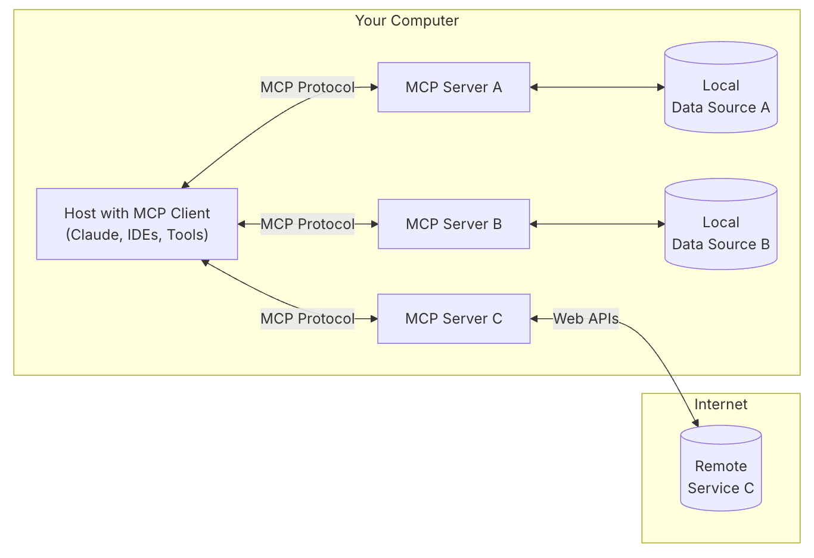

# 04.基于FastMCP框架开发智能问答应用

## <font style="color:rgb(51, 51, 51);">示例代码</font>
[fastmcp-demo.zip](https://www.yuque.com/attachments/yuque/0/2025/zip/2424104/1756179542892-c7318315-e562-4405-b52a-362232f3397d.zip)

## <font style="color:rgb(51, 51, 51);">MCP模型上下文协议实现规范</font>
### <font style="color:rgb(51, 51, 51);">理论知识</font>
<font style="color:rgb(51, 51, 51);">模型上下文协议（Model Context Protocol，MCP）是由Anthropic在2024年11月推出的开放标准协议，旨在为大语言模型（LLM）提供标准化的上下文连接。MCP解决了AI应用与外部数据源和工具集成时的安全性、可扩展性和标准化问题。</font>

<font style="color:rgb(51, 51, 51);">MCP的核心价值：</font>

+ **<font style="color:rgb(51, 51, 51);">标准化接口</font>**<font style="color:rgb(51, 51, 51);">：为LLM应用提供统一的外部系统连接方式</font>
+ **<font style="color:rgb(51, 51, 51);">安全性保障</font>**<font style="color:rgb(51, 51, 51);">：内置安全机制，支持OAuth2.0认证和授权</font>
+ **<font style="color:rgb(51, 51, 51);">可扩展架构</font>**<font style="color:rgb(51, 51, 51);">：支持多种传输协议和数据格式</font>
+ **<font style="color:rgb(51, 51, 51);">企业级应用</font>**<font style="color:rgb(51, 51, 51);">：适合生产环境的安全和性能要求</font>

<font style="color:rgb(51, 51, 51);"></font>



### <font style="color:rgb(51, 51, 51);">最佳实践</font>
1. **<font style="color:rgb(51, 51, 51);">安全优先原则</font>**
    - <font style="color:rgb(51, 51, 51);">实现robust同意和授权流程</font>
    - <font style="color:rgb(51, 51, 51);">提供清晰的安全影响文档</font>
    - <font style="color:rgb(51, 51, 51);">实施适当的访问控制和数据保护</font>
    - <font style="color:rgb(51, 51, 51);">遵循安全集成最佳实践</font>
2. **<font style="color:rgb(51, 51, 51);">协议实现规范</font>**
    - <font style="color:rgb(51, 51, 51);">生产环境MCP服务器应支持多种传输类型</font>
    - <font style="color:rgb(51, 51, 51);">必须实施PKCE流程</font>
    - <font style="color:rgb(51, 51, 51);">实现OAuth发现端点（/.well-known/oauth-protected-resource）</font>

### <font style="color:rgb(51, 51, 51);">示例代码</font>
```plain
from mcp.server.fastmcp import FastMCP
from mcp.server.models import InitializationOptions
import asyncio

# 基础MCP服务器初始化
mcp = FastMCP("demo-server")

@mcp.tool()
def get_server_info() -> dict:
    """获取服务器基本信息"""
    return {
        "name": "Demo MCP Server",
        "version": "1.0.0",
        "protocol": "MCP",
        "description": "演示用MCP服务器"
    }

async def main():
    """启动MCP服务器"""
    await mcp.run()

if __name__ == "__main__":
    asyncio.run(main())
```

## <font style="color:rgb(51, 51, 51);">MCP消息协议和传输模式原理</font>
### <font style="color:rgb(51, 51, 51);">理论知识</font>
<font style="color:rgb(51, 51, 51);">MCP采用客户端-服务器架构，支持多种传输协议：</font>

1. **<font style="color:rgb(51, 51, 51);">Stdio传输</font>**<font style="color:rgb(51, 51, 51);">：通过标准输入输出进行通信，适合本地应用</font>
2. **<font style="color:rgb(51, 51, 51);">SSE传输</font>**<font style="color:rgb(51, 51, 51);">：基于服务器发送事件，适合Web应用和远程连接</font>
3. **<font style="color:rgb(51, 51, 51);">WebSocket传输</font>**<font style="color:rgb(51, 51, 51);">：双向实时通信，适合交互式应用</font>

<font style="color:rgb(51, 51, 51);">消息协议基于JSON-RPC 2.0标准，包含：</font>

+ **<font style="color:rgb(51, 51, 51);">请求消息</font>**<font style="color:rgb(51, 51, 51);">：客户端向服务器发送的操作请求</font>
+ **<font style="color:rgb(51, 51, 51);">响应消息</font>**<font style="color:rgb(51, 51, 51);">：服务器对请求的回复</font>
+ **<font style="color:rgb(51, 51, 51);">通知消息</font>**<font style="color:rgb(51, 51, 51);">：单向消息，不需要响应</font>

### <font style="color:rgb(51, 51, 51);">最佳实践</font>
1. **<font style="color:rgb(51, 51, 51);">传输协议选择</font>**
    - <font style="color:rgb(51, 51, 51);">本地集成优选Stdio</font>
    - <font style="color:rgb(51, 51, 51);">Web应用使用SSE</font>
    - <font style="color:rgb(51, 51, 51);">实时交互选择WebSocket</font>
2. **<font style="color:rgb(51, 51, 51);">消息处理规范</font>**
    - <font style="color:rgb(51, 51, 51);">实现完整的错误处理机制</font>
    - <font style="color:rgb(51, 51, 51);">支持消息超时和重试</font>
    - <font style="color:rgb(51, 51, 51);">维护连接状态管理</font>

### <font style="color:rgb(51, 51, 51);">示例代码</font>
```plain
from mcp.server.fastmcp import FastMCP
from mcp.types import TextContent, ImageContent
import json
import asyncio

mcp = FastMCP("message-demo")

@mcp.tool()
def process_text_message(content: str) -> dict:
    """处理文本消息"""
    return {
        "message_type": "text",
        "processed_content": content.upper(),
        "timestamp": "2024-12-01T00:00:00Z",
        "status": "processed"
    }

@mcp.resource("messages://recent")
async def get_recent_messages() -> str:
    """获取最近消息资源"""
    messages = [
        {"id": 1, "content": "Hello MCP", "type": "text"},
        {"id": 2, "content": "Protocol Demo", "type": "text"}
    ]
    return json.dumps(messages, indent=2)

# SSE传输配置示例
async def start_sse_server():
    """启动SSE传输模式服务器"""
    from mcp.server.sse import create_sse_server
    
    server = create_sse_server(mcp)
    await server.serve_forever()
```

## <font style="color:rgb(51, 51, 51);">MCP客户端与服务端交互流程</font>
### <font style="color:rgb(51, 51, 51);">理论知识</font>
<font style="color:rgb(51, 51, 51);">MCP客户端与服务器的交互遵循严格的协议流程：</font>

1. **<font style="color:rgb(51, 51, 51);">初始化阶段</font>**
    - <font style="color:rgb(51, 51, 51);">客户端发送initialize请求</font>
    - <font style="color:rgb(51, 51, 51);">服务器响应capabilities信息</font>
    - <font style="color:rgb(51, 51, 51);">双方确认协议版本和功能</font>
2. **<font style="color:rgb(51, 51, 51);">功能发现阶段</font>**
    - <font style="color:rgb(51, 51, 51);">客户端查询可用资源、工具和提示</font>
    - <font style="color:rgb(51, 51, 51);">服务器返回功能清单</font>
    - <font style="color:rgb(51, 51, 51);">建立功能映射关系</font>
3. **<font style="color:rgb(51, 51, 51);">交互执行阶段</font>**
    - <font style="color:rgb(51, 51, 51);">工具调用和资源访问</font>
    - <font style="color:rgb(51, 51, 51);">错误处理和状态同步</font>
    - <font style="color:rgb(51, 51, 51);">会话管理和清理</font>

### <font style="color:rgb(51, 51, 51);">最佳实践</font>
1. **<font style="color:rgb(51, 51, 51);">连接管理</font>**
    - <font style="color:rgb(51, 51, 51);">实现连接池和复用机制</font>
    - <font style="color:rgb(51, 51, 51);">处理连接断开和重连逻辑</font>
    - <font style="color:rgb(51, 51, 51);">监控连接健康状态</font>
2. **<font style="color:rgb(51, 51, 51);">异步处理</font>**
    - <font style="color:rgb(51, 51, 51);">使用异步编程模型</font>
    - <font style="color:rgb(51, 51, 51);">实现并发请求处理</font>
    - <font style="color:rgb(51, 51, 51);">避免阻塞操作</font>

### <font style="color:rgb(51, 51, 51);">示例代码</font>
```plain
from mcp.client.session import ClientSession
from mcp.client.stdio import stdio_client
import asyncio

class MCPClientDemo:
    def __init__(self):
        self.session = None
    
    async def connect_to_server(self, command: list):
        """连接到MCP服务器"""
        try:
            # 使用stdio传输连接服务器
            async with stdio_client(command) as transport:
                self.session = ClientSession(transport[0], transport[1])
                
                # 初始化连接
                await self.session.initialize()
                
                # 获取服务器功能
                capabilities = await self.session.get_capabilities()
                print(f"服务器功能: {capabilities}")
                
                return True
        except Exception as e:
            print(f"连接失败: {e}")
            return False
    
    async def call_tool(self, tool_name: str, arguments: dict):
        """调用服务器工具"""
        if not self.session:
            raise Exception("未连接到服务器")
        
        try:
            result = await self.session.call_tool(tool_name, arguments)
            return result
        except Exception as e:
            print(f"工具调用失败: {e}")
            return None
    
    async def get_resource(self, uri: str):
        """获取服务器资源"""
        if not self.session:
            raise Exception("未连接到服务器")
        
        try:
            resource = await self.session.read_resource(uri)
            return resource
        except Exception as e:
            print(f"资源获取失败: {e}")
            return None

# 使用示例
async def main():
    client = MCPClientDemo()
    
    # 连接到服务器（假设服务器命令为python server.py）
    if await client.connect_to_server(["python", "server.py"]):
        # 调用工具
        result = await client.call_tool("get_server_info", {})
        print(f"工具调用结果: {result}")
        
        # 获取资源
        resource = await client.get_resource("messages://recent")
        print(f"资源内容: {resource}")

if __name__ == "__main__":
    asyncio.run(main())
```

## <font style="color:rgb(51, 51, 51);">开发MCP服务端与功能测试</font>
### <font style="color:rgb(51, 51, 51);">理论知识</font>
<font style="color:rgb(51, 51, 51);">MCP服务器开发涉及三个核心组件：</font>

1. **<font style="color:rgb(51, 51, 51);">Resources（资源）</font>**<font style="color:rgb(51, 51, 51);">：结构化数据，提供上下文信息</font>
2. **<font style="color:rgb(51, 51, 51);">Tools（工具）</font>**<font style="color:rgb(51, 51, 51);">：可执行函数，允许模型执行操作</font>
3. **<font style="color:rgb(51, 51, 51);">Prompts（提示）</font>**<font style="color:rgb(51, 51, 51);">：可重用的交互模板</font>

<font style="color:rgb(51, 51, 51);">服务器开发的关键要素：</font>

+ <font style="color:rgb(51, 51, 51);">类型安全的接口定义</font>
+ <font style="color:rgb(51, 51, 51);">自动化的文档生成</font>
+ <font style="color:rgb(51, 51, 51);">内置的错误处理机制</font>
+ <font style="color:rgb(51, 51, 51);">调试和测试工具</font>

### <font style="color:rgb(51, 51, 51);">最佳实践</font>
1. **<font style="color:rgb(51, 51, 51);">代码组织结构</font>**
    - <font style="color:rgb(51, 51, 51);">按功能模块组织代码</font>
    - <font style="color:rgb(51, 51, 51);">使用类型提示增强代码可读性</font>
    - <font style="color:rgb(51, 51, 51);">实现完整的错误处理</font>
2. **<font style="color:rgb(51, 51, 51);">性能优化</font>**
    - <font style="color:rgb(51, 51, 51);">使用异步操作处理I/O密集任务</font>
    - <font style="color:rgb(51, 51, 51);">实现结果缓存机制</font>
    - <font style="color:rgb(51, 51, 51);">优化内存使用</font>
3. **<font style="color:rgb(51, 51, 51);">测试策略</font>**
    - <font style="color:rgb(51, 51, 51);">单元测试覆盖所有工具和资源</font>
    - <font style="color:rgb(51, 51, 51);">集成测试验证完整流程</font>
    - <font style="color:rgb(51, 51, 51);">使用MCP Inspector进行调试</font>

### <font style="color:rgb(51, 51, 51);">示例代码</font>
```plain
from mcp.server.fastmcp import FastMCP
from typing import Optional, List, Dict, Any
import json
import sqlite3
import aiofiles
import asyncio

class DataManagerServer:
    def __init__(self):
        self.mcp = FastMCP("data-manager")
        self.db_path = "data.db"
        self._setup_database()
        self._register_handlers()
    
    def _setup_database(self):
        """初始化数据库"""
        conn = sqlite3.connect(self.db_path)
        conn.execute("""
            CREATE TABLE IF NOT EXISTS records (
                id INTEGER PRIMARY KEY AUTOINCREMENT,
                name TEXT NOT NULL,
                value TEXT,
                created_at TIMESTAMP DEFAULT CURRENT_TIMESTAMP
            )
        """)
        conn.commit()
        conn.close()
    
    def _register_handlers(self):
        """注册MCP处理器"""
        
        @self.mcp.tool()
        def create_record(name: str, value: Optional[str] = None) -> Dict[str, Any]:
            """创建新记录
            
            Args:
                name: 记录名称
                value: 记录值（可选）
            """
            conn = sqlite3.connect(self.db_path)
            cursor = conn.execute(
                "INSERT INTO records (name, value) VALUES (?, ?)",
                (name, value)
            )
            record_id = cursor.lastrowid
            conn.commit()
            conn.close()
            
            return {
                "id": record_id,
                "name": name,
                "value": value,
                "status": "created"
            }
        
        @self.mcp.tool()
        def get_record(record_id: int) -> Optional[Dict[str, Any]]:
            """获取指定记录
            
            Args:
                record_id: 记录ID
            """
            conn = sqlite3.connect(self.db_path)
            cursor = conn.execute(
                "SELECT id, name, value, created_at FROM records WHERE id = ?",
                (record_id,)
            )
            row = cursor.fetchone()
            conn.close()
            
            if row:
                return {
                    "id": row[0],
                    "name": row[1],
                    "value": row[2],
                    "created_at": row[3]
                }
            return None
        
        @self.mcp.tool()
        def list_records(limit: int = 10) -> List[Dict[str, Any]]:
            """列出所有记录
            
            Args:
                limit: 返回记录数量限制
            """
            conn = sqlite3.connect(self.db_path)
            cursor = conn.execute(
                "SELECT id, name, value, created_at FROM records LIMIT ?",
                (limit,)
            )
            rows = cursor.fetchall()
            conn.close()
            
            return [
                {
                    "id": row[0],
                    "name": row[1],
                    "value": row[2],
                    "created_at": row[3]
                }
                for row in rows
            ]
        
        @self.mcp.resource("data://records")
        async def get_records_resource() -> str:
            """获取记录资源"""
            records = list_records(100)  # 获取最多100条记录
            return json.dumps(records, indent=2)
        
        @self.mcp.resource("data://stats")
        async def get_stats_resource() -> str:
            """获取统计信息资源"""
            conn = sqlite3.connect(self.db_path)
            cursor = conn.execute("SELECT COUNT(*) FROM records")
            count = cursor.fetchone()[0]
            conn.close()
            
            stats = {
                "total_records": count,
                "server_status": "active",
                "database": self.db_path
            }
            return json.dumps(stats, indent=2)
    
    async def run(self):
        """启动服务器"""
        await self.mcp.run()

# 测试验证函数
async def test_server():
    """测试服务器功能"""
    server = DataManagerServer()
    
    # 模拟工具调用测试
    result1 = server.mcp._tools["create_record"].func("test_record", "test_value")
    print(f"创建记录结果: {result1}")
    
    result2 = server.mcp._tools["get_record"].func(1)
    print(f"获取记录结果: {result2}")
    
    result3 = server.mcp._tools["list_records"].func(5)
    print(f"列出记录结果: {result3}")

if __name__ == "__main__":
    server = DataManagerServer()
    asyncio.run(server.run())
```

## <font style="color:rgb(51, 51, 51);">基于SSE协议实现MCP客户端</font>
### <font style="color:rgb(51, 51, 51);">理论知识</font>
<font style="color:rgb(51, 51, 51);">服务器发送事件（Server-Sent Events，SSE）是MCP支持的重要传输方式，特别适合：</font>

1. **<font style="color:rgb(51, 51, 51);">Web应用集成</font>**<font style="color:rgb(51, 51, 51);">：浏览器原生支持SSE</font>
2. **<font style="color:rgb(51, 51, 51);">实时数据推送</font>**<font style="color:rgb(51, 51, 51);">：服务器主动向客户端推送数据</font>
3. **<font style="color:rgb(51, 51, 51);">跨域支持</font>**<font style="color:rgb(51, 51, 51);">：相比WebSocket更好的跨域兼容性</font>
4. **<font style="color:rgb(51, 51, 51);">简单实现</font>**<font style="color:rgb(51, 51, 51);">：基于HTTP协议，易于调试和部署</font>

<font style="color:rgb(51, 51, 51);">SSE传输的关键特性：</font>

+ <font style="color:rgb(51, 51, 51);">单向数据流（服务器到客户端）</font>
+ <font style="color:rgb(51, 51, 51);">自动重连机制</font>
+ <font style="color:rgb(51, 51, 51);">文本数据传输</font>
+ <font style="color:rgb(51, 51, 51);">事件类型支持</font>

### <font style="color:rgb(51, 51, 51);">最佳实践</font>
1. **<font style="color:rgb(51, 51, 51);">连接管理</font>**
    - <font style="color:rgb(51, 51, 51);">实现重连指数退避算法</font>
    - <font style="color:rgb(51, 51, 51);">处理网络中断和服务器重启</font>
    - <font style="color:rgb(51, 51, 51);">监控连接状态和健康检查</font>
2. **<font style="color:rgb(51, 51, 51);">数据处理</font>**
    - <font style="color:rgb(51, 51, 51);">实现消息缓冲和排序机制</font>
    - <font style="color:rgb(51, 51, 51);">处理大消息的分片传输</font>
    - <font style="color:rgb(51, 51, 51);">支持消息压缩和编码</font>
3. **<font style="color:rgb(51, 51, 51);">错误处理</font>**
    - <font style="color:rgb(51, 51, 51);">区分临时错误和永久错误</font>
    - <font style="color:rgb(51, 51, 51);">实现优雅的降级机制</font>
    - <font style="color:rgb(51, 51, 51);">记录详细的错误日志</font>

### <font style="color:rgb(51, 51, 51);">示例代码</font>
```plain
import asyncio
import aiohttp
import json
from typing import Optional, Callable, Dict, Any
from dataclasses import dataclass
import logging
import time

@dataclass
class SSEMessage:
    """SSE消息数据结构"""
    event: Optional[str] = None
    data: Optional[str] = None
    id: Optional[str] = None
    retry: Optional[int] = None

class MCPSSEClient:
    """MCP SSE客户端实现"""
    
    def __init__(self, server_url: str, max_retries: int = 5):
        self.server_url = server_url
        self.max_retries = max_retries
        self.session: Optional[aiohttp.ClientSession] = None
        self.is_connected = False
        self.last_event_id: Optional[str] = None
        self.reconnect_delay = 1  # 初始重连延迟（秒）
        self.max_reconnect_delay = 30  # 最大重连延迟
        self.message_handlers: Dict[str, Callable] = {}
        
        # 日志配置
        self.logger = logging.getLogger(__name__)
    
    async def __aenter__(self):
        """异步上下文管理器入口"""
        await self.connect()
        return self
    
    async def __aexit__(self, exc_type, exc_val, exc_tb):
        """异步上下文管理器出口"""
        await self.disconnect()
    
    async def connect(self) -> bool:
        """连接到SSE服务器"""
        if self.session is None:
            self.session = aiohttp.ClientSession()
        
        try:
            # 准备请求头
            headers = {
                'Accept': 'text/event-stream',
                'Cache-Control': 'no-cache',
            }
            
            # 如果有上次的事件ID，添加到请求头
            if self.last_event_id:
                headers['Last-Event-ID'] = self.last_event_id
            
            # 发起SSE连接
            self.response = await self.session.get(
                f"{self.server_url}/sse",
                headers=headers,
                timeout=aiohttp.ClientTimeout(total=None)
            )
            
            if self.response.status == 200:
                self.is_connected = True
                self.reconnect_delay = 1  # 重置重连延迟
                self.logger.info(f"成功连接到SSE服务器: {self.server_url}")
                return True
            else:
                self.logger.error(f"SSE连接失败，状态码: {self.response.status}")
                return False
                
        except Exception as e:
            self.logger.error(f"SSE连接异常: {e}")
            return False
    
    async def disconnect(self):
        """断开SSE连接"""
        self.is_connected = False
        
        if hasattr(self, 'response') and self.response:
            self.response.close()
        
        if self.session:
            await self.session.close()
            self.session = None
        
        self.logger.info("已断开SSE连接")
    
    def add_message_handler(self, event_type: str, handler: Callable[[SSEMessage], None]):
        """添加消息处理器"""
        self.message_handlers[event_type] = handler
    
    async def listen_for_messages(self):
        """监听SSE消息"""
        retries = 0
        
        while retries < self.max_retries:
            try:
                if not self.is_connected:
                    if not await self.connect():
                        retries += 1
                        await asyncio.sleep(self.reconnect_delay)
                        self.reconnect_delay = min(self.reconnect_delay * 2, self.max_reconnect_delay)
                        continue
                
                # 读取SSE数据流
                async for line in self.response.content:
                    line_str = line.decode('utf-8').strip()
                    
                    if not line_str:
                        continue
                    
                    # 解析SSE消息
                    message = await self._parse_sse_line(line_str)
                    if message:
                        await self._handle_message(message)
                
            except aiohttp.ClientError as e:
                self.logger.error(f"SSE连接错误: {e}")
                self.is_connected = False
                retries += 1
                await asyncio.sleep(self.reconnect_delay)
                self.reconnect_delay = min(self.reconnect_delay * 2, self.max_reconnect_delay)
            
            except Exception as e:
                self.logger.error(f"SSE监听异常: {e}")
                break
        
        self.logger.error(f"SSE重连失败，已达到最大重试次数: {self.max_retries}")
    
    async def _parse_sse_line(self, line: str) -> Optional[SSEMessage]:
        """解析SSE行数据"""
        if line.startswith('event:'):
            return SSEMessage(event=line[6:].strip())
        elif line.startswith('data:'):
            return SSEMessage(data=line[5:].strip())
        elif line.startswith('id:'):
            return SSEMessage(id=line[3:].strip())
        elif line.startswith('retry:'):
            try:
                return SSEMessage(retry=int(line[6:].strip()))
            except ValueError:
                return None
        return None
    
    async def _handle_message(self, message: SSEMessage):
        """处理SSE消息"""
        # 更新最后事件ID
        if message.id:
            self.last_event_id = message.id
        
        # 处理重连延迟
        if message.retry:
            self.reconnect_delay = message.retry / 1000  # 转换为秒
        
        # 调用消息处理器
        if message.event and message.event in self.message_handlers:
            try:
                await self.message_handlers[message.event](message)
            except Exception as e:
                self.logger.error(f"消息处理器异常: {e}")
        
        # 处理通用数据消息
        if message.data and 'data' in self.message_handlers:
            try:
                await self.message_handlers['data'](message)
            except Exception as e:
                self.logger.error(f"数据处理器异常: {e}")
    
    async def send_request(self, method: str, params: Dict[str, Any]) -> Optional[Dict[str, Any]]:
        """向MCP服务器发送请求（通过HTTP API）"""
        if not self.session:
            raise Exception("未连接到服务器")
        
        try:
            request_data = {
                "jsonrpc": "2.0",
                "method": method,
                "params": params,
                "id": int(time.time() * 1000)  # 使用时间戳作为ID
            }
            
            async with self.session.post(
                f"{self.server_url}/rpc",
                json=request_data,
                headers={'Content-Type': 'application/json'}
            ) as response:
                if response.status == 200:
                    result = await response.json()
                    return result
                else:
                    self.logger.error(f"RPC请求失败，状态码: {response.status}")
                    return None
        
        except Exception as e:
            self.logger.error(f"RPC请求异常: {e}")
            return None

# 使用示例
async def main():
    """SSE客户端使用示例"""
    
    # 配置日志
    logging.basicConfig(level=logging.INFO)
    
    async with MCPSSEClient("http://localhost:8000") as client:
        
        # 添加消息处理器
        async def handle_tool_response(message: SSEMessage):
            data = json.loads(message.data) if message.data else {}
            print(f"收到工具响应: {data}")
        
        async def handle_resource_update(message: SSEMessage):
            data = json.loads(message.data) if message.data else {}
            print(f"资源更新通知: {data}")
        
        client.add_message_handler('tool_response', handle_tool_response)
        client.add_message_handler('resource_update', handle_resource_update)
        
        # 发送请求
        response = await client.send_request("initialize", {
            "protocolVersion": "2024-11-05",
            "capabilities": {
                "roots": {"listChanged": True}
            },
            "clientInfo": {
                "name": "SSE Demo Client",
                "version": "1.0.0"
            }
        })
        print(f"初始化响应: {response}")
        
        # 开始监听消息
        await client.listen_for_messages()

if __name__ == "__main__":
    asyncio.run(main())
```

## <font style="color:rgb(51, 51, 51);">基于MCP SDK实现智能问答应用</font>
### <font style="color:rgb(51, 51, 51);">理论知识</font>
<font style="color:rgb(51, 51, 51);">数学运算智能问答应用是MCP的经典应用场景，展示了如何：</font>

1. **<font style="color:rgb(51, 51, 51);">工具定义</font>**<font style="color:rgb(51, 51, 51);">：创建数学运算工具集</font>
2. **<font style="color:rgb(51, 51, 51);">类型安全</font>**<font style="color:rgb(51, 51, 51);">：使用Python类型提示确保参数正确性</font>
3. **<font style="color:rgb(51, 51, 51);">错误处理</font>**<font style="color:rgb(51, 51, 51);">：处理数学运算中的异常情况</font>
4. **<font style="color:rgb(51, 51, 51);">扩展性设计</font>**<font style="color:rgb(51, 51, 51);">：支持复杂数学函数和运算</font>

<font style="color:rgb(51, 51, 51);">应用架构包含：</font>

+ <font style="color:rgb(51, 51, 51);">基础数学运算工具（加减乘除）</font>
+ <font style="color:rgb(51, 51, 51);">高级数学函数（三角函数、对数等）</font>
+ <font style="color:rgb(51, 51, 51);">数学表达式解析和计算</font>
+ <font style="color:rgb(51, 51, 51);">历史记录和结果缓存</font>

### <font style="color:rgb(51, 51, 51);">最佳实践</font>
1. **<font style="color:rgb(51, 51, 51);">工具设计原则</font>**
    - <font style="color:rgb(51, 51, 51);">单一职责：每个工具只处理一种运算</font>
    - <font style="color:rgb(51, 51, 51);">参数验证：检查输入参数的有效性</font>
    - <font style="color:rgb(51, 51, 51);">异常处理：处理除零、溢出等数学异常</font>
2. **<font style="color:rgb(51, 51, 51);">性能优化</font>**
    - <font style="color:rgb(51, 51, 51);">结果缓存减少重复计算</font>
    - <font style="color:rgb(51, 51, 51);">异步处理复杂运算</font>
    - <font style="color:rgb(51, 51, 51);">内存优化避免大数运算内存泄漏</font>
3. **<font style="color:rgb(51, 51, 51);">用户体验</font>**
    - <font style="color:rgb(51, 51, 51);">友好的错误提示</font>
    - <font style="color:rgb(51, 51, 51);">支持自然语言数学表达式</font>
    - <font style="color:rgb(51, 51, 51);">计算过程可视化</font>

### <font style="color:rgb(51, 51, 51);">示例代码</font>
```plain
from mcp.server.fastmcp import FastMCP
from typing import Union, List, Dict, Any, Optional
import math
import re
import json
import asyncio
import operator
from functools import reduce
from decimal import Decimal, getcontext
import datetime

# 设置高精度计算
getcontext().prec = 50

class MathCalculatorServer:
    """数学运算智能问答MCP服务器"""
    
    def __init__(self):
        self.mcp = FastMCP("math-calculator")
        self.calculation_history: List[Dict[str, Any]] = []
        self.cache: Dict[str, Any] = {}
        self._register_tools()
        self._register_resources()
    
    def _register_tools(self):
        """注册数学运算工具"""
        
        @self.mcp.tool()
        def add(a: float, b: float) -> Dict[str, Any]:
            """两数相加
            
            Args:
                a: 第一个数
                b: 第二个数
                
            Returns:
                包含计算结果和元信息的字典
            """
            result = a + b
            calculation = {
                "operation": "addition",
                "operands": [a, b],
                "result": result,
                "expression": f"{a} + {b} = {result}",
                "timestamp": datetime.datetime.now().isoformat()
            }
            self.calculation_history.append(calculation)
            return calculation
        
        @self.mcp.tool()
        def subtract(a: float, b: float) -> Dict[str, Any]:
            """两数相减
            
            Args:
                a: 被减数
                b: 减数
            """
            result = a - b
            calculation = {
                "operation": "subtraction", 
                "operands": [a, b],
                "result": result,
                "expression": f"{a} - {b} = {result}",
                "timestamp": datetime.datetime.now().isoformat()
            }
            self.calculation_history.append(calculation)
            return calculation
        
        @self.mcp.tool()
        def multiply(a: float, b: float) -> Dict[str, Any]:
            """两数相乘
            
            Args:
                a: 第一个数
                b: 第二个数
            """
            result = a * b
            calculation = {
                "operation": "multiplication",
                "operands": [a, b], 
                "result": result,
                "expression": f"{a} × {b} = {result}",
                "timestamp": datetime.datetime.now().isoformat()
            }
            self.calculation_history.append(calculation)
            return calculation
        
        @self.mcp.tool()
        def divide(a: float, b: float) -> Dict[str, Any]:
            """两数相除
            
            Args:
                a: 被除数
                b: 除数
                
            Raises:
                ZeroDivisionError: 当除数为0时
            """
            if b == 0:
                error_result = {
                    "operation": "division",
                    "operands": [a, b],
                    "error": "Division by zero is not allowed",
                    "expression": f"{a} ÷ {b} = ERROR",
                    "timestamp": datetime.datetime.now().isoformat()
                }
                self.calculation_history.append(error_result)
                return error_result
            
            result = a / b
            calculation = {
                "operation": "division",
                "operands": [a, b],
                "result": result,
                "expression": f"{a} ÷ {b} = {result}",
                "timestamp": datetime.datetime.now().isoformat()
            }
            self.calculation_history.append(calculation)
            return calculation
        
        @self.mcp.tool()
        def power(base: float, exponent: float) -> Dict[str, Any]:
            """幂运算
            
            Args:
                base: 底数
                exponent: 指数
            """
            try:
                result = math.pow(base, exponent)
                calculation = {
                    "operation": "power",
                    "operands": [base, exponent],
                    "result": result,
                    "expression": f"{base}^{exponent} = {result}",
                    "timestamp": datetime.datetime.now().isoformat()
                }
                self.calculation_history.append(calculation)
                return calculation
            except Exception as e:
                error_result = {
                    "operation": "power",
                    "operands": [base, exponent],
                    "error": str(e),
                    "expression": f"{base}^{exponent} = ERROR",
                    "timestamp": datetime.datetime.now().isoformat()
                }
                self.calculation_history.append(error_result)
                return error_result
        
        @self.mcp.tool()
        def square_root(number: float) -> Dict[str, Any]:
            """计算平方根
            
            Args:
                number: 要计算平方根的数
            """
            if number < 0:
                error_result = {
                    "operation": "square_root",
                    "operands": [number],
                    "error": "Cannot calculate square root of negative number",
                    "expression": f"√{number} = ERROR",
                    "timestamp": datetime.datetime.now().isoformat()
                }
                self.calculation_history.append(error_result)
                return error_result
            
            result = math.sqrt(number)
            calculation = {
                "operation": "square_root",
                "operands": [number],
                "result": result,
                "expression": f"√{number} = {result}",
                "timestamp": datetime.datetime.now().isoformat()
            }
            self.calculation_history.append(calculation)
            return calculation
        
        @self.mcp.tool()
        def factorial(n: int) -> Dict[str, Any]:
            """计算阶乘
            
            Args:
                n: 要计算阶乘的非负整数
            """
            if n < 0:
                error_result = {
                    "operation": "factorial",
                    "operands": [n],
                    "error": "Factorial is not defined for negative numbers",
                    "expression": f"{n}! = ERROR",
                    "timestamp": datetime.datetime.now().isoformat()
                }
                self.calculation_history.append(error_result)
                return error_result
            
            if n > 170:  # 防止结果过大
                error_result = {
                    "operation": "factorial",
                    "operands": [n],
                    "error": "Number too large for factorial calculation",
                    "expression": f"{n}! = ERROR (too large)",
                    "timestamp": datetime.datetime.now().isoformat()
                }
                self.calculation_history.append(error_result)
                return error_result
            
            result = math.factorial(n)
            calculation = {
                "operation": "factorial",
                "operands": [n],
                "result": result,
                "expression": f"{n}! = {result}",
                "timestamp": datetime.datetime.now().isoformat()
            }
            self.calculation_history.append(calculation)
            return calculation
        
        @self.mcp.tool()
        def sin(angle: float, unit: str = "radians") -> Dict[str, Any]:
            """计算正弦值
            
            Args:
                angle: 角度值
                unit: 角度单位，"radians"或"degrees"
            """
            if unit == "degrees":
                angle_rad = math.radians(angle)
            else:
                angle_rad = angle
            
            result = math.sin(angle_rad)
            calculation = {
                "operation": "sine",
                "operands": [angle],
                "unit": unit,
                "result": result,
                "expression": f"sin({angle}°)" if unit == "degrees" else f"sin({angle})",
                "timestamp": datetime.datetime.now().isoformat()
            }
            self.calculation_history.append(calculation)
            return calculation
        
        @self.mcp.tool()
        def cos(angle: float, unit: str = "radians") -> Dict[str, Any]:
            """计算余弦值
            
            Args:
                angle: 角度值
                unit: 角度单位，"radians"或"degrees"
            """
            if unit == "degrees":
                angle_rad = math.radians(angle)
            else:
                angle_rad = angle
            
            result = math.cos(angle_rad)
            calculation = {
                "operation": "cosine",
                "operands": [angle],
                "unit": unit,
                "result": result,
                "expression": f"cos({angle}°)" if unit == "degrees" else f"cos({angle})",
                "timestamp": datetime.datetime.now().isoformat()
            }
            self.calculation_history.append(calculation)
            return calculation
        
        @self.mcp.tool()
        def logarithm(number: float, base: float = math.e) -> Dict[str, Any]:
            """计算对数
            
            Args:
                number: 真数
                base: 底数，默认为e（自然对数）
            """
            if number <= 0:
                error_result = {
                    "operation": "logarithm",
                    "operands": [number, base],
                    "error": "Logarithm is not defined for non-positive numbers",
                    "expression": f"log_{base}({number}) = ERROR",
                    "timestamp": datetime.datetime.now().isoformat()
                }
                self.calculation_history.append(error_result)
                return error_result
            
            if base <= 0 or base == 1:
                error_result = {
                    "operation": "logarithm",
                    "operands": [number, base],
                    "error": "Invalid logarithm base",
                    "expression": f"log_{base}({number}) = ERROR",
                    "timestamp": datetime.datetime.now().isoformat()
                }
                self.calculation_history.append(error_result)
                return error_result
            
            try:
                if base == math.e:
                    result = math.log(number)
                    expression = f"ln({number}) = {result}"
                else:
                    result = math.log(number, base)
                    expression = f"log_{base}({number}) = {result}"
                
                calculation = {
                    "operation": "logarithm",
                    "operands": [number, base],
                    "result": result,
                    "expression": expression,
                    "timestamp": datetime.datetime.now().isoformat()
                }
                self.calculation_history.append(calculation)
                return calculation
            except Exception as e:
                error_result = {
                    "operation": "logarithm",
                    "operands": [number, base],
                    "error": str(e),
                    "expression": f"log_{base}({number}) = ERROR",
                    "timestamp": datetime.datetime.now().isoformat()
                }
                self.calculation_history.append(error_result)
                return error_result
        
        @self.mcp.tool()
        def evaluate_expression(expression: str) -> Dict[str, Any]:
            """计算数学表达式
            
            Args:
                expression: 数学表达式字符串
                
            注意：出于安全考虑，仅支持基本数学运算
            """
            # 安全的数学表达式评估
            # 只允许数字、基本运算符和数学函数
            allowed_chars = set('0123456789+-*/().^ ')
            allowed_functions = ['sin', 'cos', 'tan', 'log', 'sqrt', 'abs']
            
            # 基本安全检查
            if any(char not in allowed_chars and not char.isalpha() for char in expression):
                error_result = {
                    "operation": "expression_evaluation",
                    "expression": expression,
                    "error": "Invalid characters in expression",
                    "timestamp": datetime.datetime.now().isoformat()
                }
                self.calculation_history.append(error_result)
                return error_result
            
            try:
                # 简单的表达式替换（仅用于演示，生产环境需要更安全的解析器）
                safe_expression = expression.replace('^', '**')
                
                # 创建安全的计算环境
                safe_dict = {
                    "__builtins__": {},
                    "abs": abs,
                    "sin": math.sin,
                    "cos": math.cos, 
                    "tan": math.tan,
                    "log": math.log,
                    "sqrt": math.sqrt,
                    "pi": math.pi,
                    "e": math.e
                }
                
                result = eval(safe_expression, safe_dict)
                
                calculation = {
                    "operation": "expression_evaluation",
                    "expression": expression,
                    "result": result,
                    "safe_expression": safe_expression,
                    "timestamp": datetime.datetime.now().isoformat()
                }
                self.calculation_history.append(calculation)
                return calculation
                
            except Exception as e:
                error_result = {
                    "operation": "expression_evaluation",
                    "expression": expression,
                    "error": f"Expression evaluation error: {str(e)}",
                    "timestamp": datetime.datetime.now().isoformat()
                }
                self.calculation_history.append(error_result)
                return error_result
        
        @self.mcp.tool()
        def get_calculation_history(limit: int = 10) -> List[Dict[str, Any]]:
            """获取计算历史记录
            
            Args:
                limit: 返回记录数量限制
            """
            return self.calculation_history[-limit:] if limit > 0 else self.calculation_history
        
        @self.mcp.tool()
        def clear_history() -> Dict[str, str]:
            """清除计算历史记录"""
            self.calculation_history.clear()
            self.cache.clear()
            return {
                "message": "Calculation history cleared",
                "timestamp": datetime.datetime.now().isoformat()
            }
    
    def _register_resources(self):
        """注册资源"""
        
        @self.mcp.resource("math://history")
        async def get_history_resource() -> str:
            """获取计算历史资源"""
            return json.dumps(self.calculation_history, indent=2)
        
        @self.mcp.resource("math://constants")
        async def get_constants_resource() -> str:
            """获取数学常数资源"""
            constants = {
                "pi": math.pi,
                "e": math.e,
                "tau": math.tau,
                "golden_ratio": (1 + math.sqrt(5)) / 2,
                "euler_gamma": 0.5772156649015329  # 欧拉常数γ的近似值
            }
            return json.dumps(constants, indent=2)
        
        @self.mcp.resource("math://functions")
        async def get_functions_resource() -> str:
            """获取可用函数列表资源"""
            functions = {
                "basic_operations": ["add", "subtract", "multiply", "divide"],
                "power_operations": ["power", "square_root"],
                "trigonometric": ["sin", "cos"],
                "logarithmic": ["logarithm"],
                "special": ["factorial"],
                "evaluation": ["evaluate_expression"]
            }
            return json.dumps(functions, indent=2)
    
    async def run(self):
        """启动数学计算服务器"""
        await self.mcp.run()

# 测试和演示代码
async def demo_math_calculator():
    """数学计算器演示"""
    server = MathCalculatorServer()
    
    # 模拟计算操作
    print("=== 数学运算演示 ===")
    
    # 基础运算
    result1 = server.mcp._tools["add"].func(10, 5)
    print(f"加法: {result1['expression']}")
    
    result2 = server.mcp._tools["multiply"].func(4, 7)
    print(f"乘法: {result2['expression']}")
    
    # 高级运算
    result3 = server.mcp._tools["power"].func(2, 10)
    print(f"幂运算: {result3['expression']}")
    
    result4 = server.mcp._tools["square_root"].func(16)
    print(f"平方根: {result4['expression']}")
    
    # 三角函数
    result5 = server.mcp._tools["sin"].func(90, "degrees")
    print(f"三角函数: sin(90°) = {result5['result']}")
    
    # 阶乘
    result6 = server.mcp._tools["factorial"].func(5)
    print(f"阶乘: {result6['expression']}")
    
    # 表达式计算
    result7 = server.mcp._tools["evaluate_expression"].func("2 * (3 + 4)")
    print(f"表达式: 2 * (3 + 4) = {result7['result']}")
    
    # 获取历史记录
    history = server.mcp._tools["get_calculation_history"].func(5)
    print(f"\n=== 最近5次计算历史 ===")
    for calc in history:
        print(f"- {calc['expression']}")
    
    # 错误处理演示
    print(f"\n=== 错误处理演示 ===")
    error_result = server.mcp._tools["divide"].func(10, 0)
    print(f"除零错误: {error_result['error']}")
    
    negative_sqrt = server.mcp._tools["square_root"].func(-4)
    print(f"负数开方错误: {negative_sqrt['error']}")

if __name__ == "__main__":
    # 运行演示
    asyncio.run(demo_math_calculator())
```

## <font style="color:rgb(51, 51, 51);">FastMCP V2框架入门</font>
### <font style="color:rgb(51, 51, 51);">理论知识</font>
<font style="color:rgb(51, 51, 51);">FastMCP V2是MCP生态系统的重要组成部分，是对原始FastMCP 1.0的重大升级：</font>

1. **<font style="color:rgb(51, 51, 51);">架构升级</font>**
    - <font style="color:rgb(51, 51, 51);">FastMCP 1.0已集成到官方MCP Python SDK</font>
    - <font style="color:rgb(51, 51, 51);">FastMCP 2.0作为独立的完整生态系统</font>
    - <font style="color:rgb(51, 51, 51);">提供更强大的功能和更好的开发体验</font>
2. **<font style="color:rgb(51, 51, 51);">核心特性</font>**
    - **<font style="color:rgb(51, 51, 51);">完整工具包</font>**<font style="color:rgb(51, 51, 51);">：包含客户端库、认证系统、部署工具</font>
    - **<font style="color:rgb(51, 51, 51);">平台集成</font>**<font style="color:rgb(51, 51, 51);">：与主要AI平台的深度集成</font>
    - **<font style="color:rgb(51, 51, 51);">测试框架</font>**<font style="color:rgb(51, 51, 51);">：内置测试和调试工具</font>
    - **<font style="color:rgb(51, 51, 51);">生产就绪</font>**<font style="color:rgb(51, 51, 51);">：提供生产级基础设施模式</font>
3. **<font style="color:rgb(51, 51, 51);">开发优势</font>**
    - <font style="color:rgb(51, 51, 51);">类型安全的API设计</font>
    - <font style="color:rgb(51, 51, 51);">自动化文档生成</font>
    - <font style="color:rgb(51, 51, 51);">内置调试工具（MCP Inspector）</font>
    - <font style="color:rgb(51, 51, 51);">异步操作支持</font>

### <font style="color:rgb(51, 51, 51);">最佳实践</font>
1. **<font style="color:rgb(51, 51, 51);">项目结构</font>**
    - <font style="color:rgb(51, 51, 51);">模块化设计，分离业务逻辑和协议处理</font>
    - <font style="color:rgb(51, 51, 51);">使用类型提示增强代码可维护性</font>
    - <font style="color:rgb(51, 51, 51);">实现完整的错误处理和日志记录</font>
2. **<font style="color:rgb(51, 51, 51);">性能优化</font>**
    - <font style="color:rgb(51, 51, 51);">利用异步操作提高并发性能</font>
    - <font style="color:rgb(51, 51, 51);">实现智能缓存机制</font>
    - <font style="color:rgb(51, 51, 51);">优化资源使用和内存管理</font>
3. **<font style="color:rgb(51, 51, 51);">开发流程</font>**
    - <font style="color:rgb(51, 51, 51);">使用MCP Inspector进行本地调试</font>
    - <font style="color:rgb(51, 51, 51);">实施完整的测试覆盖</font>
    - <font style="color:rgb(51, 51, 51);">遵循安全开发最佳实践</font>

### <font style="color:rgb(51, 51, 51);">示例代码</font>
```plain
from fastmcp import FastMCP
from fastmcp.types import Resource, Tool
from fastmcp.auth import OAuth2Provider
from fastmcp.deployment import ServerConfig
from typing import List, Dict, Any, Optional
import asyncio
import aiohttp
import json
from datetime import datetime
import logging

class AdvancedFastMCPServer:
    """基于FastMCP V2的高级服务器实现"""
    
    def __init__(self, name: str = "advanced-server"):
        # 初始化FastMCP服务器
        self.mcp = FastMCP(
            name=name,
            version="2.0.0",
            description="Advanced MCP Server with FastMCP V2"
        )
        
        # 配置日志
        self.logger = logging.getLogger(__name__)
        
        # 数据存储
        self.data_store: Dict[str, Any] = {}
        self.request_history: List[Dict[str, Any]] = []
        
        # 注册组件
        self._setup_authentication()
        self._register_tools()
        self._register_resources()
        self._setup_middleware()
    
    def _setup_authentication(self):
        """设置OAuth2认证"""
        oauth_provider = OAuth2Provider(
            client_id="fastmcp-demo",
            authorization_url="https://auth.example.com/oauth2/authorize",
            token_url="https://auth.example.com/oauth2/token",
            scopes=["read", "write", "admin"]
        )
        self.mcp.add_auth_provider(oauth_provider)
    
    def _register_tools(self):
        """注册工具集"""
        
        @self.mcp.tool()
        async def create_data_entry(key: str, value: Any, metadata: Optional[Dict[str, Any]] = None) -> Dict[str, Any]:
            """创建数据条目
            
            Args:
                key: 数据键
                value: 数据值
                metadata: 可选的元数据
            """
            entry = {
                "key": key,
                "value": value,
                "metadata": metadata or {},
                "created_at": datetime.now().isoformat(),
                "updated_at": datetime.now().isoformat()
            }
            
            self.data_store[key] = entry
            
            # 记录操作历史
            self.request_history.append({
                "operation": "create_data_entry",
                "key": key,
                "timestamp": datetime.now().isoformat(),
                "success": True
            })
            
            return {
                "status": "success",
                "message": f"Data entry '{key}' created successfully",
                "entry": entry
            }
        
        @self.mcp.tool()
        async def get_data_entry(key: str) -> Optional[Dict[str, Any]]:
            """获取数据条目
            
            Args:
                key: 数据键
            """
            entry = self.data_store.get(key)
            
            self.request_history.append({
                "operation": "get_data_entry",
                "key": key,
                "timestamp": datetime.now().isoformat(),
                "success": entry is not None
            })
            
            if entry:
                return {
                    "status": "success",
                    "entry": entry
                }
            else:
                return {
                    "status": "not_found",
                    "message": f"Data entry '{key}' not found"
                }
        
        @self.mcp.tool()
        async def update_data_entry(key: str, value: Any, metadata: Optional[Dict[str, Any]] = None) -> Dict[str, Any]:
            """更新数据条目
            
            Args:
                key: 数据键
                value: 新的数据值
                metadata: 可选的新元数据
            """
            if key not in self.data_store:
                self.request_history.append({
                    "operation": "update_data_entry",
                    "key": key,
                    "timestamp": datetime.now().isoformat(),
                    "success": False,
                    "error": "Entry not found"
                })
                return {
                    "status": "error",
                    "message": f"Data entry '{key}' not found"
                }
            
            entry = self.data_store[key]
            entry["value"] = value
            entry["updated_at"] = datetime.now().isoformat()
            
            if metadata:
                entry["metadata"].update(metadata)
            
            self.request_history.append({
                "operation": "update_data_entry", 
                "key": key,
                "timestamp": datetime.now().isoformat(),
                "success": True
            })
            
            return {
                "status": "success",
                "message": f"Data entry '{key}' updated successfully",
                "entry": entry
            }
        
        @self.mcp.tool()
        async def delete_data_entry(key: str) -> Dict[str, Any]:
            """删除数据条目
            
            Args:
                key: 数据键
            """
            if key in self.data_store:
                deleted_entry = self.data_store.pop(key)
                
                self.request_history.append({
                    "operation": "delete_data_entry",
                    "key": key,
                    "timestamp": datetime.now().isoformat(),
                    "success": True
                })
                
                return {
                    "status": "success",
                    "message": f"Data entry '{key}' deleted successfully",
                    "deleted_entry": deleted_entry
                }
            else:
                self.request_history.append({
                    "operation": "delete_data_entry",
                    "key": key,
                    "timestamp": datetime.now().isoformat(),
                    "success": False,
                    "error": "Entry not found"
                })
                return {
                    "status": "error",
                    "message": f"Data entry '{key}' not found"
                }
        
        @self.mcp.tool()
        async def list_data_entries(pattern: Optional[str] = None, limit: int = 100) -> Dict[str, Any]:
            """列出数据条目
            
            Args:
                pattern: 可选的键名模式过滤
                limit: 返回条目数量限制
            """
            entries = list(self.data_store.values())
            
            if pattern:
                import re
                regex = re.compile(pattern, re.IGNORECASE)
                entries = [entry for entry in entries if regex.search(entry["key"])]
            
            entries = entries[:limit]
            
            self.request_history.append({
                "operation": "list_data_entries",
                "pattern": pattern,
                "limit": limit,
                "timestamp": datetime.now().isoformat(),
                "success": True,
                "count": len(entries)
            })
            
            return {
                "status": "success",
                "count": len(entries),
                "entries": entries
            }
        
        @self.mcp.tool()
        async def fetch_external_data(url: str, timeout: int = 10) -> Dict[str, Any]:
            """从外部API获取数据
            
            Args:
                url: 外部API URL
                timeout: 请求超时时间（秒）
            """
            try:
                async with aiohttp.ClientSession() as session:
                    async with session.get(url, timeout=aiohttp.ClientTimeout(total=timeout)) as response:
                        if response.status == 200:
                            if response.content_type == 'application/json':
                                data = await response.json()
                            else:
                                data = await response.text()
                            
                            self.request_history.append({
                                "operation": "fetch_external_data",
                                "url": url,
                                "timestamp": datetime.now().isoformat(),
                                "success": True,
                                "status_code": response.status
                            })
                            
                            return {
                                "status": "success",
                                "url": url,
                                "status_code": response.status,
                                "content_type": response.content_type,
                                "data": data
                            }
                        else:
                            self.request_history.append({
                                "operation": "fetch_external_data",
                                "url": url,
                                "timestamp": datetime.now().isoformat(),
                                "success": False,
                                "status_code": response.status
                            })
                            
                            return {
                                "status": "error",
                                "message": f"HTTP {response.status}",
                                "url": url,
                                "status_code": response.status
                            }
            
            except asyncio.TimeoutError:
                self.request_history.append({
                    "operation": "fetch_external_data",
                    "url": url,
                    "timestamp": datetime.now().isoformat(),
                    "success": False,
                    "error": "timeout"
                })
                
                return {
                    "status": "error",
                    "message": "Request timeout",
                    "url": url
                }
            
            except Exception as e:
                self.request_history.append({
                    "operation": "fetch_external_data",
                    "url": url,
                    "timestamp": datetime.now().isoformat(),
                    "success": False,
                    "error": str(e)
                })
                
                return {
                    "status": "error",
                    "message": str(e),
                    "url": url
                }
    
    def _register_resources(self):
        """注册资源"""
        
        @self.mcp.resource("data://store")
        async def get_data_store() -> str:
            """获取数据存储资源"""
            return json.dumps(self.data_store, indent=2)
        
        @self.mcp.resource("data://history")
        async def get_request_history() -> str:
            """获取请求历史资源"""
            return json.dumps(self.request_history, indent=2)
        
        @self.mcp.resource("data://stats")
        async def get_server_stats() -> str:
            """获取服务器统计信息资源"""
            stats = {
                "server_name": self.mcp.name,
                "server_version": self.mcp.version,
                "total_entries": len(self.data_store),
                "total_requests": len(self.request_history),
                "uptime": datetime.now().isoformat(),
                "success_rate": self._calculate_success_rate()
            }
            return json.dumps(stats, indent=2)
    
    def _setup_middleware(self):
        """设置中间件"""
        
        @self.mcp.middleware
        async def logging_middleware(request, handler):
            """日志中间件"""
            start_time = datetime.now()
            self.logger.info(f"Request started: {request.method}")
            
            try:
                response = await handler(request)
                duration = (datetime.now() - start_time).total_seconds()
                self.logger.info(f"Request completed in {duration:.3f}s")
                return response
            except Exception as e:
                duration = (datetime.now() - start_time).total_seconds()
                self.logger.error(f"Request failed in {duration:.3f}s: {e}")
                raise
        
        @self.mcp.middleware
        async def rate_limiting_middleware(request, handler):
            """速率限制中间件"""
            # 简单的速率限制实现
            client_id = request.get('client_id', 'anonymous')
            
            # 这里可以实现更复杂的速率限制逻辑
            # 例如：检查Redis中的请求计数等
            
            return await handler(request)
    
    def _calculate_success_rate(self) -> float:
        """计算请求成功率"""
        if not self.request_history:
            return 0.0
        
        success_count = sum(1 for req in self.request_history if req.get('success', False))
        return round(success_count / len(self.request_history) * 100, 2)
    
    async def run(self, host: str = "localhost", port: int = 8000):
        """启动服务器"""
        # 配置服务器
        config = ServerConfig(
            host=host,
            port=port,
            debug=True,
            cors_enabled=True,
            ssl_enabled=False
        )
        
        self.logger.info(f"启动FastMCP V2服务器: {host}:{port}")
        await self.mcp.run(config)

# 客户端示例
class FastMCPClient:
    """FastMCP客户端示例"""
    
    def __init__(self, server_url: str):
        self.server_url = server_url
        self.session: Optional[aiohttp.ClientSession] = None
    
    async def __aenter__(self):
        self.session = aiohttp.ClientSession()
        return self
    
    async def __aexit__(self, exc_type, exc_val, exc_tb):
        if self.session:
            await self.session.close()
    
    async def call_tool(self, tool_name: str, params: Dict[str, Any]) -> Dict[str, Any]:
        """调用服务器工具"""
        if not self.session:
            raise Exception("Client not initialized")
        
        request_data = {
            "jsonrpc": "2.0",
            "method": f"tools/{tool_name}",
            "params": params,
            "id": 1
        }
        
        async with self.session.post(
            f"{self.server_url}/rpc",
            json=request_data,
            headers={"Content-Type": "application/json"}
        ) as response:
            return await response.json()
    
    async def get_resource(self, resource_uri: str) -> Dict[str, Any]:
        """获取服务器资源"""
        if not self.session:
            raise Exception("Client not initialized")
        
        async with self.session.get(f"{self.server_url}/resources/{resource_uri}") as response:
            return await response.json()

# 使用示例
async def main():
    """FastMCP V2使用示例"""
    
    # 启动服务器（在实际使用中，这通常在单独的进程中运行）
    server = AdvancedFastMCPServer("demo-fastmcp-v2")
    
    # 客户端演示
    async with FastMCPClient("http://localhost:8000") as client:
        
        # 创建数据条目
        result1 = await client.call_tool("create_data_entry", {
            "key": "user123",
            "value": {"name": "John Doe", "age": 30},
            "metadata": {"source": "manual", "priority": "high"}
        })
        print(f"创建数据条目: {result1}")
        
        # 获取数据条目
        result2 = await client.call_tool("get_data_entry", {"key": "user123"})
        print(f"获取数据条目: {result2}")
        
        # 更新数据条目
        result3 = await client.call_tool("update_data_entry", {
            "key": "user123",
            "value": {"name": "John Doe", "age": 31},
            "metadata": {"updated_by": "admin"}
        })
        print(f"更新数据条目: {result3}")
        
        # 列出数据条目
        result4 = await client.call_tool("list_data_entries", {"limit": 10})
        print(f"列出数据条目: {result4}")
        
        # 获取外部数据
        result5 = await client.call_tool("fetch_external_data", {
            "url": "https://jsonplaceholder.typicode.com/posts/1",
            "timeout": 5
        })
        print(f"外部数据: {result5}")
        
        # 获取服务器统计信息
        stats = await client.get_resource("data://stats")
        print(f"服务器统计: {stats}")

if __name__ == "__main__":
    # 设置日志
    logging.basicConfig(level=logging.INFO)
    
    # 运行示例
    asyncio.run(main())
```

## <font style="color:rgb(51, 51, 51);">基于FastMCP开发智能问答应用</font>
### <font style="color:rgb(51, 51, 51);">理论知识</font>
<font style="color:rgb(51, 51, 51);">基于FastMCP框架实现数学运算智能问答应用，结合了FastMCP的现代化开发特性和数学计算的实用性：</font>

1. **<font style="color:rgb(51, 51, 51);">架构设计</font>**
    - <font style="color:rgb(51, 51, 51);">使用FastMCP的类型安全接口</font>
    - <font style="color:rgb(51, 51, 51);">集成自动文档生成</font>
    - <font style="color:rgb(51, 51, 51);">内置调试和测试支持</font>
    - <font style="color:rgb(51, 51, 51);">异步操作优化性能</font>
2. **<font style="color:rgb(51, 51, 51);">功能特性</font>**
    - <font style="color:rgb(51, 51, 51);">全面的数学运算支持</font>
    - <font style="color:rgb(51, 51, 51);">智能表达式解析</font>
    - <font style="color:rgb(51, 51, 51);">历史记录和结果缓存</font>
    - <font style="color:rgb(51, 51, 51);">多种输出格式支持</font>
3. **<font style="color:rgb(51, 51, 51);">用户交互</font>**
    - <font style="color:rgb(51, 51, 51);">自然语言数学查询</font>
    - <font style="color:rgb(51, 51, 51);">步骤详细的计算过程</font>
    - <font style="color:rgb(51, 51, 51);">可视化结果展示</font>
    - <font style="color:rgb(51, 51, 51);">错误处理和提示</font>

### <font style="color:rgb(51, 51, 51);">最佳实践</font>
1. **<font style="color:rgb(51, 51, 51);">代码组织</font>**
    - <font style="color:rgb(51, 51, 51);">模块化的数学函数库</font>
    - <font style="color:rgb(51, 51, 51);">清晰的错误处理策略</font>
    - <font style="color:rgb(51, 51, 51);">完整的类型注释</font>
    - <font style="color:rgb(51, 51, 51);">单元测试覆盖</font>
2. **<font style="color:rgb(51, 51, 51);">性能优化</font>**
    - <font style="color:rgb(51, 51, 51);">异步计算处理</font>
    - <font style="color:rgb(51, 51, 51);">智能结果缓存</font>
    - <font style="color:rgb(51, 51, 51);">内存使用优化</font>
    - <font style="color:rgb(51, 51, 51);">并发请求处理</font>
3. **<font style="color:rgb(51, 51, 51);">用户体验</font>**
    - <font style="color:rgb(51, 51, 51);">直观的函数命名</font>
    - <font style="color:rgb(51, 51, 51);">详细的帮助文档</font>
    - <font style="color:rgb(51, 51, 51);">友好的错误提示</font>
    - <font style="color:rgb(51, 51, 51);">多样的输出格式</font>

### <font style="color:rgb(51, 51, 51);">示例代码</font>
```plain
from fastmcp import FastMCP
from typing import List, Dict, Any, Optional, Union
import math
import re
import json
import asyncio
from datetime import datetime
from decimal import Decimal, getcontext, InvalidOperation
import sympy as sp
from sympy import sympify, latex
import numpy as np

# 设置高精度计算
getcontext().prec = 50

class SmartMathServer:
    """基于FastMCP的智能数学运算服务器"""
    
    def __init__(self):
        self.mcp = FastMCP(
            name="smart-math-server",
            version="2.0.0",
            description="智能数学运算问答系统，支持符号计算、数值计算和可视化"
        )
        
        # 数据存储
        self.calculation_history: List[Dict[str, Any]] = []
        self.user_variables: Dict[str, Any] = {}
        self.calculation_cache: Dict[str, Any] = {}
        
        # 数学常数
        self.math_constants = {
            "pi": math.pi,
            "e": math.e,
            "tau": math.tau,
            "phi": (1 + math.sqrt(5)) / 2,  # 黄金比例
            "gamma": 0.5772156649015329,  # 欧拉常数
            "inf": float('inf'),
            "nan": float('nan')
        }
        
        self._register_tools()
        self._register_resources()
    
    def _register_tools(self):
        """注册数学工具"""
        
        @self.mcp.tool()
        async def smart_calculate(expression: str, precision: int = 10, format_type: str = "decimal") -> Dict[str, Any]:
            """智能数学计算
            
            Args:
                expression: 数学表达式（支持自然语言和符号）
                precision: 计算精度（小数点后位数）
                format_type: 输出格式 ("decimal", "fraction", "scientific", "latex")
            """
            try:
                # 检查缓存
                cache_key = f"{expression}_{precision}_{format_type}"
                if cache_key in self.calculation_cache:
                    cached_result = self.calculation_cache[cache_key]
                    cached_result["from_cache"] = True
                    return cached_result
                
                # 预处理表达式
                processed_expr = self._preprocess_expression(expression)
                
                # 使用SymPy进行符号计算
                try:
                    symbolic_expr = sympify(processed_expr)
                    
                    # 数值计算
                    numerical_result = float(symbolic_expr.evalf(precision))
                    
                    # 不同格式的输出
                    formatted_results = self._format_result(
                        symbolic_expr, numerical_result, format_type, precision
                    )
                    
                    # 计算步骤
                    steps = self._generate_calculation_steps(symbolic_expr)
                    
                    result = {
                        "expression": expression,
                        "processed_expression": processed_expr,
                        "symbolic_result": str(symbolic_expr),
                        "numerical_result": numerical_result,
                        "formatted_results": formatted_results,
                        "calculation_steps": steps,
                        "precision": precision,
                        "format_type": format_type,
                        "timestamp": datetime.now().isoformat(),
                        "from_cache": False,
                        "success": True
                    }
                    
                    # 缓存结果
                    self.calculation_cache[cache_key] = result.copy()
                    
                    # 添加到历史记录
                    self.calculation_history.append(result)
                    
                    return result
                    
                except Exception as sympy_error:
                    # 回退到基础计算
                    return await self._basic_calculate(expression, precision)
            
            except Exception as e:
                error_result = {
                    "expression": expression,
                    "error": str(e),
                    "error_type": type(e).__name__,
                    "timestamp": datetime.now().isoformat(),
                    "success": False
                }
                self.calculation_history.append(error_result)
                return error_result
        
        @self.mcp.tool()
        async def solve_equation(equation: str, variable: str = "x") -> Dict[str, Any]:
            """求解方程
            
            Args:
                equation: 方程表达式（如 "x^2 + 2*x - 3 = 0"）
                variable: 待求解变量
            """
            try:
                # 分离等式两边
                if "=" in equation:
                    left, right = equation.split("=", 1)
                    equation_expr = f"({left}) - ({right})"
                else:
                    equation_expr = equation
                
                # 符号化处理
                var = sp.Symbol(variable)
                expr = sympify(equation_expr, locals={variable: var})
                
                # 求解
                solutions = sp.solve(expr, var)
                
                # 格式化解
                formatted_solutions = []
                for sol in solutions:
                    formatted_solutions.append({
                        "symbolic": str(sol),
                        "numerical": float(sol.evalf()) if sol.is_real else str(sol.evalf()),
                        "latex": latex(sol)
                    })
                
                result = {
                    "equation": equation,
                    "variable": variable,
                    "solutions": formatted_solutions,
                    "solution_count": len(solutions),
                    "equation_type": self._classify_equation(expr),
                    "timestamp": datetime.now().isoformat(),
                    "success": True
                }
                
                self.calculation_history.append(result)
                return result
            
            except Exception as e:
                error_result = {
                    "equation": equation,
                    "variable": variable,
                    "error": str(e),
                    "timestamp": datetime.now().isoformat(),
                    "success": False
                }
                self.calculation_history.append(error_result)
                return error_result
        
        @self.mcp.tool()
        async def differentiate(expression: str, variable: str = "x", order: int = 1) -> Dict[str, Any]:
            """求导数
            
            Args:
                expression: 数学表达式
                variable: 求导变量
                order: 导数阶数
            """
            try:
                var = sp.Symbol(variable)
                expr = sympify(expression, locals={variable: var})
                
                # 计算导数
                derivative = sp.diff(expr, var, order)
                
                result = {
                    "original_expression": expression,
                    "variable": variable,
                    "order": order,
                    "derivative": str(derivative),
                    "derivative_latex": latex(derivative),
                    "simplified": str(sp.simplify(derivative)),
                    "timestamp": datetime.now().isoformat(),
                    "success": True
                }
                
                self.calculation_history.append(result)
                return result
            
            except Exception as e:
                error_result = {
                    "expression": expression,
                    "variable": variable,
                    "order": order,
                    "error": str(e),
                    "timestamp": datetime.now().isoformat(),
                    "success": False
                }
                self.calculation_history.append(error_result)
                return error_result
        
        @self.mcp.tool()
        async def integrate(expression: str, variable: str = "x", limits: Optional[List[float]] = None) -> Dict[str, Any]:
            """积分计算
            
            Args:
                expression: 数学表达式
                variable: 积分变量
                limits: 积分限（[下限, 上限]），如果为None则计算不定积分
            """
            try:
                var = sp.Symbol(variable)
                expr = sympify(expression, locals={variable: var})
                
                if limits:
                    # 定积分
                    integral = sp.integrate(expr, (var, limits[0], limits[1]))
                    integral_type = "definite"
                    numerical_value = float(integral.evalf()) if integral.is_real else str(integral.evalf())
                else:
                    # 不定积分
                    integral = sp.integrate(expr, var)
                    integral_type = "indefinite"
                    numerical_value = None
                
                result = {
                    "original_expression": expression,
                    "variable": variable,
                    "limits": limits,
                    "integral_type": integral_type,
                    "integral": str(integral),
                    "integral_latex": latex(integral),
                    "numerical_value": numerical_value,
                    "timestamp": datetime.now().isoformat(),
                    "success": True
                }
                
                self.calculation_history.append(result)
                return result
            
            except Exception as e:
                error_result = {
                    "expression": expression,
                    "variable": variable,
                    "limits": limits,
                    "error": str(e),
                    "timestamp": datetime.now().isoformat(),
                    "success": False
                }
                self.calculation_history.append(error_result)
                return error_result
        
        @self.mcp.tool()
        async def matrix_operations(matrix_a: List[List[float]], operation: str, matrix_b: Optional[List[List[float]]] = None) -> Dict[str, Any]:
            """矩阵运算
            
            Args:
                matrix_a: 第一个矩阵
                operation: 运算类型 ("determinant", "inverse", "transpose", "eigenvalues", "add", "multiply")
                matrix_b: 第二个矩阵（双矩阵运算时需要）
            """
            try:
                # 转换为NumPy矩阵
                A = np.array(matrix_a)
                result_data = {"matrix_a": matrix_a, "operation": operation}
                
                if operation == "determinant":
                    if A.shape[0] != A.shape[1]:
                        raise ValueError("Matrix must be square for determinant calculation")
                    result_value = np.linalg.det(A)
                    result_data["determinant"] = float(result_value)
                
                elif operation == "inverse":
                    if A.shape[0] != A.shape[1]:
                        raise ValueError("Matrix must be square for inversion")
                    result_value = np.linalg.inv(A)
                    result_data["inverse"] = result_value.tolist()
                
                elif operation == "transpose":
                    result_value = A.T
                    result_data["transpose"] = result_value.tolist()
                
                elif operation == "eigenvalues":
                    if A.shape[0] != A.shape[1]:
                        raise ValueError("Matrix must be square for eigenvalue calculation")
                    eigenvals, eigenvecs = np.linalg.eig(A)
                    result_data["eigenvalues"] = eigenvals.tolist()
                    result_data["eigenvectors"] = eigenvecs.tolist()
                
                elif operation in ["add", "multiply"]:
                    if matrix_b is None:
                        raise ValueError(f"Matrix B is required for {operation} operation")
                    B = np.array(matrix_b)
                    result_data["matrix_b"] = matrix_b
                    
                    if operation == "add":
                        if A.shape != B.shape:
                            raise ValueError("Matrices must have the same shape for addition")
                        result_value = A + B
                        result_data["sum"] = result_value.tolist()
                    
                    elif operation == "multiply":
                        if A.shape[1] != B.shape[0]:
                            raise ValueError("Matrix dimensions incompatible for multiplication")
                        result_value = np.dot(A, B)
                        result_data["product"] = result_value.tolist()
                
                else:
                    raise ValueError(f"Unsupported operation: {operation}")
                
                result_data.update({
                    "timestamp": datetime.now().isoformat(),
                    "success": True
                })
                
                self.calculation_history.append(result_data)
                return result_data
            
            except Exception as e:
                error_result = {
                    "matrix_a": matrix_a,
                    "operation": operation,
                    "matrix_b": matrix_b,
                    "error": str(e),
                    "timestamp": datetime.now().isoformat(),
                    "success": False
                }
                self.calculation_history.append(error_result)
                return error_result
        
        @self.mcp.tool()
        async def statistical_analysis(data: List[float], analysis_type: str = "all") -> Dict[str, Any]:
            """统计分析
            
            Args:
                data: 数据列表
                analysis_type: 分析类型 ("all", "basic", "distribution", "correlation")
            """
            try:
                arr = np.array(data)
                
                result = {
                    "data": data,
                    "data_count": len(data),
                    "analysis_type": analysis_type,
                }
                
                if analysis_type in ["all", "basic"]:
                    result["basic_stats"] = {
                        "mean": float(np.mean(arr)),
                        "median": float(np.median(arr)),
                        "mode": float(sp.statistics.mode(data)) if data else None,
                        "std_dev": float(np.std(arr)),
                        "variance": float(np.var(arr)),
                        "min": float(np.min(arr)),
                        "max": float(np.max(arr)),
                        "range": float(np.max(arr) - np.min(arr)),
                        "q1": float(np.percentile(arr, 25)),
                        "q3": float(np.percentile(arr, 75)),
                        "iqr": float(np.percentile(arr, 75) - np.percentile(arr, 25))
                    }
                
                if analysis_type in ["all", "distribution"]:
                    result["distribution"] = {
                        "skewness": float(sp.statistics.skewness(data)) if len(data) > 2 else None,
                        "kurtosis": float(sp.statistics.kurtosis(data)) if len(data) > 3 else None,
                        "is_normal": self._test_normality(arr)
                    }
                
                result.update({
                    "timestamp": datetime.now().isoformat(),
                    "success": True
                })
                
                self.calculation_history.append(result)
                return result
            
            except Exception as e:
                error_result = {
                    "data": data,
                    "analysis_type": analysis_type,
                    "error": str(e),
                    "timestamp": datetime.now().isoformat(),
                    "success": False
                }
                self.calculation_history.append(error_result)
                return error_result
        
        @self.mcp.tool()
        async def set_variable(name: str, value: Union[float, str], description: Optional[str] = None) -> Dict[str, Any]:
            """设置用户变量
            
            Args:
                name: 变量名
                value: 变量值
                description: 变量描述
            """
            self.user_variables[name] = {
                "value": value,
                "description": description,
                "created_at": datetime.now().isoformat(),
                "type": type(value).__name__
            }
            
            return {
                "variable_name": name,
                "variable_value": value,
                "description": description,
                "message": f"Variable '{name}' set successfully",
                "timestamp": datetime.now().isoformat(),
                "success": True
            }
        
        @self.mcp.tool()
        async def get_variable(name: str) -> Dict[str, Any]:
            """获取用户变量
            
            Args:
                name: 变量名
            """
            if name in self.user_variables:
                return {
                    "variable_name": name,
                    "variable_data": self.user_variables[name],
                    "timestamp": datetime.now().isoformat(),
                    "success": True
                }
            else:
                return {
                    "variable_name": name,
                    "error": f"Variable '{name}' not found",
                    "timestamp": datetime.now().isoformat(),
                    "success": False
                }
        
        @self.mcp.tool()
        async def clear_cache() -> Dict[str, str]:
            """清除计算缓存"""
            cache_count = len(self.calculation_cache)
            self.calculation_cache.clear()
            return {
                "message": f"Cleared {cache_count} cached calculations",
                "timestamp": datetime.now().isoformat()
            }
    
    def _register_resources(self):
        """注册资源"""
        
        @self.mcp.resource("math://history")
        async def get_history() -> str:
            """获取计算历史"""
            return json.dumps(self.calculation_history, indent=2)
        
        @self.mcp.resource("math://variables")
        async def get_variables() -> str:
            """获取用户变量"""
            return json.dumps(self.user_variables, indent=2)
        
        @self.mcp.resource("math://constants")
        async def get_constants() -> str:
            """获取数学常数"""
            return json.dumps(self.math_constants, indent=2)
        
        @self.mcp.resource("math://functions")
        async def get_available_functions() -> str:
            """获取可用函数列表"""
            functions = {
                "basic_calculations": ["smart_calculate"],
                "equation_solving": ["solve_equation"],
                "calculus": ["differentiate", "integrate"],
                "linear_algebra": ["matrix_operations"],
                "statistics": ["statistical_analysis"],
                "variables": ["set_variable", "get_variable"],
                "utilities": ["clear_cache"]
            }
            return json.dumps(functions, indent=2)
    
    def _preprocess_expression(self, expression: str) -> str:
        """预处理数学表达式"""
        # 替换常见的数学符号
        replacements = {
            "^": "**",
            "×": "*",
            "÷": "/",
            "π": "pi",
            "∞": "oo",
        }
        
        processed = expression
        for old, new in replacements.items():
            processed = processed.replace(old, new)
        
        # 添加用户变量
        for var_name, var_data in self.user_variables.items():
            processed = processed.replace(var_name, str(var_data["value"]))
        
        return processed
    
    def _format_result(self, symbolic_result, numerical_result: float, format_type: str, precision: int) -> Dict[str, str]:
        """格式化计算结果"""
        formats = {}
        
        if format_type in ["all", "decimal"]:
            formats["decimal"] = f"{numerical_result:.{precision}f}"
        
        if format_type in ["all", "scientific"]:
            formats["scientific"] = f"{numerical_result:.{precision}e}"
        
        if format_type in ["all", "fraction"]:
            try:
                fraction = sp.nsimplify(symbolic_result, rational=True)
                formats["fraction"] = str(fraction)
            except:
                formats["fraction"] = formats.get("decimal", str(numerical_result))
        
        if format_type in ["all", "latex"]:
            formats["latex"] = latex(symbolic_result)
        
        return formats
    
    def _generate_calculation_steps(self, expression) -> List[str]:
        """生成计算步骤"""
        steps = []
        
        try:
            # 简化步骤
            simplified = sp.simplify(expression)
            if str(simplified) != str(expression):
                steps.append(f"Simplified: {simplified}")
            
            # 因式分解（如果可能）
            try:
                factored = sp.factor(expression)
                if str(factored) != str(expression):
                    steps.append(f"Factored: {factored}")
            except:
                pass
            
            # 展开（如果可能）
            try:
                expanded = sp.expand(expression)
                if str(expanded) != str(expression):
                    steps.append(f"Expanded: {expanded}")
            except:
                pass
        
        except Exception:
            steps.append("Unable to generate detailed steps")
        
        return steps
    
    def _classify_equation(self, expression) -> str:
        """分类方程类型"""
        try:
            degree = sp.degree(expression)
            if degree == 1:
                return "linear"
            elif degree == 2:
                return "quadratic"
            elif degree == 3:
                return "cubic"
            else:
                return f"polynomial_degree_{degree}"
        except:
            return "unknown"
    
    def _test_normality(self, data: np.ndarray) -> Dict[str, Any]:
        """测试数据正态性"""
        # 简单的正态性测试
        if len(data) < 3:
            return {"test": "insufficient_data"}
        
        from scipy import stats
        try:
            statistic, p_value = stats.shapiro(data)
            return {
                "test": "shapiro_wilk",
                "statistic": float(statistic),
                "p_value": float(p_value),
                "is_normal": p_value > 0.05
            }
        except:
            return {"test": "failed"}
    
    async def _basic_calculate(self, expression: str, precision: int) -> Dict[str, Any]:
        """基础计算（当SymPy失败时的回退）"""
        try:
            # 使用eval进行简单计算（在安全环境中）
            safe_dict = {
                "__builtins__": {},
                **self.math_constants,
                **{name: math.__dict__[name] for name in dir(math) if not name.startswith('_')}
            }
            
            result = eval(self._preprocess_expression(expression), safe_dict)
            
            return {
                "expression": expression,
                "result": result,
                "calculation_type": "basic",
                "precision": precision,
                "timestamp": datetime.now().isoformat(),
                "success": True
            }
        
        except Exception as e:
            return {
                "expression": expression,
                "error": str(e),
                "calculation_type": "basic",
                "timestamp": datetime.now().isoformat(),
                "success": False
            }
    
    async def run(self):
        """启动服务器"""
        await self.mcp.run()

# 测试和演示代码
async def demo_smart_math():
    """智能数学服务器演示"""
    server = SmartMathServer()
    
    print("=== 智能数学运算演示 ===")
    
    # 智能计算
    result1 = await server.mcp._tools["smart_calculate"].func(
        "2^10 + sin(pi/2) * factorial(5)", precision=5, format_type="all"
    )
    print(f"智能计算: {result1.get('formatted_results', {})}")
    
    # 求解方程
    result2 = await server.mcp._tools["solve_equation"].func("x^2 - 5*x + 6 = 0", "x")
    print(f"方程求解: {[sol['numerical'] for sol in result2.get('solutions', [])]}")
    
    # 求导数
    result3 = await server.mcp._tools["differentiate"].func("x^3 + 2*x^2 - 3*x + 1", "x", 1)
    print(f"求导数: {result3.get('derivative')}")
    
    # 积分
    result4 = await server.mcp._tools["integrate"].func("x^2", "x", [0, 2])
    print(f"定积分: {result4.get('numerical_value')}")
    
    # 矩阵运算
    matrix = [[1, 2], [3, 4]]
    result5 = await server.mcp._tools["matrix_operations"].func(matrix, "determinant")
    print(f"矩阵行列式: {result5.get('determinant')}")
    
    # 统计分析
    data = [1, 2, 3, 4, 5, 6, 7, 8, 9, 10]
    result6 = await server.mcp._tools["statistical_analysis"].func(data, "basic")
    print(f"统计分析: 均值 = {result6['basic_stats']['mean']}")
    
    # 设置和使用变量
    await server.mcp._tools["set_variable"].func("my_value", 42, "我的测试变量")
    result7 = await server.mcp._tools["smart_calculate"].func("my_value * 2 + 10")
    print(f"使用变量计算: {result7.get('numerical_result')}")

if __name__ == "__main__":
    # 运行演示
    asyncio.run(demo_smart_math())
```

## <font style="color:rgb(51, 51, 51);">总结</font>
### <font style="color:rgb(51, 51, 51);">课程内容回顾</font>
<font style="color:rgb(51, 51, 51);">本节课全面覆盖了MCP企业级开发的核心内容：</font>

1. **<font style="color:rgb(51, 51, 51);">基础理论</font>**<font style="color:rgb(51, 51, 51);">：深入了解MCP协议的设计原理和架构特点</font>
2. **<font style="color:rgb(51, 51, 51);">协议实现</font>**<font style="color:rgb(51, 51, 51);">：掌握消息协议和多种传输模式的技术细节 </font>
3. **<font style="color:rgb(51, 51, 51);">开发实践</font>**<font style="color:rgb(51, 51, 51);">：学习客户端-服务器交互的完整开发流程</font>
4. **<font style="color:rgb(51, 51, 51);">框架应用</font>**<font style="color:rgb(51, 51, 51);">：熟练使用FastMCP框架进行高效开发</font>
5. **<font style="color:rgb(51, 51, 51);">企业应用</font>**<font style="color:rgb(51, 51, 51);">：通过数学运算应用展示实际项目开发技巧</font>

### <font style="color:rgb(51, 51, 51);">技术要点总结</font>
**<font style="color:rgb(51, 51, 51);">安全最佳实践</font>**<font style="color:rgb(51, 51, 51);">：</font>

+ <font style="color:rgb(51, 51, 51);">实现robust认证和授权机制</font>
+ <font style="color:rgb(51, 51, 51);">遵循OAuth2.0和PKCE流程规范</font>
+ <font style="color:rgb(51, 51, 51);">建立完善的访问控制和数据保护</font>

**<font style="color:rgb(51, 51, 51);">性能优化策略</font>**<font style="color:rgb(51, 51, 51);">：</font>

+ <font style="color:rgb(51, 51, 51);">采用异步编程模型提高并发性能</font>
+ <font style="color:rgb(51, 51, 51);">实现智能缓存和结果复用机制</font>
+ <font style="color:rgb(51, 51, 51);">优化内存使用和资源管理</font>

**<font style="color:rgb(51, 51, 51);">开发工程化</font>**<font style="color:rgb(51, 51, 51);">：</font>

+ <font style="color:rgb(51, 51, 51);">使用类型提示增强代码可维护性</font>
+ <font style="color:rgb(51, 51, 51);">建立完整的错误处理和日志系统</font>
+ <font style="color:rgb(51, 51, 51);">集成自动化测试和调试工具</font>

### <font style="color:rgb(51, 51, 51);">实际应用价值</font>
<font style="color:rgb(51, 51, 51);">MCP技术在企业级应用中具有广阔前景：</font>

1. **<font style="color:rgb(51, 51, 51);">AI系统集成</font>**<font style="color:rgb(51, 51, 51);">：为大语言模型提供标准化的外部系统连接能力</font>
2. **<font style="color:rgb(51, 51, 51);">数据服务化</font>**<font style="color:rgb(51, 51, 51);">：将企业数据以安全、标准的方式暴露给AI应用</font>
3. **<font style="color:rgb(51, 51, 51);">工具生态</font>**<font style="color:rgb(51, 51, 51);">：构建可复用的AI工具和服务组件库</font>
4. **<font style="color:rgb(51, 51, 51);">跨平台兼容</font>**<font style="color:rgb(51, 51, 51);">：实现不同AI平台间的互操作性</font>

<font style="color:rgb(51, 51, 51);">通过本教案的学习，您将具备开发生产级MCP应用的完整技能栈，能够在实际项目中应用这些技术构建高质量的AI集成解决方案。</font>


> 更新: 2025-08-26 11:39:02  
> 原文: <https://www.yuque.com/aaron-wecc3/dhluml/nlgobq7c5yz0s3po>