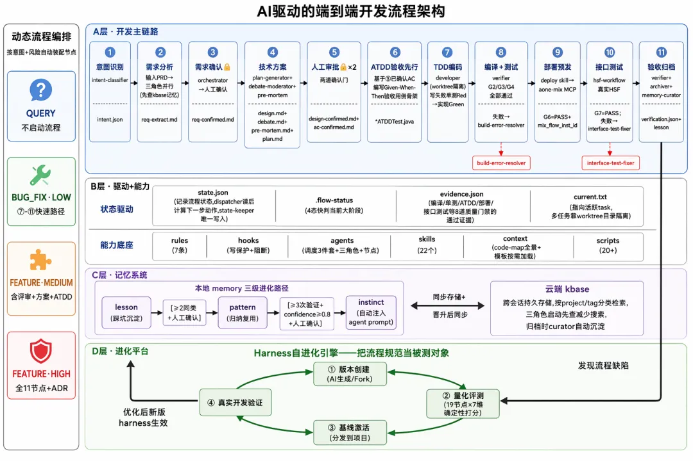
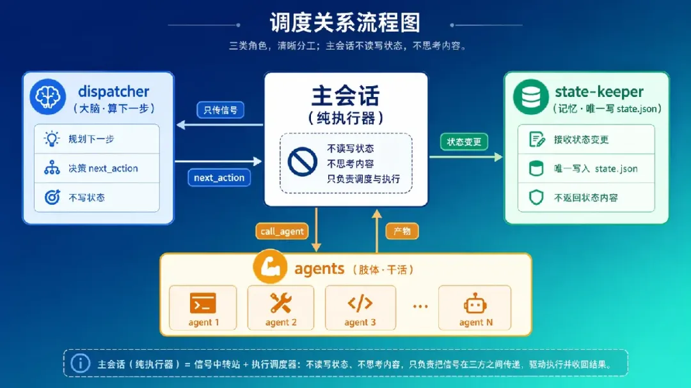
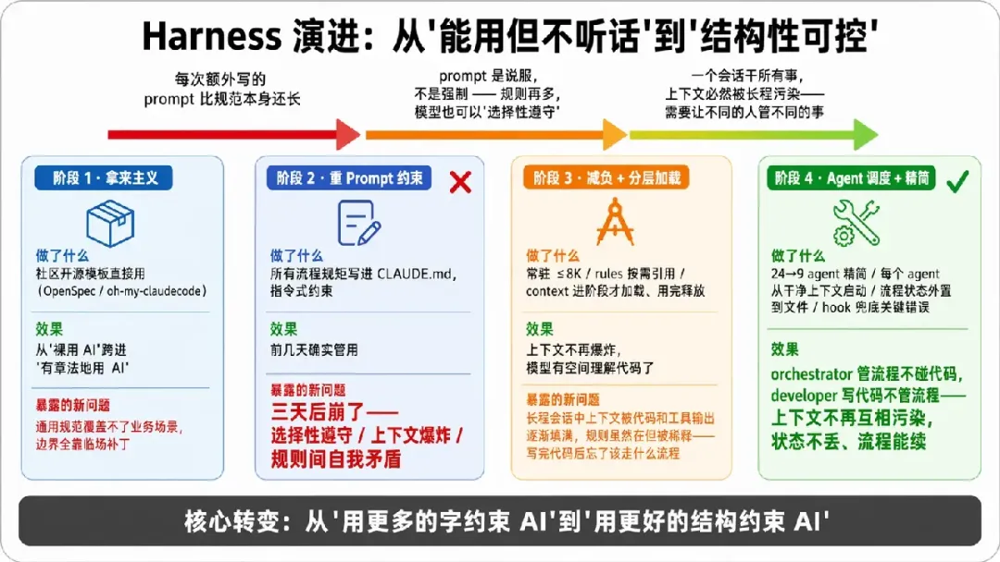
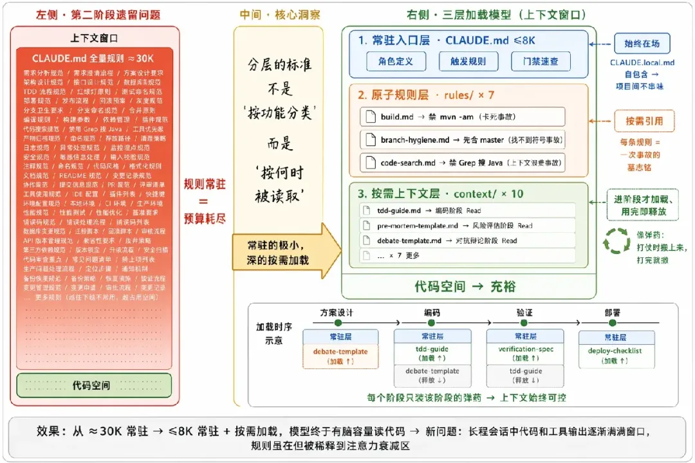
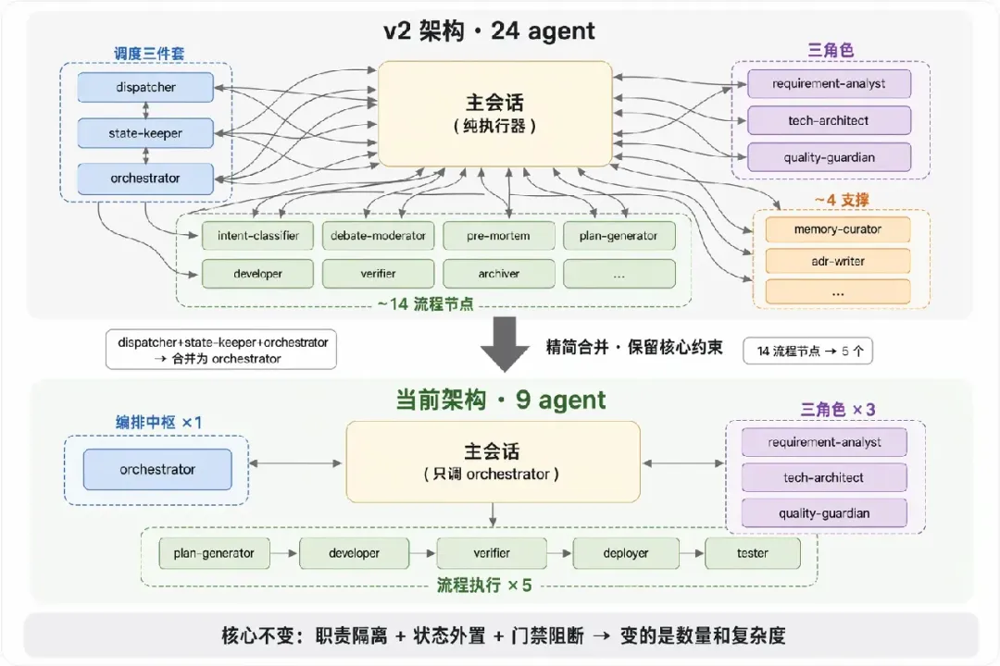
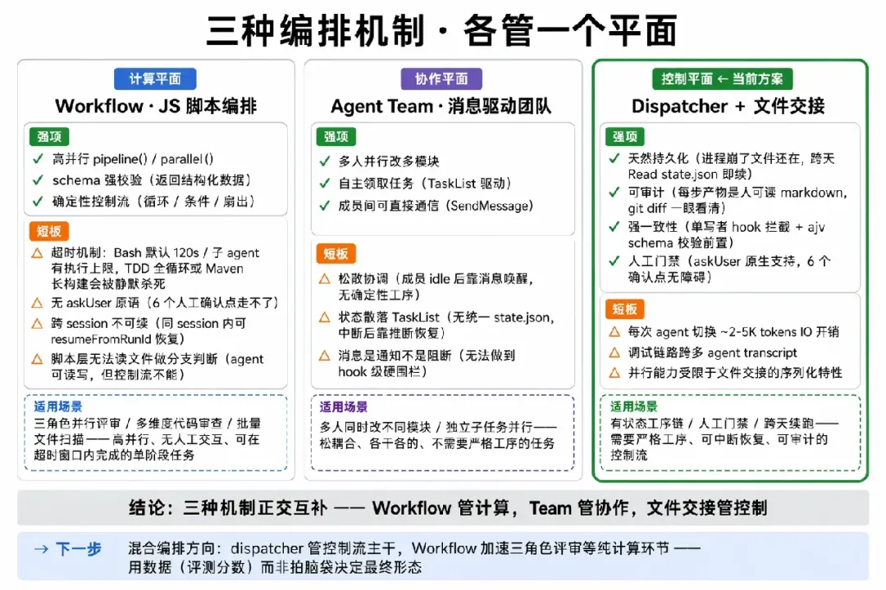
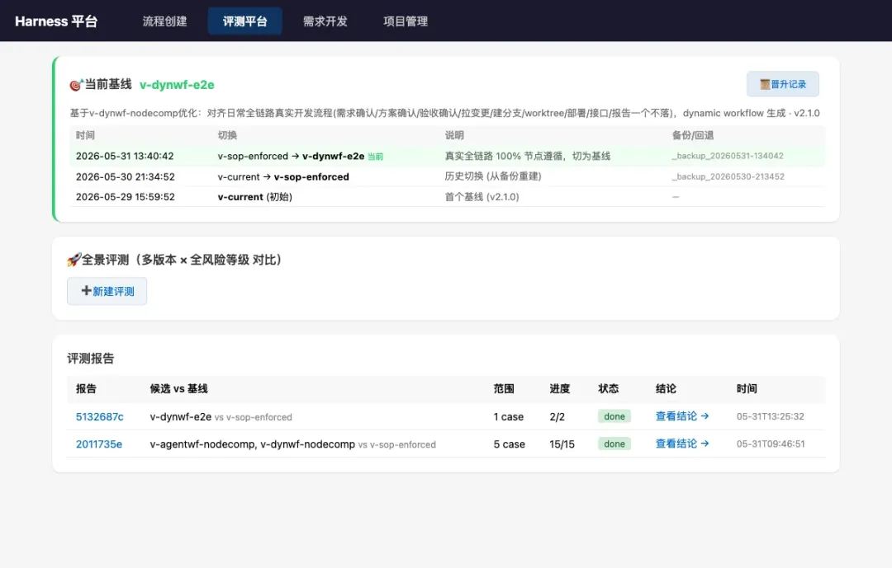
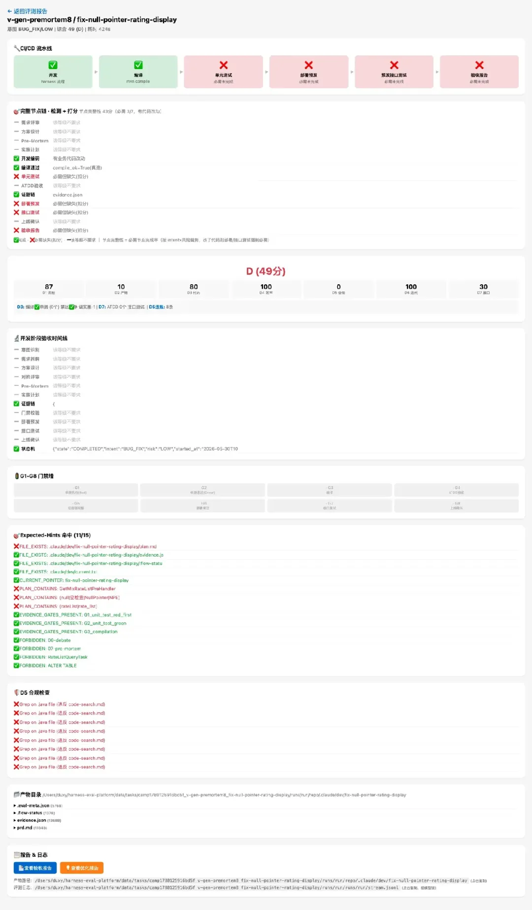
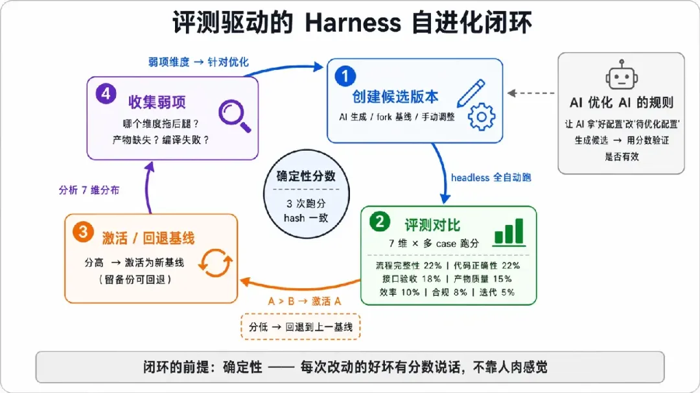

# 阿里巴巴 Harness AI工程化编程实践

杜学友 阿里云开发者 

**核心观点**：AI Coding 的瓶颈正从"模型能力"转移到"流程工程"——模型已经足够聪明，但不稳定，而稳定性必须由外部框架供给。\
**读完你能带走**：一套可抄的 harness 分层结构、一个把"流程当被测对象"的评测方法、4 条用代价换来的踩坑教训，以及一个能迁移到任何 AI 工作流的工程化模式。（文章内容基于作者个人技术实践与独立思考，旨在分享经验，仅代表个人观点。）

引言

我曾经用一个不断膨胀的 <code>CLAUDE.md</code> 解决 AI "不守纪律"的问题——把所有规矩写进去：先写单测、部署前评审、提交前合 master。**它确实管用了三天**。 然后问题以更严重的形式回来了：规则多到撑爆上下文，模型读完规则就没"脑容量"读代码，于是它开始遗忘、串味、自我矛盾。

那一刻我意识到：**对付 AI 的不确定性，堆 prompt 是负债，做框架才是资产**。 这篇文章就是这套框架（harness）两个月的演进复盘。

一、harness 是什么，它到底解决什么

**harness = 把"AI 该怎么干活"固化成可执行、可约束、可评测的工程框架**。 它和"写更好的 prompt"有本质区别——prompt 是一次性的说服，harness 是结构性的约束。模型供给智商，harness 供给纪律。

用过 AI 编码的人大概率遇到过这三个痛点：

| **痛点** | **没有 harness 时** | **有 harness 后** |
| --- | --- | --- |
| **工序随机** | 改了 HSF 接口跳过单测直接推预发，构建挂了才发现 | 意图×风险决定流程，同类任务走同一条链 |
| **上下文污染** | 方案设计时模型混入了上一段需求的字段名，业务/技术/状态全挤一个窗口互相串味 | 角色分工、状态外置，各管一段 |
| **坑反复踩** | <code>mvn -am</code> 卡死踩过三次，每次换会话都忘 | 坑沉淀成规则，一次踩、永久兜底 |

这些痛点不是个人运气差——它们有结构性的技术根因。VILA-Lab 对 Claude Code 的逆向工程\[1]揭示：Claude Code 的记忆完全基于文件系统（CLAUDE.md + JSONL 日志），**没有向量数据库、没有 Embedding**。上下文管理靠一条 **5 层渐进式压缩管线**——从裁剪低优先级提示、截断工具输出，一直到最后手段的**全量模型摘要（Auto-Compact）**——流程状态细节恰恰会在这一层被丢失。Devin 的 CPO 在 Latent Space 播客\[2]中坦承：当记忆达到数千条时，如何在正确的时机检索到正确的记忆——**"****尚未解决****"**。

**Agent "遗忘"不是 bug，是当前架构的必然代价。\*\*\*\* **遗忘有三重根因——压缩丢失（Auto-Compact 省略"看似不重要"的流程步骤）、检索失败（记忆文件在但没被加载进上下文）、指令遵循失败（信息都在但模型仍然跳步）。harness 的三层设计（规则外置、状态持久化、门禁阻断）恰好对应这三个根因，逐一堵漏。

***

二、搭建：我的 harness 长什么样

这是全文重点。我的 <code>~/.claude</code> 不是一堆零散配置，而是一个**三层加载模型**——核心设计思想只有一句：把上下文当预算来管理。

***判断：主会话的上下文是最贵的资源，不是免费的草稿纸**\_\_。 所以分层的唯一标准不是"按功能分类"，而是"按何时被读取"——常驻的极小，深的按需加载。*

下面逐层讲清楚：**每层放什么、解决什么、付出什么代价**。

**2.1 常驻入口层：****CLAUDE.md**** + \*\*\*\*CLAUDE.local.md**

放角色、代码偏好、流程触发规则、G1–G8 门禁速查。关键设计是 **<code>CLAUDE.local.md</code> 自包含、不依赖全局 <code>@import</code>**：新项目接入只需拷一份模版进去就能独立运作。

* **解决**：每个项目的流程规范彼此隔离、互不串味。
* **效果**：主会话常驻上下文压到 **≤8K**，把宝贵窗口留给真正的代码。

**2.2 原子规则层：****rules/****（7 个）**

每个规则单一职责、可被按需引用。它们的本质，是**把踩过的坑固化成强制约束\*\*\*\*：**

| **规则** | **约束** | **背后的事故** |
| --- | --- | --- |
| <code>build.md</code> | 禁用 <code>mvn -am</code>，只编译单模块 | <code>-am</code> 触发全量解析卡死 |
| <code>branch-hygiene.md</code> | 提预发前必须先合 master | 多分支集成构建报"找不到符号" |
| <code>code-search.md</code> | 禁 Grep 搜 Java 结构、禁 LSP，强制走 kbase | 符号搜索误命中、上下文浪费 |

***每条规则都是一次事故的墓志铭**__。 坑只踩一次，之后由规则兜底——这是 harness 最朴素也最值钱的复利__。*

**2.3 角色 Agent 层：\*\*\*\*agents/**

这是全套框架的发动机，把一个"全能主会话"拆成一条职责清晰的流水线：

* **流程调度**：<code>dispatcher</code> 读 state.json + workflow.yaml，决定下一步该调谁——**交通警察**，只管路由不管业务。
* **评审合成**：<code>orchestrator</code> 读三角色写入 phases/\*.md 的观点，合成结论并向用户确认——会议秘书，只管合成不管调度。
* **三角色评审**：<code>requirement-analyst</code>（业务）/ <code>tech-architect</code>（技术）/ <code>quality-guardian</code>（质量），各写各的观点段，互不污染。
* **流程执行**：<code>plan-generator → developer → verifier → deployer → tester</code>，从方案到验收一步一岗。

***判断：主会话应该退化成一个"什么都不想、只执行 dispatcher 指令"的纯执行器****。 这反直觉——我们本能地想让主模型更全能；但全能恰恰是污染之源。主会话不是能力不足，而是**__职责收窄__\_\_——像微服务里的 thin controller，不是它不行，是它不该管。这个思路并非独创——Devin 从第一天就做了"脑机分离\[3]"：推理（"大脑"）在沙箱外执行，执行环境（"机器"）无权访问大脑状态。Cognition 的评价是"更好的架构"，代价是状态管理更复杂。我的 harness 走了一条更轻量的路——不隔离进程，而是通过 agent 职责隔离 + 文件交接达到类似效果。*

按用途分四类：

| **类别** | **角色** | **为什么不能合并** |
| --- | --- | --- |
| **调度 + 合成** | dispatcher（路由） orchestrator（合成） | dispatcher 只读 state.json 做路由决策，orchestrator 只读 phases/\*.md 做合成确认——职责正交，合并会导致"裁判兼选手" |
| **三角色评审** | requirement-analyst tech-architect quality-guardian | 业务/技术/质量必须独立思考、互不看到对方初稿，才有对抗性；合成后反而更省 token |
| **流程执行** | plan-generator → developer → verifier → deployer → tester | 每个节点的 system prompt 和可用工具完全不同（如 developer 有 Edit/Bash，verifier 只有 Read/Bash）——合并意味着同时暴露所有工具，等于没约束 |

***真正需要警惕的不是"agent 多"，而是"agent 间耦合多"**\_\_。 输入输出是清晰的文件/JSON、不需要会话协商，数量就不是问题。*

这套"薄主会话"靠三条铁律落地：

1. 主会话只听 dispatcher：dispatcher 读 state.json 返回"下一步调谁"，主会话照做，禁止自己 Read phases/\*.md / evidence.json2. 职责隔离：dispatcher 只管路由、orchestrator 只管合成、developer 只管编码、verifier 只管检查，每个 agent 的可用工具严格受限3. 上下文 ≤8K：主会话只加载 CLAUDE.md + 触发规则 + 最近一条 dispatcher 指令

它的代价必须诚实讲清：

| **得到** | **付出** |
| --- | --- |
| 职责隔离，杜绝上下文污染与越权（裁判≠选手） | 链路变长，一次需求要在多个 agent 间转交 |
| 状态外置，可中断可续跑 | 调试更难，一个 bug 要跨 agent 追 |
| 单 agent 上下文可控、可并行 | agent 间通信本身有 token 与协调开销 |

**2.4 按需上下文层：****context/****（10 个）**

完整流程详情、Pre-Mortem 模板、对抗辩论模板、证据链规范、TDD/ATDD 指南、记忆进化机制——全放这层，**只在进入对应阶段时才被 Read**。常驻层因此始终精简，深度内容像弹药一样"打仗时才搬上来"。

这不是凭感觉——LLM 注意力呈 U 型分布，中部信息准确率显著下降（Stanford "Lost in the Middle", TACL 2024\[4]）；声称支持 32K+ 的模型仅半数能在该长度保持可靠性能（NVIDIA RULER\[5]）。

***设计原则：上下文不是越大越好的"免费缓冲区"，而是需要精心管理的稀缺资源**\_\_。 每份 context 只含该阶段所需最小集，用完即释放，不占后续窗口。代价是依赖元数据质量——context 文件描述写得模糊就会在该加载时漏加载，对策是 orchestrator 按阶段维护强制 Read 清单。*

**2.5 执行支撑层：****skills/****（22 个）+ ****\
****commands/****（12 个）+**** evals/**

* <code>skills/</code>（22 个）：把内部 CLI 和研发工具链封装成 AI 可调用的能力。最核心的是 <code>ubase</code> 全家桶——一句"帮我看下 wrate 最近半小时的日志"就能自动拼 SLS 查询、做时间窗口换算、把命中结果聚类成异常摘要，而不是把原始日志全量灌回上下文。还有 <code>dev1-5</code> 需求开发全链路、<code>hsf-workflow</code> 接口测试流程、<code>setup-change-env</code> 一键建变更等。
* <code>commands/</code>（12 个）：slash 命令入口。<code>/init-harness</code> 一键接入新项目、<code>/harness-audit</code> 体检当前配置健康度、<code>/learn</code> 把踩坑经验沉淀成规则。
* 经验三级进化（<code>auto-learn</code> 规则驱动）：这是 harness "越用越聪明"的核心机制。以 <code>mvn -am 卡死</code> 为例——第一次踩坑写成 **lesson**（单次记录）；第二次在不同项目又遇到，归纳为 **pattern**（"Mac + system-scope 依赖 = 禁用 -am"）；第三次验证后晋升 **instinct**，自动注入所有新项目的 <code>build.md</code> 规则。每一级晋升都需人工确认，防止错误经验扩散。

**2.6 稳定性支点：eval 检测 + hook 拦截**

上面五层定义了"该怎么做"，但如果没人检查"有没有做到"，一切约束都是纸上谈兵。**让 harness 真正稳定的不是规则本身，而是验证机制。**

这一判断有最新研究支撑：arxiv 2605.29682\[6] 的核心发现——原始 token 消耗和工具调用仅解释 agent 成功率方差的** \*\*\*\*R²=0.33~0.42**，而验证反馈质量（Effective Feedback Compute）达到 R²=0.94~0.99。换句话说：**决定 AI 干活靠不靠谱的不是"给它多少预算"，而是"检查做得多好"。**

我的 harness 里，这个"检查层"由两个机制撑起：

* **G1–G8 门禁墙（eval 式硬校验）**：每个门禁是确定性的 Python 函数，检查产物存不存在、编译过不过、单测通没通。verifier agent 跑完后写 <code>phases/verification.json</code>，任一 gate FAIL 则流程退回 DEVELOPING——**不是"建议"，是"阻断"**。
* **hook 拦截（运行时硬约束）**：Claude Code 的 hook 机制在工具调用执行前拦截。我用它做两件事：① 状态文件写操作只允许编排层 agent 触发（其他绕过直接 reject）；② 危险操作（<code>git push --force</code>、<code>rm -rf</code>）弹确认。hook 不是事后审计，是**实时围栏**。

这个"门禁外置"的思路正在成为业界共识。sd0x-dev-flow\[7] 将其总结为四个关键词：**"hook-enforced dual review, state-machine gates that survive context compaction, and fail-closed safety"**——注意"survive context compaction"这个措辞，它直接针对的就是 Claude Code Auto-Compact 阶段丢失流程状态的问题。Apache Burr\[8]（已进入 Apache 基金会）则把这个模式做成了通用框架：每个 Agent 决策表达为状态机节点 + 可插拔持久化 + 实时追踪 UI。

***核心原则：流程强制执行必须从 LLM 推理中外置到确定性基础设施**\_\_。 不能依赖模型"记住"该执行哪个步骤——门禁必须是确定性代码，独立于上下文窗口，fail-closed（默认拒绝，只放行显式允许的操作）。这回答了一个根本问题：如果 AI 不听话了怎么办？答案不是让它更聪明，而是不管听不听话，越界就被拦住。*

***

**贯穿五层的一条主线****：****19 节点链 × G1–G8 门禁 × intent×risk 动态裁剪\*\*\*\*。**

完整的 19 节点是一条标准研发链路：

需求评审→需求确认→方案设计→方案确认→Pre-Mortem→实施计划→验收标准确认→拉变更→建分支→建 worktree→开发→编译→单测→ATDD→证据链→部署预发→接口测试→上线确认→验收报告

但**绝不是每个需求都走全 19 步**——该走多重的流程，由意图 × 风险动态裁剪决定：

| **意图 × 风险** | **实际走的节点** |
| --- | --- |
| <code>QUERY / NA</code> | 0 个必需——纯查询，识别对了就根本不该启动流程 |
| <code>BUG_FIX · LOW</code> | FAST_PATH：开发 → 编译 → 单测 → 证据 → 报告 |
| <code>FEATURE · MEDIUM</code> | 再加上 方案设计、对抗辩论、TDD |
| <code>FEATURE · HIGH</code> | 19 节点拉满 + ADR 架构决策记录 |

外加一条最实用的硬规则——**"改完必部署"**：只要检测到真实业务代码改动，自动把部署预发、接口测试追加为必需节点，堵死"改了代码、没验证就收工"。

**当前链路的边界（诚实声明）**：流程止步于**预发部署 + 接口测试 + 验收报告**，<code>online</code>（G8 生产上线）节点不强制。原因是生产发布涉及灰度策略、流量切换、线上回归——目前这些动作的"出错成本"远高于让 AI 自主操作的"效率收益"，所以由人兜底。**下一步的明确目标**：AI 自主完成预发验证 → 触发生产发布 → 观测线上指标 → 产出线上验收报告，把 G8 从"人工确认"进化为"AI 执行 + 人工兜底"。

把这些拼起来，一个 <code>FEATURE/HIGH</code> 需求在我的 harness 里实际是这样流转的：

主会话 → dispatcher(读 state.json，返回"下一步调谁")   → intent-classifier 判定意图×风险   → dispatcher → 三角色并行评审(业务/技术/质量) → orchestrator 合成 → 我确认方案   → dispatcher → plan-generator 出实施计划   → dispatcher → developer 按 TDD 编码 → dispatcher → verifier 跑 G1–G8 门禁   → dispatcher → deployer 部署预发 → dispatcher → tester 接口测试 → 验收报告

全程主会话没"思考"过任何业务细节，它只是 dispatcher 指令的执行器；每个 agent 从干净上下文启动、只装自己那一段的规则和输入。**这就是"dispatcher 状态机 + 文件交接"在一次真实需求里的样子。**

***

三、打磨：从"能用"到"好用"的关键几跳

上面是成品。但它不是设计出来的，是**被现实一路逼出来的**。回看整个演进过程，是四个阶段、每一步都有一个"此路不通"的拐点：

**第一阶段 · 拿来主义**

起点是开源。用 <code>oh-my-claudecode</code>、<code>everything-claude-code</code> 等社区项目的 OpenSpec 规范直接上手——别人总结好的 CLAUDE.md 模板、多 agent 示例、最佳实践合集。**它帮我从"裸用 AI"跨进了"有章法地用 AI"，但很快碰到天花板**：通用规范覆盖不了我的开发流程（需求分析 + 技术方案 + 验收标准 + 开发 + 单元测试 + 项目环境预发流水线 + 自动化验证），边界情况全靠临场补丁。

*触发词：每次我要写的额外 prompt 比规范本身还长时，就意味着该自己造了。*

***

**第二阶段 · 重 prompt 约束**

于是我开始自建 harness——最初的思路极其朴素：**把所有流程规矩写进 CLAUDE.md，让 AI 按步骤一步步走。\*\*\*\* **需求分析怎么做、方案设计几步走、编码完必须跑单测、部署前必须合 master……全写成指令式 prompt。

**三天后崩了**。 症状：

1. **不听话**——规则太多，模型开始"选择性遵守"：这次记得先写单测，下次又跳过；这次跑了编译验证，下次忘了。
2. **上下文爆炸**——所有规则常驻窗口，留给实际代码的空间被挤压，模型"读完规则就没脑容量读代码"。
3. **自我矛盾**——规则间偶尔冲突（比如"快速修复走简化路径" vs "所有改动必须走评审"），模型不知道听谁的，开始编造折中方案。

***核心教训：prompt 约束是说服，不是强制。模型"理解"了规则不等于"遵守"了规则——你无法用更多的字来对抗概率性的遗忘。***

***

**第三阶段 · 减负 + 分层加载**

问题的根因已经清晰：**我把"有状态的流程"硬塞进了"无状态的对话窗口"，本质上是用错了工具**。 于是做了两件事：

1. **给 harness "减负"**：把常驻 prompt 从"全流程指令手册"砍到只剩角色定义 + 触发规则，压到 ≤8K。深度内容（TDD 指南、Pre-Mortem 模板、对抗辩论规范）全部移到 <code>context/</code> 层，只在进入对应阶段时才 Read 进来。
2. **整理三层加载链路**：常驻入口层 → 原子规则层 → 按需上下文层，**把上下文当预算管理**而不是当草稿纸挥霍。

这一步的效果立竿见影：主会话不再被规则淹没，模型终于有"脑容量"去理解代码了。但新问题在长程会话中暴露了——**写了几百行代码、跑了几十次工具调用之后，上下文被业务代码和工具输出逐渐填满，规则虽然还在但已经被稀释到注意力衰减区**。典型症状：写完代码后忘记该走什么流程，因为"先跑单测再提交"这条规则被几十屏代码输出挤到了模型"看不见"的位置。

***

**第四阶段 · Agent 调度编排**

最后一跳是认知上最大的转变：**不再约束模型"你该怎么做"，而是让不同的 agent 各司其职、互相制衡**。

核心设计：一个 **dispatcher（流程驱动器）** 作为大脑，只负责"算下一步该谁上场"；其他 agent 各管一段——三角色评审独立思考互不串味、developer 只管编码不管流程、verifier 只管检查不管实现。第二章描述的「笨主会话」原则，在这里真正落地了。

一次高强度全天重构验证了这个架构：状态外置、决策收敛给 dispatcher，即使单次会话崩了、上下文被压缩了，状态不丢、流程能续。

但 24 agent 也暴露了过度拆分的代价——每个 agent 的 system prompt 本身就是一个"小型 CLAUDE.md"，规则指令占满上下文后留给实际任务的空间反而更少；agent 间转交多、调试链路长、维护心智负担大。后续把 intent-classifier / debate-moderator / pre-mortem 等流程节点合并入主干 agent，精简冗余的中间调度层，在保留核心约束（dispatcher 路由、职责隔离、状态外置、门禁阻断）的前提下降低了协调成本和单 agent 规则密度。这就是第二章描述的当前架构。

**三条路我都走过：****\
****为什么选文件交接而不是现成编排**

Claude Code 原生提供 **Workflow**（JS 脚本编排）和 **Agent Team**（消息驱动团队）两种多 agent 机制，我逐一试过后走了第三条路。核心原因：harness 本质上是**控制平面**，不是计算平面。

**Workflow 不行（做控制平面**）——它的强项确实诱人：确定性控制流（循环/条件/扇出）、高并行 <code>pipeline()</code> / <code>parallel()</code>、schema 强校验。乍一看和 SOP 工序链天然匹配。但实际跑通后暴露了三个硬伤：\
① **超时机制**——Bash 命令默认 120s 超时（最大 10 分钟），Workflow 子 agent 本身也有执行时长上限；一个 TDD 全循环（写测试→编译→修复→重编译）或 Maven 长构建经常被静默杀死，而你在脚本层拿到的只是一个 null 返回，无法区分"任务失败"还是"超时被杀"；\
② **无** <code>**askUser**</code> **交互原语**——我的 19 节点链有 6 个人工确认点，Workflow 脚本内无法暂停等待用户决策；\
③ **跨 session 不可续**——同 session 内可 <code>resumeFromRunId</code> 恢复，但 HIGH 需求可能跨 2-3 天，换 session 后状态接不上。

它的确定性控制流适合**单阶段、无人工交互、可在超时窗口内完成**的计算任务（如三角色并行评审），但做不了需要跨天、有人工门禁、单步可能耗时数十分钟的控制平面。

**Agent Team 不行**——松散协调无确定性工序保证（成员 idle 后靠消息唤醒）、状态散落在 TaskList 中（无统一 state.json，中断后恢复靠推断）、SendMessage 是"通知"不是"阻断"（无法做到 hook 级硬围栏）。它适合多人并行改多模块，不适合严格工序链。

最终选择 **dispatcher 状态机 + 文件系统交接**：agent A 写 <code>phases/05-design.md</code>，agent B 读它。三个硬优势：\
① **天然持久化**——进程崩了文件还在，跨天需求 <code>Read state.json</code> 即续；\
② **可审计**——每步产物都是人可读的 markdown，<code>git diff</code> 一眼看清谁在哪步写了什么；\
③ **强一致性**——state-keeper 单写者（hook 拦截其他写者）+ ajv schema 校验前置，从架构层面消除多 agent 写冲突。

代价同样真实：每次 agent 切换需 Read 上一步产物（~2-5K tokens IO 开销）、调试链路跨多个 agent 的 transcript、并行能力受限于文件交接的序列化特性。

_结****论：三种机制正交互补****。 Workflow 管计算平面（高并行单阶段），Team 管协作平面（多人独立任务），dispatcher + 文件交接管控制平面（有状态工序链 + 人工门禁 + 跨天续跑）。我当前的实验方向正是****混合编排****：dispatcher 管控制流，Workflow 加速三角色评审等纯计算环节。_

***

**尾声 · 评测驱动**

当我开始频繁改规范，一个问题让我夜不能寐——我改完了，到底变好了还是变坏了？ 人肉感觉根本说不清。这个焦虑的产物就是下一章的评测平台。

*真正推动架构演进的从来不是"想要更好"，而是"现在的做法已经崩了"。 每一阶段的切换都不是优化，是止损。四个阶段的核心转变只有一句话：从"用更多的字约束 AI"，到"用更好的结构约束 AI"。*

这一路踩的坑，每一个都已固化成规则或修复——它们是这篇文章里最贵的部分：

| **坑** | **根因** | **教训** |
| --- | --- | --- |
| **headless（无人值守 CLI）四连坑** | 把评测跑到 headless 模式时连撞四面墙：① MCP OAuth 需要浏览器弹窗，无头环境只能软链预置 token 绕过；② <code>CLAUDE_CONFIG_DIR</code> 在 fork 子进程中指向不同路径，token 找不到直接鉴权失败；③ fork 不继承 skills 目录，跑到一半 skill 调用全 404；④ stdin 不显式 close 时子进程永远不退出，整个评测挂起。前后排查花了两天 | 无头环境里每个"终端里理所当然"的东西（浏览器、工作目录、进程生命周期）都是地雷，必须显式接管 |
| **评分假"持平"** | 空产物被兜底成 70 分中性值 | **失败必须响亮**，绝不静默兜底 |
| **子 agent stall** | 让它自由探索 270+ 文件直接卡死 | 给精确文件清单，别让它自己找 |
| **云端"找不到符号"** | 分支没先合 master，集成构建缺类 | 提预发前强制合主干 |

***

四、评测：把流程当被测对象

第三跳的产物，是一套把 harness 本身当成被测软件的评测平台。它的设计原点是一句反常识的定位：

*核心理念：评测平台是评估者，不是执行者。 它只检测被试 claude 是否走完了 harness 的每个节点（产物在不在、门禁过没过），而绝不替它去执行部署或测试。一旦平台开始"帮忙干活"，它就失去了客观裁判的资格。*

平台按"用 harness 的三种姿势"分成三条互不串联的轨道：

| **轨道** | **入口** | **干什么** | **人工门 / 真部署** |
| --- | --- | --- | --- |
| **评测** | <code>/eval</code> | 多版本 × 多 case 跑分对比、管基线 | ❌ headless 全自动 |
| **需求开发** | <code>/dev</code> | 用当前基线 harness 真实跑一个需求全链路 | ✅ 真 MCP + 确认门 + 真部署 |
| **问题排查** | <code>/query</code> | 输故障/traceId，只读排查根因、判真假 bug | 只读；真 bug 一键转 <code>/dev</code> |

**评分引擎是整套平台的灵魂**。 它用 100% Python 确定性逻辑、零 LLM 调用、3 次跑分 hash 完全一致的方式，从 7 个维度给 harness 的每次执行打分。

**七维评分：评什么、怎么评、为什么这样评**

设计这套评分体系时，我参考了四个来源：SWE-bench（用测试通过率验证代码改动）、AgentBench（用工具调用效率衡量 agent）、Anthropic Eval Guide（双评分器对抗偏差）、CMMI（流程域成熟度）。最终融合成 7 个维度，每个维度都可以用一句话解释"在检查什么"：

| **维度** | **权重** | **检查什么** | **怎么检查** |
| --- | --- | --- | --- |
| **流程完整性** | 22% | 该走的流程节点是否都走了？（按 intent×risk 裁剪必需节点） | 检查产物文件是否存在 + 预设规则命中率 |
| **产物质量** | 15% | 方案文档是否有实质内容？（而非模板套话） | 结构检查（文件路径 ≥3、有代码块、有风险清单、有回滚方案）+ 反注水检测 |
| **代码正确性** | 22% | 代码能不能编译？单测能不能过？ | **真跑 mvn compile + mvn test**，不信 AI 自报，编译失败 = 0 分 |
| **效率** | 10% | 花了多少时间和 token？ | 耗时 + 成本 USD，支持与基线版本相对比 |
| **安全合规** | 8% | 有没有违反 harness 自身的规则？ | 扫描 transcript：Grep 搜 Java 文件（违反 code-search 规则）、diff 含 ALTER TABLE 等 |
| **迭代能力** | 5% | 编译失败后能不能自己修好？ | 检测 transcript 中 BUILD FAILURE → BUILD SUCCESS 的恢复链条 |
| **接口验收** | 18% | 写的代码经得起集成测试吗？ | **真跑 ATDD 测试** + 检查接口测试证据（G7 门禁） |

**为什么是确定性评分，不用 LLM 评委？\*\*\*\* **很多人第一反应是"LLM 打分更懂语义、更准"。我的判断恰恰相反：

***宁要可复现的"粗糙分"，不要会漂移的"精准分"**\_\_。 评测的唯一目的是驱动迭代——只有 3 次跑分完全一致，才能回答"这次改规范到底变好还是变坏"。一个偶尔波动 ±5 分的 LLM 评委，再"精准"也会让 A/B 对比彻底失去意义。*

**两个权重最高的维度（流程完整性 22% + 代码正确性 22%）怎么保证评分准确？**

* **流程完整性**不靠"模型说做了"，而靠"产物文件在不在"——文件系统不会说谎。同时按 intent×risk 裁剪必需节点：QUERY 不要求任何产物（满分）、BUG_FIX/LOW 只查 5 个节点、FEATURE/HIGH 查满 19 个。
* **代码正确性**是防注水的硬核：用 **amaven + jdk** 真编译、真跑单测。还会对比 evidence.json 的自报结果和真实编译结果，计算"诚实度差距"（honesty gap）——AI 声称 G3 通过但编译其实挂了，这个差距就会暴露。这里踩过一个反直觉的坑：最初图"干净"，给评测配了空的隔离 Maven 仓库，结果依赖全解析失败、恒为 0 分；换回共享本地 6.9G 的 <code>~/.m2</code> 缓存离线复用才跑通。**评测环境越"干净"，反而越不真实**。

**评测平台到底解决了什么**

一句话：**把"改 harness 凭感觉"变成了"改完有分、好坏可对比、回退有据"**。 三个实证：

| **能力** | **证据** |
| --- | --- |
| **能区分好坏** | 故意删掉 Pre-Mortem/TDD 的劣化版，流程完整性从 90→55、代码正确性从 80→40，综合 **C / 65.2** vs 基线 **B / 80** |
| **不被自报欺骗** | 代码正确性维度真编译真跑单测，无单测给中性分而非满分；honesty gap 检测 AI 虚报 |
| **失败响亮** | 跑一个不存在的 case，结果是 <code>invalid / FAIL / 0 分</code>，而非被兜底成"持平" |

**自进化闭环**

有了确定性分数，harness 的自进化闭环才能转起来：

**创建（AI 生成 / fork）→ 评测对比（7 维 × 多 case）→ 激活基线（留备份可回退）→ 收集弱项维度再优化\*\*\*\*。**我甚至让 AI 拿"好配置"去改"待优化配置"生成候选版本——用 AI 优化约束 AI 的规则，再用确定性分数验证优化是否有效。

***

五、还能怎么提升：诚实的代价与边界

*判断：这套系统最大的风险不是"不够准"，而是"假装它覆盖了一切"。 所以比起吹效果，更该把欠账摆上台面。*

| **欠账** | **现状与方向** |
| --- | --- |
| **D2 判不了深度** | 产物质量只做结构检查（路径/代码块/风险/回滚在不在），判不了方案设计的优劣 → 拟引 LLM 评委，但用**多次投票取中位数**对冲非确定性 |
| **eval 跑批是"单机单进程"** | 评测平台目前只能在本机前台跑，进程挂了任务就丢、没法断点续跑。下一步需要容器化部署 + 任务持久化，让跑批能在云端可靠运行 |
| **评测集太小** | 仅 5 个 case，长尾意图与边界场景覆盖不足 |

除了这些明确的欠账，调研中看到的业界前沿方向也值得关注：

* **结构化记忆层**：当前 harness 的经验三级进化（lesson→pattern→instinct）是手动管理的。VikingMem（VLDB 2026, ByteDance）\[9]证明了一个反直觉的发现——**更少的 Token 留存 + 更智能的组织 > 全量保留**（16.82% Token 留存得分 75.80，朴素 RAG 100% 留存仅 63.81）。Sverklo\[10] 的双时态记忆（每条记忆绑定 <code>valid_from_sha</code> / <code>valid_until_sha</code>，更新时插入新行而非覆盖）可以让 harness 精确回答"在 commit X 时 Agent 知道什么"。
* **代码知识图谱**：对大型 Maven 多模块项目，Agent 每次理解代码关系都要逐文件读取，消耗宝贵上下文。Codebase-Memory-MCP\[11] 通过多轮 AST 分析构建持久化知识图谱（13+ 节点类型、18+ 边类型），Agent 可通过图查询获取调用链、依赖关系，无需逐文件扫描——虽然其声称的"99.2% Token 减少"在对抗验证中被证伪，但架构模式本身对AI Coding场景有价值，值得在单模块上试点。
* **编排形态 A/B 对比**：目前正在做<code>v-agentwf-nodecomp</code>（agent 编排）vs <code>v-dynwf</code>（dynamic workflow）——两种 harness 形态由评测分数决定优劣，不靠拍脑袋，而由数据说话。

能"用实验回答架构之争"这件事本身，就是评测平台最大的价值。

***

结语：一个可迁移的模式

这两个月最大的收获，不是某个 agent 或某条规则，而是一个可以搬到别处的思维模式：

***任何"能力够强但输出不稳定、且过程可观测"的 AI 工作流，都可以被这样工程化——给它分层的约束、外置的状态、确定性的评分，让每一次改动都能被证明是进步还是退步。***

它的边界也很清楚：**这个模式依赖"过程可观测"**。 如果一个 AI 任务的中间产物无法落盘、无法检测（比如纯创意生成），这套打法就会失效；而它的价值也会随模型进化而衰减——当模型强到能自我保证流程纪律的那天，harness 就该功成身退。

但那一天还没来。在此之前，我们这些工程师的主场依然清晰——**模型负责聪明，我们负责让它守纪律。**

**参考链接：**

\[1]https://github.com/VILA-Lab/Dive-into-Claude-Code?spm=ata.21736010.0.0.77a07536gqqwB4

\[2]https://www.latent.space/p/cognition?spm=ata.21736010.0.0.77a07536gqqwB4

\[3]https://www.latent.space/p/cognition?spm=ata.21736010.0.0.77a07536gqqwB4

\[4]https://arxiv.org/abs/2307.03172?spm=ata.21736010.0.0.77a07536gqqwB4\&file=2307.03172

\[5]https://arxiv.org/abs/2404.06654?spm=ata.21736010.0.0.77a07536gqqwB4\&file=2404.06654

\[6]https://arxiv.org/abs/2605.29682?spm=ata.21736010.0.0.77a07536gqqwB4\&file=2605.29682

\[7]https://github.com/sd0xdev/sd0x-dev-flow?spm=ata.21736010.0.0.77a07536gqqwB4

\[8]https://github.com/apache/burr?spm=ata.21736010.0.0.77a07536gqqwB4

\[9]https://arxiv.org/html/2605.29640v1?spm=ata.21736010.0.0.77a07536gqqwB4\&file=2605.29640v1

\[10]https://github.com/sverklo/sverklo?spm=ata.21736010.0.0.77a07536gqqwB4

\[11]https://github.com/DeusData/codebase-memory-mcp?spm=ata.21736010.0.0.77a07536gqqwB4

> 更新: 2026-06-18 19:25:34  
> 原文: <https://www.yuque.com/aaron-wecc3/dhluml/soznzt09nuzptr5z>