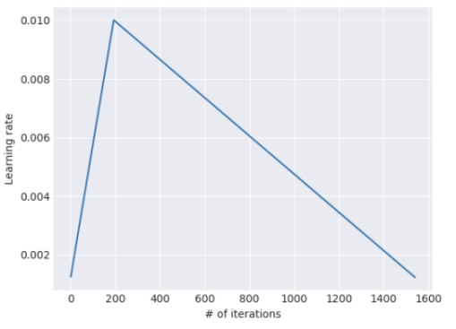
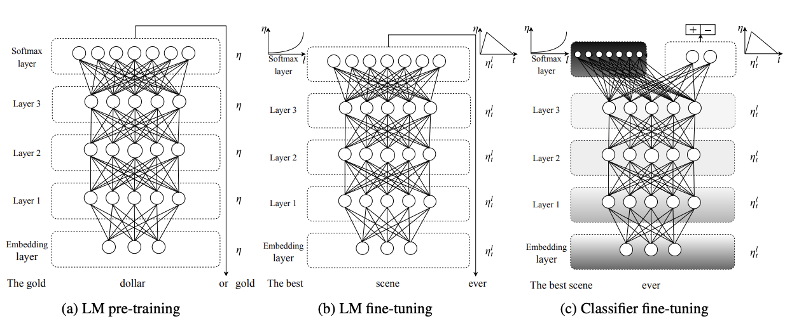

# 100.ULM-FiT迁移学习面试题

## 常见面试题
1. 回顾：NLP的预训练难题
2. 论文关键部分选读
3. 基于Fine-Tuning的迁移学习在NLP领域一直不成功
4. 但Fine-Tuning没错，我们的办法可以在NLP实现类CV的迁移学习
5. Cookie Monster的使用步骤
6. Cookie Monster提出的三个新的微调技术
7. 训练Cookie Monster的三步法

_#我还是觉得ULM-FiT是NLP的ImageNet时刻，而不是Bert。ULM-FiT的出现，让那个时代的NLP终于有了一种像CV领域一样的迁移学习方法。_

论文地址：[Universal Language Model Fine-tuning for Text Classification](https://arxiv.org/abs/1801.06146)

| Inductive transfer learning has greatly impacted computer vision, but existing approaches in NLP still require task-specific modifications and training from scratch. **We propose Universal Language Model Fine-tuning (ULMFiT), an effective ****transfer learning**** method that can be applied to any task in NLP, and introduce techniques that are key for fine-tuning a language model.** Our method significantly outperforms the state-of-the-art on six text classification tasks, reducing the error by 18-24% on the majority of datasets. Furthermore, with only 100 labeled examples, it matches the performance of training from scratch on 100x more data. We open-source our pretrained models and code. |
| :--- |

_它是Cookie Monster。ULM-FiT其实和他没有任何关系，用它来代表ULM-FiT纯粹是为了好玩儿__😘__！_

_每次都打ULM-FiT，属实有点累了。接下来都用__Cookie__ Monster来表示ULM-FiT啦！_

## 1 **回顾：****NLP****的预训练难题**
之前我们引用了ULM-FiT的论文的摘要，其中就说到了，归纳迁移学习极大地影响了计算机视觉的发展，但现有的NLP方法仍然需要针对特定任务进行修改，并从头开始训练具体的模型。

在8.1.5中我们解释了NLP领域迟迟没有出现像CV一样的Inductive transfer learning的原因：一个是数据集太少（标注成本非常高；而且网络上的语言质量参差不齐，是一种挑战）；另一个是，CV的大多数任务基本都是基于分类的，而NLP领域却有很多任务，包括基本的命名实体识别任务和句法分析任务；包括基于分类的任务，如情感分析；以及基于序列的任务，如机器翻译和自然语言生成。这些任务涉及不同的数据结构和算法，很难用同一个模型、同一个权重全部概括。

+ 对于数据集太少问题，可以用利用半监督学习（Semi-supervised Learning）：用少量的有标签数据和大量的无标签数据进行训练，以提高模型的性能。这可以参考8.2中提到的LM-LSTM和SA-LSTM。
+ 对于任务太多的问题，一个重要的解决方案就是12.2中我们会介绍的Multitask Learning, 多任务学习。

## 2 **论文关键部分选读**
### 2.1 **基于Fine-Tuning的****迁移学习****在****NLP****领域一直不成功**
+ 虽然深度学习模型在许多NLP任务上达到了SOTA，但这些模型都是从头开始训练的，需要大量的数据集，而且需要几天的时间来收敛。对比隔壁的CV，他们已经很少从头开始Train Model了，基本都是基于已有的预训练模型做fine-tuning，羡慕的NLP从业者口水都流下来了🥺
+ 鉴于预训练的好处，NLP领域应该能够比每次做任务都随机初始化我们模型的参数要做得更好。然而，通过微调的归纳转移对于NLP来说是不成功的。2015年，Dai和Le首次提出对语言模型（LM）进行微调（就是我们在第八章介绍的论文Semi-supervised Sequence Learning噢！），但需要数百万的in-domain documents来实现良好的性能，这严重限制了其适用性。
+ 此外，语言模型容易过拟合，而且在被微调时容易出现**灾难性遗忘（catastrophic forgetting）**。

_**Hey **__**ChatGPT**__**，为什么在ULM-FiT之前，在**__**NLP**__**中用fine-tuning做**__**迁移学习**__**的尝试都不算成功？**_

| 在 ULM-FiT 提出之前，使用微调进行迁移学习在 NLP 中确实存在一些挑战和限制。主要有以下几个方面： **数据量问题：** 在 NLP 中，很多任务需要大量的标注数据才能达到较好的性能，但标注数据往往是非常昂贵和耗时的。因此，训练深度神经网络需要大量标注数据的限制是一个常见的问题。 **任务之间的差异：** 不同的 NLP 任务之间可能存在很大的差异，这意味着在微调模型时需要重新训练模型来适应新的任务，而这往往需要大量的标注数据和计算资源。 **神经网络****的****过拟合****问题：** 微调的过程通常需要调整大量的参数，这可能导致神经网络过拟合训练数据，导致在测试数据上表现不佳。 以上问题使得之前使用微调进行迁移学习的尝试在 NLP 领域中取得的效果并不理想。 而 ULM-FiT 引入了一些新的方法来解决这些问题，包括：使用自然语言预训练模型来学习通用的语言知识，利用数据增强技术来扩大训练数据集的规模和多样性，使用迁移学习来将通用的语言知识应用于不同的 NLP 任务中。这些方法使得 ULM-FiT 取得了很好的效果，并在 NLP 领域中得到了广泛应用。 |
| :--- |

### 2.2 **但Fine-Tuning没错，我们的办法可以在****NLP****实现类****CV****的****迁移学习**
+ ULM-FiT这篇文章的作者想说，错的不是对LM做微调，问题出在我们缺乏如何有效训练它们的知识。相比于CV，NLP模型往往更浅，所以需要不同的微调方案。

| + We propose a new method, Universal Language Model Fine-tuning (ULMFiT) that addresses these issues and enables robust inductive transfer learning for any NLP task, **akin to fine-tuning ****ImageNet**** models**: The same 3-layer LSTM architecture— with the same hyperparameters and no additions other than tuned dropout hyperparameters— outperforms highly engineered models and transfer learning approaches on six widely studied text classification tasks.  |
| --- |

### 2.3 **Cookie**** Monster的使用步骤：**
#### 2.3.1 **Cookie**** Monster提出的三个新的微调技术**
+ **Discriminative fine-tuning（‘Discr’）** 是指在深度学习中对预训练模型进行微调，以适应新任务或数据集的过程。在这个过程中，每层的学习率被设置为不同的值。

| + **斜三角****学习率****（Slanted triangular learning rates，STLR）**是一种用于训练神经网络的学习率策略，旨在加速训练过程并提高模型性能。 + 它首先线性增加学习率，然后根据右表线性衰减。 + #横轴为迭代次数。 |  |
| --- | :--- |

+ **渐进式解冻（Progressive Unfreezing）**是一种用于训练深度神经网络的技术，其利用了分阶段训练的方法，旨在缓解深度神经网络训练中的过拟合问题，并提高模型的性能。
    - 在传统的深度神经网络训练中，通常是先对整个网络进行训练，然后再微调各个层，这种方式可能会导致网络过拟合，即模型对训练数据过于敏感，泛化能力较差。而渐进式解冻则是一种分阶段训练的方法，可以使得网络逐步地学习到数据的更多细节信息，从而降低过拟合的风险。
    - 具体而言，渐进式解冻的步骤如下：1、将深度神经网络的所有层进行冻结，只训练最后一层。2、在最后一层训练收敛后，解冻前一层，继续训练倒数第二层。3、在两层训练收敛后，解冻前一层，继续训练倒数第三层。依次类推，直到所有层都被解冻并训练完成。
    - 通过这种方式，渐进式解冻可以逐步增加网络的复杂度和容量，使得网络可以逐步学习到数据的更多细节信息，并逐渐适应数据的不同特征，从而提高模型的性能。此外，渐进式解冻还可以提高模型的泛化能力，并缩短训练时间，减少过拟合的风险。

#### 2.3.2 **训练****Cookie**** Monster的三步法**

ULMFiT由三个阶段组成：

a）在一般领域的Corpus上训练LM，以捕捉语言的一般特征（论文原作里，作者在Wikitext-103上预训练语言模型，前者由28,595篇预处理的维基百科文章和1.03亿个单词组成）。这个阶段是最昂贵的，但它只需要执行一次，并能提高下游模型的性能和收敛性。

b）在目标任务数据上使用Discr和STLR对完整的LM进行微调，以学习特定的任务特征。

+ Discr背后的思想：由于不同的层捕获不同类型的信息，它们应该被微调到不同的程度。
+ STLR的目的：希望模型在训练开始时能迅速收敛到参数空间的一个合适区域，然后完善其参数。

c) 分类器（Classifier）：在目标任务上使用**渐进式解冻**、"Discr "和STLR进行微调，以保留低级表征并适应高级表征（图中，阴影：解冻阶段；黑色：冻结）。

对目标分类器进行微调是迁移学习方法中最关键的部分。过于激进的微调会导致灾难性的遗忘，消除了通过语言建模捕获的信息的好处；过于谨慎的微调会导致缓慢的收敛（以及由此产生的过拟合）。在Cookie Monster里，作者采用了渐进式解冻的训练方法来避免过于激进的微调导致的灾难性遗忘，并辅以Discr和STLR，尽量实现激进和谨慎之间的折衷。

## 3 **总结**
ULM-FiT是一种有效的、极其节省样本的迁移学习方法，可以应用于任何NLP任务。

ULM-FiT之前，NLP领域的Fine-tuning一直存在过拟合、灾难性遗忘、数据集不够等挑战，而ULM-FiT采用了多任务学习，提出了几种新的微调技术（3.3），有效防止了灾难性的遗忘，并在不同的任务中实现了稳健的学习。**NLP领域终于有了类似CV的迁移学习方法。**

> 更新: 2025-09-30 09:37:23  
> 原文: <https://www.yuque.com/aaron-wecc3/dhluml/bx9wcsbxa8khcfqr>