# 101.GPT模型相关面试题

## 常见面试题
1. GPT是一个12层的Transformer解码器
2. GPT的训练范式是预训练+Fine-Tuning
3. 无监督预训练 Unsupervised pre-training
4. 微调的范式 An illustration of supervised fine-tuning
5. GPT的创新点：Task-specific input transformations
6. GPT-2：语言模型是无监督的Multitask Learner
7. NLP的众多子任务都可以转为问答任务
8. 多任务学习的定义
9. Zero-Shot：要不咱不去微调了？
10. Zero-shot难在哪？
11. 从Zero-shot到Prompting
12. Why Prompt Works at All？
13. GPT-2的性能与对该模型的评价
14. GPT-3：语言模型是Few-Shot Learner
15. GPT-3的意义
16. GPT-3的模型架构与工程细节
17. In Context Learning 上下文学习（ICL）
18. GPT-3模型的局限性 Limitations
19. 留下的疑问：GPT-3是怎么进化成ChatGPT的？
20. Codex：用Github代码Fine-tune一个GPT

****

**如果对Transformer还不熟悉，千万先回到第十章去把Transformer学明白！**

_**#学**__**GPT**__**不懂Transformer，就像读四大名著不看红楼梦，说明这个人技术造诣和自我修养不足，他理解不了这种内在的阳春白雪的高雅艺术，他只能看到外表的辞藻堆砌，参不透其中深奥的精神内核，他整个人的层次就卡在这里了，只能度过一个相对失败的人生。**_

_#__GPT__ is short for __**G**__enerative __**P**__retrained __**T**__ransformer。其实GPT和__BERT__的区别就写在他们的脸上。GPT是Generative的，目的就是要生成。它是一个预训练的Transformer，因为目的就是要生成，所以是Decoder-Only的Auto-Regressive架构。相比之下，Bert的论文名字叫__**BERT：Pre-training of Deep Bidirectional Transformers for Language Understanding。**__它是很深很深的、双向的Transformer__编码器__的堆叠，目的是__自然语言理解__。_

|  | 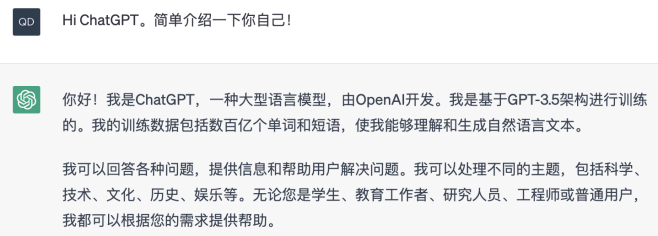 |
| :---: | :---: |

_这个文档的读者可能是为了__GPT__而来，但是能够坚持看到这里的肯定寥寥无几了！铺垫了这么久，我们终于见到主角了。__来看看__OpenAI__如何在世界更看好__BERT__的情况下，坚持用Decoder-only的__自回归__方法，不鸣则已，一鸣惊人！_

**下表是本章节会涉及到的几个模型。**

| 模型 | 论文 | 模型参数 | 范式与创新点 | 评价与意义 |
| :---: | --- | :---: | :---: | --- |
| GPT | [Improving Language Understanding by Generative Pre-Training](https://s3-us-west-2.amazonaws.com/openai-assets/research-covers/language-unsupervised/language_understanding_paper.pdf) | 12层解码器，768维词嵌入，12个注意力头 | 预训练+微调，创新点在于Task-specific input transformations。 | 很快被Encoder-only的BERT击败，但自回归的技术路线的选择注定了GPT的难度更大，但天花板会更高。 |
| GPT-2 | [Language Models are Unsupervised Multitask Learners](https://cdn.openai.com/better-language-models/language_models_are_unsupervised_multitask_learners.pdf) | 15亿参数 | 预训练+Prompt+Predict，创新点在于**Zero-shot** | 被BERT Large横扫SOTA后，OpenAI未能给出很好的回应。Zero-shot新颖度拉满，但事实更像树模型性能拉胯，实用性低，只好以0S为卖点。 |
| GPT-3 | [Language Models are Few-Shot Learners](https://arxiv.org/pdf/2005.14165.pdf) | 1750亿参数 | 预训练+Prompt+Predict，创新点在于**in-context learning** | 开创性提出**in-context learning**概念，是Prompting真正的祖师爷。**In-context learning（ICL）**是Prompting范式发展的第一阶段。 |
| Codex | [Evaluating Large Language Models Trained on Code](https://arxiv.org/abs/2107.03374) | 3亿参数和12亿参数 | 预训练+Fine-tuning。Fine-tune就是真香。 | 技术上没什么复杂的，爬完Github的代码用于训练更是极具争议。ChatGPT和GPT-4的代码生成能力很强，Codex功不可没。有人认为ChatGPT能进行复杂的reasoning是因为它学习了这些代码。 |

## 1 **GPT****的诞生（2018.6）**
### 1.1 **GPT****是一个12层的Transformer****解码器**
_**12层**__**解码器**__**，768维词嵌入，12个注意力头**_

论文：[Improving Language Understanding by Generative Pre-Training](https://s3-us-west-2.amazonaws.com/openai-assets/research-covers/language-unsupervised/language_understanding_paper.pdf)

翻译：[梦开始的地方：GPT1论文翻译：Improving Language Understanding by Generative Pre-Training](https://zhuanlan.zhihu.com/p/619995186) By haidao

我们可能会觉得GPT这么牛逼，一定超级超级复杂。但其实不是这样的！**GPT其实并不是一种新型架构，他的结构类似于只有****解码器****的Transformer。**事实上，它无非是堆叠了12个Transformer的解码器！

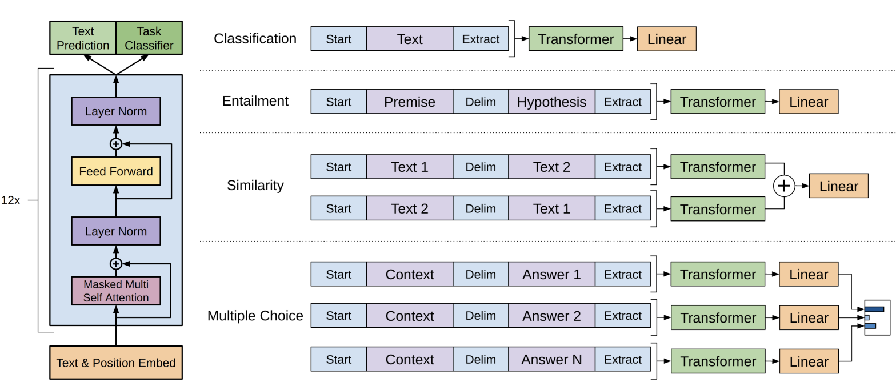

_上图截自发布__GPT__的论文，可以看到，GPT它就是一个12层__解码器__！_

| OpenAI GPT模型是在Google BERT模型之前提出的, 与BERT最大的区别在于GPT采用了传统的语言模型方法进行预训练, 即使用单词的上文来预测单词, 而BERT是采用了双向上下文的信息共同来预测单词.正是因为训练方法上的区别, 使得GPT更擅长处理自然语言生成任务(NLG), 而BERT更擅长处理自然语言理解任务(NLU)。 |
| :--- |

| 如右图所示，我们知道， 经典的Transformer Decoder Block包含3个子层, 分别是Masked Multi-Head Attention层, Encoder-Decoder Attention层, 以及最后的一个全连接层。忘记了就回到10.3好好复习哈！ GPT是一个Decoder-Only的结构，他根本就没有编码器，自然无从从编码器中获得Key和Value啦～因此，在Decoder-Only的魔改Transformer中，我们往往会取消第二个Encoder-decoder Attention子层, 只保留Masked Multi-Head Attention层, 和Feed Forward层. 这样一来，其实Encoder和Decoder的唯一差别就是，第一个多头自注意力层有没有带掩码了。如果没带掩码那就是Encoder，如果带了掩码那就是Decoder。就这么简单捏（10.3.1讲带掩码自注意力讲的很清楚噢！） + Embedding：词嵌入+位置编码 + 带掩码的多头自注意力机制，让当前时间步和后续时间步的信息的点积在被softmax后都为零 + 输出的向量输入给一个全连接层，而后再输出给下一个Decoder。 + GPT有12个Decoder，经过他们后最终的向量经过一个logit的linear层、一个softmax层，就输出了一个下一个词的概率分布函数。 + 输出的词会作为下一个词的输入。 | 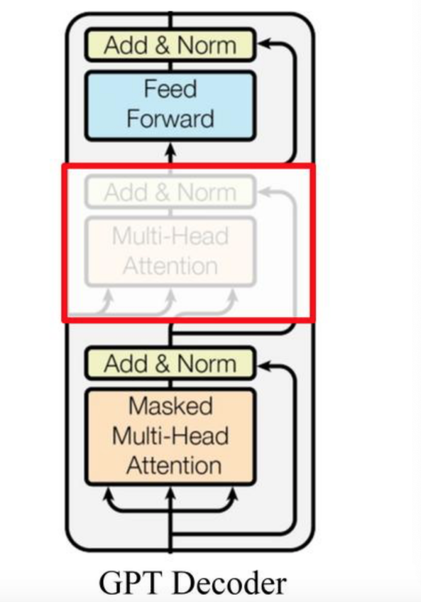 |
| :--- | :---: |

### 1.2 **GPT****的训练****范式****是预训练+Fine-Tuning**
在1.1里，我们知道了GPT本身无非是一个12层的Transformer解码器。所以接下来，我们不论说“预训练好的12层的Transformer”，还是GPT，我希望大家知道我指的是同一个东西。

#### 1.2.1 **无监督预训练 Unsupervised pre-training**
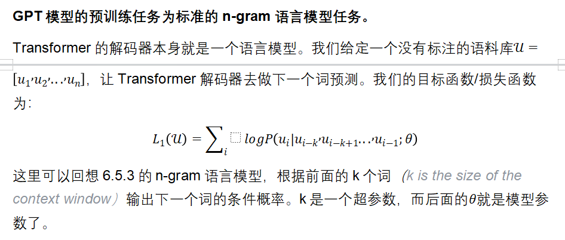

| 很多时候我们说BERT和GPT的区别在于编码器和解码器，其中编码器可以看到全部而解码器只能看到部分，这个说法其实非常不准确。真正不一样的地方在于预训练任务（以及其对应的目标函数）。GPT的预训练任务是下一个词预测，这比BERT的完形填空难得多，因为它要预测一个开放式的结局。 <给过去6天的股价，预测明天的股价 VS 给前后各三天的股价，预测中间的那一天股价> **“这是导致****GPT****在训练上和效果上比****BERT****差很多的重要原因。但如果你的模型真的能够预测未来的话，它的能力要比BERT这样的模型强大很多。这就是为什么作者要一直不断把模型做大，一直不断努力，最终造出了GPT-3那样子惊艳的东西。****OpenAI****选择了一个更难的技术路线，但可能它的天花板也就更高了。****”——李沐** |
| :--- |

#大佬这个判断真的超级准确

#### 1.2.2 **微调的****范式**** An illustration of supervised fine-tuning**
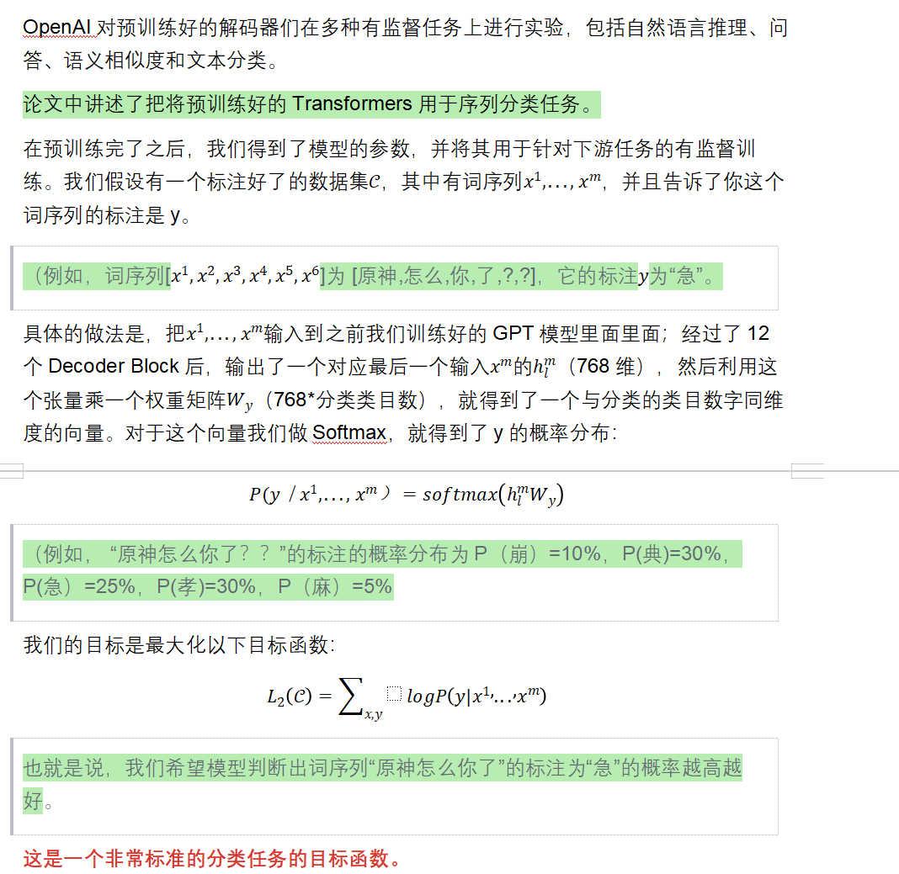

**虽然在微调的时候只关心这个目标函数，但其实我们可以把分类任务和语言模型任务两个预训练任务一起做！**

也就是说，在微调的时候，我们同时根据，做优化。

| 输入序列：[]=[卧|槽|，]。我们就希望GPT可以预测出下一个词“原”；给一个完整的序列[卧|槽|，｜原｜！]，我们希望GPT觉得这句话的标注是“崩”的概率越高越好。两个任务我们都一起做。 |
| :--- |

OpenAI用一个可以去调的超参数来把这两个目标函数连在一起，而后一起优化做梯度下降：

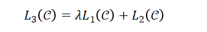

### 1.3 **GPT的创新点：Task-specific input transformations**
| For some tasks, like text classification, we can directly fine-tune our model as described above. Certain other tasks, like question answering or textual entailment, have structured inputs such as ordered sentence pairs, or triplets of document, question, and answers. Since our pre-trained model was trained on contiguous sequences of text, we require some modifications to apply it to these tasks. |
| :--- |

在1.2.2中，我们讲了怎么去给GPT做微调：我们用了典型的分类任务，不过一个比较新的点是我们把两个预训练任务的目标函数组合起来。

**接下来我们的问题是怎么把NLP里面那些很不一样的各种子任务都去用这样的微调范式去表达，即序列+标注。**

这张图前面我们看过了，不过这里我们再放出来一次。这张图里放了四个常见的子任务：

+ **Classification 分类：**可以看到，有两个特殊符号_（Start和Extract）_加了一个线性层。
+ **Entailment **：这个很难翻译。大概的意思是：给一个前提（Premise），然后提出一个假设（Hypothesis），让模型去判断这个假设是和被前提蕴涵了、和前提冲突了还是和前提无关。看起来像是在玩逻辑推断，本质上其实是给你两段文本_（用特殊符号分开）_，然后做一个三分类的问题。

| Premise：你说的对，但是《原神》是由米哈游自主研发的一款全新开放世界冒险游戏。游戏发生在一个被称作「提瓦特」的幻想世界，在这里，被神选中的人将被授予「神之眼」，导引元素之力。 Hypothesis：1、你是对的。2、你读四大名著不读红楼梦。3、游戏发生在海拉鲁王国。 Output：1、包含 2、中立 3、冲突。 |
| :--- |

+ **Similarity 相似**：判断两段文字是不是相似。相似是一个对称关系，A和B相似，那么B和A也是相似的；所以参考那张图，先有Text1+分隔符+Text2，再有Text2+分隔符+Text1，两个序列分别经过Transformers后，各自得到输出的向量；我们把它按元素加到一起，然后送给一个线性层。这也是一个二分类问题。
+ **Multiple Choice多选题**：多个序列，每个序列都由相同的问题Context和不同的Answer构成。如果有N个答案，就构造N个序列。每个QA序列都各自经过Transformers和线性层，对每个答案都计算出一个标量；最后经过softmax生成一个各个答案的概率密度分布。这是一个N分类问题。

通过这样的方法，这四个自任务就都变成了序列+标注的形式。尽管各自的形式还是稍微有一些不一样，**但不管输入形式如何、输出构造如何，中间的Transformer他是不会变的**。不管怎样，我们都不去改图中的Transformer的模型结构，这是GPT和之前工作的区别，也是这篇文章的一个核心卖点。

|  Previous work proposed learning task specific architectures on top of transferred representations . Such an approach re-introduces a significant amount of task-specific customization and does not use transfer learning for these additional architectural components.**Instead, we use a traversal-style approach, where we convert structured inputs into an ordered sequence that our pre-trained model can process. These input transformations allow us to avoid making extensive changes to the architecture across tasks. ** |
| :--- |

| 到这里过，你可能还是会觉得比较困惑——因为GPT好像没什么新的！真正的卖点无非是在于1.2.3中提到的Task-specific input transformations。那么它是怎么做到如今这么复杂的问答的？耐心继续看下去吧！ |
| :--- |

---

## 2 **GPT-2：语言模型是无监督的Multitask Learner！（2019.2）**
_**48层解码器，1600维词嵌入，15亿的参数**_

#我们知道，GPT模型在某种意义上被后于它发表的BERT给“打败”了，其中BERT Large更是层数翻了一倍（24个编码器）、宽度翻了1.3倍（1024维的词嵌入），以3倍的复杂度（用到了20亿的Wikipedia的数据集）被训练成了一个GPT3倍大的、拥有3.4亿的参数的模型，横扫了当时的SOTA。

| **Q：当你的解码器被别人用编码器、更大的模型、更大的数据打败时，你要如何做回应呢？** **A：换编码器是不可能换的，这辈子都不可能。我们要做的更大！** **Q：可是哪怕做的比别人更大，15亿参数的Decoder-only的效果还是没比3.4亿参数的BERT好诶****🥺** **A：但是我们可以Zero-Shot！** |
| :--- |

| 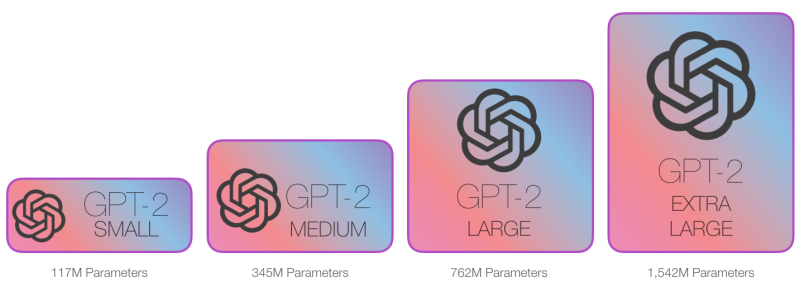 | 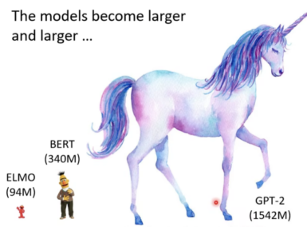 |
| :---: | :---: |

[论文原文：Language Models are Unsupervised Multitask Learners](https://cdn.openai.com/better-language-models/language_models_are_unsupervised_multitask_learners.pdf)。最大的GPT-2用了48个解码器。

### 2.1 **先谈谈多任务学习：NLP的众多子任务都可以转为问答任务**
[Language Models are Unsupervised Multitask Learners](https://cdn.openai.com/better-language-models/language_models_are_unsupervised_multitask_learners.pdf)中提到，现在的语言模型泛化能力比较差，在一个训练集、一个训练任务上训练出来的参数很难直接用到下一个模型里。因此，目前大多数模型都是Narrow Expert，而不是Competent Generalists。**OpenAI希望朝着能够执行许多任务的更通用的系统发展--最终不需要为每个任务手动创建和标记训练数据集。**这其实能让我们想到2000～2010年很火，但在NLP一直没什么应用的多任务学习。

#### 2.1.1 **多任务学习的定义**
多任务学习（Multi-Task Learning, MTL）是一种机器学习方法，它可以通过同时学习多个相关的任务来提高模型的性能和泛化能力。与单任务学习只针对单个任务进行模型训练不同，多任务学习通过共享模型的部分参数来同时学习多个任务，从而可以更有效地利用数据，提高模型的预测能力和效率。

#### 2.1.2 **自然语言十项全能竞赛 The Natural Language Decathlon（2018.6）**
重要文献：[The Natural Language Decathlon: Multitask Learning as Question Answering](https://arxiv.org/abs/1806.08730)

| 在NLP中，一个统一的多任务基础模型可以很方便地进行模型迁移、模型部署，并且对这个基础模型的不断改进，可以不断提高下游模型的性能，有可能达到持续学习、持续提升的目的，而如果每个新的子模型都重新学习的话，相当于利用不到基础模型长期学习到的知识。 但是，NLP领域有很多任务，比如序列标注、命名实体识别是一类；对整个句子的分类是一类；还有就是seq2seq的机器翻译、自动摘要等，要怎样将这些不同的任务统一到一个模型中呢？ 答案是，可以把所有NLP任务统一成QA任务！机器翻译转换为QA任务就是问这个句子翻译成另一种语言是什么句子，句子情感分类就是问这个句子表达的是积极还是消极的含义，自动摘要就是要求机器帮你写一段摘要。所有NLP任务都可以转换为QA任务。 ——引自[CS224N(3.5)Multitask Learning | bitJoy](https://bitjoy.net/2020/03/14/cs224n%ef%bc%883-5%ef%bc%89multitask-learning/) By Beeder |
| :--- |

在文献[The Natural Language Decathlon: Multitask Learning as Question Answering](https://arxiv.org/abs/1806.08730)中，[Bryan McCann](https://arxiv.org/search/cs?searchtype=author&query=McCann%2C+B)等人介绍了**自然语言十项全能竞赛（decaNLP）**，这是一项跨越十个任务的挑战：问题回答、机器翻译、摘要总结、自然语言推理、情感分析、语义角色标签、关系提取、面向目标的对话、语义解析和常识性代词解析。

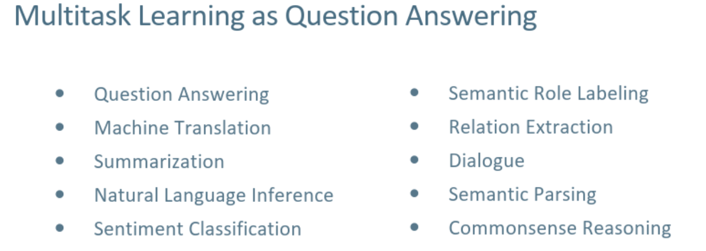

怎么做到这件事呢？在上文引自Beeder的文章里已经透露了答案：**把所有的任务都归结为上下文的问题回答。**

具体的，我们应该满足如下的条件：

| 1. 必须对所有任务一视同仁，也就是喂给模型的数据不能包含这条数据具体是哪个任务，不能告诉模型这条数据是要做NMT，另一条数据要做情感分类。 2. 模型也不能包含针对不同任务的特殊模块。给模型输入一段词序列，**模型必须学会自己辨别这段词序列要求的不同的任务类型**，并且进行内部切换，执行不同的操作。 3. 此外，模型还应具备执行这10个任务之外的任务的能力，即zero shot learning。 |
| :--- |

因此，这篇论文的作者提出了一个新的多任务问题回答网络（Multitask Question Answering Network, MQAN），该网络**在没有任何特定任务模块或参数**的情况下**联合学习**decaNLP的所有任务。

MQAN具体是怎么做的这里先不展开讲了，但把各种下游子任务都转换为QA任务，并且让模型通过我们告诉他的自然语言**（Prompt！！！）**去自动执行不同的操作，从而完成任务的想法真的非常天才，也是GPT-2的关键。

#这就是为什么提出GPT-2的论文的标题叫[Language Models are Unsupervised Multitask Learners](https://cdn.openai.com/better-language-models/language_models_are_unsupervised_multitask_learners.pdf)！非常应景。

### 2.2 **Zero-Shot：要不咱不去微调了？**
| GPT-2 最大的改变是，OpenAI 抛弃了前面“无监督预训练+有监督微调”的模式，而是开创性地引入了 Zero-shot 的技术，即预训练结束后，不需要改变大模型参数即可让它完成各种各样的任务！ |
| :--- |

不论是GPT还是BERT，他们都是预训练+针对具体下游任务做微调的范式。既然要做fine-tune，那就还是需要很多有标注的数据，还要去担心过拟合的问题。真麻烦啊。

**Zero-shot的含义在于，我们在预训练做下游任务时，不需要任何额外的标注信息，自然也不去改模型参数。这听起来非常离谱，自然也需要一些额外的细节。**

模型架构上，GPT-2和GPT其实没有区别，都是Transformer解码器的堆叠。所以对模型架构就不再做重复介绍。

**但我们要捋清楚一个逻辑：**

#### 2.2.1 **Zero-shot难在哪？**
+ 在1的GPT中，我们的模型在自然语言上进行预训练，到了给下游任务做微调的时候，我们是引入了很多模型之前从来没有见过的特殊符号的。参考下图，中间的Delim（间隔符，能够让模型知道这个符号前的是context而该符号之后的是Answer）就是一个特殊符号，是针对这个具体的任务我们专门设计的，模型之间在预训练的时候可是从来都没有见过。也就说，对于下游任务，我们给GPT的输入进行了特殊的构造，加入了开始符、结束符、分割符。这些符号，模型要在微调的过程中慢慢认识。

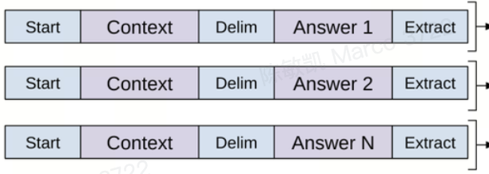

+ 那么现在问题来了：如果我们想要做Zero-short Learning，即不做任何额外的下游任务训练的话，我们就没办法让模型去临时学习这些针对特定任务的构造了。因此，我们在构造下游任务的输入的时候，就不能引入特殊的符号，而是要让整个下游任务的输入和之前在预训练的时候看到的文本形式一样。**简言之，输入的形式应该更像自然语言。**

#### 2.2.2 **从Zero-shot到Prompting**
既然输入的形式也要更像自然语言，那么我们有没有办法，让模型通过我们的自然语言，去知道现在要去执行什么任务呢？例如，我对模型说：_**把这段话翻译成英文：都什么年代，还在抽传统香烟。**_然后模型就知道了，这是一个翻译任务，而且冒号后面的部分就是我想让他翻译的文本。这样就不需要让模型认识新的特殊符号了，模型只要能读懂我对他的指示就行。

那该怎么办？答案是站在巨人的肩膀上：2.1.2提到的[NLP十项全能竞赛](https://arxiv.org/abs/1806.08730)给我们带来了灵感！

| But as exemplified in McCann et al. (2018), language provides a flexible way to specify tasks, inputs, and outputs, all as a sequence of symbols. For example, a translation training example can be written as the sequence (**translate to french**, english text, french text). Likewise, a reading comprehension training example can be written as (**answer the question**, document, question, answer)。 |
| :--- |

**也就是说，实现Zero-shot learning的前提就是，我们得能够做到不需要针对下游的任务，给模型的输入结构做专门的设计；而是只需要给模型指示，也就是提示词（Prompt）就好了。**读来是否心潮澎湃呢？期待了这么久，Prompt这个词终于出现了！！！鼓掌！！！！

#### 2.2.3 **Why Prompt Works at All？**
#为什么只需要写Prompt就可以自动实现下游的任务的预测？这件事真的很邪门！下面给了个可能的解释：

| OpenAI推测，当数据量足够大、模型能力足够强的时候，语言模型会学会推测并执行用自然语言提出的任务，**因为这样可以更好的实现下一词预测。** 参考右图。GPT-2的语料库中，其实本来就有非常多的英文翻译成法语的例子，它们是在语料库中被动存在的，不需要人为的去提出这样的要求；而机器学习过这些数据以后，可能就产生了理解自然语言所蕴含的“英法翻译”这个要求的能力。 |  |
| :--- | :---: |

#### 2.2.4 **GPT-2的性能与对该模型的评价**
GPT-2的性能如下图所示：

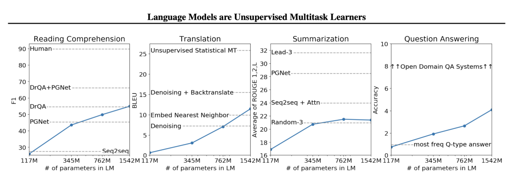

可以看到，在阅读理解上做得还行，在翻译和摘要总结上比较拉胯，Summarization甚至比不过平平无奇的seq2seq+Attention；Question Answering就别提了，弱得看不见上面其他的模型的车尾灯，直接和别人都没法放在一张图里了……GPT-2主要以Zero-shot为卖点还是有原因的，因为这个性能确实不大行，尤其是考虑到这般史无前例的参数规模的情况下，居然还是只交出这样的答卷。

GPT-2还是做了一个很有新意的工作的，即Zero-shot范式；但它的性能就非常差了。李沐大佬说过：一篇文章的贡献度=新意度*有效性*问题的大小。GPT-2在新意度上是很高的，但这个有效性，实在是很难评。

不过值得我们关注的一个点是，整体来看，模型的性能还是随着参数的增加在（类似线性地）上升的。因此，

| 这还是给我们留下了想象空间：如果模型被搞得足够大，搞得大一点、再大一点的话，是不是我们离AGI，就真得更近了？粗略地说，这就是GPT-3将要做的事情！ |
| :--- |

---

## 3 **GPT-3：语言模型是Few-Shot Learner （2020.5）**
[论文原文：Language Models are Few-Shot Learners](https://arxiv.org/pdf/2005.14165.pdf)

### 3.1 **GPT-3的意义**
_**GPT-3有1750亿参数，模型参数实在大到恐怖，以至于用在子任务的时候也不大能去微调。因此GPT-3用于下游任务时，不做任何梯度更新。**_

_#GPT模型指出，如果用Transformer的解码器和大量的无标签样本去预训练一个语言模型，然后在子任务上提供少量的标注样本做微调，就可以很大的提高模型的性能。GPT-2则是更往前走了一步，说在子任务上不去提供任何相关的训练样本，而是直接用一个足够大的预训练模型去理解用自然语言表达的子任务要求，并基于此做预测。但正如前面提到的，GPT-2的性能太差，新意度高而有效性低。_

自然的，GPT-3这篇文章其实就该来解决有效性低的问题。Zero-shot的概念很诱人，但是还是太苛刻了。别说人工智能了，哪怕是我们人，去学习一个任务也是需要样本的，不过我们学起来比较快罢了，而机器却往往需要大量的标注样本去fine-tune。人工智能人工智能，我们总归是想要让机器也有类似人类的智能，人看两三个例子就可以学会一件事了，机器却得需要大量“人工”才能有智能。太不好了。那有没有可能做到这样：我给预训练好的语言模型一点样本，但不多。用这有限的一丁点样本，我们的语言模型就可以迅速学会下游的任务？

嗯，这就是GPT-3的工作。论文的名字是[Language Models are Few-Shot Learners](https://arxiv.org/pdf/2005.14165.pdf)，就是这个意思。

| **Note：哪怕在是Few-shot中，我们给了模型几个例子，模型也是不更新梯度的噢！GPT-3的工作非常强调不对模型的权重做更新，毕竟1750亿参数，实在是太大了。** |
| :--- |

| 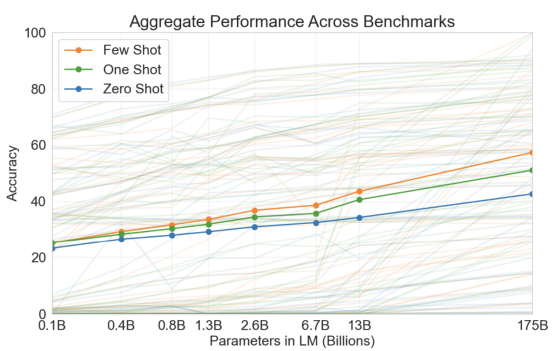 可以看到，从GPT2（1.3B）到GPT-3（175B），模型的精度翻了一倍。把模型做大确实行之有效。 | 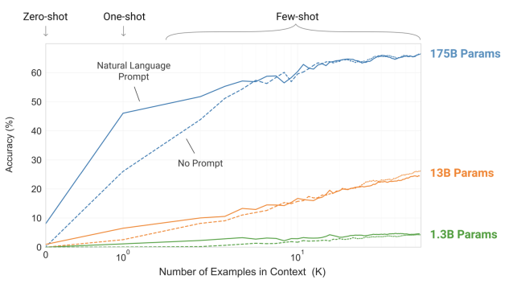 横轴为在输入给模型的Context中提供的样本的数量。 |
| :---: | :---: |

### 3.2 **GPT-3的模型架构与工程细节**
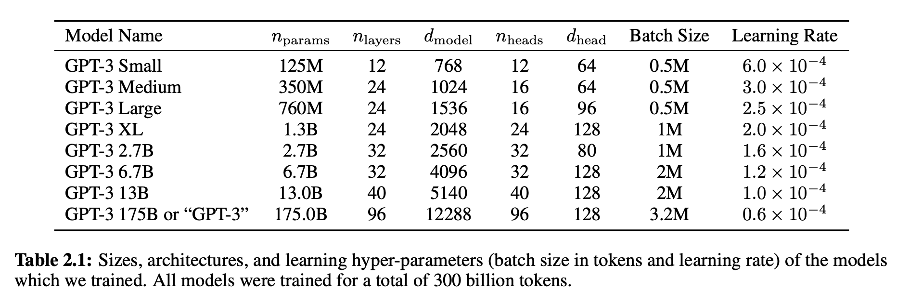

+ _模型架构上，和GPT-2是一样的，都是解码器的堆积，不过用到了一个叫Sparse Transformer的架构。我不打算在这个文档里具体介绍Sparse Transformer；不过通过下面这段文字，我们就可以对它的作用和机制有一个大概的了解。__**简言之，Sparse Transformer允许我们处理更长更稀疏的输入序列。**_

| Sparse Transformer是一种旨在处理高维、稀疏和长序列数据的Transformer拓展版，由OpenAI团队在2019年提出。相比于传统的Transformer架构，Sparse Transformer通过在自注意力机制中引入稀疏性，减少了网络中计算的数量，从而可以处理更长的序列数据。 在处理高维、稀疏数据时，Sparse Transformer可以避免对所有输入的位置进行计算，只计算与当前位置相关的位置，从而提高了计算效率。 |
| :--- |

+ ，代表多头注意力有几头，代表每头多头注意力的维数（就是我们前面提到的分别乘Q、K、W三个权重矩阵后得到的向量的维数。在原版Transformer中是64维）。
+ _GPT-3的批大小达到了320万，这是一个非常巨大的批大小，对内存考验非常大。参考下公式：_

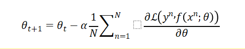

_批大小（N）大了的话，每次就都要计算非常非常多的梯度的平均值，导致计算复杂度更高。_

| 为什么要选择这么大的批大小呢？首先，大模型相比于小模型更不容易过拟合，所以更用大的、噪音更少的Batch也不会带来太多负面影响；其次，现在训练一个大模型会用到多台机器做分布式计算，机器与机器之间数据并行。如果机器多的话，每一台机器就能撑住。批量大小上去了，机器之间并行度上升、通讯量减少。 |
| :--- |

+ _**虽然批大小增加会导致梯度计算的时间复杂度增加，但是较大的批大小通常可以提高模型的训练效率和性能**__**。**_这是因为较大的批大小可以利用现代硬件的并行计算能力，加速模型的训练过程，同时也可以通过减少梯度的方差来提高模型的稳定性。总之，选择一个如此之大的批大小，自然主要是因为工程经验。
+ _还有一些很有意思的细节，例如模型变大、批大小提升的时候，OpenAI选择的学习率反而下降了。_
+ _在数据源上，一个模型的参数量越大，我们自然就需要更多的数据来去预训练它。_
    - GPT-2中OpenAI觉得Common Crawl的数据太脏了，所以用了karma值>3的Reddit文章作为训练数据；但是现在GPT-3的模型大小又翻了十几倍，所以就不得不考虑Common Crawl_（一个数据量巨大无比的互联网页面爬虫集合，但数据巨大无比，自然伴随着数据非常脏）_了……
    - 具体而言，OpenAI对Common Crawl做了三个工作：1、二分类。用Logit模型把Common Crawl的数据分为高质量的和低质量的，从而把不好的数据给过滤掉。2、去重（LSH算法）。3、而后再把之前GPT-2、BERT用到的数据集再都放进来。
    - 此外，虽然用了很多Common Crawl爬来的数据，其在数据总量上对其他的数据集形成压倒性优势，但是在采样率上OpenAI还是对每种数据集都做了区别对待的。在每个Batch Size中，Open AI都控制了Common Crawl的权重为60%。具体是怎么做的论文没有讲，不过我们大概能懂这是什么意思。

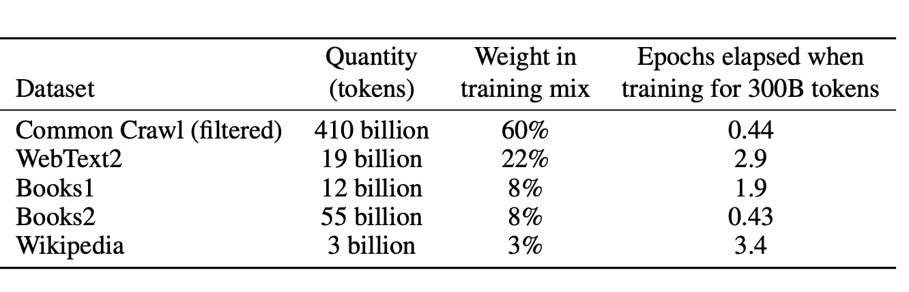

| 总之，虽然模型架构部分我们只看了这么一张参数表，但参数表里也体现出了非常多的工程细节。**GPT在技术上没什么新的，可是想要大力出奇迹的话，算力规划、超参数的选择等工程know-how还是非常多的。** |
| :--- |

OpenAI在论文中几乎没怎么透露模型训练的具体细节，对超参数的选择、模型分割、数据分割、分布式训练的做法都披露的很少。所以哪怕我想详细的讲也不找到上哪找资料。_大家都戏称OpenAI为ClosedAI是有原因的。你的开源之魂哪去了？？？_

### 3.3 **In Context Learning 上下文学习（ICL）**
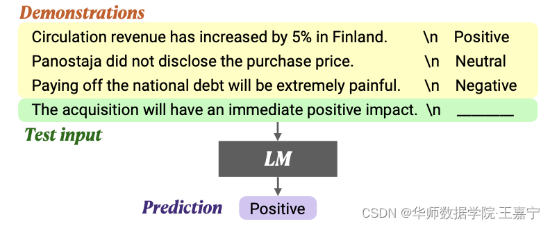

前面我们反复强调了GPT-3是不会做梯度下降、更改模型参数的。那么，它是怎么做的呢？——只做预测，不做训练！我们希望Transformer在做前向推理的时候，能够通过注意力机制，从我们给他的输入之中抽取出有用的信息，从而进行预测任务，而预测出来的结果其实也就是我们的任务指示了。**这就是上下文学习（In context learning）**。

**GPT-3的上下文学习能力究竟从何而来，在它刚发布的时候其实还是一个谜， **[**Tengyu Ma**](https://arxiv.org/search/cs?searchtype=author&query=Ma%2C+T)**所在的Group曾发布若干论文致力于解释GPT-3出现的上下文学习能力。参考：**

[【arxiv】An Explanation of In-context Learning as Implicit Bayesian Inference](https://arxiv.org/abs/2111.02080)

[【arxiv】What learning algorithm is in-context learning? Investigations with linear models](https://arxiv.org/abs/2211.15661)

上述两篇论文都比较难懂，作为入门级，我们只需要知道当Train出一个GPT-3这么大的模型后，上下文学习能力就能被体现出来了，而且其是具有一定的科学解释。

**这么一来，GPT-3是一个1750亿参数的有ICL能力的模型。为了体现ICL，OpenAI用三个方法来评估他：**

**1、Few Shot Learning（FS）：**用自然语言告诉模型任务；对每个子任务，提供10～100个训练样本。

**2、One-shot Learning（1S）：**用自然语言告诉模型任务，而后只给该任务提供1个样本。

**3、Zero-shot learning（0S）：**用自然语言告诉模型任务，但一个样本都不给。**具体例子看下图。**

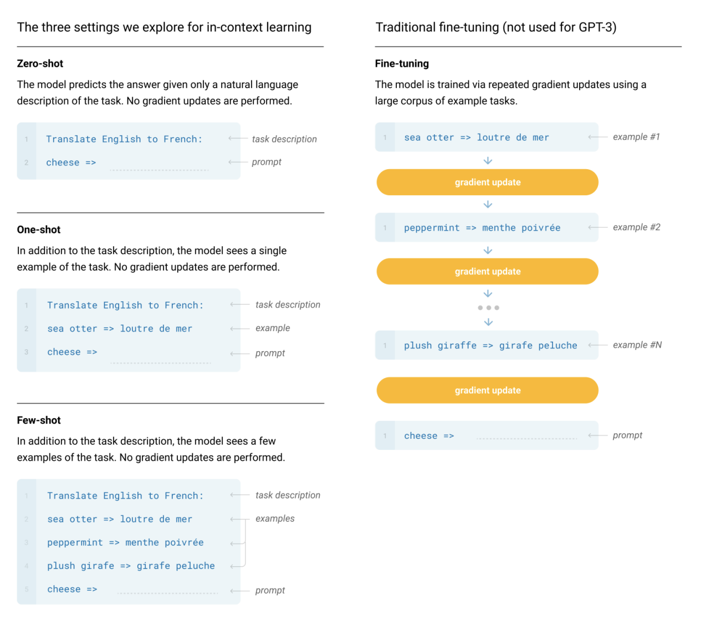

<图左为GPT-3提出的In context learning的三种范式，右边为传统的Fine-tunning>

这个模式其实也有好有坏：

+ **好处就是我们前面说的，它避免了对下游的任务做Fine-tune。**Tune一个模型还是很麻烦的，对于每一个新任务，都需要准备足够的样本，调好超参数（批大小、学习率等），选择各种学习方法（想起Cookie Monster了吗？），而且训练模型这件事本身就要求得有GPU。相比之下，GPT-3的范式让我们面对新任务时，只需要去让模型做预测，即前向传播，就可以了，模型就会直接把结果返回给我们。这对新任务特别友好。
+ 坏处也很明显：
    - 如果真的有很多训练样本，该怎么办？GPT-3的输入窗口长度毕竟是有限的，我们不可能无限的堆叠example的数量——例如，如果是训练翻译任务，我们随随便便就可以找到巨量的样本。这种时候Tune出来的模型效果就很可能会比我们在有限的窗口数内输入的few-shot examples差。简言之，有限的输入窗口限制了我们利用海量数据的能力。

| **Transformer 变得越来越深，越来越宽，但在长序列上训练它们仍然很困难。**研究人员遇到的一个基本问题是，Transformer 的注意力层在序列长度方面是按二次方比例增长：就是说从 32k 长度增加到 64k 长度，成本不只增加 2 倍，而是增加了 4 倍。 过去两年，斯坦福大学 Hazy Research 实验室一直在从事一项重要的工作：增加（LLM的输入）序列长度。  ——推荐阅读：[想把半本《红楼梦》搬进ChatGPT输入框？先把这个问题解决掉](https://mp.weixin.qq.com/s/idL7DyL7prhztvnMHBEl1g) By机器之心 [【arxiv】FlashAttention: Fast and Memory-Efficient Exact Attention with IO-Awareness](https://arxiv.org/abs/2205.14135) |
| :--- |

+ 每次做一次新的预测，模型都要从输入的中间抓取有用的信息；可是我们做不到把从上一个输入中抓取到的信息存起来，存在模型中，用到下一次输入里。
+ **这就是GPT-3明明早在2020年5月就已经用巨大参数取得了很好的效果，但是学界用Few-shot做上下文学习的热度好像还是不那么高的原因。**

### 3.4 **GPT-3模型的局限性 Limitations**
作者列举了非常多的局限性，但我这里主要讲一些我觉得最重要的。

_**首先，长文本生成能力还是很弱。**_

**如果要让GPT-3生成长文本的话，可能写了几段后，再往后就又往回写第一第二段的重复的东西了。**如果想要让GPT-3在无监督的情况下帮你写小说，可以说这压根就不可能，因为他没有不断的往前推剧情的能力。不过，如果你在输入中告诉了GPT你的上下文，让它来补全上下文中间的一段故事，他可能就会做的特别好。

| 在文本合成方面，虽然整体质量很高，但GPT-3样本有时仍会在文档层面上重复自己的语义，在足够长的段落中开始失去连贯性，自相矛盾，并偶尔包含非连续的句子或段落。 |
| :--- |

_**其次，GPT-3对**__** "如果我把奶酪放进冰箱，它会融化吗？"**__**这类问题有困难。基于物理等世界尝试的逻辑推理能力可能还不够。**_

此外，还有如下局限性：：

+ **学习的时候做不到像我们人类这样盯着材料的重点学。**例如，一句话中实词的占比可能很小，语言模型的大量学习都是去学习虚词，如“a”、“the”、“to”等，毕竟语言模型还是对所有词语都一视同仁的。
+ **GPT-3还是单模态的，只能做文字。**OpenAI的梦想是实现多模态的AGI，不仅可以输出文字，也想进行多模态生成。这是后面GPT-4要做的事情。
+ **可解释性差。**你不会知道从一个输入到一个漂亮的输出的过程中，是模型的哪些权重发挥了作用。
+ **可能会输出有害的、有偏见的内容，和人类的价值观或者社会主义核心价值观不对齐**。OpenAI调查了GPT对性别的偏见、对种族的一些偏见等。例如，A man is ___的下一词预测，和A woman is ____的下一词预测的比较，可能会非常不一样。

### 3.5 **留下的疑问：GPT-3是怎么进化成ChatGPT的？**
在最开始的时候，GPT-3在一些任务上表现的还算OK，但还是远远没有现如今的ChatGPT体现出的惊艳水平的。我们知道，ChatGPT可以很好的理解并遵循人类的指令，在一个非常简洁没有任何条条框框的界面上和人类做真正的自然语言的交互，其能联系上下文，能解决几乎全部自然语言任务，能逻辑推理，还会写代码。

**所以，How did GPT-3 get there?? 在走向ChatGPT时代的过程中，人们对GPT-3都做了些什么？这是我们接下来要探索的问题**。具体的演化路径参考下图（引用自[Yao Fu](https://franxyao.github.io/)）。

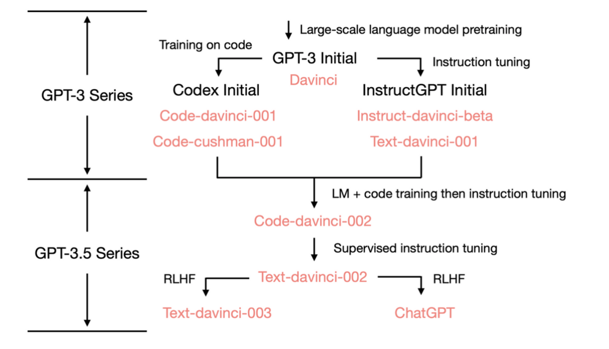

在紧接着的4中，我们将收集解锁GPT-3能力的第一块拼图。

---

## 4 **Codex：用Github代码Fine-tune一个GPT模型（2021.6）**
#2021年6月29日，GitHub首次发布了GitHub Copilot，后者是GitHub和OpenAI合作开发的一个人工智能工具，用户在使用Visual Studio Code、Microsoft Visual Studio、Vim、Cursor或JetBrains集成开发环境时可以通过GitHub Copilot自动补全代码。这是网址：[GitHub Copilot · Your AI pair programmer](https://github.com/features/copilot)

#感兴趣的可以参考Open AI给的一个Demo：[Creating a Space Game with OpenAI Codex](https://openai.com/blog/openai-codex)，其中展示了怎么用自然语言去开发一个小游戏。

| 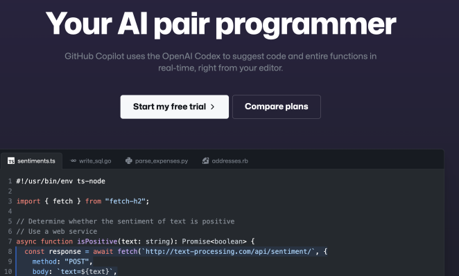 |  |
| :---: | :---: |

#“我OpenAI就是饿死，死外边，从这里跳下去，也不会用你们Fine-tuning一点东西。”———“真香！”

GPT-3即使没有怎么被训练用于代码生成，依然可以输出一些简单的代码，不过整体性能非常低罢了。那么，如果说给模型数量可观的代码，是不是这个模型就可以在代码生成上取得比较好的效果，甚至实现帮助程序员完成代码，作为一个辅助工具的作用？Codex就是这个思想。OpenAI团队收集了Github上所有的不重复的python代码，总计179GB（这引起了广泛的抨击），并对收集的代码进行了简单过滤，去掉了过大的文件（>1MB）和过长的代码(>100行或单行超过1000个字符)，形成了一个数据集。利用这些数据集，他们Fine-tune了一个GPT3模型。

虽然说Codex看起来很牛逼很特别，但是介绍它并不需要讲更多的复杂的原理：

| 我们只要知道它是一个用来自GitHub上的公开的代码作为训练数据集，对GPT-3做一个会改变权重的Fine-tuning，从而让他具有生成代码的能力的拓展版GPT-3模型好了。它生成代码的能力依然是来自于语言模型的下一词预测，它是预训练LM被fine-tune后实现的针对代码生成的下游应用。 |
| :--- |

Codex背后的论文：[【arxiv】Evaluating Large Language Models Trained on Code](https://arxiv.org/abs/2107.03374)

| 我们介绍了Codex，一个在GitHub的公开代码上微调的GPT语言模型，并研究了它的Python代码编写能力。Codex的一个独特的生产版本为GitHub Copilot提供动力。在HumanEval上，我们发布了一个新的评估集，用于衡量从文档串合成程序的功能正确性，我们的模型解决了28.8%的问题，而GPT-3解决了0%，GPT-J解决了11.4%。此外，我们发现，从模型中反复取样是一个令人惊讶的有效策略，可以产生对困难提示的工作解决方案。使用这种方法，我们在每个问题100个样本的情况下解决了70.2%的问题。对我们模型的仔细调查揭示了它的局限性，包括在描述长操作链的文件串和将操作与变量绑定方面的困难。最后，我们讨论了部署强大的代码生成技术的潜在的更广泛的影响，包括安全性和经济。 |
| :--- |

_注：HumanEval是OpenAI自己收集的数据集，其中包含164个原创的编程问题，其中包含语言理解，算法，一些简单的数学和一些简单的软件面试的题目。它的作用是评估一个模型的代码生成能力。_

[OpenAI Codex 论文精读【论文精读】_哔哩哔哩_bilibili](https://www.bilibili.com/video/BV1iY41137Zi/?buvid=ZE4EBEE92994324F407089826EE9BEE9DE8E&is_story_h5=false&mid=jOTTvC9MAcEUtHyHp%2B%2B2ww%3D%3D&p=1&plat_id=114&share_from=ugc&share_medium=iphone&share_plat=ios&share_session_id=410BD0A2-09B3-40DA-92AE-963B9EF201DF&share_source=WEIXIN&share_tag=s_i&timestamp=1682615486&unique_k=i6pA5Lz&up_id=1567748478) By 李沐

| _**Tune GPT-3以让其学会代码是我们收集的通往ChatGPT的第一块拼图！**_ 之所以要专门花篇幅介绍看起来没什么的CODEX，是因为有很多人推测（or认为）ChatGPT这样的大模型之所以涌现出了复杂的逻辑推理能力，多少是因为其学习了代码生成，在这个过程中大语言模型学会了Reasoning。参考：[How does GPT Obtain its Ability? Tracing Emergent Abilities of Language Models to their Sources](https://yaofu.notion.site/How-does-GPT-Obtain-its-Ability-Tracing-Emergent-Abilities-of-Language-Models-to-their-Sources-b9a57ac0fcf74f30a1ab9e3e36fa1dc1#929906a4292b4cceadabd92c47f3843f)，By [Yao Fu](https://franxyao.github.io/), yao.fu@ed.ac.uk |
| :--- |

> 更新: 2025-09-30 09:37:23  
> 原文: <https://www.yuque.com/aaron-wecc3/dhluml/azvggxqgb62b5as5>