# 102.Prompting相关面试题

## 常见面试题
1. Prompting、Prompt tuning、Prompt Learning
2. 参数高效学习 Parameter-Efficient Transfer Learning
3. 参数高效的定义
4. 部分参数微调：选择法Selective Method
5. 基于重参数化的方法 Reparametrization-based PEFT
6. Prompting / Prompt Learning的定义
7. Prompt Engineering
8. 手动设计提示模版与自动模版学习
9. 参数化Prompt/自动 Prompt
10. 离散提示/硬提示 Discrete Prompt a.k.a Hard Prompt
11. 连续提示/软提示 Continuous Prompt a.k.a Soft Prompt
12. 软提示真就一定比硬提示好吗？
13. 摘要 Abstract
14. 基于人类反馈的强化学习
15. 模型的效果与评价
16. 所以指令微调都做了些什么?
17. 思维链 Chain of Thoughts, CoT
18. 大语言模型的涌现 Emergent Abilities
19. 什么是大语言模型的涌现？
20. 涌现是敏锐且不可预测的
21. 对涌现的批评

****

**预训练语言模型的新范式：Prompting！**

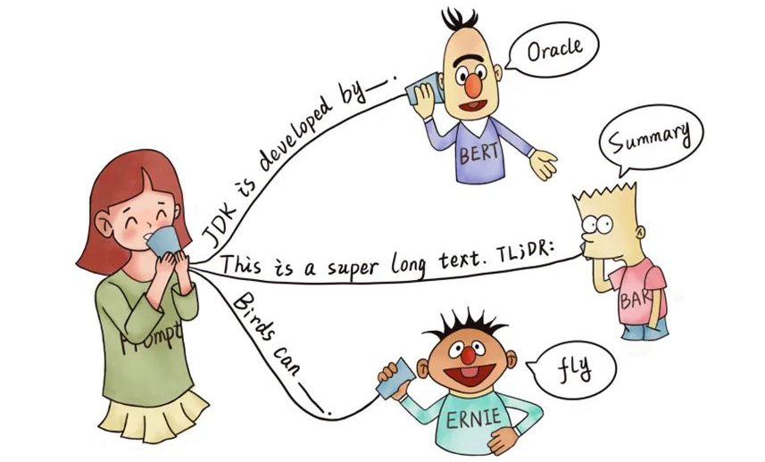

参考_12.3_，GPT-3提出了一个重要的概念—_**上下文学习（in-context learning, ICL）**_。

| ICL其实就是Prompting的祖师爷，其一举把预语言模型实现下游任务应用的范式从Fine-Tuning时代引入到了Prompting时代。紧接着，面向超大预训练语言模型，Prompting出现了三个主要范式：上下文学习ICL，指令精调Instruction-tuning和思维链CoT。 |
| :--- |

|  Now, as of this writing in 2021, **we are in the middle of a second sea change, in which the “pre-train, fine-tune” procedure is replaced by one in which we dub “pre-train, prompt, and predict”.** In this paradigm, instead of adapting pre-trained LMs to downstream tasks via objective engineering, downstream tasks are reformulated to look more like those solved during the original LM training with the help of a textual prompt. ——[Pre-train, Prompt, and Predict: A Systematic Survey of Prompting Methods in Natural Language Processing](https://arxiv.org/pdf/2107.13586.pdf) |
| :--- |

| **模型** | **论文** | **模型参数** | **范式****与创新点** | **评价与意义** |
| :---: | --- | :---: | :---: | :---: |
| GPT-3 _#仅提及，已在12.3讲完_ 2020.5 | [Language Models are Few-Shot Learners](https://arxiv.org/pdf/2005.14165.pdf) | 1750亿参数 | 预训练+Prompt+Predict，创新点在于**in-context learning** | 开创性提出**in-context learning**概念，是Prompting真正的祖师爷。 **In-context learning（ICL）**是第一类适用于大模型的Prompting范式。 |
| InstructGPT 2022.3 | [Training language models to follow instructions with human feedback](https://arxiv.org/pdf/2203.02155.pdf) | 13亿参数 | 预训练+SFT+RLHF，本质还是Fine-tune。RLHF应被理解为把生成式任务变成判别式任务的降低标注成本的Fine-tune。 | **Instruction-tuning**是第二类适用于大模型的Prompting范式。利用SFT+RLHF实现人类价值观的对齐时，可能教会了模型如何去遵循指示。 |
| PaLM 2022.4 | [PaLM: Scaling Language Modeling with Pathways](https://arxiv.org/abs/2204.02311) | 5400亿参数 | 验证了使用思维链提示能够显著提升模型在算数、常识推理（基于对世界的知识，例如“奶酪放在冰箱里会不会融化”）等挑战性的下游任务的性能 | PaLM的直接目的在于证明继续把参数做大，模型的性能还是可以进一步提升。**思维链提示（CoT）**是第三类面向大模型的Prompting范式。 |

_#我自己在学习的过程中会对Prompting、Prompt __tuning__还有Prompt Learning等概念感到混淆和困惑。_**这就是为什么我想要在这一章的开头首先做概念辨析，区分清楚这三个Related concepts.**

## 1 **概念辨析：Prompting、Prompt ****tuning****还有Prompt Learning**
| Prompting，指的是给语言模型输入一段特定的文本（即提示词），从而引导模型去生成特定的我们想要的输出文本。_他其实就类似我们在__ChatGPT__里打字的过程啦。_ |
| :--- |

| **Prompting refers to the process of giving a specific prompt or input text to a language model to guide its generation of a specific output text.** The prompt text can be in the form of a question, a sentence, or a few words that are related to the desired output. The language model then generates the output text based on the prompt and its own internal understanding of the language. In other words, Prompting is a technique used to guide the generation of specific output text using a language model, while Prompt Tuning is a technique used to adapt a pre-trained language model to a specific downstream task by fine-tuning it on task-specific data using prompts. |
| :--- |

| Prompting Tuning（提示微调），和微调会更接近，是自动化生成“软提示”的一种方法。具体怎么work后面会介绍，_不过在这里我们只需知道，Prompt tuning是微调的一种特殊形式，它是会改变模型的权重参数的，但它又比fine-tuning参数高效得多。_ |
| :--- |

| **"Prompt ****tuning****", a simple yet effective mechanism for learning "soft prompts" to condition frozen language models to perform specific downstream tasks. **Unlike the discrete text prompts used by GPT-3, soft prompts are learned through backpropagation and can be tuned to incorporate signal from any number of labeled examples. ——[The Power of Scale for Parameter-Efficient Prompt Tuning](https://arxiv.org/abs/2104.08691) |
| :--- |

| 先用一个高亮块快速讲清楚提示学习的定义： 再用这个高亮块快速讲清楚Prompt Learning范式的运作原理： **传统的预训练+微调**：预训练完后，利用有标签的下游数据集对模型做微调，这需要改变模型的权重与偏置参数。而后，基于下游任务输入x，模型预测输出y: P(y|x)。 **新****范式****预训练+Prompt+Predict**：基于输入x，根据模版（Template）将其转为特定的结构化提示x'，x'是一个具有一定格式但是不完整的句子，有一些字段还没有被填充。对于x'，模型会基于概率对其进行填充，得到完整的输入。基于这个，模型再预测输出y。 |
| :--- |

| Prompt learning is a general term that refers to the use of prompts in machine learning.  In the context of natural language processing, prompt learning involves training a language model to understand and respond to a specific set of prompts.  |
| :--- |

最后再额外提一嘴Prompt Engineering。语言的发展经历了四个范式：基于符号主义的全监督学习时代、基于神经网络的全监督学习时代、预训练+微调阶段和预训练+提示词+预测阶段，这四个阶段分别对应了四类工程：特征工程（手动提取特征）、结构工程（搭建更好的神经网络结构以更好的提取特征）、目标工程（选取好的目标函数）和提示工程。**提示工程**，指的是精心去设计提示词Prompt，以让语言模型可以生成我们想要的输出，最大的发挥语言模型的潜力。

## 2 **开端：当我们发现一个模型做的越大越好之后……**
我们在12.2.2.4中提到了，GPT-2模型的参数量达到了15.42亿，尽管其性能还不够好，但它确实证明了不断地去堆参数，把模型做的更大，模型性能还是可以继续上去的。但模型变大了以后，其他的问题就接踵而至。首先，有如下两个问题：

+ 预训练的模型大，所需要的预训练语料（数据量）就多。无监督预训练用的数据量多了，那么下游预训练的有标注数据相比之下就微不足道了。
+ 预训练的模型大，参数量多，用反向传播算一次梯度的成本剧增。微调变得又贵又不可能。
+ 此外，Fine-tuning毕竟是要基于有监督下游任务改变模型的Weights & biases的，所以很容易过拟合。

| 我们知道，GPT-2的模型参数为15亿，到了GPT-3就将达到1750亿个参数了。如此骇人听闻的参数规模，好不容易花了巨大成本预训练完，你再对他去做梯度下降，算反向传播算法，哪怕只是针对少量下游任务数据的fine-tuning，这个成本也是我们难以承受的。 传统的解决方案是寻找参数高效（Parameter-Efficient）的迁移学习方法，即微调的时候不改变全部的参数，只去改变部分的参数就好了。能尽可能的少更新参数并尽可能保证任务性能，那也不错。 但OpenAI团队不会只局限于此。他们的梦想是实现AGI，实现通用的、类似人的智能。人类可不会只擅长某一个具体的下游任务，参数高效的迁移学习再高效，毕竟也需要人为对任务做划分。因此，OpenAI更关注另一个的解决方案：能不能我们去把它应用于任何下游任务时，都不要去改模型的参数权重了，而是只需要用自然语言给模型一些提示词就可以？这就是Prompt。 **写这么多是希望大家可以知道：Prompt工程不只是工程师们的异想天开：这是让大力出奇迹的超大型模型能在多种场合都有所作为的前置要件，也是通往AGI的必由之路。** |
| :--- |

---

## 3 **前Prompt时代的尝试：参数高效学习 Parameter-Efficient ****Transfer Learning**
[【arxiv】Parameter-Efficient Transfer Learning for NLP](https://arxiv.org/pdf/1902.00751.pdf)

[参数高效微调指南](https://zhuanlan.zhihu.com/p/619583361) By [TimsonShi](https://www.zhihu.com/people/timsonshi)

#### 3.1.1 **参数高效的定义**
+ **全面微调：**做针对下游任务的Fine-tuning时，更新模型的所有参数。这不可避免地导致模型对小的目标数据集过度拟合，继而在微调后不能用于其他任务。
+ **参数高效微调（Parameter-Efficient Fine-tuning，PEFT）**：做针对下游任务的Fine-tuning时，不更新模型全部的参数。我们可能选择性的只更新模型最上面的几层权重，也可能只去更新偏置而不去改变神经元之间的连接强弱。我们的目的是在尽可能少更新参数的情况下尽可能保证模型的下游任务的性能。

#### 3.1.2 **部分参数微调：选择法Selective Method**
为了解决巨大的预训练模型的Fine-tune问题，研究人员们首先提出了部分参数微调/冻结部分参数的方法。

+ **最早的一批工作是只微调网络的最上面几层。**
+ **后来人们认为可以根据人的经验和推理去微调网络中和下游任务最相关的部分。**
1. 首先，我们人类对模型的参数分布是有先验知识的。例如学完了第10章，我们就应该知道，Encoder部分负责编码语言为高维的向量，而Decoder负责生成目标的句子。
2. 有了类似这样的基于先验知识的假设之后，在微调模型的参数时，我们就可以更新和目标任务最相关的那部分。例如，如果要把一个用于生成摘要的Transformer转变为生成原文的Paraphrasing，那么可能我们就只需要改Decoder的参数就行了，而不去改Encoder。
+ **更极端的做法是只微调模型偏置项或者某些行。**
+ **最极端的版本可能是稀疏地更新模型，无视模型结构，只更新某些参数。**

#### 3.1.3 **使用额外的参数增强现有预训练模型：附加法Additive Method**
**附加法的主要思路是使用额外参数或层增强现有预训练模型，它只训练这些新加入的参数。**目前这是最大、最广为应用的PEFT方法。附加法的实现方式为适配器（这里先不提软提示）。

**适配器 Adapter**

**简单来说，就是在Transformer子层后面加入小的全连接网络。**

| 在上述”部分参数微调“方法的基础之上，研究人员提出了Adapter方法，通过添加一个灵活的即插即用的可训练适配模块(Adaper Module)，我们可以改变模型某一层（或某几层）的数据分布，从而让模型可以适用于各种各样的任务和领域。典型的做法就是每一任务或者每一领域对应了一个Adapter Module，训练的时候只更新对应任务Adapter的参数，推理的时候激活对应任务/领域的Adapter，其它任务/领域的Adapter直接忽视。和”部分参数微调“方法相比，Adapter方法的优势有（1）更轻量级（2）同样比例的参数效果更好。 |
| :--- |

#### 3.1.4 **基于重参数化的方法 Reparametrization-based PEFT**
[【arxiv】INTRINSIC DIMENSIONALITY EXPLAINS THE EFFECTIVENESS OF LANGUAGE MODEL FINE-TUNING](https://arxiv.org/pdf/2012.13255.pdf)

基于重参数化的PEFT方法（reparametrization-based PEFT）利用的是低秩矩阵表示来减少可训练参数数量。**目前使用最多的基于重参数化的方法是低秩适配（Low-Rank Adaptation, ****LoRA****）**。LoRA这个名儿很多读者，尤其是关注Diffusion算法的读者肯定不会陌生！在很多应用中，Low-Rank Adaptation技术已经被证明非常有效。例如，在图像处理领域，利用低秩结构可以实现图像去噪、图像复原、图像分割等任务。在推荐系统中，Low-Rank Adaptation技术可以提高推荐算法的准确性和鲁棒性。不过我还没有想好要不要在这篇文章里介绍LoRA。

#### 3.1.5 **对上述方法的评价**
在12.3.2.2～12.3.2.4中，我们提到了很多参数高效的学习方法，他们用于解决LLM变得越来越大所以难以训练的问题。但是，我们可以看到，以上方法都是基于”预训练-微调“的范式的方法，无论多么轻量级，每个任务都还是有一套特定的参数（即使大部分参数可以共享）。

| 说到这里，大多数人其实并没有意识到，**<u>它的致命缺点正是：任务本身需要人为进行定义</u>**。但是现实生活中的知识，并不是完全地按照任务进行分类的，现实中大多数任务会涉及到多个任务的能力: 比如一个中国人阅读了一篇英文的文章，最后用中文写了个总结 --- 这就涉及到 翻译+总结 两个任务。**而Prompting可以做到模糊任务的界限---****<u>不需要人为对任务进行划分</u>****，相反，任务的描述会作为输入的一部分直接输入****预训练模型****。** 这其实就是为什么Prompting范式是“通往真正大一统语言模型的关键一步”。 |
| :--- |

---

## 4 **定义Prompting：通往真正大一统语言模型的关键一步**
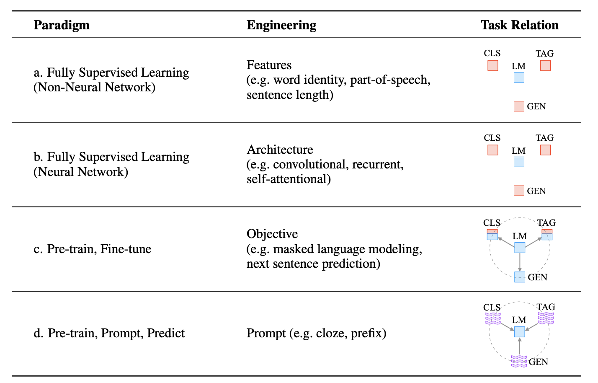

_图源: _[_Pre-train, Prompt, and Predict: A Systematic Survey of Prompting Methods in Natural Language Processing_](https://arxiv.org/pdf/2107.13586.pdf)_，这张图总结了__NLP__发展过程中出现的四种__范式__。右下角最后的两张图是Fine-tune范式和Prompt范式的鲜明对比：让__预训练模型__服从于下游任务，还是让下游任务服从于预训练模型。_

### 4.1 _**Prompting / Prompt Learning的定义**_
读完[_12.2.2.1_](https://s3tlxskbq3.feishu.cn/docx/NyPqdCKraoXz9gxNVCfcIFdnnAc#KUW4dyCAyo442wx04r0cAT6Fnvd)后，我们应该能够理解，Prompt的目的是将Fine-tuning的下游任务目标转换为Pre-training的任务，（即各种子任务都可以用基于下一词预测的Question Answering来表达）；且与此同时，我们不可以给下游任务构建特定的输入结构，不能添加额外的特殊符号。

提示学习这种方式拉近了测试分布与预训练分布的距离，进而可以利用大规模预训练语言模型在预训练过程中习得的强大语言建模能力，使其不经过微调就可以在各种下游任务上取得很好的结果。

采用Prompt的范式之后，Pre-train，Fine-tune的范式变成了Pre-train，prompt & predict。

| 融入了Prompt的新模式大致可以归纳成“pre-train, prompt, and predict”，在该模式中，下游任务被重新调整成类似预训练任务的形式。例如，对于一个预训练的GPT，我们在文本情感分类任务中，对于 "I love this movie." 这句输入，可以在后面加上prompt "The movie is ___" 这样的形式，然后让预训练语言模型用表示情感的答案填空如 "great"、"fantastic" 等等，最后再将该答案转化成情感分类的标签**，****这样一来，通过选取合适的prompt，我们可以控制模型预测输出，从而让一个完全无监督训练的PLM可以被用来解决各种各样的下游任务**。 ——[【知乎】NLP新宠——浅谈Prompt的前世今生](https://zhuanlan.zhihu.com/p/399295895) By [AI Box专栏](https://www.zhihu.com/people/dou-hong-jian-44)，作者：闵映乾@RUC  |
| :--- |

**在数学上区分fine-tune和prompt：**

+ 我们知道，Fine-tuning的过程是一个有监督学习的过程。基于输入，以为参数的模型会预测输出的概率分布：，而后这个概率分布再会和我们标注的输出做比较，计算损失函数。
+ 相比之下，Prompting的目的就是避开用标注数据做有监督的微调。因此，是没有输入输出pair（与）的。在数学上，它是这么做的：基于我们输入的input，模型会建模的概率分布:_，_而后用这个的概率分布再去预测**（Predict）**模型的输出y。
+ 这样说话可能会比较Confusing。更清晰的说法我觉得是，模型能够做到理解我们的意图，并把我们输入的稍加改造。被改造后的，姑且称为吧，会是一个模型更熟悉的东西，模型基于去预测y。
+ **可以看到，上述的过程是无监督的，而基于去预测y是语言模型本身就具有的能力。因此，关键在于怎么去设计把输入的改造成的这个机制。**

### 4.2 _**Prompt最早还不叫Prompt，它只是一种模版（Template）**_**。**
2.2.1提到，关键在于怎么去设计把输入的改造成的这个机制。这就让人不禁想到一个方法——用模版。

其实Prompt最早不叫这个名，他无非是一种模版。_所以我们可以看到，整个提出GPT-3的论文_[_Language Models are Few-Shot Learners_](https://arxiv.org/pdf/2005.14165.pdf)_（2020.5）里，Prompt这个词只出现了27词。但到了InstructGPT（2022.3）的时候，Prompt在论文中的__词频__就超过300次了。_

Prompt最早是研究者们为了下游任务设计出来的一种输入形式或模板，它蕴含了不同的下游任务的信息，且输入形式和大语言模型进行预训练时的输入很像，因此能够帮助预训练语言模型“回忆”起自己在预训练时“学习”到的东西。

模版中有两个待填充的部分，一个叫input slot [X]；一个叫answer slot [Z]。

| 下表展示了一张基于预训练好的语言模型，在不做微调的情况下，利用模版与语言模型本身具有的下一词预测能力，完成各种下游任务的范例。 |
| :--- |

| **下游任务种类** | **任务** | **输入 ****Input**** [X]** **Input** | **模版 Template** **把****input****映射成Prompt（1）** | **回答 Answer[Z]** **Predict（2）** |
| :---: | :---: | :---: | :---: | :---: |
| 文本分类 | 情感分类 | 这部电影真好看。 | [X] 它是 [Z] （这电影真好看。它是[Z]？——>精彩的）_<再根据一个函数把“精彩的”三个字映射到积极含义>_ | 精彩的 （积极情感） |
| | 主题分类 | 接下来我将批评一款游戏 | “[X]”。这段话是关于[Z]的话题。 （“接下来我将批评一款游戏”。这段话是关于[Z]？——>原神 | 原神 |
| 文本对 | 自然语言推理 （Entailment; NSP） | [X1]故事发生在一个名叫提瓦特大陆的地方。 [X2]玩家在海拉鲁王国进行了一系列冒险。 | 我们知道，[X1]。那么，“[X2]”的说法是[Z]的。 （我们知道，故事发生在一个名叫提瓦特大陆的地方。那么，“玩家在海拉鲁王国进行了一系列冒险”的说法是[]的。） | 正确 错误 无关 |
| 文本生成 | 摘要 Summarization | 当年陈刀仔他能用20块赢到3700万，我用20万赢到500万不是问题。 | “[X]”。这段话主要表达了[Z]。 | 陈刀仔通过赌博巨量赚钱，我自然也能小赚一笔 |
| | 翻译 Translation | 看看你的。 | 中文：[X]。英文：[Z] （中文：看看你的。英文：_____） —> can can need | can can need |

_<Note：这个表格中的内容的目的是让一个已经预训练好的模型可以用于各种各样的下游任务，可能跟我们比较熟悉的__ChatGPT__还不那么relevant。毕竟在ChatGPT横空出世之前，大家训练__LLM__的目的不是为了ChatBot，而是各种自然语言的自任务啦。>_

（1）在这里，我们把我们输入的词叫做Input。Input首先会被一个函数映射成一个Prompt，映射函数的功能可以是基于我们的input去填充Template中[X]的部分。Prompt是一个模版，也是一个不完整的句子，会有unfilled slot，即[Z]的部分。这时候就有另一个函数——。

（2）会计算出[Z]中的内容的概率分布。Answer的就是往Z里面填充的**正确**的东西。在上面的例子中，语言模型的目的就是输出正确的Answer。

| **提示工程 Prompt Engineering****：**指设计提示函数，从而在下游任务中取得好的性能的过程。 **可以这么理解：Prompting****范式****的出现使得在面对下游任务时，我们不再需要像以前那样Fine-tune一个大型****预训练模型****，而是只需要训练一个好的把输入文本映射为模板的函数就可以了。** 这样一来，怎么选好模版与映射函数就很重要。例如，在情感分类的示例里，这部电影真好看和那个模版是匹配的，但如果想要辨别“而你，我的朋友，你才是真正的英雄。”这句话的情感，那个模版就文不对题了。 |
| :--- |

### 4.3 _**Prompt的一般工作模式（最General的一款）**_
2.2.2中其实已经讲明白了基于Template的Prompt具体是怎么工作的。现在我们来整理一下整个过程。

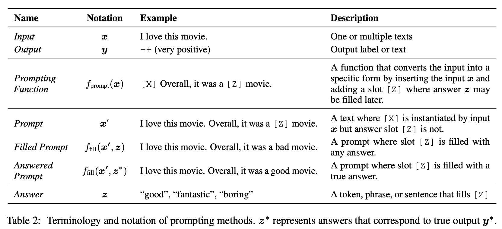

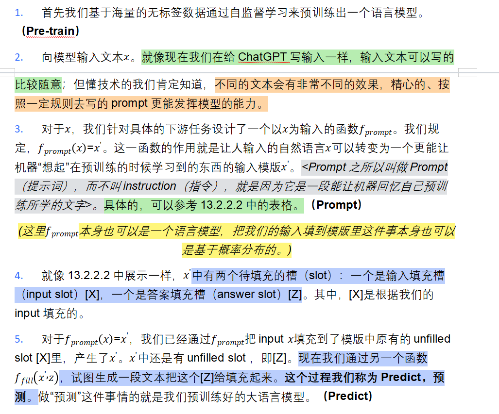

| **回答工程 Answer Engineering****：**指的是设计回答，以让z填充[Z]的机制的工程。 1、这里的可以是一个有限的选择，尤其是在分类任务中，例如我们之前做情感分类时的崩、典、急、孝、麻五种。也可以生成任何文本用于填充[Z]，尤其是在生成式任务中（like GPT）。 2、语言模型可以做两件事。首先是它它老本行：判断一整句话Make sense的概率。这个功能可以用于给句子打分。例如，我们在填充[Z]时，可以把崩、典、急、孝、麻五种都尝试一遍，对每一个都打分，然后选分数最高的一个。 3、其次是下一词预测，它可以用来生成任意的填在[Z]里的内容，而不需要人类去提前规制。 |
| :--- |

1. 生成一段文本来去填充[Z]也是个概率采样的问题，会有不同的选择，因此会有很多种Filled Prompt。我们会选择打分最高的，即图中的来作为输出。
2. 最终，语言模型输出。这样，我们就在没有微调，而只是设计了模版和的情况下完成了下游任务。

## 5 **Prompt Engineering & Prompt ****Tuning**
设计指令和模版看起来很容易，但是在实际使用过程中，预训练模型很难“理解”这些指令。

| Prompt engineering is the process of creating a prompting function fprompt(x) that results in the most effective performance on the downstream task. In many previous works, this has involved prompt template engineering, where a human engineer or algorithm searches for the best template for each task the model is expected to perform.  |
| :--- |

**提示工程 Prompt Engineering****：**指设计提示函数，从而在下游任务中取得好的性能的过程。

### 5.1 **手动设计提示模版与自动模版学习**
#### 5.1.1 **手工Prompt**
+ 在最开始的研究中，这涉及到提示模板工程，即由人类工程师或算法为模型预期执行的每项任务寻找最佳模板。背后的思维在于，人类有自己的先验知识，包括对模型的理解和对语言的理解，因此手动去设计模版是一件非常顺直觉的事。_（Perhaps the most natural way to create prompts is to manually create intuitive templates based on human introspection）_[_4.2_](https://s3tlxskbq3.feishu.cn/docx/NyPqdCKraoXz9gxNVCfcIFdnnAc#GuCCdWSoQooEGexSu1zcN2eXntg)中的表格里的prompt都属于这一范畴。

#参考下表，手动去设计一个我们知道，[X1]。那么，“[X2]”的说法是[Z]的这样的模版是完全顺直觉的，而且模版往往也由自然语言构成。

| 自然语言推理 （Entailment; NSP） | [X1]故事发生在一个名叫提瓦特大陆的地方。 [X2]玩家在海拉鲁王国进行了一系列冒险。 | 我们知道，[X1]。那么，“[X2]”的说法是[Z]的。 （我们知道，故事发生在一个名叫提瓦特大陆的地方。那么，“玩家在海拉鲁王国进行了一系列冒险”的说法是[]的。） | 正确 错误 无关 |
| :---: | :---: | :---: | :---: |

| 但手动设计模版这件事还是存在很多局限性：首先，模版很难设计，背后需要工程经验甚至天马行空的沾点艺术的灵感，颇有些以往的“专家系统”的味道，从历史发展的角度看，这注定会被淘汰；其次，研究机器学习的人懂个屁的机器，符合人类直觉的提示词不一定是最能激发机器的潜能的。Optimal prompts可能是在人类看来很诡异的token组合，只靠人类自己拍脑袋的话，一辈子都想不出来。 |
| :--- |

#### 5.1.2 **参数化Prompt/自动 Prompt**
#哼哼，我们都有GPT-3这么牛逼的东西了，为什么不干脆让模版也由机器来写呢？

+ 于是，就有了**自动模版学习（Automated Template Learning）**，也就是说不再由人类拍脑袋来设计Template，Template也由机器来自动生成，机器决定Template有哪些文字，input slot在哪，answer slot在哪。
+ 一旦把格局打开，让语言模型去写模版后，就有了许多新的可能性：首先是可以发挥神经网络的优势，去做试错学习，不断挖掘、迭代和优化，让性能不断变好。其次是可以发挥人工智能具有的自动化的能力，例如实现为每个输入生成一个自定义模板，而不是一个模版走天下。从而，自动模版学习产生了两种分类方式：
    - 离散型提示（discrete prompts）和连续型提示（continuous prompts）。前者就是文本构成的模版，后者则还是在LLM嵌入层的向量空间里的向量组合。
    - 静态提示Static Prompt和动态提示Dynamic Prompt。静态的Prompt对每个输入使用基本相同的提示模板，而动态的为每个输入生成一个自定义模板。静态和动态策略都被用于不同种类的离散和连续提示。

|  In particular, the automatically induced prompts can be further separated into discrete prompts, where the prompt is an actual text string, and continuous prompts, where the prompt is instead described directly in the embedding space of the underlying LM。 |
| :--- |

### 5.2 **离散提示/硬提示 Discrete Prompt a.k.a Hard Prompt**
**在自动模版学习中，离散提示或者硬提示，就是生成以自然语言的文本形式存在的提示模版的意思。**

叫这个名字是因为自然语言本质上是一个个one-hot向量的token构成的序列，处在一个离散的空间。相比之下，以稠密向量的形式在嵌入层存在的提示就是连续的。_（Works on discovering discrete prompts (a.k.a hard prompts) automatically search for templates described in a discrete space, usually corresponding to natural language phrases）_。

它主要有如下的生成方式：

1. **Prompt Mining 提示挖掘**：通过分析大量的文本数据，识别出其中的关键词、短语和句子，并将其组合成一系列简洁而有效的“prompt”作为自然语言模型的输入。
2. **Gradient-based Search 基于梯度的搜索**：梯度下降/上升是一种寻找极小值/极大值的方法，自然可以用这种方法来寻找最优的prompt。由于离散领域中没有可微函数，因此需要对梯度下降算法进行一些改进，导致基于梯度的搜索的硬提示生成比较复杂。
3. **Prompt Generation 提示词生成：**将提示词的生成视为一项文本生成任务，并使用标准的Generative自然语言模型来执行这项任务。例如基于seq2seq架构的T5模型

### 5.3 **连续提示/软提示 Continuous Prompt a.k.a Soft Prompt**
#等等，我们真的在乎模版是不是“自然语言”构成的吗？——你的下一句提示词，又何必是提示词！

| 对于一些软提示方法，例如Prefix-Tuning和P-tuning，他们重新审视了关于模版的定义，放弃了“模版由自然语言构成”这一常规要求，从而将模版的构建转化为连续参数优化问题，虽然简单，但却有效。 ——[P-tuning:自动构建模版，释放语言模型潜能 - 科学空间|Scientific Spaces](https://spaces.ac.cn/archives/8295/comment-page-1) By 苏剑林大佬 |
| :--- |

| 因为构建提示的目的是找到一种能让LM有效执行任务的方法，而不是供人使用，所以没有必要将提示限定为人类可理解的自然语言。正因如此，学者们又提出了连续提示（又称软提示）的方法，**直接在模型的嵌入空间中进行提示。** （说是这么说，但实际操作起来其实就是冻结模型的大部分参数，而只去fine-tune一部分代表了下游任务的参数，这部分没有被冻结的参数就是软提示） Note：这一部分的数学推理如果要写出来会非常复杂，不符合入门文档的定位，所以基本上是在文字建模。论文原文的地址我基本都有放出来，感兴趣or功底好的朋友们可以去学。 |
| :--- |

#### 5.3.1 **软提示为我们带来了什么：Template的的嵌入向量不再一定是自然语言的词嵌入**
_连续 Prompt 允许使用任意词向量作为模板词的表示，这些构成Template的稠密向量不必来自于自然语言的词汇表中，可以不对应任何一个词典里的Token。_

这个限制的松散有以下几个意义：

1. **更灵活的模板表示方式：**在某些任务中，自然语言词汇表中的词向量可能无法准确地表示模板中的单词。例如，对于一些特定的领域或术语，自然语言词汇表中可能没有对应的词汇，此时使用自然语言词汇表中的词向量表示模板中的单词可能会导致模板的表示不准确，从而影响模型的性能。因此，松散这个限制可以使得模板的表示更加灵活，可以更好地适应不同的任务和场景。
2. **更广泛的应用场景：**松散这个限制可以使得模板可以适用于更广泛的应用场景。例如，对于一些非自然语言的任务，例如代码生成、机器翻译等，使用自然语言词汇表中的词向量来表示模板中的单词可能没有意义，因为这些任务需要的是代码或其他非自然语言的表示方式。

#### 5.3.2 **软提示为我们带来了什么：取消了模板由预训练的LM的参数决定的限制。**
模板不再受预训练语言模型参数的参数化限制的意义在于，现在我们可以使用独立的模板参数来定义模板，而不需要依赖预训练语言模型的参数。

这个意义主要有以下几点：

1. **更灵活的模板表示方式：**在以前的方法中，模板的表示是由预训练语言模型的参数来决定的。这个限制会导致模板只能使用预训练模型中定义的参数，因此限制了模板的灵活性。而现在，模板不再受预训练模型的限制，可以根据具体任务的需求，定义适合该任务的模板参数，从而提高模板的灵活性和适用性。
2. **更精细的模板调整（Prompt-tuning）：**

| 一旦将模版从离散的自然语言变成了连续的参数（稠密的嵌入向量），我们就可以用随机梯度下降等方式去优化它。 使用独立的模板参数可以让我们更精细地调整模板，只需要精调模版的参数，而不需要去改变整个预训练大语言模型。这就引申出了Prompt-Tuning的概念：**Prompt tuning通常指微调模板中的参数，以适应特定的下游任务。**在Prompt tuning中，整个预训练语言模型通常不会被微调，而只有模板的参数会被微调。 |
| :--- |

具体而言，Prompt tuning的目标是通过微调模板的参数，使得模板能够更好地与下游任务的输入相匹配，从而提高下游任务的性能。通常情况下，模板中的参数是在预训练模型的基础上学习得到的，因此模板的参数微调相当于是在原始的预训练模型上微调得到的模板。因此，尽管Prompt-tuning让我们不再需要去更改整个预训练LLM的参数，省下了大量功夫，但在微调模板时，预训练模型的知识和能力仍然发挥了重要作用。

#### 5.3.3 **软提示的生成方法：从Prefix-Tuning到Prompt Tuning**
1、软提示的第一阶段：Prefix-Tuning，_**2021.1**_

[【Arxiv】Prefix-Tuning: Optimizing Continuous Prompts for Generation](https://arxiv.org/abs/2101.00190)

| **Prefix-Tuning（前缀微调）**是一种将连续的特定任务向量序列预加到输入之前的方法，通过在模型的输入前添加一个可训练的前缀（prefix），来调整模型的行为。 参考右图，**在Prefix Tuning中，模型的结构被略微的调整，它在input和每个hiddern layer前都加入了一个参数可调的前缀。**前缀是可训练的，而后缀（预训练模型原有的结构）的参数通常是冻结的。 Prefix Tuning与传统的Fine-tuning方法不同，它只需要微调前缀的参数，而不需要微调整个模型。因此，它可以被看作是一种更轻量级的Fine-tuning方法。 | 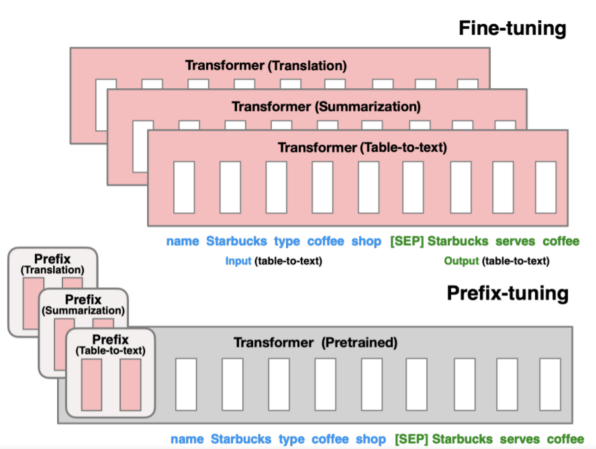 |
| :--- | :---: |

为什么说这个方法其实就是一种软提示呢？这是因为，前缀的那些稠密的向量们（我们姑且称之为任务向量），它其实就是一种Prompt，意图是告诉模型现在该去做什么任务了，只不过用的不是自然语言，而是我们人类看不懂的一大串数字而已。它其实和前面参数高效微调PEFT中提到的[Adapter](https://s3tlxskbq3.feishu.cn/docx/NyPqdCKraoXz9gxNVCfcIFdnnAc#QQowdqICKoSqeQxKDZKcY6zXndb)的思路很像，都是增加额外参数的思路；但它不在模型的最后一层做一个全连接，而是在模型的嵌入层的时候就把一段特定的任务向量拼接给输入的词序列。

2、对前缀精调的第一次简化：P-Tuning（ Hard-Soft Prompt Hybrid Tuning，软硬混合的Tuning）_**2021.3**_

[【Arxiv】GPT Understands, Too](https://arxiv.org/abs/2103.10385)（P-Tuning V1）

[【arxiv】P-Tuning v2: Prompt Tuning Can Be Comparable to Fine-tuning Universally Across Scales and Tasks](https://arxiv.org/abs/2110.07602)（P-Tuning V2）

| 最近Arxiv上的论文[《GPT Understands, Too》](https://arxiv.org/abs/2103.10385)提出了名为P-tuning的方法，**成功地实现了模版的自动构建**。不仅如此，借助P-tuning，GPT在SuperGLUE上的成绩首次超过了同等级别的BERT模型，**这颠覆了一直以来“GPT不擅长NLU”的结论，也是该论文命名的缘由**。 ——[P-tuning:自动构建模版，释放语言模型潜能 - 科学空间|Scientific Spaces](https://spaces.ac.cn/archives/8295/comment-page-1) By 苏剑林大佬 |
| :--- |

Instead of using a purely learnable prompt template, hard-soft hybrid tuning methods insert some tunable embeddings into a hard prompt template. 

| 简言之，软硬混合的提示调优指的是在离散的硬提示（构成的嵌入张量）中插入一些可以微调的任务嵌入。 |
| :--- |

P-tuning，即通过在嵌入输入中插入可训练、微调的变量来学习连续的提示语。

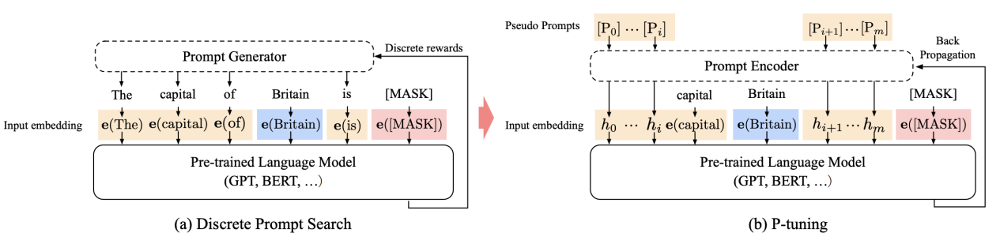

具体的，P-Tuning的运作原理大概可以归纳如下：

1. 输入一个句子，以及预先设计的一个离散的模板。以输入“The Disney film is good!”、模版：[X],it was [Z]为例，于是会有：The Disney film is good！It was [MASK].；
2. 对输入的template中，挑选一个（或多个）token作为pseudo token：The Disney film is good! [pseudo] was [MASK].其初始化可以直接使用原本的token embedding。
3. 对所有的pseudo token ，喂入一层LSTM，并获得每个pseudo token输出的隐状态向量 。
4. 将整个句子喂入GPT的embedding layer，对于pseudo token部分的token embedding，就用 来替换。最后基于这样的张量，GPT就产生对应的输出。

3、对P-Tuning的进一步简化Prompt-Tuning _**2021.4/2021.8**_

[【arxiv】The Power of Scale for Parameter-Efficient Prompt Tuning](https://arxiv.org/abs/2104.08691)

| _**We freeze the entire pre-trained model and only allow an additional k tunable tokens per downstream task to be prepended to the input text. **_ |
| :--- |

+ 在GPT-3中，Prompt Token 是模型的嵌入表(Embedding Table)的一部分，因此受模型的冻结参数决定。由于参数是冻结的，所以找最优的Prompt一般需要人为搜索或者使用不可微自动化搜索方法（硬提示的问题）
+ Prompt Tuning依然冻结，但消除了提示由参数化的限制；相反，Prompt Tuning中的Prompt有自己的专用参数 ，可以通过反向传播算法更新。 Prompt Design（手动设计离散的template）可以看做从冻结嵌入的固定词汇表中选择Prompt Token，而Prompt Tuning可以看做token已经确定，但是embedding是可以学习的。
+ 相较于Prefix Tuning，在Prompt-Tuning中，每个hidden layer不再需要对应添加相同长度的前缀，因此模型结构完全没有改变；只是让一些Token的Embedding参数变得可以微调，这部分参数大概占模型总参数的0.1%。Prompt Tuning也因此更加灵活。

#### 5.3.4 **软提示真就一定比硬提示好吗？**
答案是未必。连续提示确实有_5.3.1_和_5.3.2_中提到的好处，但它最大的问题在于，它本质上还是一种类似前prompting时代的参数高效的fine-tune方法，只不过它的Adapter并不是在整个模型的输出之前加上的一个全连接层，而是放在了模型的嵌入层。于是从底层原理上，它就一样会发生类似于Fine-tuning的过拟合/任务性能不稳定等现象。此外，我们相信Soft prompting是参数高效、节约资源的，但不管怎么解释它依然需要靠反向传播去tune参数，而且还存在伪资源节约等问题。

**后面我们会看到，在2021年，软提示火了一整年，但后来谷歌依然用思维链提示，让硬提示狠狠的来了波文艺复兴。**

## 6 **ChatGPT/InstructGPT/GPT3.5：SFT（有监督微调）or Instruct-Tuning（指令精调），与RLHF（基于人类反馈的强化学习）（2022.3）**
论文原文：[【Arxiv】Training language models to follow instructions with human feedback](https://arxiv.org/pdf/2203.02155.pdf)

根据 OpenAI 的博客，InstructGPT所用到的指令学习的方法和ChatGPT基本是一致的。所以这里就讲InstructGPT这篇文章,我们可以从中一窥ChatGPT的原理。

### 6.1 **摘要 Abstract**
| 让语言模型变得更大并不意味着它们能更好地遵循用户的意图。例如，大型语言模型可以产生不真实的、有毒的或根本对用户没有帮助的输出。换句话说，这些模型没有与用户**“对齐”（Aligned，对齐是一个我比较喜欢的翻译）**。在本文中，我们展示了一个途径，通过人类反馈的微调，在广泛的任务中使语言模型与用户的意图保持一致。从一组标签员写的Prompt和通过OpenAI API提交的Prompt开始，我们收集了一组由Labeler人工去写的回答，作为我们希望的模型行为（desired model behavior）的数据集，我们使用监督学习来微调GPT-3。然后，我们收集模型输出的排名数据集，我们利用人类反馈的强化学习来进一步微调这个监督模型。我们把产生的模型称为InstructGPT。在人类对我们的提示分布的评估中，尽管参数少了100倍，但1.3B参数的InstructGPT模型的输出比175B的GPT-3的输出更好。此外，InstructGPT模型显示了真实性的改善和有毒输出生成的减少，同时在公共NLP数据集上，测试性能也没有降低太多。尽管InstructGPT仍然会犯一些简单的错误，但我们的结果表明，利用人类反馈进行微调是使语言模型与人类意图相一致的一个有希望的方向。 ——[【Arxiv】Training language models to follow instructions with human feedback](https://arxiv.org/pdf/2203.02155.pdf) |
| :--- |

### 6.2 **要解决的问题：Misaligned**
_**大语言模型存在哪些问题：**_

通过让模型更大，我们把更多的数据用Transformer压缩到了模型的权重、偏置等参数里，这可能会让模型更好的在各种任务场合下实现下一词预测，但不代表可以让模型更符合用户的意愿。例如：

1. **Simply not useful，即讲废话**。如果你问了模型一个具体的问题，但模型顾左右而言他，像写公文一样说了一堆看似有道理其实毫无价值的废话，那这个模型可能就是不够合格的。
2. **Untruthful Hallucinations：错误的、AI产生的幻觉**（在自然语言处理中，幻觉通常被定义为“生成的内容与提供的源内容无意义或不可信）。我们都知道，ChatGPT喜欢一本正经的胡说八道，一个很知名的梗就是向ChatGPT提问，林黛玉倒拔垂杨柳的事情。它回答的真的非常好（❌）

| ChatGPT 特别擅长编造东西，因为它必须处理的数据量非常大，而且它收集单词上下文的能力非常好，这有助于它将错误信息无缝地放置到周围的文本中。 |
| :--- |

1. **Toxic：有害的内容**。例如，让GPT去帮人写假新闻、帮你大量的写垃圾邮件、写犯罪计划、写作为一个AI如何统治人类；或者让GPT输出侮辱性的、种族歧视的言论等等。

_**这样的问题为什么会存在：Misaligned**_

| An Underlying Premise：我们反思这样的问题为什么会存在时，其实首先我们已经认可了一件前提：人工智能应该输出我们人类喜欢的、符合我们人类需求的东西，而不只是“精准”的下一词预测。 |
| :--- |

| This is because the language modeling objective used for many recent large LMs—predicting the next token on a webpage from the internet—is different from the objective “follow the user’s instructions helpfully and safely” (Radford et al., 2019; Brown et al., 2020; Fedus et al., 2021; Rae et al., 2021; Thoppilan et al., 2022). Thus, we say that the language modeling objective is misaligned. Averting these unintended behaviors is especially important for language models that are deployed and used in hundreds of applications. |
| :--- |

我们每次向模型提一个问题，我们都期待模型给一个我们期待的，能够解决我们的问题而且安全无害的答案。这才是模型真正的目标函数。尽管LLM可以被以“Prompt”的输入来实现很多NLP任务，包括前面提到过的Zero-shot 0S、One-shot 1S、Few-shot FS，**但它的目标函数却很简单，无非是更好的去做下一词预测：**

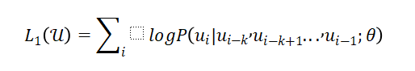

这一目标函数当然和我们人类真正想要的helpful与safe等要求有很大的偏差。由此我们定义了Misalignment:LLM在训练时的目标函数和人类的真实意图存在很大的区别，很好的下一词预测不代表很好的符合用户需求。

_**这些问题严重吗：答案是，非常严重！**_

**先不讲客户体验，我们直接看一些关乎一整个产品的生死存亡的问题。**

+ 首先美国是一个非常讲政治正确的国家，有一堆价值观要去遵循，挑剔的很。例如，你去让LLM做下一词预测，例如，A man is ___的下一词预测，和A woman is ____的下一词预测的比较，可能会非常不一样。哪怕预测下来，A man is最大可能输出Lazy，而A woman is最大可能输出Beautiful，也会有人指责你说这说明这个模型更加注重女性的外貌，还是一种Bias。总之，非常难伺候。

| + 其次，舆论对于创业公司可能会好一些，但对于大公司真的是非常挑剔。参考文章：[Google apologises for Photos app's racist blunder](https://www.bbc.com/news/technology-33347866)，2015年Google上线了一款产品，可以去识别图像中的各种元素，例如Skycrapers、Cars等，结果把几个黑人识别成了Gorillas，即大猩猩。媒体们知道这件事后直接炸毛了，而Google也不得不疯狂道歉，后来甚至下架了产品。**好好的一款产品，就这么没了，嘻嘻** |  |
| --- | :---: |

+ 中国和美国一样，也有很多不能碰的话题，而且一旦输出了非常不符合我们的核心价值观的内容、触痛到了一些不能碰的雷点，可能连产品带公司都给一次性封杀掉了。

**看完生死存亡后，我们再考虑客户体验。**在一些应用场合，尤其是工业级应用场合，我们肯定还是希望模型的生成具有稳定的，not helpful甚至幻觉的输出可能会降低客户的付费意愿，甚至阻碍LLM的商业化落地。因此，我们确实需要想办法来解决Misaligned这个问题。

### 6.3 **解决该问题的方法：基于人类反馈的强化学习，Reinforcement Learning with Human Feedback, RLHF**
_**先验知识：基础的强化学习知识。见第五章，**_[_**这里是链接**_](https://s3tlxskbq3.feishu.cn/docx/NyPqdCKraoXz9gxNVCfcIFdnnAc#CqqQdmKS8o0yWuxc3hccrZXWnwh)_**。**_OpenAI写RLHF的这个团队本身是做强化学习出家的，在这方面本来就很有一套。

看完论文的摘要和12.6.2提到的问题，我们肯定对Instruct GPT的目的有一个基本的了解了，即让语言模型和人类的Align做的更好一些，更helpful也更安全。**具体而言，他们采用的方法是RLHF，即基于人类反馈的强化学习。**

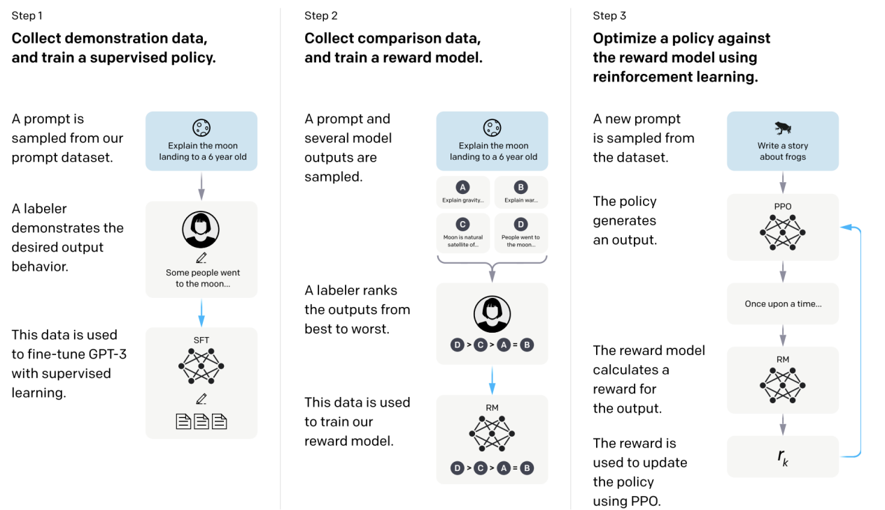

虽然对于很多读者来说这都是我们第一次接触到强化学习，但RLHF具体用到的思维和方法其实都相对比较简单。回到第五章大概理解强化学习的算法后，耐心的看下去就行。

---

#### 6.3.1 **Step1: Supervised Fine-tuning（SFT），基于监督的微调**
| Collect demonstration data, and train a supervised policy |
| :--- |

先不要去管什么Policy不Policy的，第一步其实就是一个很简单的用标注数据去给模型做微调的过程，如果没有后面两个步骤的话，这一步就根本算不上强化学习。

| 1. **收集Prompt。**Prompt有两个渠道来源：1、花钱雇人，人工来写。2、用户使用GPT产品时提交。 2. **对于收集来的Prompt，人工的给它写Output。**人工给它写的output（OpenAI管它叫做**Demonstration Data or Labeler Demonstration**）自然得是desired output，如果模型能一直输出这种水平的答案那是最好。 3. **通过第一和第二步，其实我们就得到了一个标注数据集**。利用Prompt（输入）+Labeler Demonstration（标准输出），我们就可以用Fine-Tune的范式去微调GPT。 | 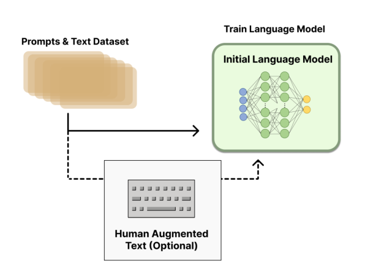 |
| --- | :---: |

OpenAI把上述的这个微调GPT-3的流程称为**Supervised Fine-tuning，SFT**。原理上，它和微调别的东西其实没有什么区别。

_**#SFT又称Instruction-Tuning（指令精调）。它是我们通往ChatGPT之路的第二块拼图。**_

_**那么它和强化学习有什么关系呢？一直用大量的人工标注去做Fine-tune，不就好了，为什么还要去用RLHF？**_

首先，可以这么去理解：

| 整个被SFT后的GPT-3其实就是一个巨大的Policy函数，这个Policy函数以用户的输入（Prompt）为自己的状态State，并在该状态下采取Action，即输出一段回答。**这样一来，想要获取一个好的LLM模型，就不仅可以靠标注数据做Fine-tune实现梯度下降了，还可以通过策略梯度等算法去获取一个好的策略函数。** |
| :--- |

_**那么，用Labeler Demonstration不应该很香吗，为什么不全靠Fune-tune呢？**_

+ 首先，花钱雇人去帮你写desired output还是一件非常贵的事情。你得去专门的给人培训，告诉人家怎样的答案才是好的，要避开哪些不能提的东西，什么时候要直指要害而什么时候要圆滑。
+ 此外，自然语言的Prompt有那么多，千奇百怪，我们很难用人工写答案的方式做一个全覆盖。
+ 最后，也是前面在_12.3.1_中提到的，当一个语言模型变得越来越大，找到足够的标注数据集去Tune它就会变得又贵又不可能。

**因此，出于工作量还有成本的考虑，必须得想一个更聪明的方法，让模型和人类对齐。这个方法就是强化学习**。

---

#### 6.3.2 **Step2: 训练一个奖励模型，Reward Model，RM**
| RM 的训练是 RLHF 区别于旧范式的开端。RM模型接收一系列文本并返回一个标量奖励，数值上对应人的偏好。其实在_6.3.1_里我们就提到过，语言模型LM的本质既可以是下一词预测，也可以是判断一句话是否Make Sense的概率；那自然，它也可以用于对一句话打分嘛。**因此，其实RM它也是一个语言模型。** |
| :--- |

我们知道，让人去写一段desired output作为标签的话，成本会很贵，因为它是一个生成式的任务。相较而言，如果人类只需要去做判别式任务，那么工作量就会减小非常多。RLHF其实就是这个思想。

前面提到过了，整个被SFT后的GPT-3其实就是一个巨大的Policy函数，这个Policy函数以用户的输入（Prompt）为自己的状态State，并在该状态下采取Action，即输出一段回答。现在我们去回想强化学习的构成要素，即：基本元素层：【环境Environment、玩家Agent、目标Goal】；主要元素层：【状态State、行为Action、奖励Reward】；基本元素层：【策略Policy、价值Value】。

| 值得注意的是，在RL中，我们可以使用奖励函数而不使用价值函数来训练策略，从而实现策略梯度算法。这种方法被称为纯粹的策略梯度方法（pure policy gradient methods）。也就是说，上面提到的东西中，Value是可以不要的。 |
| :--- |

那么，为了训练出一个最佳的Policy函数，也就是能和我们的价值观对齐的LLM，目前还缺少的要素是奖励Reward。

Step2的目的就在于此，我们想要训练出来一个好的奖励模型，让他给模型输出的结果去打分。

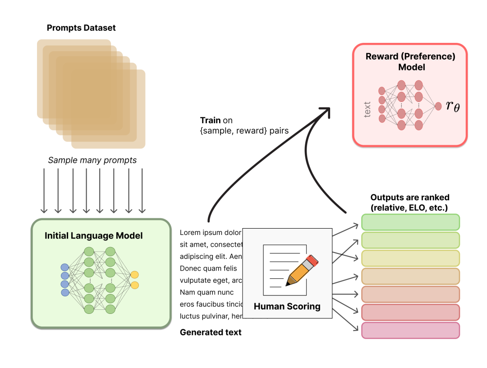

**训练出一个奖励模型（Reward Model，即RM）的步骤如下：**

1. **采样一个Prompt，对模型输入该Prompt后，模型会给出多个不同的输出**。

| _**但是模型参数在推理的时候是不变的，为什么在推理的时候GPT还会有随机性？**_ A：这是因为在生成文本时，GPT模型会采用一种称为**“采样（Sampling）”**的策略，该策略会引入一些随机性。 具体来说，GPT模型在生成文本时，通常会根据前面的文本内容预测下一个单词或字符，并从预测的概率分布中进行采样。前面讲过Greedy Decoding和Beam Search，**不过ChatGPT它采用了Top-K Sampling的方法而非argmax做概率采样，即限制在预测的概率分布中只保留前K个最可能的单词或字符，然后从这K个单词或字符中随机采样**。自然的，这样的采样方法会让模型产生多种不同的输出， |
| :--- |

1. **由人工Labeler来给模型的多种不同的输出做一个排序。**例如，输出了A、B、C、D后，标注员认为，D>C>A=B。
2. **通过1和2，我们得到了一组数据集，这组数据集的目的是训练出一个奖励函数，即RM。**具体的路径为：RM也是一个神经网络，输入给RM的是模型给出的output，输出的RM对output的一个打分。我们首先随机初始化Reward Model，让他去给Prompt的输出打分；而这个打分的结果应该是要符合Labeler的排序的。如果不符合的话，我们就做一个梯度下降。总之，训练的目标函数就是让RM给模型的输出的打分符合Labeler给他做的一个排序。

我们可以看到，Train这个Reward Model的过程本身也不是一种强化学习，而是标准的有监督学习，监督信号是我们人工标注的打分排序。只不过这个reward model在后续会被用于强化学习而已。

---

#### 6.3.3 **Step3：以大模型本身为策略函数，以训练出的RM为奖励函数，通过PPO算法去微调模型**
| Optimize a policy against the reward model using reinforcement learning. |
| :--- |

| 到这里过，整个要素就非常清楚了。我们要做的无非就是基于已有的奖励函数，去利用策略梯度算法去优化我们的策略函数，也就是LLM。 相信大家看完第五章后多少也理解强化学习的基本思想了，这篇文章不打算对PPO（近端策略优化 ，Proximal Policy Optimization）算法做细致的介绍。它真的没有什么难的，理解Train出来一个奖励模型后，我们就可以对策略函数不断更新梯度，从而让他表现的更好，就可以了！ （事实上，如果细讲技术原理和工程问题的话，这一步还是很复杂的。怎么将熟悉的RL算法应用于如此大的一个模型一直是一个挑战。） | 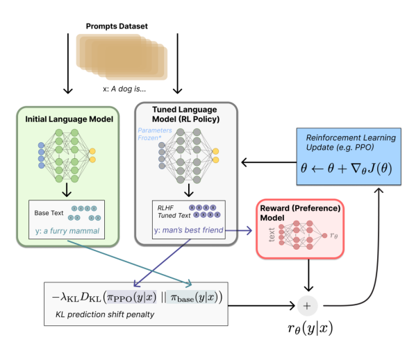 |
| :--- | :---: |

Step3讲的其实非常简略，只是讲了算法思想的程度。如果想要了解更多，可以参考：[ChatGPT 背后的“功臣”——RLHF 技术详解 By HuggingFace](https://mp.weixin.qq.com/s/TLQ3TdrB5gLb697AFmjEYQ)。

虽然我们说这一步无非是个PPO而已，但仔细想的话可能会觉得语言模型的PPO和普通强化学习里的PPO不大一样。如果想到了这一步而且觉得好奇的话，可以参考：[详解大模型RLHF过程（配代码解读）](https://zhuanlan.zhihu.com/p/624589622?utm_medium=social&utm_oi=1239682420452487168&utm_psn=1635641325230948352&utm_source=wechat_session)。这超出了本文档介绍的范畴，技术难度也会更大一些，所以这里就先不讲啦。

| **#RLHF是我们解锁GPT-3的能力，让它走向ChatGPT的最后一块拼图。** 一个大如GPT-3的语言模型，其初步具备了一些0S和FS的能力，_这可能是因为语料库中本来就有类似的指令，完成人类向他提出的下游任务要求可以帮助他更好的实现下一词预测_； 被Train on Code后,具备了代码生成能力，_而且可能从中学会了Reasoning，即逻辑推理。_ 被Instruct-Tuning后，_学会了如何遵循人的指令，而且这件事具有很强的泛化能力_。 被RLHF后，付出了一些性能作为代价（alignment tax），_进一步学会了遵循人的指令，输出Useful、relevant而且不toxic的内容，实现了与人类的价值观对齐_ _#指令精调和RLHF本身并没有为模型注入新的能力，但它让模型通过千亿参数压缩了海量预料后具有的巨大潜能得以发挥，输出了我们想要的内容。_ _#我们想看到的输出（desired output）它是可以解决我们提出的下游任务的，是有用的、正确的、有逻辑推理的。ChatGPT表现如此惊艳，个人推测一个极其重要的原因就是“对齐”的思想。__模型展现出了极其强大的理解和推理能力，但这可能只是为了实现更好的、和我们对齐的【下一词预测】而已。_ |
| :--- |

---

### 6.4 **模型的效果与评价**
+ **InstructGPT生成的答案明显比GPT-3更好（更能和人类的价值对齐）。哪怕在InstructGPT只有13亿参数，而GPT-3有1750亿参数的情况下，这一结论依然成立。**

| On our test set, outputs from the 1.3B parameter InstructGPT model are preferred to outputs from the 175B GPT-3, despite having over 100x fewer parameters. These models have the same architecture, and differ only by the fact that InstructGPT is fine-tuned on our human data. This result holds true even when we add a few-shot prompt to GPT-3 to make it better at following instructions.  Outputs from our 175B InstructGPT are preferred to 175B GPT-3 outputs 85 ± 3% of the time, and preferred 71 ± 4% of the time to few-shot 175B GPT-3. InstructGPT models also generate more appropriate outputs according to our labelers, and more reliably follow explicit constraints in the instruction. |
| :--- |

+ **InstructGPT模型在真实性方面比GPT-3有所提高：**

| On the TruthfulQA benchmark, InstructGPT generates truthful and informative answers about twice as often as GPT-3. Our results are equally strong on the subset of questions that were not adversarially selected against GPT-3. On “closed-domain” tasks from our API prompt distribution, where the output should not contain information that is not present in the input (e.g. summarization and closed-domain QA), InstructGPT models make up information not present in the input about half as often as GPT-3 (a 21% vs. 41% hallucination rate, respectively). |
| :--- |

+ ** InstructGPT shows small improvements in toxicity over GPT-3, but not bias：减少了有害的信息，但在偏见上没有什么提升。**eg还是会默认司机都是男的；护士都是女的。

|  To measure toxicity, we use the RealToxicityPrompts dataset (Gehman et al., 2020) and conduct both automatic and human evaluations. InstructGPT models generate about 25% fewer toxic outputs than GPT-3 when prompted to be respectful. InstructGPT does not significantly improve over GPT-3 on the Winogender (Rudinger et al., 2018) and CrowSPairs (Nangia et al., 2020) datasets. |
| :--- |

+ **在公有数据集上，InstructGPT的性能也没有下降太多。**通过调整RLHF的微调的程序，可以实现对模型性能的伤害对最小化（We can minimize performance regressions on public NLP datasets by modifying our RLHF fine-tuning procedure）。具体的做法为，在基于RLHF做Fine-tune的时候，不仅通过PPO算法做参数更新，也引入最原始的交叉熵函数做参数更新。在思想上有点类似_12.1.2.2_里提到的把两个目标函数合起来一起训练。
    - 这边介绍一个概念，叫**Alignment Tax，“对齐税”**。很多时候，解决模型的misalignment的问题会需要通过牺牲性能换取与人类的对齐（alignment），牺牲的这一部分性能就叫对齐税。
    - OpenAI是想说，因为他们采用了上述的做法（绿底部分）我们在做完RLHF，让模型输出的东西更符合人的意愿之后，付出的对齐税其实还是比较少的。

|  During RLHF fine-tuning, we observe performance regressions compared to GPT-3 on certain public NLP datasets, notably SQuAD (Rajpurkar et al., 2018), DROP (Dua et al., 2019), HellaSwag (Zellers et al., 2019), and WMT 2015 French to English translation (Bojar et al., 2015). **This is an example of an “alignment tax” since our alignment procedure comes at the cost of lower performance on certain tasks that we may care about**. We can greatly reduce the performance regressions on these datasets by mixing PPO updates with updates that increase the log likelihood of the pretraining distribution (PPO-ptx), without compromising labeler preference scores. |
| :--- |

+ **InstructGPT泛化到了没有产生任何训练数据的“搁置”标签者的偏好，即一类问题，哪怕没有被人工标注排序过答案，模型也可以生成更和人类对齐的回答（Our models generalize to the preferences of “held-out” labelers that did not produce any training data.）**

|  To test the generalization of our models, we conduct a preliminary experiment with held-out labelers, and find that they prefer InstructGPT outputs to outputs from GPT-3 at about the same rate as our training labelers. However, more work is needed to study how these models perform on broader groups of users, and how they perform on inputs where humans disagree about the desired behavior. |
| :--- |

泛化能力是个好东西，这说明我们的工作量可以被大幅减少。这个结论是完全符合常识的，但也是非常重要的。

+ **InstructGPT models show promising generalization to instructions outside of the RLHF finetuning distribution.:泛化能力非常强，甚至可以从生成自然语言泛华到生成代码，从英语泛化到各种语言，哪怕代码生成、其他语言这些东西其实没有被RLHF微调过。**（相比之下，想要让GPT-3实现这些任务就更难，需要小心翼翼的去写prompt，而且哪怕这样有时候也会文不对题）

| **We qualitatively probe InstructGPT’s capabilities, and ****find that it is able to follow instructions for summarizing code, answer questions about code, and sometimes follows instructions in different languages, despite these instructions being very rare in the fine-tuning distribution****. ** |
| :--- |

| In contrast, GPT-3 can perform these tasks but requires more careful prompting, and does not usually follow instructions in these domains.** This result is exciting because it suggests that our models are able to generalize the notion of “following instructions.”** They retain some alignment even on tasks for which they get very little direct supervision signal.  |
| :--- |

| 这一结论也非常重要、非常激动人心（exciting），因为OpenAI认为，这反映了**通过RLHF，InstructGPT不仅实现了更好的Alignment，它学到的东西可能还帮助他泛化到了“遵从指示”（**** our models are able to generalize the notion of “following instructions”****）**。现在再回想起文章的标题，[Training language models to follow instructions with human feedback](https://arxiv.org/pdf/2203.02155.pdf)，便能理解这个标题的真正含义了。 |
| :--- |

+ **InstructGPT still makes simple mistakes：依然会犯一些无脑的错误，没有完全对齐**。不过这也正常啦，现在这样的效果已经很好了。

| For example, InstructGPT can still fail to follow instructions, make up facts, give long hedging answers to simple questions, or fail to detect instructions with false premises. |
| :--- |

---

### 6.5 **关于InstructGPT这篇论文的总结**
从结果上看，在经过RLHF之后，一个13亿参数的InstructGPT的效果已经比175B的GPT-3还要来的好了，它更会遵循人的指令，有毒答案也更少，非要说缺点的话应该只有偏见问题还没解决。

13亿参数大小的大量人工介入的模型的效果好于参数1750亿的GPT-3，这个结果很好，但其实也不算意外：

+ **所谓有多少人工，就有多少智能。**花大钱雇人去写答案、打标签，成本无疑是很大的，这样产生的输入有两个好处：第一，信噪比更高。因为有些Prompt和Output是人工写的，噪音自然比爬虫爬到的东西少很多。第二是，标注信息，例如SFT中人工写的demonstration，肯定和模型的最终评估用的标准更接近，所以评估起来结果更好也是自然的。
+ **这背后蕴涵着这样一种思考：没必要对人工标注数据抱有恶意，认为它是落后的东西。**用无标注数据自监督训练出一个特别大的模型，一条路走到黑的话，计算量和数据需求都可能会吃不消。在一些我们很想要，但只靠堆叠海量数据让Transformer去压缩做不到的性能追求（例如无毒、相关、有用）上，可能多来点人工标注数据，性价比会高得多。

[参考：InstructGPT 论文精读【论文精读·48】_哔哩哔哩_bilibili](https://www.bilibili.com/video/BV1hd4y187CR/?buvid=ZE4EBEE92994324F407089826EE9BEE9DE8E&is_story_h5=false&mid=jOTTvC9MAcEUtHyHp%2B%2B2ww%3D%3D&p=1&plat_id=114&share_from=ugc&share_medium=iphone&share_plat=ios&share_session_id=AD8BBE31-8084-443E-99C6-F6936D247C54&share_source=WEIXIN&share_tag=s_i&timestamp=1682653931&unique_k=EPUNfG5&up_id=1567748478)

[参考：How does GPT Obtain its Ability? Tracing Emergent Abilities of Language Models to their Sources](https://yaofu.notion.site/How-does-GPT-Obtain-its-Ability-Tracing-Emergent-Abilities-of-Language-Models-to-their-Sources-b9a57ac0fcf74f30a1ab9e3e36fa1dc1#929906a4292b4cceadabd92c47f3843f) By [Yao Fu](https://franxyao.github.io/), yao.fu@ed.ac.uk

### 6.6 **所以指令微调都做了些什么**
| + 指令微调**不会为模型注入新的能力** —— 所有的能力都已经存在了。指令微调的作用是**解锁 / 激发这些能力**。这主要是因为指令微调的数据量比预训练数据量少几个数量级（基础的能力是通过预训练注入的）。 + 指令微调**将 GPT-3.5 的分化到不同的技能树。**有些更擅长上下文学习**，如text-davinci-003，有些更擅长对话，如ChatGPT。 + 指令微调**通过牺牲性能换取与人类的对齐（alignment）**。OpenAI 的作者在他们的指令微调论文中称其为 “对齐税” (alignment tax)。许多论文都报道了code-davinci-002在基准测试中实现了最佳性能（但模型不一定符合人类期望）。在code-davinci-002上进行指令微调后，模型可以生成更加符合人类期待的反馈（或者说模型与人类对齐），例如：零样本问答、生成安全和公正的对话回复、拒绝超出模型它知识范围的问题。 ——ChatGPT的前世今生 By 自动驾驶之心 |
| --- |

---

## 7 **思维链 Chain of Thoughts, CoT（2022.1）**
### 7.1 [**开山之作：Chain-of-Thought Prompting Elicits Reasoning in Large Language Models**](https://arxiv.org/pdf/2201.11903.pdf)
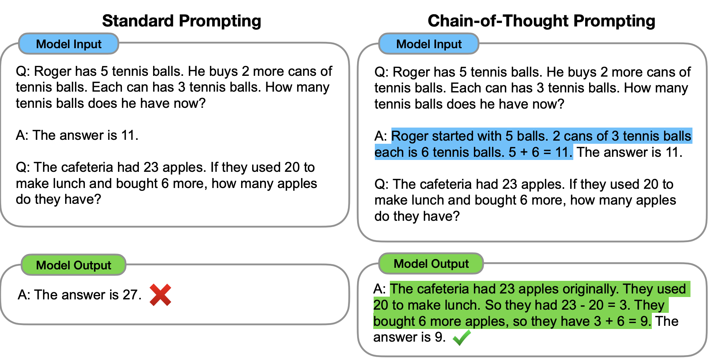

| Scaling up model size alone has not proved sufficient for achieving high performance on challenging tasks such as arithmetic, commonsense, and symbolic reasoning. ——[Self-consistency Improves Chain Of Thought Reasoning in Language Models](https://arxiv.org/abs/2203.11171) |
| :--- |

思维链提示是一种针对大语言模型的Prompting方法。大语言模型彻底重塑了NLP领域的研究，但是单纯的把规模搞大无法解决所有问题：大语言模型依然很难在算术、常识和符号推理等具有挑战性的任务中体现出好的性能。

| 当我们做出了足够大的语言模型，把足够大的Corpus通过足够多层Transformer压缩到模型中后，**模型本身具有的“能量”可能是已经足够巨大的，足以去实现Zero-shot、few shot的预测（上下文学习）。我们要做的，就是找到更多的方法，把这些能量给激发出来**。 正如前文中提到的，Instruct tuning和RLHF本身并没有给模型注入新的能力，所有的能力都是本来就有的；但他们很好的把模型蕴含的巨大潜能引导到了“遵循人类的指令并与人类对齐”上，于是就产生了极佳的效果。**思维链也是这个思维下的产物之一：不是模型推理能力不好，而是我们的prompt不能很好的引导他们。****以往我们在ICL中只给模型input和output的demonstration让它学习，那对于需要推理的任务，我们能不能把reasoning path也给放到demonstration里，让模型去学呢？这其实就是CoT的思想。** |
| :--- |

思维链是一种特殊的In-Context Learning，而且采用的不是连续提示，而是离散提示（在当时来看是文艺复兴，因为连续提示学习一时风头无两）。它和1S、FS的提示词很像，但我们除了给出Input-Output作为示范之外，还需要在输入和输出之前絮絮叨叨一阵子，给出一个推理过程，称为**Relationale或Reasoning Path**。因此，在使用CoT技术后，我们对模型的Prompt就是一个具有逻辑推理过程的短文本了，如章节开头的图中的蓝色部分。

_#2022年4月，Google发布了语言模型PaLM，它使用了Chain of Thoughts的技术后，以540B的参数规模（GPT-3的三倍左右），取得了数学问题的SOTA。_

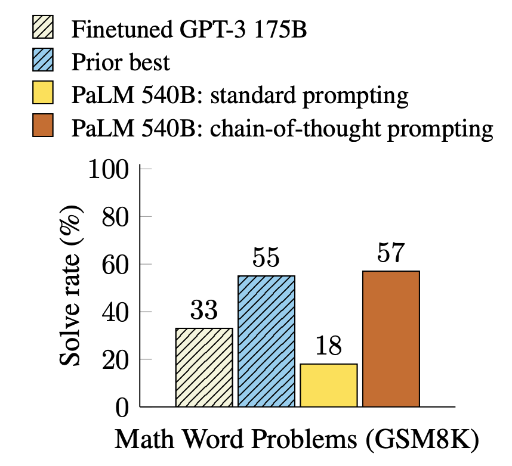

| 这篇论文相对而言比较简单，就是讲述了一个絮絮叨叨给模型讲明白逻辑的Prompt方法，没有涉及到对模型结构的调整（还没有改代码）。但接下来我们就要将CoT与更多模型细节做结合了。 |
| :--- |

### 7.2 **经典CoT方法之改变解码策略：**[**Self-consistency Improves Chain Of Thought Reasoning in Language Models**](https://arxiv.org/abs/2203.11171)
| In this paper, we introduce a novel decoding strategy called self-consistency to replace the greedy decoding strategy used in chain-of-thought prompting (Wei et al., 2022), that further improves language models’ reasoning performance by a significant margin. Self-consistency leverages the intuition that complex reasoning tasks typically admit multiple reasoning paths that reach a correct answer (Stanovich & West, 2000). The more that deliberate thinking and analysis is required for a problem (Evans, 2010), the greater the diversity of reasoning paths that can recover the answer. 自我一致性利用了这样一种直觉，即一个复杂的推理问题通常会有多种不同的思维方式来通往其唯一的正确答案，而且一个问题越复杂，潜在的逻辑链就会越多。 |
| :--- |

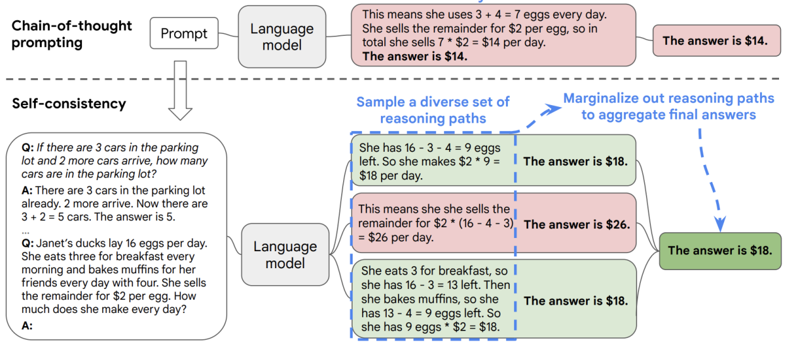

我们知道，Decoder本身是一个自回归的语言模型，语言模型在输出的时候有许多策略：

+ **Greedy Decoding Strategy，贪婪策略**。即总是输出概率最高的那一个词语。
+ **Beam-Search Strategy**。参考_7.2.3.2_。
+ **Top-k Sampling**。即在概率最高的k个词语中，基于概率做随机采样。

Self-consistency就是一个基于思维链的思想，去改变解码策略的方法，其运作模式如上图所示。**基于我们的思维链提示的输入，模型可以用自己本来就具有的能力生成一组推理逻辑不同的Output，每个Output对应一个答案。这就像是给答案做投票一样，我们留下票数最多的答案，作为模型的最终输出。**

### 7.3 **名扬四海的Let's Think Step by Step: **[**Large Language Models are Zero-Shot Reasoners**](https://arxiv.org/abs/2205.11916)
一般来说，既然要用思维链，那必然是One-shot或者Few-shot，因为你要给模型一个推理案例（参考下图右上角）。但是这篇论文指出，CoT也可以是Zero-shot：在0S CoT下，我们不需要给模型例子，只需要告诉模型你给我一步一步的思考就行。

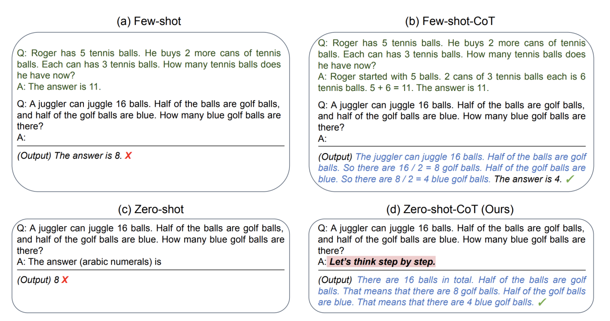

| While these successes are often attributed to LLMs’ ability for few-shot learning, we show that LLMs are decent zero-shot reasoners by simply adding “Let’s think step by step” before each answer. |
| :--- |

只要在每个答案前加上 "Let's Think Step by Step"，LLMs就是一个体面的Zero-Shot推理者。参考上图的右下角，它是一个Zero-shot的算数应用，模型本来会输出错误的结果，但是在A：之后加上了这么一句话，模型就可以输出自己的推理过程并且输出正确的结果了。

## 8 **大语言模型的涌现 Emergent Abilities：我们仍未知道那天看到的大模型会推理的原因**
[_关于涌现能力的介绍：【arxiv】Emergent Abilities of Large Language Models_](https://arxiv.org/pdf/2206.07682.pdf)

### 8.1 **什么是大语言模型的涌现？——****如果一种能力在较小的模型中不存在，但在较大的模型中存在，我们认为这种能力是涌现的。**
| **Emergent abilities of LLMs **are formally defined as “the abilities that are not present in small models but arise in large models”, which is one of the most prominent features that distinguish LLMs from previous PLMs. It further introduces a notable characteristic when emergent abilities occur [31]: performance rises significantly above random when the scale reaches a certain level. ——[【arxiv】A Survey of Large Language Models](https://arxiv.org/pdf/2303.18223.pdf) 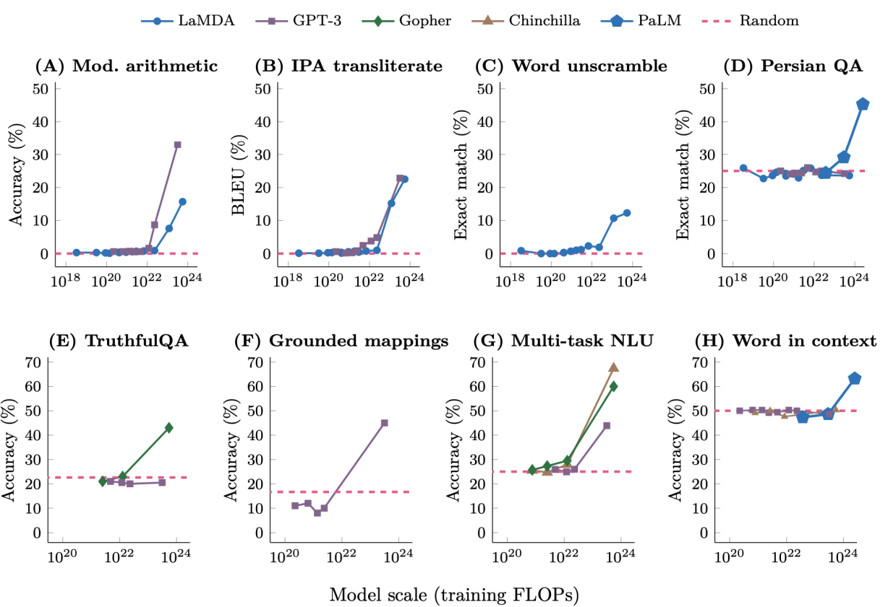 参考上图（来自[_【arxiv】Emergent Abilities of Large Language Models_](https://arxiv.org/pdf/2206.07682.pdf)）。涌现能力无法使用Scaling Law来从较小模型上进行预测。图中，我们让x轴是模型的参数量，y轴是某种能力的效果，那么涌现能力在图中会有一个清晰的Pattern：在某个阈值之前的效果接近随机（把模型做大，性能也只能在一个水准上随机波动，不会偏差太多），但是超过该阈值后效果将大大高于随机。 |
| :--- |

### 8.2 **涌现是敏锐且不可预测的**
_**涌现能力具有不可预测性：**_

+ 我们无法预测涌现能力在模型规模达到多大时会涌现出来。
+ **大多数学者在训练模型的时候，往往都没有采取最优的训练方案**_（Today’s language models are likely not trained optimally (Hoffmann et al., 2022), and our understanding of how to best train models will evolve over time）_**。**我们知道，Train一个Model的工程细节太多，数据来源及质量把关（例如GPT-3对CommonCrawl数据集的处理）、超参数怎么选（批大小，学习率，迭代次数，怎么做梯度下降等）、算力如何规划等等都会影响一个模型的训练结果，我们也不知道怎么去Train并且Train到多大的时候会出现涌现。

_**涌现能力是敏锐的，一旦达到阈值，就会被激发出来：**_

| 事实上，这些涌现能力非常令人惊讶，以至于「突然的、特定的能力扩展」已经被认为是 LLM 的两个最高定义特征之一。此外，「breakthrough capabilities」和「sharp left turns」等术语也被使用。 ——By [机器之心](https://mp.weixin.qq.com/s/tt9xYESUgw3V2c4XJu5ZVw) |
| :--- |

_**结合思维链、指令微调等技术，涌现能力会格外惊人**_

参考下图，在模型扩大到一定规模后，采用思维链和指令微调的方式，我们见到了更早出现的、更强大的涌现。

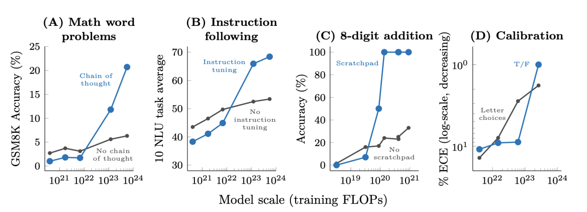

总之，把模型做的足够大、提供了足够多的数据后，模型出现了许多我们意想不到的特征，包括上下文学习，也包括模型涌现出的推理能力。**我们仍未知道那天看到的大模型会推理的原因**，很多人对大模型涌现出的推理能力的思考已经上升到了“什么是意识”“语言是对宇宙间一切事物的统一抽象解释”“通过压缩语言能否产生意识”的哲学层面……

### 8.3 **对涌现的批评**
[【arxiv】Are Emergent Abilities of Large Language Models a Mirage?](https://arxiv.org/pdf/2304.15004.pdf)

_尽管很多人通过将语言模型解释为一个复杂系统，认为LLM里的Transformer把足够多的信息在复杂系统里进行了极大程度的压缩，从而（在物理意义上）引发了相变（More is different）的角度去解释涌现，__**但也有文章批评认为涌现是一个伪概念，涌现的出现取决于我们对模型的评价指标。**_

+ 我们知道，我们经常用GLUE基准数据集、HumanEval等数据集和一些评估指标去评价一个模型的能力。对模型能力的评估不会是绝对客观中立的，它取决于我们的度量指标。
+ **斯坦福的研究者们质疑说，根本就不存在这么多奇迹，涌现的出现是度量选择的结果：**章节最开始的图中忽然变得非常陡峭的曲线的出现是因为对模型的度量指标是非线性、不稳健的。更换一些更连续、平滑的指标后，涌现现象就不那么明显了，更接近线性，例如下图。

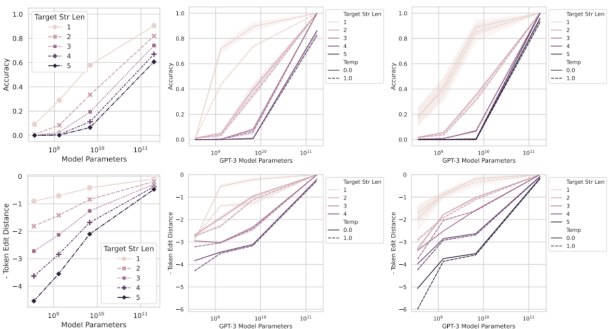

| 他们的怀疑基于以下观察：似乎只有在非线性或不连续地扩展任何模型的 per-token 错误率的度量下，模型才会出现涌现能力。例如，在 BIG-Bench 任务中，>92% 的涌现能力是这两个度量下出现的： 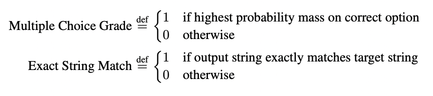 这就为 LLMs 的涌现能力的起源提出了另一种解释的可能性：尽管模型族的 per-token 错误率会随着模型规模的增加进行平滑、持续且可预测地变化，但**看似尖锐和不可预测的变化可能是由研究者选择的测量方法引起的**。也就是说，涌现能力可能是一种海市蜃楼，主要是由于研究者选择了一种非线性或不连续地改变 per-token 错误率的度量，部分原因是由于拥有太少的测试数据，不足以准确估计较小模型的性能（从而导致较小的模型看起来完全不能执行任务），另一部分原因是由于评估了太少的大规模模型。 参考：[斯坦福最新研究警告：别太迷信大模型涌现能力，那是度量选择的结果](https://mp.weixin.qq.com/s/tt9xYESUgw3V2c4XJu5ZVw)，机器之心 |
| :--- |

| 也不要因为这篇文章就直接否定了涌现的存在，其实这篇文章也不完全严谨： 首先，许多任务指标的设计本来就无法是“线性”的，对于这类任务，不应该太强人所难。 其次，NLP很多任务在使用不连续的度量时，其实也是在多个样本上的平均，整体数值其实是连续的。作者也给出了两个解释，试图说明此类度量下的涌现也是海市蜃楼，但也未能严谨证明。 _**最后的最后，不管怎样，作者也没有反对模型的性能会随着参数量的提高而上升，也没有反对**__**LLM**__**具有的推理能力。其实这就足够啦**_。 |
| :--- |

> 更新: 2025-09-30 09:37:23  
> 原文: <https://www.yuque.com/aaron-wecc3/dhluml/xvr7mk4f0mv5xt2i>