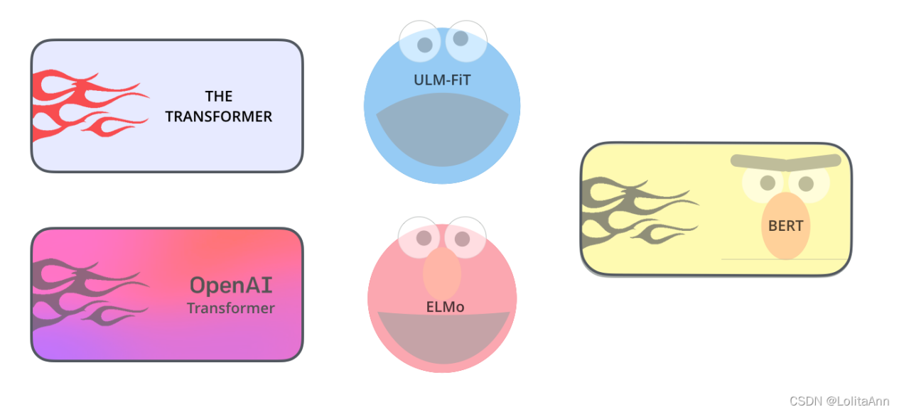
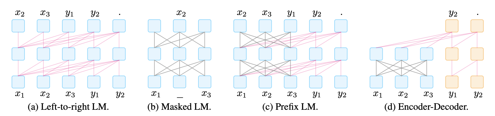
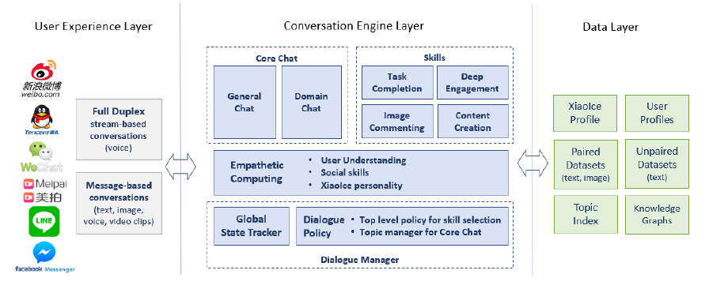
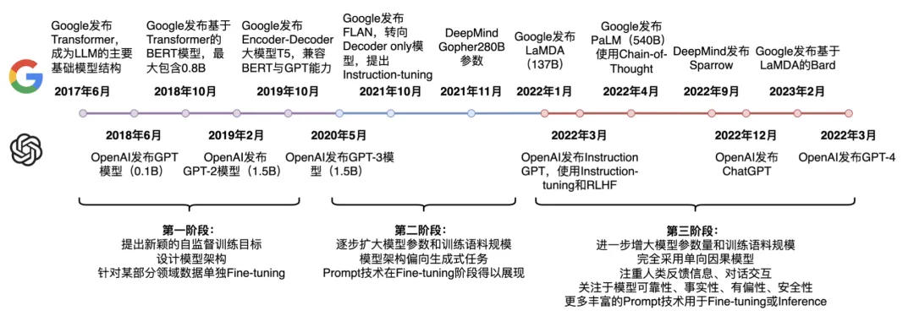
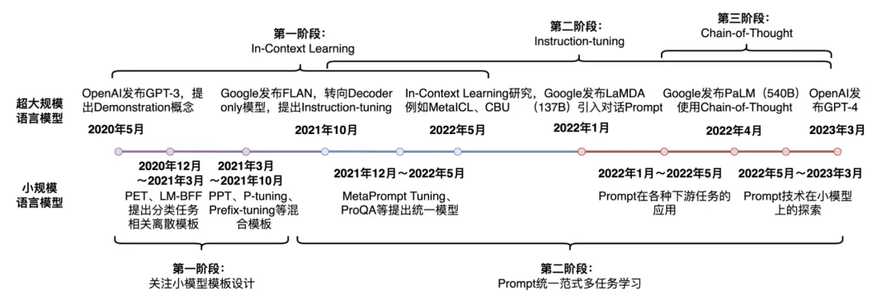
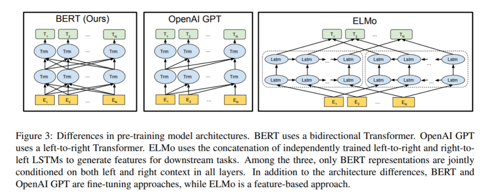
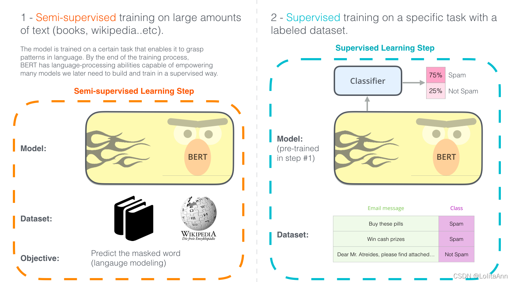
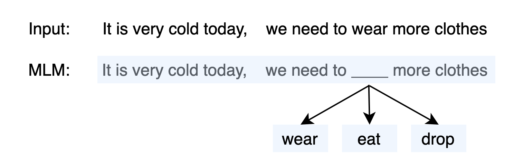
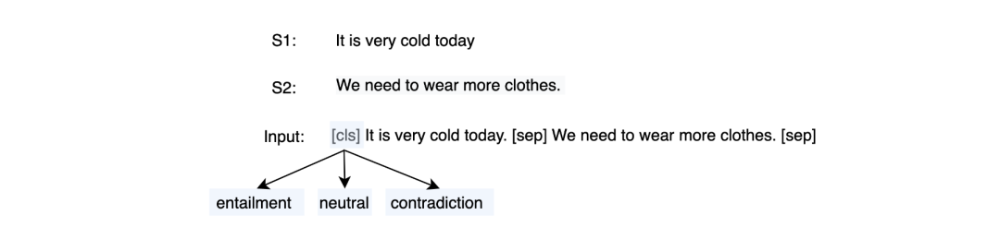

# 103.BERT相关面试题

## 常见面试题
1. 谈一谈NLP
2. BERT的模型架构
3. BERT的使用范式：下载预训练模型+自行微调
4. BERT的词嵌入：是3个嵌入之和
5. BERT的预训练任务：Masked Language Mo

[【arxiv】BERT: Pre-training of Deep Bidirectional Transformers for Language Understanding](https://arxiv.org/abs/1810.04805)

## 1 **谈一谈NLP**

_<图片是_[_Ann's Blog_](https://lolitasian.blog.csdn.net/?type=blog)_画的，怪好看的，就拿来用惹！>_

BERT 是建立在NLP领域中涌现的许多聪明想法之上的，包括但不限于[半监督学习（Semi-supervised Sequence Learning)](https://arxiv.org/abs/1511.01432)、[ELMo(Deep contextualized word representations)](https://arxiv.org/abs/1802.05365)、[ULMFiT(Universal Language Model Fine-tuning for Text Classification)](https://arxiv.org/abs/1801.06146)、[GPT(Improving Language Understanding by Generative Pre-Training)](https://s3-us-west-2.amazonaws.com/openai-assets/research-covers/language-unsupervised/language_understanding_paper.pdf) 和[Transformer(Attention Is All You Need)](https://arxiv.org/abs/1706.03762v5)。

这群人的工作改变了我们所在的世界，我愿称这张图上的角色们为NLP封神榜！

上面的所有论文或者相关的知识、模型，我应该都在前面讲过了，如果忘记了就回去复习！

语言模型的发展历史分为三个阶段：全监督学习阶段、预训练+Fine-tuning阶段和预训练+Prompt+Predict阶段。

| **范式** **Paradigm** | **阶段** **Stage** | **工程及探索** **Engineering & Exploration** | **代表模型** **Models** | **索引** **Links** |
| --- | :---: | :---: | :---: | --- |
| 全监督学习 Fully-supervised Learning 2017之前(1) | 前神经网络时代（eg. SVM；决策树；专家系统） | **特征工程****Feature Engineering** 工程师们利用自己的知识手动从Raw Data中去提取简明的特征。 | n-gram语言模型 | [特征工程](https://s3tlxskbq3.feishu.cn/docx/NyPqdCKraoXz9gxNVCfcIFdnnAc#CissdIqOUo6kuAx0a19cvwyMnDh) [n-gram模型](https://s3tlxskbq3.feishu.cn/docx/NyPqdCKraoXz9gxNVCfcIFdnnAc#ROEydsEmSo6u8Ox2tubcKif2nXe) |
| | 神经网络时代 FFNN-CNN-RNN | **结构工程 Architecture Engineering** 提取特征的工作交给了神经网络的隐层，实现了端到端学习，工程关键在于怎么设计一个好的网络结构，以更好的提取特征。这个时代的产物包括RNN及其变种，层归一化，Resnet，Attention机制等等（2）。此外，这一时代出现了利用语言模型与序列自编码器进行“半监督学习”的伟大探索。到了预训练时代，半监督学习的称谓终于逐渐演变成了自监督学习（3）。 | 神经语言模型 LSTM seq2seq LM-LSTM与SA-LSTM | [LSTM](https://s3tlxskbq3.feishu.cn/docx/NyPqdCKraoXz9gxNVCfcIFdnnAc#HeI2duSKKoMaYwx8rH1c5X2qnUc) [神经语言模型](https://s3tlxskbq3.feishu.cn/docx/NyPqdCKraoXz9gxNVCfcIFdnnAc#JmACdYYSAogGuwxyewBc0VqHn9g) [Seq2Seq](https://s3tlxskbq3.feishu.cn/docx/NyPqdCKraoXz9gxNVCfcIFdnnAc#ZWSwdmWQaoGAQuxkOEHcuD5UnVl) [探索：自监督学习](https://s3tlxskbq3.feishu.cn/docx/NyPqdCKraoXz9gxNVCfcIFdnnAc#KEcEdYK8ao48eExeypscRMkknog) |
| **#备注：**（1）哪怕在这个全监督学习时代，也是有利用无标注数据预训练的模型的，如Word2Vec、GloVe等。但他们只解决了嵌入层的问题，针对每一个具体的下游应用，彼时的工程师们依然要单独地搭一个新的模型去做全监督学习。这样的预训练我们称为Feature-based pretraining，because they are pre-trained to provide features of words for downstream tasks. （2）其中一些技术细节如层归一化、残差网络等这篇文档都没有涉及到，不过他们其实也是很重要的工作，在模型的结构中加入他们对提高模型的特征提取能力、缓解梯度问题等都至关重要。 （3）最早的时候，学者们都管这种新范式叫Semi-supervised learning，这是因为当时学者们利用“[有标签数据和无标签数据联合训练、用有标签数据辅助无标签数据训练](https://s3tlxskbq3.feishu.cn/docx/NyPqdCKraoXz9gxNVCfcIFdnnAc#Wie8dwyUSoUAKcxucycc6Dtlnig)”，因此部分有监督、部分无监督，故称作半监督学习。 | | | | |
| Transformer诞生 2017.6 _#解决__RNN__并行__难题，预训练__大模型__出现曙光_ | 大事件 Big Event | **放弃****RNN****结构，采用位置偏码（Positional Encoding，PE）与自注意力机制，并且设计了多头注意力机制。** Transformer在并行性上低于CNN而远高于RNN，在信息糅合能力上低于RNN而远高于CNN，不仅让大力出奇迹终于成为可能，在长距离依赖上也没有做出太多妥协，于是终于开始在NLP乃至CV领域横扫千军。 | Transformer | [Attention is All You Need](https://s3tlxskbq3.feishu.cn/docx/NyPqdCKraoXz9gxNVCfcIFdnnAc#YYoqdo6kUo2qI6xDA7OcjMEDnch) |
| 语境化词嵌入 （过渡阶段） 2018.2 | 过渡阶段 Transition stage | **结构工程 Architecture Engineering** 也是基于特征的预训练范式。 发现了一个单词有那么多词义却只有一个词嵌入这件事非常笨蛋，采用了双向LSTM，一正一反两个方向提取隐向量并拼在一起形成词嵌入。实现了水果Apple和手机Apple有不同的词嵌入。 | ELMo | [ELMo](https://s3tlxskbq3.feishu.cn/docx/NyPqdCKraoXz9gxNVCfcIFdnnAc#W2M0dOIgoo0mg0xa4rbcFfttnxb) |
| 预训练+Fine-tune 2017～2019 _#因为无标注文本数据比较充足和Transformer的出现，大力出奇迹成为可能_ | Decoder-Only | **目标工程 Objective Engineering** 数据相对来说不是问题了，我们基于大量的无监督语料去利用预训练任务预训练，而后针对具体下游任务的目标函数做fine-tune。选对一个好的目标函数可以让预训练效果大增（1）。 **GPT****是一个只有****解码器****的Transformer，采用带有只能注意到已有信息的****自回归****架构，利用传统的下****一词****预测的语言模型作为预训练任务。** 这符合人们写东西的时候都是从左开始往右写的习惯。因为要只根据已有词汇预测下一词，其任务难度大、训练效果更差，但天花板自然更高。 **BERT****是一个魔改的只有****编码器****的Transformer，编码器可以注意到全部时间步的信息，预训练任务为MLM，即完形填空。** BERT的预训练任务是基于上下文，猜测被挖掉的词是什么。相较于“预测未来”的下一词预测，“根据未来和过去推测现在”这样的任务显然容易很多，因此训练效果非常好，横扫了当时的SOTA。 _UniLM和T5先不介绍，可参考索引和批注（2）_ | GPT | [GPT的诞生](https://s3tlxskbq3.feishu.cn/docx/NyPqdCKraoXz9gxNVCfcIFdnnAc#CSiCdEm8koQi4mxAPQTckXC2n2e) |
| | Encoder-Only | | BERT | [BERT](https://s3tlxskbq3.feishu.cn/docx/NyPqdCKraoXz9gxNVCfcIFdnnAc#XwSYdQ6AMocmU0xcFtdcgORrnje) |
| | Prefix LM | | UniLM | [论文地址](https://arxiv.org/pdf/1905.03197.pdf) [参考文章-UniLM](https://zhuanlan.zhihu.com/p/584193190) |
| | Encoder-Decoder | | T5 | [参考文章-T5](https://zhuanlan.zhihu.com/p/88438851) |
| #**在预训练+微调阶段，Architecture Engineering逐渐消失**。一个原因是直接照着Transformer堆编码器和解码器就OK了，不需要那么多花里胡哨的（当然，任何事都不绝对，也会有Sparse Transformer这样的新东西被提出）；另一个原因是预训练Transformer实在是太太太贵了，没有人有那么多时间和算力不断的对模型架构做尝试。  | | | | |
| Zero-shot 2019.2 _#模型越来越大，微调变得又贵又不可能。必须寻找更加参数高效的办法_ | 过渡阶段 Transition stage | GPT-2是一个比GPT大很多的解码器。GPT-2放弃了微调的范式，**在预训练做下游任务时，不需要任何额外的标注信息，也不去改模型参数。** GPT-2是对BERT Large横扫SOTA的一种回应，但这个回应比较无力，因为模型参数做的非常大性能却还是很一般，只好以Zero-shot这一非常新颖的东西为卖点。但GPT-2还是证明了一件事，即把模型做的非常大后，性能总归是在增长的。 | GPT-2 | [GPT-2](https://s3tlxskbq3.feishu.cn/docx/NyPqdCKraoXz9gxNVCfcIFdnnAc#K8aydygeMoAiyUxa0ozc7M6dnlf) |
| 预训练+Prompt+Predict | In-context Learning  上下文学习 | **提示工程 Prompt Engineering** 不去调整模型的权重，而是在输入窗口给预训练语言模型一点样本，但不多。用这有限的样本输入，语言模型就可以实现下游的任务 | GPT-3 | [GPT-3](https://s3tlxskbq3.feishu.cn/docx/NyPqdCKraoXz9gxNVCfcIFdnnAc#XEUidaOmKouwWax2XHBcgBnWnkg) |
| | Instruction-Tuning 基于指令的微调 | **提示工程 Prompt Engineering** 被Instruct-Tuning后，_学会了如何遵循人的__指令__，而且这件事具有很强的泛化能力_。被RLHF后，付出了一些性能作为代价（alignment tax），_进一步学会了遵循人的指令，输出Useful、relevant而且不toxic的内容，实现了与人类的价值观对齐。__指令精调和RLHF本身并没有为模型注入新的能力，但它让模型通过千亿参数压缩了海量预料后具有的巨大潜能得以发挥，输出了我们想要的内容。_ | FLAN InstructGPT | [FLAN论文地址](https://arxiv.org/pdf/2109.01652.pdf) [InstructGPT](https://s3tlxskbq3.feishu.cn/docx/NyPqdCKraoXz9gxNVCfcIFdnnAc#EAq2d0GUqoIgcqxKWZlcjqxDnRH) |
| | Chain of Thoughts 思维链 | **提示工程 Prompt Engineering** 思维链是一种特殊的In-Context Learning，它和1S、FS的提示词很像，但我们除了给出Input-Output作为示范之外，还需要在输入和输出之间给出一个推理出答案的过程，称为**Relationale或Reasoning Path。** | PaLM | [PaLM论文地址](https://arxiv.org/abs/2204.02311) |

语言模型的发展历程其实也是NLP的发展历程。因为NLP原先有如此多的彼此割裂子任务，我们原先搞一个对话机器人，如微软小冰，会有一些极其复杂的中间任务。

大道至简，这些中间任务的存在本身就是NLP发展水平不够高的一种体现。随着语言模型的发展和人们对AGI的追求，模型逐渐从只能处理某一下游任务变成了一个通才。NLP十项全能竞赛与多任务学习让我们看到了培养通才LM的曙光，ULM-FiT让类似CV领域的迁移学习在NLP也成为可能。而到了GPT之后我们就都知道了，整个模型是端到端的，就是一个12/48/96层解码器的大号Transformer，没这些中间任务，就能很好的实现和人的对答。

| **截止23年3月底，语言模型发展走过了三个阶段：** 第一阶段：设计一系列的自监督训练目标（MLM、NSP等），设计新颖的模型架构（Transformer），遵循Pre-training和Fine-tuning范式。典型代表是BERT、GPT、XLNet等； 第二阶段：逐步扩大模型参数和训练语料规模，探索不同类型的架构。典型代表是BART、T5、GPT-3等； 第三阶段：走向AIGC（Artificial Intelligent Generated Content）时代，模型参数规模步入千万亿，模型架构为自回归架构，大模型走向对话式、生成式、多模态时代，更加注重与人类交互进行对齐，实现可靠、安全、无毒的模型。典型代表是InstructionGPT、ChatGPT、Bard、GPT-4等。 原文链接：https://blog.csdn.net/qq_36426650/article/details/120607050 |
| :--- |

## 2 **BERT****的模型架构**
_**Bert**__** Base：12层**__**编码器**__**，768维词嵌入，12个注意力头（对标**__**GPT**__**）**_

这张图讲的非常简单，对比了BERT、OpenAI和ELMo，其中ELMo是相对比较落后的，因为它没有用Transformer，而是只是用了双向的LSTM模型，把一个从左到右的RNN和一个从右到左的RNN拼接起来。GPT和BERT都是用了Transformer，但GPT用的是解码器，所以在当前时间步，“注意”不到后面时间步的信息。参考第二张图·，它是没有向左的箭头的。而BERT则是用了编码器，所以可以看到全部时间步的信息。这样一来，模型的训练会变得容易很多，让他去做判别式的任务（多分类），就容易以更小的数据集、更小的参数数量体现出更强的效果。

## 3 **BERT****的使用****范式****：下载****预训练模型****+自行微调**
参考下图，左边的自监督学习部分Google自己已经做完了，而且谷歌将其完全开源（BERT模型的开源包括了模型的源代码和预训练得到的权重参数）

后面我们会很详细的讲解如何Google具体是如何去基于大语料去做自监督学习的。

## 4 **BERT****的词嵌入：是3个嵌入之和**
**BERT****的词嵌入由词元嵌入（Token Embedding）、片段嵌入（****Segmentation**** Embedding）和位置嵌入（Position Embedding）合成得到**。其中词元嵌入还有位置嵌入我们都很熟，片段嵌入是更新的东西，但思想上与第九章中提到的ELMo类似。

上述三个嵌入分量都可以表达为one-hot编码表示输入与嵌入矩阵的乘积形式。One-hot向量和矩阵相乘的时候，它就像是一个查询，找到嵌入对应的那一列，那一列便是最终的结果。如果忘记了，可以回看6.4.2里中苏神的讲解。

## 5 **BERT****的预训练任务：Masked Language Modeling（MLM）**
引用自：[Prompt-Tuning——深度解读一种新的微调范式](https://wjn1996.blog.csdn.net/article/details/120607050) By [华师数据学院·王嘉宁](https://wjn1996.blog.csdn.net/)

| MLM是一种自监督的训练方法，其先从大规模的无监督语料上通过固定的替换策略获得自监督语料，设计预训练的目标来训练模型，具体的可以描述为： + 替换策略：在所有语料中，随机抽取15%的文本。被选中的文本中，则有80%的文本中，随机挑选一个token并替换为 [mask]，10%的文本中则随机挑选一个token替换为其他token，10%的文本中保持不变。 + 训练目标：当模型遇见 [mask] token时，则根据学习得到的上下文语义去预测该位置可能的词，因此，训练的目标是对整个词表上的分类任务，可以使用交叉信息熵作为目标函数。  因此以BERT为例，首先喂入一个文本It is very cold today, we need to wear more clothes. ，然后随机mask掉一个token，并结合一些特殊标记得到：[cls] It is very cold today, we need to [mask] more clothes. [sep] ，喂入到多层的Transformer结构中，则可以得到最后一层每个token的隐状态向量。MLM则通过在[mask]头部添加一个MLP映射到词表上，得到所有词预测的概率分布。 |
| :--- |

总之，BERT的训练目标无非是一个完形填空，即挖掉一个词，让你根据上下文猜被挖掉的词应该是什么。显然，这个任务难度太小了。如果只有这么一个完形填空的话，那么虽然预训练起来容易收敛，但模型却根本学不到什么东西。因此，Google团队给这个任务再上了点难度，有时候被选中的Token不会换成[mask]而是会随机换成另一个词，有时则会保持不变。

BERT其实还有另一个预训练任务，即下一句 at预测（Next Sentence Prediction，NSP）。虽然起了这么名字，但它和我们在[12.1.3中提到的Entailment](https://s3tlxskbq3.feishu.cn/docx/NyPqdCKraoXz9gxNVCfcIFdnnAc#CAuOdswgeoQ6i0xe60DcMGuCntd)是一样的。其主要目标是给定两个句子，来判断他们之间的关系，分别有：

+ entailment（isNext）：存在蕴含关系，NSP中则认为紧相邻的两个句子属于entailment，即isNext关系；
+ contradiction（isNotNext）：矛盾关系，NSP中则认为这两个句子不存在前后关系，例如两个句子来自于不同的文章；
+ Neutral：中性关系，NSP中认为当前的两个句子可能来自于同一篇文章，但是不属于isNext关系的

而显然，构建NSP语料也可以通过自监督的方法获得，首先给定一个大规模无监督语料，按照文章进行分类。在同一篇文章里，随机挑选一个句子作为premise，因此entailment类对应的则是其下一个句子，另外再随机挑选同一篇文章中的其他句子作为Neutral类，其他文章中的句子作为contradiction类。

在BERT中，NSP任务则视为sentence-pair任务，例如输入两个句子S1：It is very cold today. 和 S2：We need to wear more clothes.，通过拼接特殊字符后，得到：[cls] It is very cold today. [sep] We need to wear more clothes. [sep]，然后喂入到多层Transformer中，可以得到[cls]token的隐状态向量，同样通过MLP映射到一个3分类上获得各个类的概率分布：

**然而，NSP这个任务有点过于简单了，后续的研究中学者们发现NSP对实验的效果并没有太多正向影响，因此均删除了NSP的任务，在后续的预训练语言模型中，也纷纷提出其他的预训练目标。**

> 更新: 2025-09-30 09:37:24  
> 原文: <https://www.yuque.com/aaron-wecc3/dhluml/ffgqn03y3bhzyfrv>