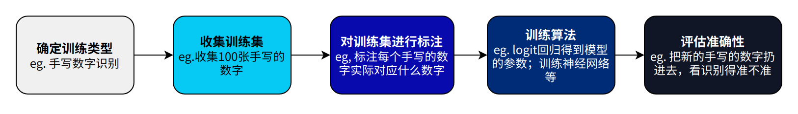
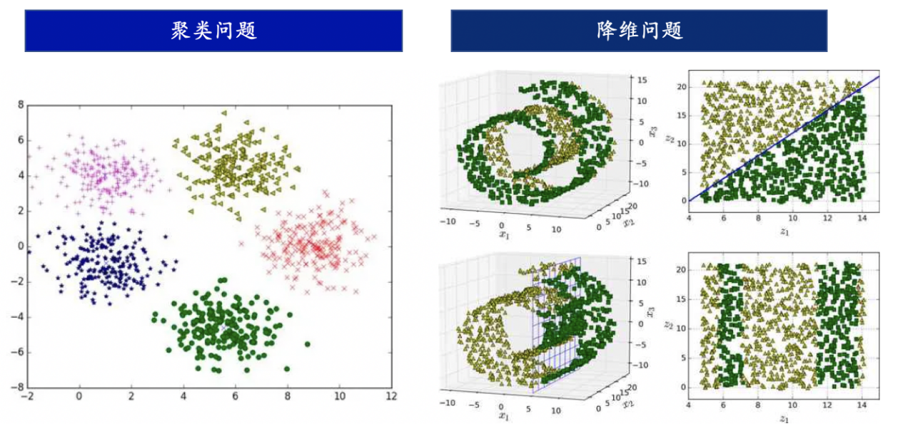
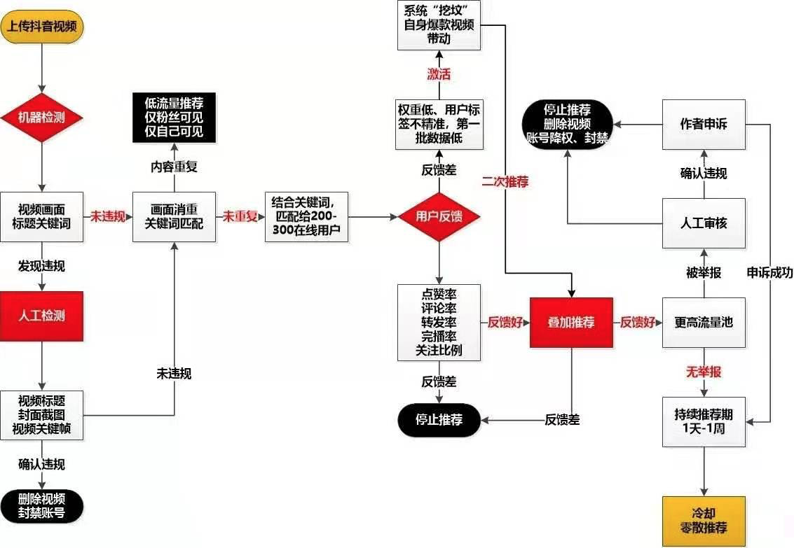
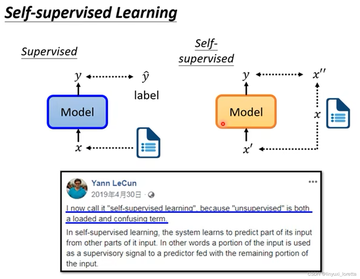
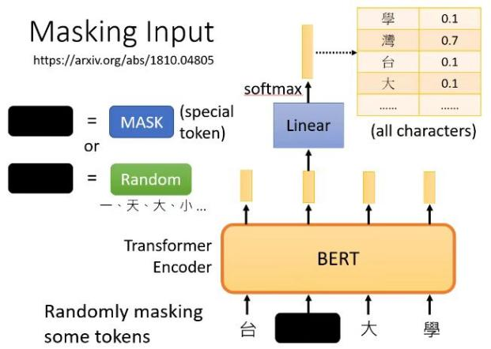

# 86.有监督和无监督学习的区别

## 人工智能概念与分支
+ 人工智能（Artificial Intelligence）是让各类机器载体上模拟并拥有类似生物的智能，让机器可以进行感知、学习、识别、推理等行为的计算机科学技术。
+ 人工智能是计算机科学的分支，涉及领域包括计算机视觉（Computer Vision，CV）、自然语言处理（Natural Language Processing，NLP）、语音识别（Voice Recognition）、语音生成（Text to Speech，TTS）、知识图谱（Knowledge Graph）等。本文档系大语言模型入门材料，因此主要关注NLP领域的技术。
+ 从学术角度来看，人工智能有三大学派：符号主义（Symbolicism）、联结主义（Connectionism）、行为主义（Actionism）。
+ 机器学习是人工智能的核心，现在最前沿的AI技术的主流算法都是基于神经网络和强化学习。

| **学派分类** | **符号主义** | **连结主义** | **行为主义** |
| :---: | :---: | :---: | :---: |
| 思想起源 | 数理逻辑：基于统计方法，通过建模预测让机器通过计算来模拟人的智能，实现识别、预测等任务 | 仿生学：生物智能是由神经网络产生的，可以通过人工方式构造神经网络，训练神经网络产生智能。 | 生物的智能来自对外界的复杂环境进行感知和适应，通过与环境和其他生物之间的相互作用，产生更强的智能。 |
| 代表算法 | 朴素贝叶斯，逻辑回归，决策树，支持向量机 | 神经网络 Neural Network | 强化学习 Reinforcement Learning |

## 机器学习
+ 机器学习（Machine Learning,ML)是实现人工智能的核心方法，是从有限的观测数据中“学习”（or“猜测”）出一个具有一般性的规律，并利用这些规律对未知数据进行预测的方法。
+ 传统的机器学习主要关注如何学习一个预测模型，一般需要首先将数据表示为一组**特征（Feature**），特征的表示形式可以是连续的数值/离散的符号等形式。而后将这些特征输入到预测模型，并输出预测结果。这类机器学习可以看作是**浅层学习（Shallow Learning）**，其重要特点是不涉及特征学习，其特征主要靠人工经验或者特征转换方法来提取。

## 机器学习的分类：根据学习范式分类
根据学习范式的不同，机器学习可分为有监督学习、无监督学习、自监督学习和强化学习

### 有监督学习 Supervised Learning
#### 有监督学习的基本定义
+ **有监督学习（Supervised Learning）：**是机器学习中一种常见的学习范式，其基本思想是利用带有标签的训练数据来训练模型，从而使其能够从输入数据中学习到输入与输出之间的映射关系，然后可以利用这个映射关系对新的未标签数据进行预测**。 <**_**是不是很像人通过刷题的学习过程？**__用带了标准答案的习题集去刷题，如果做错了就根据错误的原因反思改进。当新的题目到来时，便可根据过去刷题的经验来去写新的题目。_**>**
+ 有监督学习的训练集要包括**输入（特征）**和**输出（目标）**，其中，输出是人工标注的。
+ 有监督学习的例子：训练一个模型用于识别一个公司的财务报表是否有财务舞弊：有1000份财务报表，每份报表上体现了资产负债率、现金流量等关键数据，我们用X指代。报表有500份舞弊的和500份没有舞弊的。
+ 那么，我们就有一个1000个样本的**训练数据集**；X是每个训练样本的**输入**或者**特征；**该样本是否舞弊则是**由人工标注**的**输出**或者**目标。**<u>对于每一份输入的训练数据，都是有一个确定的预期输出结果的，因此称为“有监督”。</u>我们可以称这样的训练样本为“带标签的输入、输出对”。
+ 利用这个训练数据集，我们对算法进行训练。整体而言，训练出了一个函数f(X)，他“学习”了训练集中f(X1) = 舞弊，f(X2) = 正常，f(X3)=正常，f(X4) = 舞弊， ……，f(X1000)=舞弊的信息。当我们给出一份新的报表时，他也可以帮我们判断这个报表是舞弊的还是正常的了。
+ 有监督学习的步骤如下：

#### 有监督学习的典型应用
| 1. **分类（Classification）**：预测输入样本属于哪个类别或者类别的概率分布。典型的例子包括垃圾邮件分类、图像分类等。 2. **回归（Regression）**：预测输入样本的数值输出，通常是连续的实数值。典型的例子包括房价预测、股票价格预测等。 3. **目标检测（Object Detection）**：在图像或者视频中检测出目标物体的位置和类别。例如自动驾驶中识别出道路上的车辆、行人、交通标志等；或者人脸识别中判断出哪一部分是人脸。 4. **序列生成（Sequence Generation）**：根据输入的序列生成输出的序列，如机器翻译、音乐生成等。 5. **序列标注（Sequence Labeling）**：序列标注是一种常见的机器学习任务，其中输入数据通常是序列数据，例如文本、语音、生物信息学等。有监督学习可以对输入的序列中的每个元素进行标签预测，如命名实体识别（Named Entity Recognition，NER，指自然语言处理中，能从文本中提取如人名、地名、组织名、日期、时间、金额等具有特定意义的实体或实体类别）、语音识别（Speech Recognition）等。 |
| :--- |

#### 常见的有监督学习的算法
+ 常见的有监督学习算法包括线性回归（Linear Regression）、逻辑回归（Logistic Regression）、决策树（Decision Trees）、支持向量机（Support Vector Machines）、随机森林（Random Forests）等。
+ 这里提到的大多数算法我们都不需要看，关注神经网络即可。

### 无监督学习 Unsupervised Learning
#### 无监督学习的基本定义
+ **无监督学习（Unsupervised Learning）**是机器学习中一种常见的学习范式，其目标是从未标记的数据中自动地发现数据中的结构、模式、关联或者表示，而无需使用人工标签或者先验知识的指导。
+ 在无监督学习中，算法需要从数据中自动地进行学习，无需先知道数据的标签或者类别信息。无监督学习面临的挑战在于缺乏带有标签的训练样本来指导学习过程，因此需要自动地从数据中发现模式和结构。

+ 无监督学习的例子：根据购物习惯，对客户进行分类。假设有一大组顾客的购物数据，包括他们的购买金额、购买时间、购买商品等信息。这些数据并没有被事先标记或分类。通过应用无监督学习算法，如k-means聚类算法或层次聚类算法，<u>我们可以自动识别出具有相似购物行为的顾客群体，并将他们分为不同的簇。这些簇可以对应于不同的消费习惯、购买偏好或市场细分，从而可以帮助企业了解顾客行为并作出相应的业务决策。</u><_这么听起来，无监督学习和数据挖掘是不是有一点像？_>这里是一个聚类问题。
+ 无监督学习的例子：压缩图片。图像通常由大量的像素点组成，每个像素点包含了图像的颜色信息。图像压缩的目标是通过减少图像中的冗余信息，从而减小图像的存储空间或传输带宽，同时尽量保持图像的质量。数据降维是图像压缩的一种方式，通过减少图像数据的维度来达到压缩的目的。无监督学习中的数据降维技术，如**主成分分析（Principal Component Analysis, PCA）**和**自编码器（Autoencoder）**，可以用于图像压缩中。例如，PCA可以通过将图像数据投影到低维空间中的主成分上来实现图像的降维压缩。自编码器则可以通过学习图像的低维表示和重构图像来实现数据的降维和压缩。<_图片压缩不是非得机器学习，但无监督学习确实可以实现图片压缩！_>这里是一个降维问题。

#### 无监督学习的典型应用
| 无监督学习的应用非常广泛，包括但不限于以下几个方面： 1. **聚类（Clustering）**：将数据集中的样本根据相似性进行自动分类，形成不同的簇。典型的例子包括顾客分群、社交网络用户聚类等。 2. **异常检测（Anomaly Detection）**：识别数据中的异常样本，这些样本与正常样本不同，可能是潜在的异常事件或异常行为。典型的例子包括反洗钱、信用卡欺诈检测等。 3. **降维（Dimensionality Reduction）**：将高维数据映射到低维空间，保留数据的主要信息，去除冗余和噪音。典型的例子包括图像压缩等。 4. **关联规则挖掘（Association Rule Mining）**：从大规模数据集中发现频繁出现的关联规则，用于发现数据中的潜在关联关系。典型的例子包括购物篮分析、推荐系统等。 |
| :--- |

#### 常见的无监督学习的算法
这里提到的大多数算法我们都不需要看。

常见的无监督学习算法包括聚类算法如K均值聚类（K-means clustering），降维算法如主成分分析（PCA）、t-SNE等，异常检测算法如基于密度的异常检测（Density-based Anomaly Detection）、基于距离的异常检测（Distance-based Anomaly Detection）等。无监督学习在许多实际应用中都有广泛的应用，如图像处理、自然语言处理、推荐系统等领域。

后文会重点提及以下的无监督学习算法类型：

1. **嵌入学习（Embedding Learning）**：例如词嵌入（Word Embedding）。

### Tik Tok推荐算法：一个有监督学习与无监督学习并用的例子
无监督学习和有监督学习都是机器学习的范式，两者经常在同一个算法中被一同使用。

+ TikTok等产品中使用的推荐算法通常是基于机器学习技术，包括了一系列的无监督学习和监督学习方法。
+ _**在推荐系统中，无监督学习方法可以用于从大量的未标记数据中学习用户行为模式、内容特征等信息，从而为用户提供个性化的推荐**_**。**例如，TikTok的推荐算法可能通过无监督学习方法，如聚类（Clustering）、降维（Dimensionality Reduction）等，对用户上传的大量视频数据进行分析和处理，从中提取出视频的特征，如视频的内容、情感、时长等，并根据用户的观看历史、行为偏好等信息，将相似的视频聚类在一起，从而实现相似内容的推荐。
+ _**监督学习方法也常常用于推荐算法中，通过使用标记的样本数据，**_如用户的历史行为数据（如点击、点赞、评论等）和用户的反馈（如用户的喜好、兴趣等），_**来训练模型进行推荐预测**_。

_<上图中，哪些部分需要用到有监督学习，哪些部分要用到无监督学习，哪些部分需要人工介入呢？>_

综上，TikTok等产品中使用的推荐算法通常是综合应用了多种机器学习技术，包括无监督学习和监督学习方法，通过从大量数据中学习用户兴趣和内容特征，为用户提供个性化的推荐体验。

### 自监督学习 Self-supervised Learning
自监督学习本身是无监督学习的一种范式，因为它也不需要人工去打标签；但在体现出来的能力上，自监督学习和无监督学习非常不一样，因此在这里做单独介绍。

+ 自监督学习主要是利用辅助任务（Pretext）从大规模的无监督数据中挖掘自身的监督信息，通过这种构造的监督信息对网络进行训练，从而可以学习到对下游任务有价值的表征。

这样写会比较抽象，但可以参考下图：

左图展示了自监督学习和有监督学习的区别：例如，一段文字：“白银说的话就像是一位癌症晚期患者说的话。他都已经这样了,你为什么不顺从他，你总得给人留一段美好的回忆吧，最后的时光里。”，一个有监督任务就是判断这句话是否有害。这句话当然有害，但机器不可能自动学习出它有害，我们需要人工给他打上“有害”的标签。

但如果是无监督学习任务，例如完形填空，机器就可以这么做：把上面这段文字先变成“白银说的话就像是一位癌症晚期患者说的话。他都【Masked】经这样了,你为什么【Masked】顺从他，你总得给人留一段美好的回忆吧，最后的时光里。”输入给模型，要求模型去预测两个被遮掩的词是什么。而被遮住的这两个词是一个**Ground Truth**，它不需要任何人做判断，根据输入给机器的原文我们就知道这两个Masked标识对应的得是“已”和“不”。这样一来，机器就可以根据一个预训练任务，对输入的样本自动产生新的输入x'，自动产生标注x''，并且用于学习了。

|  |  |
| :---: | :---: |

右图是BERT中的一个自监督学习的应用：输入“台湾大学”后，机器随机的遮住了一个词，这里遮住了“湾”。而后机器要去做“预测这个被遮住的词应该是什么”的任务，而且任务的标准答案机器当然知道，就是“湾”字。因此，机器就可以自动比较自己输出的答案和标准答案差在哪儿，从而去更正自己了。

| 不要看自监督学习好像很容易理解，事实上它是一个非常天才的想法。这件事后续的第八章中，我们会首次接触到自监督学习。 |
| :--- |

> 更新: 2025-09-22 09:58:29  
> 原文: <https://www.yuque.com/aaron-wecc3/dhluml/damagi7rng9pg0bm>