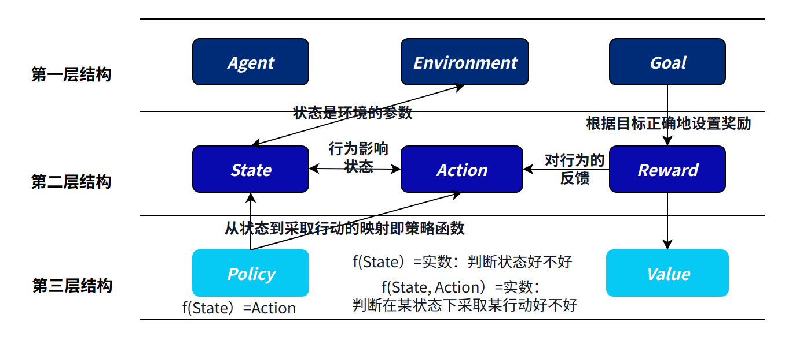

# 87.强化学习的关键特点和应用

### 常见面试题
1. 强化学习的基本定义
2. 强化学习的典型应用
3. 常见的强化学习的算法

### 强化学习的基本定义
+ 强化学习（Reinforcement Learning）是一种机器学习方法，用于通过玩家（Agent）与环境（Environment）的交互来学习如何做出合适的决策，以最大化预期的累积奖励。
+ 在强化学习中，Agent通过与环境的相互作用，观察环境的**状态（State）**，执行不同的**动作（Action**），接收环境的反馈（奖励信号，**奖励Reward**），并根据反馈来调整其行为**策略（Policy）**，从而逐渐学习如何在不同的环境中做出最优的决策。

_**强化学习的关键特点包括以下几点：**_

1. **Environment和State：**强化学习中的Agent与Environment进行交互，Agent通过观察Environment的State来感知环境的变化并进行决策。（eg. 我们开车的时候与我们所看到的路况进行交互，根据路上的行人、其他汽车、指示牌等的状态，选择怎么去打方向盘。那么整个汽车所在的公路就是Environment，公路上具体的路况就是State）
2. **Action和Policy**：Agent可以采取不同的Action来影响Environment的State。那么在什么样的State下，Agent要采取什么样的Action？Agent是基于一定的策略Policy来选择要执行的Action的，而这个Policy往往是一个以当前State为自变量，要执行的Action为输出的一个函数。（eg. 我们在路上怎么打方向盘，就是Action。在什么样的路况下我们会怎么去打方向盘，就是Policy。我们打方向盘这件事情会影响环境的状态；而环境的状态改变又会返回来决定我们该怎么打方向盘。）
3. **Reward和Goal**：环境向Agent提供奖励信号，用于反馈Agent的行为质量。Agent的目标是通过最大化预期的累积奖励，以此来学习如何做出最佳决策。（eg. 路边的其他车会向你打鸣告诉你你开的不好，违规了的话交警会对你处罚，这就是一个负的Reward。你的Goal可能是以最快的速度最安全、不违规的到达目的地，你通过不断的与环境交互，学习出一个最佳的开车Policy，从而实现这个目标。）
4. **试错学习和优化**：强化学习中的Agent通过与环境的交互来不断学习和优化其策略，这是一个不断试错的过程，State和Action之间的往复交互是强化学习的主体部分，所以是Trial and Error Learning。强化学习的最终目标是一个好的策略。
5. **价值决定策略**：价值，就是预期将来会得到的所有奖励之和。（eg. 下围棋的时候，如果一步棋决定了胜局，那么这步棋就特别有价值！）_<价值有两个函数——State Value Function和Action Value Function, 这里先不细说，后面有专门的章节来介绍强化学习及其简单的数学表示！>_

_这个图里面提到了Value，即价值；后续会提到！_

强化学习不要求预先给定任何数据，而是通过接收环境对动作的奖励（反馈）获得学习信息并更新模型参数。

强化学习是除了监督学习和非监督学习之外的第三种基本的机器学习方法。与监督学习不同的是，**强化学习不需要带标签的输入输出对，同时也无需对非最优解的精确地纠正。**其关注点在于寻找探索（对未知领域的，Exploration）和利用（对已有知识的，Exploitation）的平衡。后文会详细去讲Exploration vs Exploitation的Trade-off，此处先快速跳过。

### 强化学习的典型应用
1. 自动驾驶车辆：强化学习在自动驾驶领域中也得到了广泛应用，例如通过训练智能车辆在不同道路条件下学习驾驶策略，包括避免碰撞、减少能耗等。（自动驾驶中既要用有监督学习的图像识别技术去理解当前的State，又要用RL的技术去不断优化驾驶策略）
2. 游戏与游戏玩家：强化学习被广泛用于电子游戏中，例如通过训练智能代理在复杂的游戏环境中进行游戏策略决策，如围棋、国际象棋等。同时，强化学习还可以用于训练游戏中的虚拟角色，使其能够自主学习和优化其行为策略。（eg. AlphaGo)
3. 机器人控制：强化学习在机器人领域中有广泛的应用，包括自主导航、机器人手臂控制、无人机控制等。通过强化学习，机器人可以从与环境的交互中学习控制策略，以完成复杂的任务。

### 常见的强化学习的算法
强化学习的算法整体分为价值学习、策略学习、Actor-Critic Method. 后面再讲！

> 更新: 2025-09-22 09:58:29  
> 原文: <https://www.yuque.com/aaron-wecc3/dhluml/xf23iy5wpbwgp227>