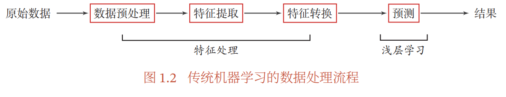
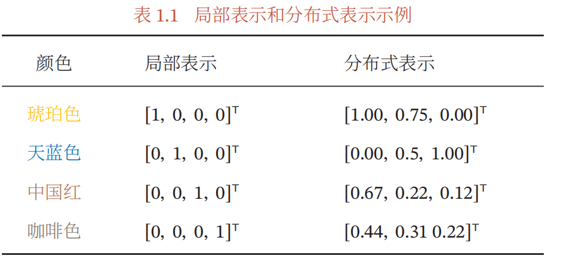
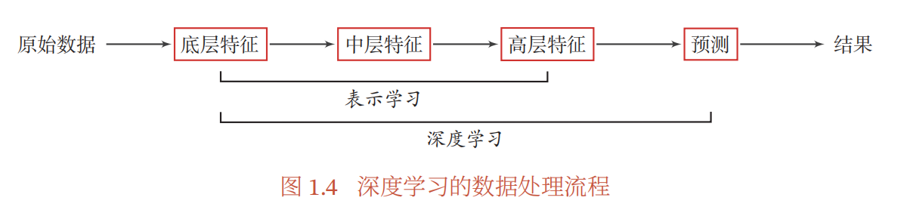

# 88.浅层学习和深度学习面试题

## 常见面试题
1. 浅层学习的基本定义
2. 特征与特征工程
3. 深度学习 表示/表征/局部表示
4. 分布式表示与表征学习
5. 深度学习的定义
6. 端到端学习

## 浅层学习（Shallow Learning）
机器学习的分类：根据网络的深度和复杂性分类

浅层学习通常指的是使用较少层次、较简单结构的机器学习模型，例如传统的线性回归、逻辑回归、决策树、支持向量机等。这些模型通常只有一层或者很少的层，且每一层的特征表示较为简单和浅显，不具备较强的抽象能力。

#### 浅层学习的基本定义

_图源邱锡鹏《神经网络与深度学习》，下同_

+ 浅层学习（Shallow Learning），也称为表面学习或者传统学习，是一种机器学习方法，其主要通过构建浅层的、较简单的模型来进行模式识别、分类、回归等任务。
+ 浅层学习方法通常包括传统的统计学习方法，如逻辑回归（Logistic Regression）、决策树（Decision Tree）、支持向量机（Support Vector Machine）、朴素贝叶斯（Naive Bayes）等，以及一些非线性模型，如K近邻（K-Nearest Neighbors）和随机森林（Random Forests）等。**这些方法通常基于人工设计的特征（即特征工程），通过对特征进行处理和选择来构建模型，并利用这些模型进行预测和分类**_**。**_
+ 相对于深度学习（Deep Learning）而言，浅层学习通常采用较简单的模型架构和较少的层次结构，不涉及复杂的深层神经网络结构。

_#浅层学习最大的特点就是特征是人工设计的，通过特征工程，去依据原始数据，决定模型的输入。_

#### 特征（Feature）
+ **特征（Feature），是指从原始数据中提取出的、用于表示样本的属性或信息。**（eg. 想起有监督学习任务里我们提到的财务舞弊识别的例子了吗？一份财务报表有一堆信息，机器是看不懂的。我们可能会利用财务报表，计算出资产负债率、流动比率指标，作为浮点数输入给机器。那么资产负债率和流动比率就是我们选出来的财务报表的特征！）
+ 在机器学习模型中，特征被用作模型的输入，用于表示样本的不同属性，从而帮助模型进行学习和预测。**因此，首先要将数据表现为一组特征，而后才能将其输入，进行机器学习。**
+ _#特征说白了就是你基于原始信息，具体给机器喂了些什么。_

#### 特征工程（Feature Engineering）
特征工程（Feature Engineering）是指在机器学习和数据挖掘中，通过对原始数据进行处理、转换和提取，生成新的特征或选择合适的特征，从而改进模型性能和提高预测准确性的过程。

Eg. 如果想要建立起一个识别财务报表是否舞弊的模型：f(财报的特征）=是否舞弊，那么输入给模型的参数的选择有很多：资产负债率、盈利质量、流动比率、速动比率等等。

_#那么选择哪些参数、输入多少参数输入给模型，其实都会对模型最后的识别性能有很高的影响。这个挖掘和选择特征的过程就是特征工程。_

## 深度学习（Deep Learning）
在解释什么是深度学习之前，我希望先讲清楚表征与表征学习。

### 表示/表征（Representation）
表示（Representation）则通常指的是将数据以某种形式进行编码或者表示的方式，可以是在特征空间中的表示，也可以是在其他空间中的表示。在深度学习中，表征通常是由模型自动学习得到的，例如通过神经网络的隐藏层进行特征提取和表示学习（后面讲MLP的时候就会提到）。这种自动学习的表现通常比手工设计的特征更能够捕捉数据中的复杂模式和关系，从而提升模型的性能。

### 局部表示 Local Representation
局部表示，也称为离散表示或符号表示。 以颜色表示为例，我们可以用很多词来形容不同的颜色1，除了基本的“红” “蓝”“绿”“白”“黑”等之外，还有很多以地区或物品命名的，比如“中国红”“天蓝色”“咖啡色”“琥珀色”等．如果要在计算机中表示颜色，一般有两种表示方法．** 如果以不同名字来命名不同的颜色，这种表示方式叫作局部表示。**

局部表示通常可以表示为One-hot向量的形式，假设假设所有颜色的名字构成一个词表 𝒱，词表大小为 |𝒱|．我们可以用一个|𝒱|维的one-hot向量来表示每一种颜色．在第𝑖种颜色对应的one-hot向量中，第𝑖 维的值为1，其他都为0．

例子参考下表，展示了琥珀色、天蓝色、中国红、咖啡色的局部表示方式。 

在后续讲到自然语言处理时，就会提到，早期的语言模型中我们主要用one-hot向量来作为词汇的表征。

 局部表示有两个优点：

1）_**这种离散的表示方式具有很好的解释性**_，有利于人工归纳和总结特征，并通过特征组合进行高效的特征工程；

2）通过多种特征组合得到的表示向量通常是稀疏的二值向量，当用于线性模型时计算效率非常高．

但局部表示有两个不足之处：

1）one-hot向量的维数很高（_**维度爆炸**_），且不能扩展．如果有一种新的颜色，我们就需要增加一维来表示；

2）_**不同颜色之间的相似度都为0，因为这些向量全部正交**__。_即我们无法知道“红色”和“中国红”的相似度要高于“红色”和“黑色”的相似度。

### 分布式表示（Distributed Representation）
**分布式表示是一种将数据表示为多维向量的方法，其中每个维度都包含有关数据的一部分信息**。

例如，我们用RGB值来表示颜色，不同的颜色对应到R、G、B三维空间中一个点，这种表示方法即为分布式表示。分布式表示通常可以表示为低维的稠密向量，参考上图。

分布式表示在深度学习中得到广泛应用，例如在神经网络中使用嵌入层（Embedding Layer）对输入数据进行分布式表示（嗯，后面学到词向量的时候就会用到了）。

相比于让所有颜色的名字构成一个词表 𝒱，_**我们现在用一个三维的向量就可以表示出所有的颜色了。**_

此外，_**不同的颜色之间的相似度也变得很容易计算，只需要去算他们的余弦相似度/欧式距离等就可以了。**_

_**分布式表示具有许多优势，例如能够更好地捕捉数据的多样性、泛化性能较好、能够处理未知数据等**_。例如，在自然语言处理中，分布式词向量（如Word2Vec、GloVe等）将单词表示为多维向量，每个维度都包含了单词在不同语义和语法属性上的信息，从而在词汇表很大的情况下，能够更好地表示单词之间的语义和语法关系。

### 表征学习（Representation Learning）
+ **表征学习（Representation Learning）是一种****<u>自动化</u>****地从原始数据中学习有效的特征表示的方法。**它通过深度神经网络等模型，从原始数据中自动学习层次化、抽象化的特征表示，而无需手工设计特征。表征学习能够从数据中提取出更丰富、更高级的特征，从而更好的描述数据，有助于提高模型的性能和泛化能力。
+ 要学到一种**好的高层语义表示（一般是分布式表示）**，通常需要从底层特征开始，经过多步骤的非线性转换才能得到_（#之所以要是非线性，是因为连续多次的线性转换归根到底还是等价于一次线性转换）_。表征学习与深度学习天然相关，因为深度神经网络所具有的深层结构的优点是可以增加特征的重用性，从而指数级的增加表示能力。**因此，表征学习的关键是构建具有一定深度的多层次特征表示。**

### 深度学习的定义
+ 深度学习是一种使用深层次、复杂结构的神经网络模型进行学习的方法。深度学习模型通常有多个层次（通常超过3层）的神经元组成，每一层的输出作为下一层的输入，从而形成层层叠加的结构。深度学习模型可以通过在多个层次上学习到更加抽象和高级的特征表示，从而能够更好地捕捉数据中的内在结构和特性。
+ 为了学习一种好的表示，需要构建具有一定“深度”的模型，并通过学习算法来让模型自动学习出好的特征表示（从底层特征，到中层特征，再到高层特征），从而最终提升预测模型的准确率。所谓“深度”是指原始数据进行非线性特征转换的次数．如果把一个表示学习系统看作一个有向图结构，深度也可以看作从输入节点到输出节点所经过的最长路径的长度．

+ 图1.4给出了深度学习的数据处理流程．通过多层的特征转换，把原始数据变成更高层次、更抽象的表示．这些学习到的表示可以替代人工设计的特征，从而避免“特征工程”．

_**#嗯，按照邱锡鹏老师的说法，深度学习可以通过底层特征、中间特征、高层特征的表示学习，去避免浅层学习中在做特征处理（特征提取、特征选择）时的特征工程的。**_

### 端到端学习(End-to-End Learning)
#### 传统机器学习：多个子模块
+ 在一些复杂任务中，传统机器学习方法需要将一个任务的输入和输出之间人为地切割成很多子模块（或多个阶段），每个子模块分开学习。比如一个自然语言理解任务，一般需要分词、词性标注、句法分析、语义分析、语义推理等步骤。

_**这种学习方式有两个问题：**_

+ 一是每一个模块都需要单独优化，并且其优化目标和任务总体目标并不能保证一致；
+ 二是错误传播，即前一步的错误会对后续的模型造成很大的影响．这样就增加了机器学习方法在实际应用中的难度．

#### 端到端学习（End-to-End Learning）的定义
端到端学习，也称端到端训练，是指在学习过程中不进行分模块或分阶段训练，直接优化任务的总体目标．在端到端学习中，一般不需要明确地给出不同模块或阶段的功能，中间过程不需要人为干预．端到端学习的训练数据为“输入-输出”对的形式，无须提供其他额外信息．因此，端到端学习和深度学习一样，都是要解决贡献度分配问题．目前，大部分采用神经网络模型的深度学习也可以看作一种端到端的学习．

_#简单的说，可以把端到端学习理解为，处理一个复杂的任务时，我们不做任务拆分，而是把它整个作为一个巨大的黑箱，我们只关注输入和输出对，并基于输出情况对这个黑箱进行调整。_

> 更新: 2025-09-22 09:58:29  
> 原文: <https://www.yuque.com/aaron-wecc3/dhluml/az0exuwracr8p2w0>