# 89.神经网络结构面试题

### 常见面试题
1. 简单聊一聊神经网络
2. 为什么让机器产生智能这么难？
3. MNIST手写数据集的特征：把一张图表示为一个784维的向量！
4. 什么是神经元（Neuron）？
5. 神经网络的结构
6. 输入层/输出层/隐层？
7. 我们指望隐层能做到什么？
8. 权重矩阵

### 神经网络概述：从MNIST手写数据集开始！
### 语义鸿沟：为什么让机器产生智能这么难？ 
下面是几个手写的数字，像素非常低。人脑可以很轻易的看出来这些数字是3、7、6，但让计算机去识别出手写的数字和文字，却一直是个老大难题。_<想起初高中教材里的OCR了吗>_。

|  | 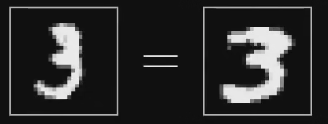 |
| :---: | :---: |

更鬼扯的事情是，上图中的两个数字3，投射到人的视网膜中之后，可以说是非常不一样，但人脑就是可以认识到，这两个手写的数字都是3。

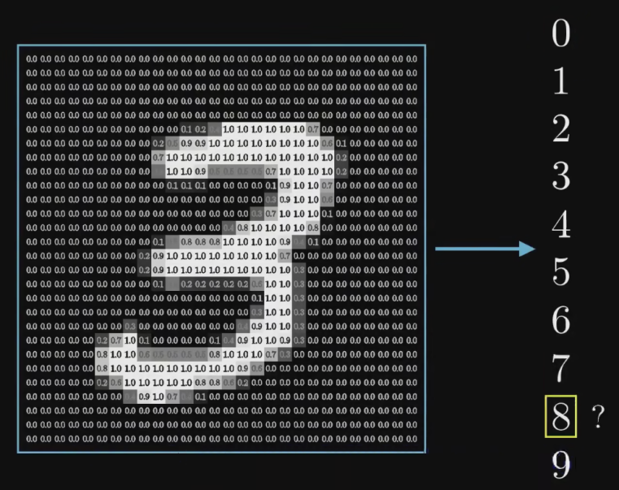

_上图就是让机器认识一个手写的0～9的数字，是不是很难？_

尽管人眼可以很轻易的去手写的数字，但如果我们把随便一张由人来手写的个位数字扔给计算机，让计算机从0～9中判断出来我们写的数字是哪一张，这件事就会变得非常困难。人类通过视觉感知能够轻松地理解图像中的内容（一张手写的3；一张路况图里的指示灯，行人和汽车），包括物体、场景、语义信息等，并能够从图像中提取高级语义特征，如物体的形状、颜色、纹理、空间关系等；但是，计算机在处理图像时通常只能看到一些低级的视觉特征，如像素值、颜色直方图、边缘等，并且缺乏对图像高级语义信息的理解能力。**我们称这种人机差异为“语义鸿沟（Semantic Gap）”。**

### MNIST手写数据集的特征：把一张图表示为一个784维的向量！
Hey，还记得在_1.4.1.2_中我们提到的定义特征（Feature）吗？现在我们要开始思考这个问题了！

对于一张黑白的手写的数字，我们应该以什么作为它的特征，输入给机器让他学习呢？答案是，构成这张图的28*28=784个像素点的灰度！对于每一个像素，我们都给他赋一个从0到1的值。**一个像素点越黑，他就越接近0；一个像素点越白，他就越接近1。那么……**

_密恐警告！！_

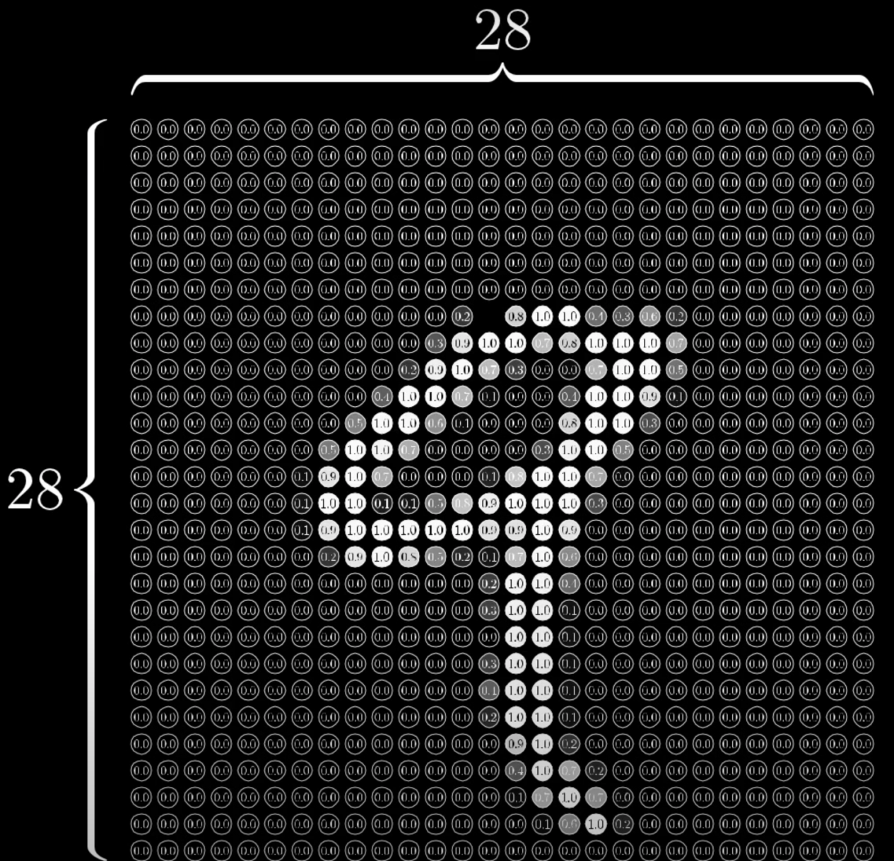

_其实很多东西，不管是图像，还是语音，本质上都可以拆分为许多许多个小块。_

_当我们用机器学习来解决实际任务时，会面对多种多样的数据形式，比如声音、图像、文本等，不同数据的特征构造方式差异很大。对于图像这类数据，我们可以很自然的将其表示为一个连续的向量。对于这个手写数字的例子，我们就很自然的按照像素点，把图像表达成了一个784维、每个元素都是介于0到1之间的实数的向量！_

**嗯，结论就是，这一张图被我们表示为了一个784维的、每个元素都在0到1之间的向量，接下来我们会把这个向量输入给神经网络的第一层，后者相应的会有784个神经元！但是什么是神经元呢？**

### 什么是神经元（Neuron）？
#### 机器学习中的神经元是对人脑的神经细胞的一种模仿
_#大脑的神经细胞（也称为神经元）可以产生认知，因为它们通过复杂的网络连接和相互作用，形成了高度结构化和动态的神经网络，能够处理和整合信息，产生复杂的认知功能。__**神经元和神经网络其实是对人脑结构的一种模仿。**__在人脑中，神经元或神经细胞是构成大脑、脊髓和周围神经系统的基本单元，神经元通过在树突接收神经信号，经过细胞体的处理和集成，然后通过轴突传递神经信号到其他神经元或效应器，从而完成神经系统内的信息传递和处理，形成了复杂的神经网络。_

#### 神经元是人工神经网络的基本构成单位，本质上是一个函数的组合，包括了输入加权和求和操作以及激活函数（Activation Function）
+ 神经元（或称为人工神经元，Artificial Neuron）是一种数学模型，用于模拟生物神经元的计算单元。神经元通常作为神经网络的基本组成单位，用于构建人工神经网络（Artificial Neural Networks, ANN）。在这个手写数字的案例中，我们可以先把神经元视为一个装着0～1的数字的容器。
+ 在机器学习中，神经元通常表示为一个接收输入数据的函数，对输入数据进行处理，并生成输出。
+ **神经元接收多个输入值（通常用向量表示），对输入值进行加权求和；然后通过一个激活函数（Activation Function）进行**_**非线性映射**_**，生成神经元的输出。**

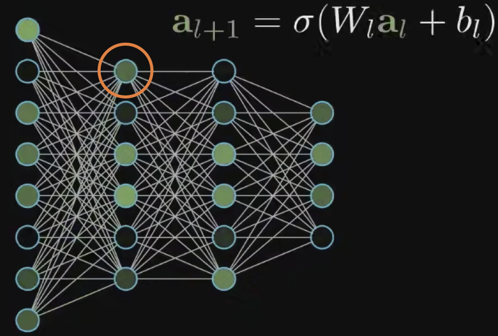

_**Q：什么是加权求和？**_

A：参考上面这张图，橙色的圈圈住了的这个神经元a9，连接了上一层的8个神经元a1~a8。那么，a1～a8里装着的数字都会被输入到a9里去。对于a1～a8的每一个值，神经元a9都会为其赋予一个权重w1～w8。那么，神经元a9的加权求和即为：。这称为神经的加权输入/激活前的值（Weighted sum)。

_**OK，现在回过头看看这张神经网络。上面的每条线，都代表一个权重！**_

_**这么看的话，每一个神经元都和其上一层的所有神经元相连；而权重的大小，则形容了连接的强弱！！**_

_**Q：什么是激活函数？**_

A：激活函数通常作用于神经元的加权输入/激活前的值（weighted sum），并产生一个非线性的输出值，作为神经元的激活状态，用于传递给下一层神经元或作为输出层的最终输出。

常用的非线性函数包括：

1. **Sigmoid函数：将输入映射到[0, 1]之间**，常用于二分类问题或者作为输出层的激活函数。
2. **Tanh函数：将输入映射到[-1, 1]之间**，也常用于二分类问题或者作为输出层的激活函数。
3. **ReLU函数（Rectified Linear Unit）：将负数输入映射为0，保留正数输入**，常用于隐藏层的激活函数。
4. **Softmax函数：将输入映射为概率分布**（输出的向量的每一个值都为正而且元素之和为一）。常用于多分类问题的输出层。

在手写的例子中，我们可以先用Sigmoid函数，那么神经元a9之中发生的事情就为：，其中

是对括号内的数字进行Sigmoid运算的意思。这里多出来了一个b，我们称之为偏置（Bias），因为我们希望加权之和足够大，才可以让一个神经元得到激活。

_**嗯，那么上图的神经网络中，除了第一层外的那16个神经元，每人都有一个自己的偏置！**_

_**Q：为什么一定要做非线性变换？**_

A：激活函数引入了非线性操作，使得神经网络可以更好地拟合复杂的非线性关系。如果神经网络只使用线性激活函数，那么整个网络将只是多个线性操作的组合，无法处理非线性数据或者学习非线性映射。

神经元的输出可以作为后续神经元的输入，从而构成了神经网络的层次结构。通过在神经网络中连接大量的神经元，并通过训练来优化神经元之间的连接权重，人工神经网络可以在大量数据上进行学习和预测，广泛应用于机器学习和深度学习任务，如图像识别、语音识别、自然语言处理等。

### 神经网络的结构
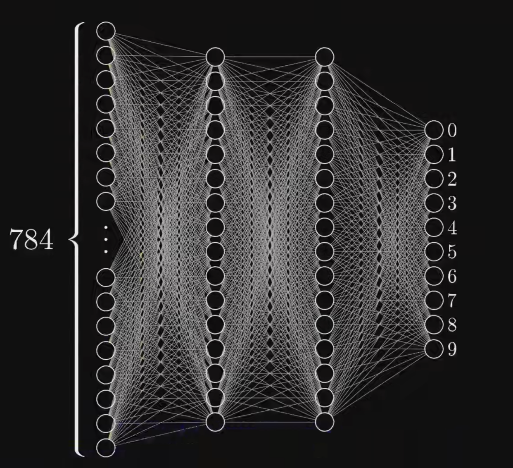

#### 输入层和输出层：非常好理解！
+ 在前面的2.1.2里我们提到了，我们把一张手写的数字表示成了一个784维的向量，那么我们给向量的每一个元素都匹配一个神经元，那么输入层就有了784个神经元。输入层负责接收输入数据。
+ 因为我们要做一个0～9的数字的输出，所以输出层有10个神经元。输出层负责产生网络的输出。对于上述的这个神经网络，最后0～9对应的每个神经元都会有一个值的大小，我们可以选择值最大的神经元对应的数字进行输出。

#### 但是什么是隐层？
在人工神经网络 ANN中，**隐层（Hidden Layer）是位于输入层和输出层之间的一层或多层神经元的集合。**作为神经网络中的中间层，隐层负责对输入数据进行特征提取和转换，从而实现复杂的非线性映射关系。

+ 我们做了一个非常随意的设定：在输入层和输出层之间，加入两个**隐层（Hidden Layer)**。每一个隐层有16个神经元，然后我们让每层的每一个神经元都和上一层的所有神经元都相连，就形成了如图的网状结构。如果两层之间，每层的每一个神经元都和另一层的所有神经元都相连，那么我们便称之为**“全连接层**”（Fully Connected Layer）。后面我们还会陆陆续续认识卷积层、池化层、循环层、嵌入层和规范化层，全连接层是我们我们认识的第一个神经网络的层！
+ _**图中这么多的线，每一条都代表了一个权重，一共有784*16+16*16+16*10=12960个权重参数！**_
+ _**图中除了输入层外，有42个神经元，所以一共有42个偏置参数！**_
+ 上述的这12960+42个参数，在最开始都是随机初始化的，最终他们是神经网络在训练过程中，由模型自动学习得到的，而不是人为设置的。**对于这些参数，我们称之为“模型参数（Model Parameters）**”。与模型参数相对的是“超参数”，后面会讲！

#### 我们指望隐层能做到什么？
| 我们希望隐层能够对输入的数据进行特征提取和转换，从而实现复杂的非线性映射关系。 参考右图，我们可能认为，人之所以可以认识9和8，是因为9是由一个圈儿和一竖构成的；8是两个圈儿构成的。那如果要让机器去认识9和8，是不是也能让机器去识别、提取出这些特征呢？ **理想情况下**，我们希望第一个隐层可以先识别出圈圈、横、竖，第二个隐层可以对他们进行组装，从而知道这是哪一个数字，并且在输出层告诉我们。 | 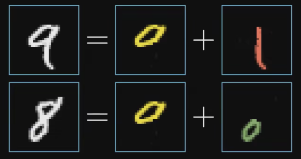 |
| :--- | :---: |

| 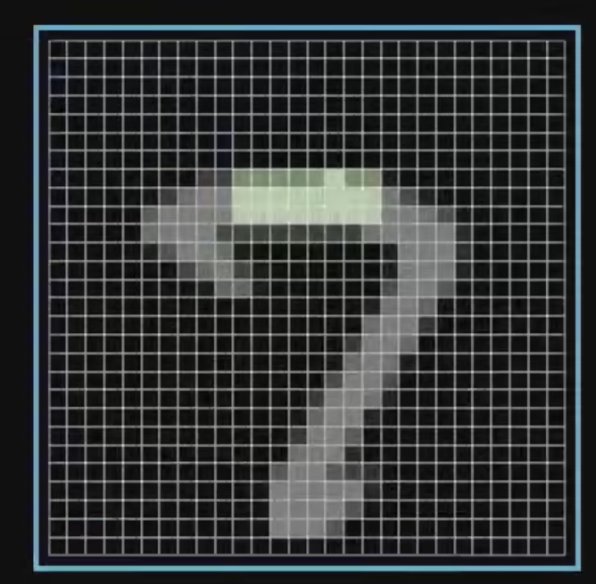 | 对于左图的手写的“7”，我们可能会让机器去识别7的一条边（一横）。 有没有可能是这样：如果图中绿色的位置的像素对应的向量元素的大小都离1很接近，而绿色位置上下的像素对应的向量元素的大小都很接近0，那么我们就可以识别出来一条横边呢？ 这样的话，我们就可以把那些我们希望离1近一些的像素对应的向量的权重赋值为正，把绿色区域上下的像素对应的向量的权重变成负的。 这样的话，如果真的写了一横，产生的加权 就最大了！ _<当然，事实上神经网络识别出来的特征我们人类根本看不懂！但寄希望于让隐层去提取特征，是没错的！>_ |
| :---: | :---: |

隐层的存在使得神经网络具有强大的表达能力，能够处理复杂的非线性关系，并从输入数据中自动提取有用的特征。隐层的神经元数量、激活函数的选择以及层次结构的设计等因素都会对神经网络的性能和学习能力产生影响，因此在设计和训练神经网络时，隐层的设置通常需要经验和调优。

#### 整个神经网络，就是一个有13002个可调节参数的超级大函数！
因为每条线都代表一个权重参数，每一个非输入层的神经元又都有一个自己的偏置，所以光是这个非常基础简单的神经网络，都有13002个参数可供调节。

所以，当我们讨论机器如何学习的时候，我们其实就是是在讨论：电脑怎么设置对这13002个参数，从而让他能够正确的帮我们解决问题，把一张手写的数字对应的784维向量转化为一个10维的向量的输出，并且输出的向量里最大的那个元素所对应的数字就是我们想要的数字？

_<光是去想象自己手动去不断地设置、调节这13002个参数，就让人感到十分恐怖了！>_

OK，那我们现在来总结一下：

+ 在手写数字识别的案例中，每一个神经元都是一个非线性的激活函数，输入值是输入的向量或者上一层神经网络中所有神经元所代表的数字（0～1）的加权和，对该加权和进行偏置的调节后送给激活函数，产生一个0～1的输出。
+ 整个神经网络由784+16+16+10=826个神经元构成，共有13002个模型参数，整个函数输入一个784维向量，输出一个10维向量。#_这个函数极为复杂，但其实仅仅也是个函数！大多数时候我们把他看成一个能够自动逼近我们想要的函数的黑箱就好了_！

#### 用线性代数的方法简洁表示层与层之间的权重：权重矩阵
+ 下面的公式中，符号a代表一个神经元；a的上标代表了该神经元所在的层；下标代表了该神经元是该层的第几个神经元。这边我们以上标0代表第输入层的784个参数，以上标1代表第一个隐层的16个参数.
+ w代表每两个神经元之间相连的权重，有两个下标，第一个下标是对第二层的神经元的标注，第二个下标是对第一层的神经元的标注。那么，有：

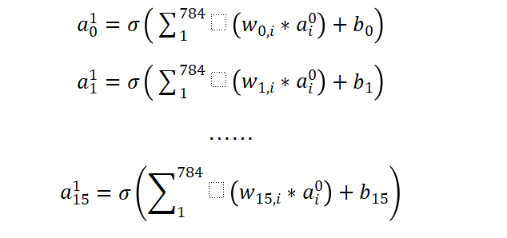

学过线性代数的话就知道，像这样子的式子，如果先不去看外面的的和b的话，可以先表示为一个列向量：

和一个16*784的矩阵：

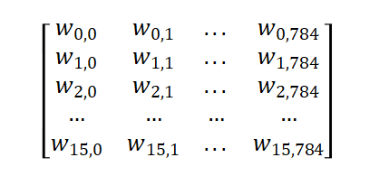

的乘积。那么，通解就参考下图：

| 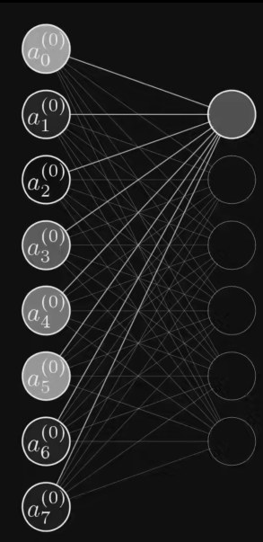 | 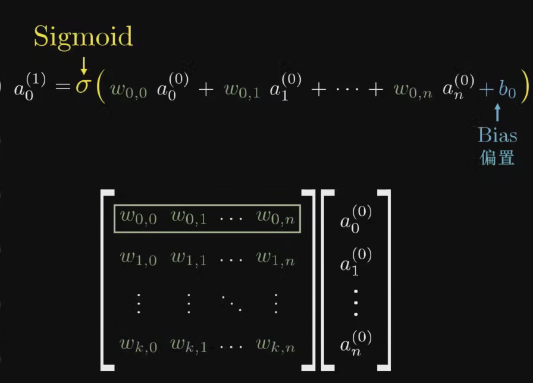 |
| :---: | :---: |

这时候再把b和给算上，就得到下面的式子：

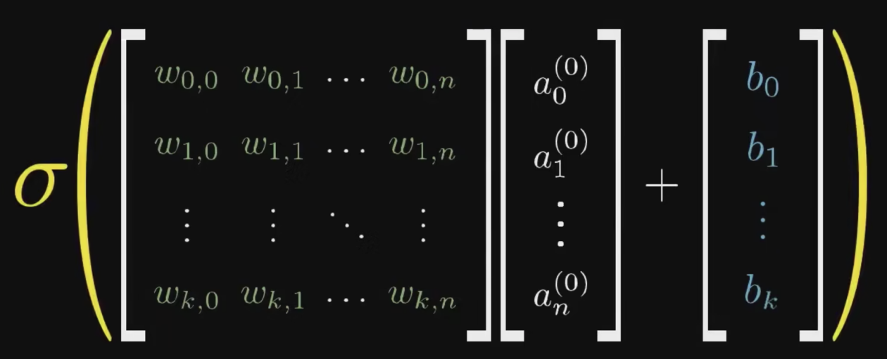

OK，最后我们再用大写的符号来表示左边的们构成的权重矩阵，用小写的和分别来表示两个列向量，用来表示新的一层神经元们的值的列向量。这样，我们就就得到：

以后我们再看到任何一个大写的W，要知道：这就是一个权重矩阵，就像这里一样，没有什么特别的！

我们这边实现了对模型两个层之间的关系的表达，那么对于整个模型，我们应该怎么表达呢？我们知道，整个模型中有多个模型参数：三个权重矩阵和多个偏置。我们常常把全部的参数都放在一个里，把模型表示为：。

模型（Model）是机器学习的三个基本要素（模型、学习准则、优化算法）之一！

> 更新: 2025-09-22 09:58:29  
> 原文: <https://www.yuque.com/aaron-wecc3/dhluml/tliixz7uz16zpkos>