# 90.神经网络训练面试题

## 常见面试题
1. 神经网络的训练
2. 前向传播（Forward Propagation）
3. 梯度下降（Gradient Descent）
4. 模型更新的频率与超参数
5. 反向传播（Backpropagation，BP）
6. 万能逼近定理：MLP可以拟合任何函数
7. MLP总结

## 神经网络的训练
### 前向传播（Forward Propagation）
介绍完神经网络的大致结构，我们就已经对前向传播这件事有一定的了解了！一张图片变成784维向量输入给神经网络的输入层的784个神经元们，而后接下来的第一层隐层根据它的784*16个权重和16个偏置，产生了16个新的输出，送给了下一个隐层；下一个隐层则继续根据16*16个权重和16个偏置，输出16个标量给输出层。最后，输出层在根据自己的10*16个权重和10个偏置，输出10个数字。在神经网络的设计中，我们往往希望输出层输出的是一个概率分布函数，每个值都为正，而总和为1（_这就是一个Softmax层可以做的！_）；然后对于值最大的一个神经元对应的内容（在上面的例子中是数字），就是我们的输出。这就是前向传播！

**前向传播（Forward Propagation）**是一种在神经网络中进行信息传递的过程，它是神经网络训练的第一步。在前向传播中，输入数据通过神经网络的多个层（包括输入层、隐藏层和输出层）按照预定的权重和偏置进行计算，从输入层传递到输出层，最终得到神经网络的预测结果。

### 梯度下降（Gradient Descent）
我们已经搞懂了模型是怎么从输入到产生输出的，但我们真正要解决的机器学习问题在于，怎么让机器自己找到这13002个参数，实现学习的过程？

#### 损失函数（Loss Function）
首先，我们需要去评估模型的表现有多坏。

**损失函数（Loss Function）**，也称为目标函数、成本函数或目标损失函数，是在监督式学习中用来度量模型预测值与真实标签之间差异的函数。

损失函数通常被定义为一个标量值，用于衡量模型的预测值与真实标签之间的误差或损失程度。一个常见的表示损失函数的公式为：

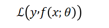

_<嗯，这个符号一出现，就是损失函数的意思！>_

损失函数有很多种，例如：

+ **平方损失函数（Quadratic Loss Function）**:预测值与真实值的差的平方的二分之一。这个函数不适用于分类问题，而适用于预测的输出值是一个实数值的任务中，所以整体而言我们不会和他打太多交道（但是在强化学习的TD算法里，我们会遇到它！！）

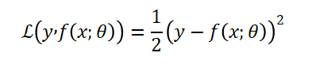

+ **交叉熵损失函数（Cross-Entropy Loss Function）：**

交叉熵损失函数（Cross-Entropy Loss Function）是一种用于测量两个概率分布之间差异的数学函数，常常用于分类任务中，特别是在神经网络中作为损失函数。（我们后面讲的语言模型的损失函数几乎都是交叉熵损失函数！）

数学上，我们考虑模型的输出向量为一个概率分布函数的情况，定义为的输出向量的第C维。一般而言，我们希望正确的输出向量是一个one-hot向量，除了正确的标签对应的元素为1外，所有其他元素都是0.那么，

**交叉熵损失函数定义如下**：

_**语言模型里，我们经常去依据前文的信息去预测下一个单词会是什么；神经网络最后输出的其实也是一个所有词的概率分布。**_此时，交叉熵损失函数可以帮助我们度量模型预测的概率分布与我们真正想要的概率分布之间的差异。

不过现在讲这些可能有点太早**，**我们还是先关注最简单的分类问题。

我们利用模型去判断一张手写的图片是什么数字（0，1，2，3，4，5，6，7，8，9）。假设对于一个手写的数字7，我们希望模型输出的向量就是：

=[0，0，0，0，0，0，0，1，0，0]

_<假设样本的标签是离散的，共有C个；那么我们可以用一个C维的one-hot向量来表示样本标签，这里C=10。假设正确的样本标签为K，那么只有第K维（这里是7）元素是1，其他都是0>_

而模型实际输出的可能是：

=[0.1，0.2，0，0.1，0，0.3，0，0.1，0，0.2]

那么，交叉熵函数为:

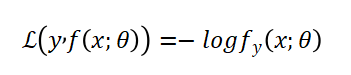

_<想不到吧，就这么简单！就是模型理应输出1的那一维向量的元素的负对数>_

识别的越准，LOSS就会越小。

_**损失函数的input是什么呢？要想清楚这个问题！**_

+ 在MNIST数据集中，损失函数的输入是13002个参数，即前面提到过的模型参数。
+ 损失函数的输出是一个实数。
+ 损失函数的大小取决于模型对训练数据的综合表现。

#### 梯度下降 Gradient Descent
在确定了训练集（MNIST数据集，有60000张训练集图片和10000张测试集图片）、确定了模型并确定了损失函数后，我们要做的其实就是让损失函数最小化了！

该怎么最小化损失呢？假设损失是一个的简单函数。学过微积分的朋友应该就可以联想到，想办法让这无非是一个求极小值的问题，看看哪里微分是0就可以了。看看下图左边的，就是那里！

| 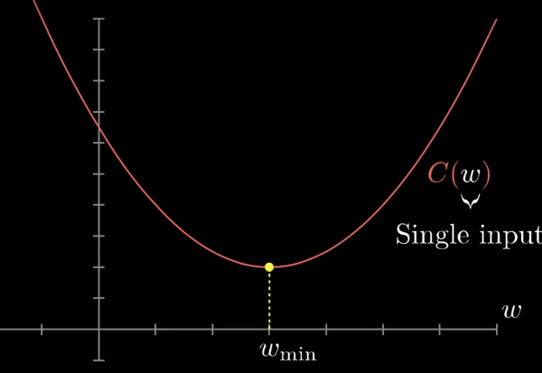 | 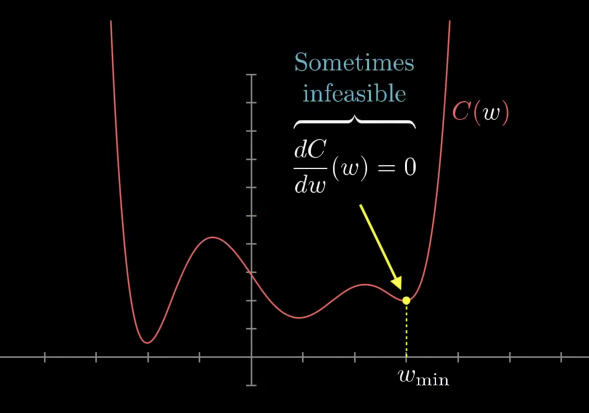 |
| :---: | :---: |

_**但是再看看右图，有时候一个函数稍微复杂一些的话，极小值就不一定好用了。何况我们的损失函数它有13002个参数，想要给这个函数求极小值，想想都会觉得很恐怖**__**😨**__**！**_

| 既然求不了极小值，那我们该怎么做呢？其实一个很简单的做法就是，因为模型的参数（中就只有）是随机初始化的，那么它就随机的落在了图像的某个点上。参考右图中的点w，我们只要去思考，把它往左挪，还是往右挪，函数的值会下降就好了。 那么，我们就算出这个点所在的斜率。斜率为正，就让它往左走；斜率为负，就让它往右走。我们让每步走的距离和斜率成正比：斜率很大，就多走几步，快速下降；斜率很小，就少走几步，防止调过头。 对每个点都如此反复，一直这么做下去，那么它就迟早会落到一个低点了！ | 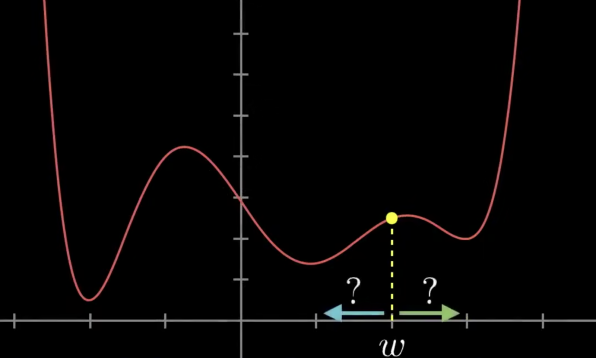 嗯，但是很自然的，按照左边的做法，我们可能会收敛于局部最小而不是全局最小😳。。。 这件事情在神经网络的训练中也会遇到！ |
| :--- | :---: |

| 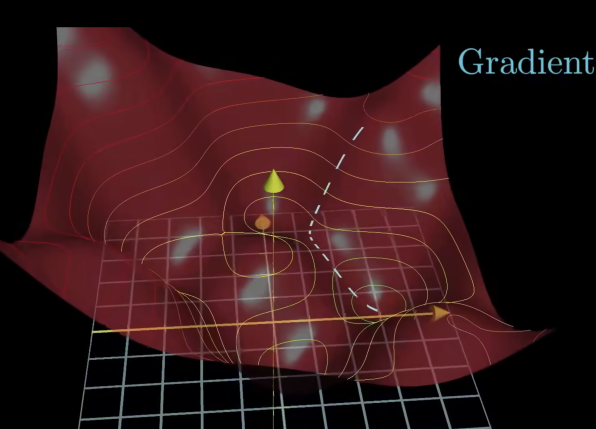 | OK，现在我们想象一个稍微复杂一点的二元函数：。那么代价函数就变成了这样的一个曲面。我们想象一个小球落在了随机初始化的参数下，代价函数对应的值所在的位置。那么这个我们就要用类似的方法，让小球沿着曲面滚动，最终落到一个凹陷的最低点里面去。 现在我们就不只是问向左还是向右了，在这个三维空间里，假定i、j是x、y轴对应的单位向量，球现在正落在的位置上。我们希望找到一个向量，沿着这个方向，函数的值上升最快。这就是在坐标的梯度。 |
| :---: | :--- |

这样的话，我们只要沿着这个方向的反方向走，而且梯度越大我们一次走的越多；并且到了一个新的位置之后，继续计算梯度，并沿着梯度的反方向走，循环往复，最终就能找到一个凹陷的地方了。

_**Hey ChatGPT，什么是多元函数的梯度？**_

**ChatGPT**：多元函数的梯度是一个向量，它表示了这个多元函数在某一点上变化最快的方向和变化率。对于一个具有 n 个自变量的多元函数，其梯度是一个 n 维向量，其中每个分量对应一个自变量的偏导数。

+ 设有一个 n 变量的函数 。
+ 这个函数在某一点  处的梯度记作  ，或：  
+ 
+ 其中  表示函数  对  的偏导数在点  处的值，分别表示n 维空间下该对应的坐标轴的单位向量。
+ 让多元函数的所有参数都沿着梯度的正方向走，我们称之为**梯度上升（Gradient Ascent）**，此时函数值上升最快。我们在强化学习的策略学习中，最大化状态价值函数，会做梯度上升！
+ 让多元函数的所有参数都沿着梯度的反方向走，我们称之为**梯度下降（Gradient Descent）**，此时函数值下降最快。在更多的场合，我们为了最小化损失，会去做梯度下降！

_**反复的去做梯度下降就是我们寻找一个多元函数的极小值点的套路！**_

上面列举了1元和2元函数的情况，来讲解梯度下降。从两个例子其实都可以看出，每到一个点，就算出该点的梯度，并且沿着梯度的反方向，走一段与梯度大小成正比的距离，从而到一个新的点；重复上述过程，最终，我们就会找到一个函数的极小值点，此时梯度就会收敛于0。我们不一定会找到整个函数的最小值，此时我们称自己收敛于局部最优而非全局最优；但不管怎么样，找到一个极小值点，就已经够了不起了！

_**负梯度向量其实告诉了我们，怎么去调节每一个参数，可以让神经网络的损失下降的最快。**_

回到MNIST数据集的这个例子，该案例中损失函数有13002个参数，但他同样适用于梯度下降这个原理！

| 想象把13002个参数作为一个列向量，那么他的负梯度其实无非也是一个13002维的列向量。这个负梯度告诉了我们，在这个13002维的空间里，怎么去调节每一个参数，才可以让损失下降的最快。 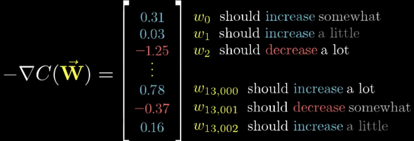 |  负梯度向量中，一个元素数字越大，说明更改这个元素对应的参数，性价比越高。 他反映了参数的重要性。 |
| :--- | :---: |

我们经常把全部的模型参数合起来写作，因此梯度下降的过程可以写作：

其中，为模型第t次迭代时的参数值，为学习率，为每一次迭代时，所输入给模型并且用于计算平均损失的训练样本的数量。传统的机器学习算法中，整个训练集中的所有样本都会被用来计算模型参数的梯度，并根据梯度来更新模型参数，因此的值就是训练集的大小。

_**介绍了这么久，有没有一个好懂一点的结论？**_

总之，目前我们只要知道，有梯度这么一个东西，可以算出一个多元函数（哪怕几千几万个参数）沿着哪个方向下降最快，从而指导我们去给模型做调参。梯度中元素的值越大，我们沿着那个元素对应的方向走越多的成正比距离，循环往复，我们就可以找到一个多元函数的极小值点了。

(2.2.3、2.2.4、2.3的具体内容我都先做了折叠，感兴趣的话可以自己打开看～)

### 模型更新的频率与超参数
上面写了梯度下降的过程的数学表达：

其中还有些元素是我们比较陌生的，包括和。显然，他们是我们人为设置的，不属于模型可以去学习的那13002个模型参数的范畴。我们管这样的参数叫做**超参数**。

**超参数**（**Hyperparameters**），是在机器学习算法中需要手动设置的参数，用于控制模型的学习过程和性能。与模型参数不同，超参数的值不能通过训练数据自动学习得到，而需要在训练之前由人工设置。

超参数的选择会影响模型的性能和训练速度，因此合理的超参数选择对于获得良好的模型性能非常重要。

#### 超参数之批大小（Batch Size）
+ **Batch Size（批大小）**是指在模型的一次参数更新中使用的样本数量。
+ 传统的机器学习算法中，整个训练集中的所有样本都会被用来计算模型参数的梯度，并根据梯度来更新模型参数，因此的值就是训练集的大小。此时，Batch Size通常指的是整个训练集的样本数量，也被称为"Full batch"或"Batch gradient descent"。
+ 使用整个训练集进行梯度计算和参数更新的方式，确保了每次更新都是基于全局的梯度信息，从而在更新模型参数时可以更加准确地朝着梯度下降的方向移动。然而，这种方式在处理大规模数据集时可能会面临计算速度较慢的问题，因为需要计算整个训练集的梯度。因此，随着数据集规模的增大，传统的梯度下降算法可能会变得效率较低。在目前大多数模型的训练过程中，训练数据通常被划分为多个小批次（Batch）进行处理，每个批次包含一定数量的样本。
+ 参考上面的公式，假定每次训练我们使用N个样本，那么Batch Size就是N。此时，Loss Function就是这N个交叉熵函数的大小的平均值，我们是基于这个损失值去做反向传播，更新模型的参数的。
+ 批大小的选择会直接影响模型的训练速度和内存占用。较大的批大小可以加速训练过程，因为可以利用硬件的并行性进行计算，但可能会占用更多的内存。较小的批大小则可以减小内存占用，但可能导致计算效率较低。合适的批大小通常需要根据具体的任务和硬件资源进行选择，常见的取值范围通常在几十到几千之间。

#### 超参数之学习率（Learning Rate）
**学习率（Learning rate）**：用于控制模型在每一轮训练中对权重进行更新的步伐大小。具体来说，学习率决定了在梯度下降优化算法中，每次更新权重时权重的变化量。

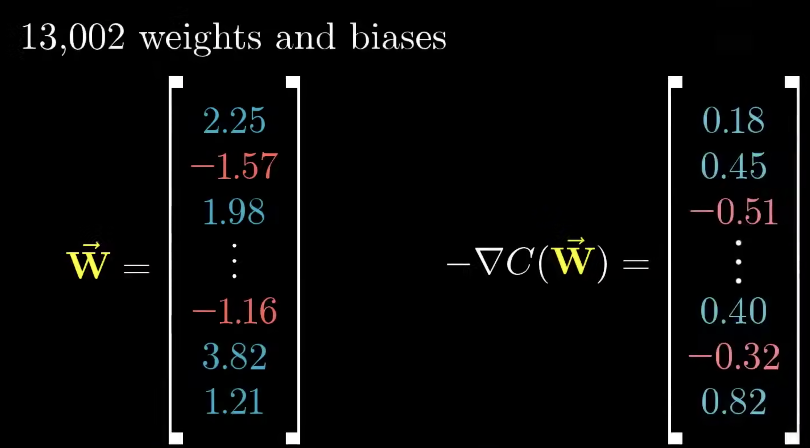

_<前面用到过这张图。左边是参数向量，右边是梯度向量，我们是以梯度的倍数去调节左边的参数的。这个倍数其实就是学习率。它可以是恒定的，可以衰减，也可以自动调整。>_

#### 超参数之迭代次数（Epochs）
迭代次数表示模型在整个训练数据集上的训练次数。

_#注意，迭代次数和Batch Size本身并不是一个此消彼长的关系。哪怕采用Full  Batch，也可以迭代非常非常多次。_

+ 过少的迭代次数可能导致欠拟合，而过多的迭代次数可能导致过拟合。
+ **欠拟合（Underfitting），**是指模型在训练数据上表现不佳，无法很好地捕捉到数据的特征和模式的现象。
+ **过拟合（Overfitting），**是指模型在训练数据上表现很好，但在未见过的测试数据上表现较差的现象。简而言之，过拟合表示模型在训练数据上过度拟合，从而导致在新数据上的泛化性能下降。过拟合通常发生在模型过于复杂或者训练数据较少的情况下。当模型过于复杂时，它可能会在训练数据上表现得非常好，但在新数据上的表现较差，因为模型已经过于“记忆”了训练数据，无法很好地泛化到新的数据。

_**解决过拟合的方法通常包括以下几种：**_

1. 数据增强（Data Augmentation）：可以对训练数据进行扩增，如旋转、缩放、翻转等，从而增加训练数据的多样性，减少模型对于训练数据的过拟合。
2. <u>提前停止（Early Stopping）：可以在训练过程中监控模型在验证数据上的性能，当性能开始下降时，提前停止训练，避免模型过拟合。</u>
3. **正则化（Regularization）**：可以通过在模型的损失函数中引入正则化项（如L1正则化、L2正则化等）来限制模型的参数值，从而减少模型的复杂度，防止过拟合。

#### 超参数之正则化
上面提到了，正则化是一种限制模型的参数值，减少模型的复杂度，从而避免模型在训练数据上过拟合的技术。

_**在神经网络中，常见的正则化方法包括以下几种：**_

1. **L1 正则化（L1 Regularization，也称为 Lasso 正则化）**：在目标函数中引入模型权重的 L1 范数作为惩罚项，使得模型权重倾向于稀疏化，即某些权重变为零。L1 正则化可以用于控制神经网络中的参数稀疏性，从而减小模型复杂性。#简单理解，L1就是把某些参数的权重变成0.
2. **L2 正则化**（L2 Regularization，也称为 Ridge 正则化）：在目标函数中引入模型权重的 L2 范数作为惩罚项，使得模型权重趋向于较小的值，从而减小模型复杂性。L2 正则化可以用于控制神经网络中的参数值的大小，从而防止过拟合。#简单理解，L2就是在抑制模型的一些权重取值过大
3. **Dropout 正则化**：Dropout 是一种在训练时随机丢弃一部分神经元输出的方法，从而减少神经网络的复杂性，防止过拟合。Dropout 可以随机地设置某些神经元的输出为零，从而迫使网络在训练过程中不依赖于特定的神经元，从而提高网络的泛化性能。简单理解DropOut就是扔掉一些神经元。

#### 超参数之激活函数
前面提到过，激活函数用于引入非线性变换，常见的激活函数包括ReLU、sigmoid、tanh等。选择合适的激活函数对于模型的性能至关重要。

### 反向传播（Backpropagation，BP）
上面提到了梯度下降的方法，而如何去计算那些梯度，变成了神经网络算法在工程实现上的核心问题。我们称之为反向传播算法。

#### 反向传播介绍
**反向传播（Backpropagation）**用于计算神经网络中各层权重和偏置的梯度，从而实现模型参数的更新。它是前向传播的逆过程，通过计算损失函数对神经网络输出的梯度，逐层向后传播，从输出层到输入层，计算每一层的梯度，并用于更新模型参数。

反向传播的基本思想是根据链式法则（Chain Rule）计算损失函数对模型参数的梯度。具体步骤如下：

1. 初始化梯度：将最后一层（输出层）的梯度初始化为损失函数对输出的梯度，通常使用损失函数的导数。
2. 反向传播：从输出层开始，根据链式法则计算损失函数对每一层输入的梯度。对于每一层，根据当前层的输出和权重，计算该层输入的梯度，并传递到前一层。
3. 计算参数梯度：根据每一层输入的梯度和该层的输入，计算损失函数对该层权重和偏置的梯度。这可以通过将输入的梯度与该层输入的转置相乘（对权重）或直接求和（对偏置）来实现。
4. 更新参数：使用计算得到的参数梯度，按照梯度下降的方式更新模型的权重和偏置，通常使用学习率来控制更新的步幅。
5. 重复步骤2至步骤4：重复执行上述步骤，直到达到预定的停止条件，例如达到最大迭代次数或损失函数收敛到足够小的值。
+ 我们只需要知道反向传播是前向传播的逆过程，通过计算损失函数对神经网络输出的梯度，逐层的传播，通过这样的方法可以计算出一个神经网络的损失函数梯度，并调参实现梯度下降，就可以了。
+ 此外，我们还需要知道，反向传播过程中，深层的网络的梯度计算需要经过连乘的操作。
+ 具体的算法在数理表示上比较复杂，可以参考后续的推荐学习资料。

#### 梯度消失问题和梯度爆炸问题
_**什么是梯度消失？**_

**梯度消失问题（Gradient Vanishing）**是指在深度神经网络中，反向传播算法中计算的梯度在网络的较深层逐渐变得非常小，甚至趋近于零，从而导致这些层的权重更新变得非常缓慢或停止更新，使得这些层的参数无法得到有效的训练。

_**为什么会梯度消失？**_

+ 梯度消失问题通常出现在具有多层的深度神经网络中，特别是在使用激活函数为Sigmoid或Tanh等饱和激活函数时，因为这些函数在输入较大或较小的情况下会饱和并导致梯度变得非常小。（当输入接近1时，Sigmoid函数的输出值会接近于1，导数趋近于0。于是在反向传播过程中，梯度的乘积会趋近于零。）（为了缓解梯度消失问题，深度神经网络中常常使用其他类型的激活函数，如ReLU）
+ 深度神经网络中，梯度是通过链式法则进行反向传播的。每一层的梯度都需要与前一层的梯度相乘，然后再传递到前一层，依此类推，直到传递到网络的输入层。如果网络层数较多，那么在反向传播过程中会经过多次连续的乘法操作，从而可能导致梯度的值指数级地减小，最终趋近于零，即梯度消失）。

_**那么梯度爆炸呢？**_

+ 自然的，因为要经过多次的连乘，每次乘法操作都可能将梯度放大，从而导致梯度值变得非常大，从而导致梯度爆炸（Gradient  Explosion）。
+ 梯度爆炸会导致网络的权重参数更新过大，从而使得模型的训练变得不稳定。

#### 缓解梯度问题：归一化（Normalization）
_**什么是归一化？**_

**归一化（Normalization）**是一种对输入或者网络层的输出进行线性或非线性的缩放处理，将其映射到一个特定的范围或者分布内，以便提高网络的训练稳定性和性能的作法。常用的方式是将数据的均值变为0，方差变为1。

_**归一化怎么缓解梯度问题？**_

归一化可以在训练过程中对输入数据或网络层的输出进行处理，从而对激活函数的输入值进行调整，避免其过大或过小而导致的梯度消失、梯度爆炸等问题，提高网络的学习效果和泛化性能。

_**在神经网络中，常见的归一化方法包括**_：

1. **批标准化（Batch Normalization，简称BN）**：批标准化是一种在训练过程中对网络层的输入进行归一化的方法。它通过在每个批次中对输入数据进行规范化，使其均值为0、方差为1，从而加速网络的收敛过程，降低网络对初始化和学习率的敏感性，同时也有一定的正则化效果。
2. **层标准化（Layer Normalization）**：层标准化是一种对网络层的输出进行归一化的方法，与批标准化不同，它在每层中对所有样本的输出进行规范化，而不是对每个批次进行规范化。层标准化在处理序列数据等不适合批处理的情况下，可以作为替代方案使用。
3. **组标准化（Group Normalization）**：组标准化是一种介于批标准化和层标准化之间的方法，它将输入数据分成多个小组，然后对每个小组内的样本进行归一化，从而减小小组之间的相关性，提高网络的学习能力。

_#总之，可以先这么理解：归一化就是把一堆数据的均值变成0、方差变成1。_

## 万能逼近定理：MLP可以拟合任何函数
+ **万能逼近定理（Universal Approximation Theorem**）：带有一个隐层（Hidden Layer）的MLP，可以以一定的精度逼近任何函数；该MLP的参数量越大，逼近程度越高。
+ 万能逼近定理的条件是指神经网络具有足够多的隐藏层节点和足够的非线性激活函数，并且可以使用足够多的训练样本进行训练。在实际应用中，虽然神经网络具有万能逼近定理的能力，但实际训练过程中还需要考虑许多其他因素，如过拟合、训练速度、数据质量等。

_#MLP可以以一定精度逼近任何函数是有数学证明的，但比较复杂，哪怕是对于搞科研的人也不是一定要搞懂，所以不在这个文档中作证明。_

## MLP总结
**计算机看到的特征是什么样的？**

| 在做出最后的表格总结之前，我们先来看看神经元所看到的特征是怎么样的。 最开始的时候，我们说，我们期待中间的隐层可以像我们人一样，识别出横、圆、边等特征，并拼接成一个数字。然而，计算机实际看到的东西是右图所示的。 嗯，他根本就没有什么规律！ 那自然的，如果我们把随便一张照片，比如一张二维码交给机器去识别。我们可能期待机器会告诉我们这不是一个数字；但事实是，机器会非常肯定的给你输出一个答案。这感觉就像，在这13000维的我们无法想象的空间中，机器找到了一个很不错的局部最小值坐了下来，可以成功分类大多图像，但却没有真正的智慧！ | 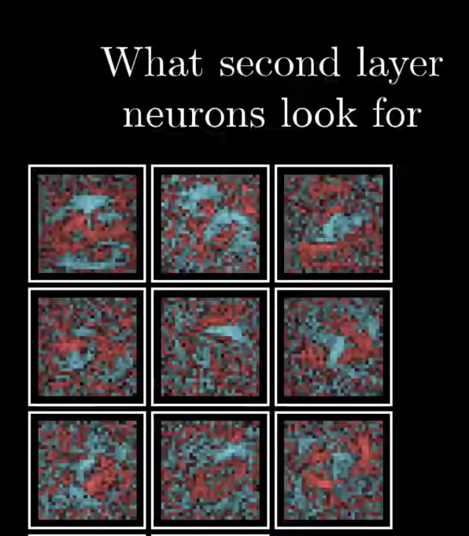 |
| :--- | :---: |

| **模型** | **多层感知器 MLP** |
| :---: | --- |
| **模型结构** | 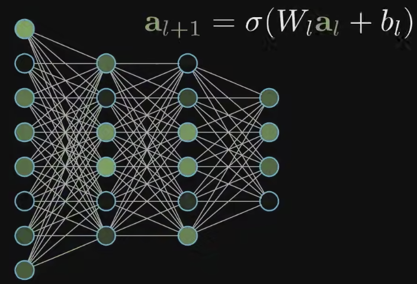 |
| **类型与架构** | MLP是最基本的神经网络，属于**前馈神经网络（Feedforward Neural Network)**。在前馈神经网络中，信息在网络中从输入层（Input Layer）经过多个中间层（Hidden Layers）传递到输出层（Output Layer），并且信息在网络中只能向前传播，不会形成循环。前馈神经网络也被称为无记忆神经网络（Memoryless Neural Network），因为网络中没有存储之前计算的状态。 |
| **优缺点** | 优点：具有较强的非线性建模能力；可以进行端到端的学习；可以并行计算 缺点：容易陷入局部最优；容易过拟合；全连接的结构太过复杂（想象一张很高清的图，例如你用苹果手机拍的照片。苹果手机的像素1200万，如果还是用全连接层的结构，那参数的数量会过于爆炸）。 |
| **可调节超参数** | Batch Size，学习率，网络结构（层数、神经元数量等）、激活函数、优化算法等。MLP可以调节的超参数非常多，因此模型的调优非常复杂。 |

> 更新: 2025-09-22 09:58:29  
> 原文: <https://www.yuque.com/aaron-wecc3/dhluml/nl83bim2b562w4x7>