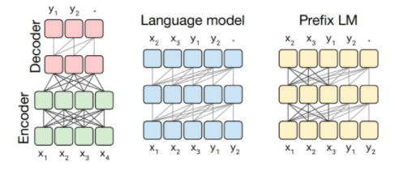
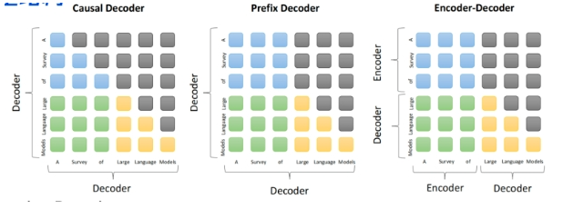
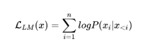
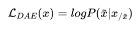

# 91.大模型基础面试题

### 常见面试题
1. 目前 主流的开源模型体系 有哪些？
2. prefix Decoder 和 causal Decoder 和 Encoder-Decoder 区别是什么？
3. 大模型LLM的 训练目标 是什么？
4. 涌现能力是啥原因？
5. 为何现在的大模型大部分是Decoder only结构？
6. 简单 介绍一下 大模型【LLMs】？
7. 大模型【LLMs】后面跟的 175B、60B、540B等 指什么？
8. 大模型【LLMs】具有什么优点？
9. 大模型【LLMs】具有什么缺点？

### 1 目前 主流的开源模型体系 有哪些？ 
目前 主流的开源模型体系 分三种： 

• 第一种：prefix Decoder 系 

• 介绍：输入双向注意力，输出单向注意力 

• 代表模型：ChatGLM、ChatGLM2、U-PaLM 

• 第二种：causal Decoder 系 

• 介绍：从左到右的单向注意力 

• 代表模型：LLaMA-7B、LLaMa 衍生物 

• 第三种：Encoder-Decoder 

• 介绍：输入双向注意力，输出单向注意力 

• 代表模型：T5、Flan-T5、BART 

### 2 prefix Decoder 和 causal Decoder 和 Encoder-Decoder 区别是什么？ 

prefix Decoder 和 causal Decoder 和 Encoder-Decoder 区别 在于 attention mask不同： 

• Encoder-Decoder： 

• 在输入上采用双向注意力，对问题的编码理解更充分 

• 适用任务：在偏理解的 NLP 任务上效果好 

• 缺点：在长文本生成任务上效果差，训练效率低； 

• causal Decoder： 

**token的规则**； 

• 适用任务：文本生成任务效果好 

• 优点：**训练效率高，zero-shot 能力更强，具有涌现能力** 

• prefix Decoder： 

• 特点：**prefix部分的token互相能看到**，causal Decoder 和 Encoder-Decoder 折中； 

• 缺点：**训练效率低** 

### 3 大模型LLM的 训练目标 是什么？ 
1. 语言模型 

根据 已有词 预测下一个词，训练目标为最大似然函数： 

**训练效率：Prefix Decoder < Causal Decoder** 

**Causal Decoder 结构会在 所有 token 上计算损失，而 Prefix Decoder 只会在 输出上 计算损失。** 

1. 去噪自编码器 

随机替换掉一些文本段，训练语言模型去恢复被打乱的文本段。目标函数为: 

去噪自编码器的实现难度更高。采用去噪自编码器作为训练目标的任务有GLM-130B、T5. 

### 4 涌现能力是啥原因？ 
根据前人分析和论文总结，大致是2个猜想： 

• 任务的评价指标不够平滑； 

• 复杂任务 vs 子任务，这个其实好理解，比如我们假设某个任务 T 有 5 个子任务 Sub-T 构成，每个 sub-T 随 

着模型增长，指标从 40% 提升到 60%，但是最终任务的指标只从 1.1% 提升到了 7%，也就是说宏观上看到 了涌现现象，但是子任务效果其实是平滑增长的。 

### 5 为何现在的大模型大部分是Decoder only结构？ 
因为**decoder-only结构模型在没有任何微调数据的情况下，zero-shot的表现能力最好**。而**encoder-decoder则** **需要在一定量的标注数据上做multitask-finetuning才能够激发最佳性能**。 

目前的Large LM的训练范式还是在大规模语料shang 做自监督学习，很显然zero-shot性能更好的decoder-only架 构才能更好的利用这些无标注的数据。 

**大模型使用decoder-only架构除了训练效率和工程实现上的优势外，在理论上因为Encoder的双向注意力会存在** **低秩的问题，这可能会削弱模型的表达能力**。就生成任务而言，引入双向注意力并无实质的好处。而Encoder- decoder模型架构之所以能够在某些场景下表现更好，大概是因为它多了一倍参数。所以在同等参数量、同等推 理成本下，Decoder-only架构就是最优的选择了。 

### 6 简单 介绍一下 大模型【LLMs】？ 
大模型：一般指**1亿以上参数的模型**，但是这个标准一直在升级，目前万亿参数以上的模型也有了。大语言模型 （Large Language Model，LLM）是针对语言的大模型。 

### 7 大模型【LLMs】后面跟的 175B、60B、540B等 指什么？ 
175B、60B、540B等：这些一般指参数的个数，B是Billion/十亿的意思，175B是1750亿参数，这是ChatGPT大 约的参数规模。 

### 8 大模型【LLMs】具有什么优点？ 
1. 可以利用大量的无标注数据来训练一个通用的模型，然后再用少量的有标注数据来微调模型，以适应特定的 

任务。这种预训练和微调的方法可以减少数据标注的成本和时间，提高模型的泛化能力； 

2. 可以利用生成式人工智能技术来产生新颖和有价值的内容，例如图像、文本、音乐等。这种生成能力可以帮 

助用户在创意、娱乐、教育等领域获得更好的体验和效果； 

3. 可以利用涌现能力（Emergent Capabilities）来完成一些之前无法完成或者很难完成的任务，例如数学应用 

题、常识推理、符号操作等。这种涌现能力可以反映模型的智能水平和推理能力。 

### 9 大模型【LLMs】具有什么缺点？ 
1. 需要消耗大量的计算资源和存储资源来训练和运行，这会增加经济和环境的负担。据估计，训练一个GPT-3 

模型需要消耗约30万美元，并产生约284吨二氧化碳排放； 

2. 需要面对数据质量和安全性的问题，例如数据偏见、数据泄露、数据滥用等。这些问题可能会导致模型产生 

不准确或不道德的输出，并影响用户或社会的利益； 

3. 需要考虑可解释性、可靠性、可持续性等方面的挑战，例如如何理解和控制模型的行为、如何保证模型的正 

确性和稳定性、如何平衡模型的效益和风险等。这些挑战需要多方面的研究和合作，以确保大模型能够健康 地发展。 

> 更新: 2025-09-22 09:58:29  
> 原文: <https://www.yuque.com/aaron-wecc3/dhluml/xxzrwlp1l5eihzy4>