# 93.循环神经网络面试题

## 常见面试题
1. Native RNN模型
2. 为什么需要循环神经网络
3. 循环神经网络的结构
4. 数学语言描述RNN结构的前向传播与反向传播
5. 传统RNN的问题
6. LSTM中的门结构
7. LSTM中门控机制的具体实现
8. LSTM为什么可以缓解梯度问题
9. 怎么对LSTM进一步优化？
10. 双向RNN：同时考虑左、右的信息
11. 双向RNN由两个独立的RNN构成
12. 多层RNN Deep RNNs：堆叠下去，增加深度
13. 多层RNN的结构
14. Deep RNNs通常也不会很深
15. 什么是串行和并行，训练深层的RNN为什么格外花时间？
16. RNN总结

****

## 1 Native RNN模型
### 1.1 为什么需要循环神经网络
很多时候，我们会希望一个模型拥有处理时间序列数据的能力。

例如，如果要翻译“这个知名作家的书都非常精彩”：

The books of the famous writer [are] all wonderful.

我们知道，当生成到writer时，这里下一个生成的词应该是are，而不是is。这涉及到对前文文本books的依赖。传统的MLP或者CNN是无法做到这种连接的，因为他们会先输出the，而后输出books，而后输出of。每次输出，都不会留下记忆，所以输出【are】这个位置的单词的时候，自然不知道前面的books这个信息。

### 1.2 循环神经网络的结构
知道了我们要解决的问题后，就变得非常简单了：我们需要让模型有记忆力。一个办法是，每次模型输出的不只是目标单词，还有一个包含了之前的全部信息的中间特征H；而后，这个中间特征作为下一次训练的输入。

具体参考下表：

| _<__学习的时候在笔记里手绘了张__RNN__结构，参考右图__>_ | | | 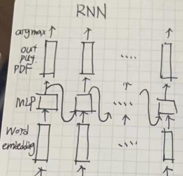 |
| --- | --- | --- | :--- |
| **Time**   **Step** | **输入** | **输出** | |
| 1 | Input1  | Output1 与中间特征H1 | |
| 2 | Input2 和中间特征H1 | Output2和中间特征H2 | |
| 3 | Input3 和中间特征H2 | Output2和中间特征H3 | |
| …… | | | |

于是就有了如下的模型结构：

| 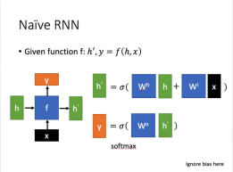 | 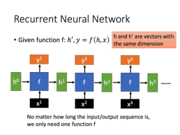 |
| :--- | :--- |

### 1.3 数学语言描述RNN结构的前向传播与反向传播
后面的文章中我们会大量提到RNN的梯度消失、梯度爆炸和长文本依赖的问题。

#### 1.3.1 Native RNN前向传播的数学表述
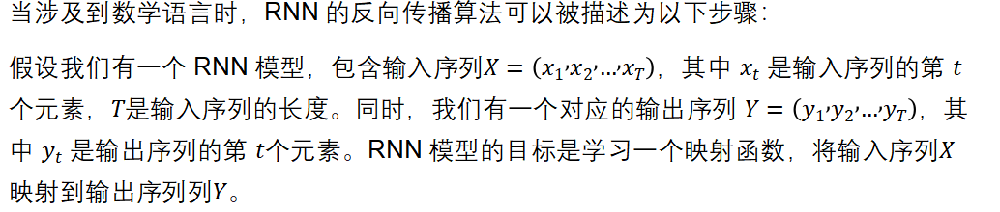

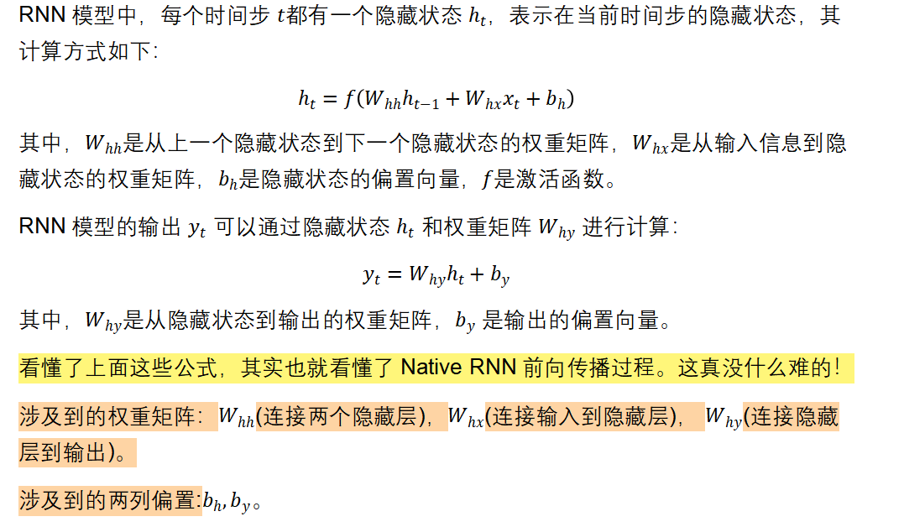

#### 1.3.2 Native RNN的反向传播算法
| RNN的反向传播在原理上和MLP的BP也是一样的，不过RNN和时间有关，导致RNN中的BP算法稍显复杂，名称也不一样，叫做backpropagation through time, BPTT。_考虑到是入门文档，就不在这里手撕__BPTT__了！_ 感兴趣的话可以去参考论文：[On the difficulty of training recurrent neural networks](http://proceedings.mlr.press/v28/pascanu13.pdf)；参考右图，如果的的最大特征值小于1，则公式(18)和(19)的左边将以指数形式下降，造成梯度消失问题；类似的，如果的最大特征值大于1，则公式(18)和(19)的左边将以指数形式上升，造成梯度爆炸问题。 问题的来源总归还是在于RNN在不同时间步是共享了每一个权重矩阵的，所以反向传播的过程中难免要对同一个东西一直做连乘。 | 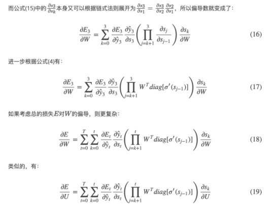 _<__截张图感受一下，哈哈！__>_ |
| :--- | :---: |

这个链接中比较详细的解释了RNN的反向传播算法BPTT：[CS224N(1.24)Language Models and RNNs | bitJoy](http://bitjoy.net/2019/07/31/cs224n%ef%bc%881-24%ef%bc%89language-models-and-rnns/)

### 1.4 传统RNN的问题
Native RNN存在很多问题：

#### 1.4.1 记忆力过强
在传统的 RNN 中，每个时间步的隐藏状态都是通过当前的输入和上一时间步的隐藏状态计算得到的，每个时间步的隐藏状态都包含了全部历史时刻的信息，因此随着时间步的增加，隐藏状态中的信息会越来越多，其中有价值的信息含量的比率会越来越少。

为了解决这个问题，我们要想办法给Native RNN引入遗忘机制。

#### 1.4.2 处理长序列时存在梯度消失和梯度爆炸的问题
模型的记忆力过强不仅会降低信息的价值，还会导致处理长序列时的梯度消失和梯度爆炸等问题，从而导致模型难以捕捉到序列中较远的依赖关系。这会影响模型的性能和泛化能力。

• 在反向传播过程中，模型的梯度需要从输出端传回输入端，经过每个时间步的参数更新。

• 如果模型的记忆力过强，也就是在输入端的信息需要经过很多个时间步之后才能传递到输出端（可以参考我在1.2贴的那张自己手绘的图），那么在反向传播过程中，每个时间步的梯度都需要乘以相同的参数矩阵，这就会导致梯度指数级别地增加或减小，从而导致梯度爆炸或梯度消失的问题。

• 梯度爆炸相对而言比较好解决，通过梯度裁剪、调整学习率等方法就可以很好的控制，但是处理梯度消失就非常的麻烦（所以后面我们也会更多的关注梯度消失的问题）。当梯度消失时，网络就很难学习到序列中的长期依赖关系。

这些问题限制了传统 RNNs 在处理长序列数据时的应用，并且难以让模型获得良好的性能和泛化能力。为了解决这些问题，出现了许多改进的循环神经网络，如长短时记忆网络（Long Short-Term Memory，LSTM）和门控循环单元（Gated Recurrent Unit，GRU），这些模型通过引入门控机制来缓解梯度消失和梯度爆炸的问题，从而使得模型能够更好地处理长序列数据。

#### 1.3 梯度消失带来的问题的直观感受
| 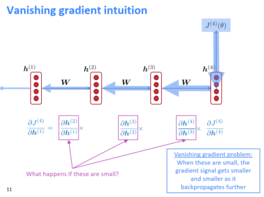  | 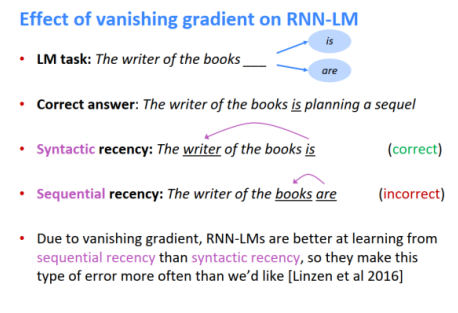 |
| --- | --- |
| 在1.3.2中，我们粗略介绍了RNN反向传播算法，说明了为什么RNN很容易产生梯度爆炸。 核心问题就是RNN在不同时间步使用共享参数，导致时刻的损失对时刻的参数的偏导数存在的指数形式，一旦很小或很大就会导致梯度消失或梯度爆炸的问题。参考上图，梯度不断反传，梯度不断变小（箭头不断变小）。 | 梯度消失会带来哪些问题呢？一个很明显的问题就是参数更新更多的受到临近词的影响，那些和当前时刻t较远的词对当前的参数更新影响很小。假设我们需要预测句子The writer of the books下一个单词，由于梯度消失，books对下一个词的影响比writer对下一个词的影响更大，导致模型错误的预测成了are，但这显然是不对的。 |
|  | |

## 2 LSTM模型 
前面提到，Native RNN的核心问题在于它的记忆力太强了，.会包含~的全部信息。所以我们需要设计一个模型结构，让模型可以去选择记住什么信息、忘掉什么信息，提高信息的价值，并解决梯度问题。

如果把LSTM视为一个黑盒而先不去考虑其内部结构，就有下面的LSTM模型：

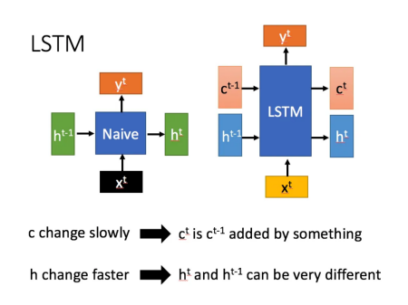

相比RNN只有一个传递状态  ，LSTM有两个传输状态，一个  （cell state），和一个   （hidden state）。（Tips：RNN中的  对于LSTM中的  ），他们都是向量。

其中对于传递下去的改变得很慢，通常输出的 是上一个状态传过来的加上一些数值。控制哪些信息会被遗忘，哪些信息会被留下,  则在不同节点下往往会有很大的区别。

### 2.1 LSTM中的门结构
网上大多数阐述LSTM结构用的都是下面这张图。不过我不喜欢这张图！所以我们先不管它！

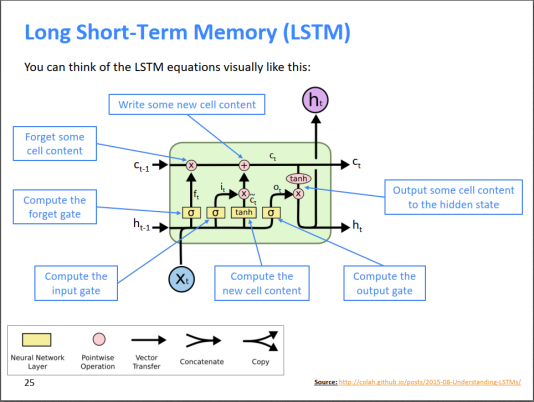

对于第一个时间步，隐状态和细胞状态可以是初始化为零向量，也可以使用一些预训练的权重或者其他先验知识来初始化和，来更好的训练模型。

对于第t个时间步，LSTM有三个输入： , 和。我们会直接把和拼接到一起，成为一个新的更长的向量。

我们有4个权重矩阵： ，(f for **f**orget)，（i for **i**nformation）**，**(o for **o**utput)。每个权重矩阵都对应了自己的偏置，不过这里我们就先忽略偏置吧！

用和拼接到一起的向量分别与这四个权重矩阵相乘，再用一个激活函数去激活，就得到了四个向量，,,。

| <很多其他的资料会用 来代表这里的，会用状态候选向量代表这里的> |
| :---: |

其中，只有是以tanh函数激活的，它后续会被作为一个输入向量；而其他三个向量后续都是作为门控向量之用，所以是以sigmoid函数激活_**（所以每个门控信号都是一个元素取值在**__** **__**的向量，元素值离**__**1**__**越近，代表记忆下来的数据越多！！**_）。

| 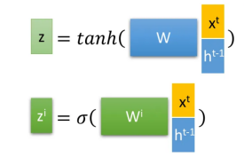 | 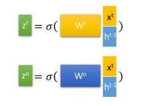 |
| :---: | :---: |

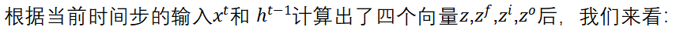

### 2.2 LSTM中门控机制的具体实现
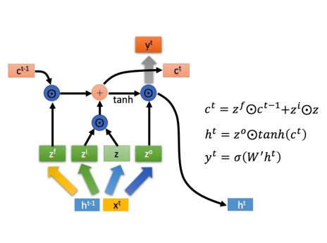

_#__是__Hadamard Product__，也就是操作矩阵中对应的元素相乘，因此要求两个相乘矩阵是同型的。_

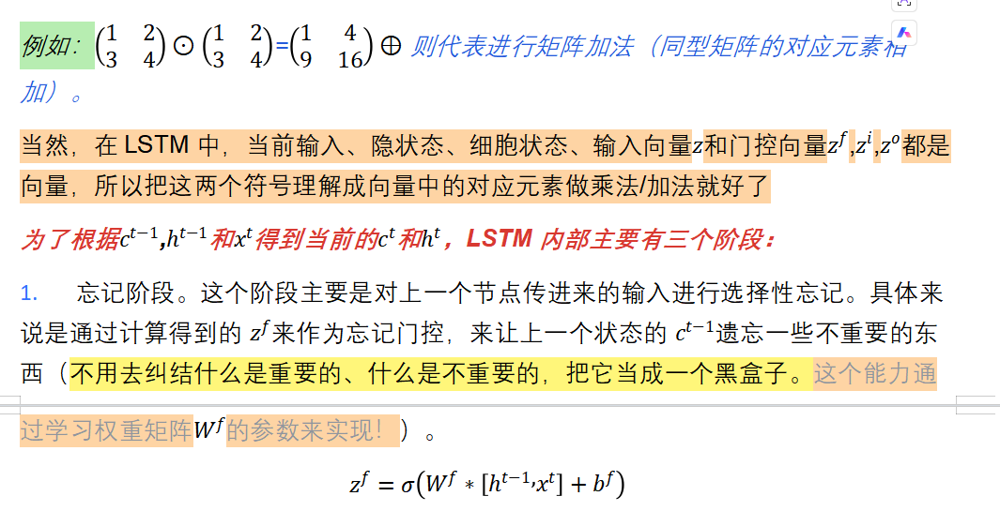

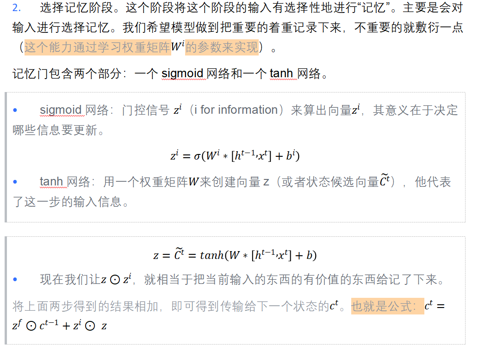

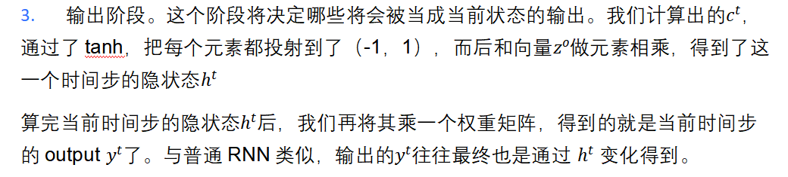

参考[【知乎】人人都能看懂的LSTM](https://zhuanlan.zhihu.com/p/32085405)  By知乎用户[陈诚](https://www.zhihu.com/people/chenchengnlp)。

### 2.3 LSTM为什么可以缓解梯度问题
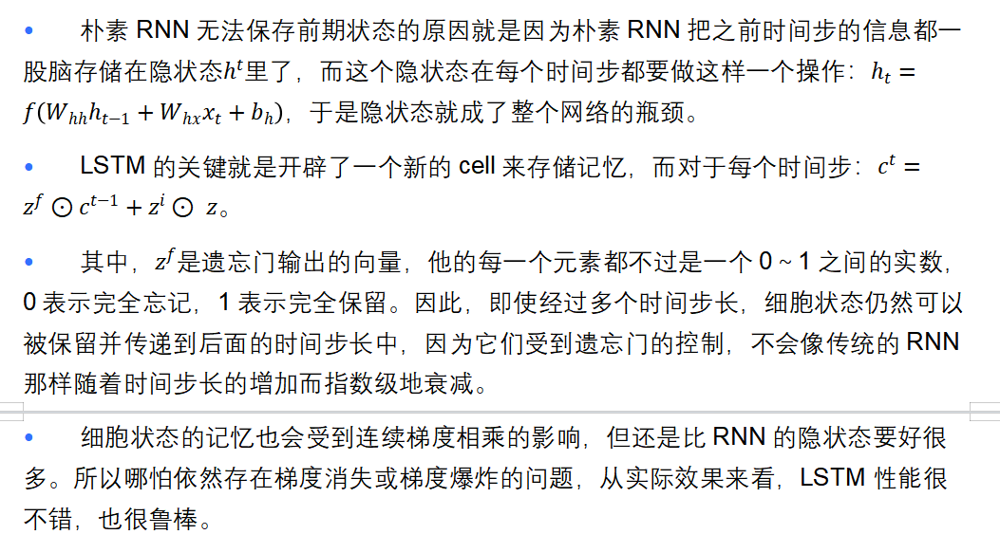

### 2.4 怎么对LSTM进一步优化？
我们可以看到，我们引入了非常多的内容，涉及到了5个权重矩阵： ，(f for forget)，（i for information）， (o for output)， （从当前步隐状态到输出），以及各种偏置，所以模型参数变得很多。这无疑会让模型的训练变得更难。

所以，LSTM还有变体GRU，参考：[人人都能看懂的GRU](https://zhuanlan.zhihu.com/p/32481747)，By知乎用户[陈诚](https://www.zhihu.com/people/chenchengnlp)。GRU很聪明的一点就在于，它采用了一些巧妙的构思，让一个门控同时可以进行遗忘和选择记忆，而LSTM则要使用多个门控，因此GRU很多时候都会更加实用。

## 3 双向RNN：同时考虑左、右的信息
### 3.1 考虑两边的信息
Q：Terribly这个词在句子“Her answer was terribly exciting”中表达什么情感？

• 如果我们只从左往右看的话，我们很可能觉得这个terribly是贬义的，毕竟terrible嘛！而且模型很可能会去猜terribly这个词的下一个词会是wrong，她的回答大错特错！

• 但如果我们从右往左看的话，我们就会知道，这个terribly应该是褒义的，她的回答是如此振奋人心。

结论是，对于很多下游任务，例如情感识别，我们最好能同时考虑左、右两个方向的信息！

### 3.2 双向RNN由两个独立的RNN构成
双向RNN其实就是从左到右按顺序输入，和从右往左按顺序收入的两个**参数独立**的RNN。

而后，我们会把两个RNN的输出（一个向量）拼接起来，作为整体输出（去做一个softmax）。

_**双向**__**RNN**__**的数学语言表述：**_

| 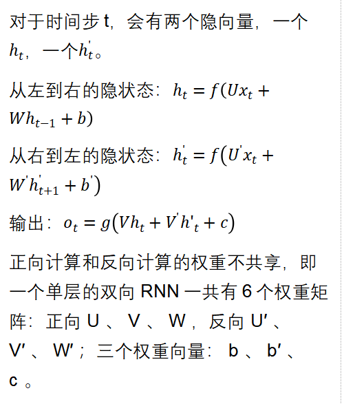  | 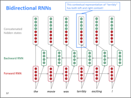 |
| :--- | :---: |

_**双向**__**RNN**__**的应用：**_

• 双向RNN是无法用于语言模型的，因为语言模型在t时刻只知道t时刻之前的信息，并基于此预测t时刻的单词。如果直接给了我们整个词序列，让我们可以做双向，那就不叫语言模型了！

• 但是对于一个包含完整序列的NLP任务，例如文本分类、情感识别，我们就应该默认使用双向RNN。

## 4 多层RNN Deep RNNs：堆叠下去，增加深度
### 4.1 多层RNN的结构
多层RNN其实也很简单，RNN Layer1的输出作为下一层RNN的输入。参考下图：

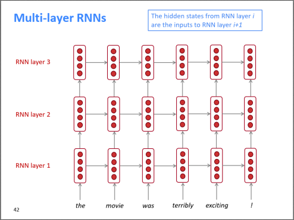

### 4.2 Deep RNNs通常也不会很深
• 其实深度学习多多少少是一种炼丹+大力出奇迹，一般来说把模型堆叠下去，深度大一些，性能就会好一些（当然，我们得处理好梯度下降等问题）。

• 在处理视觉场景的时候，卷积神经网络动辄可以有几百层，通常会很深；但RNN往往是二层为主，最多也很少超过8层。原因其实在于RNN训练时是串行的，不易并行化。网络太深的话，训练起来会非常花时间。

### 4.3 什么是串行和并行，训练深层的RNN为什么格外花时间？
RNN的强项在于处理时序数据，每个时间步的输出都会依赖前一个时间步产生的隐向量，那么对于第t步，它必须得等到t-1步算完才能开始，无法并行处理。

以下图为例：

• 如果不是RNN的话，换点别的神经网络，对于输入W1、W2、W3、W4，各算各的，各自输出Y1、Y2、Y3、Y4，最后我们可以把Y1、Y2、Y3、Y4拼在一起。**并行**就是你干你的，我干我的，最后我们拼一起。

• 然而，对于RNN来说，参考下图：

1. 首先我们得算出了H(1,1)，才能去算H(1,2)；算出了H(1,3)，才能去算H(1,4)。

2. 其次，如果我们想算出H(2,2)，那么我们得把H(2,1)和H(1,2)都先算出来。想算出H(3,3)，那么就得把H(3,2)和H(2,3)也都算出来。

3. 我们假设向上箭头的计算速度和向右箭头的计算速度是一样的，矩形被运算完就会被填充，那么对于一个四层的神经网络，会按照颜色深浅的顺序，从浅到深一个一个填充完。

4. 情况还可以更糟糕：对于Generative的语言模型，我们常常采用自回归的形式，上一步最终的输出会作为下一步的输入。在可以可以考虑：W1一路运算到了H(4,1)，才输出了W2，而后W2再输入进去，算出H3的场景。

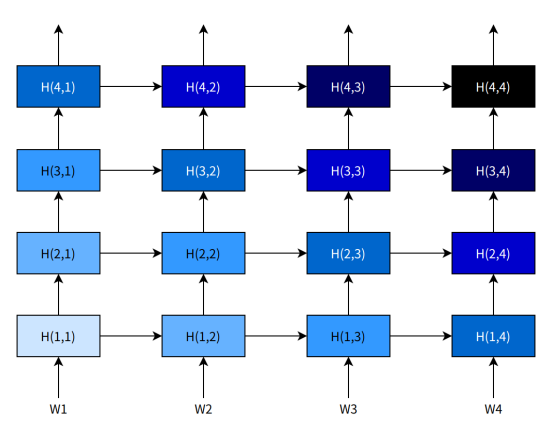

5. **串行**就是我干完了，你才能干。看上图其实我们也就能知道，如果输入序列非常长，例如一次翻译由几百个词的句子的话，RNN的训练速度极慢这件事情会格外的明显。

Note：RNN相较于CNN处理不能并行化，不是说无法同时进行多个“输入-输出”的样本批量处理，而是对于单个“输入”-“输出”的训练样本，其依赖于按照时间步顺序一个一个算，从而带来计算效率瓶颈。

GPU的牛逼之处在于超强的并行计算能力，RNN无法很好的并行，自然也就很难发挥GPU的优势，训练起来很难。

总之，深层的**RNN**训练需要很多计算资源，需要很长的时间，这就是为什么我们需要Transformer。

## 5 RNN总结
| **模型** | **卷积神经网络**** CNN** | **循环神经网络 RNN** |
| :---: | --- | --- |
| **模型结构** | 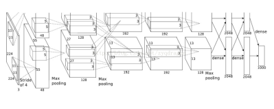 | 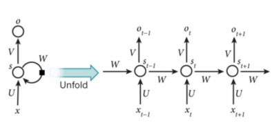 |
| **类型与架构** | 前馈神经网络，不循环 通常是有监督学习，依赖标注数据 架构包括输入层、卷积层、池化层、全连接层。卷积层提取特征，池化层压缩特征。 | 循环神经网络，有一个循环递归和递归参数，具有记忆特性，上一时刻的输出可以作为下一时刻的输入；当前时刻当同时接受前时刻的输入和上一时刻的输出 如果没有那个循环的话就是个简单的MLP，但加上了这个循环后反向传播变得非常复杂 |
| **典型模型** | LeNet；AlexNet；VGG；GoogleNet；ResNet | 最基础的RNN；LSTM；GRU |
| **优缺点** | 优点：卷积层通过使用局部感知性的卷积操作，可以有效地捕捉输入数据中的局部特征；在卷积层中，卷积核的参数在整个输入上是共享的，大大减少了需要学习的参数数量；高度可并行化；池化层进行下采样，减小特征图的尺寸，降低模型复杂性 卷积神经网络非常适合用于图像识别，其高性能和易训练的特点是最近几年CNN流行的两个主要原因 | 优点：能够捕捉序列数据中的时序关系，通过循环连接使得网络可以记住之前时间步的信息，并在后续时间步中使用，从而能够处理具有长期依赖关系的序列数据。 缺点：时序循环连接让BP非常复杂；时序循环可能导致梯度在反向传播过程中消失或爆炸；在处理长期依赖关系时可能面临梯度消失的问题，导致难以捕捉到远距离的时序关系。在处理长序列数据时，由于需要逐步进行时间步的计算，导致计算效率较低 循环神经网络非常适合用于具有序列特征的数据的识别 |
| **模型参数** | 卷积核权重与偏置；全连接层权重与偏置 | 以LSTM为例子：5个权重矩阵： ，(f for forget)，（i for information）， (o for output)， （从当前步隐状态到输出），以及对应的各种偏置。 |
| **超参数** | Batch Size；学习率，迭代次数，激活函数，网络结构，正则化； 卷积核大小；卷积核数量；窗口滑动步长；边缘填充；池化层的类型、池化窗口大小和池化步长 | Batch Size；学习率，迭代次数，激活函数，网络结构，正则化； 循环层的层数 |

> 更新: 2025-09-22 09:58:29  
> 原文: <https://www.yuque.com/aaron-wecc3/dhluml/fsdyq4u36rrgfip3>