# 94.强化学习常见面试题

## 常见面试题
1. 强化学习的三层结构
2. 基本元素：Environment, Agent & Goal 环境，玩家与目标
3. 主要元素：State & Action 状态与行为
4. 核心元素：Policy & Value 策略与价值
5. 强化学习的核心内容
6. Exploitation VS Exploration
7. 强学学习的数学表达
8. Return 回报
9. State Value Function状态价值函数
10. Action-Value Function 行为价值函数
11. 价值学习
12. Deep Q Network
13. 强化学习中的梯度下降
14. TD算法 Temporal Difference
15. 策略学习

## 1 强化学习的三层结构
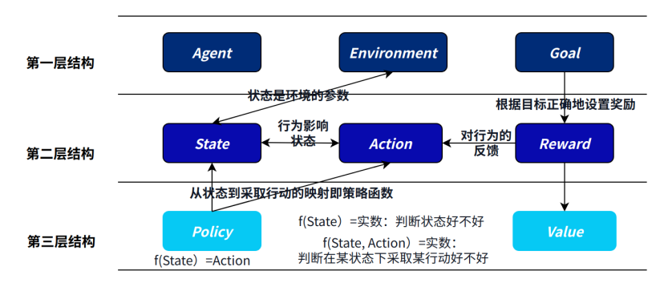

### 1.1 基本元素：Environment, Agent & Goal 环境，玩家与目标
这一层包括Agent与其所处的环境（Environment）之间的交互。环境是Agent所面对的外部世界，可以是现实世界中的物理环境，也可以是虚拟环境中的计算机模拟环境。玩家（Agent）通过与环境交互来实现其目标，目标通常由任务或问题定义。Agent需要通过与环境的交互来获取反馈（如奖励信号）并不断优化其行为。

下围棋为例子，环境：棋盘；Agent：棋手；目标：赢得棋局。

玩马里奥为例子，环境：马里奥游戏的画面 Agent：操作的马里奥 目标：吃金币/通关救出公主

### 1.2 主要元素：State & Action 状态与行为
在强化学习中，Agent通过感知环境获取当前的状态（State）信息，状态可以是环境的观测值或者内部的状态表示。Agent根据当前的状态选择合适的行为（Action）来与环境交互，行为是Agent在某个时刻从可能的动作集合中选择的具体动作。

下围棋为例子，状态：棋盘上目前的棋子分布情况。行为：要把这一步棋下在哪里。

玩马里奥为例子，状态：当前的画面，包括金币、怪物的分布行为：马里奥向左、向右、向上

### 1.3 核心元素：Policy & Value 策略与价值
策略（Policy）是Agent在特定状态下选择行为的策略，可以是确定性策略（确定性地选择一个行为）或者随机策略（根据概率分布选择行为）。价值（Value）是对不同状态或状态-行为对的评估，用于指导Agent的决策。

Agent根据策略和价值来选择行为，策略和价值的优化是强化学习中的重要任务。策略和价值的设计和更新会影响智能体的学习和决策过程。

下围棋为例子，Policy：棋谱告诉我们面对怎样的棋盘，我们应该怎么下；价值：如果下的某一步棋帮助我们奠定了胜局，那么它的价值就非常大。

马里奥游戏为例子，Policy就是根据当前的怪物、金币、机关分布，我们怎么操作马里奥任务。价值：如果走的某一步导致被怪物杀死了，价值就应该是一个非常大的负数。

## 2 强化学习的核心内容
### 2.1 学习一个好的价值函数，从而去决定一个好的策略
主流的RL算法一般是基于价值的。

### 2.2 是试错学习，而非记忆学习
### 2.3 具有延迟奖励的特点，贡献度分配很重要
例如，围棋的每一步棋对胜利都有贡献，但奖励一开始全都是0，得赢棋了才能兑现。那得到reward之后，之前每一步的value要怎么分配？ 这里涉及到贡献度分配的问题，复盘哪一步棋决定了胜势很关键。

### 2.4 Exploitation VS Exploration 
以DQN的训练过程为例，

**利用：**采用已有的价值函数，去选择价值最大的行动

**探索：**不按照目前已有的价值函数给出的价值最大的行动来，而是尝试去优化价值函数本身，去探索一些其他的选择

一个很经典的例子是老虎机问题。上帝视角看，老虎机A的期望是100，B的期望是50，C的期望是0。那么显然我们应该一直玩老虎机A；但是在强化学习中，我们其实不知道老虎机A、B、C的期望函数，只能通过实践去猜测。

假设我们把A、B、C各尝试了10次，这10次中，A的均值为30，B的均值为35，C的均值为-10。那么此时我们可以有两种选择：1、继续选择B。如果我们无数次的去尝试B，最终B的均值会逼近真实期望50，而50无疑比20和-10都要大，那么我们的学习结果就是，三个老虎机中B是最好的。

2、尝试B之外的其他选项，例如尝试一次A，这次A输出了数字140，假设一下子把均值拉到了40，那么它就超过了35。最终，因为我们在遵循既有策略（B）的同时也兼顾探索了其他策略（A），发现了A其实是最好的，那么我们可能就会避免因为只去遵守策略，最终收敛于了局部最优解B。

## 3 强学学习的数学表达
### 3.1 Return 回报
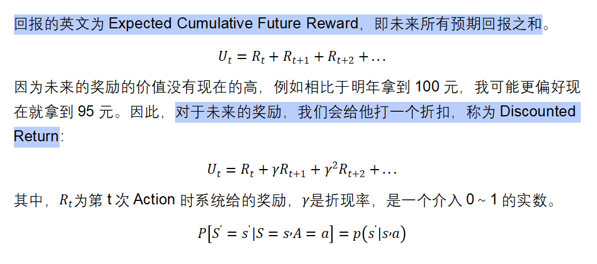

### 3.2 State Value Function状态价值函数
_**#**__**给状态**__**s**__**打分；也可评价政策**__**π**__**的好坏**_

状态价值函数，指的是在当前的状态和政策下，未来所有的奖励的折现值。

状态价值函数只和π与s有关，告诉了我们在目前的政策下，当前我们的处境怎么样，我们的胜算有多少。

是一个随机变量，随机的来源在于：状态的变化随机。

### 3.3 Action-Value Function 行为价值函数
_**#**__**给动作**__**a**__**打分**_

行为价值函数反映了：基于一个政策函数π，在一个状态下，采取一个行动的回报的期望值。

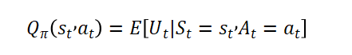

是一个随机变量，随机的来源在于：1、基于Policy函数，Agent的行为随机；2、状态的变化随机。

最优行为价值函数 Optimal Action-Value Function：指的不管政策怎样，当前的一步行为可以产生的回报的上限。

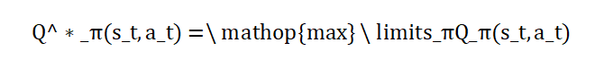

的直观意义在于抛开政策的影响，对一个行为做评估。

## 4 价值学习
价值学习的目的：去想办法近似出一个行为价值函数。

### 4.1 Deep Q Network
我们用一个神经网络去近似。

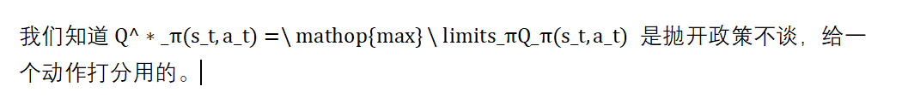

这个神经网络的输入就是当前的状态，如果我们在玩游戏，那么状态就是当前游戏的画面，我们通过卷积层把当前游戏的画面变成特征向量输入给神经网络；神经网络的输出则是输出一个给动作打分用的向量。假设当前在当前状态下，有3种可能的动作（left, right ,up)，那么神经网络的输出就会是一个三维向量，每一维向量的元素就是根据的思想对动作进行的打分。

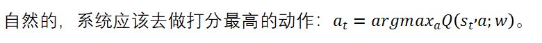

而后根据该动作，系统自动根据状态迁移函数。_**到了下一个状态后，继续往复上面的动作，用神经网络**__**给每一个动作打分，而后去做分数最高的动作。**_

### 4.2 强化学习中的梯度下降
上面讲清楚了DQN的基本思想，但问题在于，的参数一开始是随机初始化的，所以它是一个笨蛋裁判，根本就不懂怎么给动作打分。我们得想办法去训练这个网络，让这个裁判越来越专业，打分越来越准。

和前面的MLP等神经网络一样，用的其实也是梯度下降的算法。以下为例子：

从北京到深圳，模型Q(w)预计要q=1000分钟。实际旅程后，我发现只需要y=800分钟。误差200分钟，造成损失。

损失函数：

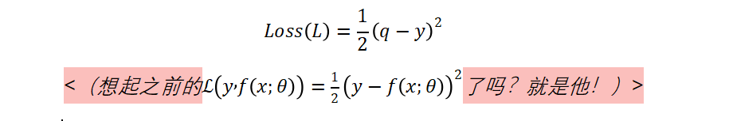

对损失函数求梯度：

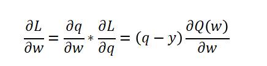

而后对参数w进行梯度下降：

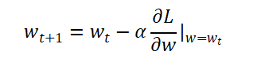

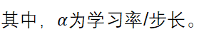

### 4.3 TD算法 Temporal Difference
_**TD**__**算法的直观感受**_

有没有这样一种算法，再让我还没有到达深圳的时候，就可以提前得到更好的估计呢？

假设我们从北京先到上海再到深圳。我们经过了500分钟到了上海，此时模型预测还需要400分钟到深圳。

那么，最初的预测：Q（w）=1000分钟；最新的预测：y=500分钟（Actual）+400分钟（Estimate）=900分钟。

此时，新的预测：900分钟被我们称为TD Target。TD Target也是一种估计，但有事实的成分，显然比一开始的1000更可靠。用TD target的话，就可以实现无需跑完整个路程，就实时更新参数了。

损失函数：

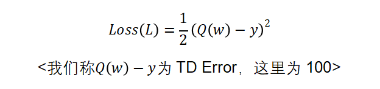

对损失函数求梯度：

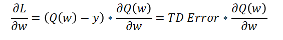

而后梯度下降即可。

_**DQN**__**中**__**TD**__**算法的数学表达**_

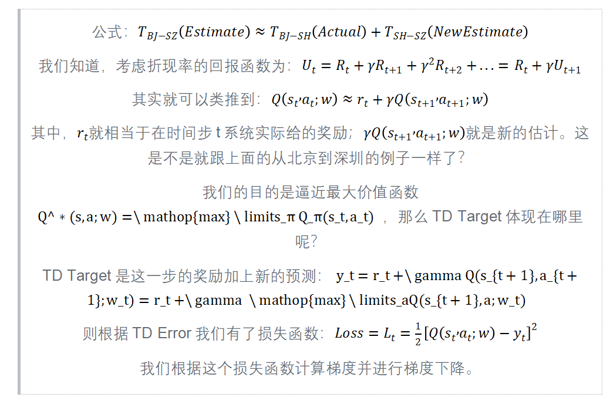

_**DQN**__**网络中**__**TD**__**算法步骤总结：**_

1. 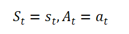

2. 预测：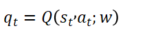

3. 求导：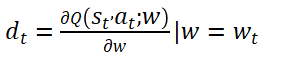

4. 根据当前的状态，决定了一个action，得到了一个奖励和新的状态

5. 既然有了新的State，我们就又可以用Q网络预测新状态下最优动作的预期回报：。从而我们可以计算TD Target：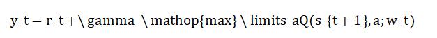

6. 有了TD Target自然就有了TD Error：，我们据此做梯度下降：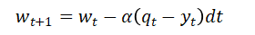

## 5 策略学习
策略学习算法是用一个神经网络去近似策略函数，并且该策略函数可以让尽可能得大。

具体略，因为文档是为语言模型服务的，学完价值学习、DQN和TD算法后，其实就已经对强化学习的基本原理有了解了。

| 值得注意的是，在RL中，我们可以使用奖励函数而不使用价值函数来训练策略，从而实现策略梯度算法。这种方法被称为纯粹的策略梯度方法（pure policy gradient methods）。也就是说，上面提到的东西中，Value是可以不要的。 |
| :--- |

> 更新: 2025-09-22 09:58:29  
> 原文: <https://www.yuque.com/aaron-wecc3/dhluml/daoi8mxqc6n6dgfm>