# 96.seq2seq与Attention面试题

## 常见面试题
1. seq2seq结构：以其在NMT中的应用为例
2. 为什么训练和预测时的Decoder不一样？
3. 计划采样 Scheduled Sampling
4. 贪心算法 VS Beam Search
5. 注意力机制 Attention
6. 朴素seq2seq的信息瓶颈
7. Attention机制的直观理解
8. Attention机制的数学表达
9. 向量的点积操作
10. Attention机制的步骤
11. Attention机制带来的好处
12. NMT确实牛，但还有一些问题
13. Attention开始变为深度学习的一种通用技术
14. Attention机制中点积操作的矩阵

细讲seq2seq对了解大语言模型有重大的意义：它启发了序列自编码器，这对于后来出现的NLP的自监督学习很有意义。而且Encoder-Decoder的架构也在Transformer里出现。

_#Attention在一开始是一个对基于__RNN__的seq2seq模型的改进技巧。当然，后面出现了放弃了RNN，只保留了Attention的剧情，大家应该都提前知道了。_

## 1 ** seq2seq结构：以其在NMT中的应用为例**
seq2seq是一个很强大的模型，不但可以用来做机器翻译，还可以用来做很多NLP任务，比如自动摘要、对话系统等。不过它最早是用来做机器翻译的，而且翻译确实是一个很经典的场景，所以这里我们先拿翻译举例。

神经机器翻译（NMT）用了seq2seq的结构，它的另一个常见的名字是编码-解码器（Encoder-Decoder）结构。

叫seq2seq的原因，在于其输入和输出都是一个词序列。那就是sequence to sequence，即seq2seq。<_所以正确读音是 /si:k-tu:-si:k/噢！不要读错了_>

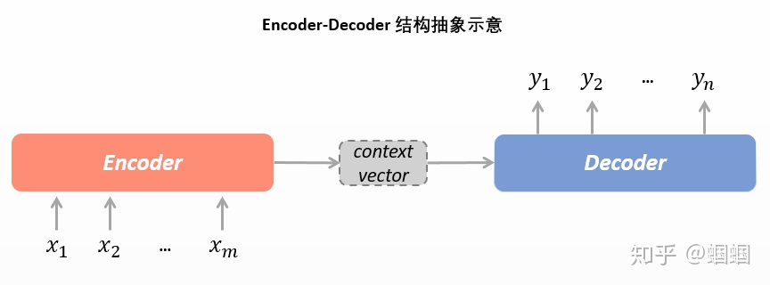

+ **编码器**** Encoder：**读取输入文本，将输入的文本（词序列）整体编码成一个表示向量，而后交给Decoder进行解码。在编码器中，输入的词会变成一个one-hot向量，而后经过Embedding层投射到一个（512维的）向量空间，随后输入到RNN的结构里面去（这个RNN一般是LSTM，而且可以是双向等结构，而且可以有很多层，即把神经网络搞的很深，从而可以去提取更高级的特征）。
+ **Context Vector：**经过了编码器中的RNN的一系列计算，输出来的对源文本整体的一个表示向量。
+ **解码器****Decoder****：**接受编码器编码出的输入（以及标准答案的词序列），自行生成文字**。**在NMT中，Decoder的输出是预测出的词的序列，但输入在训练和预测时有所不同。

| 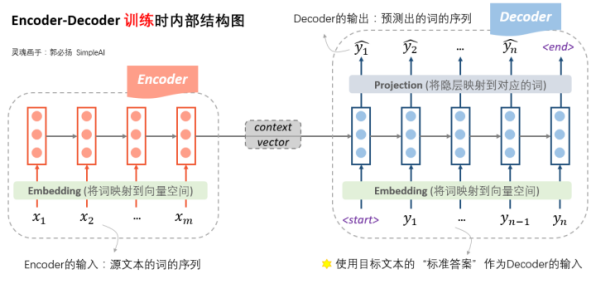 _#Encoder __RNN__负责对源语言进行编码，学习源语言的隐含特征。Encoder RNN的最后一个__神经元__的隐状态作为Decoder RNN的初始隐状态。_ | 1. **训练时：**接受编码器给出的表示向量和“标准答案”作为输入。参考左图，根据第一个输入<start>符号和编码器送来的表示向量，先生成了预测结果。而后，根据第二个输入符号（而不是前一步的预测结果），我们生成预测结果. 很好理解，那么损失函数就是前一步最终生成的整个词表的概率分布与标准答案对应的one-hot向量的交叉熵函数，我们基于这个损失函数对RNN网络做梯度下降，从而让模型预测的越来越准。 |
| :---: | --- |

| 1. **预测时：**自产自销，每一步预测的结果，都送给下一步作为输入。这样的输出方法我们称为**自回归（Auto-regressive）**。参考下图，根据第一个输入<start>符号和编码器送来的表示向量，先生成了预测结果。而后，根据前一步的输出（而不是标准答案），我们生成预测结果.后面我们会知道，GPT就是一个自回归的文本生成模型。自回归形式天然适合Generative的 场景，这不难理解，就像是我们写文章是从左往右边写边想的一样。 | 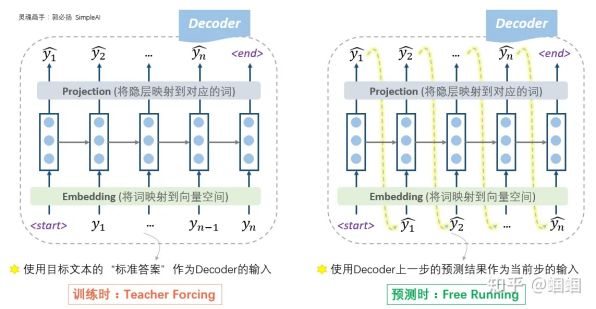 _**#Decoder的初始隐状态是基于Encoder RNN的输出，所以我们把Decoder称为一个条件语言模型。**_ |
| --- | :---: |

## 2 **详解Decoder：他就是个语言模型！**
### 2.1 **为什么训练和预测时的Decoder不一样？**
Decoder在训练时是根据标准答案做输出，而预测时则是在自产自销。为什么要做这种区分呢？

这里其实涉及到两种不同的Decode方式：

+ 根据标准答案来Decode的方式，我们称为**Teacher Forcing。**
+ 根据上一步的输出作为下一步输入的Decode方式，**Free Running。**

_“其实，free running的模式真的不能在训练时使用吗？——当然是可以的！从理论上没有任何的问题，又不是不能跑。但是，在实践中人们发现，这样训练太南了。因为没有任何的引导，一开始会完全是瞎预测，正所谓“一步错，步步错”，而且越错越离谱，这样会导致训练时的累积损失太大（「误差爆炸」问题，exposure bias），训练起来就很费劲。这个时候，如果我们能够在每一步的预测时，让老师来指导一下，即提示一下上一个词的正确答案，decoder就可以快速步入正轨，训练过程也可以更快收敛。因此大家把这种方法称为teacher forcing。所以，这种操作的目的就是为了使得训练过程更容易。”By 知乎用户_[_蝈蝈_](https://www.zhihu.com/people/guo-bi-yang-78)

### 2.2 **计划采样 Scheduled Sampling**
Decoder一上来就瞎预测自己来跑，就像是我们高中盲目刷题，在完全没有老师指导的情况下不断积累自己瞎jb写题产生的经验，可能越走越偏；一直按照标准答案来训练，就像高中刷题时一直看着正确答案来写，如果真上了高考考场，没了标准答案，那就忽然蒙圈了。。

所以，更好的办法，也是更常用的办法，是老师只给适量的引导，学生也积极学习。

**计划采样**：我们设置一个概率p，每一步，以概率p靠自己上一步的输入来预测，以概率1-p根据标准答案来预测。

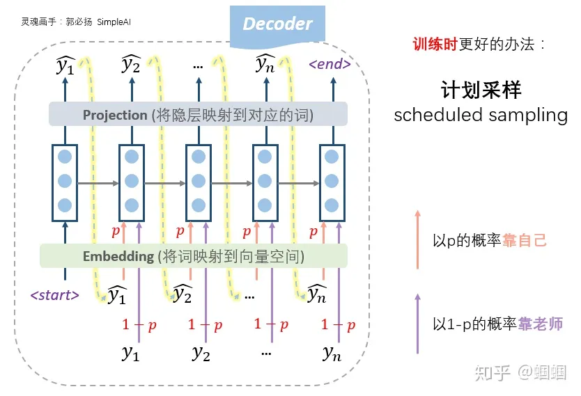

### 2.3 **贪心算法 VS Beam Search**
#### 1 **Greedy Decoding**
如果我们每一步都预测出概率最大的那个词，而后输入给下一步，那么这种方式我们就称之为Greedy Decoding。

但是Greedy Decoding这件事情肯定存在一些问题。

比如，你用你的手机输入法去打字的时候，它也是会猜你的下一个词，并且按概率排序的！那如果我们一直点击输入法给你推荐的第一个词……

eg.我用iPhone打了“不要”两个字，而后一直只点击苹果系统自带输入法推荐的第一个词。就有了下面这段文字：

| 不要再来了，我们的生活方式是什么时候回来呢，我们的生活方式是什么时候回来呢，我们的生活方式是什么时候回来呢，我们的生活方式是什么时候回来呢，我们的生活方式 |
| :--- |

嗯，甚至还循环起来了。这可真蠢！

这其实体现了贪心算法的一个问题：Greedy只能保证每一步是最优的，但却无法保证预测出来的句子整体是最优的。特别是如果在时刻贪心选择的词不是全局最优，会导致时刻往后的所有预测词都是错误的，这样就没有回头路了。为了解决局部最优全局最优的问题，我们常常会采用Beam Search方案。

#### 2 **Beam Search**
Beam Search的思想是每一步都**多选几个可能的序列**作为候选，最后综合考虑，选出最优组合。

具体方案如下：

| 1. 设定候选集大小 Beam size = k（右图中，k=2;实践中，k一般等于5～10） 2. 对于每一个时间步，我们会以当前概率最高的k个序列集作为输入，各自预测概率top-k的下一个词，从而产生个候选序列。在这个候选中，我们留下k个概率上最有可能的序列集，作为下一步的输入。<一定要注意，这里的Top-k不仅是指一个序列集的k个最高概率的，还指最终会从的序列集中留下k个得分最高的序列>（参考右图，t=3的时间步时，top2是[he hit]和[I was]，所以下一步时是这两个序列继续预测下一个词，并且产生四个概率最大的分支；[he stuck]和[I got]会被剪枝，保证beam search过程的复杂性不会指数放大） | 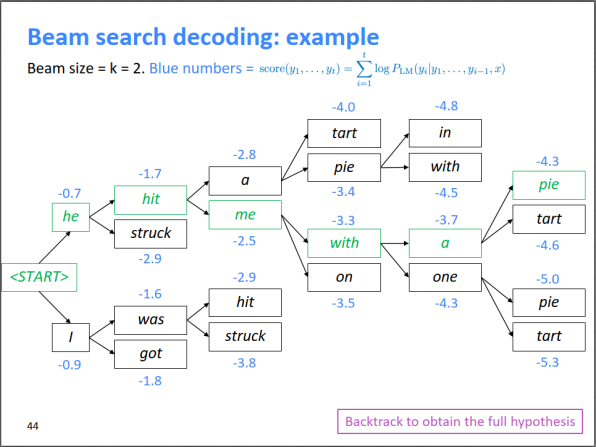 |
| --- | :---: |

+ 在beam search的过程中，不同路径预测输出结束标志符<END>的时间点可能不一样，有些路径可能提前结束了，称为完全路径。我们会暂时把这些完全路径放一边，其他路径接着beam search。
+ Beam search的停止条件有很多种，可以设置一个最大的搜索时间步数，也可以设置收集到的最多的完全路径数。当beam search结束时，需要从n条完全路径中选一个打分最高的路径作为最终结果。
+ 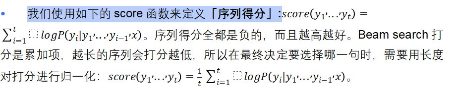
+ Beam search作为一种剪枝策略，并不能保证得到全局最优解，但它能以较大的概率得到全局最优解，同时相比于穷举搜索极大的提高了搜索效率。

## 3 **注意力机制 Attention**
### 3.1 **朴素seq2seq的信息瓶颈**
| 朴素的seq2seq神经机器翻译模型中，我们用Encoder RNN的最后一个神经元的隐状态作为Decoder RNN的初始隐状态。这里存在一个问题：Encoder的最后一个隐状态（Context Vector）承载了源句子的所有信息，成为整个模型的“信息”瓶颈。 其实不妨去想一想，在Encoder的RNN中，编码完il、a、m'的时候，中间都是有隐向量、、，但最后输入给解码器的只有最终的。有没有这么一种可能，在解码器输出“hit”这个词的时候，相比于用被更新过的，其实用原始的或者，效果反而会更好？ | 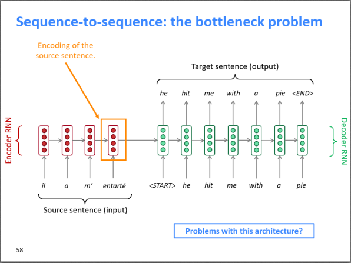 |
| :--- | :---: |

_注意力机制就是希望打破这个信息瓶颈。宏观来看，Attention直接把Decoder中的每一个隐层，和Encoder中的每一个隐层，都连接起来了！_

### 3.2 **Attention机制的直观理解**
| 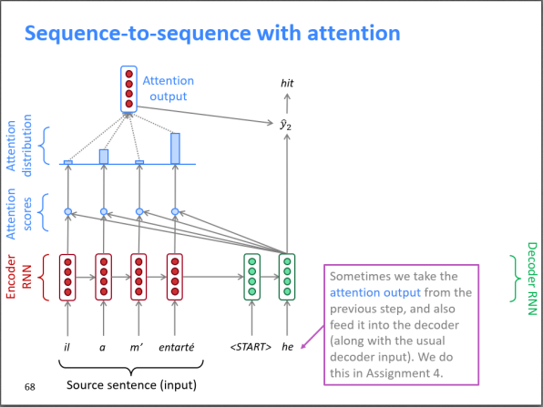 | _前面提到了，“Attention直接把Decoder中的每一个隐层，和Encoder中的每一个隐层，都连接起来了。__”_这样的话，Encoder RNN的最后一个隐状态就不再是“信息”瓶颈了。 我们在解码的时候，是一个词一个词生成的。对于每一个词，它不仅可以接受Context Vector作为辅助信息, 也可以通过“直连”线路去获取Encoder RNN中的其他的隐状态的信息，从而Decoder的解码进行辅助。 参考左图中的Decoder的第二个时间步，我们以he为输入，并且综合考虑了il、a、m'、entarte的隐状态。可见，"he"时刻的注意力主要分布在Encoder的第2和第4个词上，解码器最终做出了输出hit的决定。 |
| :---: | :--- |

### 3.3 **Attention机制的数学表达**
#### 3.3.1 **向量的点积操作**
点积（Dot product）是线性代数中的一种运算，它是同维两个向量之间的一种运算方式，通常用符号“·”表示。

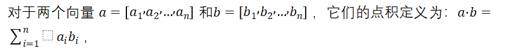

也就是说，点积将两个向量中对应位置的元素相乘后再求和。因此，点积的结果是一个标量（Scalar），表示两个向量的相似程度或者两个向量在同一方向上的投影长度。

总之，我们需要知道两件事：_**1、点积的结果是一个标量 2、点积的结果反映了两个同维向量的相似程度 **_

#### 3.3.2 **Attention机制的步骤**
1. 在时刻, Decoder有隐状态，同时也有Encoder所有时刻的隐状态。我们将和所有的编码器的隐状态分别做点积，得到N个**标量Attention score（注意力得分）**_。<#这N个标量构成一个N维向量，它反映了解码器中当前时间步的隐状态与编码器中各个时间步的隐状态的相关性打分。>_

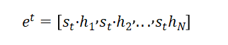

2. 我们使用Softmax对这些权重进行归一化（这些隐状态的和为一），就得到**Attention distribution（注意力分布）**。就像任何通过Softmax函数得到的向量一样，Attention Distribution也是一个概率分布。这个Attention distribution告诉了Decoder在时刻，更应该把“注意力”放在Encoder的哪些隐状态上。

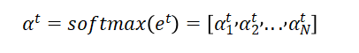

3. 接下来，我们对Encoder所有隐状态使用Attention distribution进行加权求和，得到**Attention output（注意力输出）**。<既然注意力分布是一个概率密度函数，那注意力输出其实很类似数学期望>。

解码器t时刻的注意力输出：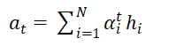

1. 把注意力输出把和该时刻的隐状态拼起来，再进行非线性变换，就得到输出。

#### 3.3.3 **Attention机制带来的好处**
想象机器要翻译这么一句话：The animal didn't cross the street because it was too tired. 

it指的是谁呢？是street，还是animal？根据下图，我们可以看到，解码器处理it这个词的时候，注意力机制能够让it和“The animal”关联起来，并将其融入到it的编码中。

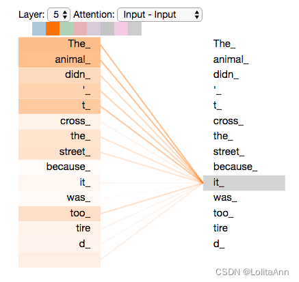

_图源_[_Ann's Blog_](https://lolitasian.blog.csdn.net/)

在seq2seq架构中，Attention机制可以带来以下好处：

1. 解决了信息瓶颈问题：在传统的seq2seq模型中，编码器将整个源序列编码为一个固定长度的向量；而Attention机制可以让解码器在每个时间步上，根据源序列中不同位置的信息进行不同程度的“聚焦”，充分利用源序列中的信息，提高模型的表现。
2. 提高处理长序列的能力，提升模型的泛化性能：Attention机制可以使模型对输入序列的长度更加鲁棒，不会因为输入序列长度的变化而影响模型的性能。这是因为Attention机制会根据不同的输入序列长度自适应地调整“聚焦”的程度，使得模型可以有效地处理不同长度的输入序列。
3. 增加模型的可解释性：Attention机制可以让我们更加直观地理解模型在生成每个输出时“关注”了源序列中的哪些部分，并且可以通过可视化Attention权重来直观地观察模型的注意力分配情况，从而更好地调试和优化模型。例子可以参考上面的可视化图。
4. 提高翻译效果：在机器翻译任务中，Attention机制可以将源序列中与目标序列有关联的部分显式地“聚焦”，从而提高翻译效果。例子同样参考The animal didn't cross the street because it was too tired的翻译。
5. 有助于缓解梯度消失问题，因为Decoder的每一时间步都和所有Encoder的隐状态相连了。

| 自从seq2seq和NMT横空出世以来，机器翻译取得了巨大的进展。从前的机器翻译的至高点——SMT（统计机器翻译）都是极其复杂的，涉及到大量的特征工程，海量的专家知识，无数的资源积累，繁多的功能模块，还需要庞大的人力去维护。现在直接被一个很深很深的神经网络干翻在地！大量特征工程师&语言专家失业SOS |
| :--- |

## 4 **拓展问题**
### 4.1 **NMT确实牛，但还有一些问题**
seq2seq用于神经翻译，在性能上肯定是非常优秀的，但它依然存在一些问题：

| 1. 领域不匹配。很多时候，我们在Wikipedia、论文、新闻稿等这种比较正式的语料库中训练，那么用来翻译Twitter，甚至在游戏国际服里和外国人的交流这种口语或者非正式语料时，就会有问题。 2. 长文本的翻译，目前介绍的都只是翻译一个句子，句子相对来说还是比较短的，如果要翻译一篇论文或一本书，那么怎样考虑非常长距离的上下文依赖关系？ 3. 对一些惯用语、俚语等翻译容易闹笑话（说曹操，曹操到；笑死我了；等等） **讲这些的目的其实还是想要铺垫后面的预训练大语言模型。** |
| --- |

### 4.2 **Attention开始变为深度学习的一种通用技术**
| 现在，Attention已经变成了DL的一个的通用技术，并不局限于seq2seq和机器翻译。其一般的定义是： 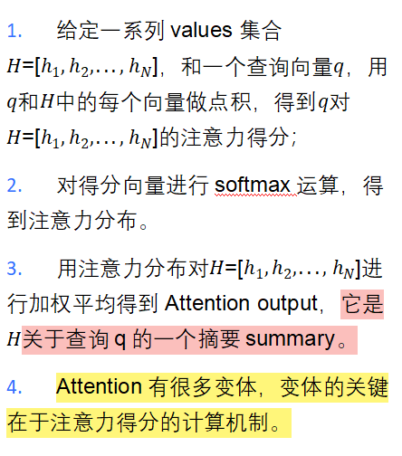 | 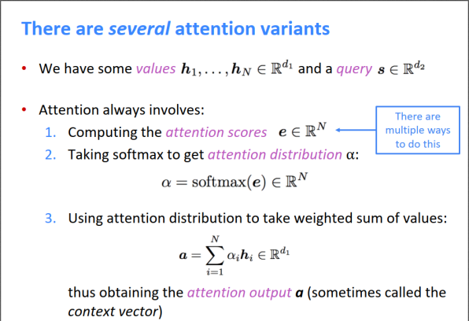 |
| :--- | :---: |

#我把Attention的矩阵运算给折叠了，因为基本是纯数学，感兴趣的话再自己打开看吧！

### 4.3 **Attention机制中点积操作的矩阵运算**
3中，我们在seq2seq里首次提到了注意力机制，我们知道了在Attention机制中，点积操作用于计算输入序列和输出序列中每个位置的相关性得分。在seq2seq里参与点积的分别是Encoder中每个时间步的隐状态和Decoder中每个时间步的隐状态。

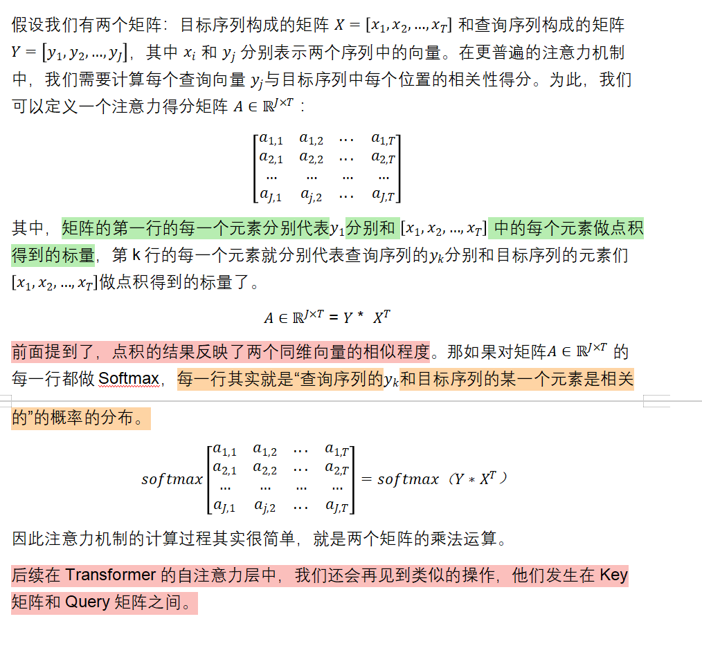

> 更新: 2025-09-30 09:37:23  
> 原文: <https://www.yuque.com/aaron-wecc3/dhluml/gdwdnd190olv9dku>