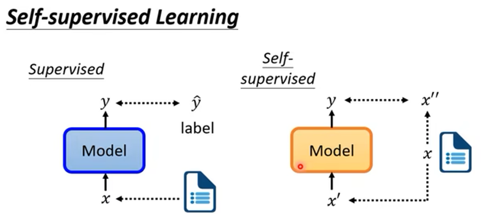
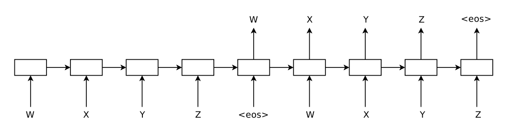

# 97.预训练模型面试题

## 常见面试题
1. 迁移学习Transfer Learning
2. 为什么要有预训练？
3. 预训练模型用于下游任务的策略：固定特征提取器
4. 预训练模型用于下游任务的策略：Fine-Tuning
5. 为什么在NLP中迟迟没有出现类似CV预训练的范式？
6. 序列自编码器和语言模型
7. 序列自编码器 Sequence Autoencoder
8. 序列自编码受到了seq2seq的启发
9. 序列自编码器的无监督特性
10. 半监督预训练：利用有标注和无标注数据联合训练

_**自监督学习**__**：对于样本x，自动生成一个输入x'和该输入理应对应的输出x''（往往是Ground Truth）。模型根据x'输出了y，而后y和Ground Truth x''做交叉熵损失函数，而后**__**反向传播**__**。**_

在这一章中我们要介绍一篇很重要的论文。我们知道，GPT的全称是Generative **Pretrained** Transformer；2018，GPT和BERT的提出把NLP带入了**预训练**的时代。那么什么是预训练？什么是我们经常说的预训练+微调（Fine-tuning）的范式？在第8、第9章，我们会讲明白这些事。

用半监督学习/自监督学习去预训练一个语言模型是RNN时代NLP的一个非常天才的想法。具体论文参考：[半监督学习（Semi-supervised Sequence Learning)](https://arxiv.org/abs/1511.01432)。**下面这段是文章的摘要：**

| We present two approaches that use unlabeled data to improve sequence learning with recurrent networks. The first approach is to predict what comes next in a sequence, which is a conventional language model in natural language processing. **The second approach is to use a sequence ****autoencoder****, which reads the input sequence into a vector and predicts the input sequence again****.** These two algorithms can be used as a "**pretraining**" step for a later supervised sequence learning algorithm. In other words, **the parameters obtained from the unsupervised step can be used as a starting point for other supervised training models****.** In our experiments, we find that long short term memory recurrent networks after being **pretrained **with the two approaches are more stable and generalize better. With **pretraining**, we are able to train long short term memory recurrent networks up to a few hundred timesteps, thereby achieving strong performance in many text classification tasks, such as IMDB, DBpedia and 20 Newsgroups. |
| :--- |

_#这篇论文的价值非常高，在那个__Transformer模型__还没有出现的2015年，__RNN__统治__NLP__的年代，它率先给出了基于__无标签样本__做__自监督学习__从而预训练一个RNN的__范式__。我认为它就是RNN时代的__BERT__和__GPT__。_

## 1 **预训练模型**
_#Note：预训练不一定是无监督的，但通常情况下预训练是指在大规模数据集上进行无监督的预训练。_

### 1.1 **迁移学习Transfer Learning**
+ 迁移学习（Transfer Learning）是一种机器学习技术，通过将在一个领域**（源领域）**中训练好的模型应用到另一个领域**（目标领域）**中，从而改善另一个领域的学习性能，加速在新领域中的学习过程。
+ 在传统机器学习中，通常需要在目标领域中收集大量的数据并训练针对目标场景模型，但目标场景的标注数据可能是稀缺的。迁移学习利用了在源领域中学到的知识，通过从一个领域向另一个领域传递知识，可以解决在目标领域数据稀缺、标注困难或者模型难以收敛等问题。

### 1.2 **为什么要有预训练？**
_#__迁移学习__和预训练是密切相关的概念，预训练可以被视为是迁移学习的一种特定形式。_

**预训练**是指在一个大规模的数据集上训练一个神经网络，并将训练好的模型参数作为下游任务的初始参数。

其中，在大规模的数据集上，我们可以让神经网络学到很多共性信息；而后，在这些共性信息的基础上（以之前用共性信息训练出来的模型的参数，对现在的下游任务的模型进行参数初始化），再学习一些小规模的垂直细分的数据，从而让模型能够去胜任一些特定的任务。

下面的文字引自：[【NLP预训练】深入理解“预训练”语言模型](https://zhuanlan.zhihu.com/p/159620066) By [潘小小](https://www.zhihu.com/people/pan-xiao-xiao-66-14)

| 如果想用一句话讲清楚“预训练“做了一件什么事，那我想这句话应该是<u>“使用尽可能多的</u><u>训练数据</u><u>，从中提取出尽可能多的共性特征，从而能让模型对特定任务的学习负担变轻。”</u> 如果用一句话来概括“预训练”的思想，那么这句话可以是： 1. 模型参数不再是随机初始化，而是通过一些任务（如语言模型）进行预训练 2. 将训练任务拆解成共性学习和特性学习两个步骤 |
| :--- |

### 1.3 **预训练模型用于下游任务的策略：固定特征提取器**
_#将预训练好的模型用于下游任务通常有两种策略，一种是固定特征提取器，一种是基于微调。_

+ 固定特征提取器（Fixed Feature Extractor），即将预训练好的模型的权重冻结，只使用其特征提取器提取下游任务数据的特征，然后将这些特征输入到下游任务的模型中进行训练。总之，冻结原来的参数，只训练一个新的分类层。这种策略适用于下游任务的数据量较少的情况，可以避免过拟合。

在CV里，大家经常把预训练好的CNN作为特征提取器用于各种下游任务场景。第三章里提到，CNN是一种CV里非常常用的模型，通常使用大规模的有标注图像数据集（eg. ImageNet）进行预训练，从而学习到通用的特征表示。

预训练好的CNN模型可以作为一种通用的特征提取器。做法如下：

1. 在下游任务中，使用预训练好的CNN模型作为特征提取器，将输入图像经过CNN模型得到高维的特征向量。
2. 在特征向量的基础上，训练一个新的分类器、检测器或分割器等，以适应新的任务要求。
3. 对于图像分类任务，可以使用全连接层或者SVM等简单的分类器；对于目标检测任务，可以使用锚框（anchor）和区域提取网络（Region Proposal Network，RPN）等技术；对于图像生成任务，可以使用生成对抗网络（Generative Adversarial Networks，GAN）等模型对特征向量进行生成。

### 1.4 **预训练模型用于下游任务的策略：Fine-Tuning**
**微调（Fine-tuning)**是一种迁移学习方法，指在预训练模型的基础上，对部分或全部的参数进行微小的修改，以适应新的任务。微调一般是在有监督学习的框架下进行的。

_**微调过程通常包括：**_

1. 预训练模型的参数通常被初始化为预训练时的值
2. 使用下游垂直任务的标注数据来对模型进行进一步的训练，并调整模型的超参数和学习率等参数。以适应特定的任务模型。_Note：这个过程中，我们会采用一些针对下游任务的目标函数。_
3. 在训练的过程中，逐步调整参数，以最小化下游任务的损失函数，从而在特定任务上表现更好。

预训练模型的权重在新数据上进行训练微调可以在整个神经网络上完成，也可以只在一部分神经网络层上完成。在这种情况下，我们称未被微调的层被**“冻结”（Frozen），**即在反向传播步骤中不更新。

_**微调是一个比较复杂的工程，需要很多工程know-how：**_

1. 过拟合（主要挑战）：微调通常涉及到在相对较小的数据集上训练预训练模型，因此很容易发生过拟合，从而在未见过的数据上产生较差的性能。
2. 数据集：微调需要大量的标注数据，而这些数据应该具有代表性和多样性，能够充分反映下游任务的特征。
3. 超参数调整：微调需要对模型的各种超参数进行调整，例如学习率、batch size、正则化等，以适应下游任务。
4. 优化算法：优化算法就是决定在更新参数时如何调整步长、方向等因素，以最小化损失函数的值。随机梯度下降是最常见的优化算法。微调时，模型可以采用与预训练时相同的优化算法，或者根据下游任务的特点选择不同的优化算法。

### 1.5 **为什么在NLP中迟迟没有出现类似CV预训练的范式？**
_**Q：2018年前，**__**迁移学习**__**在**__**NLP**__**中的运用情况如何？**_

我们知道，直到2018年，ULM-FiT、GPT和BERT模型的出现才开启了NLP预训练模型的时代，才真正实现了CV领域那样的迁移学习方法在NLP领域的应用。那么，是不是说2018年前NLP领域就没有迁移学习呢？

答案是，这个说法是非常不准确的！就如我们在6.4.3里预告的，word2vec其实就是NLP中迁移学习运用的祖师爷，它可以利用大规模的未标注文本数据进行训练，从而可以学习到非常通用的单词向量表示。由于word2vec的成功，迁移学习范式已经成为了NLP领域的标配！

_**Q：那为什么我们会说，**__**NLP**__**一直没有一个类似**__**CV**__**的**__**迁移学习**__**范式**__**？**_

+ 这是因为，虽然word2vec是将迁移学习引入NLP领域的先驱之一，但是它主要关注的是单词级别的表示学习，而不是针对具体任务的模型迁移。也就是说，在面对一个NLP任务的时候，word2vec可以让我们快速解决从词元到词嵌入的那两层神经网络（对于一个包含V个单词的词典，如果我们用N维稠密向量来表示每一个词，那么word2vec模型其实就是压迫去学习一个V×N的矩阵），但也仅此而已了。很长一段时间内，NLP研究者们依然需要针对每个具体的NLP任务训练不同的模型。

| NLP中虽然也有一些预训练模块，比如预训练词向量，然后用到具体的NLP任务中，但也仅仅是将词向量作为下游模型的输入。在NLP中，并没有一个基础模型（包括模型的结构、权重等），能把整个基础模型迁移到下游任务进行微调，现在都是针对不同的问题设计专门的网络结构，比如POS、NER、NMT等，处于不同任务各自为政的局面。——Beeder in [CS224N(3.5)Multitask Learning | bitJoy](https://bitjoy.net/2020/03/14/cs224n%ef%bc%883-5%ef%bc%89multitask-learning/) |
| :--- |

+ 相比之下，在CV中，迁移学习经常是基于模型层级的。在解决一个新的CV任务时，大部分特征提取的工作都可以用以前预训练完的CNN做完，工程师只需要给原来的CNN加一层全连接层，或者做Fine-tuning，就可以了。像CV领域那样如此方便的使用预训练模型来进行迁移学习一直是NLP领域研究人员的一个愿望。

_**Q：那为什么模型迁移这件事在**__**NLP**__**迟迟没有发生？**_

**CV****：图像数据集巨大，而且任务几乎都是以分类为基础**

+ 在计算机视觉领域中，图像数据集非常大且丰富，例如ImageNet数据集就包含了数百万张图像。很多模型都会在ImageNet上预训练，然后迁移到具体的任务中进行微调。
+ 这种方式能够成功的原因是很多CV任务几乎都是以分类为基础任务，分类相当于CV的积木（building block），所以在ImageNet上训练的CNN分类模型迁移到其他CV任务中能起到很好的提升效果

**NLP****：预处理文本数据成本非常高，而且任务种类繁多**

+ 文本数据通常需要进行分词、词性标注、命名实体识别等预处理步骤，这成本实在是太高了，所以自然语言数据集往往都比较小。
+ 语言本身的复杂性增加了预训练模型的训练难度。在6.2中我们提到了很多NLP的基本任务，在6.3.3中我们提出了对语言模型的诸多期待，这些都足以体现语言有多复杂，它不像CV一样几乎都以识别+分类为目的。
+ 因此，在NLP领域中，早期的研究主要集中在手工设计特征和模型架构上，例如基于词袋模型和n-gram模型的文本分类方法，以及基于递归神经网络和长短时记忆网络的序列建模方法。由于没有一个普适的、可以即插即用的预训练模型，NLP的学者们花了很多时间重复造轮子，相较于CV，研究一直处在一个很初级的阶段。

## 2 **序列自编码器和语言模型**
在我们要介绍的这篇论文中，作者设计了两个方法来预训练一个LSTM网络。

| We present two approaches that use unlabeled data to improve sequence learning with recurrent networks. The first approach is to predict what comes next in a sequence, which is a conventional language model in natural language processing. The second approach is to use a sequence autoencoder, which reads the input sequence into a vector and predicts the input sequence again. |
| :--- |

如果用语言模型的预训练参数来初始化LSTM，那么它就叫LM-LSTM；如果用序列自编码器的预训练参数来初始化LSTM，那么它就叫SA-LSTM。

---

### 2.1 **语言模型 LM-LSTM**
语言模型非常好理解，无非是基于一个已有的词序列，做下一个词的预测。

| 希望大家在这里不要混淆一个概念，即语言模型。语言模型不只是一个最终的模型（Like GPT-3)，语言模型它就是预训练任务本身！**语言模型即“预测下一词”，它本身就是一个很重要的预训练任务。** |
| :--- |

+ 一个标准的LSTM语言模型由三个部分组成：输入层、LSTM层和输出层。输入层接收输入序列，将其转换为嵌入向量。LSTM层是一个标准的LSTM单元，它接收输入向量序列，生成相应的隐藏状态序列。输出层将LSTM层的隐藏状态作为输入，并生成每个时刻的下一词预测。
+ 与标准的LSTM模型不同的是，LM-LSTM还包括一个语言模型的部分，用于在无监督的方式下预测文本序列。因为是自监督学习，一开始就有一个完整的词序列，所以LM-LSTM使用双向了LSTM来生成每个时刻的上下文向量，然后使用这些向量作为输入来预测当前时刻的单词。这个语言模型可以被用于在半监督学习中，利用未标注的文本数据来预训练LM-LSTM模型。

### 2.2 **序列自编码器 Sequence Autoencoder**
#### 2.2.1 **序列自编码受到了seq2seq的启发**
序列自动编码方法受到seq2seq工作的启发。<前文提到了seq2seq在NMT的运用。事实上，seq2seq是一个很强大的方法，还可以用于文本解析、图像字幕、视频分析、语音识别和对话建模等等。>

seq2seq方法的关键是使用递归网络作为编码器，将输入序列读入隐状态，作为预测输出序列的解码器递归网络的输入。在中译英的神经机器翻译中，编码器编码中文，解码器试图重构原序列为英文。_**那么可不可以这样：不让解码器去生成一个新的东西，而是试图利用编码器编码的向量，去重构原来的序列自身呢？**_

序列自动编码器就是这样子的思路。相较于传统的seq2seq，序列自编码器是一个无监督的学习模型，其目的是重建输入序列本身（这样就可以在不需要任何额外标注的情况下计算出损失函数，进行梯度下降）。在序列自动编码器中，**解码器****网络和编码器网络的权重参数是共享（相同）的**。

#### 2.2.2 **序列自编码器的无监督特性**
序列自动编码器的一个重要特性是它是无监督的，因此可以用大量的未标记的数据来训练以提高其质量。论文的结果是，额外的无标签数据可以提高递归网络的概括能力。

序列自编码器产生了怎么样的效果呢？参考下文：

| We find that the weights obtained from the sequence autoencoder can be used as an initialization of another supervised network, one which tries to classify the sequence. We hypothesize that this is because the network can already memorize the input sequence.  |
| :--- |

也就是说，通过无监督学习训练的序列自动编码器得到的权重，可以作为另一个基于有监督学习的序列分类网络的初始化参数，这可能是因为序列自编码器的RNN网络记住了喂给它的序列们。

### 2.3 **半监督预训练：利用有标注和无标注数据联合训练**
+ **半监督（Semi-supervised)预训练**，指同时利用有标注数据和无标注数据来进行预训练。半监督预训练的目标是利用有标注数据来辅助无标注数据的学习，从而提高模型的性能。
+ 以LM-LSTM为例，LM-LSTM模型可以同时处理带标签和不带标签的数据，通过联合训练来提高模型性能。如果我们要训练一个用于序列标注的LSTM，那么LM-LSTM模型可以使用带标签的数据来训练序列标注任务，并使用未标注的数据来训练语言模型部分。通过联合训练，LM-LSTM模型可以从未标注的数据中学习到更多的特征表示，从而提高序列标注任务的性能。

> 更新: 2025-09-30 09:37:23  
> 原文: <https://www.yuque.com/aaron-wecc3/dhluml/scgemvyfgbksy73v>