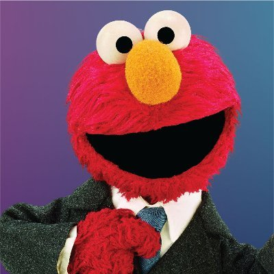
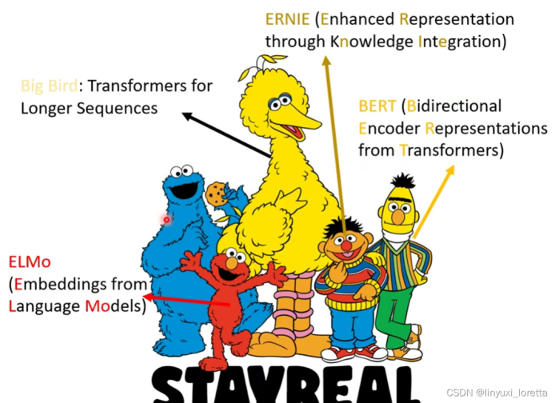
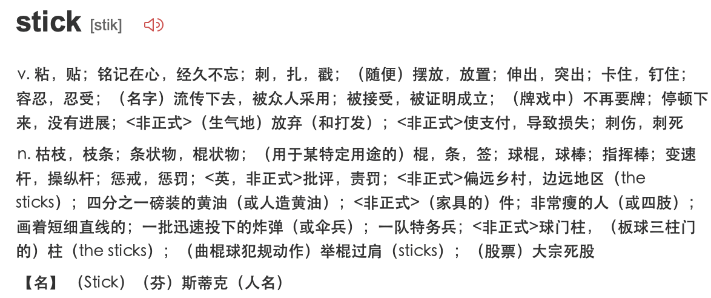
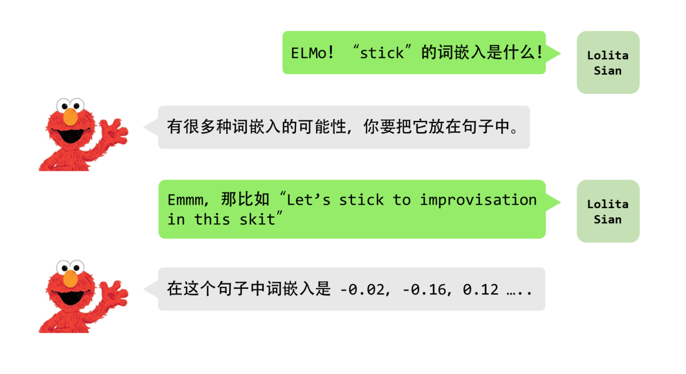
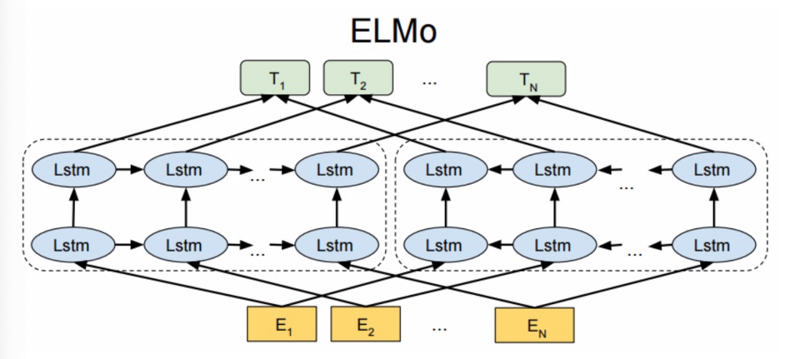

# 98.Embedding模型面试题

## 常见面试题
1. ELMo模型的意义
2. word2vec的局限性
3. 语境化词嵌入
4. ELMo模型的结构
5. 字符嵌入层（Character Embeddings Layer）
6. 双向LSTM层（Bidirectional LSTM Layer）
7. 上下文相关词向量层（Contextualized Word Embeddings Layer）
8. 输出层（Output Layer）
9. 总结ELMo  

图解 ELMo：Embedding的新纪元（2018.2）

|  _图中这位就是大名鼎鼎的ELMo啦！这里是ELMo的诞生：_[_【arxiv】Deep contextualized word representations_](https://arxiv.org/abs/1802.05365)_。Hi ELMo！_ |  _ELMo是美国家喻户晓的动画Sesame Street（芝麻街）的角色。_ _后续的__BERT__是芝麻街动画系列的另一个角色，他们开创了__NLP__的芝麻街系列文章，大家一起对着芝麻街的角色们__**硬凑**__模型名儿～_ |
| :---: | :---: |

<那只蓝色的Cookie Monster目前还没有人凑出来，等你来凑🥳！不过这篇文档中，我们会用它来代表ULM-FiT。>

## 1 **ELMo模型的意义**
| 第二代预训练模型以context-aware为核心特征，也就是说“苹果”这个词在分别表示水果和公司时，对应output是不一样的，其中具有代表性的有ELMo, GPT, BERT等。 |
| :--- |

ELMo is short for **E**mbeddings from **L**anguage **Mo**del。这个名字看起来真的很像是在硬凑，还是论文的标题Deep contextualized word representations更可以体现它的真正意义。

### 1.1 **word2vec****的局限性**
前文提到了word2vec模型是一种可以用于各种任务的单词级别的表示学习。类似的还有GloVe。

以单词stick为例子，它有非常非常多个意思：

如果我们使用word2vec、GloVe的那些词嵌入，那么不管stick的上下文是什么，单词stick都将由同一个向量表示。也就是说，我们对一个词只有一个词嵌入，哪怕这个词其实有超级多的意思。

这其实还挺蠢的。所以就有很多学者站出来说：_“stick有多种意思，而它的意思则取决于他的上下文。__“Let's stick to”和“he pick up a stick so that”中的stick显然是两个意思，却用了同一个__词向量__。__为什么我们不根据上下文语境进行embedding呢？这样既能捕捉该语境中的含义，又捕捉其他语境信息。”_

### 1.2 **语境化词嵌入**
语境化词嵌入可以根据词语在句子语境中的含义赋予词语不同的embedding。

在问ELMo，stick的词嵌入是什么的时候，ELMo是不会像word2vec一样给我们一个肯定的答案的，因为ELMo没有对每个单词使用固定的词嵌入，而是在为每个单词计算embedding之前考虑整个句子。

ELMo模型使用的是特定任务上训练好的双向LSTM（bi-LSTM）进行词嵌入。

## 2 **ELMo模型的结构**

| + 从上面的架构图中可以看到, 宏观上ELMo分三个主要模块：     - 最底层黄色标记的Embedding模块.     - 中间层蓝色标记的两部分双层LSTM模块.     - 最上层绿色标记的词向量表征模块. |
| --- |

### 2.1 **字符嵌入层（Character Embeddings Layer）**
ELMo模型使用字符嵌入来表示每个词语，这是通过卷积神经网络来实现的。

ELMo模型中的CNN主要用于从输入文本中提取字符级别的特征，这些特征可以捕捉到单词中的前缀和后缀信息，从而提高词向量的表达能力。具体来说，ELMo使用了一个具有多个卷积核的卷积层，每个卷积核对应一个不同的字符级别窗口大小，通过对输入文本进行卷积操作，可以提取出每个字符级别窗口中的特征。这些特征经过池化和拼接操作后，可以形成一个与输入文本相同长度的字符级别特征向量，作为LSTM网络的输入之一。

CNN在NLP中的应用可以见：[CS224N(2.12)Convolutional Networks for NLP | bitJoy](https://bitjoy.net/2019/08/05/cs224n%ef%bc%882-12%ef%bc%89convolutional-networks-for-nlp/) By Beeder。

### 2.2 **双向****LSTM****层（Bidirectional LSTM Layer）**
ELMo模型使用双向LSTM（Bi-LTSM）来捕捉词语在上下文中的语义信息。Bi-LSTM分别从左向右和从右向左对输入序列进行扫描，可以同时考虑到前向和后向的上下文信息，从而生成上下文相关的词向量。

_<__注意，后面我们会提到的__BERT__也会是称为Bidirectional，但我们会发现这两者并不一样。__>_

在ELMo模型中，Bi-LSTM层由两个独立的LSTM单元组成，分别从前向和后向两个方向对输入文本进行建模，形成了两个独立的隐藏状态序列。

| + ELMo的这一模块分为左右两部分, 本质上就是一个双向LM：     - 对于左半部分, 给定了N个tokens[t1, t2, …, tN]， Language Model通过前面k-1个位置的token序列来计算第k个token出现的概率, 构成前向双层LSTM模型.     - 同理, 对于架构中的右半部分, 给定了N个tokens[t(k+1), t(k+2), …, t(N)], Language Model通过后面N-k个位置的token序列来计算第k个token出现的概率, 构成后向双层LSTM模型. |
| --- |

而后，将前向和后向LSTM单元的隐藏状态序列进行合并，形成了一个包含了双向上下文信息的隐藏状态序列。

### 2.3 **上下文相关****词向量****层（Contextualized Word Embeddings Layer）**
ELMo模型通过将字符嵌入和双向LSTM层的输出进行拼接，并通过一个线性变换得到最终的上下文相关词向量。这些词向量可以根据输入句子的不同上下文进行调整，从而捕捉到不同上下文中词语的语义信息。

### 2.4 **输出层****（****Output Layer****）**
ELMo模型可以通过在上下文相关词向量上添加任务特定的输出层，如全连接层、Softmax层等，来进行具体的NLP任务，如文本分类、命名实体识别等。

因为ELMo给下游提供的是每个单词的特征形式, 所以这一类预训练方法被称为"Feature-based Pre-Training".

## 3 **总结ELMo**
ELMo的本质思想就是根据当前上下文对word embedding进行动态调整的语言模型。它总体上采用了双向双层LSTM的结构，而且用了一个两阶段过程来做预训练：

第一阶段: 利用语言模型进行预训练, 得到基础静态词向量和双向双层LSTM网络.

第二阶段: 在拥有上下文的环境中, 将上下文输入双向双层LSTM中, 得到动态调整后的word embedding, 等于将单词融合进了上下文的语义, 可以更准确的表达单词的真实含义。

| ELMo在传统静态word embedding方法(Word2Vec, GloVe)的基础上提升了很多, 但是依然存在缺陷, 有很大的改进余地。主要有以下两点： 第一点: 一个很明显的缺点在于特征提取器的选择上, ELMo使用了双向双层LSTM, 而不是现在横扫千军的Transformer, 在特征提取能力上肯定是要弱一些的. 设想如果ELMo的提升提取器选用Transformer, 那么后来的BERT的反响将远不如当时那么火爆了. 第二点: ELMo选用双向拼接的方式进行特征融合, 这种方法肯定不如BERT一体化的双向提取特征好. |
| :--- |

> 更新: 2025-09-30 09:37:23  
> 原文: <https://www.yuque.com/aaron-wecc3/dhluml/hw5cdcz4o6rigxpn>