# 99.编码器和解码器面试题

## 常见面试题
1. Transformer的整体结构
2. 编码器结构：Self-Attention层 + 前馈神经网络层
3. 解码器结构：带掩码的Self-Attention层 + Self-Attention 层+一个前馈神经网络
4. 编码器介绍
5. Input Embedding: 怎么给Token进行编码？
6. Self-Attention层：细说自注意力机制
7. 图解多头自注意力机制
8. 总结：自注意力层中发生了什么？
9. 解码器介绍
10. 解码器的第一层：带掩码的多头自注意力层
11. 解码器的第二层：多头编码器-解码器注意力层
12. 解码器的最后：下一词预测
13. Transformer模型总结
14. 模型可以去调的超参数
15. 模型整体的前向传播步骤
16. Transformer的牛逼之处
17. Transformer的评价

__

_#多年以后，面对AGI时，NLP从业者们会想起Google带他们去看变形金刚的那个遥远的下午。_

_#你说的对，但「Transformer」是谷歌自主研发的一款全新开放世界冒险游戏，中间忘了，总之就是被AGI选中的人要导引多头注意力之力，逐步发掘「大力出奇迹」的真相。_

说来，为什么发布Transformer的文章名字叫[Attention Is All You Need](https://arxiv.org/abs/1706.03762) 呢？这是因为，在seq2seq把Attention机制发扬光大后，NLP领域的模型的主流架构是递归神经网络（一般是LSTM）+注意力机制，后者起到一个辅助作用。然而，LSTM再怎么样都不过是一个变种RNN，难以并行训练、发挥GPU的优势这件事让他们训练效率很慢，自然不存在大力出奇迹造出一个超级大的语言模型的可能性。

Transformer模型非常非常的激进，他直接抛弃了作为模型主体的RNN，只保留了注意力机制。这就是这个标题的由来。_不得不说搞__NLP__的研究者们还是很笨蛋的，Attention is All You Need这篇文章牛逼了之后，大家纷纷蹭热度发文XX is All You Need，发表的论文只要采取了这个格式的标题，就很容易上热榜__🤯__。拒绝蹭热度从我做起！_

| 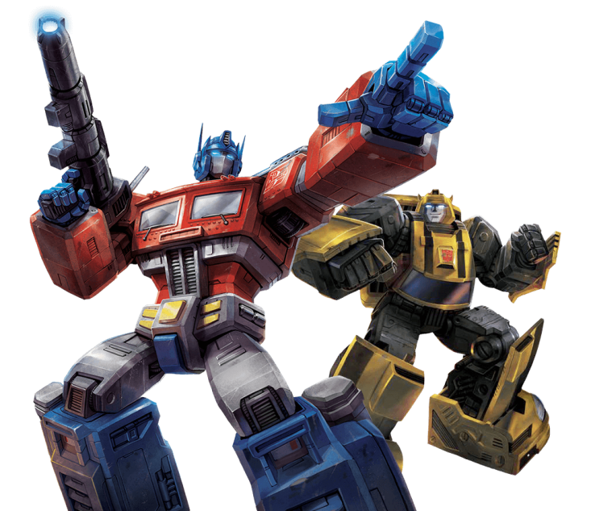 _你就是那个解决了__RNN__串行训练的效率问题，在__深度学习__领域横扫千军的Transformer？_（Google团队好像本来是想取变压器的意向。但是大家看到这词儿想到的都是变形金刚……） | 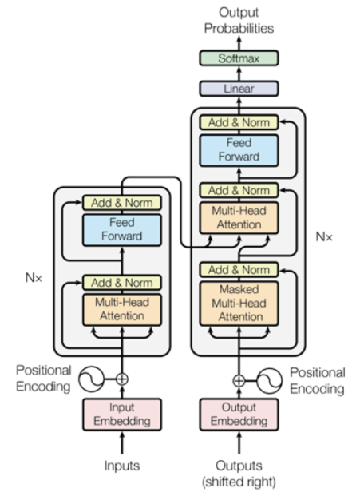 _不好意思，打扰了，是这张！模型架构乍一看有点难懂，但是没关系，我们后面会把它给讲清楚的！_ |
| :---: | :---: |

## 1. ** Transformer的整体结构**
上面那张图展示的就是Transformer的整体结构了，但乍一看会太过复杂。让我们先看下面这张图：

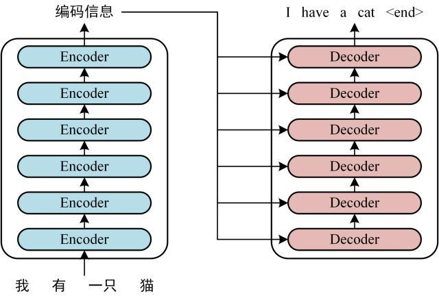

在万恶之源[Attention Is All You Need](https://arxiv.org/abs/1706.03762) 之中，原版的Transformer有六个编码器和六个解码器，是一个比较深的网络结构。可以看到，最开始的时候，Transformer主要用于神经翻译任务,所以这里先用神经翻译任务举例子。后面我们会看到对Transformer的一些魔改（Encoder-Only or Decoder-Only），从而将其用于文本生成（GPT）或者各种其他下游任务（ BERT）。

### 1.1 **编码器****结构：Self-Attention层 + ****前馈神经网络****层**
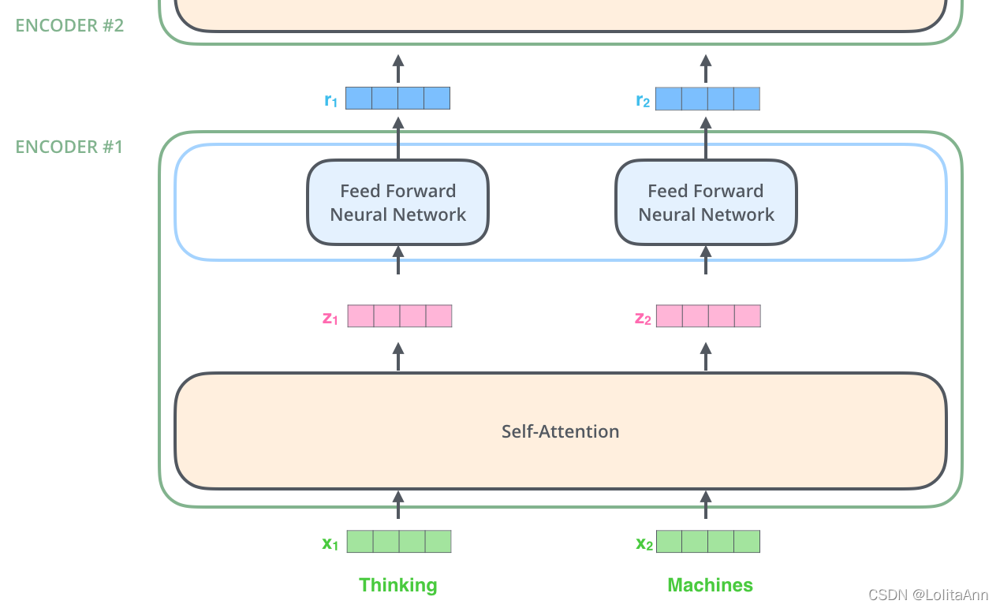

| 6个编码器组件的结构是相同的，但是他们之间的权重是不共享的，每个编码器都可以分为2个子层。 编码器的输入()首先会进入一个自注意力层，这个注意力层的作用是：当要编码某个特定的词汇的时候，它会帮助编码器关注句子中的其他词汇。之后会进行详细讲解。 自注意力层的输出（）会传递给一个前馈神经网络，每个编码器组件都是在相同的位置使用**结构相同（每个Encoder中的FFNN结构相同但参数不同）**的前馈神经网络。 |
| :--- |

### 1.2 **解码器****结构：带掩码的Self-Attention层 + Self-Attention 层+一个****前馈神经网络**
解码器组件也含有前面编码器中提到的两个层，区别在于这两个层之间还夹了一个注意力层，多出来的这个自注意力层的连接了编码器输出的隐状态，起到了和seq2seq中的attention一样的作用。

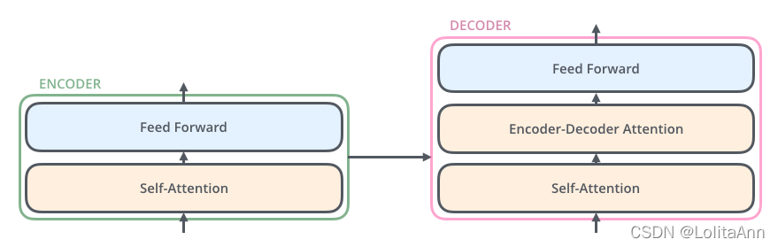

在解码器中，第一个Self-Attention和编码器的第一个自注意力层也是不同的。它是一个带掩码的自注意力层，带掩码的意思就是，对于一个总共有N个单词的词序列，在翻译到第K个单词时候，这个自注意力层只能注意到第1到第K个单词，而注意不到第K+1到第N个单词。后面我们会用一张图很清晰的展示什么是带掩码。

## 2. **编码器****介绍**
### 2.1 **Input**** Embedding: 怎么给Token进行编码？**
#### 2.1.1 **Word Embedding**
| 与其他的NLP项目一样，我们首先需要把输入的每个单词通过词嵌入（embedding）转化为对应的向量。 在Attention is All You Need原文中，他们采用了512维的词嵌入，这里为了方便展示，我们用4个格子来代表512维的词向量们。 |
| :--- |

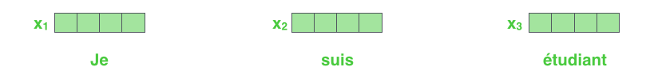

#### 2.1.2 **Positional Encoding，PE**
Transformer中的编码器不只采用了词嵌入本身的Embedding，还为每个词基于位置额外增加了一个Embedding（Positional Encoding），它的维度和词嵌入是一样的。最终输入给Transformer的是两个嵌入向量的和。

这是因为Transformer激进地放弃了自带时序处理能力的RNN，而Attention本身又是不会有时序信息的（用自注意力实现全局，不等于拥有时序信息！全局不等于时序）。

| Transformer 不采用 RNN 的结构，使用全局信息，不能利用单词的顺序信息，而顺序信息对于 NLP 来说又非常重要。所以 Transformer 中使用位置 Embedding 保存单词在序列中的相对或绝对位置。 |
| :--- |

通过Positional Encoding，模型可以确定每个单词的位置或不同单词之间的距离。

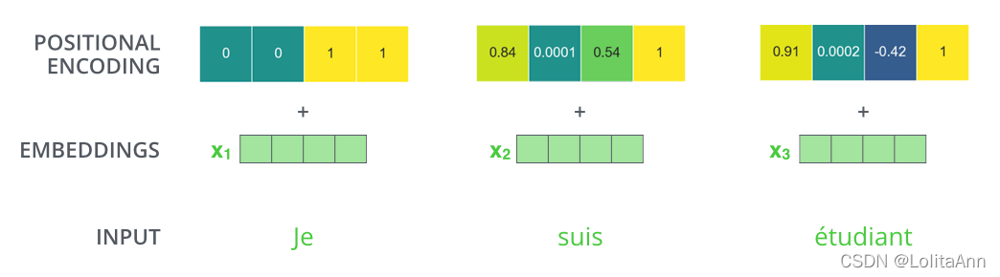

位置编码需要做到：每个位置对应的编码唯一；不论句子有多长，每两个相邻位置之间的距离都一样；所有的编码都要在一个有限的区间内，编码用到的数字不能爆炸上升（这其实真的很难做到！）。

| 具体的，Transformer里的位置编码是这样做的： 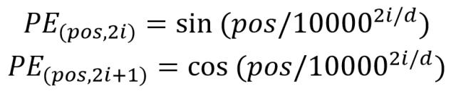 它是一个和词嵌入同维的、sin和cos交替的向量。 |
| :--- |

### 2.2 **Self-Attention层：细说自注意力机制**
7.3.3里，我们提到过注意力机制的作用。这里我们再提一次。

| Say the following sentence is an input sentence we want to translate: ”The animal didn't cross the street because it was too tired” What does “it” in this sentence refer to? Is it referring to the street or to the animal? It’s a simple question to a human, but not as simple to an algorithm. When the model is processing the word “it”, self-attention allows it to associate “it” with “animal”. As the model processes each word (each position in the input sequence), self attention allows it to look at other positions in the input sequence for clues that can help lead to a better encoding for this word. If you’re familiar with RNNs, think of how maintaining a hidden state allows an RNN to incorporate its representation of previous words/vectors it has processed with the current one it’s processing. Self-attention is the method the Transformer uses to bake the “understanding” of other relevant words into the one we’re currently processing. |
| :--- |

为了与Jammar的科普文[The Illustrated Transformer](http://jalammar.github.io/illustrated-transformer/)保持同步（并且继续用它画的高质量的图❌），我们用原文举例子的短句（Thinking Machine）作为例子，看看在编码器的每个子层中发生了什么。

#### 2.2.1 **对Encoder的每个输入矩阵都计算三个矩阵：****Query****， Key，Value**
7.4.3中，我们介绍了注意力机制的点积操作本质上其实是两个矩阵的运算（而矩阵运算是高度并行的，在GPU上训练起来非常的快）。不过我们可以暂时忘掉矩阵的事情，先从向量层级去关注都发生了些什么。

| _#自注意力层为什么叫自注意力层呢？_ _在之前的seq2seq__注意力机制__里，两个做点积来计算Attention Score的向量分别在__编码器__和__解码器__里__，而Transformer的自注意力层里，两个做点积的向量都是源自编码器（或者解码器）。_ 对每一个输入的向量（512维），我们把它乘一个512*64的权重矩阵，最后就会得到一个64维的向量。 （前面提到了，四个格子代表了512维的向量，这个习惯我们在后续也都会保持。如右图所示，Q、K、V中的向量都是三个格子，三个格子代表的就是一个64维的向量。后面都会是这样！） 在编码器的自注意力层中，我们训练三个权重不共享的512*64的矩阵：、、。对编码器的每个输入向量，都分别乘以这三个矩阵，计算出三个64维的向量：Query向量，Key向量和Value向量。 | 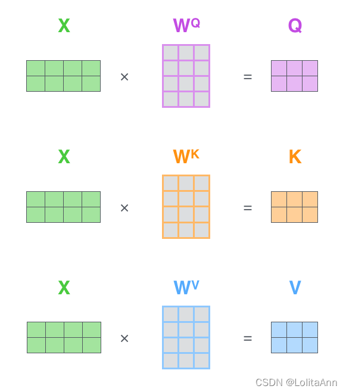 |
| :--- | :---: |

#### 2.2.2 **计算注意力得分：****Query****和Key的点积**
| 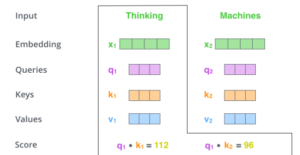 | 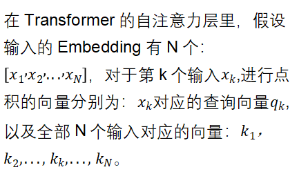 以Thinking Machine个两个词的输入为例，Thinking的查询向量会分别和句子中所有的输入（、）对应的Key向量（、）做点积，得到Thinking这个词对于句子中的每一个词的注意力得分。 |
| :---: | :--- |

#### 2.2.3 **计算注意力分布 Attention Disrtibution**
| 标准的计算注意力分布的方法就是对注意力得分做一个Softmax。不过在原版的Transformer中，作者们先把注意力得分除以了一个8（Q、K、V向量的维度的根号值）。这是因为两个64维向量做点积算出来的标量还是很大的，如果不做额外的处理就直接去softmax的话，会导致Attention Distribution高度集中于当前位置的单词，但这显然不是我们想要的，我们还是想知道当前的单词和其他各种单词的联系。总之，这里的除以8更多的其实是一种基于实践的工程经验。 | 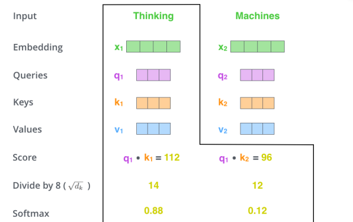 |
| :--- | :---: |

#### 2.2.4 **将Value矩阵与注意力分布矩阵相乘，得到最后的****Output**
7.3.3.2里我们提到过，既然注意力分布是一个概率密度函数，那注意力输出其实很类似数学期望。

Transformer中的自注意力层也是一样，都是数学期望的思维。上一步我们计算出Attention Distribution为P(Thinking)=0.88、P(Machine)=0.12，在最后我们会用这个概率分布乘以对应的单词的Value向量。

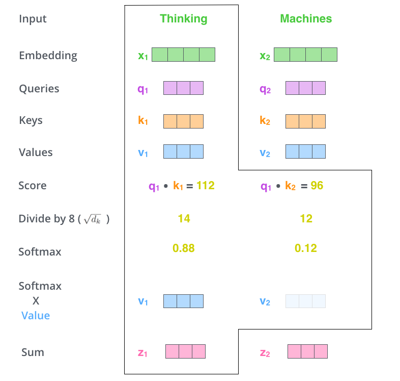

最终单词 Thinking的输出 等于所有单词 的值 、根据 attention 系数的比例加在一起得到：

#### 2.2.5 **利用矩阵快速****并行计算****整个输入的注意力分布**
12.2.2.1～12.2.2.4中，我们用向量级别的运算来举例子，现在我们讲讲怎么快速用矩阵运算计算出整个输入序列的全部z向量。

参考下图，绿色的矩阵X的第一、第二行就分别是Thinking、Machine对应的Embedding。对于一个有N个Token的序列输入，相比于让一个一个512维的向量去乘以512*64的权重矩阵，我们可以直接用N*512的矩阵去和另一个512*64的矩阵做乘法，最后得到一个N*64的矩阵。

参考下图，紫色矩阵的第一、第二行分别是Thinking、Machine对应的Query。K和V都是同理。

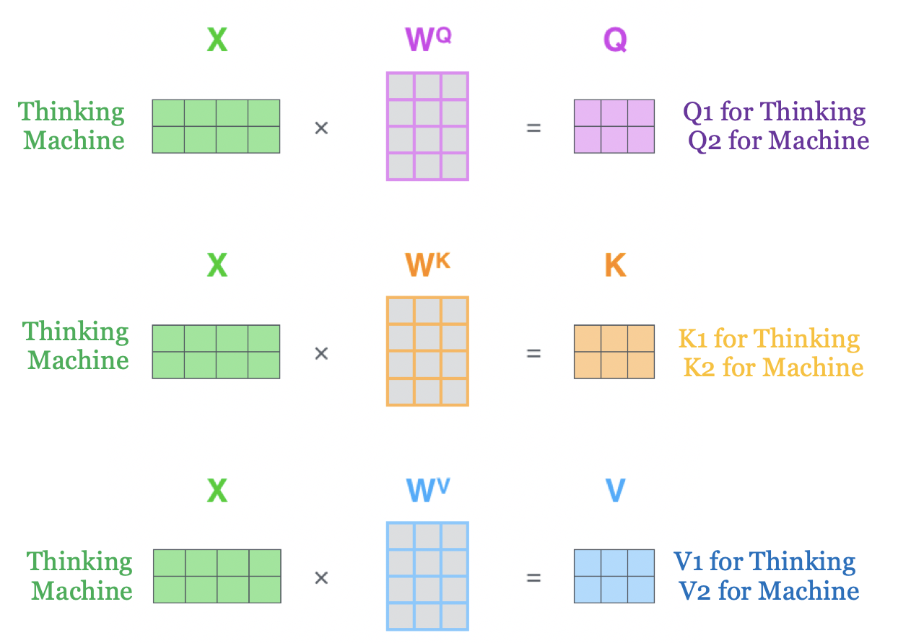

_<这张图解决了2.2.1中的运算过程>_

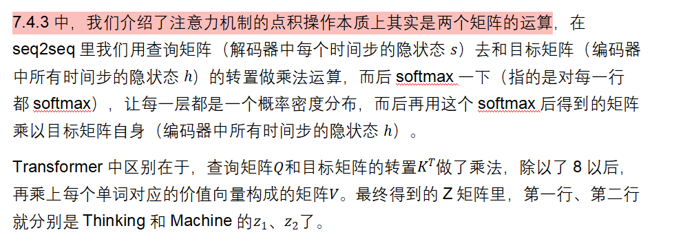

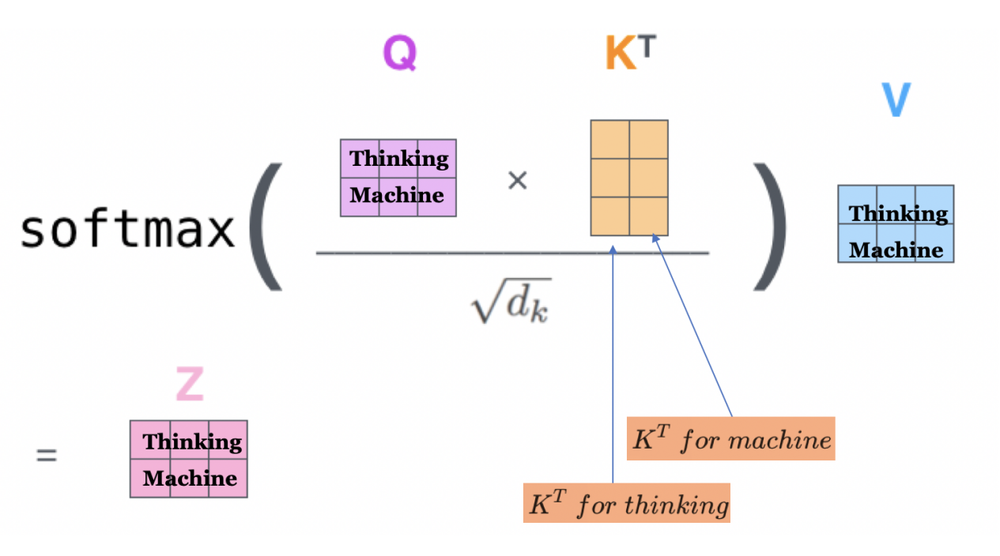

_<这张图解决了2.2.2～2.2.4中的全部运算过程>_

矩阵的乘法运算并行性非常强，训练起来是非常快的！

|  |
| :---: |

### 2.3 **图解多头自注意力机制**
2.2里我们讲明白了Self-Attention，那什么是Multi-Head呢？

| The paper further refined the self-attention layer by adding a mechanism called “multi-headed” attention. This improves the performance of the attention layer in two ways: 1. It expands the model’s ability to focus on different positions. Yes, in the example above, z1 contains a little bit of every other encoding, but it could be dominated by the actual word itself. If we’re translating a sentence like “The animal didn’t cross the street because it was too tired”, it would be useful to know which word “it” refers to. 2. It gives the attention layer multiple “**representation subspaces**”. As we’ll see next, with multi-headed attention we have not only one, but multiple sets of Query/Key/Value weight matrices (the Transformer uses eight attention heads, so we end up with eight sets for each encoder/decoder). Each of these sets is randomly initialized. Then, after training, each set is used to project the input embeddings (or vectors from lower encoders/decoders) into a different representation subspace. |
| :--- |

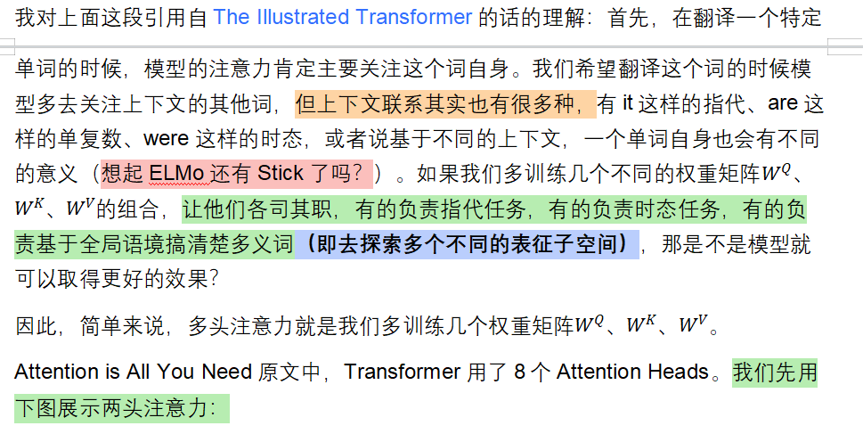

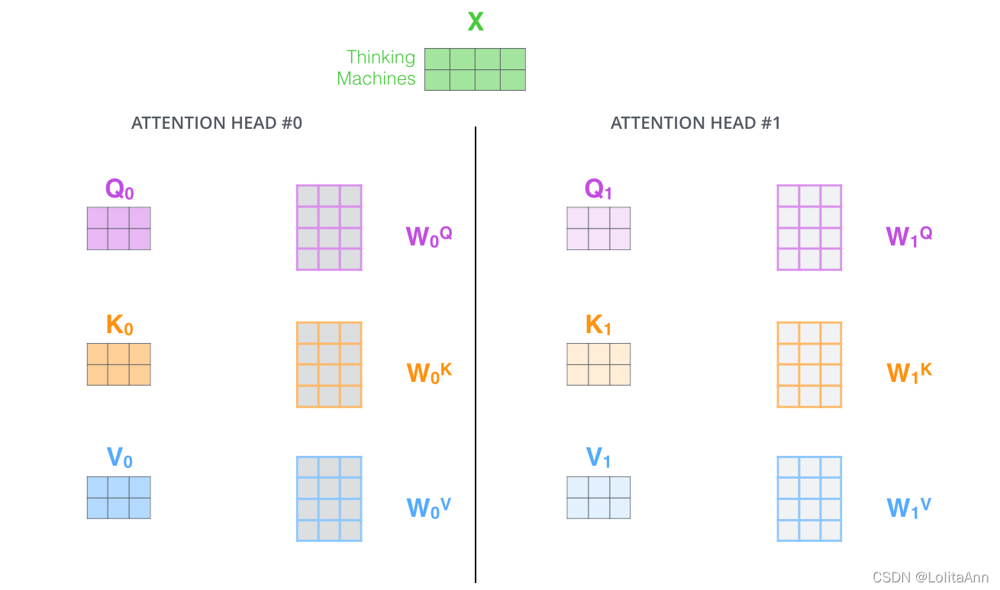

对于同一个输入Thinking Machine，我们有8个权重矩阵组，因此最终会产生8个Z矩阵：

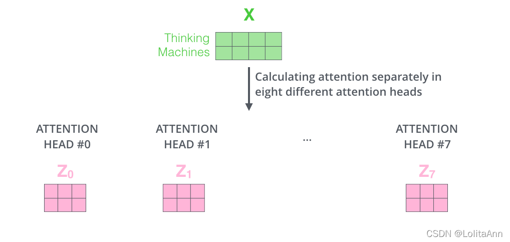

我们将这些矩阵连接起来，形成了一个2*512维的矩阵；然后将其乘以一个产生最终输出的权重矩阵。

下面的例子中，是一个512*512的矩阵，最后我们得到了一个2*512的Z矩阵，他的形状和最开始的输入一样。

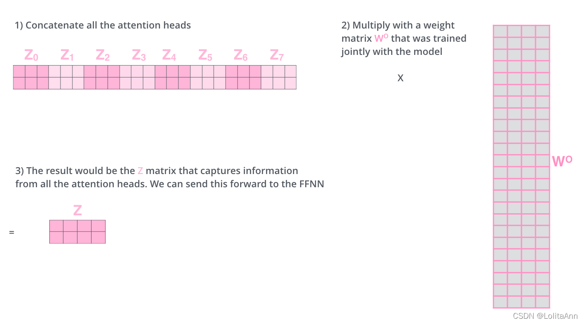

### 2.4 **总结：自注意力层中发生了什么？**
+ 输入：基于one-hot，假设字典大小是30,000,那么一个词的输入就是一个30K维的向量，对应该词汇的元素会是1，其他的全部都是0。
+ Embedding层：把输入的one-hot向量乘以一个矩阵后，投影到512维的词向量里，再加上一个位置嵌入。
+ 自注意力层：对输入的词嵌入，乘三个权重矩阵，投影出Q，K，V。输入每一个词Qk会和输入的全部词的K1、K2、K3….Kn向量做点积（向量点积得到的是标量），得到一个n维的新向量（n就是输入的句子的长度）。对向量的元素除以8（根号64），再做一个softmax，得到一个Attention Distribution，这个分布反映了当前输入的词对句子中每一个词的相关性。而后我们对V向量以Attention Distribution为权重做一个加权，得到向量Z。向量Z里就蕴含了当前timestep下来自整个句子的各种信息。
+ 多头注意力机制：多训练几个不同的权重矩阵组合，把他们最后得到的结果拼接到一起，提高信息收集维度的数量和鲁棒性。

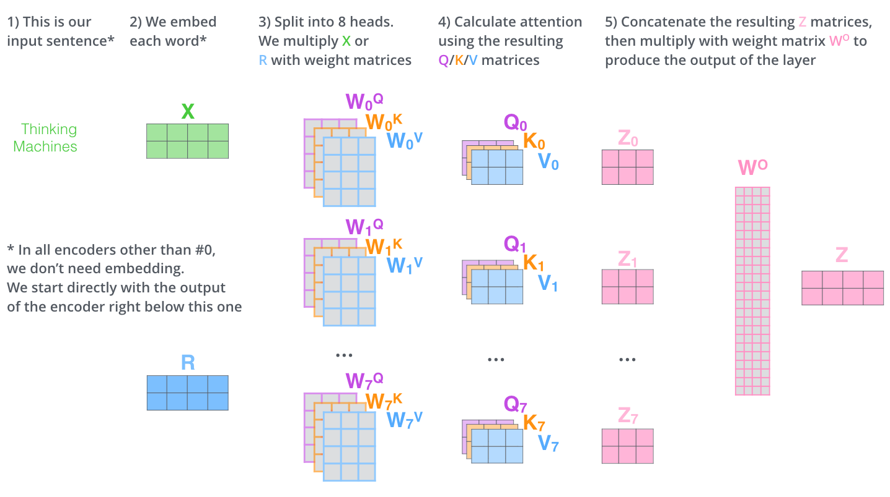

自注意力层最终输出的一个N*512的矩阵会输入给前馈神经网络。**嗯，所以它的形状和最开始的时候输入的矩阵是一样的**。即：一个多头自注意力层并不改变输入的东西的形状。

FFNN就是一个平平无奇的全连接层，和2.1.4中介绍的东西没有什么区别，所以就不再专门做介绍了。

它也不改变输入的东西的形状。总之，输入一个（batchsize, seq_length, embed_dim）的张量到一个Encoder Block里去，输出的也是一个同维的张量。

## 3. **解码器介绍**
解码器的结构在1.2里展示过，这里不再重复。

与seq2seq一样，Transformer中的解码器本质上也是一个语言模型，它做的事情就是综合考虑当前时间步的信息和Encoder给来的信息，进行一个词一个词的自回归的输出。

既然同样是一个自回归语言模型，那么7.2.2提到的Teaching Force和计划采样、7.2.3中提到的Beam Search在Decoder中都是同样适用的。这里也不重复介绍了。

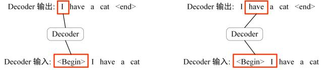

Decoder模型中的一些细节可能需要更多的输入才能讲清楚，所以现在我们试图去翻译I have a cat为中文。

### 3.1 **解码器的第一层：带掩码的多头自注意力层**
解码器中的自注意力层和编码器中的不太一样：在解码器中，自注意力层只允许关注已输出位置的信息。所以我们称之为“带掩码的自注意力层”。

| Decoder block 的第一个 Multi-Head Attention 采用了 Masked 操作，因为在翻译的过程中是顺序翻译的，即翻译完第 i 个单词，才可以翻译第 i+1 个单词。通过 Masked 操作可以防止第 i 个单词知道 i+1 个单词之后的信息。 |
| :--- |

Mask操作主要是在Softmax的时候实现的。

如果要翻译I have a cat为中文，我们依然可以做和做矩阵乘法的操作，这样我们会得到一个4*4的矩阵。

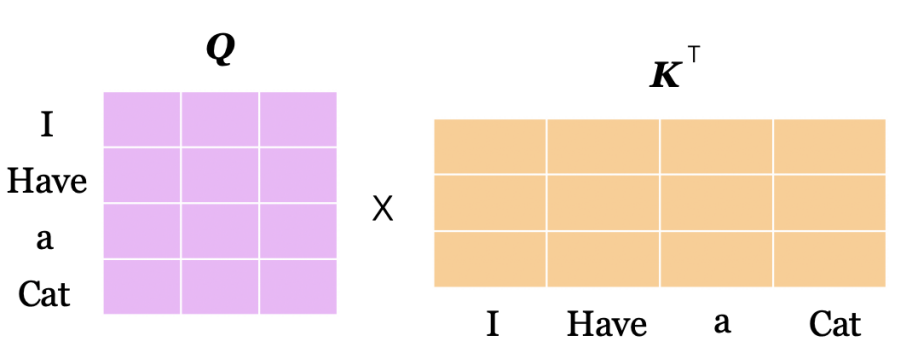

一般来说，对于我们这样得到的矩阵，直接softmax就好了，参考2.2.5。但是在解码器里，我们要做这样一个操作：

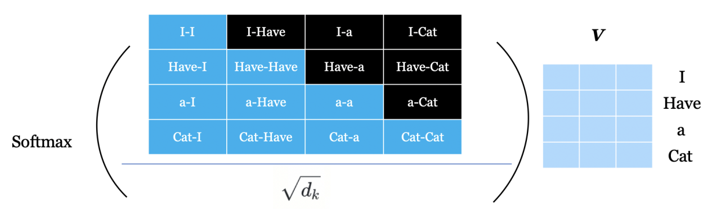

自注意力层只允许关注已输出位置的信息，所以对于已输出位置和未输出的位置的点积（上图中的黑色的位置），我们在softmax时会给他加上一个巨大的负值（GPT中为负一亿），好让他们在softmax后得到的结果为0。这样，在输出当前时间步的时候，解码器就不会去关注后面的单词的信息了。

最终我们得到了一个4*64的矩阵，它会作为Query矩阵直接被输入给解码器的下一层Encoder-Decoder Attention。矩阵的第一列（I的z向量，也是下一个注意力层中 I 的查询向量）就只包含了I的信息。

| 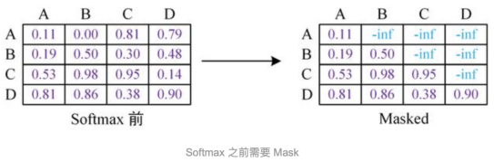 | 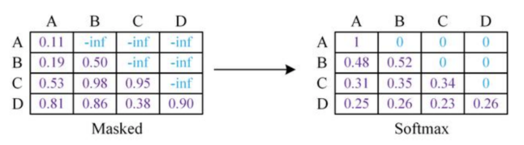 |
| :---: | ---: |

_<这张图也非常直观。>_

**解码器中也是多头注意力机制，所以如果是8头注意力的话，最后会产生8个这样子的矩阵。他们会作为解码器的下一层要用到的8个Query矩阵。**

### 3.2 **解码器的第二层：多头编码器-解码器注意力层**
| 参考右图，红框内的部分即为解码器。我们假定N为6；八头注意力。 编码器首先处理输入序列，输入序列经过了6个Encoder之后，第六个编码器会输出一个张量。该张量会被平等的送给每个Decoder的第二个注意力层，并通过一个共享参数的权重矩阵C转为8个Key矩阵和8个Value矩阵。  在这一层中，解码器组件使用自己的带掩码的第一层自注意力层产生的8个Z矩阵作为8种Query矩阵，并使用编码器传过来的8个Key和Value矩阵，来做我们前面提到过的多头自注意力的运算。 | 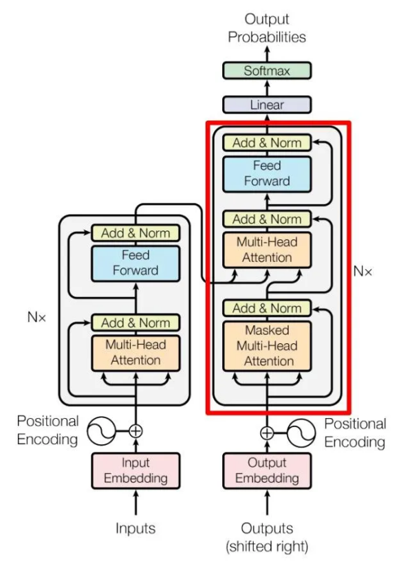 |
| :--- | :---: |

_<因为在这一层中我们不仅用到了解码器上一层的输出，还用到了编码器的输出，所以就不能叫自注意力层了>_

在经过两个多头注意力层后，最后会经过一个全连接层，然后输出一个向量给最后的Linear和Softmax层。

### 3.3 **解码器的最后：下一词预测**
| 就像seq2seq一样，transformer的解码器中当前时间步的输出会作为下一个时间步的输入。 | 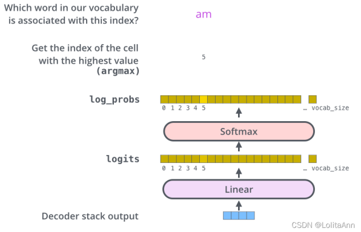 |
| :--- | :---: |

## 4 **Transformer模型总结**
### 4.1 **模型可以去调的超参数**
Transformer里可以调的参数其实并不多。

1. 词嵌入的向量有几维；
2. 编码器和解码器各自有多少层。如果没有编码器，那就是Decoder-Only（GPT）；如果没有解码器，那就是Encoder-Only（BERT）
3. 有多少个注意力头。

### 4.2 **模型整体的前向传播步骤**
**编码器：**

+ 输入：基于one-hot，假设字典大小是30,000,那么一个词的输入就是一个30K维的向量，对应该词汇的元素会是1，其他的全部都是0；输入一个句子的话，那就是矩阵了。
+ Word Embedding层：把输入的one-hot向量乘以一个矩阵后，投影到512维的词向量里。此外还要考虑位置编码，它是一个和词嵌入同维的、sin和cos交替的向量，两者可以直接相加作为最后的输入。
+ 自注意力层：对输入的词向量，乘三个权重矩阵，投影出Q，K，V。输入的第k个词的查询向量Qk会和输入的全部词的K1、K2、K3….Kn向量做点积（向量点积得到的是标量），得到一个n维的新向量（n就是输入的句子的长度）。除以8，再做一个softmax，得到一个Attention Distribution，这个分布反映了当前输入的词对句子中的每一个词的相关性。而后我们对V向量以Attention Distribution为权重做一个加权，得到向量Z。向量Z里就蕴含了当前timestep下来自整个句子的各种信息。
+ 多头注意力机制：多训练几个不同的自注意力层，最后拼接到一起，提高信息收集维度的数量和鲁棒性。
+ 自注意力层的输出会经过一个全连接层，生成一个向量，而后传给下一个编码器。最后一个编码器输出的向量会与权重矩阵C相乘，生成价值矩阵V和钥匙矩阵K。

**解码器：**

+ 带掩码的多头自注意力层：Decoder的输入里，在自注意力层中，对于当前的time step之后的单词，在softmax之前都会加一个巨大的负数，让他们的attention distribution都会是0。最终输出的张量会作为下一层的查询矩阵。因为是8头注意力，所以最后会输出8个不同的查询矩阵，
+ 编码器-解码器注意力层：这一层中，会用来自编码器的8个K和来自上一层的8个Q做点积操作，计算出注意力分布后再和来自编码器的8个V矩阵做加权。
+ 输出：解码器以自回归的形式一个一个输出，当前的输出成为下一个输入。输出的部分可以greedy，也可以做一个beam search。

损失函数和反向传播这里就跳过了。损失函数依然是交叉熵函数。

### 4.3 **Transformer的牛逼之处**
+ Transformer 与 RNN 不同，不论是自注意力层还是全连接层都是矩阵运算，可以比较好地并行训练。在做NLP的任务时，CNN、RNN和Transformer相比，并行程度CNN大于Transformer远大于RNN，信息糅合能力RNN大于Transformer远大于CNN。Transformer它没有被任何人远大于，可能这就是它为什么牛逼吧。
+ Transformer 本身是不能利用单词的顺序信息的，因此需要在输入中添加位置 Embedding，否则 Transformer 就是一个词袋模型了。
+ Transformer 的重点是 Self-Attention 结构，其中用到的 Q, K, V矩阵通过输出进行线性变换得到。这件事情还是挺天才的，正经人很难想到自己和自己做点积然后再和另一个自己相乘。
+ Transformer 中 Multi-Head Attention 中有多个 Self-Attention，可以捕获单词之间多种维度上的相关系数。八个注意力头在8个不同的表征子空间横扫信息，让模型学习能力非常强。

### 4.4 **Transformer的评价**
+ 它几乎被用在所有的NLP任务上，产生了类似CNN对CV的改变。
+ 几乎用在了每一个模态的机器学习上，文本、图片、视频，万物皆可Transformer。
+ 想要让Transformer达到和CNN、RNN一样的效果，得给他喂多得多的数据量。基于Transformer的模型都很大、很贵，虽然它在刷SOTA上所向披靡，但是CV业内其实还是CNN用的更多。
+ 事实上，Attention is NOT All You Need（_就像The Document is NOT All You Need一样，没有其他的参考文献还是不可能去扎实的掌握LLM的技术原理_）。后续的研究中发现，Transformer中的Resnet和MLP们都起到了很大的作用，缺一不可。如果只训练多头自注意力的话，最后的效果会非常糟糕。

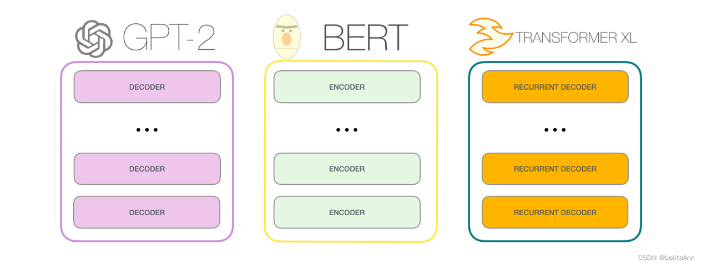

_<后续出现了大量的魔改Transformer，有人抛弃了Encoder只留下Decoder，有人则只用了Encoder。但不论怎样，多头自注意力机制这样天才的想法还是被得以保留>_

> 更新: 2025-09-30 09:37:24  
> 原文: <https://www.yuque.com/aaron-wecc3/dhluml/bq1axvdg993qdvno>