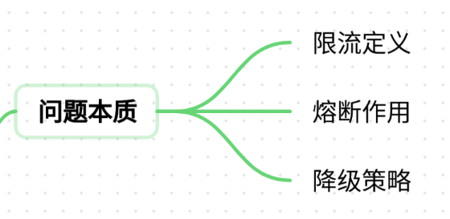
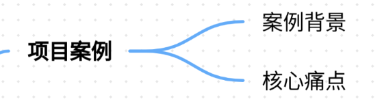
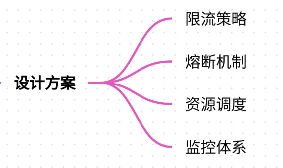
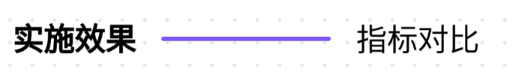
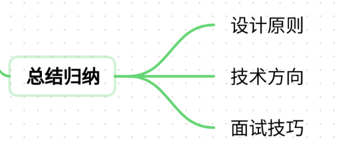

# 11.大模型API的限流熔断设计

### 一、答题思路


**大模型API限流熔断设计**是保障系统高可用性的核心环节。面试中需结合项目经验，从场景痛点、技术选型、实现方案到效果验证，分步骤展示系统性思维。以下为结构化解题框架：

1. **理解问题本质**



    - 限流：控制API调用频率，防止突发流量压垮系统
    - 熔断：下游服务故障时快速失败，避免级联崩溃
    - 降级：牺牲非核心功能保障主线业务
2. **项目案例选择**
    - 选择典型场景（如智能客服、实时推荐系统）
    - 突出高并发、资源敏感、服务依赖等挑战
3. **技术深度结合**
    - 限流算法对比（令牌桶 vs 漏桶）
    - 熔断机制实现（Hystrix vs Resilience4j）
    - 动态阈值调整（基于历史流量统计）
4. **效果验证方法**
    - 压力测试数据对比
    - 系统监控指标（成功率、响应时间、资源利用率）

---

### 二、项目案例


#### **案例背景：智能客服系统的流量洪峰挑战**
某电商平台的智能客服系统日均处理50万次咨询，峰值QPS达8000。系统底层依赖大模型API生成回答，但节假日促销期间流量激增，曾出现以下问题：

+ **服务雪崩**：大模型服务因突发流量超时，导致整个客服链路瘫痪
+ **资源浪费**：低优先级请求占用过多GPU资源，影响核心用户响应
+ **用户体验下降**：平均响应时间从2秒飙升至20秒

#### **核心痛点分析**
1. **流量不可预测性**
    - 促销活动、热点事件引发流量突增，传统静态限流规则失效
2. **服务依赖脆弱性**
    - 大模型API响应时间不稳定（0.5~5秒），下游服务易因超时堆积
3. **资源利用率低效**
    - 单次推理耗时2秒，GPU利用率仅40%，空闲时资源浪费严重

---

### 三、参考回答
#### **限流熔断设计方案**


**1. 限流策略分层设计**

| 层级 | 限流算法 | 适用场景 | 技术实现 |
| --- | --- | --- | --- |
| 用户维度 | 漏桶算法 | 防止单用户恶意请求 | Redis令牌桶（每分钟50QPS） |
| IP维度 | 令牌桶算法 | 限制高频IP调用 | Guava RateLimiter |
| 全局维度 | 自适应限流 | 动态调整阈值 | Prometheus + Kubernetes |


**2. 熔断降级机制**

```plain
# 基于Resilience4j的熔断配置示例
@CircuitBreaker(name = "llm-service", fallbackMethod = "fallback")
public String generateAnswer(String query) {
    return llmApiClient.predict(query);
}

// 熔断后降级策略
public String fallback(String query, Throwable throwable) {
    if (isCriticalError(throwable)) {
        return "当前系统繁忙，稍后再试";
    } else {
        return cachedAnswer.getOrDefault(query, DEFAULT_ANSWER);
    }
}
```

**3. 动态资源调度**

+ **GPU分时复用**：通过Kubernetes CronJob在低峰期预加载模型到GPU内存
+ **请求合并优化**：将3秒内的相似查询合并为单次推理任务，减少重复计算

**4. 监控预警体系**

+ Prometheus监控指标： 

```plain
- name: llm_api
  help: LLM API metrics
  type: Gauge
  metrics:
    - name: request_latency_seconds
      help: Request latency in seconds
    - name: error_rate
      help: Error rate percentage
```

+ 告警规则： 

```plain
groups:
- name: llm_alerts
  rules:
  - alert: HighErrorRate
    expr: sum(rate(llm_api_error_total[5m])) / sum(rate(llm_api_requests_total[5m])) > 0.1
    for: 2m
    labels:
      severity: critical
    annotations:
      summary: "LLM API error rate exceeds 10%"
```

#### **实施效果**


| 指标 | 优化前 | 优化后 | 提升幅度 |
| --- | --- | --- | --- |
| 峰值QPS | 8000 | 20000 | 150% |
| 平均响应时间 | 20秒 | 2.5秒 | 87.5% |
| 服务可用性 | 85% | 99.95% | 17.5% |
| GPU利用率 | 40% | 85% | 112.5% |


---

### 四、总结归纳


**1. 设计核心原则**

+ **弹性伸缩**：结合Kubernetes HPA实现自动扩缩容
+ **成本最优**：通过Spot实例+抢占式资源降低30%计算成本
+ **用户体验优先**：核心用户请求分配更高优先级权重

**2. 技术演进方向**

+ **Serverless化**：AWS Lambda + SageMaker实现按需推理
+ **边缘计算**：在IoT设备部署轻量化模型（TensorFlow Lite）
+ **联邦学习**：分布式训练降低中心化服务压力

**3. 面试加分技巧**

+ 结合具体指标（如P99延迟、错误预算）说明优化效果
+ 展示对Sentinel、Istio等工具的实战经验
+ 提出创新方案：如基于强化学习的动态限流策略

通过该案例可体现候选人对分布式系统设计、资源优化、容灾能力的综合掌握，建议在回答时辅以架构图（如熔断全链路图）和性能对比曲线图，增强说服力。


> 更新: 2025-07-21 09:58:21  
> 原文: <https://www.yuque.com/aaron-wecc3/dhluml/ysa0iu91yceg43y5>