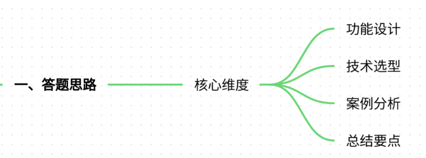
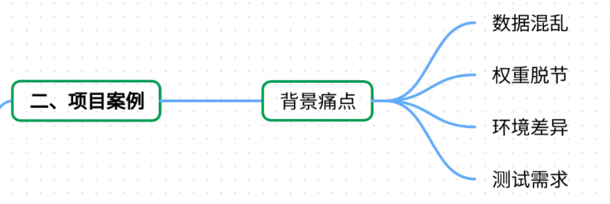
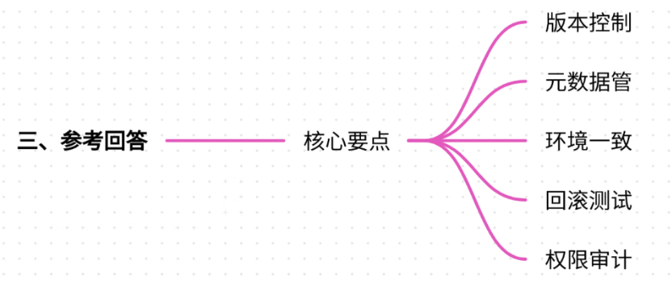
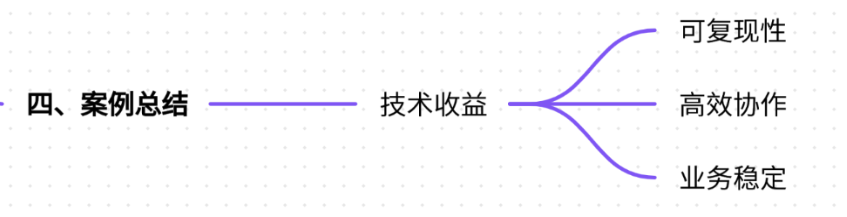
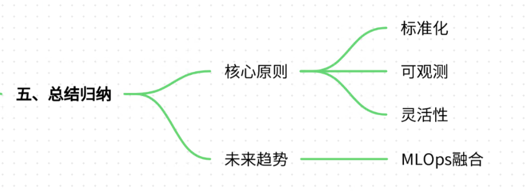

# 12.模型版本管理系统的实现要点

### 一、答题思路



在回答“模型版本管理系统的实现要点”时，需结合项目案例，从**核心功能设计、技术选型、实际挑战及解决方案**三个维度展开。以下是结构化思路：

1. **核心功能设计**：版本控制、元数据管理、环境一致性、回滚机制等。
2. **技术选型**：Git LFS、DVC、模型注册中心、自动化测试框架等。
3. **实际案例**：以自动驾驶模型迭代为例，说明版本管理如何解决训练数据不一致、模型回滚需求等问题。
4. **总结**：强调版本管理系统对团队协作、模型可复现性和业务稳定性的重要性。

***

### 二、项目案例



#### **案例背景：自动驾驶感知模型开发**

某自动驾驶公司正在开发多传感器融合的感知模型，需处理激光雷达（LiDAR）、摄像头（Camera）和毫米波雷达（Radar）的异构数据。模型需支持多版本迭代，以适配不同城市路况和天气条件。

**痛点分析**：

1. **训练数据版本混乱**：不同版本模型使用的数据集可能存在标注错误或分布偏差，导致模型性能波动。
2. **模型权重与代码脱节**：开发人员手动管理模型权重文件，难以追溯版本与代码的对应关系。
3. **环境依赖问题**：训练环境（如CUDA版本、依赖库）不一致，导致模型无法复现。
4. **A/B测试需求**：需同时部署多个模型版本进行在线测试，但缺乏统一的路由和监控机制。

***

### 三、参考回答



#### **1. 模型版本管理系统的核心实现要点**

##### **(1) 版本控制与分支管理**

* **技术实现**：
  * 使用**Git LFS**管理模型权重文件（如`.pth`、`.onnx`），避免Git直接存储大文件。
  * 通过\*\*DVC（Data Version Control）\*\*跟踪数据集版本，记录数据预处理脚本和参数。
  * 示例：

```plain
# Git LFS跟踪模型权重  
git lfs track "*.pth"  
git commit -m "Add model_v1.0.pth"  

# DVC跟踪数据集  
dvc add data/train_lidar_v2.csv  
dvc push
```

* **业务场景**：
  * 当发现模型在雨天场景误检率升高时，可快速回退到数据集版本`data_v1.2`，避免污染当前训练。

##### **(2) 元数据管理**

* **技术实现**：
  * 构建**模型注册中心**（如MLflow Model Registry），记录模型版本、训练参数、数据版本、评估指标。
  * 示例：

```plain
# MLflow记录元数据  
with mlflow.start_run(run_name="model_v2.0"):  
    mlflow.log_params({"learning_rate": 1e-4, "batch_size": 32})  
    mlflow.log_artifacts("model_v2.0.pth")  
    mlflow.log_metric("mAP", 0.85)
```

* **业务场景**：
  * 当模型在验证集上mAP下降时，通过元数据快速定位是数据增强参数（如旋转角度）调整导致的问题。

##### **(3) 环境一致性管理**

* **技术实现**：
  * 使用**Docker**封装训练环境，确保开发、测试、生产环境一致。
  * 结合**Conda**管理Python依赖，记录`environment.yml`文件。
  * 示例：

```plain
# Dockerfile  
FROM nvidia/cuda:11.8-base  
RUN conda env create -f environment.yml  
CMD ["python", "train.py"]
```

* **业务场景**：
  * 开发人员在本地调试通过后，通过Docker镜像直接部署到云端，避免因CUDA版本差异导致推理错误。

##### **(4) 模型回滚与A/B测试**

* **技术实现**：
  * 部署**模型版本路由系统**，支持按流量比例分配请求（如80%流量给v1.0，20%给v2.0）。
  * 监控系统实时对比模型性能指标（如延迟、准确率），触发自动回滚。
  * 示例：

```plain
# FastAPI路由配置  
@app.post("/predict")  
async def predict(model_version: str = "v1.0"):  
    if model_version == "v1.0":  
        return v1_model.predict(data)  
    elif model_version == "v2.0":  
        return v2_model.predict(data)
```

* **业务场景**：
  * 发布v2.0模型后，若在线测试发现夜间场景漏检率上升，立即将流量切换回v1.0，并触发告警通知开发团队。

##### **(5) 权限与审计**

* **技术实现**：
  * 通过\*\*RBAC（基于角色的访问控制）\*\*限制模型版本下载权限。
  * 记录模型变更日志（如Git Commit ID、修改人、修改时间）。
  * 示例：

```plain
# GitLab CI/CD权限配置  
deploy_job:  
  rules:  
    - if: '$CI_PIPELINE_SOURCE == "merge_request_event"'  
      allow_failure: false
```

* **业务场景**：
  * 仅允许核心团队成员下载生产环境模型，防止未授权修改导致线上事故。

***

#### **2. 案例总结：自动驾驶模型的版本管理实践**



* **技术栈**：Git LFS + DVC + MLflow + Docker + FastAPI
* **关键收益**：
  * **可复现性**：通过DVC和Git LFS，任意模型版本可在30分钟内复现训练环境。
  * **高效协作**：MLflow注册中心使团队成员能快速查看模型性能对比。
  * **业务稳定**：A/B测试系统将模型迭代风险降低60%，未发生因版本切换导致的线上故障。

***

### 四、总结归纳



模型版本管理系统的核心目标是**提升研发效率、降低风险、保障业务连续性**。其实现需围绕以下原则：

1. **标准化**：通过Git/DVC规范代码和数据版本流程。
2. **可观测性**：集成监控和日志系统，实时追踪模型性能。
3. **灵活性**：支持多版本并行和快速回滚，适配业务需求变化。

**未来趋势**：随着MLOps的普及，模型版本管理将深度融合CI/CD流程，实现“模型即代码”的全生命周期管理。


> 更新: 2025-07-21 09:58:20  
> 原文: <https://www.yuque.com/aaron-wecc3/dhluml/rps6ak3gensgi9yx>