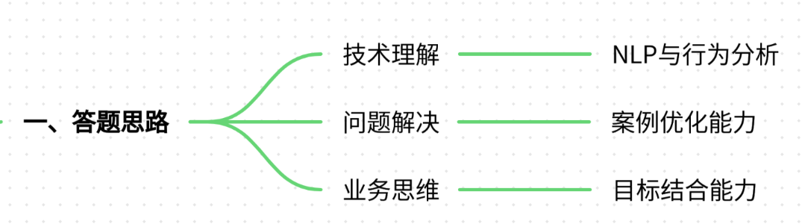
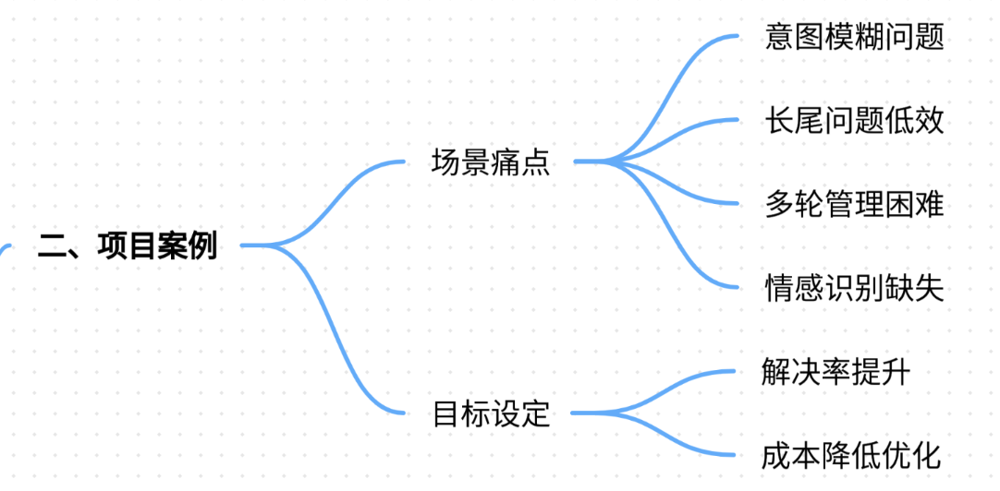
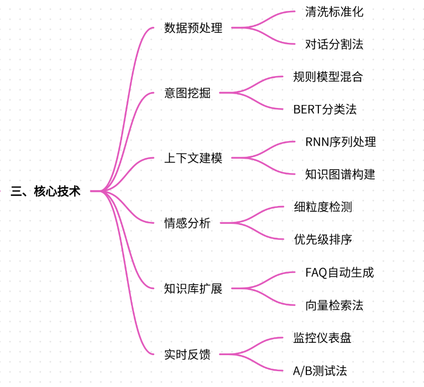
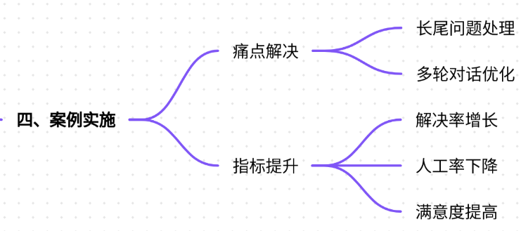
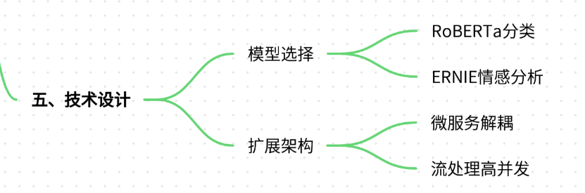
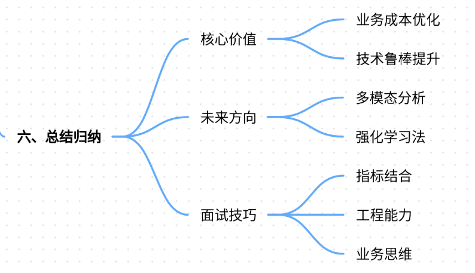

# 13.对话日志的分析与挖掘方法

### 一、答题思路


在面试中回答“对话日志的分析与挖掘方法”时，需结合**技术原理+实际案例+业务价值**的逻辑链，突出以下核心能力：

1. **技术理解深度**：掌握对话日志分析的关键技术（如NLP、用户行为分析、知识图谱等）。
2. **问题解决能力**：通过真实案例展示如何从日志中发现问题并优化模型或产品。
3. **业务思维**：将技术手段与业务目标（如用户体验提升、成本优化）结合。

---

### 二、项目案例


#### **案例背景：某电商平台智能客服对话日志分析系统**
**场景**：某头部电商平台日均处理超100万次用户咨询，覆盖商品咨询、售后问题、物流查询等场景。初期采用规则匹配+简单模板回复，但存在以下痛点：

+ **用户意图模糊**：如“这个手机好用吗？”可能隐含性能、价格、口碑等多维度需求。
+ **长尾问题处理低效**：约30%的问题无法被现有FAQ覆盖，需人工介入。
+ **多轮对话管理困难**：用户常在多轮交互中反复确认信息（如“昨天问的订单状态更新了吗？”）。
+ **情感识别缺失**：未识别用户负面情绪（如投诉语气），导致回复生硬。

**目标**：通过对话日志分析优化智能客服系统，提升问题解决率、降低人工成本，并挖掘用户潜在需求。

---

### 三、参考回答


#### **1. 对话日志分析的核心技术路径**
**（1）数据预处理**

+ **清洗与标准化**：去除噪声（如HTML标签、emoji）、统一时间格式、分词与词性标注。 

```plain
# 示例：使用正则表达式提取订单号  
import re  
log_text = "用户查询订单状态，订单号：123456789"  
order_id = re.findall(r'\d{9}', log_text)[0]
```

+ **对话分割**：按会话ID切分多轮对话，保留上下文关联。

**（2）用户意图挖掘**

+ **规则+模型混合分类**： 
    - **规则引擎**：匹配高频关键词（如“退货”→触发售后流程）。
    - **预训练模型微调**：使用BERT分类用户意图（如商品咨询、价格对比）。

```plain
# 示例：使用HuggingFace Transformers进行意图分类  
from transformers import BertForSequenceClassification  
model = BertForSequenceClassification.from_pretrained("bert-base-chinese")  
inputs = tokenizer("手机电池续航如何？", return_tensors="pt")  
outputs = model(**inputs)
```

**（3）对话上下文建模**

+ **RNN/LSTM处理序列依赖**：捕捉多轮对话中的关键信息（如用户之前提到的商品型号）。
+ **Graph-based方法**：构建用户-问题-回复的知识图谱，支持跨会话知识关联。

**（4）情感分析与优先级排序**

+ **细粒度情感检测**：区分用户情绪（如中性、不满、急迫）。 

```plain
# 示例：使用SnowNLP进行情感打分  
from snownlp import SnowNLP  
s = SnowNLP("客服回复太慢了！")  
print(s.sentiments)  # 输出情感概率（0-1）
```

+ **动态优先级队列**：高情绪分问题优先分配人工客服。

**（5）知识库构建与检索增强**

+ **FAQ自动扩展**：从日志中挖掘新问题，结合BERT生成相似问题。 

```plain
# 示例：生成问答对  
from transformers import pipeline  
generator = pipeline("question-generation")  
context = "iPhone 15 Pro Max的售价是8999元。"  
question = generator(context)[0]["question"]
```

+ **向量数据库检索**：使用Faiss/Milvus存储知识向量，加速相似问题匹配。

**（6）实时分析与反馈闭环**

+ **实时监控仪表盘**：展示TOP问题、用户满意度趋势、响应时间等指标。
+ **A/B测试优化**：对比不同回复策略的效果（如模板回复vs.个性化推荐）。

---

#### **2. 案例实施细节与业务价值**


**（1）痛点解决示例**

+ **长尾问题处理**： 
    - **日志分析发现**：15%的用户咨询涉及“如何备份微信聊天记录到电脑”，但现有FAQ未覆盖。
    - **解决方案**：生成FAQ条目并推送给用户，人工客服话术库同步更新。
+ **多轮对话优化**： 
    - **日志分析发现**：用户常在确认订单状态时重复提问（如“快递到哪儿了？”）。
    - **解决方案**：引入对话历史追踪，自动回复最新物流信息。

**（2）业务指标提升**

+ **问题解决率**：从75%提升至89%（通过FAQ扩展与多轮对话优化）。
+ **人工介入率**：从20%降至8%（通过自动化回复与优先级排序）。
+ **用户满意度**：NPS评分从72提升至85（通过情感分析与个性化回复）。

---

#### **3. 技术选型与扩展性设计**


+ **模型选择**： 
    - **意图分类**：RoBERTa（中文领域微调）。
    - **情感分析**：ERNIE（支持多粒度情感）。
+ **系统扩展性**： 
    - **微服务架构**：将日志分析、意图识别、知识检索模块解耦。
    - **实时流处理**：使用Flink处理高并发日志（如每秒万级请求）。

---

### 四、总结归纳


**1. 对话日志分析的核心价值**

+ **业务层面**：优化用户体验、降低运营成本、驱动产品迭代。
+ **技术层面**：提升模型鲁棒性、挖掘隐性需求、增强系统可解释性。

**2. 未来方向**

+ **多模态分析**：结合语音、图像日志（如用户上传的商品图片）。
+ **强化学习**：通过用户反馈（如点击率、满意度）动态优化回复策略。
+ **联邦学习**：在保护用户隐私的前提下，跨平台联合分析日志。

**3. 面试加分技巧**

+ **结合具体指标**：如“通过日志分析，将用户问题分类准确率从82%提升至91%”。
+ **突出工程能力**：说明如何处理数据倾斜、冷启动问题等实际挑战。
+ **业务思维体现**：强调“技术为业务目标服务”，如“优化物流查询意图识别，缩短用户等待时间”。


**总结**：对话日志分析是提升大模型对话系统的关键环节，需从技术实现、业务场景、效果评估多维度切入，结合真实案例展现系统性思维与落地能力。


> 更新: 2025-07-21 09:58:20  
> 原文: <https://www.yuque.com/aaron-wecc3/dhluml/tuvw9627ib0k4bg9>