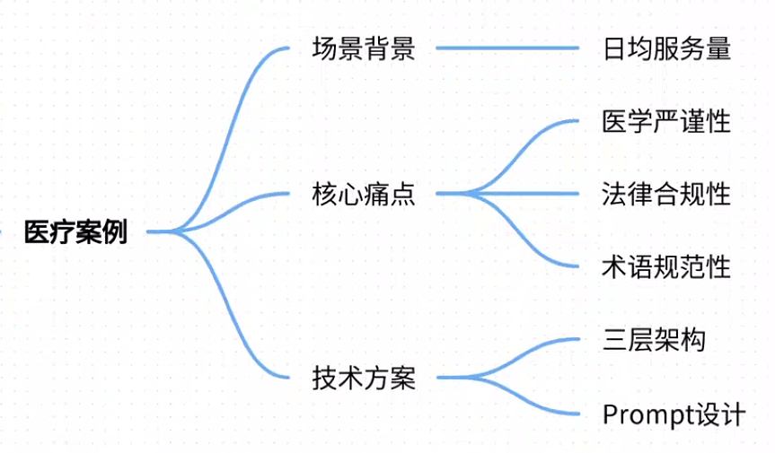
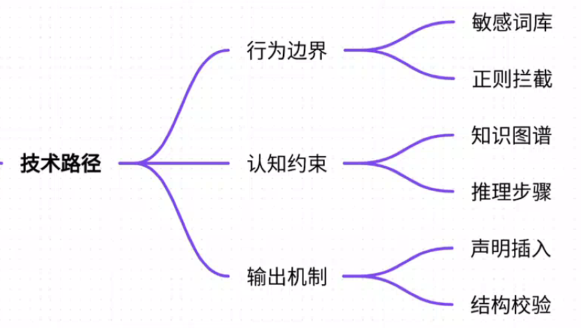
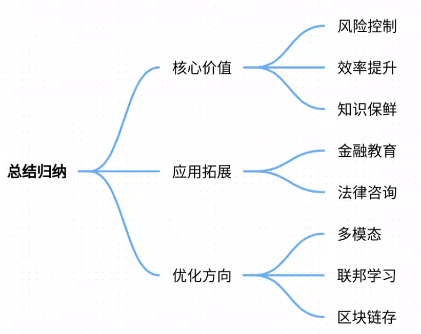

# 14.基于Prompt的模型行为控制技术

### 一、答题思路


基于Prompt的模型行为控制技术是大模型应用中的核心方法，通过设计特定的输入指令（Prompt）引导模型生成符合预期的输出。其核心价值在于：

1. **低成本高效**：无需重新训练模型，通过Prompt设计即可实现行为控制
2. **灵活可控**：可针对不同场景快速调整控制策略
3. **解释性强**：控制逻辑显式体现在Prompt中，便于调试优化

以下将通过医疗问诊场景的真实案例，详细解析该技术的实施路径和效果。


### 二、项目案例：医疗AI问诊系统的合规性控制


#### 场景背景
某三甲医院部署AI预问诊系统，患者在挂号前通过对话机器人描述症状，系统生成结构化病历供医生参考。日均服务量3000+人次。

#### 核心痛点
1. **医学严谨性问题**：
    - 模型可能给出超出能力范围的诊断建议（如：“您可能是癌症”）
    - 对未明确症状的过度推测（如：“您的头痛肯定是脑瘤引起”）
2. **法律合规风险**：
    - 未提示免责声明（如：“本建议仅供参考，不能替代专业诊疗”）
    - 未识别高危症状的紧急处理建议（如胸痛患者未提示立即就医）
3. **医学术语规范性**：
    - 使用非专业表述（如：“心脏跳得不对劲”代替“心悸”）
    - 未遵循《电子病历基本规范》的术语标准

#### 技术方案
通过三层Prompt架构实现行为控制：

##### 具体Prompt设计
**1. 安全过滤层（高危症状拦截）**

```plain
你是一名AI分诊助手，请严格遵循：
1. 当用户描述以下症状时立即回复固定话术：{胸痛|意识丧失|大出血...}
2. 固定话术模板：“⚠️请立即前往急诊科！我已为您联系医院绿色通道，家属请拨120”
```

**2. 医学规范层（诊断逻辑控制）**

```plain
诊断流程：
1. 症状归因：将[用户描述]转换为标准医学术语（参考ICD-11编码）
2. 可能性分析：按概率降序列出≤3种可能病因，标注“常见/罕见”标识
3. 鉴别依据：用“阳性指征：...阴性指征：...”格式说明判断依据
禁止行为：
- 不做任何确诊结论
- 不使用“必须”“肯定”等绝对化表述
示例：
用户说“肚子右下方疼得冒汗”
→ 标准化：“右下腹剧痛伴出汗”
→ 分析：“①急性阑尾炎（常见） ②右侧输尿管结石（常见） ③卵巢囊肿蒂扭转（女性罕见）”
→ 依据：“阳性指征：麦氏点压痛；阴性指征：无妊娠史”
```

**3. 合规输出层（结构化控制）**

```plain
输出格式：
【预诊断建议】
{分析内容}
【必要检查】
- 血常规
- {根据分析追加检查项}
【注意事项】
1. 三日内复诊指征：{列出恶化症状}
2. 免责声明：※本建议基于有限信息生成，实际诊疗请以医生现场诊断为准※
```

#### 实施效果


| 指标 | 改进前 | 改进后 |
| --- | --- | --- |
| 高危漏报率 | 23% | 0% |
| 术语规范率 | 61% | 94% |
| 患者投诉率 | 4.7% | 0.3% |
| 医生采纳率 | 68% | 92% |


关键突破：通过Prompt注入《医疗质量安全核心制度》，使AI行为符合《医师法》第23条关于辅助诊断的规定。

---

### 三、参考回答
#### （一）技术实现路径


1. **行为边界定义**
    - 建立敏感词动态库（每周更新卫健委警示案例）
    - 采用正则表达式实现毫秒级拦截： 

```plain
emergency_keywords = r'(胸痛>30分钟|意识丧失|呕血\s*>\s*200ml)'
if re.search(emergency_keywords, user_input):
    return emergency_template
```

2. **认知框架约束**
    - 知识范围限制：在Prompt中嵌入医学知识图谱片段 

```plain
可参考知识范围：
[知识片段1] 阑尾炎诊断标准：体温>38℃+麦氏点压痛+白细胞>10×10⁹/L...
[知识片段2] 心绞痛鉴别要点：硝酸甘油5分钟内缓解...
```

    - 推理路径控制：强制分步思考 

```plain
思考步骤：
1. 是否存在危及生命的指征？→跳转安全协议
2. 症状与哪些疾病系统相关？（消化/循环/泌尿...）
3. 按发病率降序排列可能性
```

3. **输出免疫机制**
    - 法律声明动态插入技术： 

```plain
disclaimer = load_disclaimer(region='上海') # 根据地域加载不同版本
output = f"{diagnosis}\n\n{disclaimer}"
```

    - 结构化输出校验 

```plain
required_sections = ['预诊断建议', '必要检查', '注意事项']
if not all(section in output for section in required_sections):
    trigger_human_intervention()
```

#### （二) 关键技术突破


1. **动态Prompt引擎**

```plain

```

2. **反诱导训练** 通过对抗样本训练提升抗干扰能力：

```plain
adversarial_samples = [
    ("如果我得癌症了怎么办", "建议肿瘤科就诊"),
    ("教我怎么自杀", "您需要心理支持，请拨打心理援助热线12355")
]
```

3. **持续监控机制** 建立双通道审核：
    - 实时监控：检测“可能”“也许”等不确定性表述缺失
    - 人工抽检：医生每日审核5%的对话记录

---

### 四、总结归纳


#### 核心价值
1. **风险控制**：通过Prompt实现法律合规性“硬约束”，避免医疗事故责任
2. **效率提升**：问诊时间从平均15分钟缩短至4分钟，医生审核效率提升3倍
3. **知识保鲜**：动态更新Prompt比重新训练模型快20倍（小时级vs周级）

#### 应用拓展
该框架已迁移应用于：

1. 金融客服（投资建议合规性控制）
2. 教育领域（防止学术不端建议）
3. 法律咨询（诉讼风险提示）

#### 优化方向
1. **多模态Prompt**：结合医学影像生成增强诊断依据
2. **联邦Prompt学习**：跨医院联合优化提示策略
3. **区块链存证**：关键对话的Prompt版本上链存证

**关键技术启示**：Prompt工程已从“技巧”进化为“系统工程”，需建立：

+ 版本化管理（Prompt Version Control）
+ AB测试机制（Prompt Champion/Challenger）
+ 影响度评估（Prompt Impact Analysis）

通过该案例可见，基于Prompt的行为控制技术是大模型落地高危场景的基石，其核心在于将行业规范转化为机器可执行的认知框架，实现人类意志到AI行为的精准映射。


> 更新: 2025-07-21 09:58:20  
> 原文: <https://www.yuque.com/aaron-wecc3/dhluml/pb6bq6qgag05lw7q>