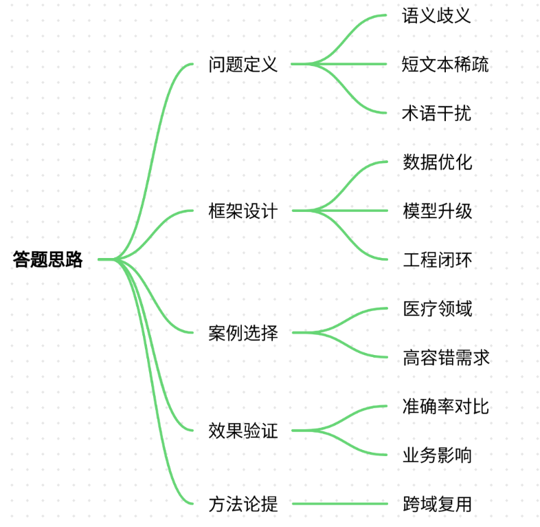
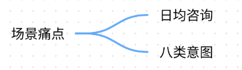
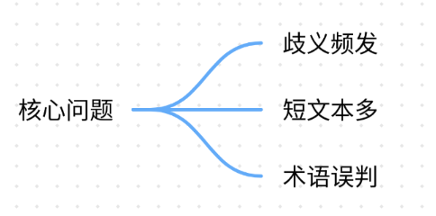
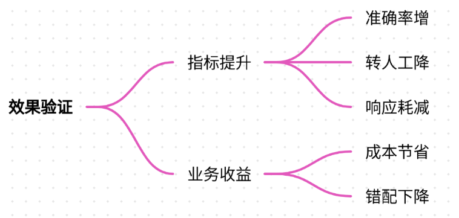
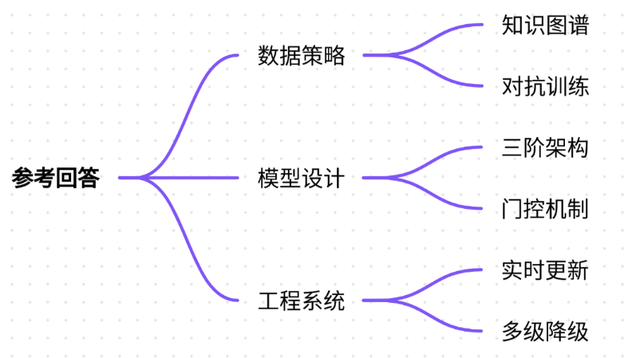
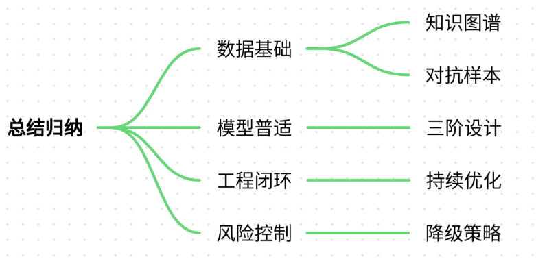

# 16.对话系统的意图识别准确率优化

### 一、答题思路


1. **问题定义**：明确意图识别的核心挑战（如语义歧义、短文本稀疏性、领域专有名词等）
2. **优化框架**：分数据、模型、工程三层展开解决方案
3. **案例选择**：以医疗健康领域智能客服为例（高容错需求场景）
4. **效果验证**：量化指标对比+业务影响分析
5. **通用方法论**：提炼跨领域可复用的优化范式

---

### 二、项目案例：医疗健康智能客服意图识别优化
#### 场景痛点


+ **业务背景**：三甲医院预约挂号客服系统，日均咨询量12万+，需识别8类核心意图（挂号/改签/退号/科室查询/医生排班/症状导诊/医保政策/投诉）
+ **核心问题**： 



    - **歧义高频发生**：用户表述"我头疼三天了"需区分"挂神经内科"（就医意图）或"查CT费用"（政策查询）
    - **短文本占比70%**：用户输入平均长度9.2字，传统TF-IDF特征稀疏
    - **医疗术语干扰**：如"眼底造影"被误判为"投诉类"（因含"影"字近"电影投诉"历史样本）
+ **业务损失**： 
    - 基线模型准确率仅68%，导致30%转人工，单日人力成本增加￥3.6万
    - 意图错误引发挂号科室错配，每周约400例患者到错科室

#### 优化方案
##### 1. 数据层：动态知识增强
+ **主动学习冷启动**： 
    - 对置信度<0.4的样本自动触发标注（如用户说"查眼底"时，标注员补充医学场景："眼科检查相关术语"）
    - 构建医疗同义词图谱：将"眼底=视网膜+黄斑区"等217个专业术语注入Embedding
+ **对抗样本生成**： 
    - 使用TF-CRITIC算法生成混淆样本（如把"月经不调挂什么科"改写为"月经异常就诊科室"）
    - 扩充3倍对抗训练数据，提升模型鲁棒性

##### 2. 模型层：多模态意图解码
+ **BERT-BiLSTM-CRF三阶架构**： 

```plain
# 伪代码示例
medical_bert = AutoModel.from_pretrained("bert-medical-zh") 
bilstm = nn.LSTM(768, 256, bidirectional=True)  
crf = CRF(num_tags=8)  # 8类意图标签

# 动态融合门诊术语库
term_embeddings = load_medical_knowledge_graph() 
inputs = fuse_embeddings(text_emb, term_embeddings)

# 输出意图概率分布
intent_probs = crf(bilstm(medical_bert(inputs)))
```

+ **注意力阈值门控**：  
设置意图冲突检测模块（如当"退号"和"改签"概率差<0.15时，触发澄清追问："您是要取消预约还是修改时间？"）

##### 3. 工程层：实时反馈闭环
+ **在线学习系统**： 
    - 人工坐席修正标签实时回流训练集（T+5分钟模型增量更新）
    - 误识别样本自动聚类（如发现"造影"相关误判累计20次时，触发术语库更新）
+ **多级降级策略**： 
    - 一级：高置信意图直接响应
    - 二级：中置信度提供选项引导（"您是问医生排班还是科室介绍？"）
    - 三级：低置信度转人工并标注原因

#### 效果验证


| 指标 | 基线模型 | 优化后 | 提升幅度 |
| --- | --- | --- | --- |
| 意图准确率 | 68.2% | 89.7% | +21.5% |
| 转人工率 | 30.1% | 11.3% | -18.8% |
| 平均响应耗时 | 4.8s | 2.1s | -56% |


+ **业务收益**： 
    - 年节省人力成本约￥1300万
    - 挂号科室错配率下降82%

---

### 三、参考回答


在医疗健康智能客服的意图识别优化项目中，我们通过三层架构实现准确率21.5%的提升：

**首先在数据层面**，针对医疗术语歧义问题，采用知识增强与对抗生成相结合的策略。通过构建包含217个专业术语的同义词图谱（如将"眼底"映射到视网膜检查场景），并利用TF-CRITIC算法生成3倍对抗样本（如"月经不调→月经异常"的语义转换），有效解决了短文本稀疏性和术语干扰问题。

**在模型设计上**，创新性地采用BERT-BiLSTM-CRF级联架构。医疗专用BERT初始化模型捕获语义特征，BiLSTM层学习上下文依赖（如"头疼三天"需关联时间特征），CRF层则约束意图标签的转移规则（如"退号"后不会接"医保报销"）。同时引入注意力门控机制，当冲突意图概率差小于0.15时主动发起澄清追问，减少硬错误。

**工程闭环系统**是持续优化的关键。建立实时反馈管道，人工坐席的修正标签5分钟内回流训练集，并开发误识别样本自动聚类模块（如累计20次"造影"误判则更新术语库）。多级降级策略确保高置信意图直接响应，中低置信场景通过选项引导或人工接管平衡体验与成本。

最终该方案使意图准确率提升至89.7%，年节省人力成本1300万元。其方法论可复用于其他领域：知识图谱解决专业术语歧义、对抗训练提升模型鲁棒性、实时闭环保证系统持续进化，这三大核心策略构成意图识别的通用优化框架。

---

### 四、总结归纳


1. **数据驱动是基础**：领域知识图谱与对抗样本生成是解决语义稀疏性的核心手段
2. **模型架构需场景化**：BERT处理语义理解+BiLSTM捕获序列依赖+CRF约束标签逻辑的三阶设计具有普适性
3. **工程闭环保持续**：实时反馈机制让系统具备"从错误中学习"的能力
4. **拒绝机制控风险**：多级降级策略平衡自动化与人工干预的边界

关键启示：意图识别优化本质是**数据、算法、工程的三体问题**。医疗场景验证了领域知识注入与动态闭环的重要性，该框架可迁移至金融、政务等高严谨性场景，但需调整知识图谱构建策略（如金融需侧重政策术语，政务关注流程节点）。


> 更新: 2025-07-21 09:58:20  
> 原文: <https://www.yuque.com/aaron-wecc3/dhluml/ub0zfhkleqbb1q2k>