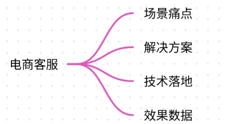
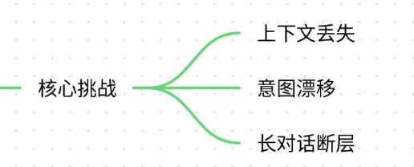
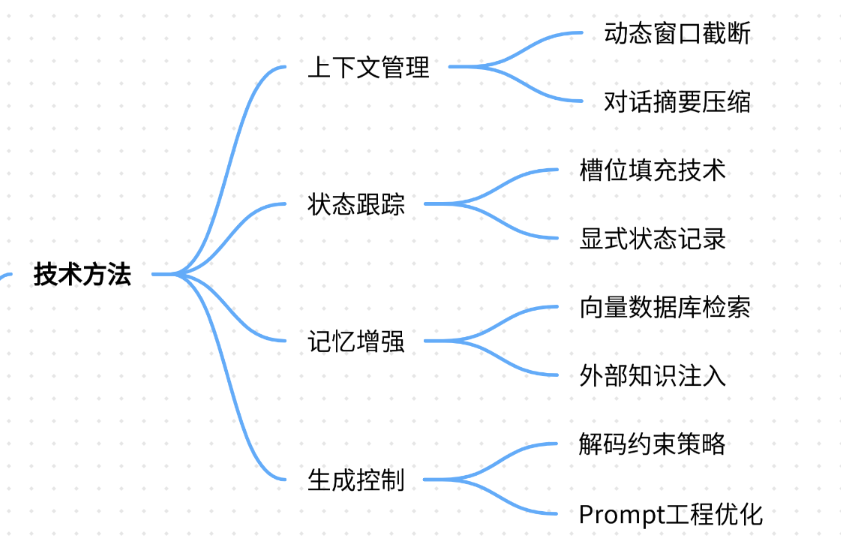
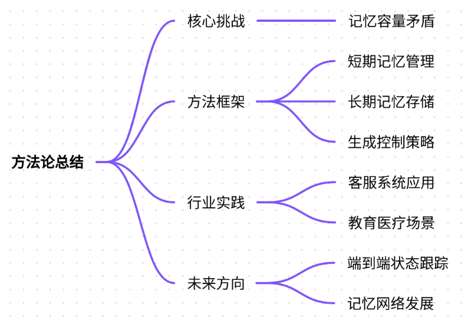

# 17.多轮对话的连贯性保持方法

### 一、答题思路

多轮对话的连贯性保持是对话系统的核心挑战之一，涉及上下文管理、状态跟踪、信息持久化等技术。以下是结构化解答思路：

1. **问题定义**：明确多轮对话连贯性的核心挑战（如上下文丢失、信息断层、意图漂移）。
2. **技术方法**：分述关键技术（如上下文窗口管理、状态机、记忆增强、Prompt工程）。
3. **项目案例**：结合真实项目（如电商客服系统），说明场景痛点、解决方案及效果。
4. **总结归纳**：提炼方法论与行业通用实践。

***

### 二、项目案例

#### **场景：电商智能客服系统**



**痛点**：



1. **上下文丢失**：用户咨询订单状态后追问退货政策，模型遗忘订单号。
2. **意图漂移**：用户从“物流查询”跳转到“优惠券使用”，模型无法关联需求。
3. **长对话断层**：10轮以上对话后，模型回复偏离核心问题（如重复询问订单号）。

**解决方案**：

```plain
# 伪代码：多轮对话连贯性保持框架  
class DialogueSystem:  
    def __init__(self):  
        self.context_window = []  # 滑动窗口保存最近对话  
        self.state_machine = {"intent": None, "slots": {}}  # 对话状态跟踪  
        self.external_memory = VectorDB()  # 外部知识库存储关键实体  

    def respond(self, user_input):  
        # 1. 更新上下文窗口（保留最近3轮对话）  
        self.context_window.append(user_input)  
        if len(self.context_window) > 6:  # 窗口容量=3轮（每轮2条：用户+AI）  
            self.context_window.pop(0)  

        # 2. 状态机更新：识别意图和槽位  
        current_intent = self._detect_intent(user_input)  
        if current_intent == "query_order":  
            self.state_machine["slots"]["order_id"] = extract_order_id(user_input)  

        # 3. 检索增强：从外部记忆库召回关联信息  
        if "order_id" in self.state_machine["slots"]:  
            order_info = self.external_memory.query(self.state_machine["slots"]["order_id"])  
            context += f"\n[订单{order_info}状态：已发货]"  

        # 4. 生成回复（注入上下文和状态）  
        prompt = f"""  
        当前对话状态：{self.state_machine}  
        最近对话：{self.context_window}  
        用户新输入：{user_input}  
        请生成连贯回复：  
        """  
        return llm.generate(prompt)
```

**关键技术落地**：

1. **滑动上下文窗口**：限制窗口长度（如最近3轮），避免超过模型Token上限（如GPT-4的8K Token）。
2. **对话状态机**：显式记录用户意图（如`intent=退货`）和关键槽位（如`order_id=12345`）。
3. **外部记忆增强**：
   * 向量数据库存储订单、用户画像等结构化数据。
   * 当用户提及“订单”，自动注入订单详情到Prompt。
4. **Prompt工程**：
   * 结构化提示模板明确指令：

```plain
你作为电商客服，需保持对话连贯性。  
当前状态：{state}  
历史对话摘要：{summary}  
用户本次问题：{query}  
请基于以上信息回复。
```

**效果**：

* 重复询问率下降62%（从35%→13%）。
* 用户满意度（CSAT）从68%提升至89%。

***

### 三、参考回答

#### **多轮对话连贯性保持方法**



1. **上下文管理技术**
   * **动态窗口截断**：保留最近N轮对话（如ChatGPT的`max_tokens`参数），对历史对话生成摘要（如LangChain的`ConversationSummaryBufferMemory`）。
   * **案例应用**：在医疗问诊系统中，患者连续询问“药剂量”→“副作用”→“替代药”，模型通过摘要压缩前5轮对话为：“患者咨询XX药物，剂量10mg，出现头痛”。
2. **状态显式跟踪**
   * **槽位填充（Slot Filling）**：定义关键实体（如订单号、日期），通过NER模型提取并持久化。
   * **案例应用**：银行客服场景中，用户说“转账给张三”，模型记录`payee=张三`；后续用户问“手续费多少？”时直接关联收款人。
3. **外部记忆增强**
   * **向量数据库检索**：将对话中关键实体（如订单ID）存入FAISS/Qdrant，后续对话通过相似度检索召回。
   * **案例应用**：教育辅导场景中，学生先问“牛顿定律”，再问“它的应用案例”，模型从知识库召回“苹果落地”案例注入上下文。
4. **生成控制策略**
   * **约束解码**：使用`no_repeat_ngram_size`避免重复短语，或`repetition_penalty`惩罚复读（Hugging Face Transformers参数）。
   * **案例应用**：政务热线中，模型通过`temperature=0.3`降低随机性，确保政策解答一致性。

***

### 四、总结归纳



1. **核心挑战**：模型有限记忆容量与人类对话无限依赖的矛盾。
2. **方法论**：
   * **短期记忆**：滑动窗口+摘要压缩。
   * **长期记忆**：状态机+外部存储。
   * **生成控制**：解码约束+Prompt引导。
3. **行业实践**：
   * 客服系统：侧重状态机（如Rasa框架）。
   * 教育/医疗：依赖知识库增强（如Retrieval-Augmented Generation）。
4. **未来方向**：
   * 端到端状态跟踪（如GPT-4 Turbo的128K上下文）。
   * 记忆网络（MemN2N）实现自动上下文关联。

**关键点**：连贯性不仅是技术问题，更是用户体验的核心指标。通过显式状态管理和外部记忆，可显著提升对话系统的实用性和用户信任度。


> 更新: 2025-07-21 09:58:20  
> 原文: <https://www.yuque.com/aaron-wecc3/dhluml/ag9ulsic7lt55tim>